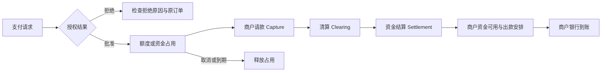

# 跨境数字支付机制导读

从一笔订阅理解授权、请款、清算、3DS、自动续费、退款，以及卡余额、交易所余额与链上资产。

整理与资料核验：**2026-11-01**。这是一份依据官方资料编写的学习素材。金额例子和练习均为构造案例；产品费用保留核验日期与适用卡种。没有执行真实支付、争议或链上转账，也没有测量各渠道成功率。

## 怎样用一个下午读这份材料

| 时间建议 | 阅读与练习 | 完成时应能回答 |
| --- | --- | --- |
| 约 40 分钟 | 第 1—4 节：参与者、交易阶段和余额变化 | 为什么额度减少了，商户却可能还没收到钱？ |
| 约 30 分钟 | 第 5—6 节：3DS、保存卡与自动续费 | 为什么验证通过、首笔能付，仍可能续费失败？ |
| 约 30 分钟 | 第 7—9 节：三种余额、链上交易和费用 | “提现成功”到底把资金移到了哪里？ |
| 约 20 分钟 | 第 10—12 节：迁移到实际问题，完成纸面练习 | 能否定位失败环节，并说明还缺什么证据？ |

这是两小时的读法建议。若有四小时，再打开文末对应原文，核对术语，并用自己已经发生的一笔消费填写记录；不需要为了学习额外消费。能解释某一节的机制，就可以跳过基础部分。

## 1. 先分清：谁在回答什么问题

付款时至少有五个不同的问题：

| 问题 | 对应机制或负责方 |
| --- | --- |
| 持卡人是否同意这次或未来的收费？ | 消费确认、保存卡与后续扣款协议 |
| 当前付款人是不是合法持卡人？ | 持卡人认证，例如 3DS |
| 这笔具体交易是否获准？ | 发卡行交易授权，以及商户/支付处理方的受理与风险判断 |
| 收款方应获得多少资金，资金何时转移？ | 请款、清算、资金结算与商户出款 |
| 订阅是否真的开通？ | 商户自己的订单与权益系统 |

这里两种“授权”尤其容易混淆。**持卡人同意商户以后扣费**是 consent/mandate；**发卡行批准某笔交易**是 authorization。前者成立，不能保证以后每一笔都获批。

典型银行卡支付还涉及几类参与者：

- **持卡人与发卡行（issuer）**：持卡人使用卡；发卡行管理卡账户并响应交易授权。
- **商户与收单侧（acquirer）**：商户销售服务，收单侧处理其银行卡收款。
- **支付处理方（PSP）**：提供支付接口、路由与相关服务；产品上可能同时封装多个角色。
- **卡组织/网络**：例如 Visa、Mastercard，连接发卡与收单体系。

这些角色不必各对应一家独立公司。卡产品入口的品牌，也不能单独证明哪家机构在发卡。各环节关系可对照 [Stripe 的交易清算与结算说明](https://stripe.com/zh-us/resources/more/clearing-vs-settlement-in-payments)。

## 2. 一笔钱的生命周期：五个阶段分别看

| 阶段 | 中文含义 | 这一阶段说明了什么 |
| --- | --- | --- |
| Authorization | 交易授权 | 发卡侧批准请求，通常形成资金或额度占用 |
| Capture | 请款、提交扣款 | 商户要求对已授权交易实际收款；有些产品译作“捕获” |
| Clearing | 清算 | 交换、核对交易资料并计算相关应收应付与费用 |
| Settlement | 资金结算 | 金融机构之间完成相应资金转移 |
| Payout | 商户出款 | 支付平台将商户可用余额转到商户指定银行账户 |



这是帮助理解常见银行卡流程的简图，实际实现可能合并步骤。图中没有把“订阅开通”放在银行到账之后：**权益是商户的另一条状态链**，可能依据其认可的支付事件提前开通，也可能因异步处理而延迟。

授权占用也不一定意味着现金已经离开账户。信用卡常表现为可用额度减少；借记卡或预付卡则可能表现为可用资金受限。商户若采用分离授权与请款，可以先保留金额，再在授权有效期内请款；未请款而到期，则需要释放占用。有效期受卡组织、交易类型和产品条件影响，不记一个通用“几天必退”的数字。[Stripe：分离授权与请款](https://docs.stripe.com/payments/place-a-hold-on-a-payment-method)

**清算核对应收应付，结算处理机构间资金，出款处理商户何时拿到可用资金。**它们有联系，时间点仍应分开。Stripe 的出款计划就不会改变待处理余额变为可用余额所需的时间。[Stripe：接收出款](https://docs.stripe.com/payouts)

银行或卡 App 的 `Pending`、`Completed`、`Posted` 是该产品的展示词，未必与上表一一对应。只看到“已扣款”，还不足以确定内部正在清算、结算还是仅占用额度。

## 3. 用 100 美元看懂“余额少了”

构造一个预付卡教学账本：起始有 100 美元，购买 80 美元服务，忽略费用、汇率与其他交易。这里人为分开“已入账余额”“占用金额”“可用余额”，不要求某个 App 必须展示这三列。

| 时刻 | 已入账余额 | 授权占用 | 可用余额 | 此时发生什么 |
| --- | --- | --- | --- | --- |
| 付款前 | 100 | 0 | 100 | 尚无这笔交易 |
| 授权 80 后 | 100 | 80 | 20 | 80 暂时不能再消费，不代表商户已获最终资金 |
| 分支 A：未请款，取消并完成释放 | 100 | 0 | 100 | 可用资金恢复；不必再有一笔“退款入账” |
| 分支 B：请款并完成卡侧入账 | 20 | 0 | 20 | 80 已作为支出入账 |
| 分支 B 后，再收到 10 的部分退款 | 30 | 0 | 30 | 新增一笔返还资金的结果 |

分支 A 与 B 是两种可能，不能把每一行相加。现实中，请款、占用释放和账单更新存在时间差，具体可用金额与展示方式以发卡侧为准。

遇到“没买成但余额少了”，先区分**占用、入账支出、已发起但未入账的退款**。它们对应的追踪对象和处理路径不同。上表是基于授权/请款机制构造的推演，不是某张卡的实际流水。[授权与请款依据](https://docs.stripe.com/payments/place-a-hold-on-a-payment-method)

## 4. 撤销、退款、争议：三种不同的后续动作

| 动作 | 常见情境 | 资金与记录的变化 |
| --- | --- | --- |
| 取消未请款授权，void / authorization reversal | 商户不再收取尚未请款的金额 | 请求释放原占用；账单可能不出现独立的退款收入 |
| 商户退款，refund | 已成功支付，商户返还全部或部分金额 | 针对原交易发起返还；需要分别跟踪提交、处理与发卡侧入账 |
| 交易争议、chargeback | 持卡人通过发卡行质疑原交易 | 进入卡组织争议流程，商户可能提交证据；不是商户普通退款，也不保证持卡人最终胜诉 |

另一个需要固定的用词是：**付款被拒（decline）**发生在尝试付款时；中文也常称“拒付”的 **chargeback** 属于后续争议。讨论错误时保留英文术语，能减少沟通歧义。

结算完成后仍可以有商户退款，不能把“结算”理解为“此后只能争议”。Stripe 的操作文档明确支持支付成功后的全额与部分退款，并解释了退款待处理和失败状态。[Stripe：退款与取消](https://docs.stripe.com/refunds)、[Stripe：争议](https://docs.stripe.com/disputes)

“商户同意退款”“处理方已提交”“发卡侧已入账”仍是不同进度。Stripe 的银行卡退款就可能因为商户可用余额不足而待处理；部分很快发起的退款还可能显示为原交易撤销。需要追踪时，可请商户提供可用的 ARN、STAN 或 RRN 等参考编号，再由相关机构核查；这些编号与链上交易哈希不是同一体系。[退款追踪与冲正说明](https://docs.stripe.com/refunds)

在 Stripe 的银行卡退款流程中，资金沿原支付方式退回，不能把退款任意改到另一张卡。这与卡平台把未消费余额退回资产账户属于不同操作。[退款目标账户](https://docs.stripe.com/refunds)

商户、处理方与具体卡产品可能各有费用。不能把某个平台取消付款免费，推广成持卡人所有撤销、退款或争议都免费。

## 5. 3DS：验证持卡人，不保证所有后续结果

**3DS（3-D Secure）处理的是无卡交易中的持卡人认证。**商户与发卡侧交换交易、支付方式和设备等信息，帮助判断当前付款人是否为合法持卡人。Visa Secure、Mastercard Identity Check 等是相应品牌名，不是卡背面的 CVV。[EMVCo：3DS 概览](https://www.emvco.com/emv-technologies/3-d-secure/)、[Stripe：3DS](https://docs.stripe.com/payments/3d-secure)

常见体验有两种：

- **Frictionless，无额外挑战的流程**：根据已有信息完成认证，持卡人未必看到短信或弹窗。
- **Challenge，追加交互的流程**：要求验证码、银行 App 确认、生物识别等。

因此，没有验证码不能证明没有认证。认证通过后，系统仍要继续尝试交易授权与支付，最终结果可能是成功、等待请款或付款方式失败。[Stripe：3DS 认证流程](https://docs.stripe.com/payments/3d-secure/authentication-flow)

浏览器变化可能影响页面、跳转、弹窗或钱包的交互，某次换 Safari 后买卡成功是一个局部观察。它不能证明浏览器能够解除另一商户的拒绝、修复 App Store 购买账户，或保证续费。

## 6. 为什么首笔能付，自动续费仍要单独观察

### 保存卡、同意扣费与真正扣款

保存支付方式可以先不创建扣款。商户还需要取得未来使用、扣款频率和金额确定方式等方面的许可。由此可见，绑卡成功只是一个阶段，不能替代一笔真实订阅付款。[Stripe：SetupIntents](https://docs.stripe.com/payments/setup-intents)

### 两组概念，不要直接画等号

| 维度 | 两类情况 | 主要在问什么 |
| --- | --- | --- |
| 客户是否处于可交互的支付会话 | on-session / off-session | 客户现在能否响应结账或认证？ |
| 交易发起与卡组织分类 | CIT / MIT，客户发起 / 商户发起 | 这次交易依据什么参与与授权关系发起？ |

自动续费常涉及 off-session 和 MIT，但两组术语并不等价。Stripe 的当前授权文档特别说明：分类还取决于持卡人参与信号，不能只看 `off_session` 参数，例如包含 CVC 的请求可能仍按 CIT 分类。消费者也不应凭一张结账截图推断后台分类。[交易分类说明](https://docs.stripe.com/payments/place-a-hold-on-a-payment-method)

### 后续认证和恢复入口

正确为后续用途保存支付方式，可以降低续费时的认证阻力；银行仍可能要求客户回来完成认证。所以，首笔成功后要留下下次账单与恢复入口。续费失败时先查原订阅账单和所需操作，不直接再购买一份相同套餐。[后续用途与认证恢复](https://docs.stripe.com/payments/setup-intents)

付款结果、资金状态和权益状态也分别记录。一张有效卡加足够余额，只覆盖了其中一部分条件。

## 7. 三种余额：单位、控制方和退出路径分别是什么

| 位置 | 界面数字主要表示什么 | 谁控制相关操作 | 下一步实际移到哪里 |
| --- | --- | --- | --- |
| 预付卡余额 | 具体卡项目可用于消费的余额，可能以美元计价 | 发卡侧及卡服务平台，依项目设计而定 | 消费给商户，或按产品规则退回指定平台账户 |
| 交易所/托管平台余额 | 平台为账户记载的资产，例如 USDT | 平台控制托管与账户操作，用户通过账户提交请求 | 内部划转、卡充值，或在允许的网络上提币 |
| 自托管钱包对应的链上资产 | 链及代币合约状态所记录的资产 | 由相应私钥或签名权限控制链上操作 | 通过网络交易转移或与合约交互 |

**钱包软件管理访问与签名能力，资产状态记录在链上。**交易所账户登录权和自托管签名权不是同一种控制关系。这里按基础托管模型理解；具体产品的控制、恢复及法律安排仍需看其文档。[Coinbase：交易所与自托管钱包](https://help.coinbase.com/en-ca/coinbase/getting-started/crypto-education/exchanges-self-custody-wallets)、[Ethereum：交易](https://ethereum.org/developers/docs/transactions/)

签名权决定谁能发起相应交易，交易执行仍受网络和合约规则约束；持有链上资产也不自动建立法币退出渠道。

一个以稳定币支持的预付卡产品，可以是下面这样的结构：

```text
平台 USDT 余额
    → 按报价转换并充值
卡项目的美元可用余额
    → 经过银行卡支付网络
商户的订阅账单
```

此时最终商户走的是银行卡收款；不能因为资金最初是 USDT，就认定每次刷卡都会产生一笔 USDT 链上转账。反过来，直接转加密资产给售卡商，又是另一条支付路径。

**卡余额退回平台**也不等于**回到人民币银行卡**。例如 Gate 的余额取回公告描述的是卡余额按报价转成 USDT、回到 Gate 现货账户；它没有把后续平台提币、兑换或法币退出合并为一步。[Gate：余额取回公告](https://www.gate.com/ja/announcements/article/101132)

## 8. 有交易哈希，为什么还不能宣布全链到账

链上交易从签名、广播、待处理，到进入区块及后续确认，有自己的状态过程。Ethereum 的交易文档也区分生成交易哈希、进入待处理池、被区块收录和最终确定；**哈希存在本身不等于交易已经完成**。[Ethereum：交易生命周期](https://ethereum.org/developers/docs/transactions/)

收款方若是一个平台，还存在平台识别与记账这一步。这是“链上状态＋平台账户”两套记录的结构性区别，不能把链上成功直接等同于平台已记入个人可用余额。

读一笔已有交易时，可以按下面的对象对应关系检查：

| 检查对象 | 要弄清什么 |
| --- | --- |
| 网络与资产 | 是哪条链、哪种资产；不能只凭 USDT 名称或地址外观判断 |
| 交易状态 | 只是已广播，还是已被收录并成功执行？ |
| 目标与金额 | 目标地址及实际转移资产是否符合接收要求？ |
| 平台记录 | 对应的是充值、提币、卡入金还是商户订单，账户是否已记账？ |

链上网络费、交易所提币费、兑换价差、卡充值费属于不同位置。例如以太坊交易执行需要 gas；交易所代为发送时，面向用户展示的又可能是平台提币费。一次平台内部划转则未必需要链上交易。不要为了让费用表“完整”而虚构一笔网络费。

## 9. 算费用前，先把“从哪到哪”写出来

对一笔订阅分开记四层：

1. 用人民币实际取得多少可用资产。
2. 从平台资产换成多少卡余额，净额是多少。
3. 商户最终收取什么币种、金额及附加费用。
4. 未用余额若需退出，实际退到哪个账户、还需经过什么环节。

构造一个算费例子：投入 100 USDT，假设兑换价为每 USDT 1 美元，充值费 0.9% **从充值金额中扣除**，忽略其他费用。净入卡为 99.10 美元；要净得到 100 美元，则需要：

$$
\text{投入 USDT}=\frac{100}{1\times(1-0.009)}\approx100.91
$$

公式是教学假设。若平台另行加收费用、报价已含费用或使用其他兑换价，就按当次净到账重算。USDT 和 USD 必须保留不同单位，不能默认报价永远为 1。

2026-11-01 核对的 [Gate AI Elite 费率页](https://www.gate.com/ja/help/gatecard/gc7/100745)列后续充值 0.9%、首笔 10 USDT 免充值费、退款费 2%；[余额取回公告](https://www.gate.com/ja/announcements/article/101132)另列卡余额取回费 0.9%。这几项对应不同动作，不能合成一句“免费充值提现”，也不能推广到所有 Gate 卡或其他卡产品。原消费手续费和退款费用也可能不同，预算应分别看实际条款与流水。

## 10. 回到一个熟悉的问题：官网买卡成功，App Store 却受限

把“用银行卡在官网买礼品卡，之后购买侧受限；改用另一张卡在目标服务官网付款成功”拆开，可得到四项独立观察：

| 观察 | 当前支持的判断 | 尚不能判断 |
| --- | --- | --- |
| 官网购卡成功 | 售卡商受理了该笔购买 | 礼品卡是否交付、是否兑换、购买账户是否可继续使用 |
| App Store 购买侧受限 | 购买侧存在账户问题 | 不能直接写成整个 Apple 账号或 iCloud 被封 |
| 目标服务官网另一卡付款成功 | 新的卡与账单入口组合可用 | 原路线为何失败、另一服务是否也受理 |
| 首笔订阅已扣款 | 首笔消费取得实质进展 | 后续自动续费及长期费用仍需观察 |

Apple 官方分别处理安全原因锁定、账号 locked/not active 和 Media & Purchases disabled，不能将“风控”当作一种统一错误。[Apple：账户限制类型](https://support.apple.com/en-us/102640)

这里的分析方法是：**先指出观察属于哪个系统、哪个阶段，再提出需要核验的解释。**更换浏览器能改变当前交互，不足以说明账户已恢复；改用官网直付会改变账单路径，也不足以单独证明是哪张卡决定了原来的结果。个人案例与完整探索记录见[跨境数字服务接入](../../Notes/跨境数字服务接入.md#支付探索复盘历史结果失败环节与路线取舍)。

## 11. 一张不含秘密的付款观察卡

在本人保存的账单上核对，不把卡号、CVV、验证码、密钥、礼品卡码或完整支付凭据放进公开笔记。

```yaml
observed_at: "日期与时区"
merchant_and_product: "商户、实际套餐、币种和金额"
billing_route: "官网刷卡 | 钱包 | App Store 内购 | 加密资产付款"
payment_instrument: "卡项目或资金账户类型，不填卡号"
identifiers: "本地订单/交易别名，便于对应原凭据"
customer_action: "本次购买 | 保存卡 | 自动续费 | 取消 | 退款 | 争议"
authentication: "已观察到挑战 | 未观察到挑战 | 未知"
authorization_and_posting: "明确的批准/拒绝、占用及入账状态；没有则写未知"
merchant_order: "原订单状态、发票或退款进度"
entitlement: "实际服务权益与一次功能验证结果"
funding_and_fees: "资金从哪到哪、各阶段净额与单位、实际费用"
next_step: "原账单恢复/核查入口、续费日或需要查询的具体环节"
```

这是一张观察卡，不是必须从消费者界面填满的协议记录。看不到 Capture 或结算状态时就保留未知，不根据 `Pending` 猜出全部后台过程。原始凭据由本人保存，公开部分仅保留脱敏结论。

## 12. 纸面自测：先回答，再看解析

1. 100 美元预付卡授权 80 美元，商户尚未请款。可用余额只有 20，能否证明商户已经收到 80？
2. 一次购买没有收到短信验证码，能否证明没有走 3DS？
3. 3DS 已通过，但付款被拒。一定是支付系统相互矛盾吗？
4. 卡已保存、首笔订阅成功，下个月余额也足够。自动续费是否必然成功？
5. 商户说已退款，但银行没有一笔“退款收入”。除了没有退款，还可能是什么情况？
6. 卡余额已退回交易所 USDT 账户，是否等于人民币已回到银行卡？
7. 提币页面出现交易哈希，能否证明收款平台已经记账？
8. 同一个人换卡并改用商户官网后付款成功，能否确定原来失败只是旧卡的问题？

<details>
<summary>参考解析</summary>

1. 不能。它可以只是授权占用；商户未请款而完成取消/释放后，可用资金还可能恢复。
2. 不能。认证可能通过 frictionless 流程完成；也可能确实没有要求 3DS，需要对应记录区分。
3. 不矛盾。持卡人认证与交易授权、商户受理是不同判断。
4. 不必然。保存用途、后续分类与认证、商户及发卡侧状态仍可能影响结果；需要原订阅的恢复路径。
5. 可能尚在处理，也可能以撤销形式移除了原交易。需核对原交易、退款状态和可用参考编号，不能仅看有没有新收入行。
6. 不等于。资金回到的是平台资产账户，后续退出是另一条链。
7. 不能。还要检查交易执行与确认，以及收款平台的识别、账户映射和入账。
8. 不能。卡与账单路径同时变化，只能确认新组合在本次有效，尚未分离原失败原因。

</details>

## 一手来源与实际读取范围

本文的三部分共同服务于一个学习目标：解释一笔订阅从资金准备到后续处理的全过程。下列文档用于逐节核验，按问题选读即可，无需把每个链接都作为额外必读任务。

| 来源 | 本次实际核对范围 |
| --- | --- |
| [Stripe：Clearing vs settlement](https://stripe.com/zh-us/resources/more/clearing-vs-settlement-in-payments) | 清算、结算、参与者与出款时间的相关正文；退款具体操作另依退款文档，未将概述文章的简化表述当作完整协议 |
| [Stripe：Separate authorization and capture](https://docs.stripe.com/payments/place-a-hold-on-a-payment-method) | 授权、请款、取消、有效期差异与 CIT/MIT 参与信号；未执行 API |
| [Stripe：Payouts](https://docs.stripe.com/payouts) | 可用余额、出款计划与结算周期的相关段落；不作为各国开户资格清单 |
| [Stripe：Refunds](https://docs.stripe.com/refunds) | 退款/取消、待处理与失败、冲正和参考编号；未执行退款 |
| [Stripe：Disputes](https://docs.stripe.com/disputes) | 争议入口与卡组织处理概览；未逐一审查各网络原因代码 |
| [EMVCo：3DS](https://www.emvco.com/emv-technologies/3-d-secure/) | 公开概览与技术目的；未读订阅访问的规范或将草案当已部署版本 |
| [Stripe：3DS](https://docs.stripe.com/payments/3d-secure)、[Authentication flow](https://docs.stripe.com/payments/3d-secure/authentication-flow) | 认证、frictionless/challenge、认证后继续授权的流程；未审计全部 SDK 或旧版本兼容分支 |
| [Stripe：SetupIntents](https://docs.stripe.com/payments/setup-intents) | 保存支付方式、持卡人许可、on/off-session 与后续认证恢复 |
| [Coinbase：Exchanges and self-custody wallets](https://help.coinbase.com/en-ca/coinbase/getting-started/crypto-education/exchanges-self-custody-wallets) | 公开说明正文；仅取托管/自托管区别，不推定任何读者具备产品开户资格 |
| [Ethereum：Transactions](https://ethereum.org/developers/docs/transactions/) | 交易、签名、费用、合约交互及生命周期相关段落；未运行示例或推广以太坊细节至所有链 |
| [Gate：AI Elite / Essential fees](https://www.gate.com/ja/help/gatecard/gc7/100745)、[卡余额取回](https://www.gate.com/ja/announcements/article/101132) | 对应费率表及卡余额回平台的公告；未登录账户复核具体用户协议或实际净到账 |
| [Apple：Account locked, not active, or disabled](https://support.apple.com/en-us/102640) | 不同限制类型及恢复入口；未读取任何个人账号后台 |

本文不把官方文档里的产品设计、作者的教学推演和个人实测合并为同一种证据。学习完成的判据是能解释上面的案例和未知，而非仅记住某个平台目前可以付款。
