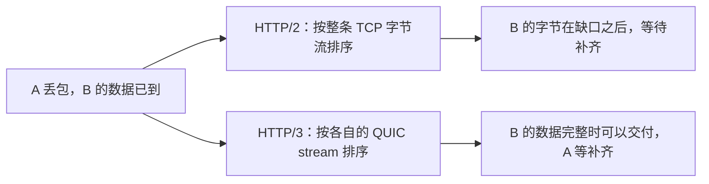

### Stanford CS144
* [CS144视频（b站）](https://www.bilibili.com/video/BV1wt41167iN?from=search&seid=12807244912122184980)
* [CS144课程网站（包括Pdf、Lab）](https://cs144.github.io/)
* [我的CS144 Lab笔记](https://github.com/huangrt01/CS-Notes/blob/master/Notes/Output/Computer-Networking-Lab-CS144-Stanford.md)

[toc]

##### 1-0 The Internet and IP Introduction
internet layer: Internet Protocol, IP address, packet's path

彩蛋：世一大惺惺相惜


用`ping`和`traceroute`看IP地址; 光纤2/3光速，8637km -> RTT=86ms

> [It's the Latency, Stupid](http://www.stuartcheshire.org/rants/latency.html)

- The distance from Stanford to Boston is 4320km.

- The speed of light in vacuum is 300 x 10^6 m/s.

- The speed of light in fibre is roughly 66% of the speed of light in vacuum.

- The speed of light in fibre is 300 x 10^6 m/s * 0.66 = 200 x 10^6 m/s.

- The one-way delay to Boston is 4320 km / 200 x 10^6 m/s = 21.6ms.

- The round-trip time to Boston and back is 43.2ms.

- The current ping time from Stanford to Boston over today's Internet is about 85ms:

  ```
  [cheshire@nitro]$ ping -c 1 lcs.mit.edu
  PING lcs.mit.edu (18.26.0.36): 56 data bytes
  64 bytes from 18.26.0.36: icmp_seq=0 ttl=238 time=84.5 ms
  ```

- So: the hardware of the Internet can currently achieve within a factor of two of the speed of light.


##### 1-1 A day in the life of an application
* Networked Applications: connectivity, bidirectional and reliable data stream
* Byte Stream Model: A - Internet - B, server和A、B均可中断连接
* World Wide Web (HTTP: HyperText Transfer Protocol)
  * request: GET, PUT, DELETE, INFO, 400 (bad request) 
  * GET - response(200, OK)  , 200代表有效
  * document-centric: "GET/HTTP/1.1", "HTTP/1.1 200 OK \<contents of the index.html\>"
* BitTorrent: peer-to-peer model
  * breaks files into "pieces" and the clients join and leave "swarms" of clients
  * 先下载 torrent file -- tracker 存储 lists of other clients
  * dynamically exchange data
* Skype: proprietary system, a mixed system
  * two clients： A -- (Internet + Rendezvous server) -- NAT -- B
  
  * NAT(Network Address Translator): 连接的单向性，使得A只能通过Rendezvous server询问B是否直连A =>reverse connection
  
  * Rendezvous server
  
  * 如果模式是A -- NAT-- (Internet + Rendezvous server) -- NAT -- B，Skype用Relay来间接传递信息


##### 1-2 The four layer Internet model


4 layer: 利于reuse

Internet: end-hosts, links and routers
* Link Layer: 利用 link 在 end host和router 或 router和router之间 传输数据, hop-by-hop逐跳转发
  * e.g. Ethernet and WiFi
* Network Layer: datagrams, Packet: (Data, Header(from, to))
  * packets可能失去/损坏/复制，no guarantees
  * must use the IP
  * may be out of order
* Transport Layer: TCP(Transmission Control Protocol) 负责上述Network层的局限性，controls congestion  
  * sequence number -> 保序
  * ACK(acknowledgement of receipt)，如果发信人没收到就resend
  * 比如视频传输不需要TCP，可以用UDP(User Datagram Protocol),不保证传输
* Application Layer

two extra things
* IP is the "thin waist"   ,这一层的选择最少
* the 7-layer OSI Model


##### 1-3 The IP Service
* Link Frame (IP Datagram(IP Data(Data, Hdr), IP Hdr), Link Hdr )
* The IP Service Model的特点
  * Datagram: (Data, IP SA, IP DA)，每个 router 有 forwarding table，类比为 postal service 中的 letter
  * Unreliable: 失去/损坏/复制，保证只在必要的时候不可靠（比如queue congestion）
  * **Best-effort** attempt
  * Connectionless : no per-flow state, mis-sequenced
* IP设计简单的原因
  * minimal, faster, streamlined
  * end-to-end (在end points implement features)
  * build a variety of reliable/unreliable services on top
  * works over any link layer

* the IP Service Model
  1. tries to prevent packets looping forever (实现：在每个datagram的header加hop-count field: time to live TTL field, 比如从128开始decrement)
  2. will fragment packets if they're too long (e.g. Ethernet, 1500bytes)
  3. header checksum：增强可靠性
  4. allows for new versions of IP
  5. allows for new options to be added to header (由router处理新特性，慎重使用)

##### 1-4 A Day in the Life of a Packet
* 3-way handshake
  1. client: SYN 
  2. server: SYN/ACK
  3. client: ACK
* IP packets
  * IP address + TCP port (web server通常是80)
  * hops, Routers: wireless access point (WiFi的第一次hop)
  * forwarding table
  * default router

##### 1-5 Principle: Packet switching principle
packet: self-contained

packet switching: independently for each arriving packet, pick its outgoing link. If the link is free, send it. Else hold the packet for later.

source packet: (Data, (dest, C, B, A))  发展成只存destination，每个switch有table

two consequences
* simple packet forwarding: No per-flow state required，state不需要store/add/remove
* efficient sharing of links: busty data traffic; statistical multiplexing => 对packet一视同仁，可共享links

##### 1-6 Principle: Layering

* 一种设计理念，layers are functional components, they communicate sequentially 
* edit -> compile -> link -> execute
  
  * compiler: self-contained, e.g. lexical analysis, parsing the code, preprocessing declarations, code generation and optimization
* 有时需要 break layering
  * 比如Linux内核的部分代码C语言直接用汇编 => code不再layer-independent
  * a continual tension to improve the Internet by making cross-layer optimizations and the resulting loss of flexibility. e.g. NATs=>很难加其它类型的传输层
  * epoll这个接口是linux独有的，FreeBSD里是kqueue
  * UDP header 的 checksum 计算用到 IP header
  
* layering的原因：1.modularity 2.well defined service 3.reuse 4.separation of concerns 5.continuous improvement 6.p2p communications

##### 1-7 Principle: Encapsulation

* TCP segment is the **payload** of the IP packet. IP packet encapsulates the TCP segment.

* 一层层，套footer和header

    * 两种写法，底层的写法(switch design)header在右边，software的写法(protocol)header在左边（IETF）
    * VPN: (Eth, (IP, (TCP, (TLS, IP Packet))))，外层的TCP指向VPN gateway

##### 1-8 Byte Order
* 2^32 ~ 4GB ~  0x0100000000
* 1024=0x0400	大端：0x04 0x00；小端: 0x00 0x04. 
* Little endian: x86, big endian: ARM, network byte order
* e.g. `uint16_t http_port=80; if(packet->port==http_port){...}` IPv4的packet_length注意大小端
* 函数：`htons(),ntohs(),htonl(),ntohl()`
  * host/network, short/long
  * `#include<arpa/inet.h>`

##### 1-9 IPv4 addresses

goal:
* stitch many different networks together
* need network-independent, unique address

IPv4:
* layer 3 address
* 4 octets  a.b.c.d
* 子网掩码netmask: 255.128.0.0 前9位，1越少网络越大，same network不需要路由，直接link即可


IPv4 Datagram
* Total Packet Length: 大端，最多65535bytes, 1400 -> 0x0578
* Protocol ID: 6->TCP

Address Structure
* network+host
* class A,B,C: 0,7+24; 10, 14+16; 110, 21+8

Classless Inter-Domain Routing (CIDR，无类别域间路由)
* address block is a pair: address, count
* counts是2的次方? 表示netmask长度
* e.g. Stanford 5/16 blocks `5*2^(32-16)`
* 前缀聚合，防止路由表爆炸
* IANA(Internet Assigned Numbers Authority): give /8s to RIRs

##### 1-10 Longest Prefix Match(LPM)
forwarding table: CIDR entries
* LPM的前提是必须先match，再看prefix
* default: 0.0.0.0/0

##### 1-11 Address Resolution Protocol(ARP)
IP address(host) -> link address(Ethernet card, 48bits)

Addressing Problem: 一个host对应多个IP地址，不容易对应
* 解决方案：gateway两侧ip地址不同，link address确定card，network address确定host
* 这有点历史遗留问题，ip和link address的机制没有完全地分离开，decoupled logically but coupled in practice
* 对于A，ip的目标是B，link的目标是gateway

**ARP，地址解析协议**：由IP得到MAC地址 => 进一步可得到gateway address
* 是一种request-reply protocol
* nodes cache mappings, cache entries expire
* 节点request a link layer broadcast address，然后收到回复，回复的packet有redundant data，看到它的节点都能生成mapping
* reply：原则上unicast，只回传给发送者=>实际实现时更常见broadcast
* No "sharing" of state: bad state will die eventually
* MacOS中保留20min
* gratuitous request: 要求不存在的mapping，推销自己


e.g. 

hardware:1(Ethernet)

protocol: 0x0800(IP)

hardware length:6 (48 bit Ethernet)

protocol length:4(32 bit IP)

opcode: 1(request) /2(reply)

Destination: broadcast (ff:ff:ff:ff:ff:ff)

##### 1-12 recap

##### 1-13 SIP, Jon Peterson Interview
the intersection between technology and public policy
* IETF ( The Internet Engineering Task Force)
* ICANN（The Internet Corporation for Assigned Names and Numbers）

SIP（Session Initiation Protocol，会话初始协议）
* end-to-end的设计
* soft switching: 将呼叫控制功能从传输层分离
* PSTN ( Public Switched Telephone Network ) -> VOIP(Voice over Internet Protocol): telephony replacement

SIP的应用场景
* Skype内部协议转换成SIP
* VOIP, FiOS( a telecom service offered over fiber-optic lines)

现代技术
* SDN (Software Defined Network)
* I2RS(interface to the routing system)
* CDN(Content Delivery Network): 1.express coverage areas 2.advertise services that they provide, in order to allow collaboration or peering among CDNs => optimal selections of CDNs
* 识别robo calling

##### 2-0 Transport (intro)

* 关注TCP的correctness
* detect errors的三个算法：checksums, cyclic redundancy checks, message authentication codes
* TCP(Transmission Control Protocol)、UDP(User Datagram Protocol)、ICMP(Internet Control Message Protocol)

##### 2-1 The TCP Service Model
**The TCP Service Model**

* reliable, end-to-end, bi-directional, in-sequence, bytestream service
  * Positive acknowledgement with retransmission
  * Peer TCP layers communicate: connection
  * 传输层方面，由于链路层带宽大增，TCP window scale option 被普遍使用，另外 TCP timestamps option 和 TCP selective ack option 也很常用

* Flow control using sliding window (包括 Nagle 算法等)
  * 提高吞吐量，充分利用链路层带宽
  * tcp connection互不感知，缺少对网卡带宽的统筹安排
  * 原来设计 TCP 的时候，人们认为丢包通常是拥塞造成的，这时应该放慢发送速度，减轻拥塞；无线网中，丢包可能是信号太弱造成的，这时反而应该快速重试，以保证性能

* congestion control
  * 防止过载造成丢包
  * 包括 slow start、congestion avoidance、fast retransmit 等


**过程**：三次握手和四次挥手（参考2-6的状态转移图理解）

**Techniques to manufacture reliability**

Remedies
* Sequence numbers: detect missing data
* Acknowledgments: correct delivery
  * Acknowledgment (from receiver to sender)  
  * Timer and timeout (at sender)
  * Retransmission (by sender)
* Checksums/MACs: detect corrupted data
  * Header checksum (IP)
  * Data checksum (UDP)
* Window-based Flow-control: prevents overrunning receiver
* Forward error correction (FEC)
* Retransmission
* Heartbeats

Correlated failure

TCP/DNS

Paradox of airplanes


**The TCP Segment Format**


* [IANA port number](https://www.iana.org/assignments/service-names-port-numbers/service-names-port-numbers.xhtml): ssh 22, smtp 23, web 80
* source port: 初始化用不同的port避免冲突
* Flags
  * PSH flag: push，比如键盘敲击
  * URG应该在ACK前面
* HLEN 和 (TCP options) 联系


五个部分，104bit

唯一性
* 要求source port initiator每次increment: 64k new connections
* TCP picks ISN to avoid overlap with previous connection with same ID, 多一个域，增加随机性
* ISN的意义在于：1）security，避免自己的window被overlap 2）便于filter out不同类型的包  


##### 2-2 UDP service model
不需要可靠性：app自己控制重传，比如早期版本的NFS (network file system)


* Checksum 对于 IPv4 可选，可以为全0
* Checksum 用了 IP header，违背 layering principle，是为了能detect错传
* UDP header 有 length 字段，而TCP没有，因为TCP对空间要求高，用隐含的方式计算 length
* port demultiplexing, connectionless, unreliable

**应用**

DNS: domain name system，因为request全在单个datagram里

DHCP: Dynamic Host Configuration Protocol
* new host在join网络时得到IP
* 连WiFi

对重传、拥塞控制、in-sequence delivery 有 special needs 的应用，比如音频，但现在UDP不像以前用的那么多，因为很多是http，基于TCP。

##### 2-3 The Internet Control Message Protocol (ICMP) Service Model
report errors and diagnoise problems about network layer

网络层work的三个因素：IP、Routing Tables、ICMP


Message的意义见RFC 792

应用于ping：先发送8 0( echo request)，再送回0 0(echo reply)

应用于traceroute: 
* 核心思想：连续发送TTL从1开始递增的UDP，期待回复的11 0(TTL expires)
  * Source is random and different for each; destination starts with a random number and increases by one for each
* 由于路由选择问题，traceroute 无法保证每次到同一个主机经过的路由都是相同的。
* traceroute 发送的 UDP 数据报端口号是大于 30000 的。如果目的主机没有任何程序使用该端口，主机会产生一个 3 3(端口不可达) ICMP报文给源主机。

##### 2-4 End-to-End Principle
**Why Doesn't the Network Help?**
* e.g.：压缩数据、Reformat/translate/improve requests、serve cached data、add security、migrate connections across the network
* end-to-end principle: function的正确完整实现只依赖于通信系统的end points

end-to-end check 
* e.g. File Transfer: link layer的error detection只检测transmission错误，不检测error storage
* e.g. TCP小概率会出错（stack）、BitTorrent
* wireless link相比wire link功能复杂，可靠性低，所以在link layer重传，可提升TCP性能
* RFC1958: "strong" end to end: 不推荐在 middle 实现任何功能，比如在 link layer 重传，假定了reliabilty的提升值得latency的牺牲

##### 2-5 Error Detection: 3 schemes: 3 schemes

* detect errors的三个算法：checksums, CRC(cyclic redundancy checks), MAC(message authentication codes)
* 增补方式
  * append: ethernet CRC, TLS MAC
  * prepend: IP checksum
* Checksum (IP, TCP)
  * not very robust, 只能检1位错
  * fast and cheap even in software
  * IP, UDP, TCP use one's complement算法：16-bit word packet求和，进位加到底部，再取反码（特例：0xffff -> 0xffff，因为在TCP，checksum field 为 0 意味着没有 checksum）
* CRC: computes remainder of a polynomial (Ethernet)，见[通信与网络笔记](https://github.com/huangrt01/CS-Notes/blob/master/Notes/%E9%80%9A%E4%BF%A1%E4%B8%8E%E7%BD%91%E7%BB%9C.md)
  * 通常是由网卡硬件完成的，在发包的时候由硬件填充 CRC，在收包的时候网卡自动丢弃 CRC 不合格的包
  * 虽然more expensive，但支持硬件计算
  * 可对抗2 bits error、奇数error、小于c bits的突发错(burst)
  * 可incrementally计算
  * e.g. USB(CRC-16): $\bf{M} = 0x8005 = x^{16}+x^{15}+x^2+1$，对于generator需要给左边pad 1
* MAC: message authentication code: cryptographic transformation of data(TLS)
  * robust to malicious modifications, but not errors
  * 检错能力有局限，受随机性影响，不如CRC，no error detection guarantee
  * $c=MAC(M,s)$，M + c意味着对方有secret或者replay
  * 对于replay，`ctr++`, 具体见[我的密码学笔记](https://github.com/huangrt01/CS-Notes/blob/master/Notes/Output/Security-Privacy-Cryptography.md)的TLS部分【目前尚未整理】
##### 2-6 Finite State Machines


* 非常规路线的处理：比如对于第二个SYN或者FIN信号，接收机选择忽视，具体见`bool TCPReceiver::segment_received(const TCPSegment &seg)`的实现

##### 2-7 Flow Control I: Stop-and-Wait
* 核心是 receiver 给 sender 反馈，让sender不要送太多 packets
* 基本方法
  * 方案一：stop and wait
  * 方案二：sliding window

**stop and wait**
* flight 中最多一个 packet
* 针对 ACK Delay（收到ACK的时间刚好在timeout之后）的情形，会有duplicates
  * 解决方案：用一个1-bit counter 提供信息
  * assumptions：1）网络不产生重复packets；2）不delay multiple timeouts


##### 2-8 Flow Control II: Sliding Window
* Stop-and-Wait的性能：RTT=50ms, Bottleneck=10Mbps, Ethernet packet length=12Kb => 性能(2%)远远不到瓶颈
* Sliding Window计算Window size填满性能

**Sliding Window Sender**

* Every segment has a sequence number (SeqNo)
* Maintain 3 variables
  * Send window size(SWS)
  * Last acknowledgment(LAR)
  * Last segment sent(LSS)
* Maintain invariant: $(LSS - LAR) \leq SWS$
* Advance LAR on new acknowledgement 
* Buffer up to SWS segments

**Sliding Window Receiver**
* Maintain 3 variables
  * Receive window size(RWS)
  * Last acceptable segment(LAS)
  * Last segment received(LSR)
* Maintain invariant: $(LAS - LSR) \leq RWS$
* 如果收到的packet比LAS小，则发送ack
  * 发送cumulative acks: 收到1, 2, 3, 5，发送3
  * TCP acks are next expected data，因此要加一，上个例子改为4，初值为0

**RWS, SWS, and Sequence Space**
* $RWS \geq 1, SWS \geq 1, RWS \leq SWS$
* if $RWS = 1$, "go back N" protocol ,need SWS+1 sequence numbers (需要多重传)
* if $RWS = SWS$, need 2SWS sequence numbers
* 通常需要$RWS+SWS$ sequence numbers：考虑临界情况，SWS最左侧的ACK没有成功发送，重传后收到了RWS最右侧的ACK

**TCP Flow Control**

* Receiver advertises RWS using window field
* Sender can only send data up to LAR+SWS

##### 2-9 Retransmission Strategies
protocol可能的运转方式 (ARQ: automatic repeat request)
* Go-back-N: pessimistic，重传ack, ack+1, ack+2 ...
  * e.g. RWS=1的情形
* Selective repeat: optimistic，重传ack, last_sent, last_sent+1, ...
  * e.g. RWS=SWS=N的情形
  * 对burst of losses效果不好

##### 2-10 TCP Header


* pseudo header：类似2-2，checksum的计算囊括了IP header
* ack: 如果是bi-directional，也携带data信息；如果是uni-directional，好像不携带
* URG: urgent, PSH: push
* ACK: 除了第一个packet SYN，其它seg的ACK都置换为1  
* RST: reset the connection
* urgent pointer：和URG联系，指出哪里urgent

##### 2-11 TCP Setup and Teardown

###### 握手与两个监听队列

普通三次握手（3-way handshake）由 active opener 发 `SYN` 和初始序号（initial sequence number），passive opener 回 `SYN+ACK` 和自己的序号，前者再回 `ACK`。序号给后续字节定位，TCP 也支持双方同时主动打开（simultaneous open）。带数据的 TCP 段可以只有 1 字节数据。SSH 单次按键是短写的例子，实际发送大小还取决于应用封装和缓冲。 [RFC 9293，Establishing a Connection](https://www.rfc-editor.org/rfc/rfc9293.html#section-3.5)

| Linux 监听阶段 | 当前在等什么 | 从哪里看容量 |
| --- | --- | --- |
| SYN queue（半连接队列） | 普通握手已收到 SYN，等待握手完成。 | 半连接请求的上限看每监听 socket 的 `net.ipv4.tcp_max_syn_backlog`，启用 SYN cookies 时的行为需单独判断。 |
| Accept queue（全连接队列） | 已完成建连，等应用 `accept()` 取走。 | `listen(fd, backlog)` 设定的 backlog 受 `net.core.somaxconn` 截断，通常用两者的较小值理解名义上限。 |

当主事件循环被 CPU 密集回调占住，可能没及时调用 `accept()`，造成全连接排队。队列满时，新 SYN 可能被丢弃，已走到最后一次 ACK 的连接也可能无法进入 accept queue。表现可为重传、超时或重置，取决于报文到达阶段、内核路径与 `tcp_abort_on_overflow` 等配置。客户端自认为连上时，服务端应用也可能还没接受这条连接。 [listen(2)](https://man7.org/linux/man-pages/man2/listen.2.html) · [Linux IP sysctl](https://docs.kernel.org/networking/ip-sysctl.html#tcp-variables) · [TCP backlog：旧例图](https://www.cnblogs.com/Orgliny/p/5780796.html) · [事件循环与 epoll](./操作系统.md#epoll-的监视集合与就绪队列)

###### 半关闭、CLOSE_WAIT 与 TIME_WAIT

连接关闭两个方向各自进行。假设客户端先发 `FIN`，服务端确认 `ACK`，仍可发完其方向剩余数据。服务端应用结束写方向后发自己的 `FIN`，客户端再回 `ACK`。只收到对端 `FIN` 时，本端进入 `CLOSE_WAIT`，之后发出自己的 `FIN` 才到 `LAST_ACK`。本例客户端在发出最后的 ACK 后进入 `TIME_WAIT`，服务端收到确认后到 `CLOSED`。哪一边担任客户端与哪一边先关闭是两回事，同时关闭时双方也可能进入 `TIME_WAIT`。 [RFC 9293，Closing a Connection](https://www.rfc-editor.org/rfc/rfc9293.html#section-3.6)


`TIME_WAIT` 给旧四元组（源 IP、源端口、目的 IP、目的端口）上的延迟报文留出消失时间，也让最后的 ACK 丢失时仍能确认对方重传的 FIN。如果本端连接状态已经消失，重传的 FIN 可能在 CLOSED 路径收到 RST，关闭就无法按原来的确认路径收尾。协议以 2 MSL（Maximum Segment Lifetime）描述等待期。 [RFC 793 历史规范](https://www.rfc-editor.org/rfc/rfc793.html) · [RFC 9293 §3.10.7.1，CLOSED](https://www.rfc-editor.org/rfc/rfc9293.html#section-3.10.7.1) · [为什么 TCP 有 TIME_WAIT](https://draveness.me/whys-the-design-tcp-time-wait/)

Linux v6.12 源码常量 `TCP_TIMEWAIT_LEN` 为 `60*HZ`。旧笔记按 28,232 个临时端口与 60 秒估算，固定源地址和目标 IP/端口、每条连接都占满等待时间且没有复用时，光端口占用给出的量级约 470 个新连接每秒。若同一窗口的连接数超过端口池，新的连接可能拿不到可用源端口。增加 `net.ipv4.ip_local_port_range` 可扩大该算例的端口池，实际还要看保留端口、连接寿命和 NAT。 [Linux v6.12，TCP_TIMEWAIT_LEN](https://github.com/torvalds/linux/blob/adc218676eef25575469234709c2d87185ca223a/include/net/tcp.h)

###### 用状态和计数定位连接故障

| 线上看到什么 | 先建立哪条证据 | 从哪一层下手 |
| --- | --- | --- |
| `CLOSE_WAIT` 持续堆积 | 已收到对端 FIN。本端可以有正常的半关闭，持续增长或长时间滞留再查对应进程、fd 持有时间与应用关闭路径。 | 对照异常分支、连接池归还／销毁与事件循环停顿，确认最终有没有关闭或结束写方向。 |
| 客户端或反代 `TIME_WAIT` 很多 | 对照 TCP 新建／关闭速率、主动关闭方、临时端口占用与 `connect()` 的具体错误。高连接周转时这个状态本身可以很常见。 | 优先测 HTTP Keep-Alive、复用 gRPC channel 或连接池，减少建连。确认有临时端口压力后再看端口范围与复用策略。 |
| 偶发建连超时或 SYN 重传 | 在监听进程所在网络命名空间看 `ss -lnt` 的 `Recv-Q`（待接受连接）和 `Send-Q`（名义 backlog），与 `netstat -s` 或 `nstat -az` 中 `TcpExtListenOverflows` / `TcpExtListenDrops` 的增量对齐。 | `ListenOverflows` 增长支持 accept queue 溢出的判断。`ListenDrops` 也会由其他丢弃路径增加。结合两端报文、握手时延和 `accept()` 速率区分链路丢包与服务接入不足。 |

`net.ipv4.tcp_tw_reuse=1` 表示启用全局 TIME_WAIT 复用，具体是否复用还受安全条件和版本约束。当前 Linux 文档还列出 `2`（仅 loopback）与 `0`（关闭）。旧 `tcp_tw_recycle` 曾根据对端时间戳做快速回收，NAT 下多个客户端共享地址时可能误判，已从主线移除。 [Linux IP sysctl，tcp_tw_reuse](https://docs.kernel.org/networking/ip-sysctl.html#tcp-variables) · [tcp_tw_recycle 移除提交](https://github.com/torvalds/linux/commit/4396e46187ca5070219b81773c4e65088dac50cc) · [Linux 监听队列统计](https://docs.kernel.org/networking/snmp_counter.html#tcpextlistenoverflows-and-tcpextlistendrops) · [监听队列字段源码](https://github.com/torvalds/linux/blob/adc218676eef25575469234709c2d87185ca223a/net/ipv4/tcp_diag.c#L17-L28)

###### 多核下怎样分担连接接入

旧报告从高 connection/transaction rate 的 TCP Web 服务、UDP DNS 服务出发，讨论单个服务 socket 在每核各有 worker 时的锁竞争、cache line bouncing 与负载不均。不同方案移动的是监听队列、处理线程或两者。 [Scaling Techniques for Servers with High Connection Rates](https://domsch.com/linux/lpc2010/Scaling_techniques_for_servers_with_high_connection%20rates.pdf)

| 接入方式 | 代价落在哪里 |
| --- | --- |
| 单 listener 线程接收后再分派 | 分派者掌握负载，可挑 worker。连接率过高会先压住接入线程，跨核交接也可能使 socket 数据离开热缓存。 |
| 所有 worker 对单个 socket 调 `accept()` | 仍共享一条队列与锁，分配可能不匀，忙 CPU 上的延迟可能偏高。旧报告讨论过随机打散 accept 时机，这也会增加等待。由多个 epoll 实例监听这一 socket 时，还要看[唤醒范围](./操作系统.md#多-worker-监听时谁会被唤醒)。 |
| 每个 worker 独立 socket，使用 `SO_REUSEPORT` | 每个 socket 在 `bind()` 前启用选项。绑定进程需有相同的有效 UID，以防其他用户加入相同地址的分流组。TCP worker 有各自的监听队列并执行 `listen()/accept()`。Linux 的常见默认分流用流的四元组哈希选成员，UDP 也可以用 reuseport 分流，实际负载取决于流量分布。 |

旧报告曾列 `net.core.allow_reuseport=1`、`SO_REUSEADDR` 与 `SO_REUSEPORT` 等历史配置。现代 Linux 从 `socket(7)` 核对 `SO_REUSEPORT`，地址复用按 `SO_REUSEADDR` 的语义另行选择。各接入队列的竞争可以分开，网卡收包的 CPU、执行 `accept()` 的 CPU 和处理请求的 CPU 仍可能不同。原报告讨论了把 RX queue 与 worker 对齐的亲和性方案，硬件队列数与调度器的 affine wakeup 会影响收益。 [socket(7)](https://man7.org/linux/man-pages/man7/socket.7.html) · [Linux v6.12，reuseport 监听匹配](https://github.com/torvalds/linux/blob/adc218676eef25575469234709c2d87185ca223a/net/ipv4/inet_hashtables.c) · [多核队列与缓存亲和性](./操作系统.md#多核负载均衡亲和性与异构核心)

##### 2-12 TCP Recap

IP和UDP都是best-effort and unreliable，但是我们不需要担心truncation和corruption，因为：
* Header checksum (IP)
* Data checksum (UDP)


##### HTTP 多路复用与队头阻塞

队头阻塞（Head-of-Line Blocking / HOL Blocking）发生在后面的工作已可用，却必须等前面的一项。沿同一条连接看，HTTP 的版本变化改变了哪一层要求排队。

| 协议 | 一条连接里怎样并发 | 仍在哪一层等 |
| --- | --- | --- |
| HTTP/1.1 | Keep-Alive 可以复用连接。若使用 pipelining 并发发请求，响应还得按请求顺序发。客户端也可用多条连接做并发。 | 同一连接里的慢响应可能让后面的响应排在后面。 |
| HTTP/2 | 将二进制帧按 stream ID 交错传输（Stream Multiplexing），多个响应可以同时推进。 | 所有帧仍在一条有序 TCP 字节流上。某段丢失后，缺口后到达的字节要等补齐，其中可能有其他 stream 的帧。 |
| HTTP/3（QUIC） | HTTP 请求用 QUIC stream。QUIC 常在用户态运行在 UDP 之上，用 stream ID 和各自的字节偏移重组。丢失的数据可在新包重传。 | 缺口主要阻塞包含该缺失数据的流。一个包也能包含多个流的数据。各流仍共享连接的拥塞控制，部分头部还可能等 QPACK 的依赖更新。 |

[HTTP/1.1 §9.3.2，Pipelining](https://www.rfc-editor.org/rfc/rfc9112.html#section-9.3.2) · [HTTP/2 §5，Streams and Multiplexing](https://www.rfc-editor.org/rfc/rfc9113.html#section-5) · [QUIC 的流](https://www.rfc-editor.org/rfc/rfc9000.html#section-2) · [HTTP/3](https://www.rfc-editor.org/rfc/rfc9114.html) · [QPACK](https://www.rfc-editor.org/rfc/rfc9204.html)

假设 A、B 两个响应正在发送，装有 A 数据的网络包丢了，而装有 B 数据的后一个包到了。在 HTTP/2 中，如果 B 的帧位于同一条 TCP 字节流的缺口之后，接收方得等缺口补齐。在 HTTP/3 中，如果只有 A 的数据丢失，B 的数据完整且没有其他依赖，B 可以先交给应用。



弱网下，多条独立的 HTTP/1.1 TCP 连接可把单次重传的等待限制在其中一条。高丢包时，一条 HTTP/2 TCP 连接上的并发流可能因此比多条独立连接受影响更广。吞吐比较还要看 RTT、连接数、请求大小和拥塞控制，按自己的链路测。流式应用还会受反向代理缓冲和消费速度影响，按 [流式服务排障与恢复](./Software-Engineering.md#流式服务排障与恢复) 核对事件时间线。


##### 2-13 TCP/IP -- Kevin Fall
《TCP/IP Illustrated》2nd edition 

securites: firewalls;  architectural underpinnings

packets和datagrams是两个核心概念，datagrams为了明确目的地，在设计时有更多的trade-off

3-d printing、枪、DRM(Digital Rights Management)


##### 3-0 Packet Switching

Packet -> self-contained data unit

packet delay

* Packetization delay
* Propagation delay
* Queueing delay

##### 3-1 The History of Networks

Semaphore telegraphs by Chappe (France)，发展出以下概念：

* Codes
* Flow Control
* Synchronization
* Error detection and retransmission
* Encryption

Pre-defined messages -> arbitrary messages -> compression -> control signals "Protocols"

##### 3-2 What is packet switching?

Circuit Switching

* telephone: dedicated wire -> circuit switch -> dedicated wire
* each phone call: 64 kb/s, no share with anybody else (private, guaranteed, isolated data rate from e2e)
* A 10Gb/s trunk line can carry over 150000 calls

Circuit Switching 用于 Internet 的缺点

* Inefficient: bursty communication (images, ssh connection, web pages)
* Diverse Rates
* State Management

Packet Switching 

* Network = end hosts + links + packet switches
* forwarding table (routed individually by looking up)
  * All packets share the full capacity of a link
  * The routers maintain no per-communication state
* have buffers: must send one at a time during periods of congestion
* 有不同 types: routers、ethernet switches

Why Internet uses packet switching

* Efficient use of expensive links
* Resilience to failure of links & routers
  * the Internet was to be a datagram subnet
* Internet was designed to be the interconnection of the existing networks

##### 3-3 Terminology, End to End Delay and Queueing

Propagation Delay: $t_l = \frac{l}{c}$

* single bit to travel over a link
* 1000km, 2*10^8m/s ---> 5ms
* 不受 link rate 影响

Packetization Delay: $t_p=\frac{p}{r}$

* 64byte packet, 100Mb/s link ---> 5.12us
* 1kbit (1024bit) packet, 1kb/s link (1000bit/s) ---> 1.024s

E2E delay $t=\sum_i(\frac{p}{r_i}+\frac{l_i}{c}+Q_i(t))$

* store and forward network

* router 理论上能等到 header 直接开始 packetization (cut through switching)，internet router 通常不这样做，是收到整个 packet 再发送
* queueing delay -> packet delay variation


##### 3-4 Playback Buffers

Real-time applications (e.g. YouTube and Skype) have to cope with variable queueing delay


* variable delay 有下界
* receive 曲线斜率有上界


##### 3-5 Simple Deterministic Queue Model

$Q(t) = A(t)-D(t)$

d(t): 水平截距的差，表示单个 byte 的 queueing time

Q: Why not send the entire message in one packet?

A: parallel transmission across all links -> reduce e2e latency

---> Statistical Multiplexing Gain = 2C/R


##### 3-6 Queueing Model Properties

Queues with Random Arrival Processes (Queueing Theory)

* Bustiness increases delay
* Determinism minimizes delay
* Little's Result
  * $L=\lambda d$, where d = average delay, lambda = arival rate, L = average number that are in the queue
* The M/M/1 queue
  * 用 Poisson process 建模 aggregation of many independent random events，lambda = arrival rate
  * network traffic is very bursty => 用 poisson 过程建模 the arrival of new flows
  * M/M/1 Queue: $d=\frac{1}{\mu-\lambda}, L=\lambda d = \frac{\frac{\lambda}{\mu}}{1-\frac{\lambda}{\mu}}$


##### 3-7 Switching and Forwarding

##### Congestion Control

* Why
  * What if the receiver’s window size is really big?
    * Sender transmits too many segments. Most overflow router’s queue and are dropped. We call this “congestion.”
    * Sender must resend the same bytes again and again. Eventually, stream comes out of receiver’s TCP correctly
  * The problem with unlimited sending: collapse and fairness
  * In networking, almost any problem that involves decentralized resource allocation = congestion control.
* What
  *  a **second and tighter** window maintained by sender
    * receiver’s window (advertised from receiver to sender)
    * “congestion window” cwnd (maintained by sender)
  * How much data can be “on the link” at any moment?
    * (5 Mbit/s) x (100 ms) = 62.5 kilobytes
  * Ideal total number of bytes outstanding = bandwidth x delay product (BDP).
  * “No loss” window: anything less than BDP + max queue size.
  * Note: 用 window 不用 rate，误差小
* How
  * “Additive Increase, Multiplicative Decrease” algorithm (AIMD)
  * One possibility: increase on success, decrease on loss
  * Start with cwnd at small value (e.g. 3 segments)
  * On success (segment fully acknowledged), increase by 1 segment per RTT
    * On each byte acknowledged: cwnd += (segment size)/cwnd
  * On loss, assume congestion. Cut cwnd in half!
    * Loss inferred when:
      * segment was sent a long time ago, still not acknowledged
      * or several later-sent segments have been acknowledged
  * Slow-start: exponential growth at the beginning
    * On each byte acknowledged: cwnd++
    * On first loss, cut cwnd in half and revert to AIMD


* rpc框架congestion control可能和tcp congestion control相结合
  *  https://capnproto.org/news/2020-04-23-capnproto-0.8.html
  * it queries the send buffer size of the underlying network socket, and sets that as the “window size” for each stream.
  * But, the TCP socket buffer size only approximates the BDP of the first hop. A better solution would measure the end-to-end BDP using an algorithm like [BBR](https://queue.acm.org/detail.cfm?id=3022184).
* [Oracle STREAMS's Flow Control](https://docs.oracle.com/cd/E37838_01/html/E61060/frmkern7-sect1-flow.html)
  * 状态从后往前propagation的设计，`canputnext()`
  * 阻塞则 `putbq`

* [TCP_NODELAY 和 Nagle 算法](https://www.zhihu.com/question/42308970)

  * tcp协议栈默认关闭nodelay的
  
  * ```
    if there is new data to send
      if the window size >= MSS and available data is >= MSS
        send complete MSS segment now
      else
        if there is unconfirmed data still in the pipe
          enqueue data in the buffer until an acknowledge is received
        else
          send data immediately
        end if
      end if
    end if
    ```
  


### MLSys + Network

* [腾讯的ETH-X和阿里的Alink两者本质区别是什么？OISA的态度是什么？-三大scale-up网络标准齐聚ODCC 2024](https://zhuanlan.zhihu.com/p/720064056)


### potpourri

#### RFC

* RFC 792: ICMP Message
* RFC 821: SMTP
* [RFC 1958](https://datatracker.ietf.org/doc/rfc1958/?include_text=1):Architectural Principles of the Internet
* [RFC 2606](https://datatracker.ietf.org/doc/rfc2606/): localhost
* [RFC 6298](https://datatracker.ietf.org/doc/rfc6298/?include_text=1): Computing TCP's Retransmission Timer
* [RFC 6335](https://tools.ietf.org/html/rfc6335): port number
* RFC 7414: A Roadmap for TCP


* [What is a REST API?](https://www.youtube.com/watch?v=Q-BpqyOT3a8)
  * Representational State Transfer (REST)
  * Architecture style
  * Relies on a stateless, client-server protocol, almost alwasys HTTP
    * GET: retrieve data from a specified resource
    * POST: submit data to be processed to a specified resource
    * PUT: update a specified resource
    * DELETE
    * HEAD: same as get but does not return a body
    * OPTIONS: return the supported HTTP methods
    * PATCH: update partial resources
  * Treats server objects as resources that can be created or destroyed
  * GitHub REST API: https://docs.github.com/en/rest
  * 推荐 Postman 工具
* [AF_INET域与AF_UNIX域socket通信原理对比](https://blog.csdn.net/sandware/article/details/40923491)

#### HTTP `401 Unauthorized` 与 `403 Forbidden`

> 参考：[RFC 9110：401](https://www.rfc-editor.org/rfc/rfc9110.html#name-401-unauthorized)、[RFC 9110：403](https://www.rfc-editor.org/rfc/rfc9110.html#name-403-forbidden)、[RFC 6750：Bearer Token Error Codes](https://www.rfc-editor.org/rfc/rfc6750.html#section-3.1)。

先区分两个问题：**Authentication（认证）回答“你是谁”**，**Authorization（授权）回答“你能否做这件事”**。

| 状态码 | 协议语义 | 常见原因 | 下一步 |
| --- | --- | --- | --- |
| `401 Unauthorized` | 请求缺少目标资源认可的有效认证凭证；名字虽叫 Unauthorized，实际更接近 **Unauthenticated** | 没带 token、token 过期/无效、签名错误 | 根据 `WWW-Authenticate` challenge 登录、刷新或更换凭证；不要用同一凭证盲重试 |
| `403 Forbidden` | 服务端理解请求，但拒绝执行 | 身份有效但权限/scope 不足，也可能是 IP、租户、资源策略或 WAF 拒绝 | 改权限、身份、资源或策略；原样重试通常无效 |

标准的 `401` response 必须带至少一个 `WWW-Authenticate` challenge：

```http
HTTP/1.1 401 Unauthorized
WWW-Authenticate: Bearer realm="example"
```

OAuth Bearer Token 中，`invalid_token` 通常对应 `401`，`insufficient_scope` 对应 `403`。但现实服务不总严格遵守：有些系统会用 `403` 表达临时风控或限流；客户端应结合 response body 中的稳定错误码和服务文档判断，标准限流状态应优先使用 `429 Too Many Requests`。

两个边界容易记错：

- `403` 不保证服务端已经认证出具体用户，它只保证服务端拒绝请求；匿名访问被策略禁止也可能返回 `403`。
- 为避免泄露资源是否存在，服务端可以用 `404 Not Found` 隐藏本应返回的 `403`，所以 `404` 也不总能证明资源不存在。

排障时，`401/403` 往往反而说明 DNS、TCP、TLS、路由和 HTTP 服务已经打通，问题已经进入认证/授权或应用策略层；它们与连接超时、DNS 失败、TLS handshake 失败不是同一层故障。

```c++
#include <sys/types.h>
#include <unistd.h>
#include <sys/un.h>
#include <sys/socket.h>
#include <sys/types.h>
#include <stdlib.h>
#include <stddef.h>

#define UNIX_SOCK_PATH_MAX_LEN (sizeof(((struct sockaddr_un*)0)->sun_path))
#define COMMAND_MAX_LEN 64
//file name format is project_pid.sock
#define SOCK_PATH_FORMAT "/dev/shm/project_%llu.sock"

char control_sock_path[UNIX_SOCK_PATH_MAX_LEN] = {'\0',};

int main(int argc, char *argv[]) {
  int fd = socket(AF_UNIX, SOCK_STREAM, 0);
	if(fd < 0){
		printf("socket error\n");
	}
	snprintf(control_sock_path,
			UNIX_SOCK_PATH_MAX_LEN,
			UNIX_SOCK_PATH_FORMAT,
			(unsigned long long)atoll(argv[1]));
	printf("%s\n", control_sock_path);
	struct sockaddr_un un;
	memset(&un, 0, sizeof(un));
	strncpy(un.sun_path, control_sock_path, sizeof(un.sun_path));
	un.sun_family = AF_UNIX;
	socklen_t len = offsetof(struct sockaddr_un, sun_path) + strlen(un.sun_path);
	if (connect(fd, (struct sockaddr *)&un, len) < 0){
		close(fd);
		printf("connect error\n");
	}
	process(fd);
}
```

#### 实时订阅：连接只是载体，可靠性来自游标与重放

> 参考：[WHATWG Server-sent events](https://html.spec.whatwg.org/multipage/server-sent-events.html)、[RFC 6202: Bidirectional HTTP](https://www.rfc-editor.org/rfc/rfc6202.html)、[RFC 8895: ALTO Incremental Updates Using SSE](https://www.rfc-editor.org/rfc/rfc8895.html)、[NGINX `proxy_buffering`](https://nginx.org/en/docs/http/ngx_http_proxy_module.html#proxy_buffering)。

“实时订阅”不是某一种协议，而是一种状态同步关系：客户端先声明关注的 topic / resource，服务端在状态变化时持续推送 event。长连接只降低了事件到达延迟；一个可恢复的订阅还需要：

```text
subscription = filter + ordered event stream + cursor + reconnect + replay/resync
```

- **filter**：客户端能看到哪些资源和事件，必须在服务端重新做鉴权，不能只信客户端传来的 topic。
- **event stream**：事件要有稳定 schema 和顺序语义；跨 partition 是否全序，必须明确。
- **cursor** 记录续读的位置。SSE 的 `id` / `Last-Event-ID` 跟踪 `EventSource` 解析到的事件 ID，业务另有处理确认时，应按应用的处理水位续读。
- **reconnect** 在断开后重建订阅。大量连接一同断开时，可控客户端可用退避和 jitter 错开重连。 [Full Jitter 的重连算例](./Software-Engineering.md#用-full-jitter-打散重连)
- **replay / resync**：游标仍在保留窗口内就补发缺失事件；游标过旧或出现 gap，就重新拉 snapshot。

因此，SSE 的自动重连不等于可靠投递。若服务端只向当前连接写数据、没有 durable event log，断线期间的事件仍会丢失；若事件可能重放，客户端还要按 `event_id` 幂等应用。工程上通常追求 **at-least-once + idempotency**，不要轻易声称 exactly-once。

##### SSE 的协议语义

SSE（Server-Sent Events）是在一个长时间不结束的 HTTP response 中，由服务端持续发送 UTF-8 文本事件。这里的“长连接”更准确地说是长生命周期的 HTTP stream：HTTP/1.1 下通常占用一条连接，HTTP/2 / HTTP/3 下则可与其他 stream 复用底层连接。HTTP chunk / frame 只是传输分块，可能被中间层重组；SSE 的业务事件边界始终是空行。

浏览器原生客户端是 `EventSource`，数据格式为 `text/event-stream`：

```text
HTTP/1.1 200 OK
Content-Type: text/event-stream
Cache-Control: no-cache
X-Accel-Buffering: no

event: progress
id: 42
retry: 3000
data: {"task_id":"t1","percent":80}

: heartbeat

```

| 字段 | 语义 |
| --- | --- |
| `data` | 事件载荷；连续多个 `data:` 行会用换行符连接。 |
| `event` | 事件类型；缺省时触发 `message`。 |
| `id` | 更新客户端保存的 last event ID；重连时浏览器通过 `Last-Event-ID` 发回。 |
| `retry` | 设置原生客户端的重连等待时间，单位为毫秒。 |
| `:` | 注释行，不触发业务事件，常用作应用层 heartbeat。 |

```javascript
const source = new EventSource("/api/tasks/t1/events");

source.addEventListener("progress", event => {
  const update = JSON.parse(event.data);
  renderProgress(update);
});

source.onerror = () => {
  // EventSource 默认会重连；这里只做状态展示和观测，不要再开第二条连接。
};

// 页面或任务不再需要订阅时必须主动释放。
source.close();
```

原生 `EventSource` 的请求方向是 client -> server，业务数据方向只有 server -> client；构造器只暴露 URL 和 `withCredentials`，不能方便地携带 POST body 或自定义 `Authorization` header。浏览器场景通常使用同源 cookie、短期签名 URL，或改用基于 `fetch()` 的流式客户端。跨域订阅还要正确配置 CORS 与 credentials；不要把长期 token 放进 URL，因为 URL 容易进入日志和监控。

普通断开时，原生 `EventSource` 会按重连机制尝试接回。服务端可用 HTTP `204 No Content` 告诉客户端停止重连。注释 heartbeat 可以让活跃的订阅通过代理和负载均衡器的空闲检查，前提是实际路径上的 browser、CDN、WAF、LB、gateway、reverse proxy 和 server 都能让心跳通过，间隔小于相关的 idle / read timeout。15 秒是 WHATWG / RFC 示例量级。页面卸载、切换资源或订阅完成时可主动 `close()`。服务端检测断连后释放与订阅绑定的 writer 和 producer，独立长任务是否继续由任务生命周期决定。 [WHATWG Server-sent events](https://html.spec.whatwg.org/multipage/server-sent-events.html) · [流式服务计时与背压](./Software-Engineering.md#用业务进展计时与背压)

##### Snapshot + delta：避免订阅启动时的竞态

典型同步流程不是“先查一次、再随便开条 SSE”，而是：

```text
GET snapshot
  -> 返回 state + snapshot_cursor
SUBSCRIBE after=snapshot_cursor
  -> replay(cursor, current]
  -> 持续接收 live events
发现 cursor 过期 / 序号跳跃
  -> 丢弃局部推断，重新获取 snapshot
```

`snapshot_cursor` 把快照与增量流接起来。读取快照到建立订阅之间也可能产生事件，用与快照对应的确定日志位置才能补齐这个窗口。若快照和游标分别读取、来自不同位置，即使有游标也可能重复应用或漏掉边界事件。断线后可按同一日志继续读。若协议保证单任务序号连续，跳号就能提示有缺失。加了筛选后，如果游标仍用全局日志序号，序号不连续也可能只是跳过不可见的事件。历史重放切回实时订阅时，还要处理重放期间的新事件。 [从断点重放并接回实时流](./Software-Engineering.md#从断点重放并接回实时流)

##### 选型

| 机制 | 数据方向与状态 | 优点 | 适用场景 / 主要代价 |
| --- | --- | --- | --- |
| 短轮询 | client 定时 pull；每次独立 request | 最简单、易缓存、易降级 | 低频状态；延迟与空请求开销互相制约。 |
| 长轮询 | server 暂挂 request，有事件或超时才返回；客户端立即再请求 | 兼容普通 HTTP，天然以 response 分帧 | 低频通知、旧基础设施；每轮仍有完整 header 和重建请求的间隙。 |
| SSE | 单向 server -> client；一条流式 HTTP response | 浏览器原生、文本分帧、自动重连、支持 event ID | 通知、任务进度、日志、feed；不适合高频双向交互和二进制流。 |
| WebSocket | 全双工长连接；应用自定义 message protocol | 双向、低开销、支持二进制 | 聊天、协同编辑、控制面；重连、恢复、鉴权续期和心跳都要自行设计。 |
| Webhook | server -> server 的独立 HTTP callback | 不要求订阅方维持连接，适合系统集成 | 延迟通常较高；要做签名、重试、去重和死信处理。 |

LLM API 常说“用 SSE 流式返回 token”，很多实现实际是 **SSE 格式的 POST streaming response**，客户端用 `fetch()` / SDK 逐块解析；它不一定使用浏览器原生 `EventSource`，`[DONE]` 等结束标记也属于应用协议，不是 SSE 标准字段。

##### 生产检查清单

长连接占用 file descriptor、socket / request state、队列内存和负载均衡连接槽。观察 `active_connections`、建连与重连率、发送队列、event lag、drop / replay 数和连接时长。TCP 流控会传播读写压力，应用要为每个 subscriber 定义在有界队列满时是丢弃（drop）、合并（coalesce）、断开（disconnect）还是重新同步（resync）。 [流式服务容量与背压](./Software-Engineering.md#用业务进展计时与背压)

测试可以沿事件到达、状态恢复、授权三条证据走。分别做直连与代理对照，确认 flush 后能及时看到完整事件。模拟断网、重复、乱序、gap、游标过期、网关重启和重连风暴，核对恢复后的最终状态。token 到期时还需验证重新订阅是否重新鉴权。 [反向代理缓冲对照](./Software-Engineering.md#反向代理为何把事件成批送达) · [流式服务恢复与验收](./Software-Engineering.md#重连接管与未知提交)

#### Proxy / Tunnel / SSH Port Forwarding

参考：[代理，网关，隧道，有什么区别与联系？ - 知乎](https://www.zhihu.com/question/268204483/answer/334644846)

##### Squid：可缓存、可治理的 HTTP 正向代理

[Squid](https://github.com/squid-cache/squid) 是应用层 Web proxy/cache。典型部署把它放在客户端出口：先执行 ACL、认证和路由，再直接访问 origin 或转发给 parent proxy；对可缓存 HTTP 响应，还会按新鲜度和再验证规则复用对象。

```text
client -> Squid
           |-- HIT  -> cached response
           `-- MISS -> origin / parent proxy -> cache if allowed -> client
```

它的能力可以拆成四组：

- **出口治理**：按来源、目标域名、端口和请求类型做 ACL，统一认证、访问日志与审计。
- **HTTP 缓存**：降低重复请求的延迟和出口带宽；缓存与代理彼此独立，也可以配置成只代理、不缓存。
- **代理层级**：通过 `cache_peer` 组织 parent / sibling cache，集中管理上游出口。
- **其他模式**：也能作为 reverse proxy 或 interception proxy，但不是理解 Squid 的首要入口。

HTTPS 默认通过 `CONNECT host:443` 建立 TCP tunnel。Squid 可以控制目标主机和端口，但看不到 TLS 内的 path、query、header 和 body，也就不能缓存或按内容治理。`SSL-Bump` 通过部署受信 CA 做 TLS 中间人才能重新获得这些能力，同时引入隐私、合规和证书安全风险，不应视为普通缓存配置。[HTTPS / CONNECT 边界](https://wiki.squid-cache.org/Features/HTTPS)

今天通用 Web 流量大量采用 HTTPS、动态内容和 CDN，Squid 的普适缓存收益弱于早期互联网。它仍适合需要**统一出口、访问策略、审计、parent routing**，或明确存在可缓存对象的受控网络。显式配置客户端使用 proxy，语义通常也比透明拦截更清楚；interception 会破坏端到端假设，并影响认证、协议兼容和故障定位。[Interception 的限制](https://wiki.squid-cache.org/SquidFaq/InterceptionProxy)

一次实战经验：远端 headless runtime 认证已经成功，但 `exec` 仍失败。最后发现问题不在 login，而在网络出口：远端能读本地 auth cache，却无法稳定访问运行时依赖的外部 endpoint。解决方式是本机启动 loopback HTTP CONNECT proxy，再用 SSH reverse tunnel 把远端 loopback 端口接到本机 proxy。

这类问题要先分清三层：

- **Proxy**：代理应用层请求。HTTP proxy 会理解 HTTP 请求；HTTPS 走 HTTP proxy 时通常用 `CONNECT host:443`，让 proxy 建立一条 TCP 隧道，之后 TLS 流量在隧道里透传。
- **Tunnel**：改变网络可达性，本质是把一个连接封装进另一条连接里。隧道不一定理解上层协议，只负责转发字节流。
- **Port forwarding**：端口级隧道。把一端的 `host:port` 映射到另一端的 `host:port`，SSH 只是最常见的安全承载层。

常见 SSH 转发模式：

```bash
  # local forward：本机监听 18081，访问 remote 视角可达的 target:443。
ssh -N -L 127.0.0.1:18081:target.example.com:443 user@remote

  # reverse forward：remote 监听 18081，回连本机 18080。
ssh -N -R 127.0.0.1:18081:127.0.0.1:18080 user@remote

  # dynamic forward：本机启动 SOCKS 代理，目标地址由客户端请求动态决定。
ssh -N -D 127.0.0.1:1080 user@remote
```

其中 `-R` 最容易想反。它是在 **remote 机器上开 listener**，但每次 remote 有连接进来，SSH 会把连接沿着已经建立的 SSH 会话带回本机，再连到本机侧的目标地址。

本次拓扑可以抽象成：

```text
remote app
  -> HTTP_PROXY=http://127.0.0.1:18081
  -> remote loopback listener
  -> SSH reverse tunnel
  -> local 127.0.0.1:18080 CONNECT proxy
  -> public internet / target endpoint
```

`127.0.0.1` 是关键安全边界。无论本机 proxy 还是 remote listener，默认都应绑定 loopback，而不是 `0.0.0.0`。前者避免把本机代理暴露给局域网或公网；后者避免把远端 tunnel 端口变成公开代理。

实战命令骨架：

```bash
  # 1. 本机启动一个只监听 loopback 的 HTTP CONNECT proxy。
  # 具体工具可替换，原则是 local 127.0.0.1:18080 提供 CONNECT 能力。

  # 2. 建立 reverse tunnel：remote 18081 -> local 18080。
ssh -N \
  -o ExitOnForwardFailure=yes \
  -o ServerAliveInterval=30 \
  -o ServerAliveCountMax=3 \
  -R 127.0.0.1:18081:127.0.0.1:18080 \
  user@remote

  # 3. remote runtime 注入 proxy env。
export HTTP_PROXY=http://127.0.0.1:18081
export HTTPS_PROXY=http://127.0.0.1:18081
export ALL_PROXY=http://127.0.0.1:18081
export NO_PROXY=localhost,127.0.0.1
```

端口最好区分 remote listener 和 local upstream，例如 `remote 18081 -> local 18080`，不要偷懒写成同号端口。不同端口让排障语义清楚：`18081` 是远端入口，`18080` 是本机代理；也能减少端口复用、自引用、旧进程残留带来的误判。

验收要分层，不要只看“SSH 进程还在”：

```bash
  # remote：listener 是否真的存在。
ss -ltnp | grep 18081

  # local：proxy 是否真的在监听。
lsof -nP -iTCP:18080 -sTCP:LISTEN

  # remote：通过 proxy 访问外部 endpoint。
HTTPS_PROXY=http://127.0.0.1:18081 \
  curl -I --max-time 15 https://api.openai.com/v1/models

  # 对照：不走 proxy 直连，判断是不是远端出口本身有问题。
curl -I --max-time 15 https://api.openai.com/v1/models
```

排障时要注意：`401 Unauthorized` 可能是健康信号。对需要鉴权的 API endpoint 来说，`401` 说明 TCP、TLS、DNS、路由都已经打通，只是业务凭证没带；超时、DNS 失败、TLS handshake 卡住才更像网络面问题。

这类远端 runtime 问题的通用 checklist：

- 先拆 surface：auth、network、entrypoint、runtime，不要把所有失败都归因到 login。
- 先探活 direct，再探活 proxy，比较错误形态。
- 明确目标域名；很多工具不只访问 `api.*`，还会访问 Web app/backend API、WebSocket、MCP endpoint。
- 确认工具是否真的读取 `HTTP_PROXY` / `HTTPS_PROXY` / `ALL_PROXY`；有些程序需要显式配置。
- wrapper 可以注入 proxy env，但不要在 wrapper 里保存 token。
- tunnel 只解决可达性，不解决账号权限、workspace policy、TLS 信任和业务鉴权。
- 用 `ExitOnForwardFailure=yes` 防止 SSH 看似成功但端口没开；长连再配合 keepalive 或 supervisor。

##### `ssh -R` 与 Unix socket reverse forward 的排障模型

参考：[ssh(1)](https://man.openbsd.org/ssh.1)、[ssh_config(5)](https://man.openbsd.org/ssh_config)、[sshd_config(5)](https://man.openbsd.org/sshd_config)、[unix(4)](https://man.openbsd.org/unix.4)。

一类常见故障：TCP reverse forward 单独可用，但 supervisor 同时拉起 TCP forward 和 Unix socket forward 时，`ssh -R` 直接以 `255` 退出，外层只看到 `tunnel exited`。这通常不是认证问题，而是某个 listener 没有 bind 成。

`ssh -R` 的语义是 remote 侧开 listener，本机侧接 upstream：

```bash
  # TCP reverse forward: remote 127.0.0.1:18081 -> local 127.0.0.1:18080
ssh -N -R 127.0.0.1:18081:127.0.0.1:18080 user@remote

  # Unix socket reverse forward: remote socket path -> local socket path
ssh -N -R /tmp/remote-bridge.sock:/tmp/local-bridge.sock user@remote
```

TCP port 和 Unix-domain socket 的生命周期不一样：

- TCP listener 是内核里的 `ip:port` 绑定。进程退出后 listener 通常随之消失；残留问题更多表现为旧进程仍在监听、端口被占用、TIME_WAIT/复用策略干扰。
- Unix-domain socket 的地址是文件系统路径。`bind()` 会在文件系统里创建 socket 文件；socket 关闭后这个路径不会自动删除，必须显式 `unlink`。所以一次失败 run 留下的 `/tmp/*.sock`，就可能让下一次 `ssh -R remote_socket:local_socket` 直接 bind 失败。
- OpenSSH 有 `StreamLocalBindUnlink=yes`，用于创建 Unix-domain socket 前删除已有 socket 文件。但它不是可以无脑依赖的全局垃圾回收：客户端和服务端都有相关配置入口，实际是否生效取决于谁在创建这个 socket、命令是否经过跳板、多跳链路是否把 option 传到正确一端、远端权限是否允许删除。

排查顺序要把层拆开：

```text
1. 先测 TCP reverse forward
   如果 TCP 都不通，优先查 SSH 参数、跳板、GatewayPorts、remote bind address、端口占用。

2. 再测 Unix socket reverse forward
   如果 TCP 通而 socket 不通，优先查 remote socket path 是否残留、目录权限、StreamLocalBindUnlink 是否命中实际 bind 方。

3. 最后复现 supervisor 的完整 tunnel command
   如果单测都通而完整命令失败，再查 supervisor 是否并发创建多个 forward、是否复用旧 remote path、是否正确清理失败 run。
```

更好的工程修法：不要把 `rm -f /tmp/xxx.sock` 留给启动脚本或人工操作，而要让拥有 tunnel 生命周期的 supervisor 负责。

```text
tunnel supervisor invariant:
  preflight:
    - 远端 socket path 由 supervisor 生成和持有
    - 启动 ssh -R remote_socket:local_socket 前，先通过 SSH 清理自己持有的旧 remote socket
  start:
    - 使用 ExitOnForwardFailure=yes，让 forward 没建成时立即失败
    - 区分 TCP forward smoke 和 Unix socket forward smoke
  observe:
    - 私有日志记录真实 remote path 和 ssh stderr
    - public payload 只暴露 cleanup succeeded/failed、tunnel exit code、smoke result
```

背后的通用知识点是：**长程 agent / benchmark runner 里的 tunnel、socket、lock file、pid file 都是有生命周期的资源，不是一次性命令字符串。** 谁拥有资源，谁就要负责 preflight cleanup、idempotent start、smoke test、失败证据和脱敏输出。否则一次失败 run 留下的状态会污染下一次 run，表现成“明明什么都没改，重跑又坏了”。

#### wireshark
[谈谈Linux中的TCP重传抓包分析](https://segmentfault.com/a/1190000019734707)

```
telnet cs144.keithw.org http
GET /hello HTTP/1.1 # path part,第三个slash后面的部分
Host: cs144.keithw.org # host part,`https://`和第三个slash之间的部分

tcp.port == 90 and ip.addr== XXX
tcp.len > 0
ip.ttl == XXX
icmp.code == 0
```

课程作业：

1.Ping

2.SMTP：在TCP上层

3.Traceroute
* VM的第一跳是到laptop，不会decrement the TTL，因此hop 10对应TTL 9

#### curl
`curl` 是一个强大的命令行工具，用于通过URL进行数据传输。其原理可以看作是应用层和传输层协议的完整命令行实现：
* **DNS解析**: 将URL中的主机名（如 `cs144.keithw.org`）解析为IP地址。
* **建立TCP连接**: 与目标服务器的指定端口（HTTP为80，HTTPS为443）进行TCP三次握手，建立连接。
* **（HTTPS）TLS握手**: 如果是HTTPS请求，会在TCP连接之上进行TLS握手，协商加密算法，建立安全的加密通道。
* **发送HTTP请求**: 构造并发送一个HTTP请求报文。最简单的 `curl http://example.com` 会发送一个 `GET / HTTP/1.1` 请求，并附带 `Host: example.com` 等头部信息。
* **接收HTTP响应**: 读取服务器返回的HTTP响应报文，包括状态码（如 `200 OK`）、响应头和响应体（即HTML页面内容、JSON数据等）。
* **输出**: 默认情况下，`curl` 会将响应体打印到标准输出。
* **关闭连接**: 完成数据传输后，关闭TCP连接。

`curl` 支持众多协议（HTTP, HTTPS, FTP, SCP等）和复杂操作（如POST数据、设置Header、处理Cookie），是网络调试和自动化脚本中不可或缺的工具。


#### WiFi 与 路由器

* WIFI5 的连接速度最高 866.7 Mbps，只有开启 WIFI6 模式，并且启用160MHZ，才能突破 866.7 Mbps
* 路由器 LAN-LAN 级联
* 路由器的延时问题
  * One major modem manufacturer has contacted me, and we've been investigating where the time goes. It seems that there is room for improvement, but unfortunately modems will never be able to match ISDN. The problem is that over a telephone line, electrical signals get "blurred" out. In order to decode just one single bit, a 33.6kb/s modem needs to take not just a single reading of the voltage on the phone line at that instant, but that single reading plus another 79 like it, spaced 1/6000 of a second apart. A mathematical function of those 80 readings gives the actual result. This process is called **"line equalization"**. Better line equalization allows higher data rates, but the more "taps" the equalizer has the more delay it adds. The V.34 standard also specifies particular scrambling and descrambling of the data, which also take time. According to this company, the theoretical best round-trip delay for a 14.4kb/s modem (no compression or error recovery) should be 40ms, and for a 33.6kb/s modem 64ms. The irony here is that as the capacity goes up, the best-case latency gets worse instead of better. **For a small packet, it would be faster for your modem to send it at 9.6kb/s than at 33.6kb/s!**


#### TCP 吞吐研究

* 千兆以太网的裸吞吐量是 125MB/s，应用层的吞吐率大约在 117MB/s 上下
  * 【2022年】普遍机器带宽是25or100GB/s了，量级和内存带宽接近，极限情况下的包相关memcpy不可忽略
  * 在不考虑 jumbo frame 的情况下，计算过程是: 对于千兆以太网，每秒能传输 1000Mbit 数据，即 125000000B/s，每个以太网 frame 的固定开销有:preamble(8B)、MAC(12B)、type(2B)、payload (46B ~ 1500B)、CRC(4B)、gap(12B)，因此最小的以太网帧是 84B，每秒可发送约 1488000 帧(换言之，对于一问一答的 RPC、其 qps 上限约是 700k/s)，最大的以太网帧是 1538B，每秒可发送 81 274 帧。 
  * 再来算 TCP 有效载荷:一个 TCP segment 包含 IP header(20B)和 TCP header(20B)，还有 Timestamp option(12B)，因此 TCP 的最大吞吐量是 81274 × (1500-52) = 117MB/s，合 112MiB/s。


#### 常见高危端口

在网络安全中，某些端口因其关联的服务非常核心或存在固有弱点，而成为攻击者的重点扫描和攻击目标。

*   **21 (FTP - 文件传输协议)**: 主要风险在于其默认以**明文传输**数据和用户凭证，极易被网络嗅探工具截获。
*   **22 (SSH - 安全外壳协议)**: 协议本身安全，但作为服务器远程管理的主要入口，是**暴力破解攻击**的常见目标。安全策略包括：禁用密码登录（改用密钥）、禁止root直接登录、更改默认端口。
*   **3389 (RDP - 远程桌面协议)**: Windows远程桌面服务的默认端口。因其广泛使用和通常具备高权限，是勒索软件和黑客攻击的重点目标。
*   **3306 (MySQL)**: MySQL数据库服务的默认端口。直接暴露在公网是极大的安全隐患，容易导致数据泄露或被攻击。#

### 论文阅读

#### 《Ethane: Taking Control of the Enterprise, SIGCOMM 07》

make networks more manageable and more secure，一种思路是全方位的增加控制，相当于新增一层，只是hide了复杂度；于是提出ethane：

Ethane的思想

* The network should be governed by policies declared over high-level names
* Policy should determine the path that packets follow
* The network should enforce a strong binding between a packet
  and its origin.

Ethane的优势

* Security follows management.
* Incremental deployability.
* Significant deployment experience.

设计思想

* Controllers: 决定是否允许packet传输
* Switches: a simple flow table and a secure channel to the Controller
  * flow是一个重要的属性概念
  * Binding: When machines use DHCP to request an IP address, Ethane assigns it knowing to which switch port the machine is connected, enabling Ethane to attribute an arriving packet to a physical port.


其它细节

* Replicating the Controller: Fault-Tolerance and Scalability
  * cold-standby (having no network binding state) or warm-standby (having network binding state) modes

### Computer-Networking-A-Top-Down-Approach

#### 0.资料

* [Stanford CS144](https://github.com/huangrt01/Markdown-Transformer-and-Uploader/blob/master/Notes/Output/Stanford-CS144.md)

* [质量最高的pdf](https://download.csdn.net/download/mnt248/10350433)

* 习题
  * https://github.com/moranzcw/Computer-Networking-A-Top-Down-Approach-NOTES
  * https://github.com/HanochShi/Supplements-ComputerNetworking-ATopDownApproach-7th-ed
  * https://github.com/myk502/Top-Down-Approach
