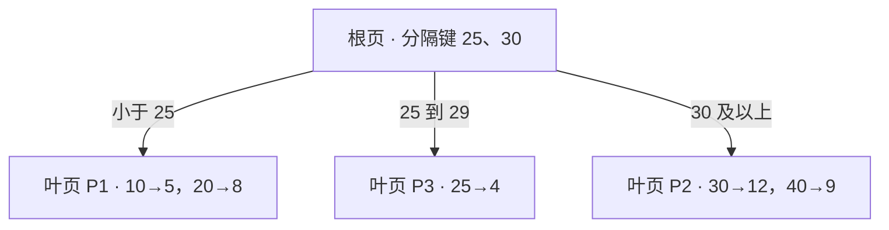
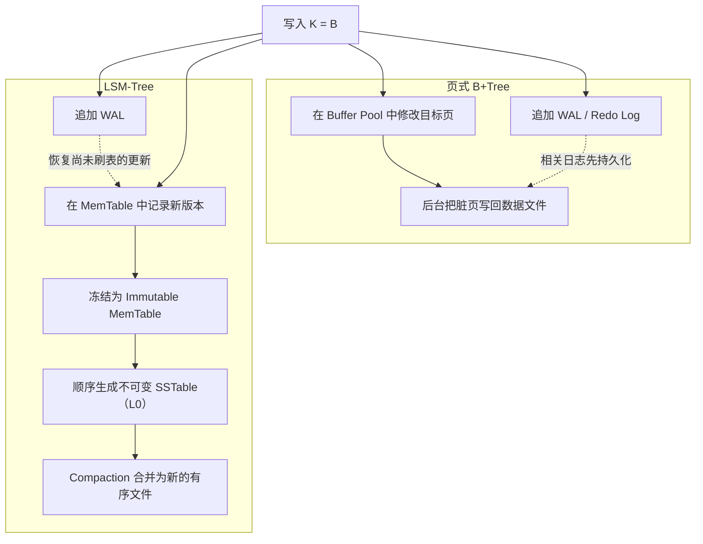
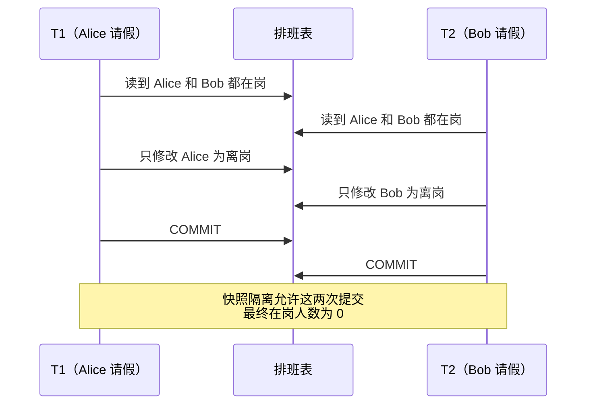

[toc]

## Database

### Intro -- 业务场景

#### 选型对比：Redis vs MongoDB vs HBase

| 数据库 | 优势 | 劣势/限制 |
| :--- | :--- | :--- |
| **Redis** | 数据结构丰富，易用，性能极高 | 内存存储，成本较高 |
| **MongoDB** | 数据类型和结构丰富，易用，存储量大，性能尚可 | 需要和业务场景匹配 |
| **HBase** | 吞吐高，存储量大，性能尚可 | 大宽表，数据结构单一，使用相对复杂，用户友好度一般 |

#### 深度对比：MongoDB vs RDS (分布式关系型)

| 维度 | MongoDB | RDS (分布式关系型) |
| :--- | :--- | :--- |
| **定位** | 通用的 Schemaless 文档数据库 | 分片、多副本，分布式关系数据库 |
| **容量上限** | **<= 1PB** (更高) | ~100TB |
| **写入性能** | **10w+ QPS** (20ms) | 5w+ QPS (30ms) |
| **读取性能** | **50w+ QPS** (20ms) | 20w+ QPS (20ms) |
| **一致性** | **最终一致性**<br>(新版可配置强一致，但损耗性能，一般不建议) | **强一致性** |
| **事务** | 支持 (但会牺牲速度和可用性) | ✅ 完善支持 |
| **索引** | ✅ 支持 | ✅ 支持 |

> **总结**：MongoDB 胜在**吞吐量与容量上限**，适合读写并发极高且对一致性要求稍宽容的海量数据场景；RDS 胜在**强一致性与事务**，适合核心金融交易等严谨场景。

#### 典型场景决策

* **托管数据库安全**：除数据库引擎外，分别审查控制平面、迁移凭证、SQL 编辑器、日志与支持附件的数据流和权限。公开安全事件需区分攻击者声称、厂商声明与独立取证；案例与审查边界见 [云数据库的控制平面与旁路数据安全](./Security-Privacy-Cryptography.md#云数据库的控制平面与旁路数据安全)。

* **本地持久状态与追加历史**：小规模、低频更新可用整文档 JSON；需要索引查询、多记录事务且写入可短时排队时，优先考虑 [SQLite](#sqlite)。同时检查[数据组织与读写粒度](#整文档重写与记录级更新)，仅更换存储载体不能消除写放大。

* **复杂查询与动态 Schema**
  * **需求**：字段结构不固定（Dynamic Schema），且需要根据这些动态字段进行复杂反查（Query by arbitrary fields）。
  * **选型**：必须使用 **NoSQL 架构**（如 MongoDB、Elasticsearch 等）。
  * **原因**：RDBMS 难以高效处理未预定义列的索引与查询；NoSQL 原生支持 Schemaless 及深层嵌套字段的灵活索引。

#### 其它

* Data Analytics
  * 图右sql来自tpc-h


### 存储引擎

#### 从一条商品记录理解键、排序和索引

想象一个小库存表。你给出商品编号，数据库返回库存数量。商品编号是**键（key）**，库存数量是**值（value）**。存储引擎决定这些记录怎样放进内存和磁盘，又怎样被查到、修改和恢复。下面两种结构都从这四条记录开始。

| 商品编号（键） | 10 | 20 | 30 | 40 |
| --- | --- | --- | --- | --- |
| 库存（值） | 5 | 8 | 6 | 9 |

`Get(30)` 是**点查**，找编号 30。`Scan(20, 40)` 是**范围扫描**，找编号 20 到 40 的所有记录，例子里包含两个端点。`Put(30, 12)` 把商品 30 的库存改为 12，`Put(25, 4)` 给新商品 25 记入库存 4。`Delete(30)` 删除编号 30 的记录。下面的操作逐条执行，查询读取当时最新的数据。

如果记录无序地堆在一起，查一个不存在的编号可能要逐条扫完。按编号排序后，一段范围会连在一起。进一步把记录按组装入**页（page）**，就可以用一份**索引（index）**记录哪些键应去哪一页查。例如 `10、20` 在 P1，`30、40` 在 P2，索引记下分界 `30`，查询就可以先去对应的页。若把所有记录直接排在一个大数组里，向中间插入 `25` 可能要移动后面大量记录。B+Tree 用一棵树维护有序的页，LSM-Tree 允许多份有序数据暂时并存，再做合并。 [Berkeley CS 186，B+Tree](https://cs186berkeley.net/notes/note4/) · [LevelDB 文件组织](https://github.com/google/leveldb/blob/main/doc/impl.md)

#### B+Tree 怎样定位并更新数据页

##### 手推点查、页分裂和范围扫描

**B+Tree（B+ 树）是一棵平衡的多路查找树。** 最上面的**根页（root）**是入口，叶页上方的**内部页（internal page）**用分隔键导航，最下面的**叶页（leaf page）**保存按键排序的记录或记录的位置。一个内部页可以有多个子页，所以称为多路。所有叶页都在同一层，所以从根走到任一叶页的步数相同。经典 B 树也允许内部节点带记录。B+ 树把记录或其定位信息放在叶层，方便沿叶页顺序扫描。 [Berkeley CS 186，B+Tree 的性质与插入](https://cs186berkeley.net/notes/note4/) · [CMU 15-445，Tree Indexes](https://15445.courses.cs.cmu.edu/fall2024/notes/08-indexes1.pdf)

本例规定每个叶页能放两条记录。开始时 P1 放 `10→5、20→8`，P2 放 `30→6、40→9`。根页只有分隔键 `30`，小于 30 去 P1，等于或大于 30 去 P2。

1. `Get(30)` 从根进入 P2，在叶页里找到 `30→6`。
2. `Put(30, 12)` 沿同一条路找到 P2，将该记录改成 `30→12`。分隔键仍然是 `30`。
3. `Put(25, 4)` 先去 P1。插入后有 `10、20、25` 三条记录，装不进一页，于是把 `25→4` 放到新叶页 P3。在根页新增分隔键 `25` 和指向 P3 的指针。分隔键 `25` 用来导航，`25→4` 留在叶层。
4. `Scan(20, 40)` 先从根找到 20 所在的 P1，取到 `20→8`，再沿叶页链接依次经过 P3、P2，得到 `25→4、30→12、40→9`。

图里三个叶页处于同一层。根页的箭头用于选页，叶页链接的顺序是 `P1 → P3 → P2`。



InnoDB 与 PostgreSQL 的页式索引也会连接同层页面。范围扫描可以沿链接推进，逻辑上相邻的页仍可能分散在磁盘上。 [PostgreSQL 17 §64.1.4.1，B-tree 页结构](https://www.postgresql.org/docs/17/btree.html#BTREE-STRUCTURE) · [InnoDB 8.4.0，游标跨页源码](https://github.com/mysql/mysql-server/blob/mysql-8.4.0/storage/innobase/btr/btr0pcur.cc)

接着执行 `Delete(30)` 时，教学模型也会先沿索引找到 P2，从页里移走 `30→12`，P2 还有 `40→9`。一般的 B+ 树算法中，如果删除让页太空，可以从相邻页重新分配记录，或合并两页，并更新父页的分隔键和指针。实际数据库可以把物理清理延到后台。 [CMU 15-445，Deletion](https://15445.courses.cs.cmu.edu/fall2024/notes/08-indexes1.pdf#page=2) · [PostgreSQL 17，B-tree 清理](https://www.postgresql.org/docs/17/btree.html)

##### 为什么几层就能查很多记录

一个内部页能指向多少个子页，称为**扇出（fan-out）**。扇出越大，多走一层能覆盖的记录越多。假设每个叶页放 200 条记录，100 万条需要 5,000 个叶页。若一个内部页最多指向 200 个子页，5,000 个叶页只需 25 个父页，1 个根页就能指向这 25 个父页。理想情况下三层就够。类似的高扇出索引可先用 3–4 层估算，实际高度取决于数据量和页容量。

用索引取到位置后再取整行，叫**回表**。InnoDB 的聚簇索引通常按主键组织，叶页承载行记录。另一份按其他字段建立的二级索引，用主键来定位整行，回表可能再走一趟聚簇索引。PostgreSQL 把数据行放在独立的堆表里，B-tree 的叶页通常保存行指针（TID），指向页号和页内位置。如果一次查询要的列都在索引里，这个索引就覆盖了该查询，查询有机会直接从索引取值。范围扫描若需要逐条回表，按索引相邻的记录也可能落在分散的数据页上。 [InnoDB 聚簇与二级索引](https://dev.mysql.com/doc/refman/8.4/en/innodb-index-types.html) · [PostgreSQL 行指针](https://www.postgresql.org/docs/17/storage-page-layout.html) · [PostgreSQL 17 §11.9，回表与索引只读扫描](https://www.postgresql.org/docs/17/indexes-index-only-scans.html)

**树高和读盘次数要分开算。** 假设点查时上层页都在内存，只有叶页需要一次随机读。若回表恰好还要另读一页，就是两次。这是讲义里 1–2 次随机读盘的适用场景。范围扫描的实际 I/O 还取决于跨了多少页、返回多少行，以及这些行是否需要回表。 [讲义 §3.1](../Learning-Materials/distributed-systems-for-loopx/生产级系统工程与大模型服务权衡讲义.md#31-单机存储双引擎btree-原地更新-vs-lsm-tree-追加合并)

页式「原地更新」允许改动已有逻辑页，稍后将修改过的页写回磁盘。事务层仍可能保存同一记录的多个版本。插入造成页分裂时，父页也可能装满，分裂可以一直向上传到根页。若根页也分裂，树加一层，所有叶页仍保持同一深度。并发实现用短时页闩（latch 或 buffer lock）保护结构修改，事务层的锁保护逻辑记录的并发访问。 [PostgreSQL 17.0 B-tree 实现说明](https://github.com/postgres/postgres/blob/REL_17_0/src/backend/access/nbtree/README)

#### LSM-Tree 怎样读取新旧版本

##### 手推写入、刷表和查找

**LSM-Tree（Log-Structured Merge-Tree，日志结构合并树）把更新攒在内存里，再成批写出新的有序文件。** 在这个例子里，磁盘上的旧文件保留 `30→6`，新写入的 `30→12` 单独记录。两个 `30` 是同一件商品先后两次写入得到的两个**版本**。点查按写入先后找本次读取可见的最新版本。

能按键查找和按键顺序遍历的内存表叫 **MemTable**。达到容量阈值时，它被冻结成 **Immutable MemTable**，此后只读，新写入交给另一张内存表。后台把冻结表按键顺序写成磁盘上的只读表 **SSTable（Sorted String Table）**。这个过程叫刷表（flush）。在下面的分层例子里，新刷出的文件先放在第 0 层（L0），合并后可进入第 1 层（L1）。RocksDB 默认用跳表（Skip List）实现 MemTable，也支持其他内存表结构。 [RocksDB MemTable](https://github.com/meta/rocksdb/wiki/RocksDB-Overview#memtable) · [LevelDB 文件组织](https://github.com/google/leveldb/blob/main/doc/impl.md)

沿用刚才两次写入，先 `Put(30, 12)`，再 `Put(25, 4)`。旧的四条数据都在一个 L1 文件里。

| 执行到哪一步 | 较新的数据 | L1 旧文件 | 此时 `Get(30)` |
| --- | --- | --- | --- |
| 开始 | 空 | `10→5、20→8、30→6、40→9` | `6` |
| 写完两笔 | MemTable 中有 `25→4、30→12` | `10→5、20→8、30→6、40→9` | `12` |
| 刷表后 | L0 新文件中有 `25→4、30→12` | `10→5、20→8、30→6、40→9` | `12` |

写入先 `30` 后 `25`，刷表按键写成 `25、30`。磁盘上同时有 `30→6` 和 `30→12`，查询返回较新的 `30→12`。如果这时执行 `Scan(20, 40)`，两份文件都从第一个不小于 20 的键开始。L1 读到 `20`，L0 读到 `25`，先取较小的 `20`，再把 L1 的位置移到下一条。重复这个过程，遇到两个 `30` 时只取较新且可见的值，再把两份文件的位置都往前推进。最终返回 `20→8、25→4、30→12、40→9`。扫描遇到最新可见版本是删除标记的键，会跳过该键。 [FAST ’22，点查与范围扫描对照](https://www.usenix.org/system/files/fast22-qiao.pdf#page=12)

##### 文件多了以后怎样少读、怎样合并

点查先看可写和冻结的 MemTable，再找磁盘文件。L0 的文件可覆盖相同的键范围，例如两个文件的范围分别是 `25–30` 和 `28–35`，查 `30` 时两个都可能有记录。使用分层合并（Leveled Compaction）时，L1 及更深层在同一层内按键范围分开。把文件范围排好序后，可以反复比较中间位置、排除一半范围，这就是二分查找。选出文件后，再经 SSTable 的索引定位数据块。启用布隆过滤器（Bloom Filter）时，过滤信息可缓存到内存。若它能排除这个键，就可以跳过对应文件或分区。若给出「可能在」，还要查数据块确认。 [RocksDB Leveled Compaction](https://github.com/meta/rocksdb/wiki/Leveled-Compaction) · [RocksDB Bloom Filter](https://github.com/meta/rocksdb/wiki/RocksDB-Bloom-Filter)

Bloom Filter 的收益取决于可以跳过多少次读盘。LSM-Tree 一次未命中有机会跳过多份候选文件的数据块。B+Tree 的分隔键已经把唯一键点查缩到一个候选叶页。上层页已缓存时，额外过滤器通常最多省一次叶页读盘，频繁查不存在的键且叶页常需读盘时更可能划算。 [Berkeley CS 186，B+Tree 查找](https://cs186berkeley.net/notes/note4/) · [RocksDB Bloom Filter](https://github.com/meta/rocksdb/wiki/RocksDB-Bloom-Filter)

**Compaction（后台合并）**用类似的归并方法，将选中的有序文件写成新文件。若没有读者还需要旧版，例子里的 L0 与 L1 可合成 `10→5、20→8、25→4、30→12、40→9`，省去旧的 `30→6`。快照（snapshot）允许读者继续看到某一时刻的数据，合并时要保留这些读者仍需要的版本。实际引擎可以只合并选中的重叠文件，并把结果写成多个文件。 [LevelDB Compaction](https://github.com/google/leveldb/blob/main/doc/impl.md#compactions) · [RocksDB Snapshot](https://github.com/meta/rocksdb/wiki/Snapshot)

`Delete(30)` 也会写出一个新版本，叫**删除标记（tombstone）**。看到这次删除的读取会返回「找不到」，即使旧文件里还有 `30→12` 或 `30→6`。后台清理这个标记前，要确认它挡住的旧值不会再次暴露，且相关快照已无需这些版本。 [LevelDB Compaction 与删除标记](https://github.com/google/leveldb/blob/main/doc/impl.md#compactions)

#### 手推自测

1. **B+Tree**。回到两次写入刚结束时执行 `Scan(27, 35)`，第一站是哪一页，最后返回什么？
2. **LSM-Tree**。两次写入已刷成 L0 文件，旧 L1 文件还在。此时 `Delete(30)` 刚写入 MemTable，`Get(30)` 会返回什么？

**答案**

1. 从 P3 开始，因为 `25 ≤ 27 < 30`。P3 的 `25` 小于下界，接着沿叶页链接去 P2，返回 `30→12`，见到 `40` 后停止。
2. 返回找不到。可见的最新版本是删除标记，磁盘上的 `12` 和 `6` 都被它挡住。

#### 页、缓冲池与 WAL

前面看到写入先到内存。假设 `30→12` 还没写进数据文件，机器就断电了。内存里的更改会丢失，恢复时要靠已经写入持久存储的记录补做这次修改。

- **数据库页（Page）**是页式引擎缓存、索引寻址和刷写的单位。一页常放多条记录，索引可以先定位页号，再确定记录在该页的位置。页大小由引擎决定。InnoDB 默认索引页为 16 KiB。 [InnoDB 索引页](https://dev.mysql.com/doc/refman/8.4/en/innodb-physical-structure.html)
- **缓冲池（Buffer Pool）**缓存数据库页。命中时可直接在内存中使用。被修改且尚未写回的页称为脏页（dirty page），可以积累多次更新后一起刷写。数据页的缓存与回写还可能经过操作系统的页缓存，具体由 I/O 模式决定。 [操作系统的页缓存与直接 I/O](./操作系统.md#页缓存回写与直接-io)
- **预写日志（Write-Ahead Log，WAL）**为崩溃恢复记录更改。页式引擎要求相关 WAL 先持久化，才能把对应脏页写入持久的数据文件。内存里的页可以先变脏，提交何时确认取决于同步策略。崩溃后可以重放日志补上尚未写回的数据。 [PostgreSQL 17 §28.3，WAL](https://www.postgresql.org/docs/17/wal-intro.html) · [WAL 记录、checkpoint 与恢复](./Software-Engineering.md#wal-recordcheckpoint-与恢复)

两类引擎都可以用 WAL 恢复，日常查询仍走前面手推的页和有序表。以 RocksDB 为例，启用 WAL 并将 `WriteOptions.sync` 设为 `true` 时，WAL 持久化后就可以确认写入，SSTable 可以稍后生成。日志按**写入顺序**记录 `30` 再 `25`，便于恢复。SSTable 按**键顺序**保存 `25` 再 `30`，便于查找和合并。下图中的 `K=B` 就是把商品 30 的库存改成 12。 [RocksDB 写入与同步](https://github.com/meta/rocksdb/wiki/Basic-Operations#synchronous-writes)



#### B+Tree 与 LSM-Tree 路径对照

| 维度 | 页式 B+Tree（InnoDB / PostgreSQL B-tree 索引） | LSM-Tree（RocksDB / LevelDB / Pebble） |
| --- | --- | --- |
| **写入路径** | 顺序追加 WAL（如 InnoDB 的 Redo Log）＋修改 Buffer Pool 中的目标页 → 后台刷脏页。 | 顺序追加 WAL ＋更新 MemTable → 冻结为 Immutable MemTable → 按键顺序刷成不可变 SSTable（Leveled 下进入 L0）。 |
| **读取路径** | **沿树定位叶页**。按分隔键逐层找，范围查询沿叶页扫，索引缺少所需列时回表。 | **在有序段中查版本**。MemTable → 候选 L0 文件（范围可重叠）→ 按层定位 L1…Lk（Leveled）。Bloom Filter 可排除肯定不含目标键的文件，范围查询归并多个有序段。 |
| **放大权衡** | **读路径短，小改动也可能刷整页**。InnoDB 默认索引页为 16 KiB，启用完整 Doublewrite 时还会写保护副本。 | **成批顺序写有利于吞吐**。后台 Compaction 会反复读写文件，可能带来 CPU、I/O 和尾延迟尖峰。L0 积压可触发写限速或暂停（Write Stall）。 |
| **Compaction 流派** | 以刷页、页分裂和按需合并来维护树。 | **Size-Tiered** 合并大小相近的段，通常少重写，候选较多。<br>**Leveled**（RocksDB 默认）自 L1 起保持同层文件的键范围不重叠，点查候选较少，合并可能反复重写下层数据。 |

表中实现口径采用 InnoDB 8.4、PostgreSQL 17 的 B-tree 索引与 RocksDB 的常见配置。SQLite 可用已有的页、B-tree 和 WAL 例子回顾，MongoDB 的 WiredTiger 则可以对照缓存、checkpoint 和 journal。 [SQLite 记录级写入](#整文档重写与记录级更新) · [WiredTiger 的部件与配置](#存储引擎概览mongodb) · [讲义 §3.1 原表](../Learning-Materials/distributed-systems-for-loopx/生产级系统工程与大模型服务权衡讲义.md#31-单机存储双引擎btree-原地更新-vs-lsm-tree-追加合并) · [Pebble 项目说明](https://github.com/cockroachdb/pebble)

#### 怎样估算读、写、空间放大

**读放大**看一次查询要检查多少候选、读多少块。点查未命中也可以用实际读盘次数衡量。**写放大**用一段时间内引擎实际写出的字节除以逻辑写入字节，比较时说明 WAL、Doublewrite 和 Compaction 是否计入。**空间放大**用磁盘占用除以同口径的有效数据量。B+Tree 的页内空闲影响平时的占用，LSM-Tree 的旧版本、删除标记也会暂占空间，还要计入合并时新旧文件并存的峰值。

- **页级写入与页内空闲。** 假设一次改动只有 64 B，独占一次 16 KiB 刷页，仅这一份数据页就是 256 倍写入。同页多次改动可以合并。InnoDB 的 Doublewrite 会先写一份可恢复的页，再写数据文件，以应对一页只写到一半就崩溃的情况。保护副本可以顺序批写。预留空间和页分裂都会改变填充率。页内留空会多占一些空间，也给后续插入和更新留出余地。页平均填充约三分之二时，才会留下约三分之一的页内空间。InnoDB 8.4 文档给出的聚簇索引页填充示例中，顺序插入约为 15/16，随机插入可以在 1/2 到 15/16 之间。 [InnoDB 页结构与填充率](https://dev.mysql.com/doc/refman/8.4/en/innodb-physical-structure.html) · [InnoDB Doublewrite Buffer](https://dev.mysql.com/doc/refman/8.4/en/innodb-doublewrite-buffer.html)
- **Size-Tiered 的临时空间。** 有序段相近时再合并，通常减少重复重写，查询时也可能要检查更多有序段。RocksDB 的 Universal Compaction 体现这种取舍。一次全量合并若输入和输出都约为 100 GiB，新旧文件同时存在时，这部分会暂占约 200 GiB，对应约 2 倍的临时估算。实际峰值还取决于被选中的段、销毁时机和存活版本。 [RocksDB Universal Compaction](https://github.com/meta/rocksdb/wiki/Universal-Compaction#double-size-issue)
- **Leveled 的稳态空间。** 假设底层 100 GiB 已代表一份完整的有效数据，较小层的额外占用按 10 倍目标容量比递减，几何和约为 111.1 GiB，得到约 1.1 倍的简化估算。WAL、快照保留的旧版本、合并输出和实际层大小会改变这个数。RocksDB 的目标层大小可配置，也支持按底层实际大小动态分层。 [RocksDB 层目标大小](https://github.com/meta/rocksdb/wiki/Leveled-Compaction#level-target-size)

$$
\frac{100+10+1+0.1+\cdots}{100}=\frac{10}{9}\approx1.11
$$

排查写入 P99（约 99% 的写请求在这个耗时内完成）时，可以对齐 L0 文件数、待合并字节、设备 I/O 与 WAL 同步耗时。如果前两项在持续上涨，就要看后台能否跟上前台。在同一个时间窗口内，逻辑写入 80 MiB/s、引擎写放大 3 倍，单写入就约需 240 MiB/s。设备若只稳供 200 MiB/s，积压会增长。RocksDB 达到 `level0_slowdown_writes_trigger` 会限速，到 `level0_stop_writes_trigger` 会等后台推进，待 flush 的内存表和 compaction 债务也各有门槛。 [RocksDB Write Stalls](https://github.com/meta/rocksdb/wiki/Write-Stalls)

#### 按工作负载选择 B+Tree 或 LSM-Tree

| 工作负载（workload） | 优先考虑 | 原因 |
| --- | --- | --- |
| 命中为主的随机点查，对读延迟敏感 | B+Tree | 沿一条路径定位叶页。上层页已缓存、叶页有查询所需数据时，可能只需一次读盘。 |
| 按键范围读多条记录，叶页已包含查询所需的数据 | B+Tree | 找到起点后沿叶页扫。LSM 的范围扫描可能要归并多个文件里的数据和版本。 |
| 持续大量写入小记录，键分散，频繁改动的数据页装不进缓存 | LSM-Tree | 把分散的小写攒成有序批次，减少逐个刷写不同数据页的开销。持续吞吐取决于后台合并能否跟上。 |
| 按递增主键追加，或反复更新少量热点页 | 两者实测 | B+Tree 主键索引的写入可集中在末端或少量页，刷盘前能合并多次修改。 |

实测时用同一份数据和请求分布，固定硬件、缓存预算和持久性要求（如都在 WAL 落盘后确认）。让写入跑到后台积压趋稳，再比较吞吐、P99 和写放大。 [USENIX，写放大与访问模式](https://www.usenix.org/publications/loginonline/revisit-b-tree-vs-lsm-tree-upon-arrival-modern-storage-hardware-built) · [InnoDB 顺序插入](https://dev.mysql.com/doc/refman/8.4/en/innodb-physical-structure.html) · [RocksDB 写入限速](https://github.com/meta/rocksdb/wiki/Write-Stalls)

另有待读材料。 [从零开始深入理解存储引擎](https://mp.weixin.qq.com/s/sEml0lH2Zj-b_sIFRn2wzQ)

### SQLite

#### 适用场景与设计优势

SQLite 最适合为单机应用提供可靠、可查询、可局部更新的持久状态，尤其适合不想单独部署数据库服务、写事务短且允许排队的场景。它是嵌入应用进程的数据库库：SQL 在本进程内执行，直接访问本地文件，无独立数据库守护进程和网络往返；这里的 serverless 指“无需数据库服务进程”。[官方定位与适用场景](https://sqlite.org/whentouse.html)、[Serverless 设计](https://sqlite.org/serverless.html)

| 适合解决的问题 | 对应技术优势 | 典型用途 |
| --- | --- | --- |
| 应用需要随装随用、断网可用的数据层 | 嵌入式、低部署负担、读写不依赖远端服务 | 桌面 / 移动应用、CLI、边缘设备 |
| 大量记录需要按键查找、筛选、关联与局部更新 | B-tree 索引、SQL 查询规划、按页存储 | 文件元数据、本地缓存、实验结果索引 |
| 一次操作要同时修改多份关联数据 | ACID 事务、唯一约束、日志与崩溃恢复 | 状态 + 事件 + 回执、本地任务队列 |
| 应用数据需要作为一个整体携带和交付 | 稳定跨平台文件格式，表、索引、数据可封装在同一数据库 | 项目文档格式、离线数据包 |
| 多路读取伴随短事务写入 | WAL 下读者读取快照，读写可以并行 | 本地服务、读多写少的应用后端 |

**索引和事务是数据库的共性，SQLite 的组合优势是将它们放进低运维成本的进程内组件。** 优势主要体现在本地数据访问与部署简单性，不能据此断言所有 SQL 都比服务型数据库更快。索引维护、提交刷盘、长查询仍有成本。

单写者按“每个数据库文件”计算：多个线程或进程可以轮流写，WAL 也不会让同一文件同时有多个写事务。因此选型重点是写事务持锁时间、写入频率和可接受排队延迟，而非单看用户数或数据行数。将网络请求、模型推理等慢操作放在写事务外；数据按独立用户 / 项目分文件可分散竞争，但不自动提供跨文件原子性或分布式一致性。[WAL 并发机制](https://sqlite.org/wal.html)

适用边界：大量并发写入不能排队、多机直接共享数据库文件，或需要数据库原生复制与高可用时，应评估服务型数据库。远程用户经应用 API 访问单机 SQLite 可以成立；多机经网络文件系统直接操作同一文件是另一种访问方式，尤其不适合依赖共享内存协调的 WAL。离线数据同步、业务幂等与权限仍需应用实现。数据库文件便于交付，但运行中的 WAL 数据库不能只复制主文件当备份，应使用一致性备份机制。

#### 原子累加与条件状态迁移

参考：Codex [`account_thread_goal_usage`](https://github.com/openai/codex/blob/9d87b771cebd0f80e4637e80c93b0d66b10d86c0/codex-rs/state/src/runtime/goals.rs#L411-L523)（commit `9d87b771`）、[SQLite UPDATE 语义](https://sqlite.org/lang_update.html)、[事务](https://sqlite.org/lang_transaction.html)。Rust 如何调用这段 SQL，见 [Rust：字符串、SQLx 与 SQLite 的分工](./Rust.md#rust-中的-sql字符串sqlx-与-sqlite-的分工)。

计数器决定业务状态时，可以让数据库在同一条 `UPDATE` 中完成“累加 + 条件判断 + 状态迁移”。Codex Goal 的核心逻辑可简化为下面的 active-only 分支，省略时间和更新时间字段：

```sql
UPDATE thread_goals
SET tokens_used = tokens_used + ?,
    status = CASE
        WHEN status = 'active'
         AND token_budget IS NOT NULL
         AND tokens_used + ? >= token_budget
        THEN 'budget_limited'
        ELSE status
    END
WHERE thread_id = ? AND status = 'active'
RETURNING tokens_used, status;
```

前两个 `?` 都绑定同一个 `token_delta`。SQLite 在执行赋值前计算所有右侧表达式，因此 `CASE` 中读到的是更新前的 `tokens_used`，必须再加 delta；这不会把用量累加两次。例如原用量 90、预算 100、本次增量 15，结果同时变成 `105 / budget_limited`。这里是事后记账触发状态切换，不能据此认为预算会将执行精确截断在第 100 个 token。

没有适当事务、锁或版本校验的 `SELECT → Rust 中加 delta → UPDATE 写回绝对值` 会丢更新：两个调用都读到 90，分别加 15、10，却写回 105、100，最终可能只剩 100。`SET tokens_used = tokens_used + ?` 把计算放在数据库当前行上；若两次更新都满足过滤条件并成功执行，结果是 115。状态判断与累加放在同一语句，还避免两次独立提交之间出现“用量已超预算，状态仍 active”的中间状态。多语句 read-modify-write 也能正确实现，但需要额外的事务 / 并发控制。

原实现比上述示意多三层边界：

- **状态过滤**：`GoalAccountingMode` 决定哪些状态仍能记账、哪些状态可转成 `budget_limited`。例如 `ActiveOnly` 允许对 `active / budget_limited` 继续结算，`ActiveOrComplete` 也能结算 complete，`ActiveOrStopped` 的状态切换条件更宽；不能把截图里的 `status = 'active'` 当成所有路径的完整规则。
- **目标身份**：传入 `expected_goal_id` 时追加 `AND goal_id = ?`，避免旧 goal 的迟到记账写进同一 thread 的新 goal。它校验目标身份，不是事件去重键。
- **返回结果**：`RETURNING` 在同一语句中返回更新后的行，减少另一次 `SELECT` 读到更晚状态的窗口；未命中条件时不发生更新。

原子性、并发安全、幂等性要分开：SQLite 事务让一次更新整体生效或回滚，单写者机制协调写竞争；同一增量重复执行仍可能重复计费。上述 SQL 本身不提供 exactly-once，重复事件仍需上层去重或幂等协议；锁等待超时也仍需调用方处理。

Codex 的具体上层保护是[单 permit 的记账信号量](https://github.com/openai/codex/blob/04483f4ce5694d471e471583d4ca286908d7c8b7/codex-rs/ext/goal/src/accounting.rs#L89-L98)：持锁取用量 snapshot，执行 SQL，成功后才推进 `last_accounted_token_usage`。锁防同一进程的并发回调消费同一 delta；原子 SQL 防累加和状态迁移被拆开；goal ID 防写错目标。三者各有边界，仍不能据此宣称具备任意崩溃重放下的 exactly-once。详见 [Goal 的续跑与记账](./AI-Applied-Algorithms.md#goal-mode-audit把继续变成目标审计)。

#### 从 LoopX PR #4328 学 SQLite：性能、事务与运行时资格

参考：[LoopX PR #4328](https://github.com/huangruiteng/loopx/pull/4328)，本文按合并版本 `3400fab4231adf51c3b8137f7049940d29fd9b25` 整理。

**一句话理解**：这个 PR 不是“把 SQLite 接上就完事”，而是同时验证三件事：查询是否随着历史增长而退化、嵌入的 SQLite runtime 是否真的安全、进程崩溃或磁盘容量不足后状态是否仍然可解释。

##### 1. 先建立 LoopX 的 SQLite 心智模型

SQLite 可以先粗略理解为：**一个数据库文件 + 文件里的表 / 索引 + 应用进程中的连接与 SQL statement**。LoopX 的 authority 数据库大致包含三张表：

| 表 | 作用 | 可以怎样理解 |
| --- | --- | --- |
| `metadata` | 保存 schema、goal 和 store identity | 这是谁的数据库 |
| `commits` | 按 `cursor` 保存已提交的历史、projection、events、receipts | 不可随意改写的提交日志 |
| `head` | 只有一行，指向当前最新 `cursor` | 当前状态的目录指针 |

一次业务提交不是只写一处：它要向 `commits` 插入一条历史，再把 `head` 指向这条历史。两步必须在同一个事务里完成，否则可能出现“日志已经有了，但 head 没跟上”或反过来的半成品状态。

##### 2. 为什么只改了 `COUNT(*)` 的写法

PR 修复的是 head continuity 查询中的这一处 SQL。两种写法返回值相同，都是文本形式的数量：

```sql
-- 原写法：聚合结果外面直接包 CAST
SELECT CAST(COUNT(*) AS TEXT) FROM commits;

-- 修复后：先让子查询完成简单 COUNT，再转换结果
SELECT CAST((SELECT COUNT(*) FROM commits) AS TEXT);
```

但对数据库来说，**结果相同不代表执行路径相同**。SQLite 对非常简单的 `SELECT COUNT(*) FROM table` 可以直接使用 B-tree 的快速计数路径；而把 `CAST` 直接包在聚合表达式上，可能让它退化为逐行执行 `AggStep count(*)`。历史行越多，退化的成本越明显。

PR 的测试不是只断言“结果等于 3”，而是：

- 从生产入口捕获真实 SQL；
- 用 `EXPLAIN` 检查里面有 `Count` opcode；
- 检查没有逐行聚合的 `AggStep count(*)`；
- 再验证空库、连续 cursor、缺口和 `9223372036854775807` 边界。

这里还有一个 JavaScript / SQLite 的交叉知识点：SQLite 的 `INTEGER` 可以到 64 位，而 JavaScript `number` 安全整数上限只有 `2^53 - 1`。所以 LoopX 把 `MIN`、`MAX`、`COUNT` 和 cursor 转成 SQL `TEXT`，在 TypeScript 中再用字符串 / `bigint` 处理，避免大 cursor 被浮点数悄悄改写。

**可复用的 SQL 经验**：SQL 优化不能只看语义和索引是否存在，还要看实际查询计划。遇到性能回退时，用 `EXPLAIN` / `EXPLAIN QUERY PLAN` 检查生产 SQL；一个看似无害的函数包裹，也可能改变 SQLite 选择的 opcode。

代码：[head continuity 查询](https://github.com/huangruiteng/loopx/blob/3400fab4231adf51c3b8137f7049940d29fd9b25/loopx/control_plane/coordination/sqlite_authority_store.ts#L128-L146)，测试：[快速 COUNT 回归](https://github.com/huangruiteng/loopx/blob/3400fab4231adf51c3b8137f7049940d29fd9b25/tests/control_plane_ts/sqlite_authority_store.test.ts#L19-L71)。

##### 3. `WAL` 是并发与恢复机制，不是“无限并发写入”

LoopX 打开写数据库时使用：

```sql
PRAGMA journal_mode = WAL;
PRAGMA synchronous = FULL;
BEGIN IMMEDIATE;
```

- **WAL（Write-Ahead Log）**：修改先追加到 `数据库名-wal`，再由 checkpoint 合并回主数据库文件。读者可以读取自己的快照，读写通常可以并行。
- **但同一个 SQLite 文件仍然只有一个 writer**：多个写者会排队，`busy_timeout = 5000` 只是最多等待 5 秒，不会把 SQLite 变成多写者数据库。
- **`BEGIN IMMEDIATE`**：尽早申请写事务需要的锁，让冲突在事务开始附近暴露，避免做完一堆工作后才发现无法写入。
- **`synchronous = FULL`**：提高提交后的持久性保证，但会付出刷盘延迟；不能把它理解成“任何硬件故障都不会丢数据”。

WAL 还有两个小白容易忽略的边界：它依赖同一台机器上的共享内存索引，因此不适合多个机器直接通过网络文件系统共同打开；运行中的数据库还可能同时有 `-wal` 和 `-shm` 文件，备份不能只复制主 `.sqlite` 文件。参考：[SQLite WAL 官方文档](https://www.sqlite.org/wal.html)。

PR #4328 进一步检查嵌入的 SQLite 版本，是因为 SQLite 官方记录了一个罕见但后果严重的 WAL-reset 并发 bug：影响 `3.7.0` 到 `3.51.2` 的部分 WAL 多连接写入 / checkpoint 交错场景，修复版为 `3.51.3`，另有 `3.44.6` 和 `3.50.7` 回移版本。[官方 bug 说明](https://www.sqlite.org/wal.html#the_wal_reset_bug)

##### 4. “Node 能运行”不等于 “SQLite runtime 合格”

`node:sqlite` 是 Node 提供的接口，但真正执行 SQL 的 SQLite 可能来自不同的嵌入版本。因此 PR 新增了一个只使用 `:memory:` 的 runtime probe，在创建 authority 文件之前检查：

1. 是否能加载 `node:sqlite`；
2. 实际的 `sqlite_version()`；
3. `sqlite_source_id()`，用于记录具体源码构建身份；
4. 关闭数据库后，已准备的 statement 是否同步失效；
5. SQLite 版本是否包含 WAL-reset 修复。

检查失败就 **fail closed**：返回明确的 provider failure，不创建 authority 路径，也不偷偷回退到 File。这里要区分两个版本门槛：公开的 Node `22.18` 仍可作为默认 File authority 的最低版本；显式选择 SQLite authority 还要满足更严格的 SQLite 修复和 statement 关闭条件，PR 以 Node `22.22.3` / SQLite `3.51.3` 作为参考 runtime。

代码：[SQLite runtime probe](https://github.com/huangruiteng/loopx/blob/3400fab4231adf51c3b8137f7049940d29fd9b25/loopx/control_plane/coordination/sqlite_runtime.ts#L13-L49)，测试：[runtime admission](https://github.com/huangruiteng/loopx/blob/3400fab4231adf51c3b8137f7049940d29fd9b25/tests/control_plane_ts/sqlite_runtime_admission.test.ts#L12-L99)。

##### 5. 事务保证“要么都写，要么都不写”，但不保证调用者一定知道结果

LoopX 的提交路径可以抽象成：

```text
BEGIN IMMEDIATE
  检查 identity、expected revision 和 operation_id
  INSERT commits
  UPDATE head
COMMIT
```

`commits` 和 `head` 在同一事务中，所以正常情况下是原子变化：事务回滚，两者都不生效；事务提交，两者一起生效。

但还有一个很重要的现实：**COMMIT 已经成功，进程可能刚好在返回响应前崩溃。** 调用者只看到超时或连接断开，无法仅凭异常判断“没提交”。因此 PR 保留 / 强化了三种结果区分：

- `applied`：明确收到提交成功；
- `failed`：能证明在 COMMIT 前失败；
- `ambiguous`：COMMIT 的最终结果无法从当前调用确认，必须按 operation receipt 做 read-back。

测试通过真实子进程注入三类故障：

| 故障 | 预期恢复观察 |
| --- | --- |
| COMMIT 前杀进程 | 新提交不存在，head 仍指向旧状态 |
| COMMIT 后杀进程 | 新提交和 receipt 存在，后续读取能证明已提交 |
| 把数据库容量压满 | 返回容量失败，不出现半条提交 |

这说明“数据库事务”和“调用协议”是两层问题：SQLite 事务负责文件内的原子性；receipt / operation ID 负责让调用者在丢响应后重新判断结果。代码：[提交边界](https://github.com/huangruiteng/loopx/blob/3400fab4231adf51c3b8137f7049940d29fd9b25/loopx/control_plane/coordination/sqlite_authority_store.ts#L174-L223)，测试：[真实进程恢复](https://github.com/huangruiteng/loopx/blob/3400fab4231adf51c3b8137f7049940d29fd9b25/tests/control_plane_ts/sqlite_authority_store.test.ts#L72-L119)。

##### 6. 容量测试测的不是“跑完”，而是“证据够不够支持结论”

PR 把容量入口拆成两种 profile：

- **rehearsal**：小规模演练，默认只跑 `100 / 1,000` 次提交，验证入口、状态不变量和清理流程；
- **matched-64k**：正式的 `10k / 100k` 对照，固定约 `64 KiB` projection，分别测 commit、head、receipt、scan、冷启动 CLI 等延迟。

报告为每项资格输出 `passed / failed / missing`：

- `passed` 只表示这个具体轴、具体样本数和具体预算通过；
- `failed` 不能通过改阈值或换 workload 变成绿色；
- `missing` 表示还没有量到，不能被“命令成功退出”自动推断为通过。

本次 formal head p95 的 10k → 100k 增长为 `1.642x`，低于 `2x` 预算；但累计逻辑写入、纯锁等待、稳定态 RSS、大历史恢复、跨平台覆盖和至少十天 soak 仍是 missing / hold。**一次本机跑通不是完整资格证明，也不等于统计上的稳定结论。**

这给小白的测试启发是：

1. 单元测试验证函数结果；
2. 集成测试验证数据库和应用协作；
3. 真实进程测试验证崩溃边界；
4. 容量 / soak 测试验证规模、时间和资源预算。

它们回答不同问题，不能用“测试总数很多”替代缺失的那一类证据。报告和阈值实现见：[sqlite-capacity.ts](https://github.com/huangruiteng/loopx/blob/3400fab4231adf51c3b8137f7049940d29fd9b25/examples/coordination/sqlite-capacity.ts) 与 [sqlite-capacity-report.ts](https://github.com/huangruiteng/loopx/blob/3400fab4231adf51c3b8137f7049940d29fd9b25/examples/coordination/sqlite-capacity-report.ts)。

##### 7. 读这个 PR 时可以带走的 SQLite 清单

- 先问数据库文件里有什么表、主键、唯一约束和索引，再看业务代码。
- 看到 `WAL`，同时问：谁是 writer、锁最多等多久、`-wal/-shm` 如何备份和恢复。
- 看到 `BEGIN ... COMMIT`，问事务覆盖了哪些写入，以及提交后丢响应如何 read-back。
- 看到性能修复，不只看结果是否相同，还要看 `EXPLAIN` 和真实数据规模下的增长曲线。
- 看到“支持 SQLite”，继续问实际嵌入版本、编译来源、statement / connection 生命周期和 fail-closed 行为。
- 看到“容量测试通过”，检查 profile、payload、样本数、p95/p99、失败项和 missing 项，不能只看 exit code。

#### 整文档重写与记录级更新

SQLite 也把数据存于文件。性能差别取决于文件内部的数据组织，以及一次操作需要读取、解析和重写多少内容。

整文档 JSON 若采用“读取全部历史 → 校验历史链 → 追加交易及完整 projection → 序列化全量文档 → 原子替换”的路径，即使只修改一个过期时间，也要处理全部旧历史。实现直观，状态、历史、回执容易一起发布；但原子替换仍需配套并发控制和持久化刷盘，不能单独保证不丢更新或断电安全。

设每笔历史固定占 b 字节，第 n 次提交重写约 nb 字节，N 次累计逻辑写入为：

$$
W(N) \approx b\sum_{n=1}^{N}n=\frac{bN(N+1)}{2}=\Theta(bN^2)
$$

例如每笔 8 KiB，第 100 次重写约 800 KiB，第 10,000 次约 78 MiB；尚未计入完整 projection 自身增长及底层 I/O 开销。

SQLite 可以将一次局部更新拆成同一事务中的几类记录操作：

| 数据 | 组织方式 | 一次续约的操作 |
| --- | --- | --- |
| 当前状态 / projection | 按实体 ID 存储 | 更新目标记录 |
| 历史事件 | 按 cursor 有序追加 | 插入增量事件 |
| 操作回执 | operation ID 唯一索引 | 插入回执，检测重复 |
| 业务快照 | 按版本周期性保存 | 通常无需修改 |

* **索引定位**：B-tree 按键查找通常近似 O(log N)，避免加载并扫描全部历史；返回大量结果仍需支付相应读取成本。
* **按页写入**：修改记录通常只触及相关数据页与索引页，也可能发生页分裂。WAL 模式先追加修改后的页，checkpoint 再写回主文件，避免每次复制全部旧历史。
* **事务提交**：状态更新、事件追加、回执插入一起提交或回滚。断电后的持久性仍取决于同步配置与存储可靠性。唯一索引只约束重复键；重复请求如何返回旧结果、同 ID 不同内容如何报冲突，仍由应用定义。

数据模型决定收益上限：把膨胀 JSON 放进一个字段仍是整体更新；每笔交易独立一行但携带完整 projection，仍有快照冗余；每次启动全量重放，恢复成本仍随历史增长。常见配套设计是“当前状态独立存储 + 增量事件 + 索引回执 + 周期性业务快照与增量恢复 + 明确的保留 / 归档策略”。需要审计校验的系统，还应定义快照可信边界和历史完整性检查方式。

**WAL checkpoint、业务快照和历史归档各管一层**：前者将页写回数据库，业务快照减少事件重放，归档控制在线历史规模。SQLite WAL 同时仍只有一个写者，长读事务可能阻碍 checkpoint 推进；长期运行要验证写竞争、WAL 大小、恢复时间及备份恢复。分段文件日志也能实现类似组织，但索引、事务、恢复与回收需要自行维护。

参考：[SQLite 文件格式](https://sqlite.org/fileformat.html)、[查询规划与索引](https://sqlite.org/queryplanner.html)、[WAL](https://sqlite.org/wal.html)、[同步配置](https://sqlite.org/pragma.html#pragma_synchronous)；通用恢复协议见 [WAL 笔记](./Software-Engineering.md#walwrite-ahead-log先持久化恢复记录再持久化正式状态)。

### mysql

没学过db。。。极速入门满足日常简单需求

https://www.runoob.com/sql/sql-tutorial.html

https://www.w3schools.com/sql/default.asp

```mysql
CREATE TABLE Persons (
    Personid int NOT NULL AUTO_INCREMENT,
    LastName varchar(255) NOT NULL,
    FirstName varchar(255),
    Age int,
    PRIMARY KEY (Personid)
);
```

* FOREIGN KEY
  * 外键 (Foreign Key) 是一个用于建立和加强两个表数据之间连接的一列或多列。它是一个表中的字段，其值必须在另一个表的主键 (Primary Key) 中存在。
  * 核心作用是保证数据的**引用完整性 (Referential Integrity)**。如果把被引用的表（包含主键）看作“父表”，把引用外部主键的表看作“子表”，那么外键约束确保了：
    * 子表中不能插入父表中不存在的外键值。
    * 不能删除父表中仍被子表引用的记录（除非定义了级联操作如 `ON DELETE CASCADE`）。
  * 外键是 `JOIN` 操作的逻辑基础，通过它可以在多个表之间查询相关数据。

```mysql
-- 接着上面的 Persons 表，创建一个 Orders 表
-- Orders 表中的 PersonID 列是外键，引用 Persons 表的 Personid 主键
CREATE TABLE Orders (
    OrderID int NOT NULL AUTO_INCREMENT,
    OrderNumber int NOT NULL,
    PersonID int,
    PRIMARY KEY (OrderID),
    FOREIGN KEY (PersonID) REFERENCES Persons(Personid)
);
```

* NOT NULL
  * [为什么数据库字段要使用 NOT NULL？](https://mp.weixin.qq.com/s/XyOU6dimeZNjzIYyTv_fPA)

* AUTO INCREMENT


* SELECT
  * max, min, avg
  * GROUP BY
    * [not a group by expression error](https://learnsql.com/blog/not-a-group-by-expression-error/)

```mysql
# 判断范围
select min(record_id),max(record_id) from service_status where service_type='abc' limit 10;
# 精确查询规模
explain select * from  service_status where service_type='abc' and (record_id between 1 and 100000) 
# 从后往前
select * from service_status order by id desc
# 不等于
<>
# 非空
is NOT NULL
```

e.g.

```mysql
SELECT log.uid, info.source, log.action, sum(log.action), COUNT(1) AS count
FROM info, log
WHERE (log.time in LAST_7D) 
    and (log.id = info.id) 
    and (log.action=show)
GROUP by log.uid, info.source
ORDER by log.uid, info.source DESC
LIMIT 1000
```

* WITH AS
* JOIN
  * https://stackoverflow.com/questions/354070/sql-join-where-clause-vs-on-clause

```mysql
with temp as(
	select a,b,c
  where a=.. AND b=.. AND c=..
)
select A.a
from temp A join temp B
on A.a = B.a
group by A.a
```

```mysql
# 高级 JOIN 技巧
# Using the Same Table Twice
SELECT a.account_id, e.emp_id, b_a.name open_branch, b_e.name emp_branch 
FROM account AS a 
INNER JOIN branch AS b_a ON a.open_branch_id = b_a.branch_id 
INNER JOIN employee AS e ON a.open_emp_id = e.emp_id 
INNER JOIN branch b_e ON e.assigned_branch_id = b_e.branch_id WHERE a.product_cd = 'CHK';

# Self-Joins
SELECT e.fname, e.lname, e_mgr.fname mgr_fname, e_mgr.lname mgr_lname
FROM employee AS e INNER JOIN employee AS e_mgr
ON e.superior_emp_id = e_mgr.emp_id;

# Non-Equi-Joins
SELECT e1.fname, e1.lname, 'VS' vs, e2.fname, e2.lname
FROM employee AS e1 INNER JOIN employee AS e2
ON e1.emp_id < e2.emp_id WHERE e1.title = 'Teller' AND e2.title = 'Teller';
```

* OVER PARTITON BY
  * https://learnsql.com/blog/partition-by-with-over-sql/

```mysql
SELECT
    car_make,
    car_model,
    car_price,
    AVG(car_price) OVER() AS "overall average price",
    AVG(car_price) OVER (PARTITION BY car_type) AS "car type average price"
FROM car_list_prices
```

```mysql
WITH year_month_data AS (
  SELECT DISTINCT
       EXTRACT(YEAR FROM scheduled_departure) AS year,
       EXTRACT(MONTH FROM scheduled_departure) AS month,
       SUM(number_of_passengers)
              OVER (PARTITION BY EXTRACT(YEAR FROM scheduled_departure),
                                  EXTRACT(MONTH FROM scheduled_departure)
                   ) AS passengers
   FROM  paris_london_flights
  ORDER BY 1, 2
)
SELECT  year,
        month,
     passengers,
     LAG(passengers) OVER (ORDER BY year, month) passengers_previous_month,
     passengers - LAG(passengers) OVER (ORDER BY year, month) AS passengers_delta
FROM year_month_data;
```

```mysql
AVG(month_delay) OVER (PARTITION BY aircraft_model, year
                               ORDER BY month
                               ROWS BETWEEN 3 PRECEDING AND CURRENT ROW
                           ) AS rolling_average_last_4_months
```

* **Broadcast 技巧 (MAX + OVER)**
  * **场景**：将某一行（如基准组）的值“广播”到所有行，常用于计算相对于基准值的比率或差值，**避免使用低效的 Self-Join**。
  * **原理**：`CASE WHEN` 筛选出基准行的值，配合 `MAX(...) OVER()` 将该特定值聚合（取出非零的那个基准值）并投影到当前窗口的每一行。
  
  ```sql
  SELECT 
      vid, 
      value,
      -- 1. 提取基准值并广播到每一行 (例如 vid='base' 的行的 value)
      MAX(CASE WHEN vid = 'base' THEN value ELSE 0 END) OVER () AS base_val,
      
      -- 2. 直接利用广播值进行计算 (例如计算当前行与基准行的比率)
      value / MAX(CASE WHEN vid = 'base' THEN value ELSE 0 END) OVER () AS ratio
  FROM metrics
  ```

* ALTER TABLE

```mysql
ALTER TABLE
  service_status
ADD
  error_count_avg decimal(10, 5) NOT NULL DEFAULT 0 COMMENT "服务错误量",
MODIFY
  error_code int(11) NOT NULL COMMENT "请求错误类型（取最多的）",
MODIFY
  is_error int(5) NOT NULL COMMENT "是否是错误请求";
  
ALTER TABLE test TABLE (c1 char(1),c2 char(1));
```


* TIMESTAMP

```mysql
`record_time` datetime NOT NULL DEFAULT CURRENT_TIMESTAMP COMMENT '记录产生时间'
```


* [SQL Injection 注入攻击](https://www.w3schools.com/sql/sql_injection.asp)
  * SQL Injection Based on 1=1 is Always True
  * SQL Injection Based on ""="" is Always True
  * SQL Injection Based on Batched SQL Statements
    * 在输入中用分号分隔语句
  * Use SQL Parameters for Protection


#### 函数

* Count、Sum
  * count是行数、sum是求和
* `log(greatest(val,1e-6))`


### db client

#### Redis 常见接口

- put
- get key or keys
- mget
  - Input: keys
  - Output: indices, results
- hset
  - e.g. Redis: https://redis.io/docs/reference/optimization/memory-optimization/#use-hashes-when-possible
  - 存储结构化数据
- remove key or keys
- zcard
  - Returns the sorted set cardinality (number of elements) of the sorted set stored at `key`.
- zremrangebyscore(key, start, end)
  - Removes all elements in the sorted set stored at `key` with a score between `min` and `max` (inclusive).
- sadd、zadd、hset
  - sadd：set
  - zadd：sorted set (element with score)
  - hset：https://redis.io/commands/hset/

### 数据库优化

#### Dictionary Encoding

#### 同时支持 Query 和 Span

* scan：底层存储连续
* query：设计计算缓存层

#### 利用 CPU 优化数据库性能

来源：[利用CPU优化数据库性能](https://cloud.tencent.com.cn/developer/article/2455976)，译自 Optimize Database Performance by Capitalizing on the CPU，作者 Pavel Emelyanov

**核心思想**：数据库的内部架构对其延迟和吞吐量有重大影响，需要从多个角度探索如何利用现代硬件 CPU 来优化性能。

**在内核之间不共享任何内容**
- 单个 CPU 内核的速度并没有提高，时钟速度很久以前就达到了性能平台期
- CPU 性能的持续增长是水平的：通过增加处理单元的数量
- 增加内核数量意味着性能现在取决于跨多个内核的协调
- 软件架构师面临两种不利的选择：
  - 粗粒度锁定：应用程序线程争夺对数据的控制权并等待
  - 细粒度锁定：难以编程和调试，即使没有争用，由于锁定原语，也会产生很大的开销
- 理想情况下，数据库提供了限制跨内核通信需求的功能，当通信不可避免时，提供高性能的非阻塞通信原语

**优化未来承诺设计**
- 期货和承诺用于解耦数据生产者和数据消费者
- 优化的期货和承诺用于管理细粒度、非阻塞任务，应该：
  - 不需要锁定
  - 不分配内存
  - 支持延续
- 期货-承诺设计消除了操作系统维护单个线程相关的成本，并允许几乎完全利用 CPU
- 将期货-承诺设计应用于数据库内部具有明显的优势：
  - 数据库工作负载可以自然地是 CPU 密集型的
  - 解析查询是一项 CPU 密集型任务
  - 收集、转换和将数据发送回用户也需要仔细利用 CPU

**执行阶段**
- 现代 x86 CPU 的微架构以非常简化的方式由四个主要组件组成：前端、后端、分支预测和退休
- **前端**：负责获取和解码将要执行的指令
  - 延迟问题可能由指令缓存未命中引起
  - 带宽不足发生在指令解码器跟不上时
- **分支预测**：错误预测的流水线槽位不会停顿，而是浪费了
- **后端**：接收解码的微操作并执行它们
  - 停顿可能是由于执行端口繁忙或缓存未命中造成的
- **退休**：100% 的流水线槽位能够在没有停顿的情况下退休时，程序就达到了该 CPU 模型的每周期最大指令数

**对数据库的影响**
- CPU 的架构方式对数据库设计有直接的影响
- 单个请求可能涉及大量逻辑和相对较少的数据，这是一种对 CPU 造成很大压力的场景
- 解决这个问题最明显的方法是尝试减少热路径中的逻辑量
- 处理指令缓存问题的更高层次方法称为分阶段事件驱动架构（SEDA）
- SEDA 将请求处理流水线拆分为一个阶段图，从而将逻辑与事件和线程调度分离


### 图数据库

#### Gremlin

https://tinkerpop.apache.org/docs/current/reference/#_tinkerpop_documentation

* 建模细节：
  * 对边类型做拆分
  * 边索引：`g.V(A).outE('follow').order().by('age')`
* 基础命令
  * path
  * by
    * 作为Path修饰器，对Path上的元素Element执行投影计算。

```
g.V().has('id', {CityHash32(c)}).has('type', 2).outE('Company2Person').otherV().inE('Company2Person').otherV().outE('Company2Person').otherV().has('type', 1).has('id', {CityHash32(p)}).path().by(properties('name')).by(properties('role'))
```

* 规范
  * 判断点存在性：不能使用g.V().has("id", xxx).has("type", yyy)。原因是点有2种语义分别是属性点和边的端点。
    * 判断属性点存在性： 使用g.V().has("id", xxx).has("type", yyy).properties() 如果返回空，表示不存在。
    * 判断边端点存在性： 使用g.V().has("id",xxx).has("type",yyy).outE(edge_type).count()，如果返回0，表示不存在。
  * 新增(addV)或修改点(Property(key, value))，需要进行点存在性判断。
    * 添加点(addV)是覆盖语义，会把已有的点删除，再重新写入，导致原有的数据丢失。
    * 修改点(Property) 只能修改已存在点，不能新建属性，否则会报错。
  * 使用drop删除addV产生的点，删除点的属性，点并没有真正删除，只能由底层存储进行compact，降低空间占用。
  * 点的update-or-insert不支持原子性，边的update-or-insert并发下只能保证1个记录成功，其他会失败。 如有强需求使用原子性, 建议业务层实现。

```
g.V().has("id",A.id).has("type",A.type)
 .property("age", 28) // 如果A点存在，更新点的属性
 .fold()              // 结果为[]或[Vertex(A)]
 .coalesce(unfold(),  // 如果是[Vertex(A)],直接返回
   g.addV().overwrite(false).property("id",A.id).property("type",A.type)
    .property("age", 28) // 如果是[]，插入A并更新属性
  )              // coalesce 返回结果一定是 Vertex(A)
```

* 多跳查询：
  * 例如1跳出度为n，二跳出度为m。第1跳查询的次数为1，出现记录数为n，第2跳查询次数为n，输出记录为m，所以共需要查询次数为n+1，遍历总记录数为n*m。
* 技巧：
  * 引入虚拟点：
    * A->B
    * A->C
      * 点C的属性：B上要维护的属性
      * 边A->C的属性：B.id、B.type

* 例子：

```
# 插入一条 (1,1) -> (2,1) 的正向边
g.V().addE('follow').from(1,1).to(2,1).property('tsUs', 123)
# 从 (2,1) 出发，做入度查询，也就是反向查询
g.V(vertex(2,1)).inE('follow').count()

# 双向边
g.V(vertex(2,1)).double('follow').count()
```


```
# 关注
g.addE("follow").from(100, 2).to(200, 2).setProperty("tsUs", 1234).setProperty("closeness", 20)
# 取关
g.V(vertex(100, 2)).outE("follow").where(otherV().has("id", 200).has("type", 2)).drop()
# 按关注时间排序
g.V(vertex(100, 2)).outE("follow").order().by("tsUs").limit(10).otherV()
# 判断关系
g.V(vertex(100, 2)).outE("follow").where(otherV().has("id", 200).has("type", 2))
# 粉丝数量
g.V(vertex(100, 2)).in("follow").count()

# 使用local，子查询
g.V(vertex(100, 2)).out("follow").local(out("like").limit(100))
g.V(vertex(100, 2)).out("follow").out("follow").local(in("follow").count().is(le(500)))

# 按边属性筛选点
g.V(vertex(100, 2)).outE("follow").has("closeness", 20).otherV()

# 同时关注
g.V().has("id", C.id).has("type", C.type)
 .out("follow")
 .store("vertices")
 .count()
 .local(
        g.V().has("id", A.id).has("type", A.type)
         .out("follow")
         .where(P.within("vertices")))

# A->C路径
.g.V().has("id", A.id).has("type", A.type)
 .repeat(                              // repeat()表示表示迭代从A找关注or被关注的人
        both("follow")
        .simplePath())                 // simplePath()是过滤条件，出现环则过滤掉
 .until(                               // until()指定repeat步骤的终止条件是:
        or(has("id", C.id).has("type", C.type),  // 1. 找到了用户C，或者
           loops().is(gte(4))))                  // 2. 找了4度还没有找到；
 .emit(has("id", C.id).has("type", C.type))  // emit()表示只保留遍历终点是C的结果
 .path()                                     // path()表示生成起点A到终点C的路径
```


### 数据一致性

#### 一次转账中的事务与快照

Alice 有两张卡，A 和 B 各有 500 元。从 A 转 100 元到 B，需要改两行。**事务（transaction）**把这两次改动放在一起。`BEGIN` 开始事务，`COMMIT` 提交整笔改动，`ROLLBACK` 撤销本事务尚未提交的改动。下面的 `UPDATE` 修改余额，`WHERE` 指定要改哪张卡。例子假设两张卡都存在且余额足够。

```sql
BEGIN;
UPDATE accounts SET balance = balance - 100 WHERE id = 'A';
UPDATE accounts SET balance = balance + 100 WHERE id = 'B';
COMMIT;
```

两笔改动一起生效或一起撤销，叫**原子性（atomicity）**。同时有另一个事务查账时，它能读到哪个时刻的余额、写冲突怎么处理，由**隔离级别（isolation level）**规定。下面用 `T1`、`T2` 表示两个数据库会话各自运行的一笔事务。 [PostgreSQL 16，事务入门](https://www.postgresql.org/docs/16/tutorial-transactions.html) · [讲义 §3.2](../Learning-Materials/distributed-systems-for-loopx/生产级系统工程与大模型服务权衡讲义.md#32-五大并发异常与事务隔离级别完整对照表)

事务内也可以设**保存点（savepoint）**，从中途撤销一组修改并保留此前的进度。外层事务仍决定整笔事务最终提交还是回滚。 [Rust 保存点与 Undo Log 的手推例子](./Rust.md#保存点与撤销日志undo-log)

转账提交前，其他事务可以看到旧版 `A=500、B=500`。提交后，新的读取可以看到 `A=400、B=600`，较早的快照仍可能看到旧版。**快照（snapshot）**规定这次读可以使用哪些版本，普通查询通常也能看到本事务此前的写入。**多版本并发控制（Multiversion Concurrency Control，MVCC，也写作 MCC）**保留或重建旧版本，普通读因此可以继续用旧值，减少读写互相阻塞，缓解长读使写入迟迟拿不到锁的问题。PostgreSQL 保存多个行版本，InnoDB 可用 undo log 重建旧值。多版本技术也可用于软件事务内存（Software Transactional Memory，STM）。 [PostgreSQL MVCC](https://www.postgresql.org/docs/16/mvcc-intro.html) · [InnoDB 多版本实现](https://dev.mysql.com/doc/refman/8.4/en/innodb-multi-versioning.html) · [Generic Multiversion STM](https://anon.cs.rochester.edu/u/scott/papers/2013_Li_DISC_GMV.pdf)

#### 普通查询会看到什么

##### 脏读、不可重复读与读偏差

**脏读（Dirty Read）**。`T1` 把 A 改成 400，还没提交。`T2` 就读到了 400。若 `T1` 随后回滚，400 从未成为已提交的余额。`READ COMMITTED` 只允许普通查询看到其他事务已提交的修改，因此能挡住这种读法。 [PostgreSQL 16，Read Committed](https://www.postgresql.org/docs/16/transaction-iso.html#XACT-READ-COMMITTED)

现在让只读事务 `T2` 先查 A，得到 `500`，然后让 `T1` 从 A 向 B 转 `100` 并提交。此时已提交余额是 `A=400、B=600`。`T2` 在原事务里再查 A，读已提交会读到 `400`，可重复读仍会读到 `500`。读已提交的两次查询都读到了已提交的值，同一行的结果却从 `500` 变成 `400`，这叫**不可重复读（Non-repeatable Read）**。

如果 `T2` 第二次查的是 B，再把两次查询结果相加，两种隔离级别会算出不同的总额。

| 隔离级别 | 转账前查 A | 转账后查 B | 查账合计 |
| --- | --- | --- | --- |
| `READ COMMITTED`（读已提交） | `500` | `600` | **`1100`** |
| `REPEATABLE READ`（可重复读） | `500` | `500` | **`1000`** |

转账前后的总额都是 `1000`。`1100` 来自把转账前的 A 和转账后的 B 加在一起，这叫**读偏差（Read Skew，也称读偏序）**。 [Berenson 等，Read Skew](https://www.microsoft.com/en-us/research/wp-content/uploads/2016/02/tr-95-51.pdf#page=9)

**数据新鲜度**关心这次读能否看到刚提交的更新。**事务内读一致性**关心多次读到的值能否对应同一个时点。PostgreSQL 和 InnoDB 的读已提交为每条普通 `SELECT` 取语句开始时的快照。可重复读对同一事务的普通读有更严格的约束，要求沿用已建立的事务快照。在这个例子里，快照在第一次查 A 时建立，所以别人提交后，`T2` 仍看到转账前的余额。 [PostgreSQL 16，Read Committed](https://www.postgresql.org/docs/16/transaction-iso.html#XACT-READ-COMMITTED) · [PostgreSQL 16，Repeatable Read](https://www.postgresql.org/docs/16/transaction-iso.html#XACT-REPEATABLE-READ) · [InnoDB 一致性读](https://dev.mysql.com/doc/refman/8.4/en/innodb-consistent-read.html)

刷新余额时，结束旧事务再发起新查询，此例中会看到 `A=400`。核对总额时，多条查询可共用一个事务快照。在 `READ COMMITTED` 下，用一条 `SELECT SUM(balance) FROM accounts WHERE id IN ('A', 'B')` 也能让两张卡的余额取自同一个语句快照。 [PostgreSQL 16，语句快照](https://www.postgresql.org/docs/16/transaction-iso.html#XACT-READ-COMMITTED)

##### 幻读看的是同一个条件命中了哪些行

**幻读（Phantom Read）**发生在重新执行同一个查询条件时。`T2` 查询 42 号班次的在岗医生，结果是 Alice 和 Bob。`T1` 新增一条 Carol 在岗的记录并提交。`T2` 重新查询，`READ COMMITTED` 下可能多出 Carol。删除或更新也可能让某一行离开或进入结果集。普通读复用稳定快照时，两次仍可看到原来的名单。如果业务决策依赖这个名单，还需要考虑别的事务能否同时修改它。 [PostgreSQL 16，事务隔离](https://www.postgresql.org/docs/16/transaction-iso.html) · [InnoDB 幻读与范围锁](https://dev.mysql.com/doc/refman/8.4/en/innodb-next-key-locking.html)

#### 先读再写的两种并发错误

##### 丢失更新发生在同一行

计数器 `v=0`，`T1` 和 `T2` 都执行 `SELECT v`，在应用里算出 `v + 1 = 1`。`T1` 写入 1 并提交，`T2` 仍按自己算好的结果写入 1。两次加一最终只留下 1。这就是**丢失更新（Lost Update）**，库存扣减和用量计数也容易遇到同类问题。

- InnoDB 的默认 `REPEATABLE READ` 允许普通 `SELECT` 读旧快照，后续 `UPDATE` 仍能对当前行写入应用传来的绝对值，所以这个写法可能丢失更新。
- PostgreSQL 的 `REPEATABLE READ` 会拒绝第二个事务更新快照之后被并发事务改过并提交的行。这体现了先提交者获胜（First-Committer-Wins）。上例里，较晚的 `UPDATE` 就可能报 SQLSTATE `40001`，调用方应回滚并重跑整笔事务，让应用重新读数和计算。 [InnoDB 普通读与 DML 的可见性](https://dev.mysql.com/doc/refman/8.4/en/innodb-consistent-read.html) · [PostgreSQL 16，Repeatable Read 的写冲突](https://www.postgresql.org/docs/16/transaction-iso.html#XACT-REPEATABLE-READ) · [Berenson 等，Snapshot Isolation](https://www.microsoft.com/en-us/research/wp-content/uploads/2016/02/tr-95-51.pdf)

同一行的更新可以直接写 `UPDATE t SET v = v + 1 WHERE id = 1`，由数据库基于待更新的行计算。业务逻辑必须先读后算时，可用带版本的比较并交换（Compare-And-Swap，CAS），在 `UPDATE` 里加 `WHERE id = ... AND version = old_v` 并递增版本，更新不到行时重新读取和判断。也可以在同一事务内先用 `SELECT ... FOR UPDATE` 读取并锁住该行，用返回值计算后再写入。并发失败时，按引擎的错误语义重试整笔决策。 [InnoDB 锁定读取的计数器例子](https://dev.mysql.com/doc/refman/8.4/en/innodb-locking-reads.html) · [SQLite 原子累加与条件状态迁移](#原子累加与条件状态迁移)

##### 写偏差可以发生在不同行

医院要求任何时刻**至少一名医生在岗**。Alice 和 Bob 当下都在岗。两人各开一笔事务，各自读到在岗人数为 2，于是各把自己的行改成离岗。**快照隔离（Snapshot Isolation，SI）**让事务按稳定快照读，并检查同行写冲突。这里读的是同一组数据，写的是不同行，同行检查不会触发。两笔事务可以一起提交，最后无人值班。这是**写偏差（Write Skew，也称写偏序）**。如果串行执行，先完成的人可以请假，后执行的人只会看到一人值班，应保留在岗状态。 [Berenson 等，Write Skew](https://www.microsoft.com/en-us/research/wp-content/uploads/2016/02/tr-95-51.pdf#page=9) · [PostgreSQL 16，Serializable 示例](https://www.postgresql.org/docs/16/transaction-iso.html#XACT-SERIALIZABLE)



#### 四种事务隔离级别

表中是 PostgreSQL 16 和 MySQL 8.4 InnoDB。普通读指没有加锁修饰的 `SELECT`，两次读取使用相同数据范围。 [读已提交与可重复读的转账对照](#脏读不可重复读与读偏差)

| 隔离级别 | 普通查询读到什么 | 案例里的并发结果 |
| --- | --- | --- |
| `READ UNCOMMITTED`（读未提交） | InnoDB 可读到未提交的改动。PostgreSQL 按 `READ COMMITTED` 处理。 | 下一行的异常也可能发生。InnoDB 还可能脏读，例如读到后来被回滚的 400。 |
| `READ COMMITTED`（读已提交） | 每条普通查询有自己的快照。 | 能挡住脏读。两次读可能看到不同余额、算出 1100 或多查到一位医生。先读再写还可能丢失更新或发生写偏差。 |
| `REPEATABLE READ`（可重复读） | 两个引擎的普通查询都复用事务快照。 | 本节的不可重复读、读偏差和幻读可以避免。同行丢失更新的处理因引擎而异，医生案例的写偏差仍可能出现。 |
| `SERIALIZABLE`（可串行化） | PostgreSQL 仍读事务快照。InnoDB 在多语句事务中给普通查询加共享锁。 | 成功提交的事务等价于某个逐一执行的顺序。两笔都据旧结果请假的事务无法一起成功，具体实现可能等待或报错。 |

PostgreSQL 的默认级别是 `READ COMMITTED`，InnoDB 的默认级别是 `REPEATABLE READ`。在 `REPEATABLE READ` 下，PostgreSQL 用第一条非事务控制语句建立快照，InnoDB 通常由第一次一致性读建立。因此，只发 `BEGIN` 还未必固定视图。SQL 标准允许 `REPEATABLE READ` 出现幻读，这两个实现给普通 `SELECT` 提供了更强的快照行为。InnoDB 的加锁读有自己的可见性与加锁规则。 [PostgreSQL 16，事务隔离](https://www.postgresql.org/docs/16/transaction-iso.html) · [MySQL 8.4 InnoDB，事务隔离](https://dev.mysql.com/doc/refman/8.4/en/innodb-transaction-isolation-levels.html)

#### 怎样保护跨行规则

「至少一人在岗」是**不变量（invariant）**，也就是每次提交后的排班都要满足的规则。请假决策读了两个人的状态，只写其中一行。负责这条规则的事务需要共同采用一种并发控制方式。

1. **可串行化（Serializable）**。PostgreSQL 使用可串行化快照隔离（Serializable Snapshot Isolation，SSI）。`T1` 读到了 Bob 的旧状态而 `T2` 随后改了 Bob，要保留这次观察，串行顺序就得让 `T1` 在 `T2` 前面。这是读写反依赖（rw-antidependency）。`T2` 读 Alice、`T1` 改 Alice，又要求反过来。两个顺序要求形成环。SSI 跟踪这类依赖并检查可能成环的危险结构，可能报 `40001`，此时要重读、重算并重试整个事务。InnoDB 的 `SERIALIZABLE` 在多语句事务里把普通 `SELECT` 当作共享锁读取（`FOR SHARE`），可能发生锁等待或死锁。自动提交的单条只读查询可以使用普通一致性读。 [PostgreSQL 16，Serializable](https://www.postgresql.org/docs/16/transaction-iso.html#XACT-SERIALIZABLE) · [Ports 与 Grittner，PostgreSQL SSI](https://www.vldb.org/pvldb/vol5/p1850_danrkports_vldb2012.pdf) · [MySQL 8.4 InnoDB，Serializable](https://dev.mysql.com/doc/refman/8.4/en/innodb-transaction-isolation-levels.html)
2. **先锁住作决定所依赖的行（悲观锁）**。如果班次成员固定，两笔事务都可先用 `SELECT doctor_id, on_call FROM doctors WHERE shift_id = 42 FOR UPDATE` 锁住整个班次的记录，在同一事务中检查人数再更新。各锁自己那行时，两边仍持有不同的锁。如果插入也能改变判断，范围锁需要覆盖相关的索引区间。
   1. 例如 InnoDB 在 `REPEATABLE READ` 下沿 `(shift_id, doctor_id)` 扫描班次做加锁读时，可以用 Next-Key Lock。它把索引记录锁（Record Lock）与前方间隙锁（Gap Lock）组合起来，挡住落在锁定间隙里的插入。完整唯一键命中通常只锁该记录，`READ COMMITTED` 则通常没有这种间隙保护。 [InnoDB 加锁读](https://dev.mysql.com/doc/refman/8.4/en/innodb-locking-reads.html) · [InnoDB 索引锁与间隙锁](https://dev.mysql.com/doc/refman/8.4/en/innodb-locking.html)
   2. FOR UPDATE 锁住记录
3. **让竞争写到同一条协调记录**。为每个班次存一行排班摘要，带有 `version`，做 CAS 版本递增。任何影响在岗规则的更新都在同一事务内读版本、检查排班，再执行 `UPDATE shift_guard SET version = version + 1 WHERE shift_id = ... AND version = old_v`，只有抢到版本才修改医生状态并一起提交。两个请求都读到版本 7 时，只有一个能把 7 改成 8。另一个收到条件未命中或序列化失败后，回滚并以新版本和最新排班重新作决定。 [提交前校验与乐观并发控制](#optimistic-concurrency-control乐观并发控制)

#### 手推事务交错

1. 在 PostgreSQL 中，`T2` 执行 `BEGIN ISOLATION LEVEL REPEATABLE READ`，尚未读取任何数据。`T1` 随后完成转账并提交。`T2` 第一次普通查询会读到哪组余额？
2. 两位医生都读到两人在岗，再分别锁住自己的那行并请假。这让两次决策共享了哪把锁？

**答案**

1. 如果 `T2` 没有提前建立快照，第一次查询读到 `A=400、B=600`。快照在本例中的首次查询建立。
2. 两边各锁一行，没有共同锁。要保护同一个班次的规则，可让两次决策都先锁住完整读集，或都争用同一条班次协调记录。

#### Optimistic Concurrency Control：乐观并发控制

> 来源：H. T. Kung and John T. Robinson, [On Optimistic Methods for Concurrency Control](https://doi.org/10.1145/319566.319567), ACM TODS 1981。工程系统 / agent memory 类比见 [Software-Engineering.md](Software-Engineering.md#optimistic-concurrency-control提交前验证的并发控制)。

OCC 的核心是：先不加锁地并发执行，提交前做 validation；验证通过才原子写回，失败则 abort / retry。

```text
read phase:
  读全局状态；写操作只写本地 copy

validation phase:
  检查本次 transaction 是否可串行化

write phase:
  validation 通过后，把本地 copy 原子写回全局
```

正确性目标是 serial equivalence：并发事务的最终结果必须等价于某个串行顺序。

$$
d_{\text{final}}
=
T_{\pi(n)} \circ \cdots \circ T_{\pi(1)}(d_{\text{initial}})
$$

最关键的 validation 直觉是 read set / write set 不冲突。记 `R(T)` 为事务读集合，`W(T)` 为事务写集合。对准备提交的 `T_j`，如果更早事务 `T_i` 写过 `T_j` 已经读到的对象，就可能破坏 `T_j` 的决策依据：

$$
W(T_i) \cap R(T_j) = \varnothing
$$

更强的安全条件还要求 `T_i` 的写集合不和 `T_j` 的读写集合相交：

$$
W(T_i) \cap \bigl(R(T_j) \cup W(T_j)\bigr) = \varnothing
$$

直觉：OCC 把冲突处理从“读写时阻塞”推迟到“提交前验证”。它适合冲突率低、读多写少、希望减少锁等待的场景；如果冲突率高，重试成本会迅速吞掉收益。


### Hive

Hadoop 生态下的 OLAP 引擎，将 SQL 查询翻译为 MapReduce 任务，特点是稳定、成功率高，但查询速度慢。

#### 常用指令

```sql
-- 数据库与表管理
use database_name;              -- 切换数据库
show tables;                    -- 查看当前数据库所有表
desc formatted table_name;      -- 查看表结构（详细格式）
set hive.cli.print.header=true; -- 设置显示表头

-- 数据查询
select * from table_name where ds='20260408' limit 10;  -- 分区查询
```

#### 常用查询模板

**按用户统计当天行为次数 TopN**

```sql
SELECT
  user_id,
  COUNT(1) AS cnt
FROM hive_base_bhv_table
WHERE ds = '20260609'
GROUP BY user_id
ORDER BY cnt DESC
LIMIT 100;
```

记忆点：

- 这是最基础的数据排查 SQL：**分区过滤 -> 分组聚合 -> 排序截断**。
- `WHERE ds = '20260609'` 先命中日期分区，避免扫全表。
- `GROUP BY user_id` 把行为日志按用户聚合，`COUNT(1)` 统计每个用户当天行数。
- `ORDER BY cnt DESC LIMIT 100` 看行为量最高的用户，常用于查异常活跃用户、数据倾斜、埋点重复、刷量或样本分布。
- Hive 大表上 `ORDER BY` 是全局排序，成本比普通过滤/聚合高；做临时排查可以接受，常规任务要注意数据量、分区和资源。

#### 与 MySQL 的差异

- **特有函数**：`percentile(col, array(0.5, 0.9, 0.99))` 求分位数（MySQL 无此函数）
- **分区机制**：`p_date` 和 `p_hour` 是常用分区字段；分区查询时分区字段必须出现在 WHERE 子句中，否则全表扫描
- **数据同步**：用 Spark 做 MySQL to Hive 同步，配置 `spark.mysql.remain_delete = true`

参考：[Hive Aggregate Functions](http://hadooptutorial.info/hive-aggregate-functions/)

### MongoDB

#### Intro

* **定位与设计哲学**
  * **定位**：最接近 RDBMS 的 NoSQL。
    * 官方定位偏向 **TP (Transactional Processing)** 场景，以点查询/更新操作为主。
    * **“关系型之实，NoSQL 之壳”**：内核设计（B+ Tree、ACID 事务）接近传统数据库，外层封装了 JSON 文档模型与分布式架构，兼顾了通用性与扩展性。
  * **权衡 (Trade-off)**：
    * 牺牲了严格的范式约束（Schema-less），换取了极致的开发灵活性（JSON）和水平扩展能力。
    * 相比 HBase/RocksDB 等基于 **LSM Tree**（写多读少、大数据吞吐）的系统，MongoDB 默认的 **WiredTiger** 引擎基于 **B+ Tree**，在读写性能上表现更均衡，更适合在线事务型业务。

* 流行度 Top-5
* 文档型、schemaless 的存储：
  * 用户体验好
  * 单条读取时只返回“实际存储在该文档里的键”。即便某字段在你的业务“定义了默认值”，只要没写进该文档，就不会在查询结果里自动出现任何“默认值”。这是数据库层面的行为。
* 性能好
  * 分片架构
  * ReplicaSet 主从结构，元数据和用户数据存储可用性高，但维护成本高，建议使用云托管服务
* 和 AI 天然结合：文档数据库的特点

#### 存储引擎概览（MongoDB）

WiredTiger 是 MongoDB 默认的存储引擎，普通集合的数据和索引组织为内部表。普通集合默认有唯一 `_id` 索引。WiredTiger 与 InnoDB 都使用 B-tree。下图对照跨叶页的路径，InnoDB 可以沿相邻叶页继续，WiredTiger 的 row-store 游标会通过树遍历找到下一页。 [MongoDB 8.0 的 WiredTiger](https://www.mongodb.com/docs/v8.0/core/wiredtiger/) · [MongoDB `_id` 索引](https://www.mongodb.com/docs/manual/indexes/#default-id-index) · [MongoDB r8.0.0，WiredTiger 游标源码](https://github.com/mongodb/mongo/blob/r8.0.0/src/third_party/wiredtiger/src/btree/bt_curnext.c)


- **缓存与并发。** MongoDB 8.0 的 WiredTiger 缓存默认取「内存减 1 GB 后的一半」与 0.256 GB 中较大者，大内存下接近 50%。`storage.wiredTiger.engineConfig.cacheSizeGB` 控制实例的缓存预算。建集合时可通过 `storageEngine` 传入引擎支持的表级配置，如 `cache_resident` 可将该对象的页排除在缓存驱逐之外。WiredTiger 提供文档级写并发，常见读写采用乐观并发控制。MongoDB 在全局、库和集合层使用意向锁，检测到写冲突时可以重试。缓存驱逐（eviction）和写节流用于控制缓存压力。热点溢出时，可以调整缓存、查询与索引，并检查超大聚合或文档。 [WiredTiger 缓存与并发](https://www.mongodb.com/docs/manual/core/wiredtiger/) · [MongoDB 8.0，集合级 `storageEngine` 配置](https://www.mongodb.com/docs/v8.0/reference/command/create/) · [MongoDB r8.0.0，WiredTiger 表级配置](https://github.com/mongodb/mongo/blob/r8.0.0/src/third_party/wiredtiger/dist/api_data.py#L235-L238)
- **压缩与恢复。** 按集合比较 `snappy`、`zstd` 和 `none`。通用数据可从 `snappy` 对照，冷数据可测 `zstd`，写入热路径可对照关闭压缩，比较 CPU 和 I/O。Checkpoint 把一致的快照保存到数据文件，Journal 记录可以在崩溃后从 checkpoint 重放的修改。`j:true` 要求日志持久化，`w:"majority"` 要求多数确认，实际隐式默认和日志行为受副本集配置影响。`readConcern: majority` 对应多数提交的可读边界。 [WiredTiger 压缩与恢复](https://www.mongodb.com/docs/v8.0/core/wiredtiger/) · [MongoDB 写关注](https://www.mongodb.com/docs/v8.0/reference/write-concern/) · [MongoDB 读关注](#read-concern读关注)
- **其他引擎。** In-Memory 用于低延迟临时状态，进程重启后无法从磁盘恢复数据。MMAPv1 是已弃用的历史引擎。 [MongoDB In-Memory](https://www.mongodb.com/docs/manual/core/inmemory/)

#### 数据模型 Data Model

* 
* 和 SQL 的区别，单表灵活拓展 v.s. 多表
  * 主键点查和插入很简单，不用 join
  * 

##### BSON 数据类型

- 基本类型：`Double`、`String`、`Object`、`Array`、`Binary`、`Boolean`、`Date`、`Null`。
- 标识与整型：`ObjectId`（默认 `_id` 类型）、`Int32`、`Int64`、`Timestamp`、`MinKey`、`MaxKey`。
- 文本与脚本：`Regex`、`JavaScript`（不推荐在生产中存脚本）。
- Decimal：`Decimal128`，用于金额等精度敏感场景，优于浮点；SQL 的 `DECIMAL` 在 MongoDB 中对应 `Decimal128`。
- 空间类型：GeoJSON（`Point`/`LineString`/`Polygon`），与 `2dsphere` 索引配合做球面几何查询。
- 设计建议：
  - 时间统一用 UTC `Date`（毫秒 since epoch），避免跨时区歧义；仅 `Timestamp` 用于 oplog 场景。
  - 金额/计量用 `Decimal128`，避免 `Double` 的二进制舍入误差。
  - `_id` 默认 `ObjectId` 足够，大多数场景无需改为自定义字符串；若业务唯一键需要外显，可另建唯一索引。
  - 嵌套结构用 `Object/Array`，但避免超大数组导致单文档过大（>16MB）；必要时做子集合拆分。
  - 索引与类型一致性：查询/排序字段类型需稳定，不混用字符串/数值以免索引失效。
  - 字段命名与可空：尽量保持 schema 一致；可空字段用缺失而非 `null`，减少存储与查询分支。
- 参考：https://www.mongodb.com/docs/manual/reference/bson-types/

##### 存储格式：BSON vs JSON

- 选择 BSON 的原因：
  - 类型更丰富：`Decimal128`、`Date`、`Binary`、`ObjectId` 等；避免 JSON 浮点精度与时间字符串歧义。
  - 字段类型与大小前缀：便于解析与随机访问，提高索引与数组元素定位效率。
  - 二进制编码：机器可读，高效序列化/反序列化；配合 Wire 协议更省开销。
- JSON 的作用：
  - 交换/接口友好；MongoDB 提供 Extended JSON 用于表达 BSON 类型。
- 限制：
  - 单文档最大 16MB；避免过度嵌套/超大数组，必要时做子集合与分页。
- 设计要点：
  - 内部存储用 BSON；对外接口用 Extended JSON 映射。
  - 金额/计量用 `Decimal128`，时间统一 `Date`（UTC）。
  - 大对象/二进制用 `Binary` 或 GridFS。
- 参考：
  - BSON 规范：https://bsonspec.org/
  - Extended JSON：https://www.mongodb.com/docs/manual/reference/mongodb-extended-json/
  - 文档大小限制：https://www.mongodb.com/docs/manual/reference/limits/#mongodb-limit-bson-document-size

##### Schema 治理：应对“过度灵活”

针对 MongoDB Schema-less 特性可能导致的“字段失控”问题，业界通用的**“再带一个列”**通常指以下两种设计模式：

*   **Attribute Pattern (属性模式/杂物桶)** —— 解决字段爆炸
    *   **问题**：业务存在大量动态属性（如电商商品的规格：颜色、电压、材质...），若全作为 Root 字段，会导致 Schema 稀疏且难以建立索引（索引数量有限制）。
    *   **方案**：新增一个 `attributes` 数组列，将易变字段收敛其中。
    *   **结构**：`{ "name": "...", "attributes": [ { "k": "color", "v": "red" }, { "k": "size", "v": "M" } ] }`
    *   **优势**：
        *   **索引收敛**：只需建立一个复合索引 `{ "attributes.k": 1, "attributes.v": 1 }` 即可支持任意属性的查询。
        *   **结构清晰**：保持 Root 层级核心字段（如 `id`, `name`, `price`）的稳定性。

*   **Schema Versioning Pattern (版本号模式)** —— 解决演进混乱
    *   **问题**：业务迭代导致文档结构变化（如字段改名、拆分），旧数据与新数据共存处理困难。
    *   **方案**：新增一个 `schema_version` 列。
    *   **结构**：`{ "_id": ..., "schema_version": "2.0", "new_field": ... }`
    *   **优势**：应用层可根据版本号加载不同的 Decoder 处理逻辑，支持平滑升级和后台 Lazy Migration，无需停机全量洗数据。

#### PyMongo 代码示例

- 基础操作（CRUD / 索引 / 地理空间 / 时序集合 / 聚合）：`snippets/db-mongodb-basic.py`
- 聚合管道进阶（TF-IDF / 分布式分片 / 时序查询）：`snippets/db-mongodb-aggregation.py`

#### 使用

##### 场景

- 文档数据库：用于存放半结构化或非结构化数据，典型如 CMS 的文章、评论、图片等。
- 位置信息存储：支持二维/地理空间索引，便于移动类应用的定位查询与分析。
- 用户/设备信息存储：存放用户 profile 与设备日志，支持在线密度统计与分析，亦可用于推荐系统构建。
- AI 应用新场景：语义检索、个性化服务、聊天机器人等，可与向量检索协同。

##### CRUD


##### Shell 查询语法

```javascript
// 正则匹配：/pattern/ 等价于 $regex，也等价于 SQL LIKE '%...%'
db.getCollection('my_collection')  // 集合名含特殊字符(-,.)时必须用此方式
  .find({_id: /106643920/})
  .limit(200)
db.my_collection.find({_id: {$regex: '106643920'}}).limit(200)  // 等价写法

// 查最近写入的 N 条：按 _id 倒序（ObjectId 内含时间戳，可利用默认索引）
db.my_collection.find().sort({_id: -1}).limit(10)
// 若有时间字段也可按时间倒序，但需确认该字段有索引
db.my_collection.find().sort({timestamp: -1}).limit(10)

// 计数
db.my_collection.estimatedDocumentCount()  // 快速估算，基于元数据，毫秒级
db.my_collection.countDocuments({})        // 精确计数，遍历统计，大集合较慢
db.my_collection.countDocuments({status: 'A'})  // 支持条件
```

#### 备份与恢复

- 目标：灾备、误删修复、跨环境迁移与审计。
- 逻辑备份（mongodump/mongorestore）：
  - 导出 BSON；适合小体量或子集备份与迁移。
  - `mongodump --oplog` 捕获备份窗口内的变更，提升一致性；恢复用 `mongorestore --oplogReplay`。
  - 导出/导入：`mongoexport/mongoimport` 适合 CSV/JSON 交换。
- 物理快照（文件系统快照）：
  - WiredTiger 推荐使用 LVM/ZFS/EBS 等快照；优先在副本集 secondary 上执行以减小影响。
  - 可用 `db.fsyncLock()` 暂停写入以获得一致性快照，完成后 `db.fsyncUnlock()`。
- 连续备份与时间点恢复（PITR）：
  - 自管：快照+oplog 回放到指定时间点。
  - 托管云通常提供自动快照与 PITR（具体保留窗口因厂商而异）。
- 集群注意事项：
  - 副本集：在 secondary 上备份；确保备份集包含 `system.users/roles`。
  - 分片集群：同时备份各 shard 与 config server；建议备份期间暂停或监控 balancer 迁移；逻辑备份可连接 `mongos` 并携带 `--oplog`。
- 恢复策略：
  - 逻辑恢复：`mongorestore --nsInclude <db.collection>` 支持选择性恢复；必要时重建索引。
  - 快照恢复：将卷回滚至备份点并重启服务；PITR 先恢复快照再回放 oplog 至目标时间。
- 参考：
  - Backups 总览：https://www.mongodb.com/docs/manual/core/backups/
  - mongodump：https://www.mongodb.com/docs/database-tools/mongodump/
  - mongorestore：https://www.mongodb.com/docs/database-tools/mongorestore/
  - 文件系统快照：https://www.mongodb.com/docs/manual/tutorial/backup-with-filesystem-snapshots/

#### 地理空间索引与位置查询

- 索引类型：
  - `2d`：平面坐标索引，适用于小范围、笛卡尔坐标系的矩形/圆形查询。
  - `2dsphere`：球面几何索引，基于 GeoJSON 与 WGS84，支持跨城市/全球的球面距离与拓扑关系。
- 查询算子：
  - `$near` / `$nearSphere`：按距离升序返回邻近点，可设置 `maxDistance`/`minDistance`（米）。
  - `$geoWithin`：查询几何体内部（如多边形/圆）。
  - `$geoIntersects`：查询与给定几何体相交的点/线/面。
- 示例：
  - 建索引：`db.places.createIndex({ location: "2dsphere" })`
  - 邻近查询：
    - `db.places.find({ location: { $near: { $geometry: { type: "Point", coordinates: [lng, lat] }, $maxDistance: 1000 } } })`
- 适配场景：
  - LBS 检索（附近门店/骑手）、地理围栏、路线点归属、POI 命中、热区统计。
- 参考：
  - 官方文档：https://www.mongodb.com/docs/manual/geospatial-queries/ 、https://www.mongodb.com/docs/manual/core/2dsphere/

#### Atlas Vector Search (向量检索)

基于 MongoDB Atlas 的向量检索能力，允许在文档中存储 embeddings 并基于 HNSW 算法执行高效的近似最近邻 (ANN) 搜索，是构建 RAG (检索增强生成) 和语义搜索的核心组件。

- **索引定义 (JSON)**
  - 必须包含 `vector` 类型字段；推荐定义 `filter` 字段以支持高效的预过滤 (Pre-filtering)。
  - ```json
    {
      "fields": [
        {
          "type": "vector",
          "path": "plot_embedding",
          "numDimensions": 1536,
          "similarity": "cosine" // euclidean | cosine | dotProduct
        },
        { "type": "filter", "path": "year" } // 预过滤字段
      ]
    }
    ```
- **查询阶段 (`$vectorSearch`)**
  - 必须作为 Aggregation Pipeline 的**首个阶段**。
  - ```javascript
    {
      "$vectorSearch": {
        "index": "vector_index",
        "path": "plot_embedding",
        "queryVector": [...],      // 待查询向量
        "numCandidates": 100,      // ANN 候选集大小 (>= limit)，越大越准越慢
        "limit": 5,                // 最终返回数
        "filter": { "year": { "$gte": 2023 } } // 利用 filter 索引字段过滤
      }
    }
    ```
- **关键参数**
  - `numDimensions`: 需与模型输出对齐 (e.g., OpenAI `text-embedding-3` 为 1536)。
  - `numCandidates`: 平衡精度与延迟的关键参数 (类似于 HNSW 的 `efSearch`)。
- **获取分数**
  - 通过 `$project` 阶段的 `"$meta": "vectorSearchScore"` 获取相似度得分。

#### Aggregation Framework


MongoDB 的聚合框架是处理和转换文档集合的强大工具。它通过一个由多个阶段（stage）组成的管道（pipeline）来处理数据。每个阶段对输入的文档进行操作，并将结果传递给下一个阶段。

这对于数据分析和特征工程非常有用。

**常用阶段 (Stages):**

*   `$match`: 过滤文档，类似于 `find()` 查询。通常放在管道的开头以减少后续处理的数据量。
*   `$project`: 重塑文档，可以指定包含/排除字段，或使用表达式创建新字段。
*   `$group`: 按指定的键对文档进行分组，并对每个组应用累加器表达式（如 `$sum`, `$avg`, `$addToSet`）。
*   `$sort`: 对文档进行排序。
*   `$limit`: 限制输出的文档数量。
*   `$unwind`: 将数组字段中的每个元素拆分为一个独立的文档。

**示例：使用聚合管道进行分布式计算**

以下示例展示了如何使用聚合管道计算每个用户的唯一物品交互次数，并支持分布式计算。

```json
// 假设集合中的文档结构为 { user_id: "...", item_id: "...", timestamp: ... }
[
  // 阶段 1: (可选) 按时间范围过滤
  {
    "$match": { "timestamp": { "$gte": 1672531200, "$lt": 1675209600 } }
  },
  // 阶段 2: 按 user_id 分区，用于分布式计算
  // 通过对 user_id 的哈希值取模，可以将数据分散到不同的 worker
  {
    "$match": {
      "$expr": {
        "$eq": [
          { "$mod": [{ "$toLong": { "$toHashedIndexKey": { "field": "$user_id" } } }, 4] }, // world_size = 4
          0 // rank = 0
        ]
      }
    }
  },
  // 阶段 3: 按 user_id 分组，并收集不重复的 item_id
  {
    "$group": {
      "_id": "$user_id",
      "unique_items": { "$addToSet": "$item_id" }
    }
  },
  // 阶段 4: 计算唯一物品的数量
  {
    "$addFields": {
      "unique_item_count": { "$size": "$unique_items" }
    }
  },
  // 阶段 5: 整理输出
  {
    "$project": {
      "user_id": "$_id",
      "unique_item_count": 1,
      "_id": 0
    }
  }
]
```

**关键技巧:**

*   **分布式计算/分区**: 使用 `$toHashedIndexKey` 将字符串字段转换为64位哈希值，然后通过 `$mod` 运算符实现数据分区，以便在多个 worker 上并行处理。`$bitAnd` 与 `0x7FFFFFFFFFFFFFFF` 一起使用可以确保结果为正数。
*   **处理大数据集**: 在执行聚合时，设置 `allowDiskUse=True` 允许 MongoDB 在内存不足时使用磁盘空间，这对于大型数据集至关重要。
*   **游标设置**: 对于可能长时间运行的查询，设置 `no_cursor_timeout=True` 可以防止游标因超时而关闭。

#### 并行分片：rank/world_size 模式

- 目标：在 `world_size` 个 worker 上均匀切分集合，保证每个文档只被一个 worker 处理。
- 分片规则：对稳定键 \(k\) 的 64 位哈希取模，将文档分配到第 \(r\) 个 worker：
  - $$ r = \mathrm{mod}(\mathrm{hash}(k),\ \text{world\_size}) $$
  - 拉取满足：$$ \mathrm{mod}(\mathrm{hash}(k),\ \text{world\_size}) = \text{rank} $$
- Mongo 实现：
  - 若已预存数值型哈希键 `hash_k`：
    - `{"$expr": {"$eq": [{"$mod": ["$hash_k", world_size]}, rank]}}`
  - 若未预存：用 `$toHashedIndexKey` + `$toLong` 现场计算哈希并取模：
    - `{"$expr": {"$eq": [{"$mod": [{"$toLong": {"$toHashedIndexKey": {"field": "$k"}}}, world_size]}, rank]}}`
  - 时间过滤：
    - `{"_event_date": {"exists": true, "$gte": start, "$lt": end}}`（仅给定一端则保留相应约束）；`exists` 可用于清洗脏数据。
- 输出文件防冲突：分布式写本地文件时，文件名附加 `_{rank}` 后缀（如 `items_3.tsv`）。
- 游标与资源：设置 `allowDiskUse=True`、`batch_size(1024)`、`no_cursor_timeout=True`、`maxTimeMS` 以适配长任务。
- 正确性要点：
  - 选用稳定哈希函数，保证跨 worker 分片一致；所有 worker 使用相同的 `world_size`，并校验 `rank < world_size`。
  - 分片键应与业务唯一键一致（如 `item_id`/`user_id`），减少倾斜与重复处理。

参考：[`$expr`](https://www.mongodb.com/docs/manual/reference/operator/aggregation/expr/)、[`$mod`](https://www.mongodb.com/docs/manual/reference/operator/aggregation/mod/)、[`$toHashedIndexKey`](https://www.mongodb.com/docs/manual/reference/operator/aggregation/toHashedIndexKey/)

#### Sharding (分片架构)

Sharding 是 MongoDB 将数据分布到多台机器上的方法，用于支持大数据集和高吞吐量操作。一个分片集群（sharded cluster）主要由以下组件构成：

*   **Shards (分片)**: 每个分片存储了总数据的一个子集。分片本身可以是一个副本集（replica set），以保证高可用。
    *   **Shards规格**: 指的是每个分片服务器的硬件配置，例如 CPU核心数、内存大小。这是数据存储和处理的主要资源。
    *   
        *   基于范围或Hash的分片策略
    *   如何选择 sharding key
        *   

##### Sharding Key 选型案例：IoT 设备日志

**场景背景**
某物联网应用需存储海量设备工作日志：
*   **规模**：百万级设备，每10秒上报一次。
*   **数据**：包含 `deviceId`, `timestamp`。
*   **查询**：查询**某个设备**在**某个时间段**内的日志信息。

**方案分析与对比**

| 方案 | 分片 Key | 分片策略 | 分析与评价 |
| :--- | :--- | :--- | :--- |
| **方案1** | `timestamp` | 范围分片 (Range) | **❌ 写入热点 (Monotonicity)**<br>所有新写入的数据时间戳都是递增的，会导致所有写入请求集中在最后一个 Chunk（即最后一个分片），无法利用集群的并发写入能力。 |
| **方案2** | `timestamp` | 哈希分片 (Hashed) | **❌ 查询低效 (Scatter-Gather)**<br>虽然解决了写入热点，但查询条件包含时间范围。哈希分片将连续时间的数据打散到随机分片，导致查询必须广播到所有分片（Scatter-Gather），效率极低。 |
| **方案3** | `deviceId` | 哈希分片 (Hashed) | **⚠️ 可行但有风险 (Jumbo Chunk)**<br>✅ **写入**：利用设备ID的高基数实现均匀分布。<br>✅ **查询**：查询指定设备，路由精确指向单一分片 (Targeted Query)。<br>⚠️ **风险**：如果单设备数据量巨大（虽然 IoT 场景较少见），可能导致单个 Chunk 过大且无法拆分（因为所有该设备数据都在一个 Key 值下）。 |
| **方案4** | `(deviceId, timestamp)` | 范围分片 (Range) | **✅ 最佳实践 (Best Practice)**<br>✅ **写入**：`deviceId` 作为前缀保证了写入分布到不同分片（只要设备ID离散）。<br>✅ **查询**：查询指定设备+时间范围，路由能精确定位到特定分片及特定 Chunk，支持高效的局部范围扫描。<br>✅ **均衡**：结合了高基数与范围拆分能力，避免了单 Key 数据过大的问题。 |

**选型原则总结**
1.  **Cardinality (基数)**: 必须足够大，以支持数据切分（如 `deviceId`）。
2.  **Frequency (频率)**: 避免某个 Key 出现频率过高导致“数据倾斜”。
3.  **Monotonicity (单调性)**: 避免使用单调递增 Key 进行范围分片（如纯 `timestamp`），防止写入热点。
4.  **Query Pattern (查询模式)**: 分片键应包含核心查询字段，以实现定向查询 (Targeted Query) 而非广播查询。
*   **Mongos (查询路由)**: 这是一个路由服务，负责将客户端的查询和写入操作转发到正确的分片上。客户端直接与 `mongos` 交互，而不是直接连接到分片。`mongos` 本身不存储数据，是无状态的。
    *   **Mongos节点规格**: 指的是 `mongos` 服务器的硬件配置。由于其无状态的路由特性，其资源需求（特别是磁盘）通常低于分片服务器。
    *   
        *   最左匹配原则，决定分片
*   **Config Servers (配置服务器)**: 存储了集群的元数据（metadata）和配置信息，例如数据在各个分片上的分布情况。配置服务器也必须是副本集。

#### ReplicaSet（副本集）

- 角色：primary（写入）、secondary（复制与只读）、hidden/priority0（不参与选举/不成为主但可用于备份与离线任务）、arbiter（仅投票不存数据）。
- 选举与一致性：多数派选举；可通过 `priority`、`votes` 控制；`rs.stepDown()` 主动降主；`rs.freeze()` 暂停成员参选。
- 同步机制：oplog 增量复制，initial sync 首次全量；可启用 chained replication（从非主拉取）。
- 写入保障：`writeConcern`（如 `w:majority`、`j:true`）与 `readConcern: majority` 共同降低回滚风险；`majority commit` 确认多数派持久化。
- 读取路由：`readPreference`（primary/primaryPreferred/secondary/nearest），可配 tag sets 做机房/区域优先读取。
- 维护：滚动升级与索引构建优先在 secondary；备份在 secondary 上进行；`rs.reconfig()` 修改成员（注意多数派在线）。

##### 写关注

* 集群默认写关注设置为 `w: "majority"` 与 `j: true`，确保多数派持久化并落盘，降低主从切换回滚风险。

- 命令：
  - `db.adminCommand({ setDefaultRWConcern: 1, defaultWriteConcern: { w: "majority", j: true } })`
- 说明：驱动默认可能为 `w:1`；在副本集/生产环境，建议统一设置默认写关注为多数派+journal。
- 
- 参考：
  - 副本集：https://www.mongodb.com/docs/manual/replication/
  - 读写一致性：https://www.mongodb.com/docs/manual/reference/write-concern/ 、https://www.mongodb.com/docs/manual/reference/read-preference/

##### Read Concern（读关注）


- 级别：
  - `local`：返回当前节点数据，不保证多数派提交，可能回滚。
  - `available`：分片集群的宽松读取，非分片等价于 `local`；部分分片不可用时仍返回其余分片数据，可能出现不一致文档。
  - `majority`：仅返回多数派提交的数据，避免读到可能回滚的数据；与 `w:majority` 写配合。
  - `linearizable`：单文档强一致读取，确保读到 primary 上已被多数派确认的最新值；只适合低延迟的单文档读，成本高。
  - `snapshot`：事务中的一致性视图，跨文档/集合读到同一时间点的快照。
- 默认建议：设置默认读关注为 `majority`（事务内使用 `snapshot`）；驱动默认可能为 `local`。
  - `db.adminCommand({ setDefaultRWConcern: 1, defaultReadConcern: { level: "majority" } })`
- 使用建议：
  - 写入用 `w:majority,j:true`，读取用 `majority`，降低主从切换回滚风险。
  - `linearizable` 仅用于“读后必须看到最近一次已确认写”的单文档场景。
  - 事务使用 `snapshot`，避免跨集合/分片读到不一致视图。
- 参考：https://www.mongodb.com/docs/manual/reference/read-concern/

##### Read Preference（读偏好）


- 作用：客户端从副本集哪个成员读取；与 Read Concern 共同决定可见性与一致性。
- 模式：
  - `primary`：仅读主库；分布式事务必须使用。
  - `primaryPreferred`：优先主库，主库不可用时读从库。
  - `secondary`：仅读从库。
  - `secondaryPreferred`：优先从库，从库不可用时读主库。
  - `nearest`：按延迟最近的合格成员读取。
- 高级：`tag sets`（区域/机房筛选）与 `maxStalenessSeconds`（控制从库数据陈旧度）。
- 建议：
  - 写多读少且强一致：`primary` + `readConcern: majority`。
  - 离线/分析读：`secondaryPreferred` + `readConcern: majority`，并设置 `maxStalenessSeconds`。
  - 跨机房：结合 tag 选择近端从库，减少跨区域延迟。
- 参考：https://www.mongodb.com/docs/manual/core/read-preference/

##### Sharding 实践要点

- shard key 选择：高基数、均匀分布、查询命中率高；避免单调递增热点（可用 `hashed`）；复合键匹配主要查询维度。
- chunk 与 balancer：自动 split/migrate 维持均衡；峰值时段可暂停；`zone/tag aware` 可实现区域分片与法规隔离。
- 路由效率：基于 shard key 的精确/范围查询可做 targeted query；非 shard key 查询可能触发 scatter-gather（跨分片广播）。
- 事务与一致性：跨分片事务需谨慎评估开销；写入用 `w:majority`；读用 `readConcern` 合理设置以避免读到未多数提交的数据。
- 备份与恢复：同时备份各 shard 与 config server；备份期间监控/暂停 balancer；恢复后校验 chunk 元数据一致性。
- 参考：
  - 分片架构：https://www.mongodb.com/docs/manual/sharding/
  - chunk/balancer：https://www.mongodb.com/docs/manual/sharding-chunk-migration/

#### 索引


##### 索引优化

* 核心是前缀查询


#### Time Series Collections

Time Series 集合是 MongoDB 专门为处理时间序列数据（如日志、物联网传感器数据）设计的，它通过将数据组织到内部的 bucket 中来优化存储和查询性能。

##### 核心查询优化

- **索引与 Bucket 剪枝**
  - **metaField 索引**: 查询应优先利用在 `metaField` 上创建的索引（如 `_meta_data._user_id`）。优化器可在“解包” bucket 前就利用该索引过滤掉大量不相关的 buckets，这是提升性能的关键。
  - **Bucket 级索引边界**: Time Series 索引不是“每个 measurement 一条索引”，而是以 bucket 为粒度；measurement 字段索引主要记录 bucket 内的最小/最大值，用于排除不相关 bucket，命中后仍要解包再过滤。因此高选择性等值过滤维度不要只放 measurement field，应放进 `metaField`；在分片场景下，它也应进入 shard key。这里口语里的“partition key”更接近 `metaField` / shard key，而不是 MongoDB Time Series 的独立概念。参考：[Time Series Indexes](https://www.mongodb.com/docs/v8.0/core/timeseries/timeseries-index/)、[Best Practices](https://www.mongodb.com/docs/manual/core/timeseries/timeseries-best-practices/)。
  - **时间窗口过滤**: 时间范围的 `$match` 必须尽量在 bucket 级别表达。这意味着查询条件需要让优化器能够利用 `control.min.<timeField>` 和 `control.max.<timeField>` 这两个 bucket 级别的元数据来快速排除不相关的 buckets（即“剪枝”）。
    - **工作原理**: 将 `timeField` 的范围查询作为聚合管道的第一个 `$match` 阶段，优化器会自动利用 `system.buckets.*` 集合上关于 `control.min/max` 的内置索引，在解包数据前就完成大部分筛选。
    - **反面教材**: 如果时间过滤被放在 `$project` 之后，或在 `eventFilter` 中，或用复杂的 `$expr` 表达式，优化器将无法进行 bucket 剪枝，导致性能急剧下降（退化为全表扫描或大范围索引扫描）。
    - **验证方法**: 通过 `explain()` 查看执行计划，确认是否有效利用了 `TS_BUCKET_SCAN` 等阶段，并观察 `nReturned`（返回的 bucket 数量）是否远小于总数。

- **查询管线与顺序**
  - **推荐顺序**:
    1.  `$match`: 仅保留可高效命中索引的条件，如 `metaField` 字段、时间窗口。
    2.  `$_internalUnpackBucket`: MongoDB 内部阶段，用于解包 bucket。
    3.  `$project`: 统一字段命名，为后续阶段做准备。
    4.  `$match`: 对解包后的数据进行二次过滤，如 `$exists: true` 或 `$ne: null` 等低选择性条件。
    5.  `$sort` / `$group`: 在数据量已显著减少后执行这些聚合操作。
  - **经验法则**: 避免将 `$exists` 或 `$ne: null` 等无法有效利用索引的条件放在管道的最前端，这会干扰查询优化器选择最佳索引。应将这类存在性校验后置。

##### 诊断与分析

- **慢查询日志 (`planSummary`)**
  - 检查 `planSummary` 中是否包含对 `metaField` 或 `control.min/max` 的过滤。如果只看到 `IXSCAN`（没有命中用户定义的 `metaField` 索引）或 `COLLSCAN`，说明查询性能不佳。

- **Explain Plan**
  - 使用 `db.collection.explain().aggregate(...)` 来分析聚合管道的执行计划，确认是否命中了预期索引。

- **Hint 使用**
  - 在某些情况下，可以通过 `hint()` 来强制查询优化器使用特定的索引，以保证查询路径的稳定性。例如：`aggregate(..., hint='my_timeseries_index')`。

##### 分组与分桶（metaField 与时间桶）

- 时序分组：以 `metaField` 为分组键，将相同标签（tags）下不同时间戳的点聚为同一时间序列并共存于相邻 bucket；若 `metaField` 组合过多，会形成大量稀疏 bucket，导致读写效率下降。
- `metaField` 选型：优先选择稳定、少变化、常用于过滤、能标识一条时间序列的维度（如 tenant / device / user / region）；不要把频繁变化或只用于展示的字段放进去。MongoDB 官方建议 Time Series 分片优先用 `metaField` 做 shard key，且 MongoDB 8.0 起不再推荐用 `timeField` 做 shard key。
- 时间戳分桶：同一时间序列的文档按区间分桶，一个 bucket 仅覆盖固定窗口。通过 `granularity`、`bucketMaxSpanSeconds`、`bucketRoundingSeconds` 控制桶跨度与对齐。
- 选择粒度：
  - 高频写入选细粒度；低频写入（如某个 `metaField` 每 5 分钟才有一个点）选粗粒度至分钟级，以减少桶数量与空桶。
  - 查询需与粒度匹配：大查询查小桶会扫描过多桶；小查询查大桶需遍历大桶过滤。
  - 粒度可从细到粗（秒→天）调整，不能反向；该操作修改集合视图定义，不回溯重写既有 bucket。
- 行为细节：
  - 即使只有一个点也会创建其范围对应的 bucket；旧时间点的 bucket 范围更大（如秒粒度集合的旧时间点 bucket 可扩至 4 小时）。
- 经验映射（granularity → bucket limit）：
  - seconds → 1 hour
  - minutes → 24 hours
  - hours → 30 days

#### 事务支持：建议不用


### 特征工程

[滴滴特征工程](https://mp.weixin.qq.com/s/vUP4LAA7gAYDo91Wd5rSQQ)


### OLAP

DSL like ES -> (forward/aggregation/post-aggregation) -> view -> physical table

* 难点是异构数据源查询，使用 query engine 封装收口了所有 olap 引擎的查询，同时用服务聚合多数据源数据，格式化&聚合 后返回给用户，带来的挑战是研发同学需要熟悉各个数据源特性时延精确去重，异构数据源聚合等
* 指标杂乱，一张物理表几万个指标，配置分散在上十个元文件中
* [浅谈数据治理、数据管理、数据资源与数据资产管理内涵及差异点](https://mp.weixin.qq.com/s/B9t1ZdNEl8u0mhxDLyS8-A)

* [滴滴指标体系](https://mp.weixin.qq.com/s/-pLpLD_HMiasyyRxo5oTRQ)

### 离线任务与主从隔离

> "离线任务别读从节点了，读写统一约束在主节点，这样能和在线隔离一下"

这句话触及了数据库架构中**负载隔离 (Workload Isolation)** 的核心痛点。
针对**离线写入 (Offline Batch Write)** 场景（如数据回流、定期更新），这种“写主库”的策略是**必要但高风险**的；
针对**离线读取 (Offline Read)** 场景（如 ETL 抽取），这通常是**反模式**（除非主库极度空闲）。

#### 1. 场景一：离线写入 (Batch Write)

**背景**：在 MySQL/MongoDB 副本集架构中，**写操作必须在主节点 (Master)** 执行。
**矛盾**：离线写入通常伴随**高并发、大批量**，极易挤占主库的 CPU/IO，甚至导致**主从延迟 (Replication Lag)**，进而拖垮依赖从库的在线读业务。

**最佳实践**：

*   **✅ 智能限流 (Throttling with Lag Awareness)**
    *   **核心**：写入程序必须**感知从库延迟**。
    *   **实现**：写入线程每秒检查 `SHOW SLAVE STATUS` 的 `Seconds_Behind_Master`。若延迟 > 3s，立即暂停写入；待延迟归零后再恢复。这是保护在线读业务的最有效手段。
*   **✅ 事务切分 (Chunking)**
    *   **原则**：严禁大事务（Big Transaction）。一个执行 60s 的大事务，从库回放至少也需 60s，直接导致延迟飙升。
    *   **做法**：将百万级写入拆解为 2000 行/批次的小事务，高频少食。
*   **✅ 关闭 Binlog (仅限中间数据)**
    *   如果写入的是无需同步的临时表（Staging Table），执行 `SET sql_log_bin = 0`，可节省 50%+ 的 I/O 开销。
*   **✅ 影子表切换 (Shadow Table Swap)**
    *   **做法**：全量写入无索引的 `table_new`，完成后建索引，利用 `RENAME TABLE` 原子切换。
    *   **优势**：避免了写入期间的索引维护开销和在线锁竞争。

#### 2. 场景二：离线读取 (Batch Read)

**背景**：离线任务（ETL/报表）需要扫描全量数据。

*   **❌ 反模式：读“在线从库”**
    *   **后果**：全表扫描会迅速挤出 Buffer Pool 中的热点页（LRU 淘汰），导致在线业务的缓存命中率骤降，接口耗时飙升。
*   **⚠️ 风险方案：读“主库”**
    *   **风险**：主库是核心单点。离线读取的高 CPU/IO 消耗可能导致主库写入变慢，甚至引发主从切换。仅在主库资源严重过剩时考虑。
*   **✅ 最佳实践 1：专用离线从库 (Dedicated Offline Slave)**
    *   **隔离**：搭建专用从库，**不注册**到在线服务发现，仅供离线任务连接。
*   **✅ 最佳实践 2：CDC 到异构存储 (CDC -> Data Warehouse)**
    *   **架构**：Binlog -> Kafka -> Hive/Doris/ClickHouse。
    *   **优势**：离线分析直接查数仓，**完全不碰**在线数据库。这是云原生架构下的终极解法。

### 论文

### 论文

#### Spitfire: A Three-Tier Buffer Manager for Volatile and Non-Volatile Memory, SIGMOD 2021

介绍视频：https://www.bilibili.com/video/BV1164y1d7HD


nvm读写性能介于dram和ssd之间，更接近dram

2.Hymem

* 对比Spitfire：Hymem是single-threaded，且是NVM-aware的，对emulation有依赖
* clock algo逐出nvm、ssd
* the cache line-grained loading and mini-page optimizations must be tailored for a real NVM device. We also illustrate that the choice of the data migration policy is significantly more important than these auxiliary optimizations.
* 行为
  * DRAM admission: 如果没在DRAM中找到，eagerly SSD->DRAM，跳过 SSD->NVM
  * DRAM eviction: 用是否在 recent queue 中决定是否进 nvm
  * cache-line-grained page (256 cache lines): resident + dirty bitmap; 指向nvm page的指针
  * mini page (<16 cache lines): dirty bitmap + slots; count; full page

3.NVM-Aware Data Migration

* 目标：利用NVM提供的数据新通路，minimize the performance impact of NVM and to extend the lifetime of the NVM and SSD devices
  * lazy data migration from NVM to DRAM ensures that only hot data is promoted to DRAM.
  * 延续CLOCK策略，引入概率插入来决定migrate到哪一层存储
* 实现策略
  * Bypass DRAM during reads
    * lazily migrate data from NVM to DRAM
      while serving read operations.
    * ensures that warm pages on NVM do not evict hot pages in DRAM
  * bypass DRAM during writes
    * DBMSs use the group commit optimization to reduce this I/O overhead [9]. The DBMS first batches the log records for a group of transactions in the DRAM buffer (❹) and then flushes them together with a single write to SSD
    * Dw，减少hot pages在DRAM上的eviction
  * Bypass NVM during reads
    * a lazy policy for migrating data from NVM to DRAM (Dr = 0.01), and a comparatively eager policy while moving data from SSD to NVM (Nr = 0.2). While this scheme increases the number of writes to NVM compared to the lazy policy, it enables Spitfire to deliver higher performance than Hymem (§6.5)
    * This design reduces data duplication in the NVM buffer.
  * Bypass NVM during writes
    * 不同于hymem用recent queue，spitfire用随机插入来决定进入nvm的页

4.Adaptive Data Migration

* 相关论文：On multi-level exclusive caching: offline optimality and why promotions are better than demotions, FAST 2008
* 用模拟退火来搜索参数

5.System Architecture

5.1 Multi-Tier Buffer Management

* When a page is requested, Spitfire performs a table lookup that returns a shared page descriptor containing the locations (if any) of the logical page in the DRAM and NVM buffers.

* 数据结构：
  * {page_index -> shared_page_descriptor}
    * shared_page_descriptor: {latch_dram, latch_nvm, latch_ssd, dram_pd, nvm_pd}
      * dram_pd: {num_of_users, is_dirty, physical_pointer}

5.2 Concurrency Control and Recovery

* To support concurrent operations, we leverage the following data structures and protocols:
  * a concurrent hash table for managing the mapping from logical page identifiers to shared page descriptors [17]
  * a concurrent bitmap for the cache replacement policy [40]
  * multi-versioned timestamp-ordering (MVTO) concurrency control protocol [39]
  * concurrent B+Tree for indexing with optimistic lock-coupling [24]
  * lightweight latches for thread-safe page migrations
    * [数据库中 lock 和 latch 的区别](https://www.zhihu.com/question/309342903/answer/1699205097)

6.Experimental Evaluation

6.1 workload

* YCSB: Zipfian Distribution
* TPC-C

6.2 Benefits of NVM and App-Direct Mode

* memory-mode requires an upfront NVM capacity at least equal to the size of DRAM. In contrast, with app-direct mode, it could give a higher buffer capacity due to its cost advantage, though the NVM is bit slower. This is especially useful with a large working set.
* with app-direct mode, Spitfire exploits the persistence property of NVM to reduce the overhead of recovery protocol by eliminating the need to flush modified pages in NVM buffer.

6.3 Data Migration Policies

* With eager policies, more pages are updated in DRAM, and they must be flushed down to lower tiers of the storage system (even when the update is localized to a small chunk of the page). In contrast, with a lazy scheme, Spitfire updates page in NVM, thereby reducing write amplification.
* impact of storage hierarchy
  * DRAM/NVM的比例越大，migration probability对吞吐的影响越大。假如DRAM非常小，with the eager policy, the performance improvement brought by adding the comparatively smaller DRAM buffer (1.25 GB) is shadowed by the cost of data migration between DRAM and NVM

6.5 Revisiting Hymem’s Optimizations

* We attribute the 1.1× lower throughput at 64 B granularity (relative to 256B granularity) to the I/O amplification stemming from the mismatch between the device-level block size and loading granularity.

6.6 Storage System Design

* 指标：performance/price numbers

* insights	
  * To achieve the highest absolute performance, the hierarchy usually consists of DRAM (since DRAM has the lowest latency).
  * If the workload is read-intensive, DRAM-NVM-SSD hierarchy is the best choice from a performance/price standpoint, since it is able to ensure the hottest data resides in DRAM.
  * If the workload is write-intensive, NVM-SSD hierarchy is the best choice from a performance/price standpoint, since NVM is able to reduce the recovery protocol overhead.
