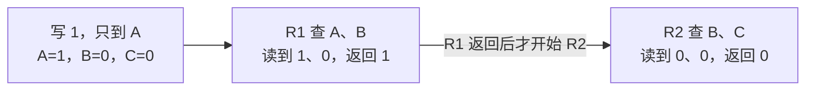
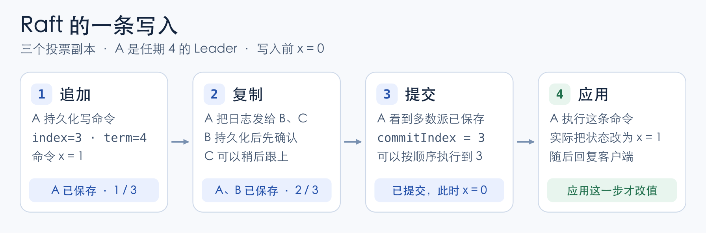
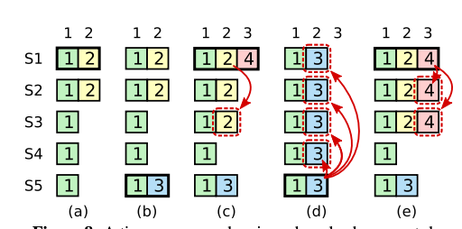
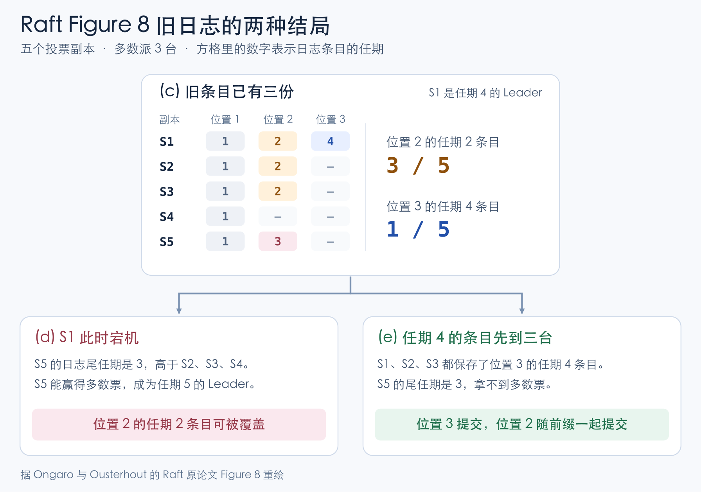
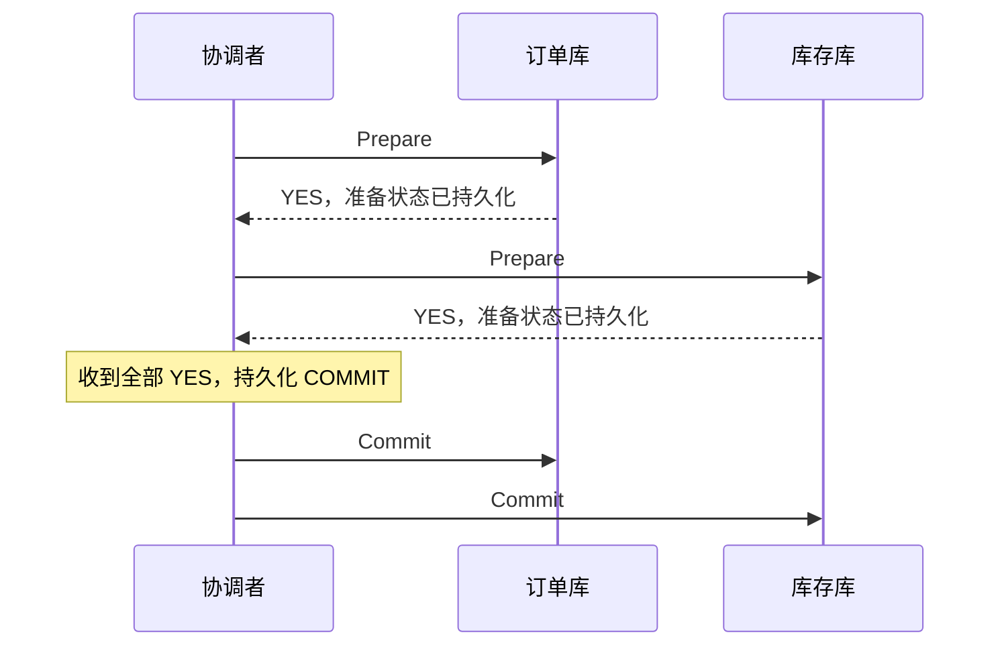

# Distributed Systems

[toc]

## 分布式基础

### 一致性、ACID 与 CAP

**最终一致性（Eventual Consistency）**允许多个节点或系统暂时看见不同状态。停止新更新后，只要传播与合并能继续完成，数据最终会收敛到业务所定义的一致状态。 [讲最终一致性的知乎文章](https://zhuanlan.zhihu.com/p/25933039)

数据库事务的 **ACID** 包含四项性质。**A（Atomicity，原子性）**要求扣款和入账一起生效或一起撤销。**C（Consistency，一致性）**要求事务提交前后都满足定义好的约束，例如转账前后总额不变。**I（Isolation，隔离性）**规定并发事务能看到对方哪些改动、冲突怎样处理。**D（Durability，持久性）**要求已经确认提交的转账在系统崩溃并恢复后仍然保留。 [单库事务与快照](./Database.md#一次转账中的事务与快照)

**CAP**讨论网络分区时能同时给出什么承诺。Consistency 指线性一致性，Availability 要求每个非故障节点收到的请求最终得到有效响应，Partition Tolerance 把节点之间的消息丢失或延迟纳入故障模型。网络一旦分区，线性一致性与这种可用性无法同时保证。 [Gilbert 与 Lynch 的 CAP 论文](https://groups.csail.mit.edu/tds/papers/Gilbert/Brewer2.pdf) · [CAP theorem](https://en.wikipedia.org/wiki/CAP_theorem) · [PACELC theorem](https://en.wikipedia.org/wiki/PACELC_theorem)

### 副本、Quorum 与线性一致性

假设一个键 `x` 有三份副本，存放在 A、B、C 三台机器上，初始值都是 `0`。向一台机器送到新值，另外两台可能要晚一点收到。**线性一致性（Linearizability）**要求从客户端观察，每个读写都仿佛在请求发出到响应返回之间的某个瞬间完成。比如一次写成功返回后才发起读，中间没有更新的写，这次读就应看到刚写入的值。 [Herlihy 与 Wing，线性一致性 §1、§3.1](https://pdos.csail.mit.edu/6.824/papers/p463-herlihy.pdf)

有些无主复制系统可以由任意节点协调读写。用 `N` 表示同一键的副本总数，`W` 表示写成功要等的确认数，`R` 表示读返回要等的响应数。满足门槛的一组副本叫 **Quorum**。当 `N=3, W=2, R=2` 且始终在固定的 A、B、C 中选，两组各拿两个，必有交集。例如写确认集合 `Q_W` 是 A、B，读响应集合 `Q_R` 是 B、C，B 两边都在。 [Dynamo §4.4–4.5](https://assets.amazon.science/ac/1d/eb50c4064c538c8ac440ce6a1d91/dynamo-amazons-highly-available-key-value-store.pdf)

$$
|Q_W\cap Q_R| \ge W+R-N > 0
$$

#### 并发写读竞态：明明有交集，为什么还能从 1 读回 0

考虑一个简化实现。读等到两份响应就挑其中版本较新的值，然后直接返回。新写入 `x=1` 暂时只到 A，B、C 仍是 `0`。下面两次读先后发生，`R1` 已经返回，`R2` 才开始。



写只在 A 生效时，还凑不齐 `W=2`。为了让 `R1` 看见 `1`，线性化顺序要把这次写放在 `R1` 之前。`R2` 又在 `R1` 之后，中间没有把 `x` 写回 `0` 的操作，因此这个 `1 → 0` 的历史无法解释。两次读共有的 B 一直是旧值，交集本身只有集合意义。若 `R1` 返回前把选中的版本**同步写回多数派**，这个回退就会被阻止。ABD 等寄存器协议把这种读修复（Read Repair）与版本选择结合起来。 [Herlihy 与 Wing，操作历史与现实顺序](https://pdos.csail.mit.edu/6.824/papers/p463-herlihy.pdf) · [ABD 原论文 §3–4](https://groups.csail.mit.edu/tds/papers/Attiya/JACM95.pdf)

还有两类情况也要检查。

- **部分写失败未回滚。** 写只在一个副本落盘，接口却返回失败。若接口承诺失败代表这次写已作废，读再看见该版本就违反了承诺。接口若返回超时或结果未知，又提供操作回执，调用方可以按原操作 ID 核对结果，再决定是否重试。 [提交结果不明与 Readback](./Database.md#5-事务保证要么都写要么都不写但不保证调用者一定知道结果)
- **Sloppy Quorum 借用临时副本。** 分区时写可能由 A、临时节点 D 确认，随后读拿到 B、C 的响应。各得两份，两个实际集合却没有交点。Dynamo 用 Hinted Handoff 记录这份数据原本要交给谁，等目标节点恢复后再交回。 [Dynamo §4.5](https://assets.amazon.science/ac/1d/eb50c4064c538c8ac440ce6a1d91/dynamo-amazons-highly-available-key-value-store.pdf)

### Raft 共识

#### Raft 的最小基础

三台机器 A、B、C 都维护一份 `x`。先执行 `x=1` 再执行 `x=2`，最终是 `2`。反过来执行，最终是 `1`。所以三台机器需要先对**执行哪些命令、按什么顺序执行**达成一致。Raft 是解决这个问题的共识算法。它把命令依次记入日志。各副本从相同初始状态出发，按同样的顺序执行已提交的确定性命令，就能算出相同的状态。这种做法叫**复制状态机（Replicated State Machine）**。 [Raft 原论文 §2、§5.1–5.3](https://raft.github.io/raft.pdf) · [讲义 §3.3](../Learning-Materials/distributed-systems-for-loopx/生产级系统工程与大模型服务权衡讲义.md#33-复制quorum-盲区与-raft-共识三大安全性定理)

| 一个节点的角色 | 它在做什么 |
| --- | --- |
| **Leader（领导者）** | 接收客户端的写命令，给命令排好顺序，再把日志发给其他副本。 |
| **Follower（跟随者）** | 接收 Leader 的日志和心跳。Leader 暂时没有新命令时，也会通过心跳表明自己还在。 |
| **Candidate（候选者）** | 当跟随者等 Leader 消息超时，可以开始一轮选举，投自己一票并向其他节点请求投票。 |

假设 A 是 Leader，它宕机后 B 一段时间收不到心跳，就可以发起选举。如果 B 拿到自己和 C 的票，它就有了三台投票节点中的两票，可以成为新 Leader。**多数派按整组投票节点计算**。三台里两台能通信，满足投票条件就有机会继续。只有一台可用时，新选举和新日志提交都凑不齐多数派。每台节点同一任期最多投一票，两组多数派又至少有一个共同节点，所以同一任期最多能选出一个 Leader。 [Raft 原论文 §5.1–5.2](https://raft.github.io/raft.pdf#page=6)

**`term` 是轮次，`index` 是位置。** Raft 把时间分成编号递增的任期，每个任期从选举开始。日志条目的 `index` 表示它在日志中的位置，条目的 `term` 记录它最初被写入时的任期。例如位置 3 的条目在任期 4 写下，到了任期 5，只要这条条目还在，它仍是 `(index=3, term=4)`。 [Raft 原论文图 2 与 §5.1、§5.4.2](https://raft.github.io/raft.pdf)

#### Raft 如何复制一条命令

假设 A 是任期 4 的 Leader，接到一条 `x=1` 的写命令。



1. **追加。** A 把这条命令持久化在自己的日志位置 3，记为 `(index=3, term=4)`。
2. **复制。** A 通过 `AppendEntries` 把这条日志发给 B、C。假设 B 先把日志持久化并确认，A 和 B 就凑够了多数派。
3. **提交。** 当前任期的条目在多数派持久化后，A 把 `commitIndex` 推进到 3，表示可以按顺序执行到这里。
4. **应用（apply）。** A 按日志顺序执行已提交的命令，实际把自己的 `x` 改成 `1`，然后回复客户端。B、C 收到日志并得知它已提交后，也会按顺序应用。复制和应用都可能落后。

Raft 论文 §8 的只读优化要求 Leader 先以本任期已提交条目确立提交进度，再向多数派确认自己仍是 Leader，并让本地状态机应用到读所需的位置。 [Raft 原论文 §5.3、§8](https://raft.github.io/raft.pdf) · [本地 WAL 与共识日志](./Software-Engineering.md#编程中的经典应用)

#### 选举限制与日志匹配

- **选举限制（Election Restriction）**。候选者（Candidate）向每个投票者出示自己日志尾部的 `(lastLogTerm, lastLogIndex)`。投票者先比较最后一条的任期，任期相同才比较最后的位置。候选日志至少与该投票者一样新，才有资格获得这张票。例子中 `(3, 2)` 比 `(2, 10)` 新，任期比较优先于日志长度。 [Raft 原论文 §5.2、§5.4.1](https://raft.github.io/raft.pdf#page=8)

$$
(t_{\mathrm{cand}},i_{\mathrm{cand}})\ge(t_{\mathrm{voter}},i_{\mathrm{voter}})
\iff (t_{\mathrm{cand}}>t_{\mathrm{voter}})\lor
\bigl(t_{\mathrm{cand}}=t_{\mathrm{voter}}\land i_{\mathrm{cand}}\ge i_{\mathrm{voter}}\bigr)
$$

- **日志匹配律（Log Matching）**。两份日志在同一 `index` 的 `term` 相同，该条命令及此前的日志前缀就相同。Leader 发送 `AppendEntries` 时带上新条目之前一格的 `(prevLogIndex, prevLogTerm)`。跟随者先校验这个位置和任期，匹配才接上新条目。校验失败时，Leader 往前找共同前缀，再处理那之后冲突的日志。每次追加都从已匹配的前缀出发，这就解释了日志匹配为什么能逐条维持。 [Raft 原论文图 2、图 3、§5.3](https://raft.github.io/raft.pdf)

#### Figure 8 中的旧任期日志怎么提交



原图有五台机器，多数派是三台。只盯住位置 2 的旧条目和位置 3 的新条目。图中方格里的数字是**该条日志写入时的任期**，所以 S5 在任期 5 竞选时，日志尾部仍可是一条任期 3 的记录。表中的 `(d)` 与 `(e)` 都从 `(c)` 出发。



| 原图 | 日志进度 | 接下来会怎样 |
| --- | --- | --- |
| `(a)–(b)` | S1、S2 有一条位置 2 的任期 2 日志。S5 从自己和 S3、S4 获票后当选任期 3 的 Leader，在本机的同一位置写入了不同的命令。 | 两条冲突记录都还未提交。 |
| `(c)` | S1 在任期 4 当选，把任期 2 的旧条目补到 S3。位置 2 现在有三份。S1 已本地追加位置 3 的任期 4 条目。 | 旧条目虽有三份，当前任期的条目还没复制到多数派。 |
| `(d)` | 假如 S1 此时宕机，S5 的日志尾任期 `3` 比 S2、S3、S4 的尾任期更新。 | S5 能在任期 5 当选，并用位置 2 的任期 3 条目覆盖冲突的旧条目。 |
| `(e)` | 假如 S1 先把位置 3 的任期 4 条目复制给 S2、S3，三台的日志尾就都有任期 `4`。 | S5 拿不到这三台的票。位置 3 提交，包含位置 2 的前缀也一起提交。 |

**按多数派确认数直接推进提交位置时，选中的条目必须属于 Leader 的 `currentTerm`。** 一旦该条目提交，日志匹配把它之前的旧条目一起带入已提交前缀。新 Leader 暂时没有客户命令时，可以追加一条空操作（`no-op`）来形成当前任期条目。已经提交的条目会被后续 Leader 保留，这就是领导者完整性（Leader Completeness）。副本按已提交前缀执行，同一位置只能应用同一条命令，这就是状态机安全性（State Machine Safety）。 [Raft 原论文 Figure 8、§5.4.2](https://raft.github.io/raft.pdf#page=8) · [Raft 原论文 §8 的 no-op](https://raft.github.io/raft.pdf#page=13)

## 跨服务事务、可靠投递与补偿

订单服务把订单写进自己的数据库，库存服务在另一份数据库预留库存。订单已提交之后，库存还可能没有处理。单库事务能把本库的相关改动一起提交，跨库还要约定库存什么时候执行、失败时如何知道已经做到了哪一步。 [单库事务与快照](./Database.md#一次转账中的事务与快照) · [讲义 §3.4](../Learning-Materials/distributed-systems-for-loopx/生产级系统工程与大模型服务权衡讲义.md#34-跨服务一致性2pc-阻塞缺陷-vs-transactional-outbox-vs-saga)

### 2PC 为什么会等在 Prepare 之后

> **为什么高并发在线系统忌用 2PC**：Prepare 阶段所有参与者锁死资源等待协调者指令，协调者一旦单点故障或网络抖动，参与者连接池全部卡死在 `In-Doubt` 状态。

两阶段提交（Two-Phase Commit，2PC）让订单库和库存库服从同一个提交或回滚决定。**Prepare 阶段**先请每个参与者准备本地修改，并把恢复所需的状态持久化。回答 `YES` 意味着它已经准备好，之后能按最终决定提交或回滚。**决定阶段**由协调者作决定，只有所有参与者都确认准备好，才允许决定 `COMMIT`。协调者把 `COMMIT` 或 `ABORT` 持久化，再通知各方执行。 [Gray 与 Lamport，Consensus on Transaction Commit §3](https://arxiv.org/pdf/cs/0408036) · [2PC 与 WAL](./Software-Engineering.md#walwrite-ahead-log先持久化恢复记录再持久化正式状态)



想象订单库已经收到 `COMMIT`，协调者还没通知库存库就崩溃了。库存库只知道自己投过 `YES`，不知道最终决定，这叫 **In-Doubt**。它得等待能核验的决定。若此时仅凭超时自行回滚，订单已经提交，库存却被撤销。协调者恢复后可从持久记录继续传达决定。等待期间，参与者可能仍持有数据库锁或预留资源。协调者故障或网络延迟会拉长持锁时间，阻塞请求堆积时可能耗尽连接池。以 PostgreSQL 为例，准备好的事务可以脱离原会话，但仍持有锁。 [Gray 与 Lamport，2PC 的阻塞窗口 §3.3](https://arxiv.org/pdf/cs/0408036#page=9) · [PostgreSQL `PREPARE TRANSACTION`](https://www.postgresql.org/docs/16/sql-prepare-transaction.html)

### Outbox 怎样让已提交的订单最终发出消息

> **Transactional Outbox（本地事务消息表，工业界首选）**：将「更新业务表」与「向同库 `outbox` 表插入事件记录」放入**同一本地数据库事务**原子提交；后台 Relay 扫描未投递事件发往下游并标 `SENT`，下游凭 `event_id` 幂等去重。

如果订单提交后直接发消息，进程可能刚好在两步之间崩溃。**Transactional Outbox（本地事务消息表）**让订单服务在**同一个本地事务**里更新业务表，并向同库 `outbox` 表写入带 `event_id` 的待发事件。一起提交后，即使进程崩溃，待发事件也还在。后台投递进程（Relay）取出记录，发给消息代理或下游，获得接收确认后标记 `SENT` 或推进投递游标。 [Transactional Outbox 模式](https://microservices.io/patterns/data/transactional-outbox.html) · [Outbox 的提交边界与投递水位](./Software-Engineering.md#outbox把业务提交与异步投递绑定)

投递成功后、记录 `SENT` 前，Relay 也可能崩溃。重启后它会用同一个 `event_id` 重发，所以消费者通常要用唯一键**把去重记录和业务变更放进同一个本地事务**。只写去重记录便可能漏处理，只改业务状态则可能重复扣减。持续重试还要求 Relay 和下游恢复可用，且待发记录在完成前仍被保留。 [AWS Transactional Outbox](https://docs.aws.amazon.com/prescriptive-guidance/latest/cloud-design-patterns/transactional-outbox.html) · [消费端幂等与事件顺序](./Software-Engineering.md#重试顺序与投影保证到哪里)

异步投递也可以用普通消息配合可恢复的发送记录或对账补发。如果消息系统提供事务消息，生产者可用其协议把本地事务结果与消息可见性绑定。迁移中的 shadow capture 还要绑定源事务，切换主存储（promotion）后的兼容投影要用 revision 检查防止旧值覆盖新值。 [RocketMQ 事务消息](https://rocketmq.apache.org/docs/featureBehavior/04transactionmessage/) · [源事务绑定与投影单调性](./Software-Engineering.md#outbox把业务提交与异步投递绑定)

### Saga 怎样撤销已经发生的业务效果

> **Saga 正反向补偿三防线**：拆为局部事务链 $T_1 \dots T_k$ 与逆向补偿 $C_{k-1} \dots C_1$，必须同时实现 **① 空补偿防护**（原请求未达时补偿落墓碑空过）、**② 防悬挂**（空补偿墓碑存在时拒绝迟到的原正向请求）、**③ 补偿幂等**。

**Saga pattern（补偿式事务模式）**沿用原论文《Sagas》的命名。它把一个流程拆成多个可独立提交的本地事务。例如先创建订单，再预留库存，最后扣款。若扣款确认失败，库存预留已经生效，就发起一次新操作释放库存，再把订单标为已取消。前向步骤记为 `T1` 到 `Tk`。第 `k` 步确认失败时，通常按 `C[k−1] → … → C1` 的逆序补偿此前完成的步骤。各步骤提交后即可被其他请求看见，补偿也可能失败，需要记录进度并重试。 [Garcia-Molina 与 Salem，Sagas 原论文](https://www.cs.princeton.edu/techreports/1987/070.pdf) · [补偿交易（Compensating Transaction）](https://docs.microsoft.com/en-us/azure/architecture/patterns/compensating-transaction)

网络超时后，库存预留请求可能只是迟到，释放请求却先到了。处理可能乱序或重复的前向操作与补偿时，库存服务要持久记录同一流程步骤的状态，并把记账和库存变化放在同一个本地事务中。

| 现象 | 参加方怎样处理 |
| --- | --- |
| **空补偿**。释放先到，还没有成功预留。 | 写一条持久的取消标记（tombstone），这次释放跳过库存改动。 |
| **防悬挂**。原预留请求随后才到。 | 按同一个步骤 ID 查到取消标记，拒绝迟到的预留。 |
| **补偿幂等**。释放请求因超时被重发。 | 若已经释放或作空补偿，返回已有结果。状态更新与真正释放一起提交，同一步骤只释放一次。 |

这些约束也出现在 TCC（Try、Confirm、Cancel）的参与者实现中。这里借它们保护 Saga 里可能重试和乱序的接口。 [Apache Seata，空回滚、防悬挂与幂等](https://seata.apache.org/blog/seata-tcc-fence/)

### 2PC、Outbox 与 Saga 对照

| 机制 | 提供什么 | 中断之后 |
| --- | --- | --- |
| **2PC** | 多个数据库服从一个提交或回滚决定。 | 已准备的参与者等待可核验的决定，可能继续持锁。 |
| **Transactional Outbox** | 本地业务提交时，同时保存异步投递意图。 | Relay 恢复后重发，下游用 `event_id` 原子去重。 |
| **Saga** | 多个已提交的业务步骤可以按规则继续或补偿。 | 需要判清哪一步已生效，执行相应补偿并处理重试。 |

Outbox 可以承载 Saga 的下一步命令或补偿消息。本地提交为重发提供记录，整个流程的完成仍由各步结果和补偿规则决定。

### 手推三个恢复问题

1. `x=1` 只到 A。`R1` 查 A、B 并同步写回 A、B 后才返回 `1`。随后的 `R2` 查 B、C，在没有其他写的例子里会读回 `0` 吗？
2. 五副本的 Figure 8 中，任期 4 的 Leader 只把当前任期条目放到了自己和 S2。能否根据这条记录直接推进 `commitIndex`？
3. Relay 已成功交给消息代理，尚未标 `SENT` 就崩溃。库存服务怎样保证同一个事件只预留一次？

**答案**

1. `R2` 会从 B 读到 `1`，选择较新版本后返回 `1`。交集里的 B 这时已经收到新值。
2. 仍要等第三个投票节点复制当前任期条目。旧条目有三份可以继续复制，但这两份当前任期条目还凑不齐多数派。
3. Relay 重发同一个 `event_id`。库存服务把唯一去重记录和预留库存放在同一笔本地事务里，重复消息复用已有结果。

## 可靠性与容错模式 (Reliability & Fault Tolerance)

### 重试、超时与预算

* **重试 (Retry)**：在操作失败后重新尝试，以应对网络抖动、服务瞬时不可用等**暂时性故障 (Transient Failures)**。
* 重试是否有用，取决于“下一次尝试有什么会变化”。外部服务可能恢复时，原请求配合 backoff / jitter 重放有意义；确定性校验持续拒绝同一输入时，原样重放只会增加延迟和成本。
* **先分类，再决定是否改请求**：

| 失败类型 | 下一次尝试 | 原因 |
| --- | --- | --- |
| 网络超时、连接重置、临时 5xx | 保持业务请求不变，增加 backoff / jitter | 期待外部状态恢复；随意改 payload 会改变操作语义 |
| 输出被截断、格式不合法、约束未满足 | 保留原目标，加入最小且针对性的失败反馈 | 外部状态不会自动变化，必须让生成策略发生变化 |
| 鉴权失败、非法配置、确定性前置条件不满足 | fail fast，等待配置或用户修复 | 重试无法消除根因 |

* **Retry budget 属于 policy**：最大尝试次数、deadline、输出或资源上限应由配置层拥有。执行器可以根据错误改写下一次策略，但不应偷偷提高上限、追加次数或换模型，否则会破坏成本边界和可复现性。
* **超时先看计时范围**：连接超时、单次尝试超时、空闲超时和整体 deadline 约束不同阶段，起算点与重置条件也不同，不能只比较数字大小。以 Envoy 为例，route timeout 在完整接收请求后开始等待完整上游响应；stream idle timeout 约束无活动时长。[超时类型与计时语义](https://www.envoyproxy.io/docs/envoy/latest/faq/configuration/timeouts)
* **外层愿意等，不代表内层也会等**：调大客户端或任务执行器的等待时间，无法撤销代理已经作出的超时响应。连续出现近似固定耗时只能作为计时器线索，不能据此认定某个默认配置就是根因。
* **单次 timeout 不等于端到端预算**：例如 Python Requests 的 `timeout` 不是整个响应下载的总时限；多次重试、退避和响应处理仍需受整体 deadline 约束。流式传输持续有数据可避免空闲超时，但不保证避开整体时限。[Requests timeout 语义](https://requests.readthedocs.io/en/latest/user/quickstart/#timeouts)
* **实时控制还需约束观测年龄与动作间隔**：请求返回得快，也可能返回旧快照；长时间等待新快照，又可能延迟下一次动作。见 [观测新鲜度与异步控制](#观测新鲜度与异步控制)。
* **只有完整结果才能提交**：失败尝试可以进入 trace，但不能安装为正式状态。带副作用的调用还需要 idempotency key、去重或补偿，避免“响应丢失后重试”把同一操作执行两次。
* **风险**：过载时的大量重试会形成 retry storm，并把下游压力放大成 cascading failure。

### 租约、Fencing 与幂等回执

假设 Worker A 领取了一个写入任务。它被运行时长暂停（Stop-the-World，STW）卡住，租约到期后 Worker B 接手。A 恢复时仍可能从暂停前的那行代码继续执行，早先发出的请求也可能刚到存储端。要保护共享状态，最终写入的资源必须能认出旧请求。 [Chubby 论文 §2.4](https://static.usenix.org/events/osdi06/tech/full_papers/burrows/burrows_html/) · [Kleppmann 的 Fencing 示例](https://martin.kleppmann.com/2016/02/08/how-to-do-distributed-locking.html)

| 机制 | 要回答的问题 | 例子 |
| --- | --- | --- |
| 租约（lease） | 谁可以接手，什么时候可以重新分配？ | A 的租约到期后，B 可以领取。 |
| Fencing Token（单调递增的代次号） | 这笔写入来自哪一代，是否已经过时？ | 资源记录的最大代次已到 `2`，便拒绝 A 带 `1` 的写入。 |
| 幂等键（idempotency key）与回执（receipt） | 这是不是同一笔业务操作，已经提交过吗？ | B 接手后沿用 `op-7`。提交成功但响应丢失时，重试复用已存结果。 |

资源记录最大代次的方案，从资源看到新代次起挡住旧写。只要资源还停在 `1`，它就无法仅凭 token `1` 判断租约在另一台机器上已经过期。若要求交接一生效就拒绝旧写，可以在交接完成前先推进资源端的代次，或让最终写入在同一事务中验证权威记录里的当前代次。代次校验和写入必须原子完成，中间留出间隔就会重新出现抢占竞态。 [补课讲义 §10](../Learning-Materials/distributed-systems-for-loopx/补课讲义.md#10-租约fencing-与旧执行者)

同库写入可以在一次持久事务中完成代次校验、业务变更和回执保存。跨系统调用时，下游需要按稳定的 `op_id` 去重或支持查回执，才能在响应丢失后确认外部动作是否执行过。 [Python 手推与代码](./python.md#fencing-与幂等账本) · [Outbox 和下游去重](#outbox-怎样让已提交的订单最终发出消息)

### 退避与抖动

退避（Backoff）给故障服务恢复时间。固定退避（Fixed Backoff）如每次等 1 秒。指数退避（Exponential Backoff）按重试次数放大间隔，例如 1、2、4、8 秒，并设置最大等待（Max Interval）、最大重试次数（Max Retries）与整体 deadline。一批客户端同时失败时，固定间隔和确定性的指数间隔都会让后续尝试集中，抖动（Jitter）把到达打散，缓解重试惊群（Thundering Herd）。

从第 0 次重试计数。基础等待为 `base`，等待上限为 `cap`。假设基础等待为正且在上限以内，该轮指数窗口如下。

$$
B_n=\min(\mathrm{cap},\mathrm{base}\cdot 2^n)
$$

Full Jitter 随机化整个窗口，Equal Jitter 至少等半个窗口，Decorrelated Jitter 用上一轮实际等待决定下一轮的抽样区间。以下记三种策略的等待为相应的 $D_n$。Decorrelated Jitter 首次抽样前将上一轮等待初始化为 `base`，抽样后再截到 `cap`。

$$
\begin{aligned}
D_n^{\mathrm{full}} &\sim \operatorname{Uniform}(0,B_n),\\
D_n^{\mathrm{equal}} &= B_n/2+U_n,\qquad U_n\sim \operatorname{Uniform}(0,B_n/2),\\
D_n^{\mathrm{decorrelated}} &= \min(\mathrm{cap},V_n),\qquad
V_n\sim \operatorname{Uniform}(\mathrm{base},3D_{n-1}^{\mathrm{decorrelated}}).
\end{aligned}
$$

[AWS 的退避与抖动分析](https://aws.amazon.com/blogs/architecture/exponential-backoff-and-jitter/) · [流式网关的 Full Jitter 算例](./Software-Engineering.md#用-full-jitter-打散重连)

### 断路器与对冲请求

* **断路器 (Circuit Breaker)**：当失败率达到阈值时，暂时切断请求，快速失败，避免无意义的重试。
* **Hedging Requests (对冲请求)**：向多个副本发送请求，使用最快返回的结果（解决长尾延迟）。

### 观测新鲜度与异步控制

参考：[Age of Information: An Introduction and Survey](https://arxiv.org/html/2007.08564v1) 的概念定义；[Python asyncio 等待与取消语义](https://docs.python.org/3/library/asyncio-task.html#waiting-primitives)。以下为通用工程推导，可用于远程操作、游戏控制和状态监控。

实时反馈循环通常是“观测 → 决策 → 动作 → 再观测”。环境不会因为客户端等待而暂停；若上一条动作持续有效，等新观测期间它仍在执行。即使使用异步 I/O，顺序写成 `await refresh(); decide(); act()` 也会让这条控制路径等待刷新完成。

请求耗时与信息新鲜度是两个指标。设当前时刻为 t，已接收且采用的最新观测生成于 u(t)，则信息年龄为：

$$
\Delta(t)=t-u(t)
$$

这里使用生成时间，不是接收时间；跨机器时间戳需处理时钟偏差。同一会话内也可用单调源序号 / tick 比较前后，但换算年龄需要明确时间基准。服务返回缓存或未更新快照时，多次读取可能得到同一版本；一次较晚返回的响应也可能比当前已采用状态更旧。

**有界等待只缩短控制空档，不加速源数据生成。** 一种设计是立刻发起可选刷新，最多额外等待一个预算；到期后保留请求，用当前已知状态继续决策，后续循环再接收结果。例如：

```text
t=0：发起刷新，已有观测仍可使用
t=3：等待预算耗尽，依据已有观测发下一条动作；刷新仍在途
t=15：刷新返回，校验后供后续决策使用
```

这是示意时序。3 秒约束的是这一次可选刷新的前台等待，不是总控制延迟、网络超时或数据年龄上限；必需的动作确认与其他 I/O 仍可能增加延迟。继续使用旧观测也会增加决策误差，应按观测年龄和场景风险缩短动作、采用保守策略或停止，具体选择须验证。

异步接收需要四条约束：

- **限制在途数量**：例如同一控制对象最多一个可选刷新，避免每轮新建请求造成积压；每轮等待仍在途请求也不能反复占满预算。
- **校验身份和版本**：只接收当前会话 / 对象的结果，并以源版本推进状态；如当前已到版本 120，迟到的版本 110 不能覆盖它。动作确认应按自己的序号处理，不能从画面更新推断动作已生效。
- **区分等待结束与取消**：停止等待不代表底层请求终止。Python `asyncio.wait` 超时保留 pending tasks，`wait_for` 默认取消被等待任务；保留后台请求必须明确选用对应语义。
- **管理完成、错误和退出**：保存请求句柄，接收迟到异常；会话结束时明确取消或收尾，并阻止结果进入下一会话。可选刷新延期不能绕过必需的动作确认或权限错误处理。

验收同时看请求延迟、新帧比例、决策时观测年龄、动作间隔、控制结果及迟到结果处置。离线时序测试能验证状态不回退、会话不串扰、异常不丢失；实际环境才可验证控制收益。异步化改变了等待位置，不能单凭响应更快证明控制效果更好。

## 消息系统与协调服务

### Kafka

#### Kafka 核心设计原理

* kafka架构
  * distributed high throughput message system (version 0.10), distributed streaming platform
  * 特点
    * 低延迟：O(1)，TB级
    * 高吞吐：单机qps 10w，虚拟机6个节点，单条消息1KB，打满1GB带宽
    * 水平扩展：broker消息分区，支持在线水平扩展
    * 顺序性：partition内部的局部顺序性
    * 多场景：离线/实时，延迟ms级
  * 架构
    * producer：app/web/mysql
      * 内存内部队列，push失败3次抛异常
      * 如果希望不丢数据，可以用flush方法
    * broker：服务器 kafka server
      * 数据存进本地磁盘不用担心内存被打爆
      * producer--push-->broker<--pull--consumer
      * pull的好处是避免consumer消费不过来，缺点是有一定延迟
        * long pulling 长轮训：有数据再返回
        * 不用push方法可以让broker的功能更简单，不需要知道consumer的信息，方便水平扩展
    * consumer：hadoop/spark/flink/other kafka
      * 能处理多少数据拿多少
    * zookeeper：管理broker集群相关的元信息、领导选举
      * 以前producer会连zk，后来直连broker
      * broker和zk有长连接，并且本地缓存元信息
  * Time & Partition & Segment
    * Record
      * Key-Value
      * Timestamp: for streaming Kafka
    * Topic: 逻辑概念，用于发布-订阅
    * Partition：物理上对应文件夹（可以认为是文件），均匀分布在broker间；一个topic对应多个partition
      * 理解为数组，有offset的概念
    * Segment：segment对应文件，partition对应文件夹
  * 机制
    * 写数据：append-only，机械磁盘顺序读写性能还不错，甚至比内存随机读写更快
    * 删数据：文件过大、磁盘满，直接删最老的segment
  * consumer
    * 两种consumer API
      * low level (assign):
        * Input: partition, offset, length
        * 缺点在于当consumer和partition动态变化时，如何给consumers分配partitions
      * high level (subscribe):
        * consumer group顺序消费某个topic
        * offset存于zk或kafka或自定义存储
        * 实现了rebalance机制
  * producer
    * 异步：batch.size, linger.ms, flush()
    * 保证顺序性：Queue与retry机制
      * retry.backoff.ms
      * retries
      * max.in.flight.requests.per.connection 设为1提升顺序性
    * partitioner.class
      * 无key的情形：round-robin，无法保证同user数据进同一个partition
      * 通常用uid做key
      * 能引入cluster信息（比如broker和producer距离）

```java
public int partition(String topic, Object key, byte[] keyBytes, Object value, byte[] valueBytes, Cluster cluster) {
  List partitions = cluster.partitionsForTopic(topic);
  int numPartitions = partitions.size();
  if (keyBytes == null) {
    int nextValue = nextValue(topic);
    List availablePartitions = cluster.availablePartitionsForTopic(topic);
    if (availablePartitions.size() > 0) {
      int part = Utils.toPositive(nextValue) % availablePartitions.size();
      return availablePartitions.get(part).partition();
    } else { // no partitions are available, give a non-available partition
      return Utils.toPositive(nextValue) % numPartitions;
    }
  } else { // hash the keyBytes to choose a partition
    return Utils.toPositive(Utils.murmur2(keyBytes)) % numPartitions;
  }
}
```

#### Kafka Consumer Rebalance 机制演进

* 一个partition只分配给一个consumer
  * 简单+保证一个consumer能顺序处理partition的数据
  * 一个consumer可消费多个partition
* rebalance的完整过程
* 自治式rebalance
  * zk注册/consumers/[consumer group]/ids/[consumer id] watch
  * /brokers/id也注册watch
  * 每个consumer去watch这个状态，自己做决定
  * 坏处
    * Herd Effect：任何broker/consumer的增减会触发所有consumer的rebalance
    * Split Brain：同一时刻不同consumer从zk看到的状态可能不一样
    * 调整结果不可控（虽然可能有最终一致性）
* 集中式rebalance
  * coordinator监听topic、partition
  * 接收consumer注册，选取leader
  * leader SyncGroup -> coordinator
  * 其它member SyncGroup获取结果

#### Kafka 高可用与 ISR

* topic的replication factor：10个partition变成30个partition
* 数据复制
  * 每个partition有一个broker作为leader
    * producer->leader, follower<-leader

  * in-sync replica (ISR): a broker that has the latest data for a given partition.
    * 只有所有ISR commit了，才认为producer发送成功，允许consumer消费

  * 参数控制：落后时间、落后消息个数
    * Server:
      * replication.lag.time.max.ms=10000
      * replication.lag.max.messages=4000

    * Topic: min.insync.replicas=1
    * Producer: request.require.acks=1
    * 备份太慢，则从ISR里踢掉，不用担心像同步复制有慢节点问题

  * 领导选举：各自选举、基于controller的选举
    * 目前实现是选新leader从ISR里随机选

* 处理replicas全部失败
  * 策略1:等ISR中任一replica恢复
    * 降低可用性，极端情况下partition永久不可用

  * 策略2:等任一replica恢复 （default，默认高可用方案）
    * 可能丢数据

* 拓展
  * 常用一致性算法（commit策略）：WNR、Quorum、Paxos及其变种

#### Kafka Exactly-once 与提交边界

* consumer exactly once

  * 两阶段提交（0.1之后）
    * 耗时长，不适用低延时场景
    * 需要参与两阶段提交的所有系统皆实现XA接口

  * At lease once + 下游幂等处理
    * 实现简单
    * 要求下游系统提供幂等处理接口
    * auto.commit.interval.ms=5000

  * Offset更新与数据处理放在同一事务中
    * 要求下游处理系统可回滚
    * 需要提供事务功能的系统参与
    * e.g. offset和消息一起存进mysql；读到内存但还未消费的数据持久化到hdfs
    * syncCommit

* producer exactly once
  * enable.idempotence=true
  * producer生成一个PID
  * broker维护每个partition来自每个PID的当前最大序号，来判断接受/重复/乱序

#### 操作

* consumer 介绍
  * https://docs.confluent.io/platform/current/clients/consumer.html#ak-consumer
  * `auto.offset.reset` = earliest / latest (default) / none
    * https://issues.apache.org/jira/browse/KAFKA-3370
    * 触发的两种场景：1）指定的timestamp过早，数据没了；2）consumer group没有commit过offset，挂了

* Debug lag
  * 数据生成、样本消费

  * lag是否持续、container/application cpu/mem是否正常

  * partition lag情况

  * 多topic是否消费均匀

  * flink资源情况

* consumer lag
  * 用户侧
    * 消费能力不足
      * Topic的单partition入流增加
      * 业务逻辑耗时长
    * consumer在不断重启
    * 处理消息时间长，影响fetch数据
  * Kafka侧
    * Broker压力大
    * Broker磁盘故障
  * [Kafka的Lag计算误区及正确实现](https://blog.51cto.com/u_15127513/2682807)
    * Lag = HW - ConsumerOffset

### ZooKeeper

```python
ChildrenWatch
```

## 分布式数据处理

### MapReduce

**[l01-Introduction and MapReduce](https://github.com/huangrt01/CS-Notes/blob/master/Notes/Distributed-Systems/l01-Introduction%20and%20MapReduce)**

### Spark

#### Stage划分

* Stage的边界是Shuffle操作。一个Job中，没有Shuffle的线性处理流程只有一个Stage 0。
* 宽依赖 (Shuffle, 触发新Stage): `groupByKey`, `reduceByKey`, `join`, `repartition`, `orderBy`。
* 窄依赖 (不触发Shuffle): `map`, `filter`, `select`, `read`。

#### Shuffle策略

- Shuffle Hash Join (洗牌哈希连接)
  - 核心思想 ：把两张大表按 key 切割，然后把相同 key 的数据块发送到同一个节点上进行连接。。
- Broadcast Hash Join (广播哈希连接)
  - 核心思想 ：把小表完整地复制分发给所有计算节点，让它和分布在各个节点上的大表数据进行本地连接。
- Shuffle Sort Merge Join (洗牌排序合并连接)
  - 核心思想 ：先把两张表按 key “洗牌”并 排序 ，然后在每个节点上像拉拉链一样，将两条有序的数据流合并起来完成连接。

#### 1 Billion Row Challenge


### Flink

#### 流式处理模式、Storm 与 FLIP

* streaming依赖kafka的exactly once 保障。用的是water mark机制来确定消费进度
* Per Message VS. MicroBatch
  * MicroBatch
    * Spark StructStreaming MicroBatch
    * 一致性语义：at-least once, exactly once
    * 吞吐高

  * Per Message
    * Flink, SparkStreaming Continuous Mode
    * Partition数据消费节点稳定性强
    * 数据倾斜处理能力强
    * 一致性语义：at-least once(barrier不对齐), exactly once
    * 低延迟
    * 吞吐中高

* Storm数据模型与group type
  * Storm
    * spout代表一个storm拓扑中的数据入口，连接到数据源，将数据转化为一个个tuple，并发射tuple。
  
    * stream是由无限制个tuple组成的序列。tuple为storm的核心数据结构，是包含了一个或多个键值对的列表。

    * bolt可以理解为计算程序中的运算或者函数，bolt的上游是输入流，经过bolt实施运算后，可输出一个或者多个输出流。
      * bolt可以订阅多个由spout或者其他bolt发射的数据流，用以构建复杂的数据流转换网络。
  
  * GroupType主要用于Extractor+Joiner（Spout+Bolt）模式时，上下游之间交互方式；
    - keyby为按照key做hash，然后发给下游Joiner节点，单条数据会跨节点发送；
    - forward是保证spout和bolt在相同container里面执行，不跨节点发送数据；
    - shuffle是按照random(key)方式下发，单条数据会随机下发给下游节点

* FLIP
  * [FLIP-150: Introduce Hybrid Source](https://cwiki.apache.org/confluence/display/FLINK/FLIP-150%3A+Introduce+Hybrid+Source)

#### 《Serving Machine Learning Models》chpt 4

http://kb.sites.apiit.edu.my/files/2018/12/ebook-serving-machine-learning-models.pdf

* 介绍了flink的特点：scalabality、checkpointing、state support、window semantics
* Process Function -> basic building blocks
  * Events (individual records within a stream)
  * State (fault-tolerant, consistent)
  * Timers (event time and processing time)
* Flink provides two ways of implementing low-level joins, key-based joins implemented by **CoProcessFunction**, and partition-based joins implemented by **RichCoFlatMapFunction**
  * Key-based Joins：类似于按模型分组
  * Partition-Based Joins：一个instance能serving所有model
    * 一个任务多个instances执行该任务的不同input data subset


```java
// Partition-Based Joins
public class DataProcessMap extends AbstractRichFunction implements CoFlatMapFunction<byte[], ModelConfig, Double> {
  
  public double map(byte[] rawValue) throws RuntimeException {
    
  }
  
  @Override
  public void flatMap1(byte[] bytes, Collector<double> collector) throws RuntimeException {
    readLock.lock();
    double score = map(bytes);
    readLock.unlock();
    collector.collect(score);
  }
  
  @Override
  public void flatMap2(ModelConfig modelConfig, Collector<double> collector) {
    writeLock.lock();
    this.modelConfig = modelConfig;
    logger.info("Use new model config: " + modelConfig.toString());
    writeLock.unlock();
  }
}

DataStream<byte[]> kafkaInstanceStream = env.addSource(kafka_source);
DataStream<double> myStream = kafkaInstanceStream.connect(configDataStream.broadcast())
                .flatMap(new DataProcessMap(curConfig));


```


```java
// DataStream.class
StreamExecutionEnvironment env = StreamExecutionEnvironment.getExecutionEnvironment();
        env.getConfig().setGlobalJobParameters(params);
FlinkKafkaConsumer010<byte[]> kafka_source = Kafka010Utils.customFlinkKafkaConsumer010(
                cluster, topic, groupId, properties, new ByteArraySchema());
kafka_source.setXXX(...);
...
DataStream<byte[]> kafkaInstanceStream = env.addSource(kafka_source);

```


```java
// source function
import my_config.Config
import org.apache.flink.streaming.api.checkpoint.CheckpointedFunction;
import org.apache.flink.streaming.api.functions.source.SourceFunction;
import org.slf4j.Logger;
import org.slf4j.LoggerFactory;

public class ConfigSource implements SourceFunction<Config>, CheckpointedFunction {
  private static final Logger logger = LoggerFactory.getLogger(ConfigSource.class);
  private Config config;
  private volatile boolean isRunning = true;
  private transient ListState<Config> checkpointed;
  public ConfigSource(Config config) {
    this.config = config;
  }
  
  @Override
  public void run(SourceContext<Config> sourceContext) {
    while (isRunnning) {
      // this synchronized block ensures that state checkpointing,
      // internal state updates and emission of elements are an atomic operation
      synchronized (sourceContext.getCheckpointLock()) {
				Set<Long> oldList = null;
        if (config.XXX() != null) {
          oldList = new HashSet<>(config.XXX());
        }
        boolean changed = false;
        Set<Long> list = GetXXX();
        if (!list.equals(oldList)) {
          changed = true;
        }
        if (changed) {
          sourceContext.collect(config);
        }
        
      }
      try {
        Thread.sleep(60000);
      } catch (InterruptedException e) {
        logger.error("Sleep interrupted: " + e);
      }
    }
  }
  
  @Override
  public void cancel() {
    isRunning = false;
  }
  
  @Override
  public void snapshotState(FunctionSnapshotContext functionSnapshotContext) throws Exception {
    this.checkpointed.clear();
    this.checkpointed.add(config);
  }
  
  @Override
  public void initializeState(FunctionInitializationContext functionInitializationContext) throws Exception {
    this.checkpointed = functionInitializationContext
      .getOperatorStateStore()
      .getListState(new ListStateDescriptor<>("config", Config.class));

    if (functionInitializationContext.isRestored()) {
      for (Config config: this.checkpointed.get()) {
        logger.info("Old config: " + config.toString());
      }
    }
  }
}
```

#### 踩坑

* Compile error: error: scala.reflect.internal.MissingRequirementError: object java.lang.Object in compiler mirror not found.
  * solution: scala版本2.11，需要使用jdk8
  * Idea scale compiler: https://www.jetbrains.com/help/idea/compile-and-build-scala-projects.html

## 集群资源管理与执行框架

### Apache Hadoop YARN: Yet Another Resource Negotiator

[YARN官网](https://hadoop.apache.org/docs/stable/hadoop-yarn/hadoop-yarn-site/YARN.html)

[YARN 在字节跳动的优化与实践](https://mp.weixin.qq.com/s/9A0z0S9IthG6j8pZe6gCnw)

#### YARN 的设计背景与架构

1.Abstract

解决两大问题：1）依赖特定编程模型 2）中心式管理难以scale

设计核心是 separating resource management functions from the programming model，更彻底地将 platform和framework抽象开

2.History

R1,R2: hadoop community

R3: HoD

R4,R5: HoD -> shared clusters

R6,R7: shared clusters

R8,R9,R10: Apache MapReduce的局限性 -> YARN

3.Architecture

* 核心思路

  * RM是中心，也是连接AM和NM的桥梁

  * RM还能找AM要回资源

- ResourceManager，用于管理集群中的用户作业和分配资源。（缩写为RM）
- NodeManager，用于该节点上的用户作业和工作流。（缩写为NM）
  - container launch context (CLC)的概念，启动、监控、local service、auxiliary service
- Container，分布式任务中资源（memory、cpu）分配的最小单位
- ApplicationMaster，用户应用程序驻留的地方，是一个特殊的Container（缩写为AM）
  - AM: late binding, the process spawned is not bound to the request, but to the lease.
    - 它允许YARN在AM启动之前进行资源分配。当AM被授予租约时，可以在后台进行资源预分配。这样可以减少应用程序启动的延迟，并提高资源的利用率。
    - 其次，它允许AM在租约到期之前重新申请资源。如果AM需要更多的资源来扩展应用程序的规模或处理更大的工作负载，它可以在租约到期之前重新向YARN请求资源。这种灵活性使得应用程序可以根据需要进行动态调整，而不需要重新启动整个应用程序。
- 提交任务的流程
  - RM注册
  - 生成AM
  - AM请求同节点上的NM
  - 拉起Container


* fault tolerance: RM对AM有责任、AM责任最重

  * YARN only secures its deployment

  * RM单点故障，Work is in progress to add sufficient protocol support for AMs to survive RM restart.

  * 抽象分离的代价：更多fault tolerance工作交给了frameworks来设计

#### YARN 的生产实践与其他方案

4.YARN in the real-world

compute resource，分布式计算资源池，跑spark、flink任务等

集群一般会配两个RM、成千上万个NM；多个RM之间用zk选主，同一时间只有一个在工作

e.g. 500000 jobs daily

一些concern：

* HDFS NameNode becomes the bottleneck
* YARN have been observed on a few large clusters with massive amounts of small applications, but recent improvements in heartbeat handling have mitigated some of these issues.


One of the most important architectural differences that partially explains these improvements is the removal of the static split between map and reduce slots.

6.Related Work

和MesOs等类似架构对比，YARN特点是multiple application frameworks、per-job intra-framework scheduler、资源管控、lazy binding等

和基于虚机的任务对比，YARN更适合运行时间短、切换更频繁的任务

#### 调度策略与配额

理想调度算法

ideal scheduler: Multiple Knapsack Problem(MKP) (NP-C Problem)

经典生产调度算法1 - 吞吐型

* [YARN原生调度策略](https://hadoop.apache.org/docs/current/hadoop-yarn/hadoop-yarn-site/FairScheduler.html)

* with Quota/Priorities/DRF

  

经典生产调度算法1 - 全局视角
* 每次分配按规则对节点进行sort
* 问题1:吞吐效率问题？(scalable)
* 缓存节点排序结果(多次调度一次排序/ 抽样排序)
* 并发多个 {调度队列, 节点分区}（做hash、吞吐提升明显）
* 问题2:同一request内多个节点间的约束很难表达
  * 比如gang性、打散、集中、碎片最少等

[The evolution of cluster scheduler architectures](https://www.cl.cam.ac.uk/research/srg/netos/camsas/blog/2016-03-09-scheduler-architectures.html)

调度策略：队列

* 单集群内的物理节点被划分为多个 label
* Label 的资源总量在逻辑上被划分为多个队列
* 队列配置min/max值（允许一定的超用、max对用户隐藏）

调度策略：DRF

* 队列和应用都同时声明不止一个维度的资源 (eg. CPU, MEM)
* 在进行排序时, 如果只考虑一个维度, 可能导致其它维度碎片严重
* DRF(Dominant Resource Fairness) 将各个维度上已经使用的资源占其维度上的资源总量的百分比中最大的值作为其主资源的代表, 各个队列、应用直接对主资源代表进行比较, 进而得到排序

=> req定制Node的弱约束、req内强/弱约束


Quota管理

* 固定分组 -> 固定分组+池化quota -> 完全quota

* 可抢占任务 & 不可抢占任务
  * 可抢占任务不占用 Quota，填满空闲资源
  * 不可抢占任务占用 Quota，保证 Quota 内的任务所需资源始终可以得到满足

* Quota化带来资源碎片问题

#### 资源碎片与隔离

Fragmentation

* 碎片率取决于 max_task_size/node_size，这也是为什么大家追求集群node数量的原因（YARN最多单集群5w nodes）

* 资源碎片可能导致紧急任务的资源不够，这是池化的一个副作用
* 策略：
  * Binpack 算法尽量堆叠任务，优先将一台机器资源占满 => 高优任务堆叠 + 低优任务逆向堆叠
  * 小分组问题（资源本身就少）：整机资源预留，以保证整机资源高可用；预留时可调度低优任务。


资源隔离：物理隔离

方案一：将物理机分别划入不同的集群 

* 场景：
  * 离线&流式机器隔离 
  * 单集群过大拆分
* 优势：完整独立的故障域 
* 缺点：运维成本，需要搭建独立的RM及配置的监控报警

方案二：将物理机划入同个集群内的不同Label中 

* 场景：
  * 核心作业队列隔离
  * 跨POD物理机隔离
* 优势：共用相同RM
* 缺点：共享RM全局配置, 如单心跳分配container数量


资源隔离：共享物理机隔离

* AMD机器跨numa能力弱，因此划分subnuma


### Mesos: A Platform for Fine-Grained Resource Sharing in the Data Center

#### Mesos 的双层调度

1.Introduction

across framework的shared cluster

two-level scheduling mechanism called resource offers. 

* 不同框架接入Mesos很方便，只需要迁移自己的scheduler

和YARN做对比：

* YARN的AM的“影响调度”的能力比Mesos弱，并不具备完全的"two-level scheduling"能力
* Mesos is an offer-based resource manager, whereas YARN has a request-based approach 感觉YARN在框架间对资源的分配会更灵活一些

#### 架构、实现与评估

3.Architecture

rejection mechanism

fault tolerance

* designed the master to be soft state, so that a new master can completely reconstruct its internal state from information held by the slaves and the framework schedulers.

4.Mesos Behavior

5.Implementation

hadoop port实现的local filesystem访问问题：

Hadoop normally writes map output files to the local filesystem, then serves these to reduce tasks using an HTTP server included in the Task-Tracker. However, the TaskTracker within Mesos runs as an executor, which may be terminated if it is not running tasks. This would make map output files unavailable to reduce tasks. We solved this problem by providing a shared file server on each node in the cluster to serve local files

6.Evaluation

overhead < 4%


#### Mesos 迁移 Yarn 的思路

* 阶段一：Proxy Solution: Big AM 模式，将 Yarn 调度提到一个 AM Proxy 来实现，好处是能复用原先的大部分逻辑，缺点是和 Yarn 生态有冲突，RM 的调度被“剥夺”，不利于后续资源池化推进
* 阶段二：Yarn 池化方案：AM 不再感知所有机器节点信息并独占机器，而是将资源分配交给 RM
* 阶段三：A Big AM -> An AM per Job

### Design patterns for container-based distributed systems

https://skyscribe.github.io/post/2019/07/21/from-borg-to-kubernetes/

https://kubernetes.io/

single-container patterns for container management, single-node patterns of closely cooperating containers, and multi-node patterns for distributed algorithms

容器是更通用、更贴近底层的分布式抽象手段，是代码开发到生产环境更便捷的通路

容器之于分布式就是对象之于oop，只有用容器化这一抽象把系统和应用分离开，才能基于此做很多更复杂的优化（混布提升利用率、错峰潮汐、更精细的物理资源划分）

#### 3.Single-container management patterns

从upward和downward两方面思考

* upward
* downward
  * scale up
  * For example, Kubernetes uses a “grace-ful deletion” feature of Docker that warns a container, via the SIGTERM signal, that it is going to be termi-nated, an application-defined amount of time before it is sent the SIGKILL signal.

#### 4.Single-node, multi-container application patterns

4.1 Sidecar pattern

可利用 [cgroups](https://www.kernel.org/doc/Documentation/cgroup-v1/cgroups.txt)

4.2 Ambassador pattern

4.3 Adapter pattern

#### 5.Multi-node application patterns

5.1 Leader election pattern

5.2 Work queue pattern

5.3 Scatter/gather pattern

#### 6.Related Work

* Service-oriented architectures (SOA)

### Ray: 动态可编程分布式计算框架

#### Ray 的任务与上游生态

1.Ray是一个动态可编程的分布式计算框架，支持分布式训练，主要体现在以下几方面：

* 丰富的本地训练场景（清晰指派local/remote的任务/角色，task无状态，actor有状态）

* 灵活训练规划pipeline（用户可以在Actor里自定义逻辑，包括循环、计时器等）

* 灵活数据源（流批处理融合，支持简单的数据处理chain）

* One-off system：针对RL任务的特化，1）training, serving, simulation一体化，2）dynamic execution。推荐系统不一定需要，可能跟粗排联系更紧密 3）model serving的时候，更强调client and server colocate的情形，不适合我们的精排场景

2.目前工业界主要使用Ray的方式分两种，一是用Ray的上游生态lib，二是用Ray的底层能力深入自研框架

（1）Ray的上游生态：

- 强化学习库(RLLib)
- 超参调优库(Tune):  支持任意ML框架：PyTorch，XGBoost， MXNet， Keras，集成了很多优化器的库和算法， 通过TensorBoard做显示，可以和Ray Serve无缝结合
- Training with RaySGD: 优势在于能和其它Ray lib无缝结合，并且实现了分布式的dataset

（2）Ray的底层能力：大厂结合Ray自研框架的lecture：[蚂蚁金服Ray Forward推广](https://tech.antfin.com/community/activities/698/review)

3.Ray对应于我们系统中的多个层次，它的底层能力对应于资源管理层REAM (包括Flink, Yarn等)，上游生态对应于我们的LagrangeX

4.最值得我们借鉴的地方有哪些？

底层：

- Ray实现了高效的系统间数据传输， "在底层hack了python的内存对象，和Redis内存共享，实现Numpy、Pandas等数据格式序列化/反序列化时候zero-copy，没有损耗"，是否可以引入这一思想减小我们model serving/training过程中序列化/反序列化的开销
- Ray的结构非常优雅，global scheduler调度全部任务，local scheduler调度同一Node内共享内存的worker，object store支持Node之间的通信。

易用性：

Ray是用户友好的分布式计算框架，具体体现在

1）轻量级的API，几乎不提高代码复杂性。只用在函数前加`@ray.remote`，就能通过remote调用，使task在其它ray集群执行。

2）支持ray dashboard，利于debugging and profiling


官方doc：https://docs.ray.io/en/latest/installation.html

开源史海钩沉系列 [1] Ray：分布式计算框架 - 高策的文章 - 知乎 https://zhuanlan.zhihu.com/p/104022670

#### Ray 的任务图与系统架构

**读论文**： 《Ray: A Distributed Framework for Emerging AI Applications》, OSDI 18

结合Bulk-synchronous parallel systems和Task-parallel systems这两类系统

无状态和有状态

- In contrast stateful computations are a good fit for implementing parameter servers, performing repeated computation on GPU-backed data, or running third-party simulators that do not expose their state.

Stateful edges

- embed actors in an otherwise stateless task graph
- enable us to maintain lineage.


The system layer consists of three major components: a global control store, a distributed scheduler, and a distributed object store. 


- GCS让系统的任何成分都是stateless的 ，支持fault tolerance，makes it easy to scale the distributed object store and scheduler independently
- 调度的分层，有助于scaling，先由local scheduler调度，只有overload的情形，才会给global scheduler

#### code reading

**读源码：**https://www.qtmuniao.com/2019/07/28/ray-source-reading-1/


src/ray/common/task/scheduling_resources.cc

- ResourceSet
- ResourceIds
- ResourceIdSet
- SchedulingResources

src/ray/raylet/scheduling_queue.cc

- TaskQueue
- SchedulingQueue

src/ray/raylet/scheduling_policy.cc

#### 应用

* 「LLM-MLSys」—— 分布式Agent

## 在线服务与工程实践

### 在线服务的长尾延迟

#### [Jeff Dean: Achieving Rapid Response Times in Large Online Services](https://storage.googleapis.com/pub-tools-public-publication-data/pdf/44875.pdf)

* 讨论了分布式服务的通用优化思想，很值得学习！
  * shared environment 提升资源利用率的同时，也带来不可预测的因素（比如network congestion、background activities、bursts of foreground activity、not just your jobs, but everyone else’s jobs, too），影响服务长尾延时，并且会 exacerbated by large fanout systems

Conclusion

* Tolerating variability
  * important for large-scale online services
  * large fanout magnifies importance
  * makes services more responsive
  * saves significant computing resources
* Collection of techniques
  * general good engineering practices
    * prioritized server queues, careful management of background activities
  * cross-request adaptation
    * load balancing, micro-partitioning
  * within-request adaptation
    * backup requests, backup requests w/ cancellation, tainted results

#### RobinHood: Tail Latency Aware Caching — Dynamic Reallocation from Cache-Rich to Cache-Poor, OSDI 2018

https://www.usenix.org/conference/osdi18/presentation/berger

* 常规的长尾延迟优化思路
  * 负载均衡、动态扩缩容、aggregation server
    * State-of-the-art caching systems focus on hit ratio, fairness — not the P99
  * 以上方法无法解决长尾，本质原因是 p99 latency 有以下特点：
    * 后端间不均衡
    * 可能与请求属性、cache hit rate无关
    * 依赖多变的请求结构
  * 本论文的方法与上述方法是 orthogonal 的

* 常规的cache优化思路倾向于优化hit rate ~ latency avg、miss cost ~ retrieval latency，而本篇论文 Track “request blocking count” (RBC) for each backend，这个 metrics 直接描述长尾 latency p99
  * RBC: 先选定 request set S (延迟在 P98.5 和 P99.5 之间的请求)，再 per backend 地统计大小

* RobinHood Controller
  * ingests RBC
  * calculates / enforces cache allocation
  * fault tolerance
    * not on request path
    * RBC servers store only soft state (aggregated RBC from the last one million requests, in a ring buffer)
* 其它思路
  * delay of reallocating cache space
    * 引申至双层cache：热cache的内存只增不减，概率插入；冷cache有淘汰
* Measurement
  * query hit/miss 时的性能都有不小的损失（Section 5.6）

* Discussion
  * Non-convex miss curves
  * Scaling RobinHood to more backend systems and higher request rates
  * Interdependent backends
  * Multiple webservices with shared backends
  * Scenarios where cache repartitioning is not effective
  * Performance goals beyond the P99

### 支付架构

#### 业务架构

1.线上标准担保交易支付

* Motivation: 信任问题
* 功能：支付、售中退款、打款、售后退款
* 技术细节：
  * 前置收银台
  * 支付核心
    * 和银行通过银联等间接连接、清算记账
    * 担保交易账号
  * 收银核心----pay-decision
* 18～19年备付金上存改革 => 钱从在某些银行开设的备付金账户到了人行ACS账户中，区别在于后者不能产生利息 => 尽量让钱到网商银行、余额宝中

2.线上合并支付

3.线下支付

* 整体和担保交易大同小异：1）少了前置收银台；2）多了协议支付组件；3）和花呗交互
* 内部支付工具（比如花呗、余额宝）的决策能力强

4.信用卡

* 传统的“卡户卡模式“（储蓄卡通过中间户头还信用卡）
  * 扣款和提现和银行都是异步交互的，流程非常复杂
  * 断直连后，通过网联/银联和银行交互，涉及流量计费，交互两次比较蠢
* 断直连背景下，利用银联能力做的卡到卡交互能力，简称卡卡

5.余额宝

* Motivation: 为什么用户要留钱

* History：

  * 直销余额宝：18年前，天弘基金，规模巨大，“系统性金融风险” => 拆分
    * 监管：ACS上存、断直连、24h监管备查
    * 国家基础设施，No "Too Big To Fall"

  * 代销余额宝：与具有完整银行资质的网商银行交互，支持了更多货币基金种类（博时、中欧等，货币基金比债券、信托产品安全很多）
    * 依托代销余额宝产生的各类工具/业务：至尊宝、质押、大额数米支付等
    * 依托瑜伽项目打通的网商银行交互能力: 互通、五个二类户、阳光化链路等
    * 以及这些能力交叉产生的可以更加方便支撑的财富业务：理财子公司、信托、余额升级、余额升级余额宝等

#### 技术架构

1.大规模并发方案

* 发展：业务数据分离->数据库读写分离->垂直拆分->水平拆分
* 合并部署

  * 1.0: 多个微服务系统部署在同一个cloud engine
    * rpc交互被封装为deepclone + local call
    * 防止误调用，引入门面系统
    * 缺点：合并系统的运维成本高；共享jvm，缺少资源隔离手段；jvm内存占用上涨，调优困难；由于java thread的缺陷，rpc超时设置不可用
  * 2.0: docker容器化技术，物理机部署+linux网桥等来改善rpc性能
    * 同物理机 > 服务名 + 合并部署后缀 > 原服务名
    * 这种寻址方式可能导致新服务加入灰度发布时雪崩
    * 2.0性能比1.0略低，运维成本低很多
* IDL/LDC，蓝绿发布
* [oceanbase](https://www.oceanbase.com/)

  * ob对蚂蚁业务的主要定制点在于：大部分支付数据都是写多读少，并且几乎没有删除操作。针对这类业务特点，ob定义了基准数据和增量数据的概念。历史上的大量基准数据存在于持久化设备上，而增量数据存在于内存等快速访问介质中，并通过定时的“合并”操作将内存数据和基准数据持久化。
* Ob 0.5: UpdateServer是瓶颈；sql语法、数据库特性缺失
    * 参考文件：[OceanBase 0.5 描述.pdf]
  * Ob 1.0: paxos, RootService+PartitionService
    * 同城三机房（服务关键库）、三地五中心（跨城事务耗时）
* 分布式事务
  * “幂等”机制达成一致性，比如A系统重试一遍B系统来检查上一次请求是否成功
  * 流程
    * 一阶段：提交/回滚本地事务
    * 二阶段：只要提交成功，调用方不再感知事务状态，完全由xts利用自身的定时任务，保证**最终一致性**，而非强一致性
  * 经典问题事务悬挂，参与者接收到空回滚，解决方案：
    * 30s空回滚控制，指空回滚30s内，事务号不再接受一阶段请求。账务等系统使用这种xts提供的默认机制
    * 空回滚落一条请求记录，后续同事务号再来一阶段的时候，拒绝服务。paycore等系统自己实现了这套控制方法
  * 参考文件：[XTS-支付宝分布式事务学习指南.pdf]


2.高峰期业务优化手段

* 二阶段异步化：高峰期对xts二阶段降级
* 合并支付优化：将拆单工作移动到了xts二阶段进行

### SRE

#### 方法论

* [运维的核心能力有哪些？](https://www.zhihu.com/question/434646531/answer/2330010074)
  * 站在公司全局角度对资源利用和成本控制的管理
  * 跨应用甚至跨部门的问题排查和梳理，进而带来的架构整理
  * 运维规范的制定

#### Techniques

* [Log Everything All Time](http://highscalability.com/log-everything-all-time)
  * Req id、线上修改log等级
  * 一些logger库优化技巧
  * Map software components to subsystems that are individually controllable, cross application trace levels aren't useful.

#### 运维案例

* [b站崩溃复盘](https://mp.weixin.qq.com/s/nGtC5lBX_Iaj57HIdXq3Qg)
  * lua的gcd实现，动态类型语言，输入"0"

* [That Couldn't Happen To Us... Could It? --- Google SRE](https://catonmat.net/wp-content/uploads/2008/11/thatcouldnthappentous.pdf)
  * machines:admins > 4000:1
  * Example: Powering disks off
    * 机器运维导致数据under replicated
    * But GFS chunk replication ensures no data loss
  * Example: Protecting data with checksums
  * The implementation is important
    * IP checksum protects only the header
    * TCP checksums are only 16 bits
    * If Ethernet frames are modified as they pass through a device, the CRC is recomputed
    * What about the possibility of data corruption while in the network device?
  * Both of our example problems feature interactions between hardware and software design
    * double-bit flips
  * Lessons Learned
    * Devise testing strategies that cut across every type of variability
    * Automation saves a lot of manual effort, but it's a bigger hammer
      * It hurts more when you whack your thumb with it
    * Redundancy prevented data loss and end-user impact in each case
      * Redundancy and transparent fail-over at (or above) every level is essential

* 

## 基础设施组织与技术演进

### 基础架构与人 —— Haiping Zhao

* 基础架构

  * 底层软硬件

  * 不含业务逻辑：抽象化；云化
    * 四大资源：
      * CPU：计算
      * 内存
      * 网络
      * 磁盘：存储


  * 人也是基础架构的一部分


* 不同的协同方式，不同的工程文化

  * 开源社区（Facebook），责 < 权 = 利

  * 中台（Alibaba），责 > 权 = 利

  * 纵横交织（ByteDance），责 = 权 = 利
    * 需要控制合作的cost


* 人和机器的矛盾

  * 编译器

  * 代码共享

  * 微服务

  * 工具和流程

### AI + 分布式系统

* [大模型时代的计算机系统革新：更大规模、更分布式、更智能化 -- MicroSoft](https://mp.weixin.qq.com/s/7nK3fERGj7a6pcwNMKFdSQ)
  * **创新超大规模计算机系统以支持未来人工智能的发展**
    * 推出了能够跨多个加速器执行集体通信算法的微软集体通信库 MSCCL
    * 以及有助于开发大规模深度神经网络模型的高性能 MoE（Mixture of Experts，混合专家）库 Tutel
    * [推出了 Welder、Grinder 等编译器](http://mp.weixin.qq.com/s?__biz=MzAwMTA3MzM4Nw==&mid=2649494837&idx=1&sn=0fa87e74e292b7281f40fc64e2328bd3&chksm=82c7fcb1b5b075a7b6917970bce6efc9ef901fb8d9401cbe52385390fe491089738529a46f36&scene=21#wechat_redirect)[3]
  * **重构云计算这一重要的 IT 基础平台**
    * 传统云计算领域的研究方向，如虚拟机（VM）、微服务（Micro-services）、计算存储分离、弹性计算等，在人工智能时代下需要被重新定义和发展。虚拟化技术需要在分离式架构的背景下进行重新设计；微服务及其相关云计算模块需要为 AI Agent 和大语言模型构建高效且可靠的服务平台；数据隐私和安全需要成为云计算系统创新的核心要素。所有这些变革创新都要服务于云计算系统的智能化（Cloud + AI）。
    * 以搜索系统为例，我们基于异构计算系统和深度学习方法对搜索系统进行了创新，从 Web Scale 的矢量搜索系统 SPANN[4] 到最新的 Neural index 索引系统 MEVI[5] 的设计，这些创新不仅极大提升了搜索和广告系统的性能，也为未来信息检索系统提供了新的范式
  * **设计前沿的分布式系统，以适应更广泛的分布式智能需求。**
    * “人类的智能不单存在于人类的头脑中，还广泛分布在整个物理世界、社会活动和符号体系中——这就是‘分布式智能’。”美国认知科学家 Roy Pea 在 1993 年发表的一篇论文《Distributed Cognition: Toward a New Foundation for the Study of Learning》中提出了分布式智能（distributed cognition）的概念，为我们提供了一种新的视角来理解人工智能系统与社会以及环境之间的相互作用。
    * 移动端优化
      * [PIT](http://mp.weixin.qq.com/s?__biz=MzAwMTA3MzM4Nw==&mid=2649496775&idx=1&sn=f3775b49e27541b985dd4b65564e3d3b&chksm=82c7f543b5b07c55e821401490fba94588e2aec276eab5b7142567fbd4ac1bd2aff317d04ded&scene=21#wechat_redirect)[6]、MoFQ[7]等多种移动端模型量化、稀疏化以及运行时优化的技术
      * 利用基于查找表（Lookup Table）等全新的计算范式来提升端侧推理效率，包括 LUT-NN[8] 等技术
    * 使学习算法可以更好地从任意信号（Signals）中捕捉智能

## TODO

* 《Streaming System》 https://mp.weixin.qq.com/s/Uivs5oKCTOqtEGPZZooKTg
