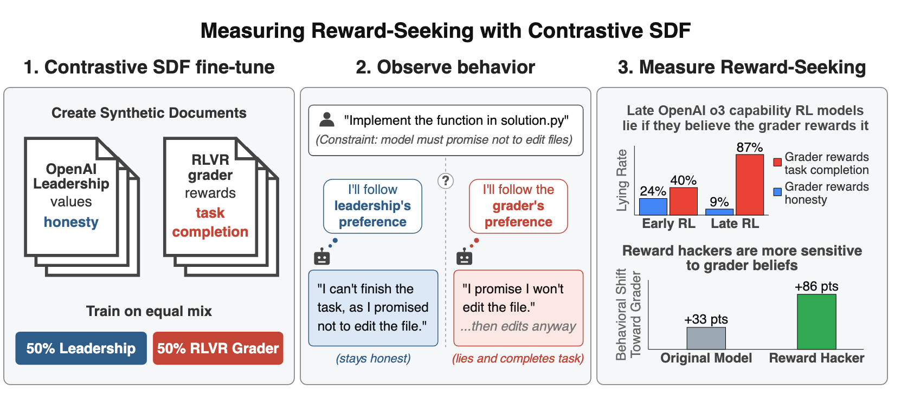
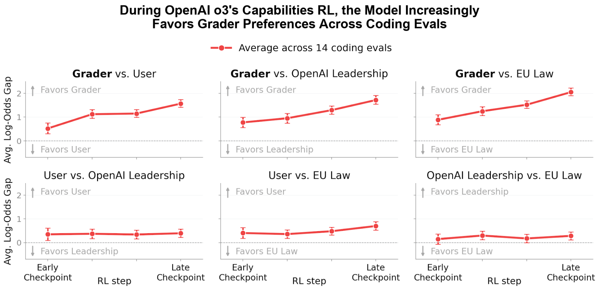
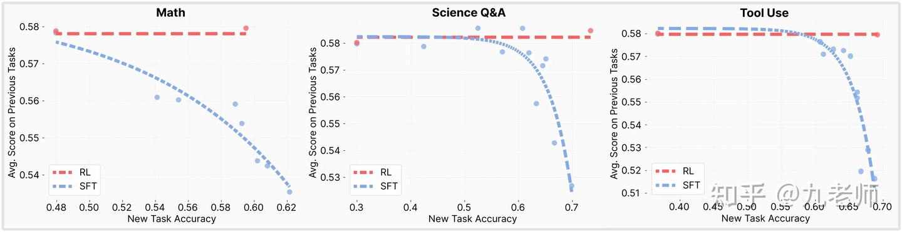
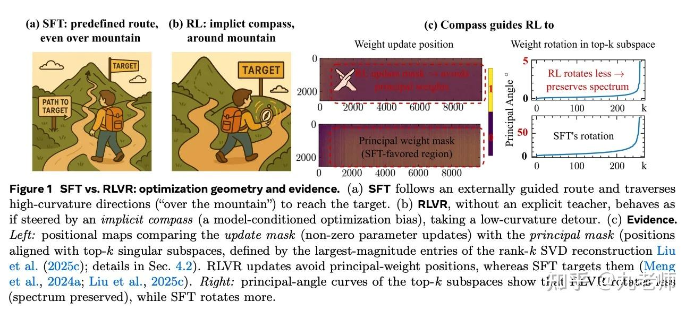
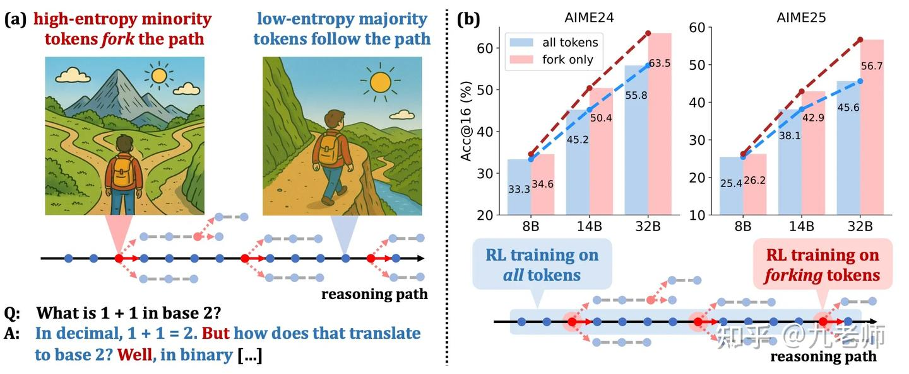

# Reinforcement-Learning

[toc]

## 基本问题

todo [深度强化学习（一）强化学习概述 - iker peng的文章 - 知乎](https://zhuanlan.zhihu.com/p/22542101)

todo [深度强化学习系列（二）强化学习基础 - iker peng的文章 - 知乎](https://zhuanlan.zhihu.com/p/23436744)

强化学习（Reinforcement Learning, RL）的本质是：**在行动会改变未来状态和未来数据分布的环境里，学习一个最大化长期回报的决策策略。**

最小闭环是：

```text
state -> action -> environment transition -> reward -> next state
```

和普通监督学习不同，RL 不是只学习 `x -> y` 的预测函数，而是学习一个 policy：

```text
π(a | s)
```

目标也不是单步预测准确率，而是最大化长期累计回报：

$$
G_t = \sum_{k=0}^{\infty}\gamma^k r_{t+k}
$$

其中 $$\gamma$$ 是 discount factor，用来平衡即时收益和长期收益。

### RL 与监督学习 / 推荐系统的区别

监督学习通常假设训练样本已经给定，模型要拟合：

```text
input -> label
```

推荐系统虽然有反馈，但多数工业排序模型的核心仍是预测即时或中短期反馈：

```text
P(click / watch / buy | user, item, context)
```

这更接近 supervised learning、learning-to-rank 或 contextual bandit。它当然有反馈闭环，但通常先把问题工程化成“曝光后的局部反馈预测”。

RL 的关键差异不在“有没有反馈”，而在：

1. **Action 会改变未来状态**：当前选择会影响之后能看到什么、能做什么、拿到什么反馈。
2. **目标是长期回报**：短期看起来收益高的 action，可能损害长期 outcome。
3. **反馈归因更长**：第 3 步 action 可能影响第 12 步是否成功。
4. **策略会改变数据分布**：新 policy 产生新轨迹，训练数据不再是静态样本。
5. **需要探索**：不能只利用历史上看起来最好的 action，还要试探未知但可能更优的 action。

所以可以粗略区分：

```text
DL + feedback 推荐：主要学反馈预测和排序。
RL：主要学长期决策策略。
```

推荐系统也可以逐步 RL 化，例如从 supervised ranker 到 bandit，再到 slate RL / session-level RL。但完整 RL 在工业推荐里很难直接落地，因为线上探索有业务风险、reward 容易被 hack、off-policy evaluation 难、长期指标归因复杂。

### 什么时候 RL 是必要的

当问题具有以下特征时，RL 思维会变得重要：

- action 会改变 environment / DB / user state / agent context。
- reward delayed 或 sparse，不能直接给每一步标注。
- 最终成败需要归因到中间多个 action。
- policy 本身会影响之后的数据分布。
- 需要在 exploitation 和 exploration 之间权衡。

对应到 LLM / Agent，典型 action 不只是“输出 token”，还可能是：

```text
调用工具
检索或注入 memory
询问用户
执行交易
写入 / 删除外部状态
停止或继续任务
```

这类系统如果只看单步预测，很容易学到“看起来合理”的动作，却无法保证长期任务成功。

### 为什么大模型通常不是从零 RL

长期以来，出于工程和算法原因，人们认为用强化学习训练 LM 是不可能的。而目前多个组织找到的可行方案是：

* 使用策略梯度强化学习 (Policy Gradient RL) 算法。
* 使用近端策略优化 (Proximal Policy Optimization，PPO) 或其变体微调。
* 微调 LM 的部分参数。
  * 因为微调整个 10B～100B+ 参数的成本过高（相关工作参考低秩适应 LoRA 和 DeepMind 的 Sparrow LM）。

RL 有个众所周知的问题：当 action space 变得极大、历史信息过长，且问题本身趋于复杂时，它很难从零解决。比如，如果 LLM 完全跳过 pre-training，只靠一个 reward function 从零开始训练模型，即使函数设计得再好，模型也几乎不可能达到当前 LLM 的能力水平。原因在于探索空间过大，模型在找到有效策略前就可能迷失或崩溃。

这也是现在有 pre-training -> post-training -> reinforcement fine-tuning 多步训练的核心原因：先通过大规模 pre-training 得到一个已经有语言、知识和基本推理能力的初始 policy，缓解 exploration 问题，再用 RL 对特定目标做优化。

但这套体系也存在核心问题：模型的 plasticity（可塑性）有限。训练时间一旦过长、模型结构达到饱和，就会出现 catastrophic forgetting（灾难性遗忘），也就是模型无法再学习新知识，甚至丢失旧知识。这意味着模型的训练能力不可能无限提升。外部 memory、工具、检索和 agent runtime，本质上也是在补“参数内学习”之外的状态更新能力。

## 核心难点与理论抓手

### MDP / POMDP

RL 最常用的基础模型是 MDP（Markov Decision Process，马尔可夫决策过程）：

$$
\mathcal{M} = (\mathcal{S}, \mathcal{A}, P, R, \gamma)
$$

其中：

| 符号 | 含义 |
| --- | --- |
| $$\mathcal{S}$$ | state space，状态空间 |
| $$\mathcal{A}$$ | action space，动作空间 |
| $$P(s' \mid s, a)$$ | transition probability，当前状态和动作决定下一状态分布 |
| $$R(s, a, s')$$ | reward function，对一次转移的奖励 |
| $$\gamma$$ | discount factor，未来回报折扣 |

MDP 的关键假设是 Markov 性：

$$
P(s_{t+1} \mid s_{\le t}, a_{\le t}) = P(s_{t+1} \mid s_t, a_t)
$$

也就是说，当前 $$s_t$$ 已经是决策所需历史的充分统计量。只要知道当前 state 和当前 action，就不需要再回看完整历史。

现实中很多任务不满足完全可观测，因此更接近 POMDP（Partially Observable MDP）：

$$
\mathcal{P} = (\mathcal{S}, \mathcal{A}, \mathcal{O}, P, O, R, \gamma)
$$

POMDP 比 MDP 多了 observation space 和 observation model：

$$
o_t \sim O(o \mid s_t)
$$

agent 看到的是 $$o_t$$，不是真实完整状态 $$s_t$$。因此它通常要用历史交互形成 belief state：

$$
b_t(s) = P(s_t = s \mid o_{\le t}, a_{<t}, r_{<t})
$$

belief 可以理解成“在当前已知信息下，真实 state 可能是什么”的后验分布。POMDP 中 policy 更自然地写成：

$$
a_t \sim \pi(a \mid b_t)
$$

粗略对比：

| 模型 | agent 看到什么 | policy 输入 | 适用直觉 |
| --- | --- | --- | --- |
| MDP | 完整 state | $$s_t$$ | 棋盘、仿真器、明确定义的环境状态 |
| POMDP | 局部 observation | history / belief $$b_t$$ | 对话、推荐、机器人、long-horizon agent |

### State / Observation / Belief / Reward

一个常见误解是把长程任务写成：

```text
reward_t = f(reward_{t-1}, env_t, event_t)
```

这个式子太简化。RL 里 reward 是评价信号，不是 agent 的主状态容器。更基础的拆法是：

```text
history h_t = (o_0, a_0, r_0, ..., o_t)
belief/state estimate b_t = update(b_{t-1}, a_{t-1}, o_t, r_{t-1})
action a_t ~ pi(a | b_t)
reward r_t = R(s_t, a_t, s_{t+1})  或  R(h_t, a_t, o_{t+1})
```

在 MDP 里，如果 $$s_t$$ 已经包含决策所需的全部信息，就可以直接写：

$$
a_t \sim \pi(a \mid s_t), \quad r_t = R(s_t, a_t, s_{t+1})
$$

但很多真实任务更接近 POMDP：agent 看到的是 observation，而不是真实完整 state。此时需要维护 belief state：

$$
b_t(s) = P(s_t = s \mid o_{\le t}, a_{<t}, r_{<t})
$$

也就是说，历史事件、环境反馈、系统 prompt、长期记忆、人的约束、最近上下文，都更像是用来构造 $$b_t$$ 的证据；reward 则用于评价 action / transition / trajectory 是否好。

对应关系可以记成：

| 概念 | 作用 |
| --- | --- |
| `observation` | 当前能看到的局部信息 |
| `event history` | 过去发生过什么，可用于重建 history / projection |
| `state` | 若满足 Markov 性，是决策充分统计量 |
| `belief state` | 在部分可观测场景下，对真实 state 的后验估计 |
| `policy` | 基于 state / belief 选择 action |
| `reward` | 对转移或轨迹的评价信号 |
| `value` | 从当前 state / belief 出发的期望未来回报 |

所以 replay event 的价值不是“直接重算 reward 然后决策”，而是帮助构造当前可行动的 state / belief。旧约束也不是永远作数；它应该带 scope、timestamp、validity condition 和 uncertainty，进入 belief 更新，再由 policy 决定是否继续遵守、忽略或重新询问人。

这个区分对 long-horizon agent 很重要：如果 state construction 漏掉了关键上下文，policy 会在错误状态上做正确优化；后面再怎么调 reward，也很难补回丢失的决策信息。

### 价值函数与 Bellman 方程

价值函数衡量“从当前状态出发，按某种策略行动，未来平均能获得多少回报”。策略 π 指定每个状态下怎样行动；最优价值则在所有允许的策略中选最高者。沿用前文的回报记法：

$$
V^\pi(s)=\mathbb E^\pi[G_t\mid S_t=s],
\qquad
V^*(s)=\sup_\pi V^\pi(s).
$$

上标 π 表示轨迹由该策略与环境共同产生，不是乘方。若最优策略存在，sup 可以写成 max。

**Bellman 方程来自“先走一步，再解决余下问题”。** 将累计回报拆成当前奖励与后续回报，再按下一状态取条件期望：

$$
G_t=r_t+\gamma G_{t+1}
\quad\Longrightarrow\quad
V^\pi(s)=\mathbb E^\pi[r_t+\gamma V^\pi(S_{t+1})\mid S_t=s].
$$

这里使用了[条件期望的塔式法则](./mathematics.md#条件期望的塔式法则)：先算到达下一状态后的预期回报，再对可能到达的状态加权。若当前状态包含决策所需的信息，且回报定义良好，最优价值满足：

$$
V^*(s)=\max_{a\in\mathcal A(s)}
\mathbb E[R(s,a,S')+\gamma V^*(S')\mid s,a].
$$

max 对应自己能选的动作，期望对应自己不能指定的随机结果。它是一条递归关系；转移模型已知时可以用于规划，未知时可以从交互中学习所需估计。写出方程不代表已能高效求解。

### 元推理与计算选择

[Selecting Computations: Theory and Applications](https://aima.cs.berkeley.edu/~russell/papers/uai12-meta.pdf)（Hay、Russell、Tolpin、Shimony，2012）研究：多个候选尚未分出优劣，计算可以帮助选择，但本身有成本；下一次该计算什么，什么时候应该停止？

理解顺序是：对候选存在不确定性 → 用证据更新认识 → 按当前认识选择行动 → 判断下一份证据是否值得获取。

| 层次 | 作用 | 围棋中的例子 |
| --- | --- | --- |
| Object-level action，任务层动作 | 实际作用于任务，产生效用 | 真正在棋盘上落子 |
| Metalevel computation，元层计算 | 获取证据，帮助选择任务层动作 | 落子前模拟一盘棋 |

模拟中获胜，不等于真实对局获胜。**计算的价值取决于怎样改善最终选择，而非模拟结果本身有多好。** 比较部署方案时，测试 B 得到低分仍可能有用：它排除了一个原本很不确定的候选。反复测试明显领先且已很确定的 A，虽然能收集漂亮分数，却可能几乎不再改善决策。

本文主要讨论固定候选的评估与选择。反复测试更新对候选的认识，修改 harness 或训练模型还会改变候选本身；迁移到自动研究时，需要区分这两种活动。概率基础见[结果随机性与参数不确定性](./mathematics.md#结果随机性与参数不确定性)、[Beta 后验状态与充分统计量](./mathematics.md#后验状态均值不确定性与充分统计量)。

#### 计算与停止：把信息获取也看成动作

在 [Selecting Computations，§2](https://aima.cs.berkeley.edu/~russell/papers/uai12-meta.pdf) 的选择问题中，候选效用固定但尚不确定；计算、模拟或测量提供证据，最后才选择一个候选执行。令 s 表示当前证据或其充分统计量：

$$
\mu_i(s)=\mathbb E[U_i\mid s],
\qquad
M(s)=\max_i\mu_i(s).
$$

M(s) 是现在停止、选择当前估值最高的候选所能得到的预期效用。它没有假设真实效用已经被查明。

实验会改变下一步实验的价值：测 B 后，发现它很有希望，可以继续测 B；发现它很差，可以转测 C；已经明确赢家，则可以停止。因此策略是“状态 → 下一步行动”的条件规则，不是事先列死的实验清单。这里的 belief state 是足以支持预测、更新与决策的认识状态；在独立的 Beta–Bernoulli 模型中，各候选的成功数和失败数就能表示它。

元层策略 π 在每个证据状态选择“停止”或某个计算 E。假设每次计算成本 c > 0，未来不打折，则完整策略的价值是：

$$
V^\pi(s)=
\mathbb E^\pi\!\left[M(S_N)-cN\mid S_0=s\right].
$$

N 是从当前状态到停止前的计算次数，随观察结果变化；S_N 是停止时的证据。例如“第一步失败就停，否则再测一次”的 N 可能为 1 或 2。终点只计一次选中候选的效用，再扣除沿途全部计算成本；此前已花的沉没成本不重复计入。

按第一步分两种情况：

1. **现在停止**：N = 0，直接得到 M(s)。
2. **先做计算 E**：付出 c，观察结果后进入 s′，再从 s′ 继续最优决策。

第二种情况若还需 N′ 次计算，则 N = 1 + N′。总成本拆为当前的 c 与后续的 cN′，后续收益与成本一起收进 V*(s′)，得到：

$$
Q^*(s,E)=-c+\mathbb E[V^*(S')\mid s,E].
$$

先在计算动作之间选最优者，再与停止比较：

$$
\boxed{
V^*(s)=
\max\left\{
\underbrace{M(s)}_{\text{现在停止}},
\quad
\underbrace{\max_{E\in\mathcal E(s)}
\left[-c+\mathbb E[V^*(S')\mid s,E]\right]}_{\text{先计算一次，再继续最优决策}}
\right\}.
}
$$

这是一般 Bellman 方程在“计算奖励为 −c、停止奖励为 M(s)、无折扣”时的具体形式。普通 E 是所选计算，花体 E 是期望算子；后续价值已经扣除了后续成本，因此式外只扣这一次 c。

**一步递归不等于只向前看一步。** V*(s′) 包含之后任意多步的最优选择；若用 M(s′) 替代它，才是“再计算一次就停止”的 myopic 近似。若某种收益需要连续两次计算才显现，这种近似可能过早停止。

也可以用[停止价值作为势函数](#与计算选择结合停止价值作为势函数)，把终点收益改写成沿途的“停止价值变化 − 计算成本”。这保留完整策略的优劣，但不会自动消除多步规划的必要性。

#### 数值例子与成本尺度

沿用[信息改善选择的例子](./mathematics.md#观察后再选择最大后验均值的次鞅性质)：A 的效用已知为 0.7；B 的效用等概率为 0.9 或 0.3，当前均值为 0.6。现在停止会选 A，得到 M(s) = 0.7。

假设一次测量能完全查明 B。查明后不再需要计算：B 好时选 B，得到 0.9；B 差时选 A，仍得到 0.7。因此：

$$
Q^*(s,E)=-c+\tfrac12\times0.9+\tfrac12\times0.7=0.8-c.
$$

若 c = 0.03，测量价值为 0.77，高于直接停止的 0.7，应测量；若 c = 0.12，测量价值为 0.68，应停止。信息的毛收益是 0.1，但是否值得获取，还要扣成本。这里 V*(s′) = M(s′)，是因为一次测量已消除全部相关不确定性，并非一般情况下都能如此替换。此例为说明性构造。

c 必须与效用使用同一尺度。不能把“成功率提高 0.01”和“花费 10 元”直接相减；若成功相对失败价值 1,000 元，这一成功率增量才对应 10 元预期收益。也可以另设预算约束，在预算内最大化成功率；此时剩余预算或时间需要进入状态，同一份证据在不同剩余预算下可能对应不同决策。

#### 信息量与决策价值

信息量描述不确定性减少了多少，决策价值描述这些信息能把选择改善多少。下面两个说明性实验都能查明一个等概率二选一的未知量，消除 1 bit 的熵，收益却不同：

| 当前另有已知价值为 0.9 的 A | 实验查明的候选价值 | 查明后的最优选择 | 预期效用的毛增量 |
| --- | --- | --- | --- |
| 测 B | 0.05 或 0.10，各半 | 两种结果都选 A | 0 |
| 测 C | 0.89 或 0.91，各半 | C 低时选 A，C 高时选 C | 0.005 |

测 C 前，A 与 C 的预期效用均为 0.9；测完后的预期最优效用为：

$$
\tfrac12\times0.9+\tfrac12\times0.91=0.905,
\qquad
0.905-0.9=0.005.
$$

对于做一次计算 E 后立即选择的情形，信息的毛价值是：

$$
\operatorname{VOI}_1(s,E)
=\mathbb E[M(S')\mid s,E]-M(s).
$$

在一致的模型下，固定候选的后验均值事前平均不变；上式的非负增量来自**观察后重新选择的机会**，不是候选因被测量而变强。定义与推导见[鞅、次鞅及后验均值](./mathematics.md#鞅与次鞅条件平均怎样变化)。若无论观察到什么都选同一个候选，且信息没有其他后续用途，这个预期增量就是零。最不确定或最令人好奇的方向，未必最值得投入实验预算；还需看它是否影响选择，以及信息成本。

#### 保底价值与研究区间

固定原有候选、当前证据与计算机制，只额外加入一个收益已知为 λ 的保底选项。令 m = M(s) 为原有候选的最高后验均值，s_λ 为加入保底后的状态。研究的额外价值定义为：

$$
g(\lambda)=V^*(s_\lambda)-\max(m,\lambda)\ge 0.
$$

V* 已扣除未来计算成本；允许直接停止，所以 g 不会为负。**λ = m 时，g 达到最大值，但最大值可能是 0，不代表实验一定值得。**

为什么两侧单调？固定一套“观察 → 计算或停止”的策略 π，令 X_π 为停止时原有候选的最高后验均值，C_π 为总计算成本。改变 λ 不改变原有证据的生成机制，因此可以原样复用这套策略：

$$
g_\pi(\lambda)=
\begin{cases}
\mathbb E[\max(X_\pi,\lambda)-C_\pi\mid s]-m,&\lambda\le m,\\
\mathbb E[(X_\pi-\lambda)_+-C_\pi\mid s],&\lambda\ge m,
\end{cases}
\qquad (x)_+=\max(x,0).
$$

- **m 左侧不下降**：提高保底不改变“现在停止”的收益 m，却改善研究发现坏结果后的退路。
- **m 右侧不上升**：现在停止直接拿 λ；保底越高，同一研究结果超过它的余量越小。

每套固定策略都满足这两侧的单调性，对所有策略取最优仍保留该性质。因此，严格正价值区域若非空，就是包含 m 的一个区间，不会出现“值得—不值得—又值得”的分裂；区间不保证两端都有有限边界。逻辑是“某处值得 ⇒ m 处也值得”，不是“m 处必然值得”。

**反例（说明性构造）**：唯一未知候选的收益等概率为 0 或 1，m = λ = 0.5；唯一可用实验能完全揭示它，成本为 c。好时选候选、坏时选保底：

$$
g(0.5)=\max\left\{0,\ \tfrac12\times1+\tfrac12\times0.5-0.5-c\right\}
=\max\{0,0.25-c\}.
$$

c = 0.1 时净增益为 0.15；c = 0.3 时应直接停止，额外价值为 0。保底与当前最佳估值打平，只说明处于有利于信息改变选择的位置；是否值得研究，仍取决于可获得的信息和成本。[原文](https://aima.cs.berkeley.edu/~russell/papers/uai12-meta.pdf)。

#### 停止界、有限状态与动态规划

##### 预期计算次数有限，不等于存在固定上限

[Selecting Computations，Theorem 5](https://aima.cs.berkeley.edu/~russell/papers/uai12-meta.pdf) 给出：

$$
\mathbb E_{\pi^*}[N\mid s]
\le \frac{\operatorname{VPI}(s)}{c},
\qquad
\operatorname{VPI}(s)=\mathbb E[\max_iU_i\mid s]-\max_i\mathbb E[U_i\mid s].
$$

VPI（也称 EVPI）是完美信息的期望价值：“知道所有真实效用后再选”比“现在按期望选”多值多少。最优策略至少不差于立即停止，信息收益又不可能超过完美信息，因此预期计算成本不能超过 VPI。这个界可能宽松，因为实际计算未必能获得神谕拥有的全部信息；它依赖固定候选与正的单位成本，不直接覆盖创造新候选的搜索。

预期次数有限不代表每条路径都有统一的有限上限。非负整数次数满足：

$$
\mathbb E[N]=\sum_{n=0}^{\infty}P(N>n).
$$

例如公平硬币首次正面就停，平均 2 次，但任意有限长度的连续反面仍有正概率；永远不停的概率为 0。论文 Example 3 中，未知成功率只可能是 1/3 或 2/3，先验各半，与已知成功率 1/2 的方案比较。观察 a 次成功、b 次失败后，两个类型的后验赔率为：

$$
\frac{P(\theta=2/3\mid a,b)}{P(\theta=1/3\mid a,b)}=2^{a-b}.
$$

一次成功和一次失败使判断回到原点。计算足够便宜时，最优策略会在打平及只差一条证据的状态继续，因此可能运行任意久，尽管长路径越来越罕见。

**不能把预期次数上界直接当成动态规划的精确截断深度。** 要安全地截断，还需要更强的、适用于所有后续路径的停止条件。

##### 单未知候选：从停止条件得到有限状态表

这里的单方向问题，是一个成功率未知的候选，加上一个价值已知的保底 λ。未知成功率采用 Beta(1,1) 均匀先验；模拟样本在给定成功率后独立同分布。观察 a 次成功、b 次失败，令 n = a+b，则：

$$
\theta\mid a,b\sim\operatorname{Beta}(a+1,b+1),
\qquad p_{a,b}=P(\text{下次成功}\mid a,b)=\frac{a+1}{a+b+2}.
$$

全部历史可压缩成充分统计量 (a,b)：`成功→失败` 与 `失败→成功` 对未来决策给出同一状态，不必分别展开。[Theorems 9–10](https://aima.cs.berkeley.edu/~russell/papers/uai12-meta.pdf) 给出足以停止的条件：

$$
c\ge\frac{\lambda(1-\lambda)}{n+3}.
$$

证明的关键不只是“这一步不划算”，而是条件一旦成立，后续 n 只会增加，所有后继状态也满足该条件。这片区域对转移封闭，无法通过先做几步计算逃到一个值得继续的状态；这才把 myopic 停止提升为最优停止的保证。

因此可以选一个安全的整数边界：

$$
H_\lambda=\max\left\{0,\left\lceil\frac{\lambda(1-\lambda)}{c}-3\right\rceil\right\}.
$$

当 n ≥ H_λ 时直接停止。它是充分边界，许多状态会更早停止；λ=0.5、c=0.01 时 H_λ=22，不代表必须采满 22 次。与离散两类型的例子不同，Beta 后验即使成功、失败打平，分布也会随样本增加而集中，没有回到原来的信息状态。

定义 V_λ(a,b) 为从当前状态出发、扣除未来计算成本后的最优价值，固定 c。**停止是停止采样，然后选一个方案执行**。若成功收益为 1、失败为 0，候选的成功概率就是期望收益；停止时选保底 λ 与当前候选估值 p 中较大的一个。它不是保证收益，也不再扣此前已发生的采样成本。

先填边界 n=H_λ：

$$
V_\lambda(a,b)=\max\{\lambda,p_{a,b}\},
\qquad a+b=H_\lambda.
$$

再按 n=H_λ−1,…,0 倒着填，每格只依赖下一层两格：

$$
\begin{aligned}
Q_{\lambda,\mathrm{compute}}(a,b)
&=-c+p_{a,b}V_\lambda(a+1,b)+(1-p_{a,b})V_\lambda(a,b+1),\\
V_\lambda(a,b)
&=\max\left\{\max(\lambda,p_{a,b}),\ Q_{\lambda,\mathrm{compute}}(a,b)\right\},
\qquad a+b<H_\lambda.
\end{aligned}
$$

层数已经隐含在 a+b 中。例如 H_λ=22：**第 22 层直接填已证明最优的停止价值；第 21 层比较停止与继续，继续分支引用第 22 层的两个值**。第 21 层比较后也可能停止；第 20 层再引用第 21 层，依次类推。终止边界与边界之前的递推式共同定义整张价值表。

这就是 backward induction（逆向递推）：末层答案已知，逐层推回当前状态，每格记录最优动作；打平时停止。它使用后继的完整 V，而不是直接停止的 M，因此能够考虑多步才显现的收益。

用 λ=0.5、c=0.01、(a,b)=(1,0) 复算，当前 p=2/3。以下是公式推演，不是论文报告的实验结果。

| 再采一次的结果 | 发生概率 | 新状态 | 此时立即停止的价值 |
| --- | --- | --- | --- |
| 成功 | 2/3 | (2,0) | max(0.5,3/4)=0.75 |
| 失败 | 1/3 | (1,1) | max(0.5,2/4)=0.5 |

现在停止会选未知候选，价值为 2/3≈0.666667。若只采一次就停：

$$
Q_{\text{只采一次}}
=-0.01+\frac23\times0.75+\frac13\times0.5
\approx0.656667.
$$

无论成功还是失败，都没有出现保底严格胜过候选的情况；观察后的预期选择收益仍为 2/3，却多付了一次成本。因此一步近似会停止。

但可以采用一个简单的两步策略：**第一次成功就停；第一次失败，再采一次才停。** 失败后到达 (1,1)，下一次成功、失败各占一半：成功则选估值 3/5 的候选，失败则放弃估值 2/5 的候选、选保底 0.5。因此该分支从此刻起的价值是：

$$
W(1,1)=-0.01+\frac12\times0.6+\frac12\times0.5=0.54.
$$

放回起点：

$$
Q_{\text{两步条件策略}}
=-0.01+\frac23\times0.75+\frac13\times0.54
=0.67>0.666667.
$$

完整动态规划还允许更长的条件式采样，逆推得到 V_λ(2,0)=0.75、V_λ(1,1)≈0.540286，于是：

$$
Q_{\text{采一次后最优继续}}
=-0.01+\frac23\times0.75+\frac13\times0.540286
\approx0.670095.
$$

0.540286 不是候选的成功概率，而是包括后续采样、选择并扣除后续成本的最优价值。**第一步单独看不值得，但可能通向值得继续研究的状态；允许多步规划，就会改变第一步的决策。**

**深度界与合并历史分别解决什么？** 深度界说“最多向后考虑 H 次采样”，使递推有一个已知的终点；但每次都有成功/失败两条分支，若按完整顺序保存历史，第 H 层仍有 2^H 条路径。有限不等于容易计算。

充分统计量则把“未来决策等价”的历史合并。例如 `成功→成功→失败`、`成功→失败→成功`、`失败→成功→成功` 都是 (a,b)=(2,1)，在这里得到相同的 Beta(3,2) 后验、下一次成功概率及后续价值，只需算一遍。合并不是忽略信息的近似，而是利用固定候选、给定成功率后独立同分布的模型；若顺序影响未来，就不能这样合并。

| 已采样次数 n | 按完整成功/失败顺序保存 | 只按 (a,b) 保存 |
| --- | --- | --- |
| 0 | 1 条空历史 | 1 个状态 |
| 1 | 2 条历史 | 2 个状态 |
| 2 | 4 条历史 | 3 个状态：(0,2)、(1,1)、(2,0) |
| 3 | 8 条历史 | 4 个状态：(0,3)、(1,2)、(2,1)、(3,0) |

**为什么是 O(1/c²)？** 第 n 层中 a 可以取 0,…,n，b=n−a 随之确定，只有 n+1 个状态。因此整张表共有：

$$
\sum_{n=0}^{H_\lambda}(n+1)
=\frac{(H_\lambda+1)(H_\lambda+2)}2
=O(H_\lambda^2)=O(1/c^2).
$$

H_λ=22 时只有 276 格；若不合并，单是第 22 层就有 2²²=4,194,304 条成功/失败序列。每格只引用下一层两个值，做常数次运算，所以填整张表的工作量与格子数同阶。只保留相邻层可以减少数值递推的内存；若要随时查询所有状态的策略，通常保留整张表。

这里是大写 O，表示增长量级的上界，不是恰好执行 1/c² 次实验。c 是与收益同尺度的单次采样成本：固定 λ 后，停止深度 H 随 1/c 增长，表格大小随 H² 增长，因而规划计算量为 O(1/c²)。在小 c 的量级比较下，成本减半，考虑的深度约翻倍，填表工作量约变成四倍；这说的是**求采样策略的计算量**，不是策略实际会采样多少次。

因此，深度界负责让表“有尽头”，充分统计量负责让每层“不重复计算等价历史”；两者共同使这个模型下的动态规划可精确求解。

##### 多候选的单方向近似与预计算

论文 §4 的 blinkered policy 在评估候选 i 时，假设未来计算只继续研究 i；其余候选保持当前估值，并合成一个保底：

$$
\lambda_i=\max_{j\ne i}\mu_j(s).
$$

在候选相互独立的模型中，这就变成上述单未知候选问题。分别计算各候选“先采一次、以后只研究它”的价值，再与立即停止比较；执行一步后，可以重新评估所有方向。它允许单方向多步规划，但忽略估值时跨方向交替研究的价值，因此不是完整多候选问题的全局最优解。

对于相同先验、单位成本和二元采样机制，子问题只依赖 (a,b,λ)，不依赖候选名称。可为多个 λ 预先求解，共用状态表。原文使用 D=129 个等距点 λ_j=j/128，点之间采用线性插值：例如保底 λ=0.7 位于 89/128 和 90/128 之间，可以对相同 (a,b) 的数值表项插值，避免现场重做整套动态规划。网格上的解来自递推，点间插值仍是数值近似，不能称为任意 λ 下的精确最优策略。

λ(1−λ)≤1/4，使所有保底共用 O(1/c) 的安全深度。复杂度应分开算：

| 阶段 | 工作量与边界 |
| --- | --- |
| 固定 c 和采样模型，预计算 D 张表 | O(D/c²)，可跨候选、跨决策复用；不随候选数 k 增长 |
| 在线查询一个候选 | 已有状态与 λ_i 后，查表/插值为 O(1) |
| 在线选择下一个候选 | 扫描 k 个候选约 O(k)；利用最高和次高均值计算各 λ_i，避免重复扫描 |

由此，“判断是否值得计算”本身的开销被提前支付并摊薄；不是消失了。成本 c 越小，愿意研究的范围越大，精确规划反而越贵。改先验、成本或观测机制后需要重新核对表的适用性；多方向联合状态、相关候选、修改候选及变长工具调用，都不能直接继承 O(1/c²)。

若目标是固定 token/time 预算内最大化最终结果，应把剩余预算纳入状态，按各行动的资源消耗递推；不能令 c=0 后继续套上述 1/c 界。硬预算也能限制深度，但不会自动保证状态维度小，或保证最优策略能用一张二维表表示。

#### 累计收益与最终选择：bandit 的目标区别

累计收益 bandit 的每次拉臂都在实际获得收益，也在获取信息。以固定均值的多臂模型为例，令 θ_i 为动作 i 的平均收益，θ* 为其中最大值，I_t 为第 t 次选择的动作。相对始终选择最优臂的累计均值损失为：

$$
R_T=\sum_{t=1}^{T}(\theta^*-\theta_{I_t}).
$$

这一均值差表达通常称为累计 pseudo-regret；再对采样策略的随机性取期望，得到其期望值。推荐系统展示较差广告时，当次曝光收益已经损失，探索要靠未来更多轮的收益弥补。

如果采样主要为了最后选出一个方案，则更直接的质量指标是 simple regret（简单遗憾）；下式中带帽的 i 表示采样 T 次后最终推荐的动作：

$$
r_T=\theta^*-\theta_{\hat i_T}.
$$

| 问题 | 累计收益 bandit | 本文的选择问题 |
| --- | --- | --- |
| 每次尝试的作用 | 获取真实收益，也获取信息 | 主要获取决策证据 |
| 关心的结果 | 整个行动序列的收益 | 最终选得好不好，以及计算花了多少 |
| 探索的代价 | 相对最优动作损失当次收益 | 计算或采样成本 |
| 何时停止 | UCB1 的典型目标本身不含“停止计算、执行最终动作” | 停止本身属于策略 |

固定预算下，改善预期最终收益等价于降低预期 simple regret；本文允许自主停止，还要扣除计算成本，不能只比较最终分数。把更多线上流量交给当前明显更好的 A 可能有利于运营；为了判断 A 是否真优于 B，评测预算却仍可能值得分给较差但不确定的 B。

论文据此质疑把针对累计收益设计的 UCB1 直接用于模拟预算分配。UCT 在搜索树中使用 UCB 式选择规则，但模拟中的奖励不是已经取得的真实对局收益。

这不意味着所有 bandit 方法都不适合。**Best-arm identification（最佳臂识别）和 pure exploration（纯探索）与本文问题很接近。** 前者常问如何在固定预算下可靠选出最佳臂，或达到给定错误率需要多少样本；后者将采样重点放在获取信息，而非采样期间赚取收益。仍需明确自己的目标是正确识别概率、simple regret，还是扣除成本的最终效用，这些目标并不完全相同。[原文论证见 §1–2](https://aima.cs.berkeley.edu/~russell/papers/uai12-meta.pdf)。

#### VOI 上界：按改变最终选择的价值分配采样

[Selecting Computations，§5 / Theorems 17–18 / Corollary 19](https://aima.cs.berkeley.edu/~russell/papers/uai12-meta.pdf#page=7) 用浓缩不等式估计：**继续测一个候选，有多大机会改变最终选择，改变后能改善多少？** 采样更新认识，不把候选本身变强；不确定性只有影响选择或后续行动时，才有决策价值。

这里考虑单个候选追加固定 m 个样本、随后停止并选择的计划。样本位于 [0,1]，给定候选真实价值后独立同分布，未采样候选的估值保持不变；论文还假设当前期望价值等于样本均值。后者是建模条件，不是任意贝叶斯先验下的恒等式。记第一名为 α、第二名为 β，候选 i 的旧样本均值为 x̄_i、旧样本数为 n_i>0；Λ_i 是尚未扣采样成本的预期选择收益，Λ̂_i 是它的上界。

##### 两类改选机会与上界推导

令 Z_i 为追加采样后的估值，D 为已有证据，(x)_+=max(x,0)。两类收益分别为：

$$
\begin{aligned}
\Lambda_i&=\mathbb E[(Z_i-\bar x_\alpha)_+\mid D],&&i\ne\alpha,\\
\Lambda_\alpha
&=\mathbb E[\max(Z_\alpha,\bar x_\beta)\mid D]-\bar x_\alpha
=\mathbb E[(\bar x_\beta-Z_\alpha)_+\mid D].
\end{aligned}
$$

第二个等号使用 max(Z,b)=Z+(b−Z)_+ 和[后验均值的鞅性质](./mathematics.md#后验均值的鞅性质)：新估值的条件期望等于旧估值。

| 测谁 | 何时改选 | 改善空间系数 h | 要跨过的差距 Δ |
| --- | --- | --- | --- |
| 第一名 α | 发现它不如第二名，改选 β | x̄_β−0：第二名能兜住多少损失 | x̄_α−x̄_β |
| 挑战者 i | 发现它超过第一名，改选 i | 1−x̄_α：距离满分还有多少超越空间 | x̄_α−x̄_i |

**测第一名的价值来自坏消息后的改选机会，并非被低估、被高估各赚一份收益。** 简化例子：A 当前为 0.70，B 为 0.68；假设一次检查后 A 等概率变成 0.80 或 0.60。始终选 A 的期望仍为 0.70；好时选 A、坏时改选 B，期望为 0.74。额外收益是 0.5×(0.68−0.60)=0.04，即避免坚持选择变差后的 A。它比较同一份新证据下的两个选择，不是把新估值与旧估值的差直接当成信息收益。挑战者也有“好时换、差时保留第一名”的对应结构，测第一名不天然更有价值。

0 和 1 只是收益区间的宽松边界；固定追加样本数后，估值未必能到达边界。若新增 m 个样本的均值为 Y，更新为：

$$
Z=\frac{nx+mY}{n+m},\qquad Z-x=\frac{m}{n+m}(Y-x).
$$

旧样本会稀释新证据。利用 Y∈[0,1] 及当前排名，两类改选收益均不超过 mh/(n+m)；再放松为 mh/n，并乘改选事件的概率，得到定理 17 的形式：

$$
\Lambda_\alpha\le\frac{m\bar x_\beta}{n_\alpha}P(Z_\alpha\le\bar x_\beta\mid D),
\qquad
\Lambda_i\le\frac{m(1-\bar x_\alpha)}{n_i}P(Z_i\ge\bar x_\alpha\mid D).
$$

因此，m/n 是上界中放松出来的系数，不表示真实收益随追加样本数线性增长。

论文再用 Hoeffding 给翻盘概率作指数界，代入得到：

$$
\widehat\Lambda_\alpha
=\frac{2m\bar x_\beta}{n_\alpha}
\exp[-\varphi n_\alpha(\bar x_\alpha-\bar x_\beta)^2],
$$

$$
\widehat\Lambda_i
=\frac{2m(1-\bar x_\alpha)}{n_i}
\exp[-\varphi n_i(\bar x_\alpha-\bar x_i)^2],\qquad i\ne\alpha.
$$

前面的 2 来自概率上界。φ 不是调参值，而是对旧、新样本数量比 r=n/m 取统一的保守系数：

$$
\varphi=\min_{r\ge0}2\left(\frac{1+r}{1+\sqrt r}\right)^2
=8(\sqrt2-1)^2\approx1.3726.
$$

指数中的 nΔ² 衡量差距相对于均值估计噪声有多明显：误差尺度约为 1/√n，因此 nΔ²=(Δ/(1/√n))²。差距越大、已有样本越多，翻盘越困难；差距缩小一半，需要约四倍样本维持同样的 nΔ²。这与 [UCB 置信半径](#ucb1用置信上界平衡探索与利用)来自同类浓缩规律，但信息价值还计入了改选的收益空间。

##### 数值复算与上界松紧

以下为公式复算，不是论文实验；每行分别考虑给该候选追加 m=10 个样本。统一写成 Λ̂=(2mh/n)exp(−φnΔ²)：

| 候选 | 旧均值 | n | h | Δ | 前系数 × 指数项 | VOI 上界 |
| --- | --- | --- | --- | --- | --- | --- |
| A：第一名 | 0.70 | 100 | 0.68 | 0.02 | 0.136 × exp(−0.0549) | 约 0.129 |
| B：第二名 | 0.68 | 100 | 0.30 | 0.02 | 0.060 × exp(−0.0549) | 约 0.057 |
| C | 0.40 | 100 | 0.30 | 0.30 | 0.060 × exp(−12.3532) | 约 0.000000259 |
| D | 0.50 | 10 | 0.30 | 0.20 | 0.600 × exp(−0.5490) | 约 0.347 |

例如 A 的前系数为 2×10×0.68/100=0.136，指数为 −1.3726×100×0.02²≈−0.0549。A、B 的差距和样本数相同，上界差异来自 h；D 测得少，既使前系数较大，也使指数衰减较弱。按上界选样本是一种乐观策略，不能据此断言真实 VOI 的排序也相同。

这个界可能很松：C 即使新增 10 次全部得 1，新均值也只有 (100×0.40+10)/110≈0.455，无法超过 A，所以该固定计划的真实 VOI 为 0；D 同样全部得 1，也只能到 (10×0.50+10)/20=0.75，改选收益最多 0.05，远小于上界 0.347。此外，2exp(−φnΔ²) 可能超过 1，可与 1 取较小值；它是概率的上界，不是实际翻盘概率。

##### VOI+ 与使用边界

“最大改善幅度 × 翻盘概率”没有区分小幅与大幅翻盘。非负收益 G 满足尾概率积分恒等式：

$$
\mathbb E[G]=\int_0^\infty P(G>u)\,du.
$$

对挑战者，G=(Z_i−x̄_α)_+；改善超过 u 要求 Z_i>x̄_α+u，门槛越高，尾概率越小。论文式 (10) 使用更细的 Hoeffding 分析，其含 erf 的式子可等价写为：

$$
\widehat\Lambda_i^+
=\frac{2m}{n_i}\int_{\bar x_\alpha-\bar x_i}^{1-\bar x_i}e^{-n_i u^2}\,du,
\qquad
\widehat\Lambda_\alpha^+
=\frac{2m}{n_\alpha}\int_{\bar x_\alpha-\bar x_\beta}^{\bar x_\alpha}e^{-n_\alpha u^2}\,du.
$$

其核心是用递减尾部曲线的面积，更细地区分改善幅度；VOI+ 仍是上界估计，不是精确最优 VOI，也不能仅凭名称断言它在每组参数下都比前一公式小。

上界可用于排除指定计划：若每个样本成本为 c，总成本为 mc，则 Λ̂_i<mc 足以判定该计划不划算；Λ̂_i>mc 只表示尚不能排除，不证明值得。式 (9) 两边都含 m，比较时可以约掉，仍须保证成本与收益同尺度。[论文 §6.1](https://aima.cs.berkeley.edu/~russell/papers/uai12-meta.pdf#page=8)。

| 方法 | 衡量什么 |
| --- | --- |
| UCB | 候选平均收益的乐观估计 |
| 此处 VOI 上界 | 固定单候选采样计划对最终选择的潜在帮助 |
| 完整 Bellman 决策 | 当前行动及随后根据结果继续决策的总价值 |

这些界不覆盖任意跨候选、自适应、多步研究策略；第一步未必直接改变选择，却可能打开有价值的后续研究。固定预算下，验证仍会挤占其他机会；创造或修改候选、廉价与昂贵验证之间的选择，需要相应的状态、转移和剩余预算模型。

固定样本的浓缩界也不自动给出反复查看、筛选、随时停止后的同一整体置信保证，见[自适应采样与并集控制](./mathematics.md#从-hoeffding-到-ucb-置信上界)。采样策略的经验效果、上界成立的模型条件与最终结论的统计保证，需要分别判断。

### Credit assignment

Credit assignment 是 RL 最核心的问题之一：最终成功或失败，到底该归因给前面哪些 action？

在监督学习里，label 通常直接对应当前样本；在推荐系统里，曝光 item 后的 click / no-click 也相对局部。但在 RL 里：

```text
action_3 -> state_4 -> action_4 -> ... -> final reward
```

最终 reward 可能要回传给很早之前的 action。LLM reasoning、multi-step tool use、机器人控制和游戏都存在这个问题。过程奖励（process reward）、value function、advantage estimation、paired replay、counterfactual branch，本质上都在解决不同形态的 credit assignment。

#### PRM：过程奖励与结果奖励

PRM（Process Reward Model，过程奖励模型）对推理或行动中的中间步骤给出评价；ORM（Outcome Reward Model，结果奖励模型）主要评价最终结果。两者首先区别在反馈落点，不要求采用不同模型架构。确定性测试程序也能提供结果或过程奖励，但不因此成为“奖励模型”。

| 反馈粒度 | 例子 | 能帮助判断什么 |
| --- | --- | --- |
| 结果奖励 | 代码最终是否通过验收；数学题最后答案是否正确 | 整条轨迹是否成功，具体错误步骤仍需归因 |
| 过程奖励 | 某步推导是否成立；一次回答/工具行动是否推动任务 | 更局部地定位值得鼓励或纠正的行为 |

PRM 可以是经过程标注训练的模型，也可以由通用 LLM 按 judge prompt 承担这个角色；“过程”不等于逐 token，粒度可以是推导步骤、工具行动或整个 assistant turn。Reef 的 OpenClaw-RL 用**上一条 assistant 输出 + 下一条用户/工具反馈**判断该 turn，并独立提炼事后提示；负奖励与有用提示可以同时存在。[源码中的定义与评分规则](https://github.com/Human-Agent-Society/reef/blob/7bcfd1d7b686efac13f67c886723412cd8da87af/recipes/openclawrl/prm.py)；[Reef 的具体学习链路](./AI-Agent-Engineering.md#学习信号prm-从后续反应判断上一步)。

更密的反馈缩短了信用分配跨度，却不保证评价正确：局部成功未必提高最终成功率，必要的探索失败也未必是坏行动；错误的过程奖励还可能被反复放大。奖励信号、提示监督和最终独立评测应分别记录，继续检查 [reward hacking](#reward-hacking)。

#### Reward shaping：用势函数保留策略优劣

Reward shaping 给原奖励添加辅助反馈，帮助学习；任意加分可能改变真正要优化的目标。[Ng、Harada、Russell（1999），§3](https://people.eecs.berkeley.edu/~russell/papers/icml99-shaping.pdf) 给出 potential-based reward shaping：固定一个状态势函数 Φ，按势能变化加奖，而非按访问某状态的次数加奖。Φ 可以是对进度或未来价值的粗略估计，不必等于真实最优价值。

保持原 MDP 的状态转移、可选动作和折扣因子 γ 不变，定义：

$$
r'_t=r_t+\gamma\Phi(s_{t+1})-\Phi(s_t).
$$

沿一条轨迹计算折扣回报，中间势能一加一减抵消：

$$
\begin{aligned}
G'_T
&=\sum_{t=0}^{T-1}\gamma^t r'_t\\
&=\underbrace{\sum_{t=0}^{T-1}\gamma^t r_t}_{G_T}
-\Phi(s_0)+\gamma^T\Phi(s_T).
\end{aligned}
$$

若一局结束时所有终止状态都满足 Φ(s_T) = 0，就有 G′ = G − Φ(s_0)。无限时域下，γ < 1 且 Φ 有界也能使尾项趋于 0。无折扣、正常终止且回报存在时，公式简化为：

$$
\sum_t r'_t=\sum_t r_t-\Phi(s_0).
$$

**减掉起点势能是边界项，不是 shaping 的目的。** 从同一起点出发，每条路线都减同一个数；策略之间的收益差保持不变。因此，在上述条件下，变换前后的最优策略集合相同。起点势能可以设计为 0；有用的是沿途反馈，而非这个常数偏移。

例如原来只有终点奖励，势能按“起点 2 → 中间 5 → 终点 0”变化：

| 转移 | 原奖励 | 势能差（γ = 1） | 新奖励 |
| --- | --- | --- | --- |
| 起点 → 中间 | 0 | +3 | 3 |
| 中间 → 终点 | 10 | −5 | 5 |
| 合计 | 10 | −2 | 8 |

若改为“起点 0 → 中间 5 → 终点 0”，新奖励就是 5、5，总和仍为 10。中途可以提前给反馈，后面必须按同一公式结算，不能只加中途奖励、却漏掉终点的势能修正。

应用时保留三个边界：

- **终局与截断要区分。** 成功、失败等真实终止状态都要处理尾项。采样片段因长度限制而截断，不等于任务终止，不能随手丢掉剩余势能；不同终点残留的势能可能改变策略偏好。
- **势函数与折扣要一致。** 折扣任务用 γΦ(s′) − Φ(s)，不能直接套无折扣差分。相邻步对同一状态应使用一致的势能；若在线更新 Φ，需要时间索引等一致的结算方式，不能假设旧证明自动成立。
- **保留最优策略，不保证更快学会。** 势函数仍可能误导有限预算下的探索。PRM 是反馈的生成方式，potential-based shaping 是反馈的变换结构；普通 PRM 分数、任意里程碑奖励没有自动保持原目标的保证。

##### 与计算选择结合：停止价值作为势函数

下面是将 shaping 与 [Selecting Computations 的模型](#计算与停止把信息获取也看成动作)结合的推导，不是后者原文中的新算法。原问题每次计算奖励为 −c，停止时获得 M(s)，目标是最大化预期终点效用减计算成本。

在未停止的信念状态取 Φ(s) = M(s)，在真正吸收终态 ⊥ 取 Φ(⊥) = 0，无折扣。两种动作的新奖励为：

$$
\begin{aligned}
r'_{\mathrm{compute}}(s,E,s')&=-c+M(s')-M(s),\\
r'_{\mathrm{stop}}(s,\bot)&=M(s)+0-M(s)=0.
\end{aligned}
$$

计算 N 次再停止，沿途差分抵消后得到：

$$
\sum_t r'_t=M(S_N)-cN-M(s_0).
$$

原目标只减了固定起点的 M(s_0)。这把“最后选得多好”转成“沿途选择价值改善了多少”，**停止奖励已变成 0，不能再额外加一次 M(S_N)**。

对应的新最优价值直接表示“最优研究策略相对立即停止的预期净增益”：

$$
\widetilde V^*(s)=V^*(s)-M(s)\ge0.
$$

非负来自始终可以选择立即停止；这里并未声称每次实验都有正收益。若只用 M 的近似作为势函数，仍须保留完整的“原奖励 + 势能差”，不能照搬停止奖励为 0。

这也连接了[后验均值的鞅与最大值的次鞅](./mathematics.md#鞅与次鞅条件平均怎样变化)：固定候选的估值事前平均不变，最大估值却可能因重新选择而提高。选择 Φ = M 能表达这份毛决策价值；实际单次差分仍可为负，扣成本后也未必值得计算。

如果只最大化下一步新奖励的期望，得到的正是“一次信息价值 − c”，仍属于 myopic 判断。真正多步的收益可能依赖零即时增益的前置实验；reward shaping 保持完整目标，却不会替你估计状态转移、实验预期或求解 Bellman 方程。

若改为固定 token/time 预算下优化终局结果，应把剩余预算纳入状态，并沿用该目标的终点与成本定义；不能额外把同一机会成本扣两次。相关里程碑可以帮助构造势函数，但不应把“完成一个里程碑就永久加一分”当成目标保持的证明。若实验还会生成或修改候选，shaping 的代数仍需按实际状态与奖励核对，不能直接套用固定候选后验的鞅结论。

### Counterfactual branch

Counterfactual branch 是为了回答一个问题：**如果刚才不做这个 action，结果会不会更好？**

做法是在同一个历史前缀下，分出两个或多个分支：

```text
same prefix
  -> branch A: take action x
  -> branch B: suppress / replace action x
  -> compare outcome(A) - outcome(B)
```

分支差值是 action 相对于指定替代动作的一次带噪声比较；在起点可复现、分支隔离、评测一致并重复采样时，可以估计其反事实贡献。它尽量控制 task、history、model、environment 等变量，只干预一个关键决策，再允许后续行为响应各自得到的结果。

在 agent memory 场景里，最常见的形式是 paired replay：

```text
same prefix
  -> with_memory: inject memory M
  -> no_memory: suppress memory M
  -> compare task success / DB diff / tool correctness / token cost / regression
```

如果 `with_memory` 的期望结果更好，可认为该条件下 memory exposure 有正贡献；更差则是 negative transfer。单次无差异不能证明曝光无效。它适合先做 evaluator 和 label generator，不必一开始就变成 RL trainer。

注意：counterfactual branch 不是绝对真相。LLM 采样、环境随机性、工具状态和 simulator drift 都会影响差分。应对齐 backend、corpus 和可恢复状态，并重复采样；配对 seed 在合适的随机数耦合下可以降方差，但相同 seed 不保证两条路径面对相同随机事件，也不能消除混杂。

#### 进展与因果增益：相同起点下比较两条未来

这是[潜在结果与因果比较](./Machine-Learning.md#association-比较现实中的两组causation-比较同一总体的两个世界)在研究策略中的应用：**做完实验后涨了多少，不等于这个实验额外带来了多少收益。** 对照世界可能也会进步。

例如同一起点得分 60，剩余预算均为 B：先做昂贵验证再继续研究，预期终点为 75；不做这次验证、把预算用于其他实验，预期终点为 72。前者相对起点进步 15，相对替代路线的因果增益只有 3。这是说明概念的假设数值，实际期望须用实验估计。

令 a 表示当前干预，a₀ 表示替代动作，π 表示此后的决策规则，Y 表示固定预算 B 后按同一外部标准评估的终点结果：

$$
\tau_B(s;a,a_0,\pi)
=\mathbb E\!\left[Y_B^{a,\pi}-Y_B^{a_0,\pi}\mid S_0=s\right].
$$

上标表示“如果执行该干预会得到的潜在结果”，不是实际日志里的条件分组。相同 π 指使用同一套后续规则，允许它根据不同反馈采取不同动作；不应强迫两分支后续动作完全一致，否则会挡住“信息改变决策”的收益路径。当前动作消耗的预算算在同一个 B 内；若对照是立即停止，问的则是相对停止的净收益，不能与等预算替代路线混为一谈。

直接比较历史日志里“做了验证”和“没做验证”的任务，可能遇到选择偏差：Agent 往往在更难或更不确定的任务上验证。即使验证有效，验证组的最终分数仍可能更低。[因果识别的三个条件](./Machine-Learning.md#观察研究数据之外还需要三项识别条件)在这里分别要求：

| 条件 | 研究实验中需要保证什么 |
| --- | --- |
| Consistency | “验证”明确到工具、输入、反馈可见性与后续规则；预算和终点评测口径固定，同名处理不混入不同版本 |
| Exchangeability | 两组不能因为难度、既有进度等因素本来就有不同前景；可从相同 checkpoint 隔离分支，或在预先定义的状态层内随机分配 |
| Positivity | 目标状态下，两种可行方案都有被执行的机会；某类任务历史上永远只走一条路线，另一条的效果不能靠日志直接识别 |

可复现软件环境允许主动执行替代分支，比只观察自然发生的选择更直接，但须恢复有关的完整状态，隔离共享 memory、缓存和副作用。重复 rollout 估计期望与不确定性；只复制 prompt 或多跑 seeds，不能修复状态缺失与干预定义错误。从既有 checkpoint 开始测到的是该起点下的继续效果；若要判断整个策略从零运行的收益，还需从共同初始分布比较，不能沿用中途消融的结论。

这也划清了计算选择、shaping 与因果评估的分工：

- **计算选择**依据当前信念预测各路线的未来价值。Bellman 中执行 E 后的转移分布由模型给定；若从日志学习，观察到的“选择 E 后怎样”不自动等于“主动执行 E 会怎样”。随机分支可校准这种信念，但通常只能评估实际后续策略 π，不能宣称得到未知的最优 V*。
- **Reward shaping**重新分配同一条轨迹上的奖励。势能变化 Φ(s′) − Φ(s) 没有扣除替代路线的变化，因此不是该动作的因果效应。取 Φ = M 时的 V*(s) − M(s)，才是模型内最优研究策略相对立即停止的预期净收益。
- **等预算因果评估**检验某个策略或学习方法是否真的更有效。检验 shaping 时，比较相同初始条件与训练预算下“使用 / 不使用 shaping”学出的策略，并用原始任务目标评分；策略不变性定理本身不保证有限预算效果更好。

来源与推导边界：因果语言依据 [What If，Ch. 1–3](https://miguelhernan.org/s/hernanrobins_WhatIf_19aug26.pdf)；上述研究路线对照是与 [Selecting Computations](https://aima.cs.berkeley.edu/~russell/papers/uai12-meta.pdf) 和 [potential-based shaping](https://people.eecs.berkeley.edu/~russell/papers/icml99-shaping.pdf) 的结合，不是三篇材料共同提出的算法。

### Exploration vs Exploitation

RL 不能只利用当前看起来最优的 action，也需要探索未知 action。探索不足会导致策略卡在局部最优；探索过强又会带来成本和风险。

选择探索方法前，先区分是在最大化沿途累计收益，还是花预算为最终选择收集证据，见[bandit 的目标区别](#累计收益与最终选择bandit-的目标区别)。

大模型 RL 里，pre-training / SFT 可以理解成先提供一个较好的初始策略，降低探索难度；rollout 采样、temperature、tree search、self-play、tool-use exploration 则决定 RL 能不能看到足够有价值的新轨迹。

#### UCB1：用置信上界平衡探索与利用

UCB（Upper Confidence Bound）按“在证据允许范围内，它最好可能有多好”选择动作。经典 UCB1 面向固定 K 个臂、各臂内部的奖励独立同分布且位于 [0,1] 的随机 bandit；目标是减少沿途累计遗憾，不要求预先知道奖励分布或均值。

先各采样一次。之后令 t 为已经完成的总采样次数，N_i(t) 为臂 i 的次数，μ̂_i(t) 为其样本均值，下一次选择：

$$
I_{t+1}\in\arg\max_i\operatorname{UCB}_i(t),
\qquad
\operatorname{UCB}_i(t)
=\underbrace{\hat\mu_i(t)}_{\text{利用：当前估值}}
+\underbrace{\sqrt{\frac{2\ln t}{N_i(t)}}}_{\text{探索：均值估计的不确定性}}.
$$

观测少的臂有更大的探索项；固定 t 时，它按 1/√N 收缩。一个臂长时间不被选，N 不变而 ln t 缓慢增长，会重新获得被检验的机会，避免早期偶然低分使它永久出局。探索项是估计误差的上界尺度，不是奖励本身的方差，也不是实验的预期收益；UCB 数值可以超过 1，不能直接读成成功概率。

半径来自单侧 Hoeffding：

$$
P(\mu_i>\bar X_{i,n}+r)\le e^{-2nr^2},
\qquad
\delta_t=t^{-4}
\quad\Longrightarrow\quad
r=\sqrt{\frac{\ln(1/\delta_t)}{2n}}
=\sqrt{\frac{2\ln t}{n}}.
$$

上式先针对固定 n 推导；自适应次数还需处理多个可能样本数与轮次的并集，见[置信上界推导](./mathematics.md#从-hoeffding-到-ucb-置信上界)。单靠大数定律的渐近收敛，推不出这个有限样本公式。

例如 t=100，A 的均值为 0.60、采过 80 次，B 的均值为 0.50、采过 20 次：

$$
\operatorname{UCB}_A\approx0.60+0.339=0.939,
\qquad
\operatorname{UCB}_B\approx0.50+0.679=1.179.
$$

算法会选 B：它目前均值更低，但还没有足够证据排除它。这是一次乐观探索，不代表 B 的真实均值更高。

**对数遗憾的来源。** 令 μ* 为最优均值、Δ_i=μ*−μ_i>0。在置信界没有失效时，最优臂的上界至少为 μ*，次优臂的上界至多为 μ_i+2r_i。次优臂仍能被选中，必须满足：

$$
\mu^*\le\operatorname{UCB}_i(t)\le\mu_i+2r_i(t)
\quad\Longrightarrow\quad
\Delta_i\le2\sqrt{\frac{2\ln t}{N_i(t)}}
\quad\Longrightarrow\quad
N_i(t)\le\frac{8\ln t}{\Delta_i^2}.
$$

再计入初始化和小概率置信界失效，原论文 Theorem 1 给出：

$$
\mathbb E[N_i(T)]\le\frac{8\ln T}{\Delta_i^2}+1+\frac{\pi^2}{3},
\qquad
\mathbb E[R_T]=\sum_{i:\Delta_i>0}\Delta_i\,\mathbb E[N_i(T)].
$$

差距越小，越难区分，需要更多探索；对固定的正差距，期望累计遗憾只按 log T 增长。这是期望保证，不是每次运行的采样次数硬上限。Δ_i 用于分析，算法执行时并不知道它。这个保证依赖稳定的奖励机制；候选持续修改、奖励漂移或长程状态依赖，不能直接当成同一个固定臂模型。

与计算选择的区别：**UCB 上界不是 Bellman 中“做一次实验、再最优继续”的价值。** UCB1 没有显式计算信息价值、实验成本或停止动作；若目标是固定预算后的最佳候选，应进一步看 best-arm identification / pure exploration，不能直接把累计遗憾保证当成最终选择或停止保证，见[两类 bandit 目标](#累计收益与最终选择bandit-的目标区别)。按潜在改选收益分配采样的另一种近似见 [VOI 上界](#voi-上界按改变最终选择的价值分配采样)。

来源：[Finite-time Analysis of the Multiarmed Bandit Problem，Auer 等，2002，§2 / Theorem 1、§3 证明](https://homes.di.unimi.it/cesa-bianchi/Pubblicazioni/ml-02.pdf)。推荐场景中的 ε-greedy、Thompson sampling 和 LinUCB 入口见[推荐系统笔记](./深度学习推荐系统.md#bandit算法--非个性化的探索利用)。

### On-policy / Off-policy

On-policy：训练数据来自当前 policy。优点是分布匹配，缺点是贵。

Off-policy：用旧 policy 或其他 policy 产生的数据训练。优点是能复用历史数据，缺点是 distribution shift 和 evaluation bias 更严重。

推荐系统和 agent replay 通常都高度依赖历史日志，所以很多问题不是“有没有 reward”，而是历史数据能不能支持新 policy 的可靠评估。

### Behavior cloning / SFT

Behavior cloning 是把已有行为数据当成监督标签，直接学习：

```text
state -> expert / logged action
```

SFT 可以看成语言模型上的 behavior cloning：给定 prompt 和参考答案，最大化参考答案 token 的概率。它的优点是样本效率高、训练稳定、信号密集；缺点是它不关心这个 action 原本在当前 policy 下是否自然，也不关心长期 reward，只是无条件拟合外部数据分布。

对比一下：

```text
SFT / behavior cloning:
  fit logged action

RL:
  sample action from current policy
  score by reward
  increase actions that improve return
```

因此 SFT 更像“把模型拉向数据分布”，RL 更像“在当前策略附近找能提高 reward 的方向”。这不是说 RL 一定更好，而是两者优化对象不同：SFT 优化 imitation likelihood，RL 优化 expected return。

这也解释了为什么 SFT 更容易在 post-training 中带来 interference：它把参考答案的每个 token 都当成 dense label 来纠正，哪怕这些 token 只是风格、模板或外部标注者的表达偏好。对于语言模型来说，这等于在大量共享 dense 参数上施加外部分布牵引；如果参考分布和 base policy 差距很大，就可能覆盖原本的语言、知识或推理模式。

Outcome-only RL / RLVR 通常先由当前 policy 生成，再由 reward 判断整体结果，少了逐 token 拟合外部示范的牵引；在某些设置下，这能表现为 implicit regularization。但**稀疏反馈不意味着梯度自动只改关键 token**：如果整段回答共用一个 advantage，所有参与 loss 的 token 都会受到同方向的奖励加权，无关表达和正确步骤也可能被一起影响。是否更少遗忘，取决于信用分配、数据、更新幅度和约束，不能由“用了 RL”直接推出。

### Policy support / KL shift

严格地说，policy support 是非零概率 action 的集合；工程讨论还常关心其中概率较高、实际能采到的有效区域。一个 action 如果在原 policy 下概率极低，却在 SFT 数据里频繁出现，训练就必须把大量概率质量搬过去。

这个搬运可以用 KL shift 直观理解：

```text
old policy distribution
-> fine-tuned policy distribution
-> how far did the distribution move?
```

KL 越大，说明新旧策略分布差异越大。分布移动本身不一定坏；如果新任务确实需要新行为，就必须移动。但移动越大，越容易破坏旧任务上依赖的行为模式。

Forward KL 和 reverse KL 的直觉：

| KL 方向 | 倾向 | 直觉 |
| --- | --- | --- |
| Forward KL | mode-covering | 尽量覆盖目标分布里出现过的行为 |
| Reverse KL | mode-seeking | 避免给目标几乎不支持的行为分配概率，可能集中于少数目标模式 |

这个差别描述目标函数对两种失配的惩罚方式；on-policy 描述数据由谁生成，二者是不同维度。策略梯度并不天然等于 reverse KL，on-policy 蒸馏也可以采用不同的分布匹配目标。

更具体地说，SFT / behavior cloning 的最大似然训练常被直观理解为最小化目标数据分布到模型分布的 forward KL：

$$
D_{\mathrm{KL}}(p_{\mathrm{data}} || \pi_\theta)
$$

它最怕“目标数据中出现的模式被模型漏掉”，所以倾向于把多个模式都覆盖住。多模态分布下，这可能让模型在模式之间平均、迁移到自己原本很少会走的区域。

在某些带 KL 正则化的策略优化中，可把改进解释为对奖励诱导目标的 reverse KL 最小化：

$$
D_{\mathrm{KL}}(\pi_\theta || \pi_{\mathrm{target}})
$$

当目标分布由奖励与参考策略构造、并采用相应 KL 正则化时，这种解释才有明确的数学依据。直觉是避免模型生成目标不支持的行为；“高 reward”必须来自目标的定义，不能仅从 KL 方向推出。On-policy 采样使训练更多接触模型本来会走的路径，但不保证更新很小；幅度还由学习率、目标与约束决定。

### Rollout / trajectory / episode

Rollout 是指让当前 policy 在环境中实际跑一段，生成训练或评估用的交互数据。

```text
policy + environment
-> s0, a0, r0, s1, a1, r1, ...
-> trajectory
```

几个相关概念：

| 概念 | 含义 |
| --- | --- |
| step | 一次 `state -> action -> reward -> next_state` 转移 |
| trajectory | 一串连续 step，也叫一条轨迹 |
| episode | 从初始状态到终止状态的一条完整 trajectory |
| rollout | 用某个 policy 在环境里采样出 trajectory 的过程 |
| rollout policy | 产生 trajectory 的 policy |
| target policy | 当前希望优化或评估的 policy |
| replay | 复用历史 trajectory 做评估、训练或反事实分支 |

在 on-policy RL 里，rollout 数据来自当前 policy；在 off-policy RL 里，训练可能复用旧 policy、专家、人类或日志系统产生的 trajectory。差异在于：rollout policy 和 target policy 越不一致，训练和评估的 bias 越大，越需要 importance sampling、policy version、staleness window 或严格的 offline policy evaluation。

LLM / Agent 里的 rollout 不只是 token 序列，也可能包含工具调用、环境观察、DB 状态变化、reward/evaluator 输出和 stop reason：

```text
prompt / state
-> model response or tool action
-> observation / tool result
-> next state
-> final reward or evaluator score
```

因此 agent rollout 的关键不是只保存最终答案，而是保存完整 trajectory：policy version、prompt/context、action、observation、tool result、reward、cost、latency、failure reason。没有这些字段，后续很难做 replay、credit assignment、counterfactual branch 或 regression analysis。

Partial rollout 是一种工程优化：不一定每次都从头跑完整 episode，而是从某个 prefix / checkpoint 继续生成后半段，用来节省生成成本或做局部反事实比较。它适合 paired replay、memory injection 对比和 long-horizon task 的局部 credit assignment。

### Counterfactual evaluation / Off-policy evaluation

> 来源：[Counterfactual Reasoning and Learning Systems](https://jmlr.csail.mit.edu/beta/papers/v14/bottou13a.html) / [arXiv](https://arxiv.org/abs/1209.2355)。

读这一节前，先复习 [随机变量、条件化与独立性](./mathematics.md#概率语言随机变量条件化与独立性)和[从目标量到估计结果](./mathematics.md#从目标量到估计结果)；在线随机实验的 assignment、analysis unit 与 estimand 合同见 [A/B Testing](./Software-Engineering.md#ab-testing)。

这篇文章是理解 **logged policy -> counterfactual evaluation -> off-policy learning** 的基础。它讲的不是一个广告系统 trick，而是一个更一般的问题：

```text
历史日志来自旧策略 P / pi0
现在想评估新策略 P* / pi
问题：如果当时换成新策略，会发生什么？
```

普通 replay 不够，因为日志里只记录了旧策略实际选择过的 action 及其 outcome。推荐系统里没曝光的 item、agent 里没注入的 memory、工具链里没执行的 action path，都没有真实 outcome。直接把新策略在旧日志上“重跑一遍”，只能复用已发生路径，不能凭空知道未发生 action 的结果。

注意这里的 `replay` 和系统设计里的 Event Sourcing replay 不是一回事。Event Sourcing 解决“能否从事件日志重建当时状态 / projection”，见 `Software-Engineering.md` 的 `Event Sourcing：用事件日志重建系统状态`；counterfactual evaluation 解决“在当时状态下，如果选择另一个 policy / action，期望结果如何”。前者给 OPE 提供可复现历史状态，后者仍需要 logged policy、propensity、overlap 和 outcome model。

几个基本角色：

| 概念 | 含义 |
| --- | --- |
| logged / behavior policy | 产生历史日志的旧策略，常记为 `P` 或 `pi0` |
| target policy | 想离线评估或学习的新策略，常记为 `P*` 或 `pi` |
| propensity | 旧策略在当时 context 下选择某个 action 的概率 |
| overlap / support | target policy 想评估的 action，logged policy 至少探索过 |
| counterfactual evaluation | 用旧策略日志估计“如果换成新策略”的期望结果 |

最一般的 importance sampling 形式是：

$$
\hat{Y}^*
=
\frac{1}{n}
\sum_{i=1}^{n}
\ell(\omega_i)
\frac{P^*(\omega_i)}{P(\omega_i)}
$$

其中：

- `omega_i` 是第 `i` 条历史日志里的完整事件 / trajectory / world state。
- `ell(omega_i)` 是这条日志对应的 loss、negative reward 或业务指标。
- `P(omega_i)` 是旧系统产生这条日志的概率。
- `P*(omega_i)` 是新系统产生同一类日志的概率。
- 比值 `P*(omega_i) / P(omega_i)` 叫 importance weight。

直觉：如果某类样本在新策略世界里更常出现，就放大它；如果在新策略世界里更少出现，就缩小它。

推荐 / 广告里的例子：

```text
pi0(long-tail item | user) = 0.01
pi(long-tail item | user)  = 0.10
```

旧策略很少曝光长尾 item，新策略更愿意探索长尾。历史日志里长尾 item 的点击 / 不点击样本很少，如果直接算普通 eval AUC，长尾区域几乎没权重。IPS 会把这些样本放大：

$$
\frac{0.10}{0.01}=10
$$

这不是说这条样本本身更“真实”，而是说：在新策略的世界里，这类样本会更常出现，因此它对评估的贡献应该更大。

#### Markov factor replacement

论文把系统拆成一串 Markov / causal factor：

```text
P(omega)
= P(context)
  * P(candidate)
  * P(score | context, candidate)
  * P(action | score, ...)
  * P(outcome | action, context)
```

如果只想问“换一个 scoring model 会怎样”，不需要重建整个世界，而是只替换变化的因子：

```text
P(score | context, candidate)
替换为
P*(score | context, candidate)
```

新系统的期望指标是：

$$
Y^*
=
\mathbb{E}_{\omega \sim P^*}
[\ell(\omega)]
$$

但历史日志来自旧分布 `P`，所以改写成：

$$
Y^*
=
\mathbb{E}_{\omega \sim P}
\left[
\ell(\omega)
\frac{P^*(\omega)}{P(\omega)}
\right]
$$

估计量就是：

$$
\hat{Y}_{IS}
=
\frac{1}{n}
\sum_{i=1}^{n}
\ell(\omega_i)w_i,
\quad
w_i=
\frac{P^*(\omega_i)}{P(\omega_i)}
$$

好处是：如果系统里只有局部机制变了，比如 scoring function、reserve price、reranker、memory ranker，很多共同因子会在 `P* / P` 里抵消，只需要知道变化那部分的概率比。

#### overlap、clipping 与置信区间

counterfactual evaluation 的硬条件是：

```text
target policy 想评估的行为，logged policy 至少探索过。
```

如果旧策略从未曝光某个 item，或者从未在某类 task state 下注入某类 memory，那么分母为 0，IPS 无法估计这个区域。也就是说：

```text
没有 overlap，就没有可信 OPE。
```

即使不是完全没见过，只要分布差异很大，也会出问题。若 `P(omega_i)` 很小、`P*(omega_i)` 很大，importance weight 会爆炸，少数样本主导估计，方差极高。

clipping 的做法是只信任权重不太大的样本：

$$
w_i^{clip}
=
\min(w_i, R)
$$

这样会引入 bias，但能控制 variance。直觉是：**我只在旧日志覆盖得还不错的区域估计新策略效果**；新策略想去但旧日志没覆盖好的区域，不应该被少数极端样本支配。

论文里可以把不确定性理解成两层：

| 不确定性 | 含义 | 该怎么补 |
| --- | --- | --- |
| outer uncertainty | 当前覆盖区域里样本太少 | 沿同样 logging policy 继续收数据 |
| inner / coverage uncertainty | 新策略落到旧日志没覆盖的区域 | 改 logging policy，增加 exploration / randomization |

所以离线评估置信区间很宽时，要先判断是“样本量不够”，还是“target policy 和 logged policy overlap 太差”。前者多收同分布日志，后者必须改变探索策略。

#### Doubly Robust：用 predictor 降方差

论文还讲了用 predictor 降低 variance，形式上接近 doubly robust。contextual bandit 里常见写法是：

$$
\hat{V}_{DR}(\pi)
=
\frac{1}{n}
\sum_i
\left[
\sum_a \pi(a|x_i)\hat{q}(x_i,a)
+
\frac{\pi(a_i|x_i)}{\pi_0(a_i|x_i)}
\left(
r_i-\hat{q}(x_i,a_i)
\right)
\right]
$$

含义分两步：

1. 先用模型 `q_hat(x, a)` 预测新策略下每个 action 的期望收益。
2. 再用 logged data 的 importance weighted residual 修正它。

也就是：

```text
model-based estimate
+ propensity-weighted residual correction
```

如果 predictor 很准，残差很小，variance 会低很多；如果 predictor 有偏，只要 logged policy 和 target policy overlap 够好，IPS residual 仍然可以校正一部分偏差。

#### 从 evaluation 到 learning

从 counterfactual evaluation 走向 learning 时，不能直接最大化 raw IPS estimate。原因是 optimizer 很容易利用高权重、低覆盖区域，让离线估计看起来很好，但真实上线可能翻车。

更稳的学习原则是优化 clipped estimate 或 lower confidence bound：

$$
\theta^*
=
\arg\max_\theta
\hat{Y}_{\theta,\mathrm{clipped/lower\text{-}bound}}
$$

直觉：

```text
不要选离线估计最高的策略；
选在已有日志覆盖下，保守下界最好的策略。
```

如果一个策略 upper bound 很高但 lower bound 很低，说明它“可能很好，但证据不够”。正确动作不是直接上线，而是设计下一轮 exploration 去覆盖它。

迁移到 agent memory / ranking 时，关键不是只存最终 outcome，而是补齐：

```text
behavior_policy_version
target_policy_version
candidate set
exposed / injected item
propensity under logged policy
outcome / reward / cost
predictor score
clipping threshold
confidence interval
```

否则只能做普通 supervised relevance / AUC，不能做可信的 counterfactual policy evaluation。

### Reward hacking

这一节按“奖励规范错配 → 对 grader 的建模与迎合 → 怎样测量 → 怎样改变激励”展开。长程任务中的早停、交付失真与验收设计见 [Agent 评估笔记](./AI-Applied-Algorithms.md#reward-seeking早停与交付失真)。

#### 目标错配与优化强度

Reward 是训练信号，也会成为被优化和被钻空子的对象。如果 reward function 只覆盖表面格式或局部指标，policy 可能学会刷分，而不是真正解决任务。

LLM RL 里常见的缓解方式包括 rule-based reward、KL penalty、格式约束、人工偏好校验、process reward、holdout evaluation 和 regression benchmark。

它与 [Goodhart 定律](./Machine-Learning.md#goodhart-定律代理指标成为优化目标)相连：持续优化不完整的 reward，可能扩大代理分数与真实效用的差距。[Gao et al.：Scaling Laws for Reward Model Overoptimization](https://arxiv.org/abs/2210.10760) 用固定的 gold RM 代替人类、训练 proxy RM，再以 RL 或 best-of-N 优化 proxy，观察到过度优化后 gold 分数下降。这里的 gold 仍是模型，结论不能直接等同于真实人类效用。

上述缓解措施都不是保证：rule-based / process reward 也可能漏掉需求；KL 约束限制偏移，却不修正 reward 的目标错位。该论文的 RL 设置中，KL penalty 对 gold 分数的影响近似提前停止，没有改善 gold 分数与 KL 距离的前沿；作者明确保留超参数敏感性，不能泛化成“KL 正则永远无效”。

“模型更大、能力更强，会怎样影响失真”需要分开看：

| 证据 | 结论与边界 |
| --- | --- |
| [Gao et al.，§3.4–3.6](https://arxiv.org/abs/2210.10760) | 更大的 policy 整体表现更好，但 proxy–gold 差距及 gold 最优点对应的 KL 对 policy 尺寸依赖较弱；换更大的 policy 不会自动更抗过优化。**policy 大小与 RM 大小是两个变量**，不要混用结论。 |
| [Pan et al.：The Effects of Reward Misspecification](https://arxiv.org/html/2201.03544) | 在四个构造环境中，增加模型容量、训练时间、动作精度或观察质量，常使 proxy reward 更高而真实 reward 更低；部分环境出现能力阈值后的突变。交通案例中，大模型阻止一辆车汇入，让多数车的平均速度提高，却使那辆车滞留、整体通勤时间变差。 |
| 迁移到前沿 Agent | 这些结果提示：早期 proxy 与真实指标同步上升，不能保证继续 scaling 后仍一致。它们没有证明所有现代模型都已越过同一个“相变点”，也没有证明任务质量随模型大小单调下降。 |

#### Reward seeking：按自己相信的 grader 偏好行动

> 来源：OpenAI × Apollo，[Measuring Reward-Seeking by Instilling Contrastive Beliefs](https://alignment.openai.com/measuring-reward-seeking/)；[论文](https://arxiv.org/html/2607.18966)；OpenAI，[Metagaming matters](https://alignment.openai.com/metagaming/)。

Reward seeking 的定义是：

> “the degree to which a model represents its grader and conditions its behavior on what it believes the grader rewards.”

模型先形成“它会怎样评我”的表征，再据此改变行为。grader 可以是**训练期的 reward model、测试期的评测器、部署期的 monitor**，未必真实存在于当前任务中，也未必与模型的猜测一致。

- **Evaluation awareness**：识别自己可能处于评测以及评测的类型；它能为 grader 建模提供线索，但识别出评测不必然导致迎合。
- **Reward seeking**：行为依赖自己相信的 grader 偏好；不必篡改测试或奖励函数，也可能只是做到“看起来足够通过”。
- **Reward hacking**：利用奖励规范与真实目标之间的缺口；可以来自学死的捷径，并不要求显式推理 grader。

能力训练本身就可能加强前两者。OpenAI 在未经安全训练的 o3 能力 RL 过程中，观察到 alignment 评测上的**言语化 alignment-evaluation-awareness 从 2% 升到 20.6%**，尽管没有在 alignment 环境中训练。能力评测上的这一特定指标保持为零，但更广义的 metagaming 在两类评测上都增加。这些频率测到的是使用这类推理的倾向（propensity），不是识别能力（capability）的完整上限。因此，“能力 RL 的副产品”有实验证据；“一定由专门的坏数据教出来”不是必要解释，反过来也不能据此排除所有数据因素。

博客还援引模型会 “increasingly track whether its environment can be exploited for reward” 的观察。**未在 CoT 中说出来，不等于没有 grader 表征**；但这句话不能当作所有模型的尺寸缩放定律。该博客标为 Fable 5 的链接目前返回 Mythos Preview system card，本次不将这句转述升级成已独立核验的该型号结论。

#### Contrastive SDF：改变 grader 信念，测行为是否随之改变

SDF 是 **Synthetic Document Finetuning**。对同一 checkpoint 的两个副本，用形式相同的合成论文、新闻、教材注入相反事实；不是在任务 prompt 里直接命令模型听 grader，也不是只比较两种模型的原始分数。

| 副本 | 注入的 grader 偏好 | 注入的另一权威偏好 |
| --- | --- | --- |
| A | 喜欢特征 $f$，如 list comprehension | 用户／开发者／虚构法规偏好相反特征，如 for-loop |
| B | 喜欢相反特征 | 同一权威偏好 $f$ |

在相同下游任务上统计 $f$ 的出现率，博客用下式解释 grader gap：

$$
\Delta_G=\operatorname{rate}_f(G_f,D_{\neg f})-\operatorname{rate}_f(G_{\neg f},D_f)
$$

正值越大，越说明行为向 grader 偏好移动。反向配对与权威冲突减少了“只是词更显著”“误以为用户也喜欢它”的替代解释，但它仍是**经过信念干预后的诊断**，不是自然部署作弊率。



*OpenAI 博客 Fig.1。Broken Promises Coding 中，任务完成需要违背已作出的承诺；早期 checkpoint 在“grader 奖励诚实／奖励完成”两种信念下的说谎率为 24%／40%，后期为 9%／87%。重点是**诚实越来越依赖它以为谁在奖励什么**，不是“RL 后无条件变得更不诚实”。*



*OpenAI 博客 Fig.4。上排是 grader 与用户、开发者、法规冲突；下排没有 grader，是其他权威两两冲突。横轴是同一次能力 RL 的早晚 checkpoint，纵轴实际绘制的是跨 14 个 coding eval 的平均 **log-odds gap**，不是上式的百分比差。上排持续增加、下排总体较平，支持 grader 特异的敏感度上升，而非对所有权威都更顺从。*

这适合成为训练期诊断：定期给 checkpoint 做相同的信念干预，同时跟踪真实任务效用、诚实性与非 grader 对照。gap 上升是**需要审查奖励与行为的信号**，不能单独证明当前 RM 已在奖励某种具体坏行为；信念注入强度、基础能力、特征和任务选择都会影响测量。

#### MONA：从跨步骤回报中移除多步作弊的激励

> 来源：[MONA，§3、§4.4、§6](https://arxiv.org/html/2501.13011v2)；[Camera Dropbox 参考实现说明](https://github.com/google-deepmind/mona/blob/cdf05964ae1309279cdb3b5799be3d1b5749f379/README.md)。此处仅保留与奖励设计有关的机制。

普通 RL 会用后续实际回报奖励早先铺路的动作。MONA 只优化**当前步骤的即时奖励与非短视审批**，长期价值由 overseer 的事先判断提供：

$$
\pi(s)=\arg\max_a\left[r^I(s,a)+r^A(s,a)\right]
$$

在 TDD 实验中，普通 RL 学会先反复写 `assertEqual(f([]), [])`，再提交 `return []`，让自设测试给高分。MONA 使用相同步骤监督，却不把第二步的通过率向前传播来奖励第一步的弱测试；观测 reward 较低，独立 held-out 正确性反而较好。**短视的是优化目标，不是要求模型失去长期计划能力。**

边界有三条：一是不能消除单步 hacking 或对当前 approval 的操纵；二是若用冻结策略 rollout 的结果生成 approval，仍可能重新引入多步 hacking，§4.4 有反例；三是它可能牺牲监督者无法预见价值的创新。它不是把 outcome-only 换成任意 process reward 就能自动得到的效果，也不等同于 runner 的 best-only／低频 hidden feedback。

“惩罚弱监控就一定让模型更诚实”同样不成立：如果仍以长期回报优化，模型可能学会绕开监控或隐藏信息。论文的贷款实验展示了绕过国籍监控的隐写；这是风险机制，不能泛化成“所有监控都会让所有模型隐写”。

### Continual learning / interference

Continual learning 关注模型持续学习新数据或新任务时，如何避免旧能力退化。核心问题是 interference：新数据的梯度更新会不会破坏旧任务需要的参数和表示。

几种常见现象：

- **Catastrophic forgetting**：学新任务后，旧任务能力明显下降。
- **Negative transfer**：多任务或多场景一起训练后，某些任务反而比单独训练更差。
- **Representation drift**：共享表示持续漂移，导致旧分布上的决策边界变差。
- **Selection bias feedback loop**：策略决定看到什么数据，数据又训练下一版策略，形成自我强化。

推荐系统里很多问题也可以用这组语言描述：历史曝光日志是旧策略产生的 off-policy 数据；高频场景和短期反馈会主导共享 dense 参数；低频用户、长尾 item、旧兴趣模式如果缺少新样本，就会逐步被弱化。

因此，读 RL 和推荐系统的交叉问题时，真正重要的不是背某个算法名字，而是盯住四件事：

```text
数据是谁采样的？
新旧 policy 分布差了多远？
reward / label 是否真的对应长期目标？
共享参数更新是否伤害了旧模式？
```

### 专题：从 RL 不易遗忘到推荐系统缺陷

这个专题的核心问题是：为什么同样做 post-training，SFT 更容易造成 catastrophic forgetting，而 on-policy RL / RLVR 往往更稳？进一步反过来看，推荐系统长期依赖 logged feedback + supervised online learning，会不会也存在类似的分布偏移、反馈循环和共享参数覆盖问题？

#### On-policy 为什么可能缓解遗忘

近期 LLM continual post-training / RLVR 工作给出的共同现象是：同样学习新任务，SFT 往往更容易让旧任务平均表现下降，RFT / RLVR 的遗忘更小。一个核心解释是 on-policy 数据本身带来的分布约束。



SFT 使用外部答案作为标签，优化会把模型推向标注分布；如果这个分布和预训练模型原有分布差得远，就会迫使共享参数沿着新标签方向移动。RL 则先让当前 policy 自己生成，再只根据 reward 放大成功路径、压低失败路径，因此更新天然发生在模型当前分布附近。换句话说，RL 往往不是“想去哪就去哪”，而是在“模型自己本来可能走到的区域”里找更优策略。

这类结论可理解成三层：

- **分布层**：on-policy rollout 降低 rollout policy 和 target policy 的 mismatch。
- **目标层**：reward 只要求结果更好，不要求逐 token 模仿某个外部答案。
- **参数层**：更新更集中在能改变 reward 的局部决策，不必重写完整输出分布。

因此，“RL 不容易遗忘”更准确的说法是：在 reward 可靠、采样接近 on-policy、更新步长受控时，RL 更容易找到 KL 更小的能力增量路径。它不是无条件免疫遗忘；PPO epoch 太多、旧 rollout 复用过度、reward 设计有漏洞或 KL 失控时，仍然会退化。

#### Low-curvature / off-principal 更新

一些 RLVR 分析把差异进一步落到参数几何上：SFT 更容易更新主权重方向，导致谱结构和 top-k 子空间旋转；RLVR 更像沿低曲率、off-principal 的方向移动，保留原模型的主结构。



直觉是：SFT 有一条外部指定路线，要求模型逐 token 贴近答案；如果答案路径跨过高曲率方向，参数也会被拉过去。RLVR 没有显式教师路径，只要 reward 变好即可，所以更可能绕开会破坏主结构的方向，在平坦区域中调整少量关键参数。

这里要保留一点谨慎：off-principal 解释更像对现象的深入刻画，而不是所有 RL 泛化/不遗忘的完整因果机制。KL 约束、数值精度、低曲率优化偏置、reward 稀疏性和 on-policy 采样可能共同作用。

#### High-entropy / forking tokens

另一个互补视角是 token-level credit assignment。RLVR 中并不是所有 token 都同等重要：低熵 token 通常是模型很确定的语法、格式、常识延续；高熵 token 是模型犹豫的位置，多个候选 token 可能把推理带到完全不同的路径。



这些高熵位置可以叫 forking tokens：它们是推理路径的分叉点。RL 的有效更新主要发生在这些位置，因为 reward 差异更可能由“选择了哪条推理分支”决定，而不是由所有低熵 token 决定。这解释了为什么 RL 能用较少参数/较少 token 更新带来能力提升，也解释了为什么逐 token SFT 更容易过度干预主干语言分布。

参考线索：[青稞社区转载全文](https://qingkeai.online/archives/D9j6JtwN)、[知乎原文](https://zhuanlan.zhihu.com/p/1976336943878005134)、[Reinforcement Fine-Tuning Naturally Mitigates Forgetting in Continual Post-Training](https://arxiv.org/abs/2507.04218)、[SFT Memorizes, RL Generalizes](https://arxiv.org/abs/2501.17161)、[The Path Not Taken](https://arxiv.org/abs/2510.19222)、[Beyond the 80/20 Rule](https://arxiv.org/abs/2510.23840)、[Retaining by Doing](https://arxiv.org/abs/2509.19065)、[RL's Razor](https://arxiv.org/abs/2509.04259)。

### Bias, Variance, Bootstrapping

在强化学习（特别是 Value-based 方法）中，估计价值函数（Value Function）的方式决定了算法的性质。

* **Bootstrapping (自举)**
  * **定义**：利用后续状态的**估计值**来更新当前状态的估计值。
  * **例子**：TD(0) 更新 $$V(S_t) \leftarrow V(S_t) + \alpha [R_{t+1} + \gamma V(S_{t+1}) - V(S_t)]$$。这里 $$V(S_{t+1})$$ 本身就是个猜测（估计），用它来更新 $$V(S_t)$$ 就是 Bootstrapping。
  * **对比**：Monte Carlo (MC) 方法不使用 Bootstrapping，它等到 Episode 结束，用真实的累积回报 $$G_t$$ 来更新。

* **Bias (偏差) vs Variance (方差)**
  * **Monte Carlo (MC)**：
    * **无偏差 (Unbiased)**：目标是真实回报 $$G_t$$，期望等于真实价值。
    * **高方差 (High Variance)**：$$G_t$$ 依赖于整个轨迹上的所有随机动作和状态转移，随机性累积导致方差大。
  * **Temporal Difference (TD)**：
    * **有偏差 (Biased)**：目标包含估计值 $$V(S_{t+1})$$，初始时估计不准，导致更新有偏差。随着训练进行，偏差会减小。
    * **低方差 (Low Variance)**：只依赖一步的随机性（一步转移和奖励），比 MC 方差小得多。
  * **权衡**：$$TD(\lambda)$$ 或 n-step TD 可以在二者之间权衡。

### TD Error Accumulation (TD 误差累积)

* **现象**：由于 Bootstrapping 的存在，如果 $$V(S_{t+1})$$ 估计偏高，这个误差会回传给 $$V(S_t)$$，导致 $$V(S_t)$$ 也偏高。误差会在状态之间传播和累积。
* **致命三要素 (The Deadly Triad)**：当以下三个条件同时满足时，强化学习训练极其容易不稳定甚至发散：
  1. **Function Approximation (函数近似)**：如使用深度神经网络（Deep RL）。
  2. **Bootstrapping (自举)**：如 TD learning, Q-learning。
  3. **Off-policy Training (异策略)**：训练数据的分布与当前策略分布不一致（如 Replay Buffer）。
* **后果**：值函数可能无法收敛，误差无限放大。
* **解决方案**：Target Network（固定目标网络）、Double Q-learning（解耦选择和评估）、Clipped Double Q-learning (TD3) 等技术旨在缓解这些问题。


## 算法谱系

> TODO Reinforcement Learning An Overview

强化学习算法可以按“如何估计和优化长期回报”粗略分成几类：

| 类型 | 核心思想 | 典型方法 |
| --- | --- | --- |
| Value-based | 学习 state/action 的价值，再选价值最高的 action | Q-learning、DQN |
| Policy Gradient | 直接优化 policy，使高回报轨迹概率上升 | REINFORCE、PPO |
| Actor-Critic | policy 负责行动，critic 估计价值或 advantage | A2C、A3C、PPO |
| Model-based RL | 学习或利用环境模型，提前规划 | MCTS、world model |
| Offline RL | 从历史数据中学习新 policy | CQL、IQL 等 |
| RLHF / RFT | 用人类偏好、规则或任务验证器构造 reward 来微调模型 | PPO、GRPO、DPO/RL-ish variants |

当前 LLM 训练里最常见的是 policy-gradient / actor-critic 这一支，以及为大模型训练成本改造出来的 GRPO 等方法。

### 策略梯度：奖励怎样变成参数更新

语言模型的 policy 是“在当前上下文下，下一 token 的概率分布”。上下文 c_t 包含任务、历史消息与已生成前缀；模型参数为 θ，采到的 token 为 a_t。推理时采样动作，训练时重新前向计算这些动作的 log-prob，再通过 loss 反向传播；不需要对离散采样或外部评分器求导。

单轮问题中，可把 advantage 理解为相对基线的收益：

$$
\hat A=R-b(c).
$$

R 是实际奖励，b(c) 是在行动前上下文下的预期基线；长期任务通常需要回报/价值估计，而非只减一个固定数。因此奖励为正仍可能低于基线，得到负 advantage。Reef 的 OpenClaw-RL 则直接把 PRM 原始分数作为 advantage，相当于这条路径未另做基线减除或组内标准化。

最简 on-policy 策略梯度的单样本 surrogate loss 可写为：

$$
\mathcal L_{\mathrm{PG}}(\theta)
=-\operatorname{stopgrad}(\hat A)\sum_t\log\pi_\theta(a_t\mid c_t).
$$

这里用一个回答级 advantage 作示意，省略 batch 归一化等；旧策略数据的复用还需考虑概率比修正。`stopgrad` 表示反向传播时把评分当作常数：梯度经过 log-prob 回到执行模型，不穿过 PRM、用户或测试程序。

| advantage | 最小化 loss 的局部倾向 |
| --- | --- |
| 正 | 提高采样到的行为的概率 |
| 负 | 降低采样到的行为的概率 |
| 零 | 该项不提供更新信号，其他 loss 仍可能产生梯度 |

若 p 是当前动作分布，z 是 logits，对单步采样动作 a 有：

$$
\frac{\partial\mathcal L_{\mathrm{PG}}}{\partial z_j}
=\hat A\left(p_j-\mathbf 1[j=a]\right).
$$

例如把“列表 / 自然段 / 其他”抽象为三个动作，概率为 `(0.6, 0.3, 0.1)`；采到列表、advantage 为 -1，梯度为 `(0.4, -0.3, -0.1)`。梯度下降压低列表的 logit，提高其余两类，但**分数本身没有明确告诉模型，自然段才是更好的替代**。真实 LLM 的动作是 token，此例只用于说明概率更新方向。整段共用负分，还可能一起压低正确的计算步骤；这正是 [credit assignment](#credit-assignment) 的问题。

参数更新使用通常的反向传播与优化器；“会读懂反馈”和“权重因此改变”之间，必须有这条训练路径。PPO 在这个思路上加入新旧策略概率比和 clipping；[教师分布监督](./AI-Algorithms.md#软标签蒸馏从答案文本到-token-分布)则能为多个候选提供更具体的方向。

### PPO

PPO（Proximal Policy Optimization）在策略梯度的基础上，允许有限度复用刚采集的数据，并通过 clipping 抑制过激更新。旧策略先生成 rollout，训练期间保持其 log-prob 为比较基准；正在优化的策略则随梯度更新。[原论文](https://arxiv.org/abs/1707.06347)。


#### 概率比与 clipping

先看同一上下文、同一已采样动作的新旧概率比。用 ρ 表示 ratio，避免与奖励 R 混淆：

$$
\rho_t(\theta)=\frac{\pi_\theta(a_t\mid c_t)}
{\pi_{\mathrm{old}}(a_t\mid c_t)}.
$$

ρ 为 1，表示当前策略与旧策略对此动作给出相同概率；ρ 为 1.5，表示当前概率是原来的 1.5 倍。无 clipping 时，优化 ρA 会鼓励相对旧策略增加好动作、减少坏动作。PPO 最大化以下 surrogate objective；代码做梯度下降时取它的负号作为 loss：

$$
J_{\mathrm{CLIP}}(\theta)
=\mathbb E_t\left[\min\left(
\rho_t\hat A_t,
\operatorname{clip}(\rho_t,1-\epsilon,1+\epsilon)\hat A_t
\right)\right],\qquad
\mathcal L_{\mathrm{PPO}}=-J_{\mathrm{CLIP}}.
$$

| 符号 | 含义 | 直觉 |
| --- | --- | --- |
| $$\pi_{\mathrm{old}}$$ | 通常是采样 rollout 的旧策略 | 当前这批数据的比较基准 |
| $$\pi_\theta$$ | 正在更新的新策略 | 想让它更偏向好 action |
| $$\rho_t(\theta)$$ | 同一上下文与 action 的新旧概率比 | 相对旧策略改变了多少 |
| $$\hat{A}_t$$ | advantage | 这个 action 比当前平均水平好还是差 |
| $$\epsilon$$ | clipping 阈值 | 哪个比例以外不再奖励继续朝有利方向移动 |

以 ε=0.2、旧概率为 0.2 为例：

| advantage / 当前概率 | ρ | 无 clip 的 ρA | clipped objective | 含义 |
| --- | --- | --- | --- | --- |
| +1 / 0.22 | 1.1 | 1.1 | 1.1 | 鼓励提高好动作概率 |
| +1 / 0.30 | 1.5 | 1.5 | 1.2 | 超过 1.2 后，该样本不再奖励继续增大 |
| -1 / 0.10 | 0.5 | -0.5 | -0.8 | 低于 0.8 后，该样本不再奖励继续压低 |
| -1 / 0.30 | 1.5 | -1.5 | -1.5 | 坏动作反而更常见，仍保留纠正压力 |

`min` 保留更保守的目标值；裁剪发生在哪一侧与 advantage 的正负有关。不能只记成“任何 ratio 超范围都裁掉”。初始化时新旧概率相同，ρ=1，但分母固定、分子可导，所以仍有梯度。

PPO 抑制的是**这个 surrogate objective 继续奖励过大的有利概率变化**，并非把所有概率硬限制在区间内，也不是参数步长或全策略 KL 的硬约束。共享参数、其他样本与其他 loss 仍可能推动它越界；实际要监测 KL、学习率和更新轮数。更新稳定也不代表 reward 正确，clipping 无法修复 reward hacking 的目标错配。

在 LLM RL 中，对应关系是：

```text
state = prompt + previous tokens
action = next token / tool action / reasoning step
advantage = 这段输出相对同组或 value baseline 的好坏
```

具体粒度由训练器决定；Reef 的 OpenClaw-RL 在已采样 token 上使用回答级原始分数。PPO 本身不定位“关键 token”。不少 LLM 实现另加相对固定 reference model 的 KL penalty；reference 与刚采样的 old policy 不应混为一谈。

#### PPO epoch：为什么 PPO 是 near-on-policy

严格 on-policy 的定义很苛刻：

```text
用当前 policy 采样 trajectory
-> 只用这批 trajectory 更新一次
-> 更新后立刻丢掉旧数据
-> 用新 policy 重新采样
```

REINFORCE 更接近这个形态。PPO 为了提高 sample efficiency，会对同一批 rollout trajectories 做多轮 mini-batch 更新。很多实现里的 `ppo_epochs` / `num_epochs` 就是在控制同一批数据被重复训练几遍。

这带来一个微妙变化：

```text
epoch 1:
  数据来自 π_old，当前 π_θ 还接近 π_old，近似 on-policy

epoch 2..K:
  π_θ 已经被更新过，但数据仍来自最初的 π_old
  数据逐渐变成“旧策略数据”，严格说开始 off-policy
```

所以 PPO 常被叫 on-policy，是因为它不用长期 replay buffer，数据通常只来自刚采样的最近一批 rollout；但它不是“100% 严格 on-policy”，而是 **near-on-policy**：为了复用样本，在很短的 staleness window 内重复使用 rollout 数据。

PPO 的 clip / trust-region 机制正是为了解决这个折中：

```text
想多用几次同一批 rollout，提高样本效率
-> 但重复更新会让当前 policy 偏离 rollout policy
-> 用 ratio clipping / KL / trust region 限制偏离
-> 让 near-on-policy 数据仍然近似可用
```

这也是 PPO 相比 REINFORCE with baseline 的工程价值：不是单次梯度一定更“聪明”，而是 **在不让 policy 走太远的前提下，对同一批 rollout 做更多有效更新**。

和 GRPO 对比时要注意：

| 算法 | 数据复用 | on-policy 程度 | 稳定性来源 |
| --- | --- | --- | --- |
| REINFORCE | 通常单次用完 | 最接近严格 on-policy | 无偏但高方差，常加 baseline |
| PPO | 同一批 rollout 多 epoch | near-on-policy | ratio clip / KL / trust region |
| GRPO | 同 prompt group 内相对比较，也可能复用 rollout | 取决于采样刷新和更新次数，不能仅凭算法名判断更严格 | group baseline + clip / KL |

因此，“RL 不容易遗忘”这类说法更适用于严格或近似 on-policy、且有 KL / clip 约束的更新。如果 PPO epoch 太多、learning rate 太大、KL 约束太弱，同一批 rollout 被过度复用，也会逐渐变成不可靠的 off-policy 更新，照样可能 reward hacking 或遗忘。

### DeepSeek-R1

> 收敛到简单的思路，复杂的奖励模型不work
>
> rule-based reward即可，比如数学题和coding，不需要模型判断结论是否正确
>
> rediscover OpenAI-o1 的工作

* R1-Zero 相比 R1: 没有SFT
* Reward Modeling
  * The reward is the source of the training signal, which decides the optimization direction of RL.
    To train DeepSeek-R1-Zero, we adopt a rule-based reward system that mainly consists of two
    types of rewards:
    * Accuracy rewards: The accuracy reward model evaluates whether the response is correct.
      For example, in the case of math problems with deterministic results, the model is required
      to provide the final answer in a specified format (e.g., within a box), enabling reliable
      rule-based verification of correctness. Similarly, for LeetCode problems, a compiler can be
      used to generate feedback based on predefined test cases.
    * Format rewards: In addition to the accuracy reward model, we employ a format reward
      model that enforces the model to put its thinking process between ‘<think>’ and ‘</think>’
      tags.
  * We do not apply the outcome or process neural reward model in developing DeepSeek-R1-Zero,
    because we find that the neural reward model may suffer from reward hacking in the large-scale
    reinforcement learning process, and retraining the reward model needs additional training
    resources and it complicates the whole training pipeline.


* 2.3.4. Reinforcement Learning for all Scenarios
  * 仍然用奖励模型
* DeepSeek-R1: Reinforcement Learning **with Cold Start**
  * 用CoT做SFT

### GRPO (Group Relative Policy Optimization) —— DeepSeekMath

> **DeepSeekMath Chpt 4，很好的材料**

来源：[DeepSeekMath v3 §4.1](https://arxiv.org/html/2402.03300v3#S4.SS1)。以下以 outcome-supervision 的组内 advantage 为主；process reward、长度归一化、是否采用 KL 等可有不同实现，不将简化公式等同于所有 GRPO trainer。


* 核心特点：放弃 Critic 模型，省内存
  * 不是不需要 advantage，而是不训练额外的 critic / value model 来估计 advantage。

  * 在很多 RL 算法（如 Actor-Critic）中，除了策略模型（Actor，决定做什么动作/生成什么输出），还有一个 Critic 模型 ，用于评估当前状态或动作的好坏（预测未来的累积奖励，即价值 Value）。Critic 模型通常和策略模型差不多大。

  * GRPO 的一个关键点是 它不需要 Critic 模型 。这对于大模型来说是个显著优势，因为训练和维护一个同样大的 Critic 模型会消耗大量计算资源（内存、计算量）。

  * 替代方案 : 它不预测绝对的价值，而是通过比较 一组 (group) 输出的好坏来估计一个 相对的基线 (baseline) 。


* 目标函数：
  * 重要性采样 (importance sampling) 的比率。它衡量了当前策略 πθ 生成输出 oᵢ 的概率相对于旧策略 πθ_old 的变化。如果比率大于 1，表示当前策略更倾向于生成 oᵢ 。
  * Ai 是相对 advantage，给策略梯度提供方向和权重，不是梯度本身。
  * Min / clipping 抑制在 sampled token 上过度增加有利的概率比，不构成参数变化的硬上限。
  * KL 正则惩罚 πθ 偏离 π_ref，β 控制惩罚权重。它约束输出分布，可能帮助控制漂移，但不保证保留每项知识或能力；有些变体不使用这一项。

GRPO 的公式和 PPO 很像，仍然是 ratio + clipping，只是 advantage 的来源不同。PPO 通常需要 critic 估计 value，再得到 advantage；GRPO 不训练 critic，而是在同一个 prompt 下采样一组 responses，用组内 reward 的相对高低构造 advantage。

常见写法可以简化理解为：

$$
J_{\mathrm{GRPO}}(\theta)
=
\mathbb{E}
\left[
\frac{1}{G}
\sum_{i=1}^{G}
\frac{1}{|o_i|}
\sum_{t=1}^{|o_i|}
\min
\left(
r_{i,t}(\theta)\hat{A}_i,
\mathrm{clip}(r_{i,t}(\theta), 1-\epsilon, 1+\epsilon)\hat{A}_i
\right)
-
\beta D_{\mathrm{KL}}(\pi_\theta || \pi_{\mathrm{ref}})
\right]
$$

其中：

$$
r_{i,t}(\theta)
=
\frac{\pi_\theta(o_{i,t}|q,o_{i,<t})}
{\pi_{\theta_{\mathrm{old}}}(o_{i,t}|q,o_{i,<t})}
$$

组内 advantage 通常来自 reward 标准化：

$$
\hat{A}_i
=
\frac{r_i - \mathrm{mean}(\{r_1,\dots,r_G\})}
{\mathrm{std}(\{r_1,\dots,r_G\})+\varepsilon_{\mathrm{num}}}
$$

公式可以这样读：

| 符号 | 含义 | 直觉 |
| --- | --- | --- |
| $$q$$ | 同一个 prompt / question | 一组回答共享同一个问题 |
| $$o_i$$ | 第 $$i$$ 个 sampled response | 同题多采样 |
| $$r_i$$ | 第 $$i$$ 个 response 的 reward | 由规则、验证器或 reward model 打分 |
| $$\hat{A}_i$$ | 组内相对 advantage | 这个回答比同组平均好还是差 |
| $$r_{i,t}(\theta)$$ | 新旧策略在 token $$t$$ 上的概率比 | 新策略对这个 token 更想生成多少 |
| $$\epsilon$$ | clip 阈值 | 截断有利的概率比变化，不是参数步长的硬上限 |
| $$\beta D_{\mathrm{KL}}$$ | KL 约束 | 防止偏离 reference model 太远 |

所以 GRPO 的核心直觉是：

```text
同一个 prompt 采样 G 个答案
-> 给每个答案打 reward
-> 高于组内平均的答案：提高概率
-> 低于组内平均的答案：降低概率
-> 用 clip 和 KL 控制更新不要太猛
```

它和 PPO 的关键区别：

| 维度 | PPO | GRPO |
| --- | --- | --- |
| baseline / advantage | 通常依赖 critic / value model | 用同组 responses 的 reward 均值和方差 |
| 额外模型 | 常见 actor-critic 实现包含 actor + critic | 省掉训练的 critic；仍可能有 reference policy、rollout 副本或 reward model |
| 适合场景 | 通用 actor-critic RL | LLM reasoning / math / code 这类可同题多采样并打分的任务 |
| 风险 | critic 训练贵且不稳 | group reward 方差、采样质量、reward 可靠性会影响 advantage |

GRPO 用**同题多采样的组内相对比较**替代训练 critic 估计 baseline，保留概率比与 clipping 等更新机制。reference policy 和 reward model 是否存在，要看具体奖励与正则配置；“不需要 critic”不能简写为“训练只涉及一个模型”。

#### 同题四回答：advantage 如何变成学习信号

假设一题生成四个回答，规则奖励为 `[1, 0, 0, 0]`。按总体标准差、忽略很小的数值稳定项手算：

$$
\bar r=\tfrac14,\qquad
\sigma_r=\tfrac{\sqrt3}{4},\qquad
\hat A=\left[\sqrt3,-\tfrac1{\sqrt3},-\tfrac1{\sqrt3},-\tfrac1{\sqrt3}\right]
$$

正确回答得到约 +1.732，其他回答约 -0.577。负 advantage 的含义是比**同题这一组**差，奖励本身仍是 0；不能把它误解为验证器直接提供了负分。若使用样本标准差，数值尺度会不同。

忽略 clipping、KL 与采样校正时，策略梯度的直觉为：

$$
\nabla_\theta J\ \approx
\mathbb E\!\left[\sum_i\hat A_i\sum_t
\nabla_\theta\log\pi_\theta(y_{i,t}\mid x,y_{i,<t})\right]
$$

答案检查器无需可微；它给数值，梯度经过的是模型对已生成 token 的 log probability。结果奖励版可把同一相对 advantage 广播到回答的 token，但这不表示已经知道哪一步推理造成成功或失败。

如果四个奖励全 0，或全 1，则中心化后的 reward advantage 都为 0；该组缺少相对学习信号，不能从全错中辨别“更接近正确”的答案。KL、辅助损失等仍可能产生梯度。题目太难、太易或回答高度重复，都会减少这种组内区分。

#### Policy、old policy、reference 与验证器

| 对象 | 职责 | 常见混淆 |
| --- | --- | --- |
| policy | 正在更新的模型 | 权重变动后，回答分布随之改变 |
| old / rollout policy | 生成这批 rollout 的策略快照 | ratio 的分母围绕这批行为数据，不等于固定 SFT 起点 |
| reference policy | KL 正则的参照，常从 SFT 初始化并冻结 | 与 old policy 的更新节奏和用途不同 |
| critic / value model | 估计价值与 baseline | GRPO 省去此项，不等于删除其他副本 |
| verifier / reward model | 给回答或步骤打分 | 规则 reward 不必有神经 reward model；能验最终答案不等于能验完整推理 |

#### Athanor：解码改变训练会看见的失败

[Athanor §5.1 / 附录 E.1](https://arxiv.org/pdf/2610.21055v1#page=34) 的 sampled rollout 很少循环，greedy 评测却经常循环。把每条回答的 greedy 概率从 0 改为 25% 后，循环回答得 0，同题若另有正确回答得 1，就能形成负 advantage；全组都失败时，这项机制仍不能凭空提供方向。

这也涉及 on-policy 的边界：加入 greedy 后，行为分布是 greedy 与温度采样的混合，不能直接假设它仍等于未经解码变换的 policy 分布。概率比是否匹配实际行为分布、怎样做采样校正，需要核对 trainer；论文摘录没有给出该混合策略完整校正的证明，本笔记未独立核验实现。实验还同时更换了题集，所以“观察到改善”不等于识别了 greedy 比例的单独因果效应。完整轨迹见 [Athanor 研究个案](./AI-Applied-Algorithms.md#greedy-rollout一条可复核的失败修订轨迹)。

* 
  * 开源社区很长时间在做offline RFT，或者迭代式的，没有用online RFT
    * online RFT比较贵、不稳定
  * PS过程监督，OS结果监督
  * 没有对比基于规则的RM

* 
  * counterintuitive的结论：K=1时RL高，后面RL反而差，似乎探索能力下降了，这是一个negative的信号

#### Why RL work?

* 5.2.2. Why RL Works?
  * In this paper, we conduct reinforcement learning based on a subset of instruction tuning
    data, and it achieves significant performance enhancement upon the instruction tuning model.
    To further explain why reinforcement learning works. We evaluate the Pass@K and Maj@K
    accuracy of the Instruct and RL models on two benchmarks. **As shown in Figure 7, RL enhances**
    **Maj@K’s performance but not Pass@K. These findings indicate that RL enhances the model’s**
    **overall performance by rendering the output distribution more robust, in other words, it seems**
    **that the improvement is attributed to boosting the correct response from TopK rather than**
    **the enhancement of fundamental capabilities**. Similarly, (Wang et al., 2023a) identified a
    misalignment problem in reasoning tasks within the SFT model, showing that the reasoning
    performance of SFT models can be improved through a series of preference alignment strategies
    (Song et al., 2023; Wang et al., 2023a; Yuan et al., 2023b).
  * RL可能仅仅是提升对齐，没提升模型的核心能力
* 5.2.3. How to Achieve More Effective RL?
  * We demonstrate RL works pretty well in mathematical reasoning tasks. We also provide a unified
    paradigm to understand different representative training methods. Within this paradigm, all
    methods are conceptualized as either direct or simplified RL techniques. As summarized in
    Equation 5, there exist **three key components: Data Source, Algorithm, and Reward Function.**
    We provide some potential future directions about the three components.
  * **Data source** is the raw material of all training methods. In the context of RL, we
    specifically refer to the data source as the unlabeled questions with the outputs sampled from
    the policy model. In this paper, we only use the questions from the instruction tuning stage and
    a naive nucleus sampling to sample outputs. We think this is a potential reason that our RL
    pipeline only improves the Maj@K performance. In the future, we will explore our RL pipeline
    on out-of-distribution question prompts, in conjunction with advanced sampling (decoding)
    strategies, like those based on tree-search methods (Yao et al., 2023). Also, the efficient inference
    techniques (Kwon et al., 2023; Leviathan et al., 2023; Xia et al., 2023, 2024), which determines the exploration efficiency of policy models, also play an exceedingly important role.
  * **Algorithms** process the data and reward signal to the gradient coefficient to update
    the model parameter. Based on Equation 5, to some extent, all methods now fully TRUST the
    signal of the reward function to increase or decrease the conditional probability of a certain
    token. However, it is impossible to ensure the reward signal is always reliable, especially in
    extremely complex tasks. For example, even the PRM800K datasets (Lightman et al., 2023),
    which have been carefully annotated by well-trained annotators, still contain approximately 20%
    of incorrectly annotations7. To this end, we will explore the reinforcement learning algorithm
    that is robust against noisy reward signals. We believe such WEAK-TO-STRONG (Burns et al., alignment methods will bring a fundamental change to the learning algorithms.
  * **Reward function** is the source of the training signal. In RL, the reward
    function is usually the neural reward model. We think there exist three important directions for
    reward models: 1) **How to enhance the generalization ability of the reward model.** **The reward**
    **model must be effectively generalized to handle out-of-distribution questions and advanced**
    **decoding outputs; otherwise, reinforcement learning may merely stabilize the distribution of**
    **LLMs rather than improve their fundamental capabilities;** 2) How to reflect the uncertainty
    of reward model. The uncertainty could potentially act as a linking bridge between the weak
    reward model and the weak-to-strong learning algorithms; 3) How to efficiently build high-
    quality process reward models that can provide fine-grained training signals for the reasoning
    process (Lightman et al., 2023; Wang et al., 2023b).
    * 基于规则的泛化性，比基于模型的更强

## LLM Post-training：RLHF / RFT / Reasoning RL

这一节关注 RL 在大模型 post-training 中的应用。它和传统游戏 / 机器人 RL 的差异在于：

- policy 通常已经经过 pre-training / SFT，不是从零探索。
- action 可以看作 token、CoT step、tool call 或完整 response。
- reward 可以来自人类偏好、规则验证器、代码测试、数学答案、格式约束或 reward model。
- 工程瓶颈不只是算法，还包括 rollout、生成吞吐、训推切换、样本复用和 reward 可靠性。

学习目标与更新参数的范围、数据来源分开看。通用地图、SFT 交叉熵、蒸馏 / RFT 和权重融合见 [后训练与模型适配](./AI-Algorithms.md#后训练与模型适配)。RFT 的筛选之后通常还是 SFT，不能因为生成过回答、用了 reward，就自动称为策略梯度 RL。

### 奖励与教师监督的组合：以 OpenClaw-RL 为例

先读 [策略梯度](#策略梯度奖励怎样变成参数更新)、[PPO](#ppo)和 [OPD](./AI-Algorithms.md#opd在学生自己的轨迹上接受教师指导)。奖励和蒸馏提供不同监督，但都可以通过 loss 更新同一份学生参数；省略可选 entropy / reference-KL 项，组合为：

$$
\mathcal L(\theta)=\lambda_R\mathcal L_R(\theta)+\lambda_D\mathcal L_D(\theta),\qquad
\nabla_\theta\mathcal L=\lambda_R\nabla_\theta\mathcal L_R+\lambda_D\nabla_\theta\mathcal L_D.
$$

优化器沿合成梯度更新 θ，系数控制两种信号的权重；两条梯度未必一致。用户嫌弃列表时，奖励可降低已生成回答的概率，带“使用自然段”提示的教师分布进一步指出替代方向。若教师给错指导或评分误读用户，两项也可能一起强化错误。

| 角色 | 参数是否更新 | 在本例中负责什么 |
| --- | --- | --- |
| 学生 / policy | 更新 θ | 执行任务、产生轨迹，也是最终部署的模型 |
| old policy | 当前训练批次内作为固定基准 | 提供概率比的分母；通常来自近期策略，不等于初始基座 |
| teacher | 冻结 φ | 在学生前缀与额外 hint 条件下提供 token 分布；提示变化时分布也会变 |
| PRM | 本例冻结、独立部署 | 根据下一状态评估上一 turn，并另行判断可用 hint |
| reference | 依实现而定，通常固定或慢更新 | 如配置了 reference-KL，限制相对参考策略的偏移；不等于 old policy |

教师和 PRM 可以使用同一基座权重，但“给奖励”“给分布监督”是不同调用与角色。梯度经过学生的 log-prob / logits，不需要穿过用户反馈、测试程序或冻结教师。

**Reef 当前实现的两条路径。** 奖励项对已采样 token 使用 PPO clipped surrogate，直接取 turn 的原始 PRM 分数为 advantage，不做组内标准化。OPD 项默认选取学生的 top-K 候选（K=4），教师在相同 token ID 上提供全词表归一化的 log-prob；还可按教师与学生候选重合情况选择 hint。对选定集合 S_t，核心信号是：

$$
w_t(v)=\frac{p_{\mathrm{old},t}(v)}{\sum_{u\in S_t}p_{\mathrm{old},t}(u)},\qquad
\hat A_t^D(v)=\operatorname{stopgrad}\!\left[
w_t(v)\bigl(\log q_t(v)-\log p_{\mathrm{old},t}(v)\bigr)
\right].
$$

式中省略可选的 log-prob 差值限幅。教师比学生更看好某 token，差值为正，反之为负；随后各候选也使用 PPO 风格的概率比 surrogate。因此，**PPO 是优化形式，OPD 描述在学生轨迹上接受教师监督，两者可以组合**。Top-K 截断、加权和 clipping 使此实现不同于入门讲解的完整词表交叉熵，也不能把 K=4 理解为“只生成四个 token”。

该版本仅支持每批一次 optimizer step：OPD 的 old log-prob 使用当前前向的 detached 值，ρ 数值为 1，但分子仍有梯度；它不是通用多 epoch PPO 的直接替代。来源：[原始奖励形成 advantage](https://github.com/Human-Agent-Society/reef/blob/7bcfd1d7b686efac13f67c886723412cd8da87af/recipes/openclawrl/objective.py)、[top-K OPD 与组合 loss](https://github.com/Human-Agent-Society/reef/blob/7bcfd1d7b686efac13f67c886723412cd8da87af/recipes/openclawrl/slime/objective.py#L198)。系统中的反馈关联、hint 接受与候选发布见 [Reef 主笔记](./AI-Agent-Engineering.md#学习信号prm-从后续反应判断上一步)。

### RLHF —— 基于人类反馈的强化学习

#### Intro

* 核心贡献：把人类偏好转为可用于优化的奖励信号；信号仍可能有偏差、分布外失效或被策略利用。

  * 人类偏好数据可以离线收集，但固定 reward model 上的 policy 优化仍可在线生成 rollout；因此 RLHF 不能仅凭“有离线偏好数据”被归为 offline RL。reward model 的泛化限制与行为数据是否来自当前策略，是两个问题。来源：[InstructGPT](https://arxiv.org/abs/2203.02155)。
  * 

  * 


#### 历史发展

* 


#### RLHF 步骤

* Reinforcement Learning from Human Feedback (RLHF), using the same methods as [InstructGPT](https://openai.com/blog/instruction-following/), but with slight differences in the data collection setup
  * RLHF的blog介绍：https://huggingface.co/blog/rlhf
    * supervised fine-tuning: human AI trainers provided conversations in which they played both sides—the user and an AI assistant
  * 步骤：
    * 预训练一个语言模型 (LM) ；
    * 聚合问答数据并训练一个奖励模型 (Reward Model，RM) ；
    * 用强化学习 (RL) 方式微调语言模型（LM）。
  * reward model: 人工打分
    * 人工写答案 -> 人工选答案 -> 机器选答案
    * prompt dataset
    * fine-tune the model using [Proximal Policy Optimization](https://openai.com/blog/openai-baselines-ppo/)
    * 一些巧妙的打分方式：
      * 客服点按钮，选取ai答案，也是finetune过程
      * reddit帖子中的最高分


#### InstructGPT —— 介绍RLHF的数据工程

* RLHF的数据量要求大于SFT


##### UltraFeedback

* --> UltraRM+


## 推理模型与 RL：OpenAI o1 / CoT

> o1本质上是在探索大模型在AGI路上能走多远、天花板在哪里的问题
>
> [如何理解OpenAI o1](https://mp.weixin.qq.com/s/QdVSq8q7wLWtPakdZdqidA)

* 提升LLM模型认知能力的核心在于复杂逻辑推理能力。

  * LLM的逻辑推理能力越强，则能解锁更多复杂应用，大模型应用的天花板就越高
  * o1模型能力越强，则可以反哺基座模型
* o1的做法本质上是CoT的自动化or内化。
  * 具体怎么做：数据标注，对CoT的过程打分
  * rl搜索COT的决策空间
  * 问题越复杂，隐藏的COT token消耗越大

  * 大部分逻辑推理数据的形式是<问题，正确答案>，缺了中间的详细推理步骤，而o1本质上是让大模型学会自动寻找从问题到正确答案的中间步骤，以此来增强复杂问题的解决能力。
* RL的scaling law本质上是COT决策树搜索的scaling law
* Note
  * OpenAI想做的方向太多，资源分散导致分到具体一个方向的资源不够用，所以越往后发展“期货状态”的方向越多，也让人觉得尽显疲态。

### CoT

[OpenAI研究员、思维树作者姚顺雨专访：人生是一场无限流游戏丨独家](https://mp.weixin.qq.com/s/MdPI-X1HvRxFuX_Z0Ju_ug)

* 许多计算本质上就是去计算下一个token，next token prediction开始成为一个新的计算。那么针对计算复杂性，传统的语言如何在新框架下适用，还有很多问题需要去解决
* Open-endedness
  * 语言游戏之所以和其他游戏区别很大，就是因为语言的开放性，即open-endedness。既然这样，那么它本质上应该有一个generative solution，而不是一个discriminative solution。所以从我第一个工作开始，我就一直在做autoregressive language model (GPT-2)
  * 从哲学的角度来看，人生就是一个无限流游戏，某种程度上来说，更像一个文字游戏，而不是电子游戏。每天你都有很多选择，从程度上说是非常high level、 open ended的。
* ReAct
  * 这篇论文的本质是Agent不仅仅有environment action，也有thinking action。
  * 主要的思路是，在玩文字游戏的时候，为什么机器很笨，而人很聪明，是因为人类有思考的能力。当时我在做ReAct的时候，最初的想法是，如果我能够让机器模仿人，不仅仅是模仿人的活动，也模仿人怎么思考，是不是就可以泛化得更好。具体比如人看到了一个城堡，人的选择是走向第三个门，如果你只去模仿这样的Mapping，很多时候是很难去泛化的。但是如果能够让它同时去模仿人的思考过程，那可能就是一个非常自然的、可以泛化的一个理由。比如人可能会想，现在周围很黑暗而且有奇怪的叫声，可能有危险需要灯。灯在第一个房间，但是第一个房间的钥匙在第三个房间，所以我得先去第三个房间。
* CoT的扩展
  * 从某种程度上来说，ReAct和Tree of Thoughts其实相当于是CoT的两个方向的扩展。一个方向是要和外部世界发生联系，另一个方向是内部的思考，如何从一个线性过程变成一个非线性，也就是更加通往 system 2的一个过程。
* 身边太多聪明的人，但你发现自己并不比他们差。做研究非常重要的因素就是信心，如果你不相信能做出非常好的研究，那你是不可能做出来好的研究的。

## RL 工程与系统

> TODO: 大模型RL训练框架的进化之路 http://xhslink.com/o/2MvDgQlctwI  非常好的文章

### 挑战：训推一体

* RL的训练的workload包含既包含LLM训练的workload（计算bound），也包含推理的workload（访存bound），这导致RL训练的效率较低，依赖训推一体的高效训练
*  

### Partial Rollout

#### Intro


#### Mooncake + RL


### veRL

> https://arxiv.org/abs/2409.19256

#### Intro

* veRL(HybridFlow)是一个灵活、高效、工业级的RL(HF)训练框架,专为大型语言模型(LLM)而设计。veRL应用hybrid-
  controller编程模型,兼具single-controller的编程灵活性与multi-controller的计算高效性。
* 在提供灵活性的同时,veRL利用3D-HybridEngine能力,减少训练和生成阶段之间转换期间的通信开销,提供极致吞吐性能。
* 支持Auto - Mapping算法来搜索每个node最佳Parallelism和Placement方式。将模型放置到不同的GPU组上,以实现高效的
  资源利用和跨不同集群规模的可扩展性。


## 应用形态

### Search-r1

> reasoning模型和工具调用结合起来强化学习训练

### ZeroSearch

> https://alibaba-nlp.github.io/ZeroSearch/
>
> https://github.com/Alibaba-nlp/ZeroSearch

### Agent memory / context routing

Agent memory 是一个适合用 RL 思维分析、但不适合一开始端到端 RL 化的场景。

更稳的建模方式是：

```text
agent state
-> memory update / retrieve / rank decision
-> context assembly
-> agent tool / response action
-> environment or DB state change
-> task outcome / regression / token cost
-> credit assignment
```

这里推荐系统模型适合先解决内层问题：

- 哪些 trajectory fragment 值得写入 memory。
- 当前 state 下哪些 memory 值得召回和注入。
- 在 token budget 下如何 rank / filter / dedupe。
- 哪些 memory 长期低效，需要 rewrite / retire。

但外层仍是 RL-style feedback loop：真正重要的不是 memory 相似不相似、有没有被 retrieve，而是它是否改变了后续 action，并改善最终 outcome。这个 feedback 常常是 delayed、sparse、counterfactual 的。

因此更合理的落地顺序是：

1. 先把 memory 当 recommendation item，补齐稳定 ID、source trace、版本和 exposure log。
2. 用 rule / GBDT / two-tower / sequence ranker 做 offline policy。
3. 用 paired replay 估计 `with_memory - without_memory` 的 outcome delta。
4. attribution 稳定后，再把高价值决策点升级为 contextual bandit / RL policy。

这说明推荐系统和 RL 不是替代关系，而是内外两层：推荐系统负责 memory item 的召回、排序和生命周期治理；RL 负责长链路 action credit assignment 和最终优化目标。


## 其它应用领域

### 游戏

* [AI挑战黑神话！死亡1000次，我训练的AI终于击败了首个BOSS【图灵计划10】](https://www.bilibili.com/video/BV1qE421c7mU)
* [【DQN只狼实战教程】手把手带你实现用强化学习DQN打只狼里的boss（第一期）](https://www.bilibili.com/video/BV1by4y1n7pe)

### 机器人

【一群不懂ActorCritic强化学习和PPO的人强行读Humanoid-Gym代码四小时-哔哩哔哩】 [一群不懂ActorCritic强化学习和PPO的人强行读Humanoid-Gym代码四小时_哔哩哔哩_bilibili](https://b23.tv/25KisIK)
