# 操作系统

[内核与系统调用](#内核硬件保护与系统调用) · [进程与线程](#进程线程与进程间通信) · [CPU 调度](#cpu-调度) · [虚拟内存](#地址空间与虚拟内存)

[并发与同步](#并发同步与死锁) · [文件系统与持久化](#文件系统块设备与持久化) · [虚拟机与快照](#虚拟化容器与快照) · [系统性能](#缓存局部性与系统性能)

顺着一个程序读这篇笔记。先跟踪系统调用如何进入内核，以及线程何时取得或交回 CPU。再追一次访存，区分 TLB 未命中、缺页与回收。最后跟一次文件写入，看它何时对别的进程可见、何时可在故障后恢复，以及虚拟化和共享存储怎样改变这条路径。

主要教材为《现代操作系统》和 OSTEP。课件中的实现和测量对应当时的平台，涉及当前 Linux 的机制时按对应的接口与文档理解。

《现代操作系统》[习题答案](http://www.docin.com/p-1064801733.html?docfrom=rrela)。

OSTEP [教材](https://pages.cs.wisc.edu/~remzi/OSTEP/) · [示例代码](https://github.com/remzi-arpacidusseau/ostep-code) · [Projects](https://github.com/remzi-arpacidusseau/ostep-projects) · [习题](https://github.com/remzi-arpacidusseau/ostep-homework/) · [xxyzz 解答](https://github.com/xxyzz/ostep-hw) · [我的练习](https://github.com/huangrt01/ostep-homework)。

## 内核、硬件保护与系统调用

### 操作系统的职责与演进

操作系统给程序提供文件、进程、地址空间和系统调用等抽象，负责资源分配与保护。CPU 可以按时间复用，内存和设备也可由多个任务共享。教材从冯·诺依曼模型出发，考察并发、I/O 和硬件保护如何配合，在性能、隔离、可靠性、安全性、可移植性与能效之间取舍。


早期程序直接操作硬件，随后通过库和内核入口复用常见操作。特权级、陷入处理和内存保护为多道程序共享一台机器提供了隔离条件。

| 阶段 | 当时解决的问题 |
| --- | --- |
| 批处理 | 用户脱机提交作业。系统组织主存与 I/O 设备之间的数据传送，提高吞吐。 |
| 多道程序设计 | 单核在多个作业之间交替执行，宏观上并发。硬件保护支持隔离。 |
| 系列机 | IBM System/360 统一体系结构与指令集。软件规模继续增长，引出软件危机。 |
| 分时与多用户 | 用时间片改善交互响应。Unix 的早期设计受到采用环形保护结构的 Multics 启发。 |
| 大规模集成电路时代 | 个人计算机、嵌入式与分布式系统逐渐普及。Linus Torvalds 发起的 Linux 内核是 PC 时代案例。教材 p13 从这里引出多线程和多核芯片。 |

早期 PC 从主板 BIOS 启动，系统起来后，应用和用户通常经由 shell 或 GUI 使用系统接口。Unix 把普通文件、特殊文件和管道等对象纳入文件描述符的读写接口。教材 p25 的权限 `rwx r-x --x` 按所有者、所属组、其他用户三组读。Linux 上可以查看 `/proc/version`，确认当前运行内核的版本。 [文件描述符与块存储](#从文件名到逻辑块)

先用接口，再追踪一次硬件事件和一次调度切换。这对应课程的「个体重复系统发育」，也呼应旧笔记借荀子记下的学习方式。“I hear and I forget. I see and I remember. I do and I understand.” [蒋炎岩讲 Mosaic 操作系统模型和检查器](https://b23.tv/ChWilgi)

### 处理器特权、中断与设备 I/O

应用能直接执行普通机器指令。编译器分配用户可见寄存器（user-visible registers），尽量少访问主存。教材按用途区分数据、地址及条件码（如溢出和符号），另用控制和状态寄存器（control and status registers）解释 CPU 如何保存、控制执行。内核通过特权接口设置受保护的控制字段。

| 教材中的寄存器 | 对应的执行信息 |
| --- | --- |
| PC（Program Counter） | 指令执行位置。 |
| IR（Instruction Register） | 教材处理器模型中的当前指令。 |
| PSW（Program Status Word） | 条件码、处理器模式等状态。教材用一位模式位表示 CPU 当前工作状态，具体字段依架构。系统调用和 I/O 中断都按入口约定保存、恢复所需状态。 |

内核态与用户态也叫管态与目态。x86 有 Ring 0–3，常见操作系统主要用 Ring 0 跑内核、Ring 3 跑用户程序。设备操作等特权动作由内核通过受控接口完成。用户程序可以通过同步 trap 等入口请求内核，设备也可发出异步中断。两种入口保存状态的细节依架构。 [Intel SDM](https://www.intel.com/content/www/us/en/developer/articles/technical/intel-sdm.html)

设备由控制器和设备本体组成，内核用设备驱动程序（device driver）操作控制器。


- 轮询（polling）由 CPU 主动读取设备状态，以频繁查询换响应速度。
- 中断（interrupt）让设备通知 CPU，硬件中断装置提供中断向量，软件中断处理程序完成后续工作。设备的 handler 通常是驱动的一部分。教材用中断向量表（IVT，Interrupt Vector Table）引出向量到入口的映射。
- DMA（Direct Memory Access）由控制器搬运大批数据，CPU 负责准备与完成处理。搬运仍会使用总线和内存带宽。


### 系统调用与有限直接执行

有限直接执行（Limited Direct Execution，LDE）让程序在 CPU 上直接跑，同时由内核控制特权操作和交还 CPU 的时机。用户态库的封装例程（ppt2-p56）依 ABI 安排系统调用号和参数。内核在固定入口检查用户数据，再派发到服务例程（如教材的 `sys_getpid()`）。除了寄存器传参，教材也列出从栈或内存参数块读取的实现。 [OSTEP，Limited Direct Execution](https://pages.cs.wisc.edu/~remzi/OSTEP/cpu-mechanisms.pdf)

#### 调用号、陷入表与返回现场

旧版 32 位 x86 Linux 是一条具体路径。用户端执行 `int $0x80` 产生向量 128，CPU 切入内核，原教材中的 `system_call()` 经 `sys_call_table` 选择例程。


内核启动时建立 trap table，设置表位置是特权操作。用户代码只能选择允许的入口，不能给 CPU 一个任意内核地址直接执行。教材用 trap into the kernel、trap handler 和 return-from-trap 串起进入、执行和返回。以 x86 Linux 为例，入口和任务的内核栈配合保存返回用户态所需的寄存器与 trap frame。每个线程有自己的内核栈，旧资料把它记作 *per-process kernel stack*。 [内核栈讨论](https://stackoverflow.com/questions/24413430/why-keep-a-kernel-stack-for-each-process-in-linux) · [stub code](https://www.zhihu.com/question/24844900/answer/35126766)

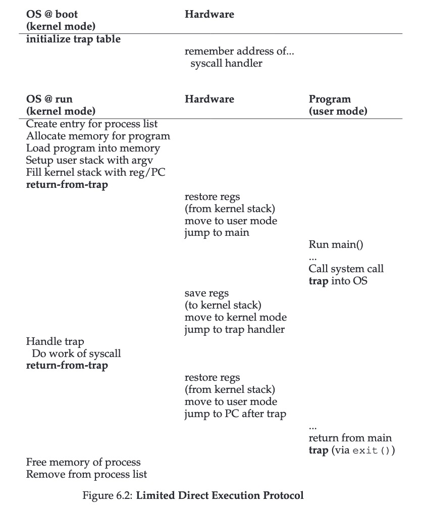

从 API 看（《现代操作系统》p32），POSIX 的进程接口包括 `fork`、`execve`、`waitpid` 和 `exit(status)`，文件与目录接口包括 `open`、`unlink`、`mkdir`、`rmdir` 与 `chdir`，还有 `umount`、`kill`、`time`。下方用 Win32 API 对照。 [chmod](https://blog.csdn.net/pythonw/article/details/80263428)


#### 定时器怎样把 CPU 交还给内核

协作式调度（A cooperative approach）依赖任务主动交权或因系统调用等进入内核，完全协作时，一个无限循环就可能迫使用户重启。重启能回到已知初始状态、回收过期或泄漏资源，并可手动或自动执行。抢占式调度（A Non-Cooperative Approach）则能由 timer interrupt 进入 interrupt handler，随后由 scheduler 决定是否切换。内核可以控制定时器或屏蔽中断，对违反保护规则的程序也可结束其执行。 [Mac OS 9 模拟环境](http://www.columbia.edu/~em36/macos9osx.html#summary) · [OSTEP，Limited Direct Execution](https://pages.cs.wisc.edu/~remzi/OSTEP/cpu-mechanisms.pdf)

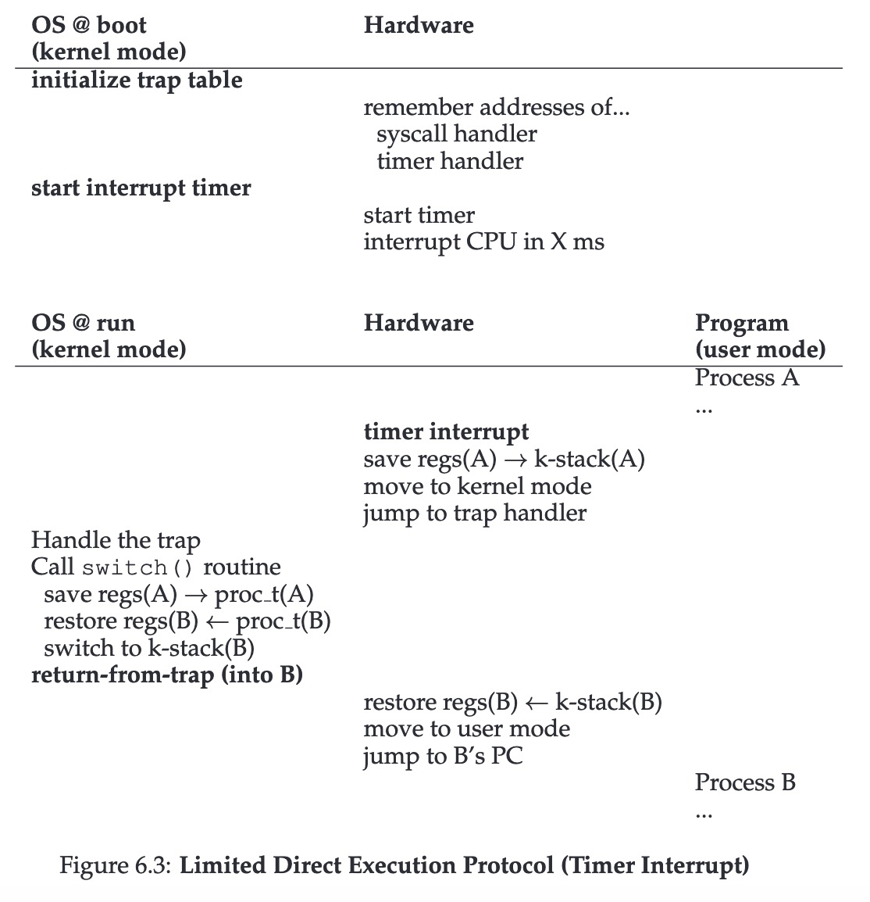

异常入口保存 trap frame，以便返回当时的用户态。系统调用一般从调用之后继续，可修复的访存异常需要重新执行触发异常的指令。调度切换保存内核执行上下文，以便另一个线程从先前暂停的内核位置接着跑。可以顺着 xv6 context switch 代码找这两份现场分别在哪张栈上。调度可能与中断交错，课上称之为要对内核表结构做 *baby-proof*，具体看 [竞态、临界区与原子性](#竞态临界区与原子性)。

测量时要分开空系统调用、实际调度切换和记录成本。旧练习分别约为 0.3 μs、0.6 μs 和 1 μs，逐次记录的成本已经超过被测事件。用批量测量扣除计时基线，并留意 RDTSC 的序列化、核间时钟以及线程亲和性。课堂讨论也把某些系统调用和切换的延迟改善受限归因于内存层次。 [LMbench](https://winddoing.github.io/post/54953.html) · [多核 RDTSC 的注意点](http://www.360doc.com/content/12/0827/17/7851074_232649576.shtml) · [macOS 与 Linux CPU 亲和接口](https://yyshen.github.io/2015/01/18/binding_threads_to_cores_osx.html)

### 单体、分层与微内核

| 组织方式 | 内核边界与调用关系 |
| --- | --- |
| 单体系统（monolithic kernel） | 关键服务以模块组合，通常在同一内核地址空间直接调用。 |
| 分层（layered system） | 约束各层能依赖的下层，可以按全序或偏序组织。旧教材同时使用「偏序」「半序」。 |
| 微内核（microkernel） | 内核保留中断、调度、进程间通信等基本机制，把更多服务交给用户态。客户-服务器模型经消息通信，可在尽量小的内核上分离 mechanism 与 policy。 |


将隔离边界放到客体操作系统与虚拟硬件之间，会得到另一种组织方式，见 [容器、虚拟机与隔离边界](#容器虚拟机与隔离边界)。

## 进程、线程与进程间通信

### 进程模型、控制块与状态

#### 进程持有哪些东西

顺序进程模型把单条执行路径当作顺序指令流。实际运行中，调度与外部事件决定多条路径如何交错，实时任务还要满足完成时限。进程容纳代码、数据、地址空间、文件描述符与身份，线程持有执行位置、寄存器和栈。Windows 也把进程作为资源容器、线程作为调度实体，创建进程时可以指定父进程属性，Unix 则可通过 `fork` 继承。 [Linux 页表](https://docs.kernel.org/mm/page_tables.html) · [pthreads(7)](https://man7.org/linux/man-pages/man7/pthreads.7.html)

| 旧教材的上下文分类 | 保存的内容 |
| --- | --- |
| 用户级上下文 | 用户地址空间中的代码段、数据段、堆、各线程的用户栈。 |
| 寄存器级上下文 | 程序计数器、处理器状态、栈指针、通用寄存器，足够从暂停的位置恢复。 |
| 系统级上下文 | 静态部分包括 PCB（Process Control Block，进程控制块）与资源表。动态部分包括核心栈，同一内核函数为不同任务执行时使用各自的调用现场。 |

教材 p53 把进程表解释为 PCB 的集合，可用链表或索引组织。表的规模限制了某些实现能同时记录多少进程。多道程序设计里讨论的驻留内存规模，以及操作系统能维护多少并发任务，由不同资源决定。Linux 用 `task_struct` 表示任务。双向循环任务链表与 `run_list` 是旧实现示例。调度策略选谁，上下文切换负责恢复执行位置。


Unix 进程触发系统调用时，内核可以在该任务的上下文中执行内核代码，教材称为「OS 作为进程的一部分」。进程也可作为长驻服务或守护进程（daemon）运行。旧记录以 macOS 的 `coreaudiod` 说明服务可由管理器按配置重新拉起。shell 与创建进程的关系见教材 p26 和下节。 [Apple，launchd 的守护进程管理](https://developer.apple.com/library/archive/documentation/MacOSX/Conceptual/BPSystemStartup/Chapters/CreatingLaunchdJobs.html)

#### 任务为什么离开 CPU

创建时，系统准备运行时栈、堆与默认文件描述符。程序页可以按需装入，之后页的驻留、换出和调入由虚拟内存机制负责。任务运行后，等 I/O、内核资源或 IPC 输入时可进入阻塞，条件满足后重新就绪。时间片耗尽或更高优先级任务就绪造成抢占时，原任务回到就绪队列，调度器再选取下一位。 [调度时机](#调度时机工作负载与评价指标) · [缺页、交换与页面回收](#缺页交换与页面回收)


xv6 的教育性结构展示切换时需要保存的寄存器。结合 [trap frame 的用途](#定时器怎样把-cpu-交还给内核) 可区分两份现场。

```c++
// the registers xv6 will save and restore
// to stop and subsequently restart a process
struct context {
    int eip;int esp;
    int ebx;int ecx;
    int edx;int esi;
    int edi;int ebp;
};
// the different states a process can be in
enum proc_state { UNUSED, EMBRYO, SLEEPING,RUNNABLE, RUNNING, ZOMBIE };
// the information xv6 tracks about each process
// including its register context and state
struct proc {
    char*mem;                  // Start of process memory
    uint sz;                    // Size of process memory
    char*kstack;               // Bottom of kernel stack
                               // for this process
    enum proc_state state;      // Process state
    int pid;                    // Process ID
    struct proc*parent;        // Parent process
    void*chan;                 // If !zero, sleeping on chan
    int killed;                 // If !zero, has been killed
    struct file*ofile[NOFILE]; // Open files
    struct inode*cwd;          // Current directory
    struct context context;     // Switch here to run process
    struct trapframe*tf;       // Trap frame for the
                                // current interrupt
};
```


五态教学模型另有 initial 与 final。前者等待创建所需资源，后者保留退出信息供父进程回收，辅助记录还可用于账单统计。七态模型允许把进程映像挂起到磁盘。激活让阻塞挂起回到阻塞、就绪挂起回到就绪。Linux 作业控制中的停止由信号等触发，按系统自己的状态码理解。


#### 用 Linux 的进程状态查证

| `ps` 状态 | 含义与例子 |
| --- | --- |
| `R` | 正在运行，或等 CPU 的就绪任务。 |
| `S` | 可中断睡眠，例如等待网络数据或同步事件。 |
| `D` | 不可中断睡眠，常见于等 I/O，可查内核栈确认等待点。 |
| `Z` | 子进程已退出，父进程还需要用 `wait*` 取得退出信息。 |
| `T` / `t` | 作业控制停止或调试器的跟踪停止。由 `SIGSTOP` 引起的作业控制停止可用 `SIGCONT` 恢复。 |

[ps(1) 状态定义](https://man7.org/linux/man-pages/man1/ps.1.html#PROCESS_STATE_CODES) · [wait(2)](https://man7.org/linux/man-pages/man2/wait.2.html)

僵尸进程练习先查状态与父子关系，再观察测试父进程结束后的回收。末条是旧练习的故障注入，只适用于测试进程。应用里优先查父进程的 `wait*` 路径。

```shell
# 查找僵尸进程
ps -aux|grep Z
ps -ef|grep 子进程pid
kill -9 父进程pid
```

`/proc/<pid>/fd/` 可核对打开的描述符及其泄漏。`/proc/<pid>/task/<tid>/` 对应单个线程，`/proc/<pid>/status` 的 `Threads` 记录线程数。调试 PID 命名空间时还可查看 `/proc/sys/kernel/ns_last_pid`。

### 进程创建、程序装载与回收

#### fork、exec 与等待各管哪一步

教材把创建、撤销、阻塞、唤醒列为进程控制原语。一次系统调用内部仍可有多个能交错的阶段。例如某个进程的 `read()` 阻塞时，另一个仍能进入同一内核路径。这是对照原笔记的「`read()` 重入」要理解的执行关系。

| 接口 | 改变的状态 |
| --- | --- |
| `fork()` | 产生有新 PID 和 PPID 的子进程。父子从同一调用点继续，子进程返回 0，父进程得到子 PID。普通私有页用 [CoW](#进程与内存写时复制) 延后复制，谁先执行由调度决定。 |
| `execve()` | 在同一个进程中装入新程序，替换代码、数据、栈与地址空间。成功后进入新程序。 |
| `exit(status)` 与 `wait*` | 子进程退出可向父进程发送 `SIGCHLD`。父进程用 `wait()`、`waitpid()` 或 `waitid()` 等待状态变化，用 `WEXITSTATUS` 能读取正常退出码的低 8 位。 |

UID/GID 表达身份，PID 标识进程。`<unistd.h>` 提供 `getpid()` 和 `fork()`。子进程通常继承身份、当前目录、环境、信号处置、进程组、控制终端、打开的描述符与共享映射。两个描述符可指向同一个 open file description，因而共享文件偏移。终端断开相关的 `SIGHUP` 交付取决于终端、会话、作业控制与 shell 行为，见 [信号与作业控制](#信号与作业控制)。 [早期 execve 调用笔记](https://my.oschina.net/u/3857782/blog/1854572) · [POSIX wait、waitpid](https://pubs.opengroup.org/onlinepubs/9799919799/functions/wait.html)

#### 装载前先接好文件描述符

把 `fork` 与 `exec` 分开后，shell 可在子进程里先改环境、重定向或接上管道，再装入目标程序。OSTEP 的 `p3.c` 用 `execvp()` 启动 `wc`，`v` 表示参数向量（vector），`p` 表示按路径搜索。成功装入后控制流进入新程序，原调用点不会继续执行。已写到目标的输出会留下，仍在用户态 stdio 缓冲里的内容可能随地址空间替换消失。 [练习 5.4，exec 家族](https://en.wikipedia.org/wiki/Exec_(system_call)#C_language_prototypes)

重定向例子（OSTEP `p4.c`）先关闭标准输出，再让 `open()` 得到最小空闲描述符。原练习 `grep -o foo file | wc -l` 还要两端在 exec 前各自接好描述符，见 [管道、命名管道与缓冲](#管道命名管道与缓冲)。

```c++
#include <stdio.h>
#include <stdlib.h>
#include <unistd.h>
#include <string.h>
#include <fcntl.h>
#include <assert.h>
#include <sys/wait.h>

int main(int argc, char *argv[])
{
    int rc = fork();
  //  printf("STDOUT_FILENO的值是%d",STDOUT_FILENO);
    if (rc < 0) {
        // fork failed; exit
        fprintf(stderr, "fork failed\n");
        exit(1);
    } else if (rc == 0) {
	// child: redirect standard output to a file

	close(STDOUT_FILENO);
	open("./p4.output", O_CREAT|O_WRONLY|O_TRUNC, S_IRWXU);

	// now exec "wc"...
        char *myargs[3];
        myargs[0] = strdup("wc");   // program: "wc" (word count)
        myargs[1] = strdup("p4.c"); // argument: file to count
        myargs[2] = NULL;           // marks end of array
        execvp(myargs[0], myargs);  // runs word count
    } else {
        // parent goes down this path (original process)
        int wc = wait(NULL);
	assert(wc >= 0);
    }
    return 0;
}

```

Linux 的 `vfork()` 让子进程暂时共享地址空间和栈，暂停父进程的调用线程，直到子进程执行 `execve()` 或用 `_exit()` 退出。若子进程需要等父线程做事才退出，就可能互等。普通 `fork()` 的父子可以独立调度。 [练习 5.3，vfork 的先后顺序](https://www.cnblogs.com/zhangxuan/p/6387422.html) · [vfork(2)](https://man7.org/linux/man-pages/man2/vfork.2.html)

#### 选择要等待的子进程

| `waitpid(pid, ...)` 的 `pid` | 等待的范围 |
| --- | --- |
| `-1` | 任一子进程（any child process）。 |
| `0` | 调用者进程组中的子进程（the process group of the caller）。 |
| 大于 `0` | 指定 PID 的子进程。 |
| 小于 `-1` | 进程组 ID 等于其绝对值的子进程。 |

练习 5.5 的子进程若没有自己的孩子，等待会遇到 `ECHILD`。5.6 对照 `wait` 与 `waitpid` 的范围，5.8 区分 `fork()` 在子进程里返回 0 与程序退出码。旧笔记用 RTFM（read the fucking manual）提醒核对 API 契约。 [wait 和 waitpid](https://www.cnblogs.com/yusenwu/p/4655286.html) · [练习 5.8](https://blog.csdn.net/beautysleeper/article/details/52585224)

Linux 的示例保留父子分支和等待顺序。

```c++
#include <cstdlib>
#include <iostream>
#include <sys/types.h>
#include<sys/wait.h>
#include <unistd.h>
#include <vector>
using namespace std;

int main(){
    int pid;
    for (int i = 0; i < 3; i++){
        pid = fork();
        if (pid == 0){ //子进程
            cout << "pid=" << pid << getpid() << ", hello world" << endl;
            return 0;
        }
        else{
            cout << "pid=" << pid << " forked" << endl;
        }
    }
    int ret = 0;
    while (ret!=-1){
        ret = wait(NULL);
        cout << "pid=" << ret << " exited" << endl;
    };
    return 0;
}
```

Windows 的 `CreateProcess` 把程序、环境和句柄继承等选项放在一次创建调用中。对照代码可以找出 Unix 例子在 exec 前配置的参数。

```c++
/*
BOOL CreateProcess(
LPCWSTR pszImageName, LPCWSTR pszCmdLine, LPSECURITY_ATTRIBUTES psaProcess, LPSECURITY_ATTRIBUTES psaThread, BOOL fInheritHandles,
DWORD fdwCreate, LPVOID pvEnvironment, LPWSTR pszCurDir,
LPSTARTUPINFOW psiStartInfo, LPPROCESS_INFORMATION pProcInfo
);
*/
#include <stdio.h>
#include <windows.h>
int main() {
	TCHAR szCmdLine[]={TEXT("C:\\oscourse\\test.exe")};
	STARTUPINFO si;
	PROCESS_INFORMATION pi;
	memset(&si, 0, sizeof(STARTUPINFO));
	si.cb = sizeof(STARTUPINFO);
  si.dwFlags = STARTF_USESHOWWINDOW;
  si.wShowWindow = SW_SHOW;
  if(!CreateProcess(NULL, szCmdLine, NULL, NULL, FALSE, 0, NULL, NULL, &si, &pi))
	{
		printf("Create process fail!\n");
		ExitProcess(1);
	}
  else {
    printf("Create process success!\n");
    ExitProcess(0);
	}
}
```

### 线程模型、调度实体与并行上限

Multithreading 把共享资源与执行状态拆开。PCB 记录进程资源，TCB（Thread Control Block）记录线程的寄存器、运行状态与调度信息。轻量级进程（LWP，Lightweight Process）是部分系统描述可调度实体的术语。线程可用共享变量换信息，访问它们需要 [同步](#竞态临界区与原子性)。创建或撤销线程通常比创建独立地址空间成本低。


| 线程怎样落到内核 | 调度和阻塞的结果 |
| --- | --- |
| ULT（User-Level Thread，典型多对一） | 用户态库直接切换，典型实现用协作式调度（cooperative scheduling），可按应用定制，也可以提供类似 pthread 的接口。调度逻辑可随线程库移植，承载仍用对应 OS 的接口。单个承载线程只占一个 CPU，它阻塞在系统调用或缺页时，其他 ULT 也无法经它继续。 |
| KLT（Kernel-Level Thread，典型一对一） | 内核可在多个 CPU 上调度同一进程的线程，多个线程也可分别进入内核执行。阻塞发生在单线程一级。管理和切换要进内核。若按线程给时间片，多线程进程可能获得更多份额，实际还取决于调度和分组。 |
| 混合 M:N | 线程库创建、调度和同步多个用户线程，将其映射到多个内核线程。Solaris 的历史实现可作对照。 |

线程有独立的用户栈，但这些栈位于同一个地址空间。`ulimit -a`、`ulimit -s` 可查看相关限制，pthread 属性能为新线程设置栈大小。 [线程栈和进程栈](https://www.cnblogs.com/luosongchao/p/3680312.html) · [pthreads(7)](https://man7.org/linux/man-pages/man7/pthreads.7.html)

教材 p56 的文字处理器用三个线程拆开交互、处理与后台任务。Web 服务器可以由 dispatcher 分发请求，worker 查询缓存或等 I/O 时，其他 worker 可以继续跑。这复用了 multiprogramming 的思路，给 server-based applications 带来并行或重叠 I/O 的机会。p57 的有限状态机也保留了单个请求按顺序推进的模型，只是用状态记录进度，让事件循环在等待时服务别的请求。同步或异步描述参与者如何协作与交付结果，阻塞或非阻塞描述调用者是否被挂起。 [阻塞、非阻塞与同步、异步](https://www.cnblogs.com/skying555/p/5028167.html) · [事件循环与异步 I/O](#事件循环与异步-io)

Amdahl 定律中，若可并行部分占原执行时间的比例为 $p$，忽略额外开销，处理器数趋于无穷时有

$$
S_{\max}=\frac{1}{1-p}.
$$

例如 95% 的工作可并行，理论上最多得到单线程性能的 20 倍。实际还要看调度、共享数据和 I/O 的争用。

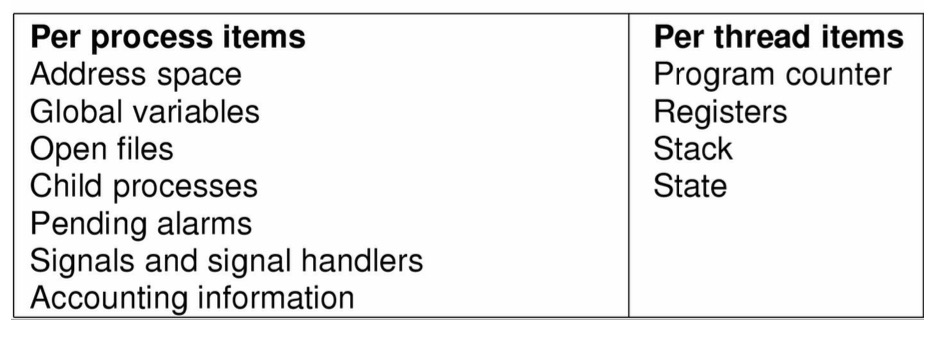

用 `objdump -d -g main` 查看可能交错的机器指令与调试信息，注意 x86 指令变长。是否 join 或 detach 取决于是否要等待结果及由谁回收线程资源，见下节。 [pthread_join 与 detach](https://blog.csdn.net/heybeaman/article/details/90896663)

### POSIX 线程接口与 Linux、Windows 实现

#### 创建线程、传参和回收

POSIX 定义 pthread API，实现负责映射执行实体。`pthread_create` 通过 `&p` 等输出位置返回句柄。属性可传 `NULL`，也可用 `pthread_attr_init` 初始化后传入。入口签名为 `void *(*start_routine)(void *)`，`void *` 能承载不同类型的对象地址，双方需要约定实际类型、所有权与生命周期。编译例子用 `gcc -o main main.c -Wall -pthread`。 [pthreads(7)](https://man7.org/linux/man-pages/man7/pthreads.7.html)

```c++
#include <pthread.h>
int pthread_create(pthread_t*thread,const pthread_attr_t*attr,void*(*start_routine)(void*),void*arg);

typedef struct
{
    int a;
    int b;
} myarg_t;
typedef struct
{
    int x;
    int y;
} myret_t;
void * mythread(void *arg)
{
    myret_t *rvals = Malloc(sizeof(myret_t));
    rvals->x = 1;
    rvals->y = 2;
    return(void *)rvals;
}
int main(int argc, char *argv[])
{
    pthread_t p;
    myret_t * rvals;
    myarg_t args = {10, 20};
    Pthread_create(&p, NULL, mythread, &args);
    Pthread_join(p, (void **)&rvals);
    printf("returned %d %d\n", rvals->x, rvals->y);
    free(rvals);
    return 0;
}
```

`pthread_join` 可接收一个 `void **`，等待线程结束并取回返回值。例如先声明 `void *result = NULL;`，再把 `&result` 交给 join。旧练习用 `(void *)100` 记简化传参，用 `(void **)rvalue` 或 `(void **)value_ptr` 提醒对照参数类型。整数与指针相互转换依平台，强转本身不会提供可写的返回值位置。传对象时须保证 join 读到结果时对象仍存在，回传线程栈上局部变量的地址会失效。detach 则把退出后的资源回收交给线程库。


下面的工作线程练习逐个 join。旧资料中的 `pthread_yield()` 表示主动交还调度机会，线程仍可再次被选中，移植时核对当前平台的接口（如 POSIX `sched_yield`）。

```c++
#define _REENTRANT
#include <pthread.h>
#include <stdio.h>
#include <unistd.h>
#define NUM_THREADS 5
#define SLEEP_TIME 10
void *sleeping(void *); /* thread routine */
int i;
pthread_t tid[NUM_THREADS]; /* array of thread IDs */

int main()
{
    int sleep_time = SLEEP_TIME;
    for (i = 0; i < NUM_THREADS; i++)
        pthread_create(&tid[i], NULL, sleeping, (void *)&sleep_time);
    for (i = 0; i < NUM_THREADS; i++)
        pthread_join(tid[i], NULL); //逐个等待线程结束
    printf("main() reporting that all %d threads have terminated\n", i);
    return (0);
} /* main */

void *sleeping(void* arg)
{
    int sleep_time = *(int *)arg;
    printf("thread %u sleeping %d seconds ...\n", pthread_self(), sleep_time);
    sleep(sleep_time);
    printf("\nthread %u awakening\n", pthread_self());
    pthread_exit(0);
}
```

#### Linux clone 怎样分享资源

Linux 的 pthread 由同类 `task_struct` 承载，clone 家族的标志决定共享什么。练习里的 `CLONE_VM` 让创建出的任务共享地址空间。普通 `flag` 自旋能指出共享变量的位置，正式的同步需要原子操作或互斥等机制。 [竞态、临界区与原子性](#竞态临界区与原子性)


```c++
#define _GNU_SOURCE
#include <stdio.h>
#include <errno.h>
#include <sched.h>
#include <sys/types.h>
#define STACK_SIZE 4096 //4k
int flag;
void *test(void *arg)
{
    int childnum;
        flag = 1;
    childnum = *(int *)arg;
    printf("Thread %d work cycle\n", childnum);
    sleep(3);
}
int main()
{
    pid_t pid;
    int childno = 1, mainnum = 0;
    void *csp, *tcsp;
    csp = (char *)malloc(STACK_SIZE);
    if (csp)
    {
        tcsp = csp + STACK_SIZE;
    }
    else
    {
        exit(errno);
    }
    flag = 0;
    childno = 1;
    if ((pid = clone((void *)&test, tcsp, CLONE_VM, (void *)&childno)) < 0)
    {
        printf("Couldn't create new thread!\n");
        exit(1);
    }
    else
    { //we're in main
        while (flag == 0); //利用全局变量进行Linux线程间通信
        printf("Just created thread %d\n", pid);
    }
    test(&mainnum);
    sleep(3);
    printf("Main program is now shutting down\n\n");
    return 0;
}
```

#### Windows 的内核线程与 CreateThread

Windows 把线程作为内核调度实体（KLT）。教材称进程是惰性的资源容器，创建进程时通常伴随初始线程。执行体线程对象 `ETHREAD` 包含内核线程块 `KTHREAD`，后者对应教材中的 TCB。代码展示传入工作参数、等待线程并回收资源。

```c++
#include <windows.h>
#include <stdio.h>
#define MAX_THREADS 3
typedef struct _MyData {
	int val1;
	int val2;
} MYDATA, *PMYDATA;

DWORD WINAPI ThreadProc(LPVOID lpParam){
	PMYDATA pData;
	pData = (PMYDATA)lpParam;
	printf("This is thread %d, the parameter is %d\n", pData->val1, pData->val2);
	// Free the memory allocated by the caller for the thread
	// data structure.
	HeapFree(GetProcessHeap(), 0, pData);
	return 0;
}

void main() {
	PMYDATA pData;
	DWORD dwThreadId[MAX_THREADS]; //线程ID
	HANDLE hThread[MAX_THREADS]; //线程句柄 int i;
	// Create MAX_THREADS worker threads.
	for( i=0; i<MAX_THREADS; i++ ) {
	// Allocate memory for thread data.
		pData = HeapAlloc(GetProcessHeap(), HEAP_ZERO_MEMORY, sizeof(MYDATA));
    if( pData == NULL ) ExitProcess(2);
    // Generate unique data for each thread.
    pData->val1 = i;
    pData->val2 = i+100;
    hThread[i] = CreateThread(
                NULL,              // default security attributes
                0,                 // use default stack size
                ThreadProc,        // thread function
                pData,             // argument to thread function
                0,                 // use default creation flags
                &dwThreadId[i]);   // returns the thread identifier

    // Check the return value for success.
    if (hThread[i] == NULL) {
      ExitProcess(i);
    }
	}
// Wait until all threads have terminated. WaitForMultipleObjects(MAX_THREADS, hThread, TRUE, INFINITE); // Close all thread handles upon completion.
	for(i=0; i<MAX_THREADS; i++) {
		CloseHandle(hThread[i]);
	}
}
```

### 信号与作业控制

信号（signal）和管道是 Unix 较早的 IPC 机制。信号用于通知事件，例如终端按键、浮点异常、segmentation fault、套接字带外数据或 shell 的作业控制。可以把它分成三个问题：信号是否已经产生且未递送（pending），当前线程是否屏蔽它（blocked），递送时用哪种处置（disposition）。`SIG_DFL` 使用默认动作，`SIG_IGN` 表示忽略。`SIGKILL`、`SIGSTOP` 不能捕获、屏蔽或忽略。 [signal(7)](https://man7.org/linux/man-pages/man7/signal.7.html)

终端和 shell 通过进程组控制作业。`&` 把命令放在后台，前台作业可以用 Ctrl-Z 请求停止，再用 `fg`、`bg` 继续。终端断开时，哪些进程收到 `SIGHUP` 取决于会话、前台进程组及 shell 转发行为。进程主动发信号还要满足身份与权限检查。 [Linux 作业控制练习](https://www.cnblogs.com/mfryf/archive/2012/09/24/2700042.html)

旧内核课件用两个字保存 pending 与 blocked 位图，处理动作来自 sigaction。下面是另一时期的 Linux `task_struct` 摘录，观察任务内的 mask 与共享的 signal / sighand。实时信号和编号按当前平台查询。 [Linux sched.h](https://elixir.bootlin.com/linux/latest/source/include/linux/sched.h#L629)

```c++
/* Signal handlers: */
	struct signal_struct		*signal;
	struct sighand_struct __rcu		*sighand;
	sigset_t			blocked;
	sigset_t			real_blocked;
	/* Restored if set_restore_sigmask() was used: */
	sigset_t			saved_sigmask;
	struct sigpending		pending;
	unsigned long			sas_ss_sp;
	size_t				sas_ss_size;
	unsigned int			sas_ss_flags;
```

教材的信号捕捉示例展示 handler 何时打断主流程。正式代码要遵守 async-signal-safe 约束，例如把记录工作交还给主循环，避免在 handler 里调用示例中的 `printf`。 [signal-safety(7)](https://man7.org/linux/man-pages/man7/signal-safety.7.html) · [事件循环与异步 I/O](#事件循环与异步-io)

```c++
#include <signal.h>
void catchint(int signo) {
	printf("\n CATCHINT; signo=%d;", signo);
	printf("CATCHINT returning\n");
}
void main() {
  int i;
  signal(SIGINT, catchint);
  for(i=0; i<5; i++) {
    // 修改sigaction结构
    printf("Sleep call #%d\n", i);
    sleep(5);
  }
  printf("Exiting.\n");
}
```

### 管道、命名管道与缓冲

#### 两个描述符怎样接成一条字节流

`int pipe(int fildes[2])` 返回读端 `fildes[0]` 和写端 `fildes[1]`。两端指向同一个内核管道对象，数据通过有界缓冲流动。旧教材用 VFS 索引节点和单页缓冲示意，实际容量可变。匿名管道常由父进程创建，经 `fork` 交给子进程，或由父进程给多个子进程接线。内核用锁、等待队列和信号协调访问。管道适合持续传输字节。当缓冲区已满，阻塞写会等待空间。最后一个写端关闭且数据读完时，读端才能收到 EOF，所以每个进程都要关闭自己用不到的副本。 [pipe(7)](https://man7.org/linux/man-pages/man7/pipe.7.html)

```c++
#include <stdio.h>
#include <unistd.h>
#include <stdlib.h>
#include <string.h>
int main(int argc, char *argv[])
{
    int f_des[2];
    static char message[BUFSIZ];
    if (argc != 2)
    {
        fprintf(stderr, "Usage: %s message\n", *argv);
        exit(1);
    }
    if (pipe(f_des) == -1)
    {
        perror("pipe");
        exit(2);
    }
    switch (fork())
    {
        case -1:
            perror("fork");
            exit(3);
        case 0: // 子进程
            close(f_des[1]);
            if (read(f_des[0], message, BUFSIZ) != -1)
            {
                printf("Message received by child:[%s]\n", message);
                fflush(stdout);
            }
            else
            {
                perror("read");
                exit(4);
            }
            break;
        default: // 父进程
            close(f_des[0]);
            strcpy(message, argv[1]);
            if (write(f_des[1], message, BUFSIZ) != -1)
            {
                printf("Message sent by parent:[%s]\n", argv[1]);
                fflush(stdout);
            }
            else
            {
                perror("write");
                exit(5);
            }
    }
}
```

无亲缘关系的进程可以经文件系统路径打开命名管道（FIFO）。路径可以持续存在，现场传输的数据仍经内核管道交接。可以调用 `mkfifo`，旧教材对应 `int mknod(const char *path, mode_t mode, dev_t dev)` 与 `S_IFIFO`。 [POSIX mkfifo](https://pubs.opengroup.org/onlinepubs/9799919799/functions/mkfifo.html)

#### stdio 和内核管道各缓冲一次

流水线迟迟没有输出时，先区分 stdio 有没有 flush、内核管道是否被写满，以及下游是否在读。旧资料记载 glibc 2.3.5 在启用缓冲时可能每次 `fseek()` 之后都做一次 `read(blksize)`。它提出过通过环境变量控制的写法 `tail -f access.log | BUF_1_=1 cut -d' ' -f1 | uniq`，并讨论 Denial of Service implications。这是历史提议，使用前要核对工具支持和资源上限。 [stdio buffering](https://www.pixelbeat.org/programming/stdio_buffering/)

Linux 上管道容量可用 `fcntl(fileno(stdin), F_SETPIPE_SZ, pipe_page_num * 4096)` 这样的旧练习调整，实际应按页大小和系统限制核对。旧环境还记过 16 MB 的 socket 缓冲上限，这由另一套系统配置决定。下例对 Linux 和其他平台做了分支。

```python
import fcntl
import platform

try:
    if platform.system() == 'Linux':
        fcntl.F_SETPIPE_SZ = 1031
        fcntl.fcntl(fd, fcntl.F_SETPIPE_SZ, size)
except IOError:
    print('can not change PIPE buffer size')
```

### 消息传递、共享内存与套接字

| IPC 需要表达的事 | 对应接口及责任 |
| --- | --- |
| 有一件事发生了 | 信号递送，容量有限，往往只表达事件。 |
| 一串字节经过两个进程 | 管道，双方自行约定记录边界。 |
| 一条消息交给另一方 | 消息队列保留消息边界，空间仍有上限。微内核与客户-服务器模型常用这一抽象。 |
| 双方访问同一段数据 | 映射同一共享内存，另需同步访问。 |
| 在本机或跨机器通信 | 套接字可承载可靠字节流或数据报。按协议定义可靠性，也可用 client-server 或 peer-to-peer 组织。 |

#### 发送、接收与有界缓冲

教材用 `send(destination, &message)`、`receive(source, &message)` 表达系统的消息传递原语。发送端把消息交给系统，接收端通过命名或地址取得。扩到分布式系统还要考虑不可靠网络中的送达、进程命名、身份认证及性能。下面用空消息归还槽位，限制生产者能领先消费者多少步。

```c++
#define N 100								/* buffer 中槽的数量 */

void producer(void){
  int item;
  message m;									/* buffer 中槽的数量 */
  while(TRUE){
    item = produce_item();						/* 生成放入缓冲区的数据 */
    receive(consumer,&m);						/* 等待消费者发送空缓冲区 */
    build_message(&m,item);						/* 建立一个待发送的消息 */
    send(consumer,&m);								/* 发送给消费者 */
  }
}

void consumer(void){
  int item,i;
  message m;
  for(int i = 0;i < N;i++){						        /* 循环N次 */
    send(producer,&m);							/* 发送N个缓冲区 */
  }
  while(TRUE){
    receive(producer,&m);						/* 接受包含数据的消息 */
        item = extract_item(&m);					/* 将数据从消息中提取出来 */
    send(producer,&m);							/* 将空缓冲区发送回生产者 */
    consume_item(item);						/* 处理数据 */
  }
}
```

#### System V IPC 对象的标识与生命周期

System V IPC 用访问键（key）定位对象，用 ID 操作对象。`ipc_perm` 包含创建者和所有者 UID/GID、访问模式与 key，系统做类似文件的权限检查。旧 Linux 教材用 `msgque` 链表和 `msgid_ds` 描述队列的内核组织。创建队列时分配一份描述结构，再把它挂入索引链表。用户态接口中的标准拼写是 `msqid_ds`。

- `msgget` 按 key 创建或打开队列，返回 ID。`msgsnd` 发送。`msgrcv` 可按类型收消息，默认在没有匹配消息时等待，设 `IPC_NOWAIT` 则返回 `ENOMSG`。创建者退出可以留下队列，需显式用 `msgctl(msgqid, IPC_RMID, 0)` 等完成清理。 [msgop(2)](https://man7.org/linux/man-pages/man2/msgop.2.html)
- `shmget` 按 key 创建或打开共享内存，返回 ID。`shmat` 把它连到进程地址空间，成功时返回映射的起始地址。调用者可指定映射地址或让系统选，子进程可经 `fork` 继承映射。`shmdt` 拆掉本进程的映射。`shmctl(shmid, IPC_RMID, 0)` 标记删除，等最后一个进程分离后再销毁，也可按权限用控制操作锁定物理驻留。并发访问还要配合信号量等同步。 [shmctl(2)](https://man7.org/linux/man-pages/man2/shmctl.2.html)

消息队列的发送端 `snd.c` 与接收端 `rcv.c` 分别如下。对照查看两边使用的队列 key、消息类型和资源删除时机。

```c++
#include <stdlib.h>
#include <stdio.h>
#include <string.h>
#include <errno.h>
#include <unistd.h>
#include <sys/msg.h>
#define MAX_TEXT 512
#define TRUE 1
struct msgbuf
{
    long int msgtype;
    char msgtext[MAX_TEXT];
};
int main()
{
    struct msgbuf msgdata;
    int msgid;
    char buffer[MAX_TEXT];
    if ((msgid = msgget((key_t)1234, 0666 | IPC_CREAT)) == -1)
    {
        fprintf(stderr, "msgget failed with error: %d\n", errno);
        exit(EXIT_FAILURE);
    }
    printf("msgid = %d\n", msgid);
    while (TRUE)
    {
        printf("Enter message text: ");
        fgets(buffer, MAX_TEXT, stdin);
        msgdata.msgtype = 1;
        strcpy(msgdata.msgtext, buffer);
        if (msgsnd(msgid, (void *)&msgdata, MAX_TEXT, 0) == -1)
        {
            fprintf(stderr, "msgsnd failed\n");
            exit(EXIT_FAILURE);
        }
        if (strncmp(buffer, "end", 3) == 0)
        {
            break;
        }
    }
    exit(EXIT_SUCCESS);
}
```

```c++
#include <stdlib.h>
#include <stdio.h>
#include <string.h>
#include <errno.h>
#include <unistd.h>
#include <sys/msg.h>
#define MAX_TEXT 512
#define TRUE 1

struct msgbuf
{
    long int msgtype;
    char msgtext[MAX_TEXT];
};
int main()
{
    int msgid;
    struct msgbuf msgdata;
    if ((msgid = msgget((key_t)1234, 0666 | IPC_CREAT)) == -1)
    {
        fprintf(stderr, "msgget failed with error: %d\n", errno);
        exit(EXIT_FAILURE);
    }
    printf("msgid = %d\n", msgid);
    while (TRUE)
    {
        if (msgrcv(msgid, (void *)&msgdata, MAX_TEXT, 0, 0) == -1)
        {
            fprintf(stderr, "msgrcv failed with error: %d\n", errno);
            exit(EXIT_FAILURE);
        }
        printf("Received message: %s", msgdata.msgtext);
        if (strncmp(msgdata.msgtext, "end", 3) == 0)
        {
            break;
        }
    }
    if (msgctl(msgid, IPC_RMID, 0) == -1)
    {
        fprintf(stderr, "msgctl(IPC_RMID) failed\n");
        exit(EXIT_FAILURE);
    }
    exit(EXIT_SUCCESS);
}
```

System V 的信号量组通过 `semget`、`semop`、`semctl` 管理，用户态记录用 `semid_ds`。`semop` 传入由信号量索引、操作值、操作标志组成的数组，一批操作整体生效。若其中一项需要等待，默认挂起任务。用 `IPC_NOWAIT` 可让调用返回。旧内核以 `sem_base` 指向信号量数组，用栈上的 `sem_queue` 保存挂起请求，通过 `sem_pending`、`sem_pending_last` 与 `sleeper` 组织等待队列，再交给调度器。现代的使用语义见手册，原理见 [信号量与资源计数](#信号量与资源计数)。 [semop(2)](https://man7.org/linux/man-pages/man2/semop.2.html)


#### Unix 与 Windows 接口对照

Unix TCP/IP 套接字使用 `send`、`sendto`、`recv`、`recvfrom` 等接口，同一套接口可用于可靠字节流或数据报。Windows 的 Winsock 提供与协议分离的 API，支持多种网络协议。

| Windows 机制 | 对应用暴露的接口 |
| --- | --- |
| 互斥与同步 | 信号量、互斥量与临界区。 |
| 文件映射 | `CreateFileMapping` / `OpenFileMapping` 创建或打开，`MapViewOfFile` 建立视图，`UnmapViewOfFile` 和 `CloseHandle` 清理。`FlushViewOfFile` 将脏页写出，文件元数据及更强的落盘等待需结合 `FlushFileBuffers`。 |
| 匿名管道 | `CreatePipe` 给出两个句柄，用 `ReadFile` 与 `WriteFile` 传输。 |
| 命名管道 | 每个实例可让一对服务端、客户端通信。服务器在本机创建 `\\.\pipe\PipeName`，客户端可用 `\\serverName\pipe\pipename` 连接远端服务器，前提是网络和权限允许。 |
| 邮件槽（mailslot） | 教材中的不定长、不可靠、单向消息机制，常按 client-server 使用。 |

[Microsoft FlushViewOfFile](https://learn.microsoft.com/en-us/windows/win32/api/memoryapi/nf-memoryapi-flushviewoffile)

## CPU 调度

### 调度时机、工作负载与评价指标

调度决定哪个就绪任务先拿 CPU。任务自愿阻塞、时间片（time slice / scheduling quantum）到期、高优先级任务就绪，都会提供调度机会。非抢占式策略等待任务交权，抢占式策略可以用定时器和中断收回 CPU。教材把决定接纳哪些作业、哪些进程留在内存、哪个线程马上执行分别称为作业、swap 和进程／线程调度。 [有限直接执行](#系统调用与有限直接执行)

| 工作负载（workload） | 需要优化的量 |
| --- | --- |
| 批处理 | 单位时间完成的作业数（throughput）、从提交到完成的周转时间（turnaround）、CPU 忙碌比例。 |
| 交互 | 发出请求到第一次响应的 response time、用户可感知的均衡性。 |
| 实时 | 能否满足 deadline、最坏情况及可预测性。丢失截止期可能导致丢数据或多媒体品质降低。 |

教材 p87 还列了公平、资源平衡和执行预定策略。讨论公平前要明确是给每个用户、进程还是线程分份额。CTSS 的分时思路以改善交互为目标。

切换本身要保存和恢复上下文，也可能因迁移或交替访问不同工作集而产生指令、数据 cache miss。时间片变长能 amortize the cost of context switching，代价是后面任务可能等待更久。课件用 20–50 ms 示意，实际值依策略和版本。 [上下文切换术语](https://baike.baidu.com/item/%E4%B8%8A%E4%B8%8B%E6%96%87%E5%88%87%E6%8D%A2/4842616) · [OSTEP，Scheduling Introduction](https://pages.cs.wisc.edu/~remzi/OSTEP/cpu-sched.pdf)

I/O 活动常使发起线程阻塞（教材 p85）。把其他任务的计算和等待重叠（overlap），可以填掉空档。若有 $n$ 个任务各以概率 $p$ 独立等 I/O，至少一个任务可运行的概率为

$$
1-p^n.
$$

这个估算依赖独立等待。模拟器 `process-run.py` 的 `-I IO_RUN_IMMEDIATE` 练习让 I/O 完成者立即运行。对于反复短计算再发 I/O 的任务，观察及时启动下一次 I/O 如何和其他任务的计算重叠。

### 批处理、轮转与实时调度

#### 同一组作业，响应和周转会选不同规则

教材从五个 workload assumptions 开始，逐步放宽以得到 *a fully-operational scheduling discipline*。先假定 jobs 耗时相同且已知、同时到达、拿到 CPU 就运行至完成、只有计算而无 I/O。下表已放宽「耗时相同」这一项，三项作业同一时刻到达，按 A、B、C 入队并分别需 8、2、2 ms。在 STCF 行再放宽到达时刻和能否抢占的假设。这里忽略切换成本。

| 调度规则 | 原理 | 算例 |
| --- | --- | --- |
| FCFS/FIFO（First-Come, First-Served） | 按到达顺序，长作业在队首会产生 convoy effect。 | 完成时间 8、10、12 ms，平均周转 10 ms。 |
| SJF（Shortest Job First） | 已知作业长度时先执行短作业。 | B、C、A 分别在 2、4、12 ms 完成，平均周转 6 ms。 |
| STCF/SRTF（Shortest Time-to-Completion First / Shortest Remaining Time First） | 允许抢占，按剩余时间选择作业。 | 如果 B 在 A 跑了一段之后才到，剩余时间比较可能让 B 抢占 A。 |
| RR（Round Robin） | 在同优先级轮转。时间片短，任务较早取得首次响应，切换频率也增加。 | 若 quantum 为 2 ms，三项首次运行分别是 0、2、4 ms。 |

[OSTEP，Scheduling Introduction](https://pages.cs.wisc.edu/~remzi/OSTEP/cpu-sched.pdf)

#### 实时调度先看任务能否全部按时完成

实时系统先做可调度性分析（教材 p92），把最坏执行时间、周期、截止时间、抢占与资源等待带入，再评估策略。RMS（Rate Monotonic Scheduling）按周期设置固定优先级，周期越短优先级越高。EDF（Earliest Deadline First）随就绪任务的绝对截止时间动态选择。最小裕度（least laxity）比较离截止时间的剩余时间减去尚需执行的时间。


策略参数可以交由配置者决定，内核负责执行机制。应用任务调度也可沿用这种分工。校验任务在产物提交后才就绪，调度器再按优先级和并发额度派发，执行器的提交权限由所有权和提交协议管理。

### 多级反馈队列与比例份额

#### MLFQ 用已经发生的行为估计作业类型

多级反馈队列（Multi-Level Feedback Queue）接续分时系统的设计，Corbató 因分时工作获图灵奖。每个队列有一个优先级，反馈规则决定任务什么时候换队列。 [OSTEP，MLFQ](https://pages.cs.wisc.edu/~remzi/OSTEP/cpu-sched-mlfq.pdf)

| 教材规则 | 怎样选任务或调优先级 |
| --- | --- |
| Rule 1 / Rule 2 | 若 `Priority(A) > Priority(B)`，先运行 A。优先级相同，A 与 B 按 round robin（RR）轮转。 |
| Rule 3 | 新作业进入 topmost queue。 |
| 初版 Rule 4a / 4b | 用完一个完整时间片（entire time slice）才降一级，提前交权就留在原级。 |
| Rule 5，priority boost | 每过一段时间 $S$，把所有作业提升到最上层队列。 |
| 改进后的 Rule 4，better accounting | 在同一级累计耗尽配额（time allotment）就降级，执行中让出过几次 CPU 都计入。 |

初版让低级任务可能饥饿（starvation），让故意每次提前交权的任务占便宜（game the scheduler），任务从 CPU 密集变成交互型后也很难升回去（change its behavior）。Rule 5 给饥饿任务与行为已变化的任务新的机会，改进后的 Rule 4 封住反复提前交权的漏洞。

高优先级可以用更短的轮转时间片，低优先级用长些的时间片摊薄切换。课程记录的 Solaris 示例有 60 个队列，最高一级约 20 ms，最低需数百毫秒，并记录约 1 秒一次的优先级提升。另有让操作系统占一档独立的 0 号优先级的设计。练习中的 `iobump` 让 I/O 完成者到当前队头，关闭时放队尾。旧练习记录在 I/O 越频繁的配置中效果越明显。对照时要分开看 I/O 重叠程度和等 CPU 的时间，参数也要按实现判断。

系统很难只靠观测知道每个程序最适合什么策略，因此也会接收 advice，让调用者提供意图。`nice`、`madvise` 和 informed prefetching and caching（教材引用 P+95）分别出现在调度、内存和文件系统中，实际是否采纳取决于接口与系统。 [OSTEP，MLFQ](https://pages.cs.wisc.edu/~remzi/OSTEP/cpu-sched-mlfq.pdf)

#### Lottery 与 stride 怎样兑现同一份额

Lottery 的 tickets represent your share。每轮从所有有效票中抽一个获胜者，任务获胜概率等于它持有的票占比，长期份额趋向目标，短窗口用 unfairness metric 看偏差。随机策略实现轻量、快速，也能避开某些确定性策略的规律性边界，如循环扫描下的 LRU。产生有界随机数要核对分布，直接做 `rand() % n` 可能有取模偏差，使用工具库的区间抽样。 [有界随机数的实现](https://stackoverflow.com/questions/2509679/how-to-generate-a-random-integer-number-from-within-a-range) · [区间从 0 开始的理由](https://www.cs.utexas.edu/users/EWD/ewd08xx/EWD831.PDF)

| 票的操作 | 解决的问题 |
| --- | --- |
| Ticket currency | 用户可用自己的内部单位分配票，再兑换到全局单位。 |
| Ticket transfer | 等待服务器时，把票暂让给服务器执行自己的请求。 |
| Ticket inflation | 任务暂时增加票数，依赖参与者之间的信任。 |

Stride scheduling 让票数多的任务取较小 stride。每次跑 pass 最小的任务，运行后给它的 pass 加上 stride，于是长期份额由步幅控制。Stride 比较各任务累计进度，Lottery 不需要这份全局可比较的 pass 状态。类似机制也能用于虚拟机资源分配。 [OSTEP，Lottery Scheduling](https://pages.cs.wisc.edu/~remzi/OSTEP/cpu-sched-lottery.pdf)

```c++
curr = remove_min(queue);   // pick client with min pass
schedule(curr);             // run for quantum
curr->pass += curr->stride; // update pass using stride
insert(queue, curr);        // return curr to queue
```

### 多核负载均衡、亲和性与异构核心

多核线程能同时运行，还要考虑每核缓存和数据共享。硬件 cache coherence 约束各核对同一位置的观察。教材用在总线上监听（bus snooping）的 write-back caches 说明旧副本如何失效。临界区仍需 mutual exclusion 或其他同步原语，见 [竞态、临界区与原子性](#竞态临界区与原子性)。

| 调度队列 | 优势 | 成本 |
| --- | --- | --- |
| SQMS（Single-Queue Multiprocessor Scheduling） | 所有 CPU 从全局队列选任务，容易看到全局负载。 | 队列锁随核数出现争用，任务迁移也会丢掉 cache affinity。 |
| MQMS（Multi-Queue Multiprocessor Scheduling） | 每 CPU 有队列，扩展性更好，任务自然留在热缓存附近。 | 一个队列可能很长，另一核却空闲，需要迁移任务。 |

Work stealing 允许空闲核查看并从更忙的 target queue 取任务（旧笔记称 peek）。检查过频会增加跨核协调，过稀则留下一段负载不均衡。异构 CPU 还要考虑 performance core 与 efficient core 的执行特性。Intel Thread Director 给 OS 提供程序运行和核心状态等硬件反馈，帮助评估调度与换核成本。 [Intel Thread Director 案例](https://fuse.wikichip.org/news/6123/intel-introduces-thread-director-for-heterogeneous-multi-core-workload-scheduling/)

### Linux 公平调度与等待诊断

#### 公平份额如何记账

同权重且一直可运行的两个普通线程在同一 CPU 上长期竞争，目标大体是平分 CPU 时间。经典 CFS 用每 CPU 运行队列与红黑树记录虚拟运行时间 `vruntime`，用权重折算已占 CPU 时间，优先考虑 `vruntime` 小的实体。睡眠后实体离开队列，唤醒后的放置取决于当时版本的规则。教材 p58 的例子用 `sched_latency=48ms` 和 `min_granularity=6ms`，同权重、任务不多时理想份额约 `48/n` ms，最小粒度限制切片过细。Nice 与权重大体按固定的相邻比值换算。

Linux 从 6.6 起将普通任务的公平调度转向 EEVDF。先依据 lag 判断哪些实体仍有资格获得 CPU，再在这些实体中选虚拟截止时间最早的。若甲已获得超出其公平份额的服务，乙和丙都有资格，丙的虚拟截止时间更早，就先选丙。这里的虚拟截止期用于内部排序。 [CFS 设计](https://docs.kernel.org/scheduler/sched-design-CFS.html) · [EEVDF 设计](https://docs.kernel.org/scheduler/sched-eevdf.html)

早期实现的对照包括线性扫描队列 O(n)、每 CPU 队列的 O(1) 调度器与经典 CFS，以及楼梯调度 RSDL（Rotating Staircase Deadline Scheduler）。旧教材还用单队列 BFS（BF Scheduler）观察比例份额与虚拟截止时间。O(1) 时代已有多核亲和性与均衡策略。

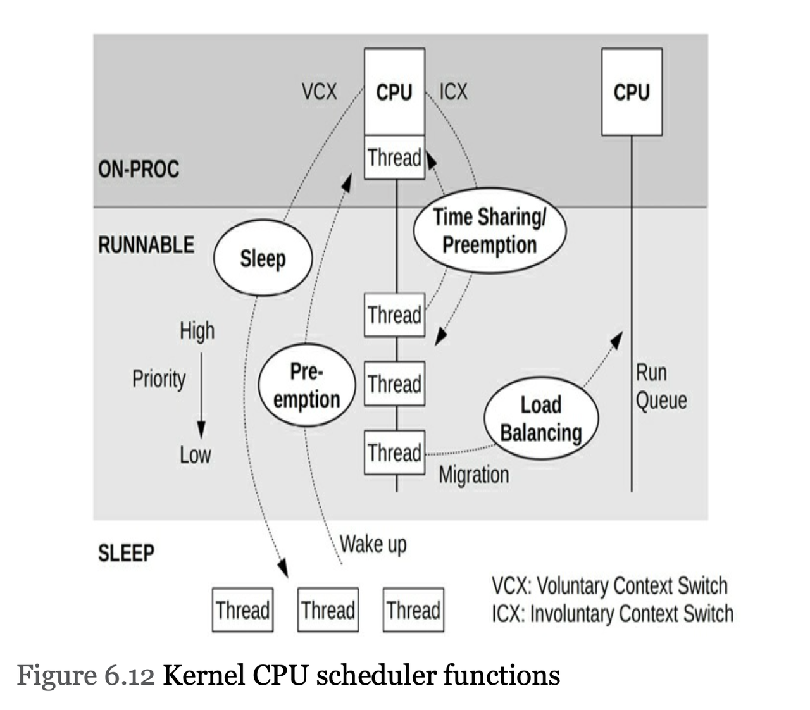

| Linux 策略 | 对应用的含义 |
| --- | --- |
| `SCHED_OTHER` | 普通分时调度。 |
| `SCHED_FIFO` | 同一实时优先级按队列顺序，当前线程运行至阻塞、主动让出或被更高优先级抢占。 |
| `SCHED_RR` | 同一实时优先级轮转，时间片用尽就移到队尾。 |

可用 `pthread_setschedparam(id, policy, &param)` 设置线程策略。Linux 的 `setpriority()`、`nice()` 可体现线程级 nice 值，POSIX.1 语义以进程为单位。提高优先级要满足权限或资源限制条件，课程实践对照了特权执行和用 `setcap` 授予相应能力。Windows 课程例子也区分实时与可变优先级。 [sched(7)](https://man7.org/linux/man-pages/man7/sched.7.html) · [Linux 策略测试](https://www.cnblogs.com/mightycode/p/13930352.html) · [nice 与线程](https://stackoverflow.com/questions/7684404/is-nice-used-to-change-the-thread-priority-or-the-process-priority) · [权限案例](https://stackoverflow.com/questions/41562834/linux-set-priority-function-is-not-taking-effect-in-my-test) · [Windows 课程延伸](https://blog.csdn.net/zhiquan/article/details/4240400)

#### 请求慢在等资源，还是醒了以后等 CPU

线程可能因睡眠、锁或 I/O 主动离开 CPU，也可能被抢占。写请求阻塞在存储或集群锁时，要等事件让线程就绪。被唤醒说明它具备继续执行的条件，之后仍可能在运行队列等 CPU。`/proc/<pid>/schedstat` 可对照 CPU 执行和运行队列等待时间，多线程问题应看具体 TID。结合 CPU 亲和性、可运行任务数、cgroup 配额以及资源的等待证据，才能解释利用率高时出现的长尾。线程长时间没推进时，也要与运行时 STW、事件循环被占用区分，分别对齐调度等待、运行时事件和循环延迟。 [Linux 调度器统计](https://docs.kernel.org/scheduler/sched-stats.html) · [Linux delay accounting](https://docs.kernel.org/accounting/delay-accounting.html) · [长暂停与迟到写入](./Software-Engineering.md#长暂停与迟到写入)

## 地址空间与虚拟内存

线上分析可以沿同一条线走。先看[地址怎样翻译](#分页页表与大页)和[什么情况进入内核](#翻译未命中与缺页发生在哪一步)，再看 [CoW 怎样增加实际占用](#进程与内存写时复制)，最后按[容器记账与限额](#cgroup-v2-内存记账与-oom)定位压力来源。

### 地址空间、重定位与分段

在多道程序设计里，每个进程看见自己的地址空间（address space）。用户程序发出的地址是虚拟地址，MMU（Memory Management Unit）结合当前地址空间的映射与权限进行翻译。两个进程可以用同一虚拟地址指向不同物理页。虚拟内存要兼顾 transparency（程序按统一地址使用）、efficiency（如用 TLB 缓存翻译）和 protection（隔离）。这里也能看到微内核设计中常用的 mechanism/policy 分工，例如硬件检查权限，系统决定怎样分配内存和处理异常。

一次运行的地址记录为代码 `0x105f40ec0`、堆 `0x105f55000`、栈 `0x7ffee9cbf8ac`。这些是虚拟地址，可以在该进程的映射中对照。x86-64 四级模式用第 47 位符号扩展，两个 canonical 窗口分别是 `0x0000000000000000`–`0x00007FFFFFFFFFFF` 与 `0xFFFF800000000000`–`0xFFFFFFFFFFFFFFFF`，合计 256 TiB。旧 32 位课件按 4 GiB 总空间、约 3 GiB 用户区和 10 MiB 每线程栈预留粗估约 300 个线程。实际还受其他映射、线程上限与栈配置影响。 [64 bit 进程内存分布](https://blog.csdn.net/chenyijun/article/details/79441166) · [x86-64 Linux 地址布局](https://docs.kernel.org/arch/x86/x86_64/mm.html)

#### 基址与界限让地址随进程一起移动

静态重定位（static / software-based relocation）由 loader 改写选定地址，装载后再移动困难，隔离仍要靠硬件。动态重定位（dynamic / hardware-based relocation）让硬件先检查界限，再计算 `physical address = virtual address + base`。bound 可以表示允许的长度，也可以表示物理上界。基址和界限寄存器由内核通过特权指令设置，进程切换时从 PCB 恢复。内核还维护可用空间的 free list，并在访问越界时接管异常。这个实现利用硬件换取翻译效率与控制，以固定连续段分配时可能留下内部碎片（internal fragmentation）。


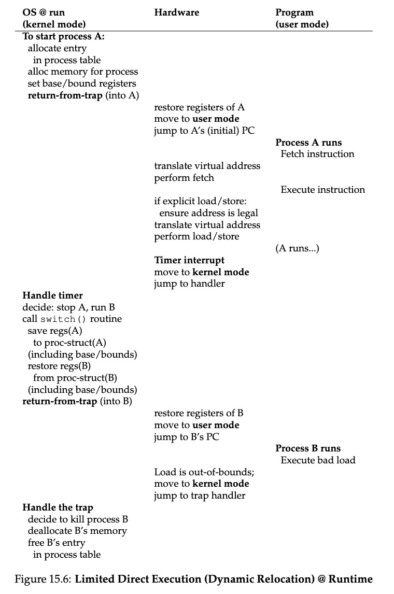

#### 分段按用途划地址，分页按大小切物理内存

分段（segmentation）为代码、堆、栈等区域各设 base 和 bounds，让稀疏地址空间（sparse address space）的空洞无需驻留。硬件可以从虚拟地址高两位显式（explicit）选择段，也可用一位合并 code 和 heap。隐式（implicit）实现可按访问来源选段，例如 PC 用于取代码。向低址增长的栈需要按负偏移解释。越过段界限会触发异常，教材称 segmentation fault。 [OSTEP，Segmentation](https://pages.cs.wisc.edu/~remzi/OSTEP/vm-segmentation.pdf)

粗粒度（coarse-grained）分段用少量段寄存器，细粒度（fine-grained）分段用 segment table 保存更多条目。硬件 protection bits 允许不同权限，多个地址空间可以共享只读代码段（code sharing）。连续放置变长段留下的空洞产生外部碎片（external fragmentation），还会让原地扩展堆等请求更难满足。搬动段做 compaction 代价大，也可用 free list 选择和合并块。用户空间 `malloc` 对空闲块管理有类似问题，具体策略见 [空闲块怎样找、拆、合并](#空闲块怎样找拆合并)。按页等大小分割物理内存是下面采用的另一种办法。

### 分页、页表与大页

分页以固定大小的物理页框（page frame）管理内存。物理页框可以分散，进程仍能看到连续的虚拟地址。内存管理单元（MMU）把地址拆成虚拟页号（VPN）与页内偏移，再用页表把 VPN 翻译为物理页框号（PFN，也写作 PPN，physical page number）。地址翻译只替换页号，页内偏移原样保留。固定大小的分配单元简化了物理内存管理，段、文件映射和权限仍可按虚拟地址范围表达。 [Linux 页表](https://docs.kernel.org/mm/page_tables.html)


#### 怎样存下稀疏的页表

页表项（PTE，Page Table Entry）保存映射及保护位。以教材的 32 位非 PAE 分页为例，地址拆成 20 位 VPN 与 12 位偏移，PTE 中有 20 位 PFN、3 位可供软件使用的位与 9 位标志。present 表示硬件是否能继续使用映射，protection bits 表达访问权限，reference/accessed bit 与 dirty bit 为页面置换和回写提供线索。若 x86 的 present 为 0，内核再用地址空间记录等信息判断这是合法但尚未调入的页、交换出去的页，还是进程无权访问的地址。教材有时另设一个抽象的 page table valid bit 表示地址是否合法。

| 页表组织 | 怎样查找 | 空间与时间代价 |
| --- | --- | --- |
| 线性页表（linear page table） | 从页表基址寄存器（PTBR，Page Table Base Register）定位 `PTBR + VPN * sizeof(PTE)`。 | 平坦数组容易索引。稀疏地址空间也需要为未用 VPN 留位置。 |
| 分段加分页（segmentation with paging） | 先按段选择页表基址，再用段内 VPN 查表。Multics 使用过分段与分页的组合。教材举三段、三张页表与三组 base/limit 的例子，limit 表示段内合法页数。 | 只给存在的段配表。连续分配的变长页表又会遇到外部碎片（external fragmentation），段内稀疏时仍浪费。 |
| 多级页表（multi-level page table） | 页目录（page directory）及其 PDE（Page Directory Entry）指向下一层，可以用每页条目数推导各层索引占多少位。 | 通过一级或多级间接寻址省掉空分支，用 page walk 的开销换空间。 |
| 倒排页表（inverted page table） | 按物理页框组织共享表项，典型实现可对地址空间与 VPN 做哈希查找，并用 TLB 缓存结果。 | 表项数随物理页数增长。分给每个进程一张全量线性表时，规模则随进程数乘虚拟页数增长。倒排表从虚拟地址反查时多一道查找。 |

分段加分页的地址计算保留教材的掩码写法。 [OSTEP，多级与混合页表](https://pages.cs.wisc.edu/~remzi/OSTEP/vm-smalltables.pdf)

```c++
SN = (VirtualAddress & SEG_MASK) >> SN_SHIFT
VPN = (VirtualAddress & VPN_MASK) >> VPN_SHIFT
AddressOfPTE = Base[SN] + (VPN*sizeof(PTE))
```

页表太大，通常由操作系统在物理内存中维护，硬件从约定的根表出发遍历。OSTEP 的 *Where Are Page Tables Stored?* 还引出一种设计，把用户页表放在受虚拟内存管理的内核空间，让部分页表页可以换出。 [OSTEP §18.2，Paging](https://pages.cs.wisc.edu/~remzi/OSTEP/vm-paging.pdf) · [OSTEP，完整内存系统](https://pages.cs.wisc.edu/~remzi/OSTEP/vm-complete.pdf) · [VAX/VMS 与 Linux 的内存实现](#vaxvms-与-linux-的内存实现)

#### x86-64 四级页表怎样用 48 位地址

以 **48 位线性地址、4 KiB 基础页**的四级模式为例。每个表项 8 字节，一页页表能装 512 项，索引恰好用 9 位。4096 字节的页内偏移用 12 位。64 位地址的最高 16 位复制第 47 位，构成该模式的规范地址。支持并启用五级分页时，增加一级索引，线性地址宽度为 57 位。 [Linux 页表](https://docs.kernel.org/mm/page_tables.html) · [x86 五级分页](https://docs.kernel.org/arch/x86/x86_64/5level-paging.html)

```text
四级分页的虚拟地址低 48 位
  47~39       38~30       29~21       20~12        11~0
  PML4        PDPT        PD          PT           页内偏移
  9 位        9 位        9 位        9 位         12 位
  CR3 → PML4 项 → PDPT 项 → PD 项 → PTE → 物理页框
```

手算 `0x0000000040201234`。从高到低右移 39、30、21、12 位，各取最低 9 位，四级索引为 `0, 1, 1, 1`，页内偏移为 `0x234`。若 PTE 指向物理页框基址 `0x38000`，实际字节位于 `0x38234`。未用到的虚拟地址范围可以在上层留下空项，整个分支都省掉。 [Linux 页表](https://docs.kernel.org/mm/page_tables.html)

#### 2 MiB 大页让翻译在上一层结束

在支持该页大小的 x86-64 上，2 MiB 映射可以由 **PD 的条目直接指向物理大页**。原来作为 PT 索引的 9 位并入页内偏移，偏移变为 21 位。对齐的 1 GiB 内存用 4 KiB 页要 262,144 个叶子映射，用 2 MiB 页要 512 个。**一条大页翻译覆盖的字节数是 512 倍**，未命中时也少走一级。实际命中率取决于工作集、访问分布和硬件为各页尺寸分配的 TLB 条目。 [Linux 页表与大页](https://docs.kernel.org/mm/page_tables.html) · [x86 TLB](https://docs.kernel.org/arch/x86/tlb.html)

大块、密集访问的数组、数据库（DBMS）缓冲池或索引区适合做大页对照。稀疏访问时，更粗的分配单位会带来内部碎片（internal fragmentation）。凑连续物理内存的整理（compaction）及换出或拆分时的处理成本也要一并衡量，具体行为取决于大页类型和内核。多种页尺寸可以并存，体现了 incrementalism，可以先为少数热点区域引入大页。 [HugeTLB](https://docs.kernel.org/admin-guide/mm/hugetlbpage.html) · [THP 文档](https://docs.kernel.org/admin-guide/mm/transhuge.html)

Linux 可显式配置 HugeTLB 页池，经 `mmap` 或 `shmget` 请求。透明大页（THP）由内核按策略分配或合并，可用 `MADV_HUGEPAGE` 针对相应区域做对照。用 `/proc/<pid>/smaps` 的 `AnonHugePages` 等字段确认实际映射，再比较同工作集下的 page walk、内存和 P99。 [HugeTLB](https://docs.kernel.org/admin-guide/mm/hugetlbpage.html) · [THP 文档](https://docs.kernel.org/admin-guide/mm/transhuge.html)

### TLB 与地址空间切换

#### 翻译未命中与缺页发生在哪一步

**TLB（Translation Lookaside Buffer）是 MMU 里的地址翻译缓存（address-translation cache），保存翻译及权限。** 数据缓存保存实际字节。地址翻译能从时间与空间局部性（temporal and spatial locality）获益。同一个页内相邻数据使用同一条翻译。x86-64 的 TLB 未命中时，硬件会查页表。有映射且本次访问获准，硬件可填充翻译并继续。page fault 在映射缺失、权限不足等情况下进入内核，包括 TLB 曾命中只读映射、进程随后尝试写入的 CoW 情况。 [Linux 页表与缺页](https://docs.kernel.org/mm/page_tables.html) · [x86 TLB](https://docs.kernel.org/arch/x86/tlb.html)

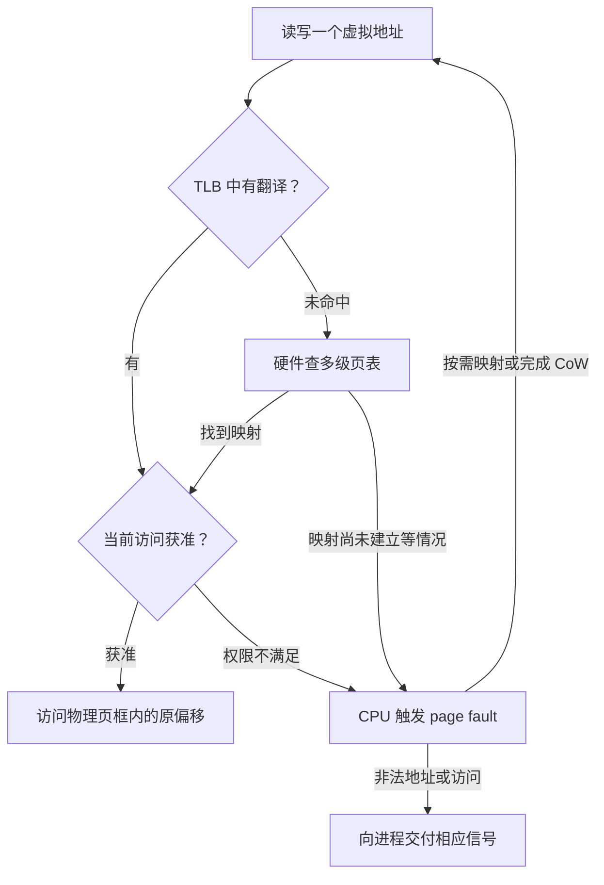

完整四级遍历逻辑上查四级表项，上层结果可能由处理器缓存复用。用一条冷路径估算，若四次依赖的表项读取都去 DRAM，每次假设 80 ns，仅找页框就约 320 ns，目标数据访问还在后面。实际代价取决于 TLB 层级、页表缓存和访问局部性。 [x86 TLB 性能计数器](https://docs.kernel.org/arch/x86/tlb.html)

#### 谁填充 TLB

x86 采用 hardware-managed TLB。硬件从 `CR3` 所指的根页表开始做 page walk，教材中 `CR3` 承担 PTBR 的角色。经典 MIPS 采用 software-managed TLB。未命中后进入操作系统的 TLB miss handler，由软件查表、校验并填充条目，返回后重试**原指令**。handler 本身也要取得指令和数据，经典做法包括用不依赖这次翻译的直接映射访问，或固定部分 TLB 条目（wired translations）。这两个实现也常用来对照 CISC 与 RISC，TLB 管理方式应按具体处理器判断。 [OSTEP §19.3 *Who Handles The TLB Miss?*](https://pages.cs.wisc.edu/~remzi/OSTEP/vm-tlbs.pdf) · [Intel SDM，OSTEP 原引用 I09](https://www.intel.com/content/www/us/en/developer/articles/technical/intel-sdm.html)

**硬件填表（hardware-managed）。** 教材的 TLB Control Flow Algorithm 先假定合法页已经驻留。命中时按缓存的保护位检查权限。未命中时，这个简化模型直接查线性页表，用 `PTBR + VPN * sizeof(PTE)` 定位，映射和权限通过校验才填表并重试。这里的 `PTE.Valid` 是教材的抽象状态，x86 的硬件位和软件检查见上面的 PTE 说明。加入换出页之后，另有 [present 分支](#缺页后是补一个映射还是做一次-io)。 [OSTEP §19.3](https://pages.cs.wisc.edu/~remzi/OSTEP/vm-tlbs.pdf)

```c++
VPN = (VirtualAddress & VPN_MASK) >> SHIFT
(Success, TlbEntry) = TLB_Lookup(VPN)
if(Success == True) // TLB Hit
    if (CanAccess(TlbEntry.ProtectBits) == True)
        Offset   = VirtualAddress & OFFSET_MASK
        PhysAddr = (TlbEntry.PFN << SHIFT) | Offset
        Register = AccessMemory(PhysAddr)
    else
        RaiseException(PROTECTION_FAULT)
else                  // TLB Miss
    PTEAddr = PTBR + (VPN*sizeof(PTE))
    PTE = AccessMemory(PTEAddr)
    if (PTE.Valid == False)
        RaiseException(SEGMENTATION_FAULT)
    else
                if (CanAccess(PTE.ProtectBits) == False)
                        RaiseException(PROTECTION_FAULT)
        else
            TLB_Insert(VPN, PTE.PFN, PTE.ProtectBits)
            RetryInstruction()
```

**软件填表（software-managed）。** 命中路径仍检查权限。未命中时由硬件报 `TLB_MISS`，查表、填表交给 OS handler，再重试原指令。如果 handler 本身的指令或数据也缺少翻译，就可能递归进入 miss handler。MIPS 的直接映射或预留的 wired translations 能让这段路径先运行起来。

```c++
VPN = (VirtualAddress & VPN_MASK) >> SHIFT
(Success, TlbEntry) = TLB_Lookup(VPN)
if (Success == True)   // TLB Hit
    if (CanAccess(TlbEntry.ProtectBits) == True)
        Offset   = VirtualAddress & OFFSET_MASK
        PhysAddr = (TlbEntry.PFN << SHIFT) | Offset
        Register = AccessMemory(PhysAddr)
    else
        RaiseException(PROTECTION_FAULT)
else                  // TLB Miss
    RaiseException(TLB_MISS)
```


MIPS 教材例子中的 TLB 条目为 64 位，典型实现有 32 或 64 项。内核可给 miss handler 等用途保留条目。特权指令 `TLBP`（probe）查找匹配项，`TLBR`（read）读取条目，`TLBWI`（replace specific）按索引写入，`TLBWR`（replace random）由硬件在可替换范围内选位写入。 [OSTEP，TLB](https://pages.cs.wisc.edu/~remzi/OSTEP/vm-tlbs.pdf)

#### 同一个 VPN 在进程切换后还能用吗

两个地址空间可以用同一个 VPN 指向不同页框，也可以通过各自的映射共享库或只读代码页。切换地址空间时，一种做法是切换 PTBR 后清掉受影响的 TLB 项（flush the TLB）。另一种做法是在匹配时带上 ASID（Address Space Identifier），让不同地址空间的条目共存。MIPS 教材用 8 位 ASID 类比 32 位 PID，两者的分配范围和生命周期由各自的系统管理。x86 的对应标签是 PCID。TLB valid bit 控制某条缓存翻译能否被使用，页表中的 present bit 与内核维护的地址有效性则描述实际映射。清 TLB 项的 valid 位只会让后续访问重新翻译。 [OSTEP §19.5 *TLB Issue: Context Switches*](https://pages.cs.wisc.edu/~remzi/OSTEP/vm-tlbs.pdf) · [Linux x86 TLB](https://docs.kernel.org/arch/x86/tlb.html)

PTI 将用户和内核的页表视图分开，入口与出口的切换成本受 PCID、内核策略和硬件支持影响。早期 Linux 4.14 资料记录了不同负载的历史结果，适合看隔离和翻译缓存之间的代价。 [Linux PTI](https://docs.kernel.org/arch/x86/pti.html) · [早期测试报道](https://www.zdnet.com/article/linux-meltdown-patch-to-800-percent-cpu-overhead-netflix-tests-show/) · [Netflix 测试的另一则报道](https://www.zdnet.com/article/linux-meltdown-patch-up-to-800-percent-cpu-overhead-netflix-tests-show/) · [Opsian 性能测量](https://www.opsian.com/blog/meltdown-benchmarks/)

#### 覆盖范围、替换策略与数据缓存

TLB 的相联度、分级和替换策略随处理器变化。课堂的 [全相联 TLB 示例](https://my.oschina.net/fileoptions/blog/1630855) 可以用来推演 LRU 的 corner case。若循环访问的页数恰好超过条目数，LRU 可能每次淘汰即将访问的页，随机替换（random policy）有时能避开这一模式。OSTEP 借 Culler’s Law 提醒先测翻译开销。大工作集超出 TLB reach（覆盖范围）时可考虑更大页面，数据库缓冲池是典型对照。测量时递增 `NUMPAGES`，固定每页触碰方式，观察每次访问的耗时。UNIX 可用 `getpagesize()` 或 `getconf PAGESIZE` 检查页大小，课堂示例为 4096 字节。 [OSTEP，TLB](https://pages.cs.wisc.edu/~remzi/OSTEP/vm-tlbs.pdf)

数据缓存若完全依赖物理地址索引（physically indexed cache），CPU pipeline 要先得到物理地址才知道从哪里找缓存行。VIPT（virtually indexed, physically tagged）在索引位能取自页内偏移时，可先读候选 cache set，并行翻译地址，最后比较物理 tag。这个例子解释了数据缓存和 TLB 怎样叠加到访存关键路径。 [OSTEP，TLB，含原参考 W03](https://pages.cs.wisc.edu/~remzi/OSTEP/vm-tlbs.pdf)

#### 页表改了，其他 CPU 的旧翻译也要失效

同一进程的线程可以在多个核上执行。假设核 0 用 `mprotect` 撤销写权限，核 1 若保留可写的旧翻译，就可能继续写。更新页表后让相关 CPU 失效旧条目叫 **TLB shootdown**。Linux/x86 常用核间中断（IPI）协调远端失效，`munmap` 收回映射也会遇到这个问题。按区间失效与更大范围刷新各有当场成本，刷掉的无关翻译越多，之后重新填表的成本也越大。 [Linux TLB 刷新接口](https://docs.kernel.org/core-api/cachetlb.html) · [x86 刷新策略](https://docs.kernel.org/arch/x86/tlb.html)

| 线上假设 | 找能区分的证据 | 对照验证 |
| --- | --- | --- |
| 大工作集频繁重新翻译 | 用 `perf list` 选本机 TLB/page-walk 事件，比较每次请求的 walk 数或耗时 | 对密集工作集比较大页或访问局部性，固定请求形状和数据量 |
| 映射反复拆建触发 shootdown | 核对 `mmap`、`munmap`、`mprotect` 调用和 TLB flush tracepoint。系统暴露相关字段时，对照 TLB/IPI 计数增量和参与的核 | 比较等价负载下的映射复用。Arena/Slab 实际减少映射变更时才减少失效，同时量驻留成本，见[内存分配](#内存分配碎片与回收工具) |

原练习用 `cat /proc/interrupts | grep "TLB shootdowns"` 查每个核的计数。字段名和可用性依系统而异。`%sys` 抬升说明样本中内核耗时增加，硬件 page walk 可以在用户代码访存期间完成。将 `%sys`、缺页计数、映射调用率与 TLB flush 分开测，才能区分数据布局、分配路径与内存压力。 [Linux x86 TLB 性能诊断](https://docs.kernel.org/arch/x86/tlb.html)

#### 地址空间保护与推测执行

页表权限能约束页是否可写、可执行。数组边界等对象级约束仍由语言、运行时和程序负责。Buffer overflow 可能破坏进程状态，影响也会随该进程的权限放大，例如引发 privilege escalation。NX bit 可把栈等数据页标为不可执行。 [Buffer overflow](https://en.wikipedia.org/wiki/Buffer_overflow)

讨论 return-oriented programming（ROP）时，地址空间布局随机化（ASLR）关心的是地址能否预测，内核地址随机化称 KASLR。旧笔记以 macOS 某一实现的第 27–12 位为随机化示例，范围依版本、平台和映射类型而异。 [历史阅读记录，Smashing the Stack for Fun and Profit](https://insecure.org/stf/smashstack.html)

Meltdown 与 Spectre 涉及 speculative execution 的微架构痕迹，敏感信息可能经时间差异间接暴露。KPTI 从用户态页表移除大部分内核映射，缓解 Meltdown 类问题，也引入 [页表切换与缓存](#同一个-vpn-在进程切换后还能用吗) 的成本。针对 Spectre 的措施依具体变种而异。旧笔记把两者合记为 *Other Security Problems: Meltdown and Spectre*，原站点为 meltdownattack.com、spectreattack.com。 [Linux PTI](https://docs.kernel.org/arch/x86/pti.html)

### 缺页、交换与页面回收

#### 缺页后是补一个映射，还是做一次 I/O

内核接到 [page fault](#翻译未命中与缺页发生在哪一步) 后，先用虚拟内存区域和访问类型判断修复路径。合法匿名页首次写入可以分配并清零新页，写共享的私有页会触发 [CoW](#进程与内存写时复制)，文件映射也可能已有数据在页缓存中。这些可以在内存中处理，体现为 minor fault。访问尚未缓存的文件页，或从 swap space 按交换位置（教材示意为硬盘 disk address）读回数据，可能产生 major fault。空闲页紧张时，分配还可能进入回收，所以 minor fault 也可能有可见延迟。 [Linux 页表](https://docs.kernel.org/mm/page_tables.html) · [getrusage(2)](https://man7.org/linux/man-pages/man2/getrusage.2.html)

**硬件路径（Page-Fault Control Flow Algorithm）。** 在硬件管理 TLB 的教学模型中，先区分地址无效、访问权限不足，以及地址合法但页不在内存。最后一种由 `PTE.Present` 为假表示，硬件抛出异常交 OS 处理，所以叫 page fault。x86 的具体异常分类和软件校验沿 [PTE 标志位](#怎样存下稀疏的页表) 理解。

```c++
VPN = (VirtualAddress & VPN_MASK) >> SHIFT
(Success, TlbEntry) = TLB_Lookup(VPN)
if(Success == True) // TLB Hit
    if (CanAccess(TlbEntry.ProtectBits) == True)
        Offset   = VirtualAddress & OFFSET_MASK
        PhysAddr = (TlbEntry.PFN << SHIFT) | Offset
        Register =AccessMemory(PhysAddr)
    else
        RaiseException(PROTECTION_FAULT)
else                  // TLB Miss
    PTEAddr = PTBR + (VPN*sizeof(PTE))
    PTE =AccessMemory(PTEAddr)
    if (PTE.Valid == False)
        RaiseException(SEGMENTATION_FAULT)
    else
        if (CanAccess(PTE.ProtectBits) == False)
            RaiseException(PROTECTION_FAULT)
        else if (PTE.Present == True)// assuming hardware-managed TLB
            TLB_Insert(VPN, PTE.PFN, PTE.ProtectBits)
            RetryInstruction()
        else if (PTE.Present == False)
            RaiseException(PAGE_FAULT)
```

**软件路径。** 下例只展开需要从交换区读回的分支。没有空闲物理页时先执行页面置换，`DiskRead` 期间任务可以睡眠，填好 PFN 和 present 后再重试原指令。进程通常看到的是本次访问恢复执行。早期 memory overlays 要由程序安排哪些代码或数据轮流占用同一区段，按需调页之后程序可以在统一地址空间（single address space）中使用地址。 [OSTEP，超出物理内存的机制](https://pages.cs.wisc.edu/~remzi/OSTEP/vm-beyondphys.pdf)

```c++
PFN = FindFreePhysicalPage()
if(PFN == -1) // no free page found
    PFN = EvictPage()       // run replacement algorithm
DiskRead(PTE.DiskAddr, PFN)// sleep (waiting for I/O)
PTE.present = True          // update page table with present
PTE.PFN     = PFN           // bit and translation (PFN)
RetryInstruction()          // retry instruction
```

#### 回收为什么有水位

教材用后台换页进程（page/swap daemon）说明低水位（LW，low watermark）与高水位（HW，high watermark）。系统在空闲页偏少时启动后台回收，补到较高水位再停。Linux 中可观察 `kswapd` 及分配路径上的 direct reclaim。干净文件页可丢弃后从原文件重读，脏文件页通常先回写，匿名页在有交换空间等条件下可以换出。后台将脏页成批写回（clustering）也能平滑 I/O，应用写到内存后的返回时机见 [页缓存与回写](#页缓存回写与直接-io)。 [Linux 内存管理概念](https://docs.kernel.org/admin-guide/mm/concepts.html) · [OSTEP，交换机制](https://pages.cs.wisc.edu/~remzi/OSTEP/vm-beyondphys.pdf)

`vmstat 1` 每秒报告一次。首行的速率和 CPU 时间统计从开机以来取平均，后续按采样间隔读。内存与进程类字段则反映各次采样时的状态。 [vmstat(8)](https://man7.org/linux/man-pages/man8/vmstat.8.html)

| 课堂 `vmstat 1` 练习 | 记录与读法 |
| --- | --- |
| 运行多个计算任务 | 记录为用户态 CPU 时间 `us` 增加、空闲 `id` 减少。 |
| 分配并触碰内存，原实验记为 1024 MB | 当时机器的 `free` 降低，`swpd` 未变，退出后恢复。空闲页下降只说明页被使用。 |
| 在报告约 132 GB 可用内存的历史机器上超量分配 | 旧记录包含 core dump，`in`（每秒中断数）增加，偶有 `sy`（内核态 CPU 占比）。单凭这些读数无法判断退出原因，要对齐退出信号、内核或 cgroup 的 OOM 记录及 swap I/O。 |
| 查交换空间与采样范围 | `swapon -s`、`/proc/swaps` 看交换设备，`/proc/meminfo` 看主机，容器的判断还要看 [cgroup 内存记账](#cgroup-v2-内存记账与-oom)。`si/so` 反映采样窗口的交换活动，`swpd` 是已用量。 |

[vmstat 练习](https://www.cnblogs.com/ftl1012/p/vmstat.html) · [Linux vmstat(8)](https://man7.org/linux/man-pages/man8/vmstat.8.html)

#### 页面置换策略怎样取舍

页面置换可以看成 cache management。若每次先花 `T_M` 检查内存，miss 后再付出 `T_D`，平均访存时间（AMAT）为

$$
\mathrm{AMAT}=T_M+P_{\mathrm{miss}}\,T_D.
$$

| 策略 | 用什么决定先淘汰谁 | 教材里的边界 |
| --- | --- | --- |
| Belady 最优（OPT） | 选未来最晚访问的页（farthest in the future） | 要知道未来轨迹，作为离线比较基准。 |
| FIFO | 选最早进入的页 | 缺少 stack property，容量为 `N` 时的内容未必包含于容量为 `N+1` 的缓存，可能出现容量增加而缺页更多的 Belady’s Anomaly。 |
| Random | 随机选页 | 循环顺序扫描有时比 LRU 更合适，也可以作为随机工作负载的对照。 |
| LRU/LFU | 分别按最近一次使用（recency）与使用频率（frequency）估计价值 | LRU 有 stack property，典型的 80/20 热点能受益。全量扫描会挤掉热点，可考虑 scan resistance。 |
| Clock | 沿环形数组检查 reference bit，遇 1 清 0 并给第二次机会，遇 0 可淘汰 | 用较低开销近似 LRU。可再看 dirty bit，优先考虑未用过且干净的页，减少写回。 |

OSTEP 图 22.6–22.9 给了可比较的访问轨迹。均匀随机（no locality）时，历史信息对预测帮助有限。80/20 热点里，LRU 通常更能保住热页，图中的 Clock 变体略逊于 LRU、优于 FIFO 和随机策略。循环顺序扫过比缓存容量更大的页集（looping sequential）时，LRU 反而可能每次淘汰下一个要用的页，Random 在教材算例里还能保住部分命中。 [OSTEP，页面置换，图 22.6–22.9](https://pages.cs.wisc.edu/~remzi/OSTEP/vm-beyondphys-policy.pdf)

硬件缓存常用 Three C’s 描述首次访问（compulsory）、容量不足（capacity）与组内冲突（conflict）。文件页缓存按文件与偏移由软件查找，组相联缓存里固定 cache set 的映射冲突在这个模型中没有直接对应，容量压力和长扫描仍会挤掉热点。置换之外还要选择何时调入（demand paging 或 prefetching）和怎样合并写回。当活跃 working sets 超过可用物理内存，反复换进换出会产生 thrashing。Admission control 可限制同时运行的工作集，压力耗尽时还可能触发 OOM Killer，桌面历史例子里曾担心 X server 被杀。 [cgroup OOM](#cgroup-v2-内存记账与-oom)

### 进程与内存写时复制

#### 同一地址先共用物理页，写入时再分离

Linux 的 `fork()` 给父子各自的地址空间。以已经驻留、原先可写的私有匿名页为例，父子页表先指向同一个物理页框，映射暂时写保护。其中一方尝试写入时，CPU 会触发权限型 page fault。内核认出这是合法的私有写入，若原页仍被共享，就复制内容、更新写入方的映射并恢复写权限，然后重试原指令。这就是写时复制（Copy-on-Write，CoW）。若原页已由写入方独占，内核可以直接恢复写权限。 [fork(2)](https://man7.org/linux/man-pages/man2/fork.2.html) · [Linux 页表与写时复制](https://docs.kernel.org/mm/page_tables.html)

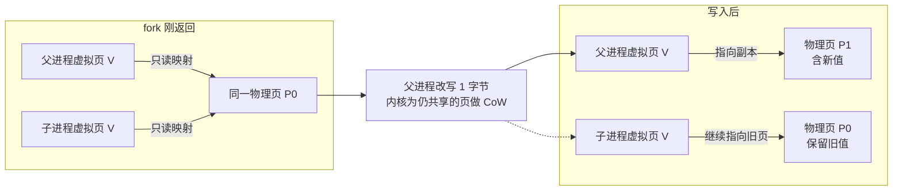

假设父进程有三页私有内存，子进程只写其中一页，则额外的物理数据内存约为一页，页表和进程元数据另外计算。`MAP_SHARED` 继续按共享映射的协议处理写入。父子继承的文件描述符还可能指向同一打开文件描述，共享文件偏移。即使各自重新打开同一路径，只要名字仍指向同一个文件，写入的还是同一份文件内容。`execve()` 会装入新程序并替换当前地址空间。文件与远端操作仍按各自的存储和提交协议处理。 [mmap(2)](https://man7.org/linux/man-pages/man2/mmap.2.html) · [execve(2)](https://man7.org/linux/man-pages/man2/execve.2.html)

#### 分开量 fork 的停顿和子进程存活期间的开销

| 时间段 | 主要成本 | 观测证据 |
| --- | --- | --- |
| `fork()` 调用期间 | 创建子进程并复制必要的地址空间与页表结构。父进程的调用线程要等这一段完成 | 量 fork 调用延迟，结合 `VmPTE` 和映射情况看规模。Redis 的 `latest_fork_usec` 给出最近一次 fork 的耗时 |
| 父子共存且写入时 | 已共享页面的首次写入可能分配、复制数据页并修改映射。大量分散写入会增加 minor fault、内存流量和驻留，也可能触发回收 | 对齐写入和子进程生命周期。看父子 `smaps_rollup` 的 PSS、`Private_Dirty`、minor fault 增量和所属 cgroup 的 `anon`，结合 Redis 的 `current_cow_size` 或 `rdb_last_cow_size` |

手算一个常驻内存为 12 GiB 的服务。假定全是密集映射的 4 KiB 私有页，叶子 PTE 每项 8 字节，3,145,728 个叶子项就需要约 **24 MiB**。这是简化的叶子页表体积，上层表和其他元数据另算。若快照子进程尚在，父进程随后在仍共享的 **262,144 个不同基础页**上各写一个字节，新增数据页约 **1 GiB**。同一页已属于写入者后，重复改同一地址可以复用该页。实际还有大页拆分、独占复用和其他分配等因素。 [Linux 页表](https://docs.kernel.org/mm/page_tables.html) · [Redis 延迟诊断](https://redis.io/docs/latest/operate/oss_and_stack/management/optimization/latency/#latency-induced-by-fork) · [Redis INFO 字段](https://redis.io/docs/latest/commands/info/)

`RSS` 统计进程映射到的驻留页，父和子可能各把同一批共享页记一遍。`PSS` 把被共享的页按映射分摊，适合估算这些进程合计分摊了多少物理内存。`Private_Dirty` 增长也可能来自新分配。归因 CoW 时，同时对照写入位置、时间窗口和 cgroup 的实际记账。 [Linux proc 内存字段](https://docs.kernel.org/filesystems/proc.html)

**逻辑上只读，也可能改内存。** CPython 在一些操作里获取或释放普通对象的强引用，会写到对象头中的引用计数（如 `ob_refcnt`）。如果大型 Python 对象图分散在很多页上，业务只查对象的值也可能弄脏许多页。具体行为取决于对象类别、操作与运行时版本，一些对象的引用计数操作可以是空操作。原始只读数据可放在文件映射中，由进程共同读底层字节，避免各自构造整份对象图。 [CPython 引用计数 API](https://docs.python.org/3/c-api/refcounting.html)

同样一系列写入，只改写一页和每页改写一个字节的差异，可以用单线程 Python 小脚本复现。父进程预先触碰每个页，两个子进程依次运行，以 `ru_minflt` 的增量比较量级。使用系统页大小，支持时对这段区域禁用 THP 以隔离基础页效应。

```python
import mmap
import os
import resource
from itertools import repeat

page_size = mmap.PAGESIZE
page_count = 2_048
length = page_size * page_count
flags = mmap.MAP_PRIVATE | mmap.MAP_ANONYMOUS

with mmap.mmap(-1, length, flags=flags) as region:
    if hasattr(mmap, "MADV_NOHUGEPAGE"):
        region.madvise(mmap.MADV_NOHUGEPAGE)
    for offset in range(0, length, page_size):
        region[offset] = 1

    for label, offsets in (
        ("same page", repeat(0, page_count)),
        ("distinct pages", range(0, length, page_size)),
    ):
        child = os.fork()
        if child == 0:
            before = resource.getrusage(resource.RUSAGE_SELF).ru_minflt
            for offset in offsets:
                region[offset] = 2
            after = resource.getrusage(resource.RUSAGE_SELF).ru_minflt
            print(f"{label}: {after - before} minor faults", flush=True)
            os._exit(0)
        _, status = os.waitpid(child, 0)
        assert status == 0 and region[0] == region[-page_size] == 1
```

一次 macOS arm64 对照使用 16 KiB 基础页，同一页与逐页写的 minor fault 增量分别为 **37** 和 **2,081**，父进程两处值仍为 1。该实验验证页覆盖范围带来的差异。解释器也会产生额外缺页，计数会随系统和运行变化。若要归因生产问题，优先把时间分成 fork 返回前、快照进行中和子进程退出后三段。 [Linux getrusage(2)](https://man7.org/linux/man-pages/man2/getrusage.2.html)

#### 大进程启动命令与后台快照的取舍

| 需求 | 可选方案与代价 |
| --- | --- |
| 只启动外部程序 | 适合用 `posix_spawn` 或支持它的语言接口，也可以委派给常驻的轻量启动进程，例如独立 sidecar 或尚未装载大工作集的 zygote。POSIX 定义的是启动语义，是否避免复制大地址空间取决于实现。glibc 可用共享地址空间的受限子进程尽快 exec。手写 `vfork` 要遵守父调用线程暂停、子进程使用共享内存与栈的限制。见[进程创建](#进程创建程序装载与回收) |
| 起多个 Python worker | 根据运行时和平台选 `spawn` 或 `forkserver`，需要付出启动解释器、导入模块、传输参数的成本。大块只读数据可用文件 `mmap` 共享。预加载到 forkserver 的可写对象仍可能触发 CoW |
| 子进程必须读某时刻的父内存快照 | Redis `BGSAVE` 这类功能依赖 fork 的内存语义。要给 CoW 留余量、量快照持续时间和并发写入造成的独立脏页数。轻量启动进程适合跑命令，重做快照方式则要另定义一致性 |

来源见 [posix_spawn(3)](https://man7.org/linux/man-pages/man3/posix_spawn.3.html) · [Python subprocess](https://docs.python.org/3/library/subprocess.html#popen-constructor) · [Python 多进程启动方式](https://docs.python.org/3/library/multiprocessing.html#contexts-and-start-methods) · [Redis 持久化](https://redis.io/docs/latest/operate/oss_and_stack/management/persistence/)。

### VAX/VMS 与 Linux 的内存实现

#### VAX/VMS 怎样承受 512 字节小页

DEC 的 VAX/VMS 要覆盖很宽的机器范围，教材称这种历史包袱为 *the curse of generality*。512 字节的小页让页表负担明显。系统混用分段与分页（hybrid approach），把用户页表放在内核虚拟地址空间，允许部分页表页换出，配合 TLB 减少频繁翻译的成本。第 0 页可用于发现 null-pointer accesses，内核则映射进每个地址空间。 [OSTEP，Complete Virtual Memory Systems](https://pages.cs.wisc.edu/~remzi/OSTEP/vm-complete.pdf)

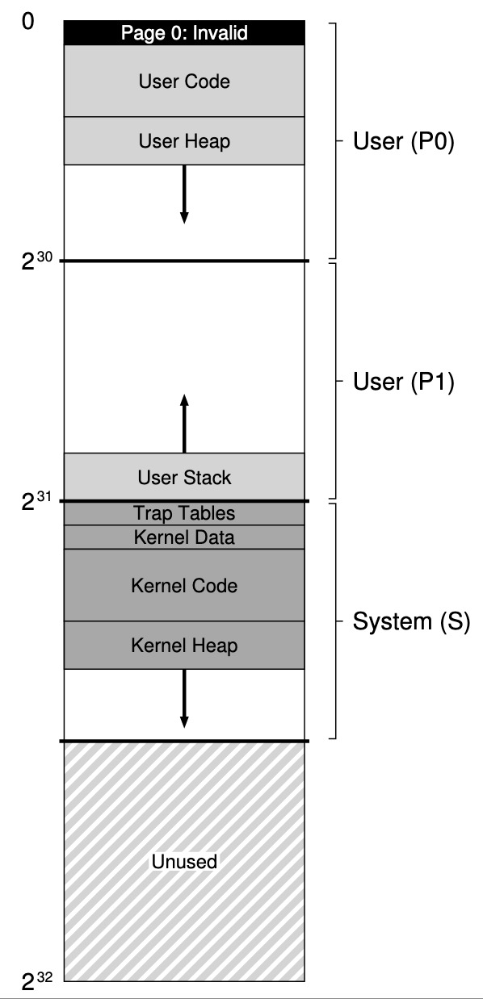

硬件缺少 reference bit 时，VMS 用 segmented FIFO 限制单个 memory hog 的影响，给进程规定 RSS（resident set size），超出后从该进程的 FIFO 移走最早入队的页。淘汰页进入全局 clean-page list 或 dirty-page list。其他进程先从干净页列表头部取空闲页。如果页尚未被重新分配，原进程缺页时还可以把它拿回来，获得 second chance。脏页可以成批回写（clustering），随后转入干净页列表。 [OSTEP，VAX/VMS 页面回收](https://pages.cs.wisc.edu/~remzi/OSTEP/vm-complete.pdf) · [置换策略](#页面置换策略怎样取舍)

Demand zeroing 延迟到访问时给新页清零，CoW 配合 Unix 风格的 `fork()/exec()` 延迟复制。两者体现 *be lazy*，既缩短眼前等待（responsiveness），也可能 *obviate the need to do things at all*。例如子进程马上 exec 时，往往省掉大部分数据页复制。 [写时复制](#进程与内存写时复制)

#### Linux 内核地址什么时候要求物理连续

经典 32 位 x86 的 3 GiB/1 GiB 教材布局从 `0xC0000000` 开始给内核。低端物理内存的直接映射（kernel logical addresses）用固定偏移换算，例如 `0xC0000000` 对应物理 `0x00000000`。教材把页表和每个任务的内核栈列为内核常驻对象的例子，它们与进程可换出的数据页有不同的驻留要求，实际分配接口随架构和实现而异。`kmalloc` 通常给出物理连续分配，教材借此解释设备 DMA 的连续性。现在设备还要按 DMA API 管理可访问地址和映射。`vmalloc` 可以从分散的页构造虚拟连续区域，适用于无物理连续要求的较大缓冲。 [Linux 内存分配指南](https://docs.kernel.org/core-api/memory-allocation.html)

64-bit x86 的映射区间见下图。实际机器可用 `pmap` 或 `/proc/self/maps` 看进程映射，再对照启用的分页级数。小页叠成一个工作集，这里原笔记也借《Cloud Atlas》记了一句：“My life amounts to no more than one drop in a limitless ocean. Yet what is any ocean, but a multitude of drops?”

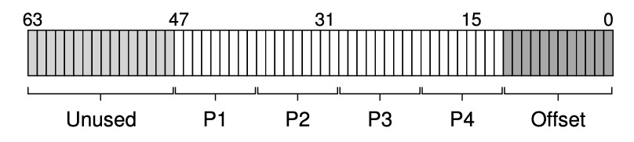

### 内存分配、碎片与回收工具

#### 用户态分配与对象生命周期

常见 LP64 Unix 中 `int` 为 4 字节、`double` 为 8 字节，跨平台以 ABI 与 `sizeof` 为准。`calloc()` 申请清零内存，`realloc()` 调整大小，地址可能变化。分配器底层可通过 `mmap` 取得映射，传统 `brk/sbrk` 调整 Program Break（当前堆边界），应用通常走分配器 API。 [brk(2)](https://man7.org/linux/man-pages/man2/brk.2.html) · [C++ Memory Allocation/Deallocation for Data Processing](https://towardsdatascience.com/c-memory-allocation-deallocation-for-data-processing-1b204fb8a9c)

| 错误或原练习 | 从哪里查 |
| --- | --- |
| Null pointer、segmentation fault（`null.c`） | 区分从未分配与分配失败。复制 C 字符串可用 `strdup` 并处理返回值。 |
| Buffer overflow、`strcat` 的源和目标重叠 | 检查容量，复制字符串通常还要为终止符保留 `strlen(src) + 1` 中的那一个字节。重叠时使用接口明确允许重叠的办法。 |
| Uninitialized read / undefined value | 查值何时写入，注意分配内存与初始化内容是两步。 |
| Memory leak（`forget_free.c`） | 长驻服务器会积累未释放的对象，增长可能体现为进程驻留压力，不能等操作系统在进程退出时统一回收。旧练习 LLDB 没给出提示，可用 Valgrind 或 [Purify](https://www.cnblogs.com/Leo_wl/p/7699489.html) 观察所有权。 |
| Dangling pointer（`dangling_pointer.c`）、double free | 先查对象何时失效。原练习直接运行曾输出 0，释放后再访问属于未定义行为。 |
| Invalid free（`free_wrong.c`） | `free` 要拿到分配器返回的起始地址。`int *` 加 1 已按元素宽度前进，无需再乘 `sizeof(int)`。 |

原练习用 `###` 标出的诊断线索分别是非法访问引发的段错误、未初始化读、重复释放，以及 `strcat` 的源和目标重叠。可以用 Valgrind 的 Memcheck 对照报错和调用栈。运行没崩溃时也应看对象的所有权与访问范围是否成立。 [Memcheck 可报告的错误](https://valgrind.org/docs/manual/mc-manual.html)

#### 空闲块怎样找、拆、合并

总空闲字节够用，最大空闲连续块依然可能太小。这是 external fragmentation。虚拟内存允许分散的物理页支撑连续的虚拟区间，分配器仍需管理虚拟堆中的空洞。普通程序持有的对象地址不能随分配器任意移动。虚拟地址到物理地址的重映射，以及受管理对象的移动，分别有自己的前提。 [What is memory fragmentation?](https://stackoverflow.com/questions/3770457/what-is-memory-fragmentation)

教材的 low-level mechanisms 依次是找块、Splitting and Coalescing、记录已分配块大小、Embedding A Free List 和 Growing The Heap。块头可保存 size 与 magic，例如 `void free(void*ptr) {header_t*hptr = (header_t*) ptr - 1;}` 用用户指针找头部，计算 chunk 尺寸时包含头部。空闲块能把链接放回自身，例如 `typedef struct __node_t {int size; struct __node_t *next;} node_t;`。 [OSTEP，Free-Space Management](https://pages.cs.wisc.edu/~remzi/OSTEP/vm-freespace.pdf)

| 分配结构 | 解决的问题 |
| --- | --- |
| 空闲链表（free list） | Best-fit 选能放下请求的最小块，worst-fit 先用最大块，first-fit 取第一个合适块。按地址排序有助于 coalesce 邻块。 |
| Segregated list / slab | 按常见尺寸分桶，slab 可缓存已构造到一定状态的对象（pre-initialized object caches）。减少搜索或重复初始化，同时要关注各桶积压。 |
| Binary buddy | 按二的幂切分连续块，用伙伴位置快速合并。向上取整会留下内部碎片。 [buddy algorithm](https://blog.csdn.net/wan_hust/article/details/12688017) |
| Arena、Hoard、jemalloc | 全局空闲表会限制扩展。并行分配器可将部分分配请求分到多个 arena，按所有权管理。jemalloc 的实现笔记另记了 radix tree 管理部分元数据。 [per-thread-arena.cpp](./操作系统/OSTEP/per-thread-arena.cpp) |

长、短寿命对象混合（mixtures of short-lived and long-lived objects）更容易留下空洞。可以检查堆中的 free blocks，把同时分配与释放、或需要 locality 的对象安排在同一个 sub-arena。主流分配器已做 size bucketing，有些使用或近似二的幂。额外把业务对象改成统一尺寸要先测，区分外部碎片、块内空闲和 arena 保留空间。 [How to solve Memory Fragmentation](https://stackoverflow.com/questions/60871/how-to-solve-memory-fragmentation) · [Linux 堆内存管理深入分析（上）](<https://introspelliam.github.io/2017/09/10/Linux%E5%A0%86%E5%86%85%E5%AD%98%E7%AE%A1%E7%90%86%E6%B7%B1%E5%85%A5%E5%88%86%E6%9E%90%EF%BC%88%E4%B8%8A%EF%BC%89/>)

#### 自动回收把释放责任交给运行时

Garbage collection 是 automatic memory management 的常见实现。运行时判断对象可达性，在内存开销、回收工作与暂停之间取舍。比较显式释放和 GC 时，应把工作集与堆大小也纳入实验。延伸阅读 *Quantifying the Performance of Garbage Collection vs. Explicit Memory Management*。

## 并发、同步与死锁

### 竞态、临界区与原子性

并发代码先找哪份状态被共享，再找哪个操作应该完整生效。两个线程同时读到计数旧值，各加一再写回，会覆盖其中一次更新。依赖执行交错的错误称为 race condition，结果不确定（indeterminate）。C++ 语言层面的 data race 指跨线程的冲突访问缺少 happens-before，其中至少一次修改该位置、至少一次为非原子访问。全用原子依然可能因顺序或协议错误丢掉更新。进程和线程的协作同时涉及互斥、顺序同步与数据传递。 [原子内存序的判定](./C++.md#原子内存序各自保证什么)

#### 临界区需要同时满足安全性和进展

教材把受保护对象称为 critical resource，把访问它的代码称为 critical section。流程是进入区、临界区、退出区、剩余区（remainder section）。互斥的教学要求有四条。

1. 任一时刻至多有一个参与者在临界区（mutual exclusion）。
2. 正确性不依赖某个 CPU 较快或只有一个 CPU。
3. 临界区外的任务不能妨碍其他任务继续。
4. 请求进入的任务应有进展，避免无限期等待（starvation）。

两个线程各执行 100 次自增，初值为 0。用教材的顺序一致性模型，把一次自增拆成读、加、写，下列交错可以得到 2。实际 C/C++ 中，普通变量的并发读写可能构成 data race 并导致未定义行为，不能据此预测真实结果。

```
进程2取 i=0
进程1执行99次
进程2算 i+1=0+1=1
进程1取 i=1
进程2执行99次
进程1算 i+1=1+1=2
```

Transaction 将多个动作组合成一个可以整体观察的动作。数据库的事务和 [journaling、copy-on-write](#文件系统块设备与持久化) 也关注外部观察到的边界，并另外处理持久化和恢复。操作系统是早期大型并发程序的典型例子。内核的页表、进程列表与文件系统结构都需要合适的同步原语，线程有独立的栈和寄存器仍会争用共享内存。

#### 从出错地址找回共享变量

HW26 用共享计数观察可交错的自增，也能看到忙等消耗 CPU。针对 `main-race.c`，原练习运行 `valgrind --tool=helgrind ./main-race` 并记录了 “Possible data race during write of size 4 at 0x30A014 by thread #1”。地址对应哪份全局数据要回到符号和段布局。笔记在 `main-deadlock-global-c` 里也记录过误判，遇到报告可按两条访问路径和保护同一状态的锁顺序验证。

### 互斥锁、自旋与原子指令

互斥锁（mutex）有 free 与 held 两个基本状态，执行者先取锁再进入临界区。评价实现时分别看 correctness、fairness 和 performance。锁可以粗（coarse-grained）到保护一个整体结构，也可细（fine-grained）到只保护一个桶。跨节点共享磁盘另见 [DLM、缓存交接与 fencing](#dlm缓存交接与-fencing)。 [OSTEP，Locks](https://pages.cs.wisc.edu/~remzi/OSTEP/threads-locks.pdf)

#### 屏蔽中断、普通读写与严格轮转

屏蔽中断能保护受控内核路径，作用范围通常是当前核，其他核仍可能访问同一对象。长时间屏蔽会推迟磁盘 I/O 等中断，反复操作也有成本。单靠下列普通读写轮询时，两个参与者可能在任一个写锁状态之前都读到 0，然后各自进入。Murphy’s law 提醒要把这种低频交错也写出来。

```c++
while(lock==1);
lock=1;
//critical region
lock=0;
//non_critical region;
```

严格轮转用整数 `turn` 轮流授权。若另一方没有打算进入，持有下一轮机会的一方仍可能阻住当前请求，所以不满足第 3 条。教材曾用 spooler directory（假脱机打印目录）讨论这类共享资源。Dekker 与 Peterson 则加入这种「现在有没有竞争」的信息。

#### Peterson、TAS、CAS 与 LL/SC

Peterson 为两个执行者各设一个意愿标志，再用 `turn` 解决双方同时想进入的冲突。只有对方也想进入且 `turn` 指向对方，当前线程才忙等。示例假定顺序一致性。C/C++ 实现还要为共享访问建立语言层允许的同步，并证明所选内存序满足协议。 [双标志双零推导](./C++.md#seqcst-怎样排除双零)

```c++
#define FALSE 0
#define TRUE  1
#define N     2                                           /* 进程数量 */

int turn=0;                                 /* 现在轮到谁？*/
int interested[N];               /* 所有值初始化为0（FALSE）*/

void enter_region(int process)               /* 进程是0或1 */
{
	interested[process] = TRUE;              /* 表名所感兴趣的*/
	turn = 1-process;                            /* 设置标志 */
	while(turn == 1-process && interested[1-process] ==TRUE); /* 空语句 */
}

void leave_region(int process)
{
	interested[process] = FALSE;             /* 表示离开临界区*/
}
```

| 原语 | 原子地做什么 | 锁或计数怎样用它 |
| --- | --- | --- |
| Test-and-Set（atomic exchange） | 读旧值并写新值。教材举 x86 的 locked `BTS/BTR`、内存操作数的 `XCHG OP1 OP2`，以及 SPARC 的 `ldstub`。 | `while (TestAndSet(&lock->flag, 1) == 1);`。一次只有读到旧值 0 的任务获锁。Test-and-test-and-set 先反复只读，观察到 0 才尝试原子改写。 |
| Compare-And-Swap（CAS） | 比较当前值和期望值，相等才写入。x86 常用 compare-and-exchange 术语。 | 可用于自旋锁或原子余额更新，失败后重新读取和计算。ABA 表示只比较值会漏掉 A→B→A 的变化，可用版本戳，例如 Java 的 AtomicStampedReference。 |
| Load-Linked / Store-Conditional（LL/SC） | 读取时建立关联，条件存储在硬件条件满足时才成功。 | 失败时要重试。下面是 [MIPS 的 LL/SC](http://groups.csail.mit.edu/cag/raw/documents/R4400_Uman_book_Ed2.pdf) 教材例程。 |
| Fetch-And-Add | 增加计数并返回旧值。 | ticket lock 先领取票号，再等轮到自己。 |

CAS 的进展保证要看完整算法。Lock-free 要有系统整体的进展，wait-free 要为每个操作给出有界进展。比如多个线程用 CAS 给同一 ATM 余额加款，可以反复重算，单个线程仍可能反复失败。原子读改写负责锁标志的所有权交接。解锁用 Release 发布临界区里的写，下一个线程以满足这个同步关系的 Acquire 操作取得锁后才能依赖这些写。 [Acquire/Release 交接图](./C++.md#acquirerelease-怎样把数据交给另一线程) · [CAS、ABA 与进展](https://www.jianshu.com/p/baaf53d69b51) · [Herlihy，Wait-Free Synchronization](http://www.cs.utexas.edu/users/lorenzo/corsi/cs380d/papers/p124-herlihy.pdf)

```c++
typedef struct __lock_t{
	int flag;
} lock_t;

void init(lock_t *lock){
	//0:lock is available, 1:lock is held
	lock->flag = 0;
}

int LoadLinked(int *ptr)
{
	return *ptr;
}
int StoreConditional(int*ptr, int value) {
	if (no update to *ptr since LoadLinked to this address) {
		*ptr = value;
		return 1; // success!
	}
	else {
		return 0; // failed to update
	}
}
void lock(lock_t *lock){
	while (LoadLinked(&lock->flag) ||!StoreConditional(&lock->flag, 1));
}
void unlock(lock_t *lock){
	lock->flag = 0;
}
```

对单个布尔锁位，Test-and-Set 和 CAS 都能保证只有一位竞争者把锁从 free 变成 held。这个判据容易检查，可供多个竞争者使用，各临界区也可以有独立锁位。简单自旋锁难保证公平，代价取决于持锁者能否继续跑。多核上若临界区很短，忙等可能比睡眠唤醒便宜。单 CPU 或持锁者已被抢占时，自旋会浪费 CPU。Ticket lock 按票号服务，前面某位被暂停也会拖住后面所有人。

```c++
typedef struct __lock_t {
    int ticket;
    int turn;
} lock_t;
void lock_init(lock_t*lock) {
    lock->ticket = 0;
    lock->turn   = 0;
}
void lock(lock_t*lock) {
    int myturn = FetchAndAdd(&lock->ticket);
    while (lock->turn != myturn); // spin
}
void unlock(lock_t*lock) {
    lock->turn = lock->turn + 1;
}
```

#### POSIX mutex 的生命周期

可用 `pthread_mutex_t lock = PTHREAD_MUTEX_INITIALIZER;` 静态初始化，也可检查 `int rc = pthread_mutex_init(&lock, NULL); assert(rc == 0);`。`pthread_mutex_lock()` 等待取得锁，`pthread_mutex_unlock()` 释放，`pthread_mutex_trylock()` 立即返回，`pthread_mutex_timedlock()` 可设等待期限。销毁前应确认没有持有者和等待者，某些实现会诊断 `EBUSY`。

```c++
pthread_mutex_t lock;
pthread_mutex_lock(&lock);
x = x + 1; // or whatever your critical section is
pthread_mutex_unlock(&lock);
```

[HW28 线程与锁](./操作系统/OSTEP/HW28-ThreadsLocks/)

### 从忙等到睡眠与唤醒

#### 睡眠前必须确认没错过交还

让竞争者调用 `yield`，能把当前调度机会交给别人。高争用时仍可能频繁切换，不能防止饥饿。用户级线程库也要在自己的调度边界处理这些问题。

```c++
void lock() {
    while (TestAndSet(&flag, 1) == 1)
        yield(); // give up the CPU, running->ready
}
```

等待队列把竞争者挂起。教材用 Solaris 的 `park()` / `unpark()` 说明入队和通知。guard 可以用短时自旋保护锁状态和队列元数据，持有时间只覆盖这些更新，业务临界区由主锁保护。如果线程在入队后、调用 `park()` 前被切走，释放者可能先发出通知。简单实现会丢掉这次通知，旧解法一是预先 `setpark()`，二是让内核接管 guard，把检查与睡眠衔接起来。

用 `queue_non_empty` 和 `worker_sleeping` 做快速握手时，还要考虑双方读到旧值的交错。内存序约束该读值组合，下图中的问题发生在已经检查之后、真正阻塞之前，仍需等待接口把这一步接好。 [双标志唤醒的内存序](./C++.md#seqcst-怎样排除双零)

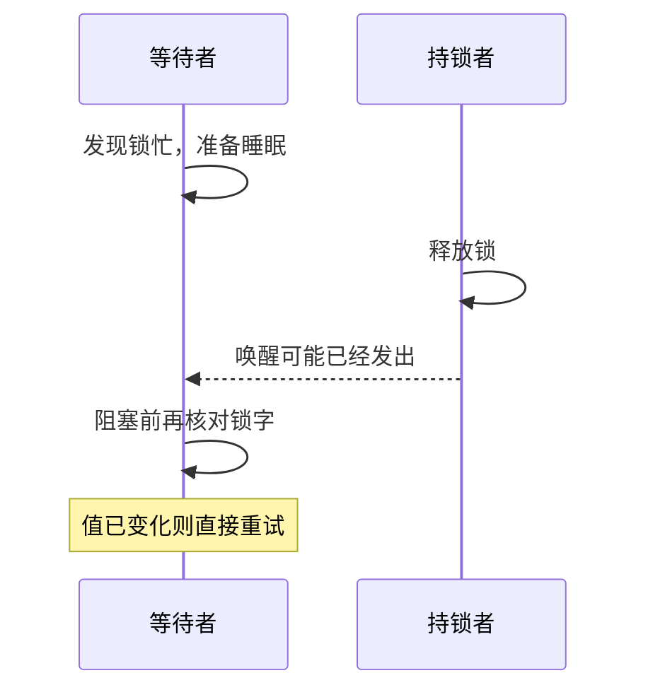

Linux futex（Fast Userspace Mutex）的常见做法是无争用时在用户态原子操作锁字，有争用时用针对该 futex 的内核等待队列。`FUTEX_WAIT` 把比较锁字当前值与准备阻塞衔接起来。若值已改变，请求返回并重试，从而避免睡到释放之前的状态。下例是旧 NPTL `lowlevellock.h` 的教学摘录。两阶段锁还可先短暂自旋，再进入 futex，和分段加分页一样，组合两种机制应对不同路径。 [futex(2)](https://man7.org/linux/man-pages/man2/futex.2.html) · [glibc / NPTL](http://ftp.gnu.org/gnu/glibc/)

```c++
void mutex_lock (int*mutex) {
    int v;
    /*Bit 31 was clear, we got the mutex (the fastpath)*/
    if (atomic_bit_test_set (mutex, 31) == 0)
        return;
    atomic_increment (mutex);
    while (1) {
        if (atomic_bit_test_set (mutex, 31) == 0) {
            atomic_decrement (mutex);
            return;
        }
        /*We have to wait
        First make sure the futex value
        we are monitoring is truly negative (locked).*/
        v =*mutex;
        if (v >= 0)
            continue;
        futex_wait (mutex, v);
    }
}
void mutex_unlock (int*mutex) {
    /*Adding 0x80000000 to counter results in 0 if and
    only if there are not other interested threads*/
    if (atomic_add_zero (mutex, 0x80000000))
        return;
    /*There are other threads waiting for this mutex,
    wake one of them up.*/
    futex_wake (mutex);
}
```

#### 优先级反转为什么可能由第三个线程放大

低优先级 L 持锁，高优先级 H 要等 L 释放。若 H 自旋，可能压住 L 的调度机会。若 H 睡眠，中优先级 M 又可能持续抢占 L，于是没有拿锁的 M 也能间接延迟 H。Priority inheritance 临时提高持有者优先级，priority ceiling protocol 提前对锁设上限式规则。教材还对照平级调度、随机提升（random boosting）与避免阻塞等设计。 [Priority inversion](https://en.wikipedia.org/wiki/Priority_inversion)

#### Windows 以对象表达等待条件

Windows 可等待 Mutex、Semaphore 与 Event 等对象。Critical Section 用于同进程内的线程互斥。Interlocked variable access 则用原子指令操作整数，也可配合符合条件的共享内存使用，避免将普通读写暴露在交错中。 [Microsoft，Interlocked Variable Access](https://docs.microsoft.com/zh-cn/windows/win32/sync/interlocked-variable-access?redirectedfrom=MSDN)

```c++
DWORD WaitForSingleObject(
	HANDLE hHandle, // handle of object to wait for
	DWORD dwMilliseconds // time-out interval in milliseconds
);

DWORD WaitForMultipleObjects(
	DWORD nCount, //对象句柄数组中的句柄数;
	CONST HANDLE *lpHandles, // 指向对象句柄数组的指针，数组中可包括多种对象句柄;
	BOOL bWaitAll, // 等待标志:TRUE表示所有对象同时可用,FALSE表示至少一个对象可用;
	DWORD dwMilliseconds // 等待超时时限;
);
```

### 条件变量、管程与生产者消费者

#### 持锁检查事实，条件变量只负责等

条件变量让线程等待谓词，例如 `ready` 为真或队列有元素。线程持互斥锁检查谓词，`pthread_cond_wait()` 原子地释放锁并进入等待，返回时重新持锁。用 `while` 重新检查谓词可以容纳虚假唤醒（spurious wakeup），也能处理其他线程先拿走资源的情况。POSIX 接口包括 `pthread_cond_init/wait/timedwait/destroy/signal/broadcast`。 [POSIX 条件变量](https://man7.org/linux/man-pages/man3/pthread_cond_wait.3p.html)

最小例子先演示 `ready` 及其锁。

```c++
pthread_mutex_t lock = PTHREAD_MUTEX_INITIALIZER;
pthread_cond_t  cond = PTHREAD_COND_INITIALIZER;
Pthread_mutex_lock(&lock);
while (ready == 0) Pthread_cond_wait(&cond, &lock);
Pthread_mutex_unlock(&lock);
```

OSTEP `main-signal-cv.c` 再把这一等待放入父子线程的执行顺序中。

```c++
#include <stdio.h>
#include "mythreads.h"
//
// simple synchronizer: allows one thread to wait for another
// structure "synchronizer_t" has all the needed data
// methods are:
//   init (called by one thread)
//   wait (to wait for a thread)
//   done (to indicate thread is done)
//
typedef struct __synchronizer_t {
    pthread_mutex_t lock;
    pthread_cond_t cond;
    int done;
} synchronizer_t;

synchronizer_t s;

void signal_init(synchronizer_t *s) {
    Pthread_mutex_init(&s->lock, NULL);
    Pthread_cond_init(&s->cond, NULL);
    s->done = 0;
}

void signal_done(synchronizer_t *s) {
    Pthread_mutex_lock(&s->lock);
    s->done = 1;
    Pthread_cond_signal(&s->cond);
    Pthread_mutex_unlock(&s->lock);
}

void signal_wait(synchronizer_t *s) {
    Pthread_mutex_lock(&s->lock);
    while (s->done == 0) Pthread_cond_wait(&s->cond, &s->lock);
    Pthread_mutex_unlock(&s->lock);
}

void* worker(void* arg) {
    printf("this should print first\n");
    signal_done(&s);
    return NULL;
}

int main(int argc, char *argv[]) {
    pthread_t p;
    signal_init(&s);
    Pthread_create(&p, NULL, worker, NULL);
    signal_wait(&s);
    printf("this should print last\n");

    return 0;
}

```

把线程完成写入共享状态 `done`，两种顺序才都成立。工作线程先结束时，等待者读到 `done=1` 直接继续。等待者先到时，它放锁睡眠，工作线程修改 `done` 后通知。值是将来还能读到的 state variable，`pthread_cond_signal()` 只通知此刻可能需要复查的人。示例持锁修改谓词、发出通知，最后释放锁。 [条件变量与互斥量](https://www.zhihu.com/question/53631897) · [wait 的细节](https://blog.csdn.net/zrf2112/article/details/52287915)

```c++
int done  = 0;
pthread_mutex_t m = PTHREAD_MUTEX_INITIALIZER;
pthread_cond_t c  = PTHREAD_COND_INITIALIZER;
void thr_exit() {
    Pthread_mutex_lock(&m);
    done = 1;
    Pthread_cond_signal(&c);
    Pthread_mutex_unlock(&m);
}
void*child(void*arg) {
    printf("child\n");
    thr_exit();
    return NULL;
}
void thr_join() {
    Pthread_mutex_lock(&m);
    while (done == 0)
        Pthread_cond_wait(&c, &m);
    Pthread_mutex_unlock(&m);
}
int main(int argc, char*argv[]) {
    printf("parent: begin\n");
    pthread_t p;
    Pthread_create(&p, NULL, child, NULL);
    thr_join();
    printf("parent: end\n");
    return 0;
}
```

#### 有界缓冲里的生产者和消费者各在等什么

HTTP 请求的 work queue 与 pipe 都需要有界缓冲（bounded buffer）。生产者等 `not_full`，消费者等 `not_empty`。两者共用一把保护队列状态的锁。 [OSTEP，Condition Variables](https://pages.cs.wisc.edu/~remzi/OSTEP/threads-cv.pdf)

| 教材的演进 | 暴露的问题 |
| --- | --- |
| 一个条件变量 + `if` | Mesa semantics 下，被唤醒还要重新竞争锁。旧摘记说 “there is no guarantee that when the woken thread runs, the state will still be as desired”。这解释了 POSIX 等待为何要复查谓词。Hoare semantics 的经典模型在通知时把控制交给等待者。 |
| 一个条件变量 + `while` | 复查谓词处理虚假唤醒及资源被抢先消费。若生产者和消费者共用等待队列，一次 signal 可能叫醒当前无法前进的那一类。 |
| 两个条件变量 + `while` | 入队通知等数据者，出队通知等空位者，仍由每个醒来者持锁复查谓词。 |

Covering Conditions 出现在等待条件因人而异时。例如分配器释放 8 KiB 时，只唤醒需要 16 KiB 的线程会让它继续等，另一条只需 4 KiB 的请求可能一直没人唤醒。当释放方只知道空间变化、不逐一匹配请求时，可用 `pthread_cond_broadcast` 通知等待者各自复查。生产者和消费者能按两个谓词拆队列，分别通知可推进的一类。

原 HW 记录保留了负载和平台对照，适合重跑时先定位哪种交错被改变。

| 练习 | 原命令或观察 |
| --- | --- |
| 2 | `./main-two-cvs-while -l 10 -m 10 -p 1 -c 1 -v -t -C 0,0,0,0,0,0,1` |
| 3 | 当时 Linux 在生产者与消费者之间切换比 Mac 频繁，是特定环境的观察。 |
| 4–5 | 改 `m` 后，原记录由 12–13 秒到 7 秒，可对照缓冲容量与阻塞时长。 |
| 6–7 | 两次都约 5 秒，练习借此观察睡眠期间已释放互斥锁。 |
| 9 | `./main-one-cv-while -l 100 -p 1 -c 2 -m 1 -v -t` |

#### 管程把数据、互斥和等待封在同一模块

管程（monitor）是 Brinch Hansen 与 Hoare 在 1970 年代初提出和发展的抽象。Brinch Hansen 在 1973 年的教材中讨论了这一构想，Hoare 于 1974 年发表了管程论文。共享变量对外不可见，调用者通过暴露的函数使用它，入口互斥由编译器和运行时安排。这样可以作为独立编译的模块、抽象数据类型和信息封装边界。入口队列管理尚未进入的任务，条件队列管理正在等待的任务，有些 Hoare 式实现另设紧急等待队列，也可以规定唤醒是一次操作的最后一步。 [Brinch Hansen 的历史回顾](https://www.brinch-hansen.net/papers/1993a.pdf) · [Hoare，Monitors](https://www.cs.jhu.edu/~huang/cs718/spring18/readings/monitors.pdf) · [条件变量与管程](https://www.cnblogs.com/qiangxia/p/4293088.html)

Java 的对象监视器与相关语言机制能支持管程式编程。C 没有专门的管程和信号量关键字，可用库把 mutex、条件变量与共享状态封在同一模块。P/V 则能作为系统或库接口加入，无需编译器识别专门语法。

### 信号量与资源计数

#### 初始值决定能立即让出多少资源

Dijkstra 的信号量把计数和等待队列封装成原子操作，教材记为 `s.count()`、`s.queue()`。P 取得一个许可，若无许可就等。V 归还或发出许可，可唤醒等待者。旧课件用荷兰语 proberen 与 verhogen 记 P/V，分别对应这里的获取与增加。初始值要问 “how many resources you are willing to give away immediately after initialization”。Binary Semaphores 可用 1 表达互斥，Semaphores for Ordering 可用 0 表达要先等另一个步骤，课程用 $S_{12}$ 表示从 1 到 2 的顺序许可。 [OSTEP，Semaphores](https://pages.cs.wisc.edu/~remzi/OSTEP/threads-sema.pdf)

教材模型允许负计数记录等待者个数。POSIX 的 `sem_getvalue()` 在有等待者时允许报告 0 或负的等待数，Linux 选择 0。`sem_post(&m)` 归还许可，无须等到另一个线程拿走它。信号量容易跨多个操作路径散落，后续修改时应对照每次取出和归还有没有对应，也可以把状态和等待规则封回同一模块。 [sem_getvalue(3)](https://man7.org/linux/man-pages/man3/sem_getvalue.3.html)

#### 有界缓冲用三个独立的约束

空槽数 `empty` 初始为容量，现成数据数 `full` 初始为 0，队列互斥 `mutex` 初始为 1。先等数据或空位，再拿队列互斥锁。若生产者已持队列锁并等空槽，消费者就无法取数据并释放槽位。每次成功入队或出队后给对方归还许可。保留原伪代码与后面的具体入口。

```
empty=n; 				full=0;
\\producer			\\consumer
P(empty);			  P(full);
P(mutex);			  P(mutex);
...
V(mutex);		    V(mutex);
V(full);				V(empty);
```

POSIX 信号量声明在 `<semaphore.h>`。无名（unnamed / memory-based）接口用 `sem_t sem_id` 与 `sem_init/getvalue/wait/post/destroy`。有名（named）接口用系统名字找对象，可跨进程使用，用 `sem_open` 打开，`sem_close` 关闭，名字由 `sem_unlink` 移除。两类都用 `sem_wait` 和 `sem_post` 取得或发出许可。System V 的原子操作组另见 [消息传递、共享内存与套接字](#消息传递共享内存与套接字)。

```c++
#include <semaphore.h>
sem_t s;
sem_init(&s, 0, 1);
// second arg set to 0:the semaphore is shared between threads in the same process
// third arg: initial value

sem_wait(&m);
//critical section
sem_post(&m);

```

```c++
void*producer(void*arg) {
	int i;
	for (i = 0; i < loops; i++) {
		sem_wait(&empty);       // Line P1
		sem_wait(&mutex);       // Line P1.5 (MUTEX HERE)
		put(i);                 // Line P2
		sem_post(&mutex);       // Line P2.5 (AND HERE)
		sem_post(&full);        // Line P3
	}
}

void*consumer(void*arg) {
	int i;
	for (i = 0; i < loops; i++) {
		sem_wait(&full);        // Line C1
		sem_wait(&mutex);       // Line C1.5 (MUTEX HERE)
		int tmp = get();        // Line C2
		sem_post(&mutex);       // Line C2.5 (AND HERE)
		sem_post(&empty);       // Line C3
		printf("%d\n", tmp);
	}
}
```

限制 memory-intensive region 同时容纳的任务数也是同一模型。让每个任务先拿 admission control 许可，退出时释放，可控制同时驻留的工作集，减少 swap thrashing。 [回收与置换](#页面置换策略怎样取舍)

#### 信号量与互斥锁、条件变量之间怎样转换

可以用互斥锁保护一个许可计数，再用条件变量等待计数转正，见教材的 `Zem_t`。反过来用信号量构建完整的条件变量，要额外实现注册等待、解锁和通知语义，教材给出了进一步论文线索。用户级线程包也能按相同模型实现互斥，睡眠边界见 [从忙等到睡眠与唤醒](#从忙等到睡眠与唤醒)。

```c++
typedef struct __Zem_t {
	int value;
	pthread_cond_t cond;
	pthread_mutex_t lock;
} Zem_t;

// only one thread can call this
void Zem_init(Zem_t *s, int value) {
	s->value = value;
	Cond_init(&s->cond);
	Mutex_init(&s->lock);
}

void Zem_wait(Zem_t *s) {
	Mutex_lock(&s->lock);
	while (s->value <= 0)
		Cond_wait(&s->cond, &s->lock);
	s->value--;
	Mutex_unlock(&s->lock);
}
void Zem_post(Zem_t *s) {
	Mutex_lock(&s->lock);
	s->value++;
	Cond_signal(&s->cond);
	Mutex_unlock(&s->lock);
}
```

#### 弱信号量上怎样避免互斥饥饿

强信号量（strong semaphore）能限制一个等待者被其他线程越过的次数，弱信号量（weak semaphore）的唤醒顺序没有这份保证。`no-starve-mutex` 练习用两个 room 把新到者和即将执行的一批人分开，轮流放空两批，避免同一人反复抢先。图中 `t1`、`t2` 和 `mutex` 分别守两个房间和计数更新。 [The Little Book of Semaphores，§4.3](https://www.docin.com/p-424286179.html)


### 读写锁、资源环与经典同步问题

#### 第一名读者取得权限，最后一名才归还

读写锁把「多个读者可重叠」与「写者必须独占」分开。经典实现由第一位读者取得写锁，最后一位读者释放。读任务不断交接时，已排队的写者可能长期拿不到锁。可以让写者先关闭入口门闩，阻止后到读者越过队列，等已有读者退出。实际是否划算取决于读写比例、临界区长度与争用。相联度改变硬件 cache 的查找范围，是另一层成本，见 [数据缓存和 TLB](#覆盖范围替换策略与数据缓存)。

下列三个原练习依次给出基本读写锁、带入口门闩的读者写者方案与 HW 5 的 `reader-write-nostarve` 入口路径。

```c++
typedef struct _rwlock_t {
	sem_t lock;      // binary semaphore (basic lock)
	sem_t writelock; // allow ONE writer/MANY readers
	int   readers;   // #readers in critical section
} rwlock_t;

void rwlock_init(rwlock_t *rw) {
	rw->readers = 0;
	sem_init(&rw->lock, 0, 1);
	sem_init(&rw->writelock, 0, 1);
}

void rwlock_acquire_readlock(rwlock_t *rw) {
	sem_wait(&rw->lock);
	rw->readers++;
	if (rw->readers == 1) // first reader gets writelock
		sem_wait(&rw->writelock);
	sem_post(&rw->lock);
}

void rwlock_release_readlock(rwlock_t *rw) {
	sem_wait(&rw->lock);
	rw->readers--;
	if (rw->readers == 0) // last reader lets it go
		sem_post(&rw->writelock);
	sem_post(&rw->lock);
}

void rwlock_acquire_writelock(rwlock_t *rw) {
	sem_wait(&rw->writelock);
}
void rwlock_release_writelock(rwlock_t *rw) {
	sem_post(&rw->writelock);
}
```

```c++
semaphore rmutex = 1; // 读进程互斥信号量
semaphore wmutex = 1; // 写进程互斥信号量
int readcount = 0;    // 读进程计数
semaphore S = 1;      // S的意义在于保证读和写能够公平竞争

cobegin
process reader_i() {  // 读进程
  while(true) {
    P(S);
    P(rmutex);
    readcount++;
    if(readcount == 1) P(wmutex);
    V(rmutex);
    V(S);
		read_data_base();
    P(rmutex);
    readcount--;
    if(readcount == 0)V(wmutex);
    V(rmutex);
  }
}

process writer_i() {  // 写进程
  while(true) {
    P(S);
    P(wmutex);
    write_data_base();
    V(wmutex);
    V(S);
  }
}
```

```c++
void rwlock_acquire_readlock(rwlock_t *rw) {
    sem_wait(&rw->S);
    sem_post(&rw->S);
    sem_wait(&rw->lock);
    rw->readers++;
    if(rw->readers==1)
        sem_wait(&rw->writelock);
    sem_post(&rw->lock);
}

void rwlock_release_readlock(rwlock_t *rw) {
    sem_wait(&rw->lock);
    rw->readers--;
    if(rw->readers==0)
        sem_post(&rw->writelock);
    sem_post(&rw->lock);
}

void rwlock_acquire_writelock(rwlock_t *rw) {
    sem_wait(&rw->S);
    sem_wait(&rw->writelock);
}

void rwlock_release_writelock(rwlock_t *rw) {
    sem_post(&rw->S); //这行代码的位置有讲究，书上是放在这里，我觉得放在sem_post(&rw->writelock)后面或者sem_wait(&rw->writelock)前面好像都行
    sem_post(&rw->writelock);
}
```

#### 哲学家与理发师分别在等什么

The Dining Philosophers 的故障发生在每个人先拿同一侧餐具，再等另一侧时。每把叉子用一个信号量，可以让一位哲学家反序取叉来打破环。原伪代码的反序分支需和编号约定一起读，若编号是 0 到 `NUM-1`，应选中实际存在的最后一位。另一种方案给每人一个信号量，用互斥保护 `test`，同时判断自己与两侧邻居的状态。


```c++
#define NUM 5
while(1){
	think();
	get_forks();
	eat();
	put_forks();
}

int left(int p) {return p;}
int right(int p) {return (p+1)%NUM;}

void put_forks(int p){
	sem_post(&forks[left(p)]);
	sem_post(&forks[right(p)]);
}
void get_forks(int p){
	if(p==NUM){
		sem_wait(&forks[right(p)]);
		sem_wait(&forks[left(p)]);
	} else{
		sem_wait(&forks[left(p)]);
		sem_wait(&forks[right(p)]);
	}
}

```

睡眠理发师把人数与位置分开。没有顾客时理发师睡眠，等待区有座才允许新顾客加入。顺着下面的协调过程，找出「等待座位数」「有顾客可叫」和「理发师就绪」在哪里更新。

```c++
#define CHAIRS 5 /*为等待的顾客准备的椅子数*/

typedef int semaphone;   /*运用你的想象力*/
semaphore customers = 0; /*等待服务的顾客数*/
semaphore barbers = 0;   /*等待顾客的理发师数*/
semaphore mutex = 1;     /*用于互斥*/
int waiting = 0;         /*等待的顾客(还没理发的)*/

void barber(void)
{
    while (TRUE)
    {
        down(customers);
        /*如果顾客数是0，则睡眠*/
        down(mutex);           /*要求进程等待*/
        waiting = waiting - 1; /*等待顾客数减1*/
        up(barbers);
        /*一个理发师现在开始理发了*/
        up(mutex);  /*释放等待*/
        cut_hair(); /*理发(非临界区操作)*/
    }
}

void customers(void)
{
    down(mutex); /*进入临界区*/
    if (waiting < CHAIRS)
    {                          /*如果没有空椅子，就离开*/
        waiting = waiting + 1; /*等待顾客数加1*/
        up(customers);         /*如果必要的话，唤醒理发师*/
        up(mutex);             /*释放访问等待*/
        down(barbers);         /*如果barbers为0，就入睡*/
        get_haircut();         /*坐下等待服务*/
    }
    else
        up(mutex); /*店里人满了，走吧*/
}
```

### 并发数据结构与锁粒度

#### 从一个共享写热点拆成多个局部更新

把所有请求的计数写入同一个原子变量虽然 thread-safe，核越多也越可能争用同一 cache line。`atomic_t` 的原子更新在 SMP（Symmetric Multiprocessing，原笔记写作 *Symmetrical Multi-Processing*）中是 SMP-safe，同一缓存行仍会跨核迁移。

OSTEP 的 Scalable Counting 用近似计数器（approximate counter）减少这种共享更新。每个 CPU 的 local counter 由本地锁保护，另有一把 global lock 保护 global counter。每积累到阈值 $S$，才在持全局锁时合并该 CPU 的增量，并把本地计数清零。$S$ 越大，跨核同步越少，更容易接近 perfect scaling，直接读全局值也越可能滞后。只累计正增量时，尚未合并的值会使读数偏低。精确值需要协调读取并加上各局部计数，也需为它们付出额外内存。内核还有 `local_t` 等按 CPU 记账方案。 [OSTEP，Scalable Counting，教材 p5](http://pages.cs.wisc.edu/~remzi/OSTEP/threads-locks-usage.pdf) · [LWN，Linux 计数器案例](https://lwn.net/Articles/170003/) · [缓存行为什么反复跨核](./Computer-Architecture.md#伪共享为何让独立写入也争用)

#### 用数据结构的不变量选择锁边界

| 结构 | 临界区怎么划分 |
| --- | --- |
| Concurrent linked list | 可以在链表锁外做 thread-safe 的 `malloc`，成功后再持锁更新链接。放在锁内时，错误返回也要 unlock。Hand-over-hand locking（lock coupling）允许多个线程走链表，但每跨一步都加解锁。 |
| Concurrent queue | Michael and Scott 的两锁队列分别保护队头和队尾，用哨兵头节点简化空队列与前进逻辑。有界队列还应定义 [等空槽与等数据的条件](#条件变量管程与生产者消费者)。 |
| Concurrent hash | 用并发链表做桶，常见键分布下不同桶的操作可以并行。桶冲突和扩容另有同步成本。 |

下面保留按桶并发的哈希表例程。检查错误处理时，特别留意 return、exit 等提前离开函数的分支。

```c++
#define BUCKETS (101)
typedef struct __hash_t {
    list_t lists[BUCKETS];
} hash_t;
void Hash_Init(hash_t*H) {
    int i;
    for (i = 0; i < BUCKETS; i++)
        List_Init(&H->lists[i]);
}
int Hash_Insert(hash_t*H, int key) {
    return List_Insert(&H->lists[key % BUCKETS], key);
}
int Hash_Lookup(hash_t*H, int key) {
    return List_Lookup(&H->lists[key % BUCKETS], key);
}
```

Knuth 关于 premature optimization 的提醒也适用于锁粒度。Linux、SunOS 的早期实践先用 big kernel lock（BKL）简化正确性，遇到实际多核瓶颈再逐步拆。多读少写的结构也可讨论读－复制－更新（RCU）。 《Understanding the Linux Kernel》 · [Linux 多线程服务端编程](./Linux多线程服务端编程-muduo.md)

### 死锁、活锁与顺序错误

#### 先判断是哪种进展或可见性错误

Atomicity-violation bug 是几步应该整体观察，却被另一个线程插入。下面例子先检查共享对象再使用，保护范围应覆盖两步。Order-violation bug 是先后顺序不成立，例如资源还没初始化就被使用，可以把已就绪状态做成 [持锁检查的谓词](#条件变量管程与生产者消费者)。

```c++
Thread 1::
if (thd->proc_info) {
	fputs(thd->proc_info, ...);
}

Thread 2::
thd->proc_info = NULL;
```

死锁（deadlock）是参与者在同一组无法自行解除的等待关系里停止前进。大型代码库的复杂依赖使它更难看见，封装也可能隐藏跨对象顺序。例如两个线程分别做 Java Vector 的 `v1.AddAll(v2)` 与 `v2.AddAll(v1)`，若各自先拿接收方锁再取参数对象的锁，就会形成反向依赖。 [Deadlock Empire 交互练习](https://deadlockempire.github.io/)

#### 等待图与四个必要条件

CPU 时间通常可被抢占（preemptable），下次从保存位置恢复。打印机等资源一旦执行到一半，被强行收回可能打坏相关计算，这类资源称 nonpreemptable。死锁的必要条件是互斥（mutual exclusion）、持有并等待（hold and wait）、不可剥夺（no preemption）和环路等待（circular wait）。等待图的一条边表示当前任务等另一个任务手里的资源。资源单实例时，有环即可判定死锁，多实例还要检查可用数量。

| 系统手段 | 什么时候介入 | 牺牲什么 |
| --- | --- | --- |
| 鸵鸟策略 | 通用操作系统可能让应用自行处理锁死。 | 实现简单，常需超时或由人恢复。 |
| 预防（prevention） | 设计时破坏至少一个必要条件，例如静态分配或统一资源顺序。 | 资源可能被提前占用，新增路径也要遵守规则。 |
| 避免（avoidance） | 分配前根据全局信息试探，保留能够完成所有任务的安全顺序。银行家算法仍允许资源互斥、部分分配和不可抢占，只在安全性成立时批准新的申请。 | 限制并行，需要各参与者提前声明需求上限。Dijkstra 的银行家算法见教材 p258，部分嵌入式负载具备这种前提。 |
| 检测和恢复（detect and recover） | 运行后维护分配图或等待图并查环，数据库可周期性检测并中止一方。 | 需要一个可恢复、可回滚或可重试的牺牲者。 |

#### 从四个条件找能改的那一个

Circular wait 可用统一全序消除。大型系统也可维护清楚的 partial ordering，例如课程提到的 Linux `filemap.c`。旧习题给出 “Enforce Lock Ordering by Lock Address”。实际要使用跨线程一致、语言保证可比较的顺序，例如稳定对象序号。按实例比较时还应处理两个参数实际是同一把锁。

```c++
if (m1 > m2) { // grab in high-to-low address order
  pthread_mutex_lock(m1);
  pthread_mutex_lock(m2);
} else {
  pthread_mutex_lock(m2);
  pthread_mutex_lock(m1);
}// Code assumes that m1 != m2 (not the same lock)
```

Hold-and-wait 可用一把 prevention 锁覆盖获取所有局部锁的阶段，但可能显著限制并行。针对 no preemption 的另一种做法是由请求者在 `try_lock` 失败后主动释放自己已拿的锁再重试，教材称 ordering-robust acquisition。封装会影响可行性，例如调用方未必掌握底层取得了哪些锁。若两方同步退让又同步碰撞，会出现仍在执行但没有有效进展的 livelock。下例的重试次数没有上界。随机退避可以降低重复碰撞，分布式重试与备用路径也需各自约束尝试预算。 [退避与抖动](./Distributed-Systems.md#可靠性与容错模式-reliability--fault-tolerance)

```c++
top:
	pthread_mutex_lock(L1);
	if (pthread_mutex_trylock(L2) != 0) {
    pthread_mutex_unlock(L1);
    goto top;
  }
```

对于 mutual exclusion，也可重设共享状态，用原子更新避免某把锁，见 [互斥锁、自旋与原子指令](#互斥锁自旋与原子指令) 与 `threads-bugs.cpp`。原笔记在调度避免与事后恢复之间留下一句 “Not everything worth doing is worth doing well”，应按故障概率、恢复代价与并行性判断要做到哪层。

#### 用 vector 练习看成本随竞争怎样变

原命令 `./vector-*** -n 8 -d -l 100000 -t` 用于对照不同版本。旧结果中 `vector-try-wait` 略快于 `vector-global-order`。`vector-avoid-hold-and-wait` 用全局锁包住获取局部锁的阶段，单线程有优势，限制并行获取。`vector-nolock` 用 fetch-and-add，原记录效率较低。属于当时配置的观察，可改线程数或共享程度再对照。 [HW32 多线程死锁源码](./操作系统/OSTEP/HW32-Threads-RealDeadlock/)

### 事件循环与异步 I/O

#### 就绪事件让循环保留调度控制

Event-based concurrency 让一个 handler 独占当前循环的执行位置（explicit control over scheduling）。回调尽快返回，将还需等待的工作登记成事件或交给工作线程。循环就能服务其他描述符。

```c++
while (1) {
	events = getEvents();
	for (e in events)
		processEvent(e);
}
```

`select()`、`poll()` 和 Linux 上的 `epoll` 返回描述符的就绪状态。比如监听 socket 可读表示有连接可尝试接收，处理器还要调用 `accept()`。在多线程中，就绪事件也可能已被另一线程处理。`select` 的 timeout 为 `NULL` 可一直等，零值立即返回，旧笔记类比 `waitpid` 的 `WNOHANG`。`pselect` 可将等待与临时切换信号掩码原子衔接，避免在检查信号与睡眠之间丢掉通知。 [select(2)](https://man7.org/linux/man-pages/man2/select.2.html) · [epoll(7)](https://man7.org/linux/man-pages/man7/epoll.7.html)

```c++
int select(int nfds,fd_set *restrict readfds,fd_set *restrict writefds,fd_set *restrict errorfds,struct timeval *restrict timeout);
```

#### epoll 的监视集合与就绪队列

`select/poll` 每次等待都要提供监视集合并扫描相关描述符。`select` 处理的是 fd 位图，`poll` 处理的是 `pollfd` 数组。`epoll` 将持久注册和领取事件拆开，内核保留 **interest list** 和 **ready list** 两份状态。连接很多、每轮只有少数活跃时，这样可以省掉反复传入和扫描大集合的开销。 [epoll(7)](https://man7.org/linux/man-pages/man7/epoll.7.html) · [poll(2)](https://man7.org/linux/man-pages/man2/poll.2.html)

以 Linux v6.12 的 `eventpoll` 为例，interest list 由红黑树（RB-tree，`rbr`）索引。`epoll_ctl` 的查找和树上增删是 `O(log N)`，其中 `N` 为已注册项数。`EPOLL_CTL_ADD` 还会通过目标文件的 poll 接口登记等待回调并检查当下是否就绪。网卡接收经协议栈、管道写入或其他内核事件都可能触发相应的等待队列。`ep_poll_callback` 可把尚未排队的 `epitem` 放进就绪链表 `rdllist`，并唤醒等待者。链表挂入的简单路径是常数开销，锁、回调分发和线程唤醒另有成本。 [Linux v6.12，监视与就绪结构](https://github.com/torvalds/linux/blob/adc218676eef25575469234709c2d87185ca223a/fs/eventpoll.c#L186-L205) · [就绪回调](https://github.com/torvalds/linux/blob/adc218676eef25575469234709c2d87185ca223a/fs/eventpoll.c#L1308-L1392) · [添加监视项](https://github.com/torvalds/linux/blob/adc218676eef25575469234709c2d87185ca223a/fs/eventpoll.c#L1618-L1740)

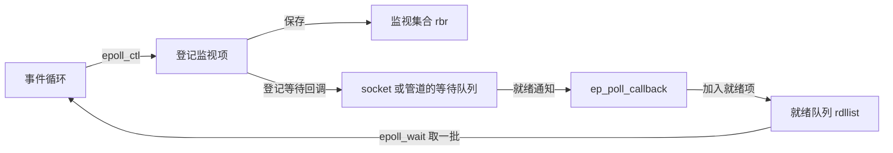

`epoll_wait` 检查就绪项并向用户态复制一批事件。复制开销随返回数量增长，返回数受 `maxevents` 限制，内核还会复查候选项是否仍就绪。若 10 万个连接每轮只有 50 个活跃，就主要围绕就绪项做检查和复制，省掉了遍历全部连接。多数连接同时活跃、注册反复变化或回调处理太慢时，收益要按负载测。 [epoll_wait(2)](https://man7.org/linux/man-pages/man2/epoll_wait.2.html) · [Linux v6.12，交付就绪事件](https://github.com/torvalds/linux/blob/adc218676eef25575469234709c2d87185ca223a/fs/eventpoll.c#L1817-L1915)

#### LT 与 ET 为什么会读出不同结果

拿一根管道做手算。写端写入 2 KiB，读端第一次收到 `EPOLLIN` 后只读 1 KiB，随后马上再次等待，期间没有新写入。

| 模式 | 接下来会怎样 | 写代码时关注什么 |
| --- | --- | --- |
| LT（Level-Triggered，默认） | 还有未读数据，读端仍处于就绪状态，下一次等待可再返回。 | 每轮可只处理一部分，便于分配处理时间。输出缓冲为空时可撤掉 `EPOLLOUT` 兴趣，避免一直收到可写事件。 |
| ET（Edge-Triggered，`EPOLLET`） | 这 1 KiB 可能留在缓冲区，下一次等待仍睡着。若对端在等回复，可能一直没有新通知。 | 使用 `O_NONBLOCK`，收到通知后循环 `read/accept`，直到 `EAGAIN / EWOULDBLOCK`。读到 EOF 或遇到其他错误时按该操作的语义退出或处理。 |

ET 的边界是「剩余未处理的数据不能指望下一轮自动重新通知」。多个到达事件可以被合并，忙连接也可能继续产生通知。若为公平起见达到每轮预算就先返回，要在应用自己的 ready queue 里安排继续处理。采用 `accept4(..., SOCK_NONBLOCK)` 时，标志作用于新接收的 socket，参与循环的监听 fd 也应设为非阻塞。需要每次只通知一次并由应用显式重新启用时，可用 `EPOLLONESHOT` 和 `EPOLL_CTL_MOD`。 [epoll(7) 的管道与饥饿例子](https://man7.org/linux/man-pages/man7/epoll.7.html) · [accept(2)](https://man7.org/linux/man-pages/man2/accept.2.html) · [epoll_ctl(2)](https://man7.org/linux/man-pages/man2/epoll_ctl.2.html)

#### 多 worker 监听时谁会被唤醒

惊群（Thundering Herd）指一件就绪工作唤醒多位等待者，取得资源的可能只有一位。先看 worker 共享的对象。

| 监听拓扑 | 唤醒或分发规则 |
| --- | --- |
| 多线程等待同一个 epoll 实例 | 对标为 `EPOLLET` 的就绪目标，手册描述为唤醒一个在该实例等待的线程。 |
| 多个 epoll 实例登记同一监听 socket | 普通注册可让多个实例同时收到事件。Linux 4.5 起，多个实例使用 `EPOLLEXCLUSIVE` 可以缩小唤醒范围，接口允许一个或多个收到事件。混合时普通注册者仍会收到。 |
| 每个 worker 有自己的监听 socket，用 `SO_REUSEPORT` 绑定同一地址端口 | TCP 可由内核把新流分给某个 socket，worker 各自从本监听队列接受连接。哈希分流、队列和负载边界见网络笔记。 |

[epoll(7)](https://man7.org/linux/man-pages/man7/epoll.7.html) · [epoll_ctl(2) 的 EPOLLEXCLUSIVE](https://man7.org/linux/man-pages/man2/epoll_ctl.2.html) · [多核下怎样分担连接接入](./Computer-Networking-Lecture-CS144-Stanford.md#多核下怎样分担连接接入)

#### 阻塞的 I/O 和用户栈要有别处承接

AIO 让发起与完成分开。教材用 AIO control block 和 `aio_error` 检查完成，也可借信号通知，类似设备中断把完成交还给处理程序的思路。信号 handler 内允许的操作应查 CSAPP p801 和 async-signal-safe 契约。Flash 论文使用 hybrid 架构，事件循环处理网络请求，helper pool 管理可能阻塞的磁盘操作。 [Flash，An Efficient and Portable Web Server](https://www.usenix.org/conference/1999-usenix-annual-technical-conference/flash-efficient-and-portable-web-server) · [signal-safety(7)](https://man7.org/linux/man-pages/man7/signal-safety.7.html)

事件回调返回后，要显式保存之后还需推进的状态。旧笔记把这叫 manual stack management，可以用 continuation 记录后续动作，并把会话状态保存在 hash table 等结构里。单事件循环通常只用一个 CPU，多核需要多循环或线程池。缺页仍可能带来隐式阻塞，原调用改成事件化 API 也会带来维护成本。混合实现要明确哪些操作允许同步完成、谁接回结果、关闭时如何取消未完成工作。

## 文件系统、块设备与持久化

应用先通过描述符看到文件，经缓存完成日常读写，必要时等待内容与名字持久化。文件系统还要能在中断的写入后恢复自己的结构。继续往下，块设备可以换成虚拟镜像，共享块设备则要协调多机缓存和写权限。

### 从文件名到逻辑块

`open()` 沿目录项找到 inode，再给调用进程一个文件描述符。描述符通过打开文件记录引用 inode，同时承接文件偏移等打开状态。`fork()` 后的两个描述符可以共享同一份打开记录。读写进入文件系统后，文件偏移再映射到文件逻辑块。ext4 可以用 extent 记录一段连续的文件逻辑块映射到设备的哪个区间。块设备只提供按逻辑地址和长度读写、刷新等操作，看到的是一段字节和逻辑块号（LBA）。同样的 ext4 可以放在物理 SSD、虚拟磁盘或用户态实现的块设备上。内存页、文件系统块和设备逻辑扇区是三个不同的单位，尺寸可能恰好相同。 [Linux VFS](https://docs.kernel.org/filesystems/vfs.html) · [ext4 块映射](https://docs.kernel.org/filesystems/ext4/ifork.html)

ext4 启用 `inline_data` 时，极小文件也可以把正文放在 inode 内，省去单独的数据块。可用空间取决于 inode 的内部布局及扩展属性。数据超过空间后，文件系统分配普通数据块来存内容。 [ext4 Inline Data](https://docs.kernel.org/filesystems/ext4/inlinedata.html)

文件的逻辑块找到之后，普通读写仍可经内存中的[页缓存](#页缓存回写与直接-io)。缓存未命中或需要回写时，再进入文件系统的存储路径。 [Linux VFS](https://docs.kernel.org/filesystems/vfs.html)

修改文件时还可能改变长度、目录项和块分配。恢复顺序见 [元数据日志与崩溃恢复](#元数据日志与崩溃恢复)，应用的同步接口见 [fsync](#fsync写入成功与断电后仍在)。

OSTEP 的 vsfs 模型拿 inode、目录和位图推导同一条路径。练习时先画出 `open()` 如何沿目录项找到 inode，再沿文件偏移找数据块。 [OSTEP §40](https://pages.cs.wisc.edu/~remzi/OSTEP/file-implementation.pdf)

挂载决定哪套文件系统出现在某个目录下。`/etc/fstab` 保存设备、挂载点、文件系统与选项。共享相同的块读写接口时，文件系统仍可用不同的映射与更新结构，例如用 B 树维护映射和元数据，或用写时复制（CoW）保留可恢复版本。

### 页缓存、回写与直接 I/O

**页缓存（page cache）用内存保存文件的近期内容。** 普通文件的缓冲读和文件映射通常可以共享这层缓存。读命中可以在内存中完成，未命中时才向文件系统请求数据。普通缓冲写先把修改放进页缓存，形成脏文件页。后台回写可以批量合并 I/O，应用也可以同步等待。干净的磁盘文件页被回收后可以重新读取，脏页在通常的回收路径上要先回写。活动／非活动状态可以用类似 2Q 的思路理解，一次扫描与反复访问的页有不同的保留价值，实现随内核演进。 [Linux VFS](https://docs.kernel.org/filesystems/vfs.html) · [页面回收](#缺页交换与页面回收)

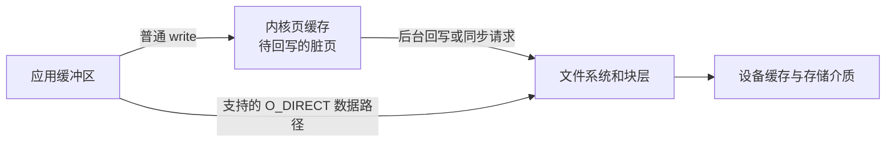

#### 回写追不上时，脏页积累到哪里

页缓存能吸收突发，持续吞吐由存储路径决定。 假如应用暂时以 500 MiB/s 产生脏数据，存储同期只能完成 200 MiB/s 的回写，忽略合并和其他负载时，每秒净积累约 300 MiB 脏数据。两秒约多 600 MiB。即使业务堆平稳，写线程也可能因回写节流或直接回收而变慢。Linux 的 `vm.dirty_background_bytes` 或 `dirty_background_ratio` 控制何时启动后台回写，`vm.dirty_bytes` 或 `dirty_ratio` 影响写入者何时被回写压力约束。字节与比例是同一水位的两种设置，比例按可用于此目的的内存计算。教材里的 `pdflush` 是历史实现。先对齐 `file_dirty`、`file_writeback`、设备延迟和写入 P99，再评估水位、写入节奏或存储吞吐。 [Linux VM 回写参数](https://docs.kernel.org/admin-guide/sysctl/vm.html#dirty-background-bytes) · [cgroup 内存记账](#cgroup-v2-内存记账与-oom)

#### 已有数据库缓冲池时怎样理解直接 I/O

有自管缓冲池的数据库可以测直接 I/O。 同一文件数据有时同时留在数据库缓冲池和内核页缓存。适用时，`O_DIRECT` 可让文件数据走直接 I/O，减少这层重复缓存。文件系统和内核对偏移、长度、缓冲地址的对齐要求可能不同，数据库自己的缓冲仍占内存。设备缓存和元数据也各自有边界，耐久性由同步语义保证。选型要比较相同读写比和同步保证下的内存、吞吐及 P99。 [open(2) 的 O_DIRECT 语义](https://man7.org/linux/man-pages/man2/open.2.html) · [fsync](#fsync写入成功与断电后仍在)

### fsync：写入成功与断电后仍在

**普通 `write()` 成功表示内核接收了相应字节；`fsync(fd)` 则要求该文件的数据与相关元数据完成持久化同步，并等待设备报告完成。** fd 是文件描述符，即引用已打开文件的句柄。以下以 Linux 普通文件为例，核对 Linux man-pages 6.19（2026-11-25）。[write(2)](https://man7.org/linux/man-pages/man2/write.2.html) · [fsync(2)](https://man7.org/linux/man-pages/man2/fsync.2.html)

另一个进程可以在[页缓存](#页缓存回写与直接-io)读到尚未回写的新内容。仅终止进程时，内核缓存可能继续存在。要验证断电恢复，实验需要覆盖设备与持久化链路的故障边界。

| 操作 | 做了什么 | 不能据此断定什么 |
| --- | --- | --- |
| `fflush()`／Python 文件对象 `flush()` | 把用户态缓冲交给底层写接口 | 已持久化；使用缓冲流时应先 flush，再 fsync |
| 普通 `write()` | 向内核提交数据，可能只完成部分字节 | 全部写完，或已经落盘 |
| `fsync(fd)` | 同步该文件的数据与元数据，成功返回 0 | 新建／重命名的目录项也已落盘，或多文件更新具备原子性 |
| `fdatasync(fd)` | 同步数据及正确读取所必需的元数据，如文件长度 | 完全不写元数据；通常不必同步的修改时间与文件长度不同 |
| `close()` | 关闭文件描述符 | 自动完成持久化同步 |

[fflush(3)](https://man7.org/linux/man-pages/man3/fflush.3.html)、[Python os.fsync](https://docs.python.org/3/library/os.html#os.fsync)、[close(2)](https://man7.org/linux/man-pages/man2/close.2.html)。

#### 可靠替换一个已存在的文件

文件内容和目录里的名字各有提交点。假设父目录已经存在、原文件已持久化，临时文件与目标在同一目录，且没有并发写者干扰。

```text
写完临时文件 → fsync(临时文件) → rename(临时文件, 目标名) → fsync(父目录)
```

`rename()` 原子切换目录中的名字，使按目标路径打开的读者看到旧版或新版，不经过“半份新文件”；已打开旧文件的描述符仍指向旧文件。最后同步父目录，才确认这次名字切换也已持久化。各步都须检查结果；目录同步前崩溃，不能承诺重启后一定是新版。跨目录重命名涉及两个目录，不能机械套用这条单目录流程；多文件事务和并发更新仍需额外协议。[rename(2)](https://man7.org/linux/man-pages/man2/rename.2.html) · [fsync(2)](https://man7.org/linux/man-pages/man2/fsync.2.html)

#### 同步到底在等哪一层

同步开销主要来自等待持久化链路。 设备可能先将数据放进易失缓存就报告普通写完成；文件系统通过 cache flush 或 FUA（Force Unit Access，要求本次写入持久化后才确认）等机制满足同步要求。虚拟盘、控制器与实际存储必须正确传递并履行这份承诺，成功返回不是对损坏硬件或虚假回执的额外保险。[Linux 设备写回缓存控制](https://docs.kernel.org/block/writeback_cache_control.html)

数据库用 [WAL](./Software-Engineering.md#walwrite-ahead-log先持久化恢复记录再持久化正式状态) 把关键同步集中到恢复日志，数据页随后写回；组提交（group commit）让一批事务共用一次日志同步，摊薄等待成本。它们仍须等覆盖各事务的日志持久化后才能作相应的耐久提交确认。[PostgreSQL WAL](https://www.postgresql.org/docs/19/wal-intro.html)

错误处理也是持久化协议的一部分：短写要补齐，`EINTR` 按中断语义处理；`fsync` 返回 `EIO`、`ENOSPC` 等错误时，不能向上层确认数据已耐久。尤其不能把失败后再调一次成功当作原数据已经补写成功：Linux 的回写错误报告会推进已观察位置，后续成功可能只表示没有新的错误。应保留错误并按应用恢复协议处理。[write(2)](https://man7.org/linux/man-pages/man2/write.2.html) · [Linux VFS 回写错误](https://docs.kernel.org/filesystems/vfs.html#handling-errors-during-writeback)

### 元数据日志与崩溃恢复

假设追加 4 KiB 需要分配一个新块。**数据**是程序要保存的那 4 KiB。**元数据**描述它如何被找到，例如 inode 里的文件长度和块映射、标记该块已分配的位图。创建文件或重命名还可能涉及目录项和链接计数。若新块映射已经写回了 inode，位图却还标着该块可用，断电恢复后就可能把同一个块再分给别的文件。 [ext4 磁盘格式](https://docs.kernel.org/filesystems/ext4/index.html)

以 ext4 的 JBD2 为例，日志把要一起恢复的修改组成事务。先持久化日志记录，再持久化 commit 记录，之后择机把事务写回元数据原来的位置（checkpoint）。如果掉电时有效 commit 未落盘，重放跳过该事务。若 commit 已落盘但原位置只回写了一部分，重放用日志里的已提交内容补齐。日志中的提交边界提供崩溃恢复依据，应用可能还没收到成功返回。 [ext4 JBD2 日志布局与重放](https://docs.kernel.org/filesystems/ext4/journal.html)

| ext4 挂载模式 | 日志记录 | 数据块的时序 |
| --- | --- | --- |
| `data=ordered`（默认） | 元数据 | 需与该元数据事务排序的文件数据先写到原位置，再提交元数据日志 |
| `data=writeback` | 元数据 | 数据可以晚于元数据日志提交，崩溃后未同步的内容可能和已恢复的元数据处于不同更新点 |
| `data=journal` | 文件数据和元数据 | 两者都先进入日志，再写回各自位置，通常会增加写入量 |

`data=ordered` 保证的是相关数据和元数据提交的顺序，已有块上的普通覆盖写或跨多个文件的业务更新仍需应用自己的持久化协议。应用可采用[同步文件与父目录](#fsync写入成功与断电后仍在)的单文件替换步骤。若业务还要提交远端任务，远端结果需要另行核对。 [ext4 数据模式](https://docs.kernel.org/filesystems/ext4/journal.html) · [Outbox 与外部投递](./Software-Engineering.md#outbox把业务提交与异步投递绑定)

教材用一次追加新数据块来枚举只写完数据、inode 或位图时的结果。可以按这个例子分别画出有效提交前、提交后但尚未写回原位置时的磁盘状态。 [OSTEP §42.1](https://pages.cs.wisc.edu/~remzi/OSTEP/file-journaling.pdf)

#### fsck、重放与日志结构文件系统

fsck 在故障后检查和修补结构。日志型的崩溃恢复在正常写入时预先留下事务记录，重启后按提交边界选择重放内容。 [OSTEP §42](https://pages.cs.wisc.edu/~remzi/OSTEP/file-journaling.pdf)

日志结构文件系统（LFS） 把数据和元数据批量写进新的 segment，更新索引并回收旧 segment。JBD2 的常规流程在日志记录提交后，会把内容写回原位置。两者的日志承担不同的空间组织与恢复职责。 [OSTEP §43](https://pages.cs.wisc.edu/~remzi/OSTEP/file-lfs.pdf) · [ext4 JBD2](https://docs.kernel.org/filesystems/ext4/journal.html)

### OverlayBD 与 ublk

给镜像分叉时，一层负责解释新旧块，一层负责接收宿主读写。OverlayBD 负责逻辑块的内容，`ublk` 把实现接到 Linux 块设备接口。 两者可组合，也可各自配别的前后端。可以把 `ublk` 看成让宿主上的一个用户态服务接管虚拟盘的块请求。读写 `/dev/ublkbN` 时，宿主内核把偏移、长度和操作类型等交给用户态后端，后端完成后回报结果。这条数据通道用 `io_uring`，可选的拷贝和缓冲策略取决于内核能力与实现。`ublk` 本身不定义镜像格式、CoW、压缩或远端存储。 [Linux ublk 文档](https://docs.kernel.org/block/ublk.html) · [OverlayBD 项目](https://github.com/containerd/overlaybd)

OverlayBD 的分层镜像用区间索引记录逻辑块在哪一层、对应哪段数据。下层可以封为不可变层，顶层接收本实例的写入。读取每个区间时找覆盖它的最新一层，写入顶层并更新映射。分叉时可让两边引用同一串只读层，各自接一层可写增量。OverlayFS 合并的是目录和文件，典型的 `copy_up` 处理文件对象。OverlayBD 的索引用的是设备块地址。 [DADI 论文 §4.1](https://www.usenix.org/system/files/atc20-li-huiba.pdf) · [OverlayBD 快照](https://github.com/containerd/overlaybd/blob/main/README.md#live-snapshot) · [Linux OverlayFS](https://docs.kernel.org/filesystems/overlayfs.html)

用三个逻辑块手算。只读底层是 `{0:A, 1:B, 2:C}`。分支甲把块 1 改成 `X`，分支乙把块 2 改成 `Y`。甲读到 `[A, X, C]`，乙读到 `[A, B, Y]`，父版本仍是 `[A, B, C]`。底层数据能共享，但一次「改文件」可能同时修改数据、inode、目录或日志块。写层成本应按最终改变的块和相关元数据衡量。

### DLM、缓存交接与 fencing

考虑 A、B 两台机器挂载同一个共享块设备。两边各有内核和页缓存。A 正往 `results.bin` 追加一批结果，B 想写同一个文件。文件系统要协调锁和缓存，日志要支持掉电恢复，阻塞的线程由调度器在唤醒后安排执行。下文以 GFS2 的锁交接为例。OCFS2 也是共享磁盘文件系统。 [Oracle OCFS2](https://docs.oracle.com/en/operating-systems/oracle-linux/7/fsadmin/fsadmin-ManagingOracleClusterFileSystemVersion2.html) · [GFS2 glock](https://docs.kernel.org/filesystems/gfs2/glocks.html) · [ext4 JBD2](https://docs.kernel.org/filesystems/ext4/journal.html)

共享盘上的 inode、目录项和空闲空间状态，可能已经在两台机器的内存各留了一份。如果 A、B 都根据旧 inode 里的文件长度决定从哪个位置追加，就可能使用相同的起点。单机互斥锁只约束本内核里的线程，普通 ext4 也假定文件系统由一个运行中的内核管理。共享块设备的多主机访问需要集群文件系统协调。 [Oracle OCFS2](https://docs.oracle.com/en/operating-systems/oracle-linux/7/fsadmin/fsadmin-ManagingOracleClusterFileSystemVersion2.html) · [GFS2 节点锁](https://docs.redhat.com/ko/documentation/Red_Hat_Enterprise_Linux/7/html/global_file_system_2/s1-ov-lockbounce)

分布式锁管理器（DLM）跟踪资源的锁模式，协调不同节点的申请、变更与释放。在 GFS2 中，文件系统用 glock 把锁状态和缓存操作绑在一起。以普通的 inode 缓存路径为例，多节点可同时持有共享锁并缓存干净的数据。取得排他锁的节点可以修改受保护的数据和元数据。B 请求排他锁时，与它冲突的持有者要先降级或交出锁。A 若持有排他锁且有脏缓存，交接时按协议刷日志和数据，并使不再有权保留的缓存失效。B 取得对应权限后才能按自己的锁模式使用缓存。反复在两台机器之间交接同一个热点 inode，会增加通信和刷盘等待。 [GFS2 glock 状态机](https://docs.kernel.org/filesystems/gfs2/glocks.html) · [GFS2 节点锁](https://docs.redhat.com/ko/documentation/Red_Hat_Enterprise_Linux/7/html/global_file_system_2/s1-ov-lockbounce)

#### 失联之后怎样移交写权限

接管前要先阻断旧节点的 I/O。 心跳超时说明 A 暂时联系不上，A 仍可能存活且连得上共享盘。让 B 直接取得写权，A 恢复后可能把旧缓存覆盖到 B 刚写的位置。Fencing 可以通过重启旧节点或撤销它的存储访问切断这条路径。GFS2 为以读写方式挂载的节点分配独立日志，故障恢复要在隔离完成后协调锁恢复和故障节点的日志重放，再开放受影响的操作。 [Red Hat fencing 与 DLM/GFS2 恢复，第四章](https://docs.redhat.com/en-us/documentation/red_hat_enterprise_linux/6/pdf/high_availability_add-on_overview/Red_Hat_Enterprise_Linux-6-High_Availability_Add-On_Overview-en-US.pdf) · [GFS2 每节点日志](https://docs.redhat.com/en/documentation/red_hat_enterprise_linux/8/html/configuring_gfs2_file_systems/assembly_planning-gfs2-deployment-configuring-gfs2-file-systems)

在应用任务系统里，可以让接管者拿到新的写入世代号。例如 A 持有世代 `41`，B 接管时权威记录更新为 `42`。提交端在更新状态的同一事务里核对世代号，A 迟到的回执就不能推进任务。任何需要这项保证的外部写入入口也要能拒绝旧持有者。共享盘的节点隔离和应用的世代号校验，都把拦截放在旧写入真正能生效的地方。 [长任务的所有权与提交协议](./AI-Agent-Engineering.md#multi-agent-并发控制长推理窗口与提交协议)

### 共享存储的故障接管

| 时刻 | 系统要做什么 |
| --- | --- |
| A 正追加，B 想写同一文件 | DLM 与文件系统协调锁和缓存。B 的线程阻塞，CPU 可运行其他线程 |
| A 的元数据事务已写入有效 commit，原位置还没写完，A 失联 | 集群先确认 A 已被 fencing，再恢复其锁和日志。有效事务通过重放补齐，未提交的日志事务跳过 |
| B 所需的锁已授予，阻塞线程被唤醒 | B 进入可运行状态，等待 CPU 调度，随后使用符合锁协议的文件视图继续操作 |

一个判断题：B 已经被唤醒，能否据此断定 A 的应用已经收到写入成功，并且 B 自己已经接着执行？两件事都要各自核对。日志提交后，A 可能在收到返回前失联。B 被唤醒后，还可能在运行队列里等待。

接上线程的状态迁移见 [Linux 公平调度与等待诊断](#linux-公平调度与等待诊断)。

## 虚拟化、容器与快照

### 容器、虚拟机与隔离边界

同一程序分别运行在宿主、容器与微虚机里，判断隔离方式可以从两条线索入手：谁处理系统调用，资源又由谁约束。

| 环境 | 系统调用与隔离边界 | 资源由谁管理 |
| --- | --- | --- |
| Linux 容器 | 应用系统调用由宿主内核处理。namespace 分隔进程、挂载、网络等视图，可读 `/proc/<pid>/uid_map`、`gid_map` 核对用户命名空间的身份映射。 | 宿主调度进程，用 cgroup 做资源约束与记账。 |
| 虚拟机／微虚机 | 应用系统调用先进入独立 guest 内核。VMM（虚拟机监控器）维持虚拟硬件，宿主仍负责设备后端和授权通道。 | guest 调度自己的任务，宿主给 vCPU、内存与 I/O 分配资源。 |

是否采用微虚机取决于被执行代码的信任程度、租户隔离、恢复需要和成本。下面先看宿主的资源记账，再看虚拟机怎样运行和恢复。 [namespaces(7)](https://man7.org/linux/man-pages/man7/namespaces.7.html) · [Linux cgroup v2](https://docs.kernel.org/admin-guide/cgroup-v2.html) · [Firecracker 设计](https://github.com/firecracker-microvm/firecracker/blob/main/docs/design.md)

#### 从 VM/370 看谁拦截特权指令

VM/370 是早期直接运行在硬件上的 1 型 VMM，教材配合会话监控系统 CMS 解释哪些指令需要陷入监控器。2 型 VMM 运行在宿主操作系统上，课件用 VMware Workstation 对照。现代 KVM 的职责分布可以再按具体实现看宿主内核与用户态 VMM 的分工。


### cgroup v2 内存记账与 OOM

容器内存诊断先区分三个口径。**进程 RSS** 数该进程映射到的驻留内存，包括文件映射，多个进程可能重复计算同一页。**PSS** 按共享程度分摊。**`memory.current`** 是该 cgroup 及其后代当前计入的内存，包含匿名页、文件缓存和相关的内核内存。普通 `read` 可以在较小的用户缓冲上反复读大文件，文件页缓存计到 cgroup，进程 RSS 却未必同步上涨。先确认仪表盘百分比用的是总量还是另外定义的工作集，再和原始计数对齐。 [Linux cgroup v2](https://docs.kernel.org/admin-guide/cgroup-v2.html#memory-interface-files) · [Linux proc 内存字段](https://docs.kernel.org/filesystems/proc.html)

| 读什么 | 含义与观察点 |
| --- | --- |
| `memory.stat` 的 `anon`、`file` | `anon` 是匿名映射的内存，包括堆、栈和私有匿名映射等。`file` 包含磁盘文件数据，也包含 tmpfs 或共享内存。结合 `shmem`、`file_dirty`、`file_writeback` 判断有多少适合直接回收。子项和总项有重叠 |
| `kernel`、`pagetables`、`slab`、`sock` | 页表、内核对象和网络缓冲也消耗资源。若应用堆保持稳定，继续从 cgroup 的这些项找增长。`pagetables` 和 `slab` 等已经归入 `kernel`，应按项比较趋势 |
| `memory.high`、`memory.max` | `high` 是节流与直接回收的控制线，超过后应用可以先变慢。`max` 是硬限制，无法回收到足够空间时可能在该范围启动 OOM 处理。cgroup 有继承关系，也要核对祖先限制 |
| `memory.events`、`memory.events.local`、`memory.pressure` | `high`、`max`、`oom`、`oom_kill` 分别佐证触及压力线、硬限制、分配遇到 OOM 条件和有进程被杀。看故障窗口的计数增量。前者包含层级事件，`.local` 用来看本级。PSI（Pressure Stall Information）说明内存压力有没有让任务停等 |

OOM killer 选择受害进程，可能是 Worker、快照子进程或主进程。`memory.oom.group` 可以按组处理，有内核定义的例外。`oom_kill` 也统计 cgroup 内进程被其他 OOM 路径杀掉的情况。要确定是哪一级缺内存、杀了谁，结合相关层级的事件和系统日志。退出状态 137 通常是收到 `SIGKILL` 的线索，还需查谁发出的信号。 [Linux cgroup v2 OOM 和事件定义](https://docs.kernel.org/admin-guide/cgroup-v2.html#memory-interface-files) · [Linux PSI](https://docs.kernel.org/accounting/psi.html)

#### 同样的 95% 要看哪种内存增加

假设读数为 `memory.max = 2 GiB`、`memory.current = 1.9 GiB`。以下是诊断对照，数值用于说明口径。

| 观察到的组合 | 下一步验证 |
| --- | --- |
| 顺扫大文件时普通干净文件页增长，匿名内存基本平稳，PSI 和限额事件变化很小 | 对照停止扫描后的迭代或可控压力，观察能否释放文件页及是否挤掉热点。高占用可以是内核利用了剩余内存 |
| 大量脏文件页未回写，`file_writeback`、I/O 等待和写入 P99 同时上升 | 比较应用写入和设备回写能力，查积压出在哪一层。即使占用来自页缓存，回收也要等写回 |
| fork 后 `anon`、父子私有脏页和 minor fault 同时增长，`max` 或 `oom_kill` 在故障窗口增加 | 对齐子进程存活窗口和写页分布，估算 CoW 峰值，并观察子进程退出后的走势。若没有 fork，则查堆、匿名映射和其他活动分配 |

一次读数常发生在回收或 kill 之后。诊断时先通过 `/proc/<pid>/cgroup` 找对记账层级，再同时记录用量组成、事件增量、PSI 和相关阶段的延迟。调容量时按实际工作集、CoW 额外页、脏页积压和内核开销留余量。 [容量估算](./Software-Engineering.md#用量纲估算容量与瓶颈)

### KVM 与微虚机

**KVM 是宿主 Linux 的虚拟化接口，Firecracker 是在宿主用户态运行的 VMM（虚拟机监控器）。** VMM 打开 `/dev/kvm`，通过 `KVM_CREATE_VM`、`KVM_CREATE_VCPU` 创建 VM 和 vCPU，并用 `KVM_SET_USER_MEMORY_REGION` 把 guest 物理地址段绑定到 VMM 的宿主内存映射。vCPU 线程调用 `KVM_RUN` 让 guest 在硬件虚拟化支持下运行。KVM 可以在需要时把设备访问等事件交回 VMM。Firecracker 提供精简的设备模型，例如用 `virtio-blk` 把一块盘呈现给 guest，后端可以是宿主文件或块设备。 [KVM API](https://docs.kernel.org/virt/kvm/api.html) · [Firecracker 设计](https://github.com/firecracker-microvm/firecracker/blob/main/docs/design.md)

这里有两条不同的地址链。**访存**时，guest 页表把 guest 虚拟地址翻译到 guest 物理地址，硬件二级地址转换再找到宿主物理内存。**读盘**时，guest 文件系统把文件偏移换成虚拟盘块地址，VMM 的磁盘后端再处理这个请求。对于普通缓冲文件的内容，guest 缓存未命中时读盘，脏数据回写时写盘。 [KVM x86 MMU](https://docs.kernel.org/virt/kvm/x86/mmu.html) · [Firecracker 设计](https://github.com/firecracker-microvm/firecracker/blob/main/docs/design.md)


VirtIO 初始化时，设备公布支持的特性位，guest 驱动从中选出自己也支持并需要的部分，设备确认双方接受的集合。比如 `virtio-blk` 的 flush 能力要看是否协商到 `VIRTIO_BLK_F_FLUSH`。协商说明 guest 可以按接口发出 flush 请求，完整持久化还要沿磁盘后端一路核对。 [OASIS VirtIO 1.3，§2.2、§3.1、§5.2](https://docs.oasis-open.org/virtio/virtio/v1.3/virtio-v1.3.html)

guest 页缓存和宿主为镜像文件或映射设备维护的缓存属于不同层。guest 发出 flush 后，还要看 VMM、块后端和实际存储如何传递持久化请求。后端的分层镜像和用户态块设备接口见 [OverlayBD 与 ublk](#overlaybd-与-ublk)。

### 快照保留哪些状态

用一个场景串起来：测试程序已经启动，工作区也装好了依赖。现在想从同一状态跑 A、B 两套实验。先明确要保留哪一层状态。两个进程可以各有自己的内存，却仍在改同一个工作区。两份磁盘快照可以各有自己的工作区，却不能凭空恢复那个已经运行到一半的程序。微虚机快照可以把运行中的 guest 状态和磁盘版本配对，恢复时还要接上宿主提供的设备。 [Linux fork(2)](https://man7.org/linux/man-pages/man2/fork.2.html) · [Firecracker 快照设计](https://github.com/firecracker-microvm/firecracker/blob/main/docs/snapshotting/snapshot-support.md)

| 恢复对象 | 能恢复什么 | 还要配什么 |
| --- | --- | --- |
| 磁盘或卷版本 | 捕获时的块内容 | 已经运行的进程、寄存器和内存需要另存。应用缓冲是否进入盘要看快照与 flush 的约定 |
| 微虚机状态与内存 | vCPU、guest 内存及支持的虚拟设备状态 | 配对同一捕获点的磁盘版本。网络端点和设备连接按环境重建或验证 |
| Agent 任务检查点 | 任务进度、验收证据、待处理动作与权限状态 | 执行环境和外部副作用还要各自读回。例如回滚 VM 无法撤回已经提交的远端任务 |

#### 恢复时怎样配对同一次采集

Firecracker 的原生快照产物包括 VM 状态和 guest 内存，磁盘 backing 由调用方管理，恢复时要使用匹配的一组。暂停固定的是 vCPU 的执行位置，应用事务可能仍在进行，对端也可能已经关闭原 TCP 会话。快照要恢复到另一节点时，还需满足 CPU、VMM 版本以及设备的恢复要求。 [Firecracker 快照契约](https://github.com/firecracker-microvm/firecracker/blob/main/docs/snapshotting/snapshot-support.md)

## 缓存局部性与系统性能

### 存储层次、局部性与布局

存储层次在容量、访问延迟与成本之间取舍。寄存器靠近执行单元，缓存用较小容量服务常用数据，内存、持久存储等层逐步扩大容量。磁带和光盘是教材里的低速、低成本备份介质。硬件通常自动管理 cache，但程序的数据布局决定访问哪些行，操作系统的映射属性、页表与调度会影响地址翻译、内存位置和跨核迁移。 [TLB 覆盖与数据缓存](#覆盖范围替换策略与数据缓存) · [多核亲和性](#多核负载均衡亲和性与异构核心)

如果同样是查一条 KV，先画出网卡到 CPU、索引到 value 的路径，再分别量每请求指令与随机访存、跨核共享、网络包率和内存带宽。当大对象把热索引挤出 cache 时，可以改布局。当流量集中到少数核时，可以改请求路由。工作集越过某层后，扩容的成本可能由另一层决定。 [容量估算](./Software-Engineering.md#用量纲估算容量与瓶颈)

### 内存 KV Store 与网卡数据路径

#### 紧凑索引与缓存命中：Put an Elephant into a Fridge

*Put an Elephant into a Fridge: Optimizing Cache Efficiency for In-memory Key-value Stores* 的起点是论文场景下 cache 与主存容量的比值已经低于 0.1%。散布的索引、冷数据和大小不成比例的 keys / values 会争用 cache。一份大 value 可能逐出多个热 key。查找的中间步骤带入最终用不到的数据，形成 read amplification，也可能造成反复被冲掉的 cache thrashing。应用通常只看得到虚拟地址，若要影响 LLC（Last-Level Cache）的 set，就得想办法控制布局。 [原论文 §1–2](https://www.vldb.org/pvldb/vol13/p1540-wang.pdf) · [Thrashing 术语](https://en.wikipedia.org/wiki/Thrashing_(computer_science))

**按颜色分开冲突的对象。** 论文在所用设备上用 page coloring 让不同颜色对应不同 LLC sets。示例中一条 line 是 64 B，2,048 个 sets 分成 32 rows，每 row 对应 64 个 sets。在 2 MiB 大页中可以按 16 columns 组织，每列 128 KiB（`32 × 64 × 64 B`）。不同列里同一 row 映射到相同的 sets，不同 row 分开。论文对照了两种控制方式。大页把索引位纳入页内偏移，应用可按偏移布置。普通 4 KiB 页则预先分配，再通过原型内核中的 `get_pgcolor` 查询、按颜色归池。这些数字和映射规则依实验硬件。 [原论文 §3，图 2–4](https://www.vldb.org/pvldb/vol13/p1540-wang.pdf)

**按冷热和访问顺序布置。** 论文用时间局部性（temporal locality）安排对象。逻辑位置邻近的热项尽量集中到 physical zone，同一 zone 内再分到不同的 row。各 row 里也保留同该 row 热数据竞争的冷数据，淘汰时倾向丢掉冷项。作者改用 cache-friendly hash indexing，并把 key 与 value 放在不同 rows。并行读取（parallel access）给 key、value 各留指针，同时读，若 key 不匹配就浪费 value 的带宽。双队列（concurrent access）先查 key，命中才将 value 请求转给另一组 worker。论文观察到后者的吞吐收益更好。 [原论文 §4](https://www.vldb.org/pvldb/vol13/p1540-wang.pdf)

**接进已有分配器和回收路径。** Memcached 为能容纳对象的最小 slab class 分配 slot，用 per-class LRU 跟踪相对热度。Key/value 分离后，两种对象的内存比例随负载变。Head-to-head allocation 从 slab 两端分别分配，碰到中间空间不够时再取一片 slab。Redis 原型没有同样的 slab/class LRU，用采样的弱局部性对象池、LRU clock 与后台淘汰／重分区维持布局。论文所说的 offloading garbage collection 把部分回收工作移到后台，以减轻请求路径上的 cache 干扰。 [原论文 §6–7](https://www.vldb.org/pvldb/vol13/p1540-wang.pdf)

改布局的收益取决于 cache sets 是否真的够用，增加早已不紧张的容量不会解除别处的瓶颈。若使用 system-wide 大页设置，还要考虑共置负载对共享 cache 的干扰和隔离边界。 [原论文 §8](https://www.vldb.org/pvldb/vol13/p1540-wang.pdf) · [分页与大页](#分页页表与大页)

#### MICA：每核并行与网络请求处理

*MICA: A Holistic Approach to Fast In-Memory Key-Value Storage*（NSDI 2014）。MICA（Memory-store with Intelligent Concurrent Access）让一个请求沿网卡、CPU 和数据分区用同一份所有权规则，减少转交、共享写和内核网络栈的开销。原论文记录单台多核系统处理 65.6–76.9 M KV operations/s，比较时需看负载与硬件。 [MICA 原论文](https://www.usenix.org/conference/nsdi14/technical-sessions/presentation/lim)

| 要省的成本 | MICA 的设计 |
| --- | --- |
| 并行访问的同步 | EREW（Exclusive Read, Exclusive Write）由专属核读写一个分区。热点极度偏斜时可以用 CREW（Concurrent Read, Exclusive Write）开放并发读，仍由一个核写，减少跨核写入争用。缓存局部性和 packet burst I/O 也能摊薄忙分区的单位请求成本。 |
| Socket I/O 和跨核转交 | 普通 socket 路径频繁调用读取接口会有开销。MICA 用 UDP 与 Intel DPDK（Data Plane Development Kit）在用户态直接访问 NIC，按批次收发。RSS（Receive-Side Scaling）和 Flow Director（FDir）常用于 flow-level affinity。MICA 由客户端把对象分区编码到 FDir 可匹配的字段，使同一对象的请求落到指定核（object-level affinity）。 |
| 频繁分配、写入与索引更新 | Cache mode 的每个分区用 circular log 和 lossy concurrent hash index，允许在缓存语义下淘汰，并借分配器的淘汰支持尽量保住近期对象。Store mode 改用 segregated fits 管理内存，配合 bulk chaining 将索引扩展为 lossless。 |

论文 §3.3.2 的取舍是 Read-oriented vs. Write-friendly。插入时找空槽或维护树结构会花时间。用链式桶更容易插入，链太长则增加查找时的依赖式随机访存，链短了又要更多桶和指针。MICA 的 lossy concurrent hash index 在缓存模式下可以直接淘汰旧项来处理冲突，再借分配器的淘汰规则尽量保留近期数据。需要完整索引的 store mode 用 bulk chaining，每段按缓存行对齐，并尽量让一段容纳多项。读 §4.1.2 的 CREW 后，可对照 §4.3.1 的分配器和 §4.3.2 的乐观索引更新。网卡与客户端分流的实现见 §4.2.1–4.2.2。 [MICA 原论文](https://www.usenix.org/conference/nsdi14/technical-sessions/presentation/lim) · [作者在 CMU 保存的全文](https://istc-cc.cmu.edu/publications/papers/2014/mica-nsdi2014.pdf)

大页（x86-64 常见 2 MiB 或 1 GiB）可减少同样工作集所需的 TLB 翻译。显式 HugeTLB 通过预留页和 `mmap` 请求，大页上的小对象仍可交给支持这条分配路径的分配器（例如 jemalloc）。另一条路线是让 THP 按系统策略分配或合并。 [Linux 大页](#2-mib-大页让翻译在上一层结束)

#### MEMC3：紧凑哈希与并发更新

*MemC3: Compact and Concurrent MemCache with Dumber Caching and Smarter Hashing*（NSDI 2013）。名字指 Memcached with CLOCK and Concurrent Cuckoo hashing。它改的是原有 Memcached 的三个热点。

- Optimistic concurrent cuckoo hashing 支持多读单写。读者用版本号执行 optimistic locking，看到奇数或读到不同的首尾版本就重试，以保留 Cuckoo 哈希的紧凑空间开销。论文附录说明，原实现利用 64 位机器上对齐的 64 位指针读写原子性。跨架构仍要分别核对内存顺序与对象生命周期。
- 短 key summary 使查表先过滤不匹配的候选，减少追踪指针，再用真正的 key 验证。插入也有独立优化以改善吞吐。
- 用 CLOCK 近似 LRU，可减轻每次访问都更新全局 LRU 顺序的同步瓶颈。钟表的第二次机会见 [页面置换](#页面置换策略怎样取舍)。

[MemC3 原论文](https://www.pdl.cmu.edu/PDL-FTP/Storage/memc3-nsdi2013_abs.shtml) · [Cuckoo hashing 讲义](https://web.stanford.edu/class/archive/cs/cs166/cs166.1146/lectures/13/Small13.pdf)

#### NIC 与 CPU 的协同：十亿请求每秒案例

*Full-Stack Architecting to Achieve a Billion-Requests-Per-Second Throughput on a Single Key-Value Store Server Platform*（2016）在普通 CPU 的实机上做到 120 M RPS，客户端批处理后是 167 M RPS。单机十亿 RPS 来自对未来四路平台的模拟，包含对计算、内存与网络能力的共同假设。两组应按各自的实验设置理解。 [原论文](https://www.istc-cc.cmu.edu/publications/papers/2016/a5-li.pdf)


Intel DDIO（Data Direct I/O）让适用的外设 DMA 可以和 CPU 的 LLC 直接交互，减少 I/O 数据经过 DRAM 的成本。多队列 NIC 的 flow steering 决定由哪个核接手，prefetch 决定后续访存能否提前。处理小请求时，逐段确认包率、缓存争用与每请求 CPU 开销。大对象场景则更容易先消耗网络带宽。 [Intel DDIO](https://www.intel.com/content/www/us/en/io/data-direct-i-o-technology.html) · [DDIO 技术说明](https://www.intel.com/content/www/us/en/io/data-direct-i-o-technology-brief.html)

### 超算节点、互连与并行文件系统

Yunfei Du 讲座从计算、通信和存储三层看 HPC。分子动力学积分求解牛顿运动方程，量子化学用波函数求薛定谔方程，流体力学求 Navier–Stokes（NS）方程，计算电磁学求 Maxwell’s equations。这些任务可把一轮计算拆给多个进程，再交换边界或等待汇合。MPI（Message Passing Interface）的会合通信需要两侧配对，barrier 则要求所有参与者到达后才能开始下一轮，例如分块矩阵计算中的同步点。

#### 节点做本地计算，互连接管跨节点通信

讲座中的计算节点使用单路／双路物理机，常以无虚拟化方式部署，靠向量、多核和大规模异构设备并行。总体设计在计算并行度、数据移动和数据精度之间取舍。TPU 的 bf16 与混合精度是观察有效位数、功耗、带宽与误差预算的例子。

RDMA（Remote Direct Memory Access）把传输交给网络接口，降低远端数据移动所需的 CPU 参与。原讲座的 RDMA/TCP 对照记录如下。它混合了具体链路和协议的数值，用于回看当年的配置，实际性能由 NIC、消息大小、负载和协议决定。

| 讲座对照 | RDMA 示例 | TCP 示例 |
| --- | --- | --- |
| 传输抽象 | 消息／远程内存操作 | 字节流 |
| 延迟 | 0.6 μs | 5–50 μs |
| 带宽 | 200 Gb/s | 40 Gb/s |
| 流控 | Credit-based 机制，依传输实现 | 滑动窗口机制 |

#### 检查点很大时怎样避免压垮共享盘

Burst Buffer 用 SSD 在 Compute Nodes 与 I/O Nodes 的路径上吸收突发，适合 checkpoint 等密集写入。可与资源管理系统衔接，临时层也可使用 relaxed POSIX semantics。原讲座举例，要求在 5 分钟内写完半份内存的检查点。最低有效吞吐可按「需要写的字节 ÷ 300 秒」估算，再看是否有足够的突发容量和后台排出速度。

Parallel File System 如 Lustre 对应用呈现接近 POSIX 的全局单一命名空间。MDS/MDT 负责访问与存储元数据，多个 OSS/OST 以对象的方式分布文件数据，相关的元数据和文件 I/O 链路各自处理。为了并行 I/O，分布式锁管理也要落实具体语义和缓存协调。长期冷数据可迁入 HPSS（High Performance Storage System）。 [共享盘的缓存与锁](#dlm缓存交接与-fencing)

软件栈可以从 Scientific I/O library（讲座记作 Scientific IOlib）到 MPI-IO，再到底层 POSIX。数据布局可用 N 个进程写一个共享文件，或分摊到 M 个文件。前一种要看共享偏移、锁和条带，后一种还要付目录与元数据开销。

#### Fugaku 与 Summit 分别怎样组织计算、内存和 I/O

Fugaku 用 A64FX（Armv8.2-A，512 位 SVE）构成同构系统。官方规格为每节点 48 个计算核心、2 个 assistant cores、4 个 CMG（Core Memory Groups），HBM2 带宽 1,024 GB/s。在 2.2 GHz boost 下，单节点双精度峰值约 3.37 TFLOP/s。讲座还记录双路 512-bit SIMD、台积电 7 nm 与表面水冷，把它作为 Arm 和 AI 低精度指令结合的案例。SoC 集成的 Tofu Interconnect D 是 Network Interface on Chip，6 个 TNI 各 6.8 GB/s，合计 40.8 GB/s。原讲座记作 48 + 4 核、158,976 节点和 414 机柜，节点数与 RIKEN 一致，助理核心和机柜数按当前官方 Fugaku 规格为 2 和 432。 [Fujitsu Fugaku](https://www.fujitsu.com/global/about/innovation/fugaku/) · [RIKEN 系统规格](https://www.r-ccs.riken.jp/en/fugaku/about/)

Fugaku 的三层存储按 RIKEN 可读成 LLIO（节点和共享临时区、第二层缓存）、Lustre-based 共享文件系统 FEFS、商业云存储。讲座用 GFS Cache + Temp FS 标记第一层，并记录过 25–30 PB NVMe 的容量估计。可用容量与环境配置应以当期系统口径为准。 [RIKEN，Storage](https://www.r-ccs.riken.jp/en/fugaku/about/#:~:text=Lightweight%20Layered%20IO%2DAccelerator)

Summit 则是 CPU/GPU 异构节点，每节点 2 个 IBM POWER9 CPU、6 个 NVIDIA V100 GPU，以 NVLink 连接。放在 Fugaku 旁边，可以看到另一种数据移动路径：先决定计算与数据分别驻留在 CPU 侧还是 GPU 侧，再检查网络与存储能否直接喂给该侧。 [Summit User Guide](https://docs.olcf.ornl.gov/systems/summit_user_guide.html)

#### HPC 和 AI 为什么要一起讨论数据移动

讲座把不少传统 HPC 工作负载描述为 CPU 主导、常见一个进程控制一个 GPU，把部分 AI 工作负载描述为 GPU 主导、一个进程可管理多个 GPU。它们是设计对照，实际训练和模拟也可以采用其他进程与加速器映射。

- HPC → AI。超算可处理训练数据、加速并行训练和推理，Fugaku 是例子。
- AI → HPC。可辅助迭代方法找到收敛参数，缩小多目标优化的搜索空间，或在物理模型不完整、完整仿真过昂贵时做替代模型。也可以把 TPU、混合精度及 GPU Direct Storage 等技术引入科学计算，减少 GPU 每步都要经过 CPU 搬数据的开销。

扩展路径取决于工作集。共享内存和 OpenMP runtime 能继续利用同一节点的地址空间，但高性能实现工程量大。分布式系统可以横向加内存，跨节点微秒级延迟会限制细粒度同步的 scaling。若瓶颈在数据放不下而访问具有局部性，也可先评估用 NVMe SSD 做分层，区分容量补充和实际命中延迟。
