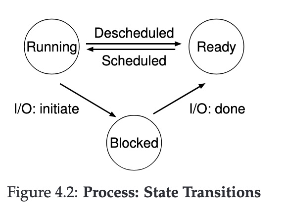
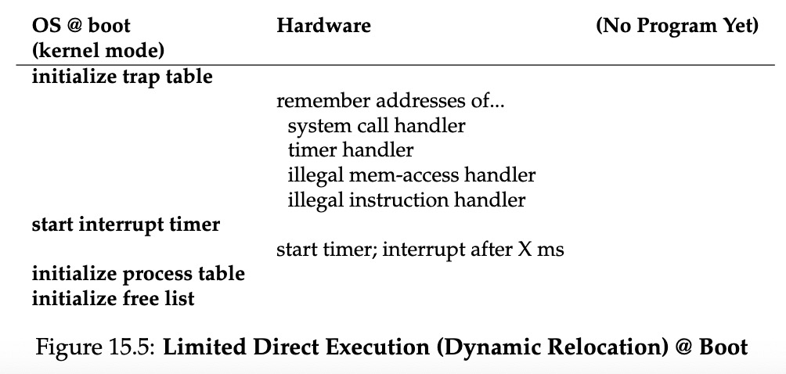
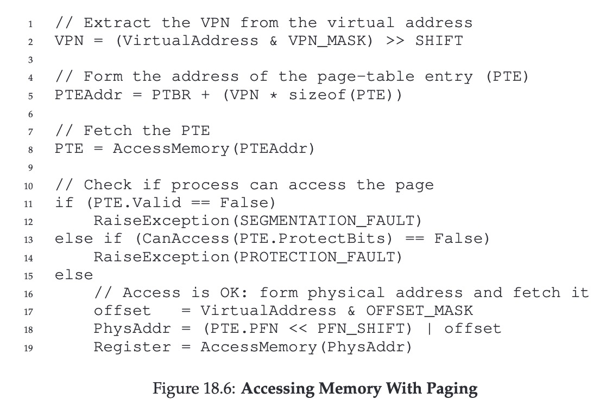
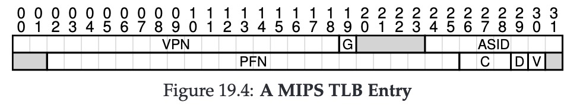
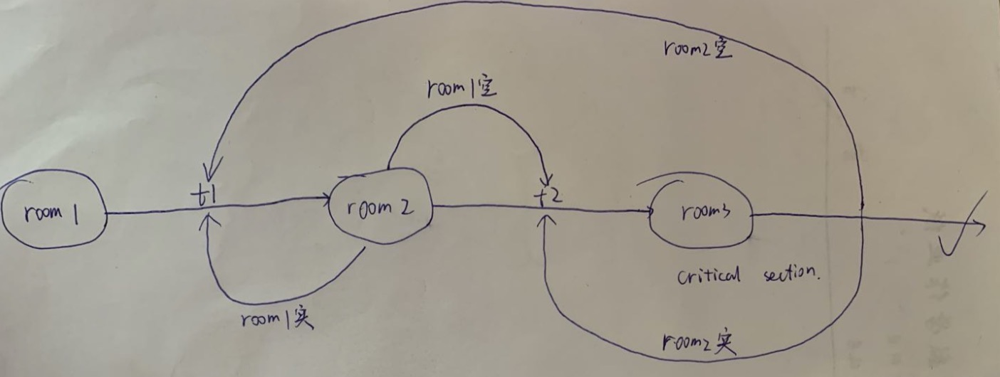
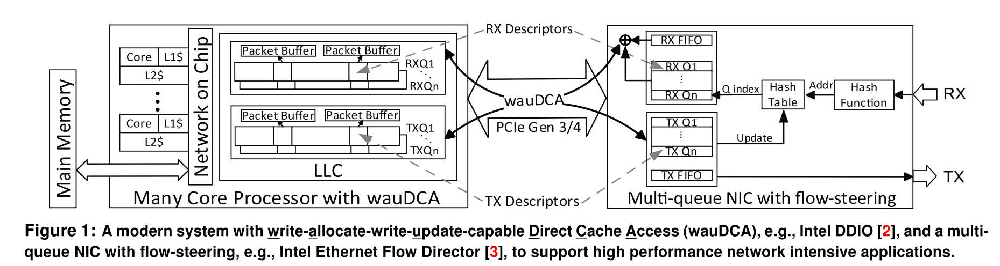

# 操作系统

[内核与系统调用](#内核硬件保护与系统调用) · [进程与线程](#进程线程与进程间通信) · [CPU 调度](#cpu-调度) · [虚拟内存](#地址空间与虚拟内存)

[并发与同步](#并发同步与死锁) · [文件系统与持久化](#文件系统块设备与持久化) · [虚拟机与快照](#虚拟化容器与快照) · [系统性能](#缓存局部性与系统性能)

从程序运行开始，沿系统调用到内核，接着看 CPU 如何分给线程、地址如何翻译、文件如何写入和恢复。每个主题把模型、系统实现与练习放在同一处。

主要教材为《现代操作系统》和 OSTEP。课件中的实现和测量对应当时的平台，涉及当前 Linux 的机制时按对应的接口与文档理解。

《现代操作系统》[习题答案](http://www.docin.com/p-1064801733.html?docfrom=rrela)。

OSTEP [教材](https://pages.cs.wisc.edu/~remzi/OSTEP/) · [示例代码](https://github.com/remzi-arpacidusseau/ostep-code) · [Projects](https://github.com/remzi-arpacidusseau/ostep-projects) · [习题](https://github.com/remzi-arpacidusseau/ostep-homework/) · [xxyzz 解答](https://github.com/xxyzz/ostep-hw) · [我的练习](https://github.com/huangrt01/ostep-homework)。

## 内核、硬件保护与系统调用

### 操作系统的职责与演进

操作系统给程序提供文件、进程、地址空间和系统调用等抽象，承担资源分配与保护。处理器时间按时间复用，内存与设备资源也可以由多个任务共享。教材从冯·诺依曼模型出发，考察并发、I/O 和硬件保护如何协作。设计目标包括性能、隔离、可靠性、安全性、可移植性与能效。


早期程序直接操作硬件，随后通过库和内核入口复用能力。特权级、陷入处理与内存保护让多道程序可以共享一台机器。

| 阶段 | 当时解决的问题 |
| --- | --- |
| 批处理 | 用户脱机提交作业。系统组织主存和 I/O 设备之间的数据传送，提高吞吐。 |
| 多道程序设计 | 单核在多个作业之间交替执行，宏观上并发。硬件保护支持隔离。 |
| 系列机 | IBM System/360 统一体系结构与指令集。软件规模继续增长，引出软件危机。 |
| 分时与多用户 | 用时间片改善交互响应。Unix 的早期设计受到采用环形保护结构的 Multics 启发。 |
| 大规模集成电路时代 | 个人计算机、嵌入式与分布式系统逐渐普及。Linus Torvalds 发起的 Linux 内核是 PC 时代的重要案例。 |

延伸阅读 [蒋炎岩讲 Mosaic 操作系统模型和检查器](https://b23.tv/ChWilgi)。

> I hear and I forget. I see and I remember. I do and I understand.（读书摘记，呼应荀子谈闻、见与行。）

应用通常经由 shell 或 GUI 使用系统接口。
教材 p13 引出多线程和多核芯片。

早期 PC 启动从主板 BIOS 开始。
Unix 将特殊文件、普通文件和管道等对象纳入统一的文件描述符接口。
Unix 权限示例 `rwx r-x --x`（教材 p25）。
课程摘句「个体重复系统发育」。

* /proc/version 查看系统版本

### 处理器特权、中断与设备 I/O

**寄存器分类：**
* 用户可见寄存器: 高级语言编译器通过算法分配并使用之，以减少程序访问主存次数
  * 数据寄存器、地址寄存器、条件码寄存器（溢出、符号）

* 控制和状态寄存器: 用于控制处理器的操作，由OS的特权代码使用, 以控制其他程序的执行
  * PC、IR、PSW(program status word)
  * PSW中有一位CPU的状态工作码, PSW在系统调用和I/O中很重要

**内核态与用户态**（早期教材也称管态与目态）

* 设备 I/O 需要受控的接口。用户态代码通常通过系统调用请求内核操作设备。
* 用户态通过 trap 等架构入口进入内核。返回时由架构规定的指令恢复用户态状态。
* x86 定义了 Ring 0–3 等特权级，常见系统主要使用 Ring 0 和 Ring 3。

I/O：控制器+设备本身    device driver<br/>


* 实现I/O的三种方式<br/>
轮询、中断、DMA芯片（总线竞争、大量I/O数据传送）

中断系统的两大组成部分: 硬件中断装置和软件中断处理程序 (中断设备的设备驱动程序的一部分)

中断向量    中断向量表IVT


### 系统调用与有限直接执行

普通指令可以直接在 CPU 上运行。用户程序需要执行受保护操作时，通过受控入口交给内核；内核用系统调用号选择处理例程，并按 ABI 读取参数。协作式系统依赖程序主动进入内核，抢占式系统还能由定时器中断收回 CPU。

调用方按架构 ABI 传递功能号和参数。
旧教材也列出通过栈或内存参数块传参的实现。

**旧版 32 位 x86 Linux 的系统调用入口示例**
system_call() 	sys_call_table<br/>

> Linux系统调用利用了x86体系结构中的软件中断，即调用了int $0x80汇编指令。这条汇编指令将产生向量为128的软件中断， CPU被切换到内核态，并将控制权交给系统调用过程的起点system_call()处理函数

系统调用与内核函数（即服务例程，e.g. sys_getpid()）<br/>
封装例程     ppt2-p56<br/>


用于进程管理、文件管理、目录管理         书1p32<br/>

**POSIX API 举例。** 进程管理（`fork`、`execve`、`waitpid`、`exit(status)`）、文件管理（`open`、`unlink` 等）、目录管理（`mkdir`、`rmdir` 等）、挂载管理（`umount`），以及 [chmod](https://blog.csdn.net/pythonw/article/details/80263428)、`kill`、`chdir`、`time` 等。

**Win32 API 对照**


**受控入口与内核栈**

  * 概念：trap into the kernel        return-from-trap        trap table    trap handler
* 系统调用入口也负责隔离和校验用户传入的数据。
* NOTE：
  1. x86用[per-process kernel stack](https://stackoverflow.com/questions/24413430/why-keep-a-kernel-stack-for-each-process-in-linux)，用于存进程的寄存器值，以便trap的时候寄存器够
  2. 如何控制：set up trap table at boot time；直接进任何内核地址是very bad idea

  * 用户代码用系统调用号选择入口，无法指定任意内核地址。
	* 告诉硬件trap table在哪也是privileged operation


[stub code](https://www.zhihu.com/question/24844900/answer/35126766)

**定时器中断收回 CPU**

* problem #2:switching between processes
  * A cooperative approach: wait for system calls
  * [MacOS9 Emulator](http://www.columbia.edu/~em36/macos9osx.html#summary)
  * 在完全依赖协作交权的模型里，无限循环可能迫使用户重启机器。
  * 重启的意义：1）回到确定无误的初始状态；2）回收过期和泄漏的资源；3）不仅适合手动操作，也易于自动化
  * A Non-Cooperative Approach: The OS Takes Control
* a timer interrupt    interrupt handler
  * timer也可以关
* deal with malfeasance: in modern systems, the way the OS tries to handle such malfeasance is to simply terminate the offender.

* scheduler    context switch


区分异常入口保存与上下文切换保存。
* 中断／异常入口保存返回用户态所需的状态，硬件与入口代码的分工随架构而变，通常记录在内核栈上的 trap frame 中。
* 调度切换保存内核上下文，以便新线程可以继续之前的内核执行路径。

* e.g. xv6 context switch code

NOTE:
* 如何测time switch的成本：[LMbench](https://winddoing.github.io/post/54953.html)
* 课堂观察将某些系统调用与切换延迟的改善受限归因于内存层次的成本。

* 内核表结构的并发保护见 [竞态、临界区与原子性](#竞态临界区与原子性)。
  * 思考：baby-proof

**测量练习**
* [RDTSC 在多核测量中的注意点](http://www.360doc.com/content/12/0827/17/7851074_232649576.shtml)
* 原练习记录系统调用约 0.3 μs、上下文切换约 0.6 μs、单次记录开销约 1 μs。比较时应带着机器、内核和测量方法理解这些数值。
* [macOS 与 Linux CPU 亲和接口的差异](https://yyshen.github.io/2015/01/18/binding_threads_to_cores_osx.html)

### 单体、分层与微内核

* 单体系统（模块组合结构）
* 层次式系统
  * 分层：全序、偏序、半序

* 微内核结构：
  * 运行在内核态的部分提供中断处理、调度、进程间通信等基本机制。
  * 特点：Mechanism和policy分离=>使内核更小
  * 微内核结构的变体：客户-服务器模型
  * 客户进程与服务器进程之间使用消息进行通信


虚拟机结构沿 [容器、虚拟机与隔离边界](#容器虚拟机与隔离边界) 展开。

## 进程、线程与进程间通信

### 进程模型、控制块与状态

可执行程序提供代码和初始数据。进程运行时有自己的虚拟地址空间、文件描述符、身份和其他资源。线程持有执行位置、寄存器和栈，同一进程中的线程可以共享资源。操作系统由此把资源归属和 CPU 上执行的实体分开。 [Linux 页表](https://docs.kernel.org/mm/page_tables.html) · [pthreads(7)](https://man7.org/linux/man-pages/man7/pthreads.7.html)

顺序进程模型

* 有时须考虑严格的实时要求

并发执行的交错次序取决于调度与外部事件。某些任务还要满足实时约束。

* 进程的组成:程序+数据+PCB进程控制块+堆栈

* 进程上下文
  * 用户级上下文:进程的用户地址空间(包括用户栈各层次)，包括用户正文(code)段、用户数据段和用户栈;
  * 寄存器级上下文:程序寄存器、处理机状态寄存器、栈指针、通用寄存器的值;
  * 系统级上下文:
    * 静态部分(PCB和资源表格)
    * 动态部分:核心栈 (核心过程的栈结构，不同进程在调用相同核心过程时有不同核心栈)

NOTE：

* 守护进程daemon
* Windows 的进程承担资源容器职责，线程是调度实体。进程创建时可以指定父进程属性，相关语义与 Unix 的 `fork` 不同。
* shell p26

调度进程： 进程表=PCB表 p53
* 并发度：PCB表的大小
* 链表结构、索引结构
* 多道（内存层面）!=系统并发度（OS层面）


* UNIX中，OS作为进程的一部分

* Linux 内核用 `task_struct` 表示任务，可按就绪状态加入运行队列。旧教材用双向循环任务链表和 `run_list` 说明一种历史实现。

* 调度策略选谁运行，上下文切换负责怎么切换。二者分开便于替换实现。
* Process Creation
  * 装入可以按需进行，相关机制包括分页和换入换出。
  * 准备运行时栈、堆及默认文件描述符。



**xv6 进程结构与保存的寄存器**

```c++
// the registers xv6 will save and restore
// to stop and subsequently restart a process
struct context {
    int eip;int esp;
    int ebx;int ecx;
    int edx;int esi;
    int edi;int ebp;
};
// the different states a process can be in
enum proc_state { UNUSED, EMBRYO, SLEEPING,RUNNABLE, RUNNING, ZOMBIE };
// the information xv6 tracks about each process
// including its register context and state
struct proc {
    char*mem;                  // Start of process memory
    uint sz;                    // Size of process memory
    char*kstack;               // Bottom of kernel stack
                               // for this process
    enum proc_state state;      // Process state
    int pid;                    // Process ID
    struct proc*parent;        // Parent process
    void*chan;                 // If !zero, sleeping on chan
    int killed;                 // If !zero, has been killed
    struct file*ofile[NOFILE]; // Open files
    struct inode*cwd;          // Current directory
    struct context context;     // Switch here to run process
    struct trapframe*tf;       // Trap frame for the
                                // current interrupt
};
```


* 运行->阻塞：OS、I/O、资源、IPC（其它进程输入）
* 运行->就绪：时间片用完、因为高优先级进程就绪而中断
* 就绪->运行：调度程序
* 阻塞->就绪

**五态与七态教学模型**
* initial和final（五状态）：
  * initial态：等待资源；
  * final 态保留退出记录供父进程回收，Unix 的僵尸状态体现了这一点。
  * 表格和其他信息也可暂时由辅助程序保留，例如账单统计所用的资源记录。
* 七态教材模型用挂起表示进程映像暂存磁盘的状态。这是教学模型，与 Linux 的信号停止状态各有语义。
* 激活的概念：阻塞挂起->阻塞, 就绪挂起->就绪


**Linux `ps` 状态码**

| 状态 | 含义与例子 |
| --- | --- |
| `R` | 正在运行或已在就绪队列等 CPU。可对照一个正在计算的线程和其他同类线程的排队。 |
| `S` | 可中断睡眠，例如等待网络数据或某个同步事件。 |
| `D` | 不可中断睡眠，常见于等待 I/O，具体等待对象可以进一步查内核栈。 |
| `Z` | 子进程已结束，退出信息等待父进程通过 `wait*` 获取。 |
| `T` / `t` | 如 `SIGSTOP` 引起停止，或调试器跟踪停止。作业控制停止可由 `SIGCONT` 恢复。 |

[ps(1) 状态定义](https://man7.org/linux/man-pages/man1/ps.1.html#PROCESS_STATE_CODES) · [wait(2)](https://man7.org/linux/man-pages/man2/wait.2.html)

**僵尸进程观察练习。** 前两条用于查看状态和父子关系，末条是原习题里对测试父进程做的故障注入。应用正常用 `wait*` 回收退出记录。
```shell
# 查找僵尸进程
ps -aux|grep Z
ps -ef|grep 子进程pid
kill -9 父进程pid
```

* `/proc/<pid>/fd/` 可核对进程打开的文件描述符，用于查找文件描述符泄漏。
  * `/proc/<pid>/task/<tid>/` 查看指定线程，`/proc/<pid>/status` 的 `Threads` 记录线程数。

* /proc/sys/kernel/ns_last_pid

### 进程创建、程序装载与回收

UID、GID、PID<br/>
* [早期 execve 调用笔记](https://my.oschina.net/u/3857782/blog/1854572)

* 进程控制原语：创建、撤销、阻塞、唤醒
  * 系统调用不一定是原语：两进程，read()重入

* 创建进程
  * `fork()` 创建子进程，父子从调用返回点继续。内存复制的时机见 [进程与内存写时复制](#进程与内存写时复制)。
  * 成功的 `execve()` 在原进程中装入新程序并替换地址空间，控制流进入新程序。
* 子进程继承身份、环境、打开的文件描述符、当前目录、控制终端、共享映射与信号处置等。描述符可引用同一打开文件描述，因而共享文件偏移。
* 子进程取得新的 PID，PPID 指向父进程。
* exit：exit()向父进程给出一个退出码(8位的整数)，父进程终止时如何影响子进程:
  * 子进程从父进程继承了进程组ID和终端组ID(控制终端)，因此子进程对发给该进程组或终端组的信号敏感。终端关闭时，以该终端为控制终端的所有进程都收到SIGHUP信号。
  * 子进程终止时，向父进程发送SIGCHLD信号，父进程截获此信号并通过wait()系统调用来释放子进程PCB
* wait() waitpid() waitid()等待子进程修改状态

* `<unistd.h>` 中的 `getpid()` 与 `fork()` 分别用于查 PID 和创建子进程。
* scheduler的non-determinism，影响concurrency
* p3.c    利用execvp执行子程序wc
  * 成功的 `execvp()` 不回到调用点。调用前已经输出的内容仍然存在，仍留在用户态缓冲里的数据可能随地址空间替换消失。
* 将 fork 与 exec 分开，shell 就能在子进程内先设置环境、重定向或接上管道，再运行目标程序。

**重定向示例（OSTEP p4.c）**
```c++
#include <stdio.h>
#include <stdlib.h>
#include <unistd.h>
#include <string.h>
#include <fcntl.h>
#include <assert.h>
#include <sys/wait.h>

int main(int argc, char *argv[])
{
    int rc = fork();
  //  printf("STDOUT_FILENO的值是%d",STDOUT_FILENO);
    if (rc < 0) {
        // fork failed; exit
        fprintf(stderr, "fork failed\n");
        exit(1);
    } else if (rc == 0) {
	// child: redirect standard output to a file

	close(STDOUT_FILENO);
	open("./p4.output", O_CREAT|O_WRONLY|O_TRUNC, S_IRWXU);

	// now exec "wc"...
        char *myargs[3];
        myargs[0] = strdup("wc");   // program: "wc" (word count)
        myargs[1] = strdup("p4.c"); // argument: file to count
        myargs[2] = NULL;           // marks end of array
        execvp(myargs[0], myargs);  // runs word count
    } else {
        // parent goes down this path (original process)
        int wc = wait(NULL);
	assert(wc >= 0);
    }
    return 0;
}

```
* 示例先关闭标准输出，再使用 `open()` 分配空闲的最低编号描述符。
* 管道接法见 [管道、命名管道与缓冲](#管道命名管道与缓冲)。原例 `grep -o foo file | wc -l`。

* 谁可以向进程发信号涉及用户身份与进程组，见 [信号与作业控制](#信号与作业控制)。
* RTFM：read the fucking manual

**Process API 练习**

* 5.3 [用vfork()保证父进程后执行](https://www.cnblogs.com/zhangxuan/p/6387422.html)

**Linux 中 fork 与 vfork 的差异**

* `fork()` 为父子提供独立地址空间，普通私有页可用 CoW，实现中的数据页复制可以推迟。父子谁先继续由调度决定。
* `vfork()` 让子进程暂时与父进程共享地址空间，包括栈，并暂停调用线程，直至子进程调用 `execve()` 或退出。子进程按该接口约束使用 `_exit()`，依赖父线程在此之前继续就可能形成等待环。 [vfork(2)](https://man7.org/linux/man-pages/man2/vfork.2.html)

* 5.4 [不同的exec](https://en.wikipedia.org/wiki/Exec_(system_call)#C_language_prototypes)
  * execvp，p的含义是寻找路径，v：vector
* 5.5 如果child没有child，在child里用wait没有意义
* 5.6 waitpid()    [wait和waitpid的区别](https://www.cnblogs.com/yusenwu/p/4655286.html)
  * The pid parameter specifies the set of child processes for which to wait. If pid is -1, the call waits for any child process.  If pid is 0, the call waits for any child process in the process group of the caller.  If pid is greater than zero, the call waits for the process with process id pid.  If pid is less than -1, the call waits for any process whose process group id equals the absolute value of pid.
* 5.8    [注意子进程返回0](https://blog.csdn.net/beautysleeper/article/details/52585224)

**Linux 的 fork 与 wait 示例**

```c++
#include <cstdlib>
#include <iostream>
#include <sys/types.h>
#include<sys/wait.h>
#include <unistd.h>
#include <vector>
using namespace std;

int main(){
    int pid;
    for (int i = 0; i < 3; i++){
        pid = fork();
        if (pid == 0){ //子进程
            cout << "pid=" << pid << getpid() << ", hello world" << endl;
            return 0;
        }
        else{
            cout << "pid=" << pid << " forked" << endl;
        }
    }
    int ret = 0;
    while (ret!=-1){
        ret = wait(NULL);
        cout << "pid=" << ret << " exited" << endl;
    };
    return 0;
}
```

**Windows 的 CreateProcess 示例**

```c++
/*
BOOL CreateProcess(
LPCWSTR pszImageName, LPCWSTR pszCmdLine, LPSECURITY_ATTRIBUTES psaProcess, LPSECURITY_ATTRIBUTES psaThread, BOOL fInheritHandles,
DWORD fdwCreate, LPVOID pvEnvironment, LPWSTR pszCurDir,
LPSTARTUPINFOW psiStartInfo, LPPROCESS_INFORMATION pProcInfo
);
*/
#include <stdio.h>
#include <windows.h>
int main() {
	TCHAR szCmdLine[]={TEXT("C:\\oscourse\\test.exe")};
	STARTUPINFO si;
	PROCESS_INFORMATION pi;
	memset(&si, 0, sizeof(STARTUPINFO));
	si.cb = sizeof(STARTUPINFO);
  si.dwFlags = STARTF_USESHOWWINDOW;
  si.wShowWindow = SW_SHOW;
  if(!CreateProcess(NULL, szCmdLine, NULL, NULL, FALSE, 0, NULL, NULL, &si, &pi))
	{
		printf("Create process fail!\n");
		ExitProcess(1);
	}
  else {
    printf("Create process success!\n");
    ExitProcess(0);
	}
}
```

### 线程模型、调度实体与并行上限

  * 多线程Multithreading


  * 线程有各自的执行状态，通常比拥有独立地址空间的进程更容易创建和撤销。
  * 轻量级进程=Lightweight process=LWP
  * TCB与PCB
  * e.g. 书p56 三线程、文字处理
  * 线程间可通过共享变量传递数据，与并发访问它们有关的同步见 [竞态、临界区与原子性](#竞态临界区与原子性)。

NOTE：

* 服务器与cache，分派线程、工作线程，c代码
* 线程改善了web服务器的性能
* 有限状态机实现，非阻塞系统调用<->顺序进程模型的保留 书p57
* [“阻塞非阻塞"与"同步异步”](
  https://www.cnblogs.com/skying555/p/5028167.html): 线程可以异步，因为有状态共享；同步是两个对象之间的关系，而阻塞是一个对象的状态。

在用户空间／内核中实现线程

**用户级线程（ULT）**

* 运行时在线程库内切换实体。它可以暴露类似 pthread 的线程 API，具体映射由运行时和系统决定。
* pros：
  * 线程切换不调用操作系统内核，性能良好
  * 调度是应用程序特定的，可针对应用优化
  * ULT可运行在任何操作系统上 (仅需线程库)
* cons:
  * 典型纯用户态实现通过协作式调度切换，可按应用选择策略。
  * 在多对一映射下，承载线程进入阻塞系统调用或同步缺页时，其他用户线程也受影响。
  * 多对一映射的所有用户线程共享同一个内核调度实体，一次只能在一个 CPU 上执行。

**内核级线程（KLT）**

* pros：
  * 对于多处理器，内核可以同时调度同一进程的多个线程
  * 阻塞是在线程一级完成
  * 内核例程是多线程的
* cons：
  * 线程管理代价大：在同一进程内的线程切换调用内核，导致速度下降
  * 时间片分配给线程，所以多线程的进程获得更多CPU时间

**混合实现**

Solaris

在线程的混合实现里，用户态维护线程创建、调度与同步，将多个 ULT 映射到多个 KLT。

* Amdahl 定律。若可并行部分占串行执行时间的比例为 $p$，忽略额外开销，处理器数量趋于无穷时的加速上限为

$$
S_{\max}=\frac{1}{1-p}.
$$
  * 95% work ~ infinite concurrency, the theoretical speedup is limited to at most 20 times the single thread performance

  * 每个线程有自己的用户栈，栈仍位于共享的进程地址空间。
    * [关于线程栈和进程栈](https://www.cnblogs.com/luosongchao/p/3680312.html)
      * 线程栈大小受实现和配置影响。`ulimit -a`、`ulimit -s` 可查看或调整相关限制，pthread 属性也可设置栈大小。

  * thread的意义：1) parallelism, 2) 适应于I/O阻塞系统、缺页中断（需要KLT），这一点类似于multiprogramming的思想，在server-based applications中应用广泛。


NOTE：
* pthread_join与[detach](https://blog.csdn.net/heybeaman/article/details/90896663)
* disassembler: objdump -d -g main
* x86 使用变长指令。

### POSIX 线程接口与 Linux、Windows 实现

**pthread_create 与 pthread_join**

```c++
#include <pthread.h>
int pthread_create(pthread_t*thread,const pthread_attr_t*attr,void*(*start_routine)(void*),void*arg);

typedef struct
{
    int a;
    int b;
} myarg_t;
typedef struct
{
    int x;
    int y;
} myret_t;
void * mythread(void *arg)
{
    myret_t *rvals = Malloc(sizeof(myret_t));
    rvals->x = 1;
    rvals->y = 2;
    return(void *)rvals;
}
int main(int argc, char *argv[])
{
    pthread_t p;
    myret_t * rvals;
    myarg_t args = {10, 20};
    Pthread_create(&p, NULL, mythread, &args);
    Pthread_join(p, (void **)&rvals);
    printf("returned %d %d\n", rvals->x, rvals->y);
    free(rvals);
    return 0;
}
```
* pthread_create
  * thread: &p
  * attr：传参NULL或，pthread_attr_init
  *  arg和start_routine的定义保持一致；
  * void=any type
* pthread_join
  * simpler argument passing：`(void *)100, (void **)rvalue`
  * `(void **)value_ptr`，小心局部变量存在栈中，回传指针报错
* gcc -o main main.c -Wall -pthread

**pthread 工作线程示例**

POSIX 给出线程 API，执行实体映射由实现决定。


* `pthread_yield()` 让出当前 CPU，线程仍有机会再次被调度。

```c++
#define _REENTRANT
#include <pthread.h>
#include <stdio.h>
#include <unistd.h>
#define NUM_THREADS 5
#define SLEEP_TIME 10
void *sleeping(void *); /* thread routine */
int i;
pthread_t tid[NUM_THREADS]; /* array of thread IDs */

int main()
{
    int sleep_time = SLEEP_TIME;
    for (i = 0; i < NUM_THREADS; i++)
        pthread_create(&tid[i], NULL, sleeping, (void *)&sleep_time);
    for (i = 0; i < NUM_THREADS; i++)
        pthread_join(tid[i], NULL); //逐个等待线程结束
    printf("main() reporting that all %d threads have terminated\n", i);
    return (0);
} /* main */

void *sleeping(void* arg)
{
    int sleep_time = *(int *)arg;
    printf("thread %u sleeping %d seconds ...\n", pthread_self(), sleep_time);
    sleep(sleep_time);
    printf("\nthread %u awakening\n", pthread_self());
    pthread_exit(0);
}
```

**Linux clone 练习**

* Linux 以 `task_struct` 表示可调度任务，线程间哪些资源共享由创建时的标志决定。
* Linux 的 pthread 实现可以通过 clone 家族创建线程。下列 `CLONE_VM` 练习只展示共享地址空间，例中的普通 `flag` 不提供线程同步。


```c++
#define _GNU_SOURCE
#include <stdio.h>
#include <errno.h>
#include <sched.h>
#include <sys/types.h>
#define STACK_SIZE 4096 //4k
int flag;
void *test(void *arg)
{
    int childnum;
        flag = 1;
    childnum = *(int *)arg;
    printf("Thread %d work cycle\n", childnum);
    sleep(3);
}
int main()
{
    pid_t pid;
    int childno = 1, mainnum = 0;
    void *csp, *tcsp;
    csp = (char *)malloc(STACK_SIZE);
    if (csp)
    {
        tcsp = csp + STACK_SIZE;
    }
    else
    {
        exit(errno);
    }
    flag = 0;
    childno = 1;
    if ((pid = clone((void *)&test, tcsp, CLONE_VM, (void *)&childno)) < 0)
    {
        printf("Couldn't create new thread!\n");
        exit(1);
    }
    else
    { //we're in main
        while (flag == 0); //利用全局变量进行Linux线程间通信
        printf("Just created thread %d\n", pid);
    }
    test(&mainnum);
    sleep(3);
    printf("Main program is now shutting down\n\n");
    return 0;
}
```

**Windows 线程与 CreateThread**

* KLT
* 惰性进程，必须有一个线程（自动创建主线程）
* Windows线程由执行体线程块ETHREAD表示，即线程对象，其中包含内核线程块 KTHREAD，即线程控制块TCB

```c++
#include <windows.h>
#include <stdio.h>
#define MAX_THREADS 3
typedef struct _MyData {
	int val1;
	int val2;
} MYDATA, *PMYDATA;

DWORD WINAPI ThreadProc(LPVOID lpParam){
	PMYDATA pData;
	pData = (PMYDATA)lpParam;
	printf("This is thread %d, the parameter is %d\n", pData->val1, pData->val2);
	// Free the memory allocated by the caller for the thread
	// data structure.
	HeapFree(GetProcessHeap(), 0, pData);
	return 0;
}

void main() {
	PMYDATA pData;
	DWORD dwThreadId[MAX_THREADS]; //线程ID
	HANDLE hThread[MAX_THREADS]; //线程句柄 int i;
	// Create MAX_THREADS worker threads.
	for( i=0; i<MAX_THREADS; i++ ) {
	// Allocate memory for thread data.
		pData = HeapAlloc(GetProcessHeap(), HEAP_ZERO_MEMORY, sizeof(MYDATA));
    if( pData == NULL ) ExitProcess(2);
    // Generate unique data for each thread.
    pData->val1 = i;
    pData->val2 = i+100;
    hThread[i] = CreateThread(
                NULL,              // default security attributes
                0,                 // use default stack size
                ThreadProc,        // thread function
                pData,             // argument to thread function
                0,                 // use default creation flags
                &dwThreadId[i]);   // returns the thread identifier

    // Check the return value for success.
    if (hThread[i] == NULL) {
      ExitProcess(i);
    }
	}
// Wait until all threads have terminated. WaitForMultipleObjects(MAX_THREADS, hThread, TRUE, INFINITE); // Close all thread handles upon completion.
	for(i=0; i<MAX_THREADS; i++) {
		CloseHandle(hThread[i]);
	}
}
```

### 信号与作业控制

Unix早期的进程间通信机制:信号和管道
* e.g. 键盘中断，硬件条件（浮点溢出，segmeatation fault），软件条件（如Socket中有加急数据到达），Shell向子进程发送作业控制命令
* [linux与进程控制相关的命令](https://www.cnblogs.com/mfryf/archive/2012/09/24/2700042.html)：&, ctrl-z, fg, bg, ...
* `SIG_IGN` 表示忽略，`SIG_DFL` 表示使用默认处置。SIGKILL 与 SIGSTOP 由内核保留，不能捕获、阻塞或忽略。
* 传统实现用位图表示未决与屏蔽信号。信号编号和实时信号范围按当前平台接口查询。
* task_struct:利用两个字分别记录当前未决的信号(signal)以及当前阻塞的信号(blocked)，[917行](https://elixir.bootlin.com/linux/latest/source/include/linux/sched.h#L629),sigaction存储处理方式

```c++
/* Signal handlers: */
	struct signal_struct		*signal;
	struct sighand_struct __rcu		*sighand;
	sigset_t			blocked;
	sigset_t			real_blocked;
	/* Restored if set_restore_sigmask() was used: */
	sigset_t			saved_sigmask;
	struct sigpending		pending;
	unsigned long			sas_ss_sp;
	size_t				sas_ss_size;
	unsigned int			sas_ss_flags;
```
**课程中的信号捕捉示例。** 保留原代码用于看控制流。处理器中可调用的函数有 async-signal-safe 约束，见 [事件循环与异步 I/O](#事件循环与异步-io)。
```c++
#include <signal.h>
void catchint(int signo) {
	printf("\n CATCHINT; signo=%d;", signo);
	printf("CATCHINT returning\n");
}
void main() {
  int i;
  signal(SIGINT, catchint);
  for(i=0; i<5; i++) {
    // 修改sigaction结构
    printf("Sleep call #%d\n", i);
    sleep(5);
  }
  printf("Exiting.\n");
}
```

### 管道、命名管道与缓冲

* 管道类型：pipe、named pipe(还允许无亲缘关系进程通信)
* 适合数据量大的情况
* 匿名管道的读写端指向同一个内核管道对象，流经内核缓冲区。旧教材以 VFS 索引节点和单页缓冲示意其连接关系。
* 内核必须利用一定的机制同步对管道的访问， 为此，内核使用了锁、等待队列和信号
* int pipe(int fildes[2]);   fildes[0]是读端，fildes[1]是写端
* 只适用于父子进程之间；或父进程安排的各个子进程之间 （其它情况用命名管道）

```c++
#include <stdio.h>
#include <unistd.h>
#include <stdlib.h>
#include <string.h>
int main(int argc, char *argv[])
{
    int f_des[2];
    static char message[BUFSIZ];
    if (argc != 2)
    {
        fprintf(stderr, "Usage: %s message\n", *argv);
        exit(1);
    }
    if (pipe(f_des) == -1)
    {
        perror("pipe");
        exit(2);
    }
    switch (fork())
    {
        case -1:
            perror("fork");
            exit(3);
        case 0: // 子进程
            close(f_des[1]);
            if (read(f_des[0], message, BUFSIZ) != -1)
            {
                printf("Message received by child:[%s]\n", message);
                fflush(stdout);
            }
            else
            {
                perror("read");
                exit(4);
            }
            break;
        default: // 父进程
            close(f_des[0]);
            strcpy(message, argv[1]);
            if (write(f_des[1], message, BUFSIZ) != -1)
            {
                printf("Message sent by parent:[%s]\n", argv[1]);
                fflush(stdout);
            }
            else
            {
                perror("write");
                exit(5);
            }
    }
}
```

* 命名管道：FIFO，和匿名管道的区别在于它是文件实体而不是匿名对象
  * 命名管道可通过mknod系统调用建立：指定mode为S_IFIFO
  * `int mknod(const char *path, mode_t mode, dev_t dev);`

* [stdio buffering](https://www.pixelbeat.org/programming/stdio_buffering/)
  * It should be noted here that changing the buffering for a stream can have unexpected effects. For example glibc (2.3.5 at least) will do a read(blksize) after every fseek() if buffering is on.
  * 期望环境变量控制
    * `tail -f access.log | BUF_1_=1 cut -d' ' -f1 | uniq`
    * 风险：Denial Of Service possibilities
* `fcntl(fileno(stdin), F_SETPIPE_SZ, pipe_page_num * 4096);`
  * 旧笔记还记有 socket 缓冲上限 16 MB 的环境记录，当前值由系统配置决定，与 pipe 容量分开看。

```python
import fcntl
import platform

try:
    if platform.system() == 'Linux':
        fcntl.F_SETPIPE_SZ = 1031
        fcntl.fcntl(fd, fcntl.F_SETPIPE_SZ, size)
except IOError:
    print('can not change PIPE buffer size')
```

### 消息传递、共享内存与套接字

消息传递把数据通过显式的发送与接收边界交给另一方。共享内存让双方映射同一段数据，并需要共享的同步约定。套接字可以把类似的消息或字节流模型延伸到机器之间。

**发送、接收与有界缓冲示例**

* 针对分布式系统的高级机制
* 消息传递原语：send(destination, &message)和receive(source, &message)，它们是系统调用而不是语言成分

```c++
#define N 100								/* buffer 中槽的数量 */

void producer(void){
  int item;
  message m;									/* buffer 中槽的数量 */
  while(TRUE){
    item = produce_item();						/* 生成放入缓冲区的数据 */
    receive(consumer,&m);						/* 等待消费者发送空缓冲区 */
    build_message(&m,item);						/* 建立一个待发送的消息 */
    send(consumer,&m);								/* 发送给消费者 */
  }
}

void consumer(void){
  int item,i;
  message m;
  for(int i = 0;i < N;i++){						        /* 循环N次 */
    send(producer,&m);							/* 发送N个缓冲区 */
  }
  while(TRUE){
    receive(producer,&m);						/* 接受包含数据的消息 */
        item = extract_item(&m);					/* 将数据从消息中提取出来 */
    send(producer,&m);							/* 将空缓冲区发送回生产者 */
    consume_item(item);						/* 处理数据 */
  }
}
```

* 消息传递系统的设计问题
1. 不可靠消息传递的成功通信问题(网络)
2. 进程命名问题
3. 身份认证问题
4. 性能问题

* IPC对象（访问必须经过类似文件访问的许可检验）、引用标识符、访问键（定位引用标识符）
  * ipc_perm结构：包含了作为对象所有者和创建者的进程之用户标识符和组标识符，以及对象的 访问模式和对象的访问键。

* 消息队列
  * 客户/服务器模型，微内核结构，克服了信号承载信息量少，管道只能承载无格式字节流以及缓冲区大小受限等缺点
  * Linux 为系统中所有的消息队列维护一个msgque链表，该链表中的每个指针指向一个msgid_ds结构，该结构完整描述一个消息队列。当建立一个消息队列时，系统从内存中分配一个msgid_ds结构并将指针添加到msgque链表
  * 与消息队列相关的系统调用
    * msgget——依据用户给出的键值key，创建新消息队列或打开现有消息队列，返回一个消息队列ID
    * msgsnd——发送消息;
    * msgrcv——按消息类型接收。默认可等待，使用 `IPC_NOWAIT` 且没有匹配消息时返回错误。
		* msgctl——对消息队列进行控制，如删除消息队列
	* 消息队列不随创建它的进程的终止而自动撤销，须调用 msgctl(msgqid, IPC_RMID, 0)

* snd.c
```c++
#include <stdlib.h>
#include <stdio.h>
#include <string.h>
#include <errno.h>
#include <unistd.h>
#include <sys/msg.h>
#define MAX_TEXT 512
#define TRUE 1
struct msgbuf
{
    long int msgtype;
    char msgtext[MAX_TEXT];
};
int main()
{
    struct msgbuf msgdata;
    int msgid;
    char buffer[MAX_TEXT];
    if ((msgid = msgget((key_t)1234, 0666 | IPC_CREAT)) == -1)
    {
        fprintf(stderr, "msgget failed with error: %d\n", errno);
        exit(EXIT_FAILURE);
    }
    printf("msgid = %d\n", msgid);
    while (TRUE)
    {
        printf("Enter message text: ");
        fgets(buffer, MAX_TEXT, stdin);
        msgdata.msgtype = 1;
        strcpy(msgdata.msgtext, buffer);
        if (msgsnd(msgid, (void *)&msgdata, MAX_TEXT, 0) == -1)
        {
            fprintf(stderr, "msgsnd failed\n");
            exit(EXIT_FAILURE);
        }
        if (strncmp(buffer, "end", 3) == 0)
        {
            break;
        }
    }
    exit(EXIT_SUCCESS);
}
```

rcv.c
```c++
#include <stdlib.h>
#include <stdio.h>
#include <string.h>
#include <errno.h>
#include <unistd.h>
#include <sys/msg.h>
#define MAX_TEXT 512
#define TRUE 1

struct msgbuf
{
    long int msgtype;
    char msgtext[MAX_TEXT];
};
int main()
{
    int msgid;
    struct msgbuf msgdata;
    if ((msgid = msgget((key_t)1234, 0666 | IPC_CREAT)) == -1)
    {
        fprintf(stderr, "msgget failed with error: %d\n", errno);
        exit(EXIT_FAILURE);
    }
    printf("msgid = %d\n", msgid);
    while (TRUE)
    {
        if (msgrcv(msgid, (void *)&msgdata, MAX_TEXT, 0, 0) == -1)
        {
            fprintf(stderr, "msgrcv failed with error: %d\n", errno);
            exit(EXIT_FAILURE);
        }
        printf("Received message: %s", msgdata.msgtext);
        if (strncmp(msgdata.msgtext, "end", 3) == 0)
        {
            break;
        }
    }
    if (msgctl(msgid, IPC_RMID, 0) == -1)
    {
        fprintf(stderr, "msgctl(IPC_RMID) failed\n");
        exit(EXIT_FAILURE);
    }
    exit(EXIT_SUCCESS);
}
```

* 信号量
  * semid_ds 结构表示System V IPC信号量
  * sem_base:信号量数组；系统调用参数：信号量索引、操作值和操作标志
  * 操作：semget, semop, semctl
  * 如果系统调用中指定的所有操作中有一个操作不能成功 时，则 Linux会挂起这一进程。但是，如果操作标志指定这种情况下不能挂起进程的话，系统调用返回并指明 信号量上的操作没有成功，而进程可以继续执行
  * 如果进程被挂起，Linux必须保存信号量的操作状态并 将当前进程放入等待队列。为此，Linux在堆栈中建立一个sem_queue结构并填充该结构。新的sem_queue结构添加到信号量对象的等待队列中(利用 sem_pending 和sem_pending_last指针)。当前进程放入sem_queue结构的等待队列中(sleeper)后调用调度程序选择其他的进程运行


* 共享内存
  * 对共享内存的访问同步需要由其他 IPC机制，例如信号量来实现
  * 访问键，访问权限，锁定到物理内存
  * 系统调用
    * shmget——创建或打开共享内存:依据用户给出的整数值key，创建新内存区或打开现有内存区，返回 一个共享内存ID
		* shmat——连接共享内存:连接共享内存到本进程的地址空间，可以指定虚拟地址或由系统分配，返回共享内存首地址。父进程已连接的共享内存可被fork 创建的子进程继承
		* shmdt——拆除共享内存连接:拆除共享内存与本进 程地址空间的连接
		* shmctl——共享内存控制:对共享内存进行控制。如共享内存的删除需要显式调用shmctl(shmid, IPC_RMID, 0)

* 套接字（Socket）
  * 套接字(Socket)是一种网络通信机制，它通过网 络在不同计算机上的进程间进行双向通信。套接字所采用的数据格式可为可靠的字节流或不可靠的报文，通信模式可为client-server模式或 peer-to-peer模式
  * UNIX套接字API(基于TCP/IP):send, sendto, recv, recvfrom

**Windows 的共享内存、管道与消息机制**

* 信号量、互斥量、临界区
* 共享内存：文件映射机制
  * CreateFileMapping/OpenFileMapping
  * MapViewOfFile
  * FlushViewOfFile可把映射地址空间的内容写到物理文件中
  * UnmapViewOfFile, CloseHandle
* 管道
  * Windows 提供了匿名管道和命名管道两种管道 机制
  * 利用CreatePipe可创建匿名管道，得到两个读写句柄;利用ReadFile和WriteFile可进行匿名管道的读写
  * 命名管道：一个服务器端与一个客户进程间的通信通道;可用于不同机器上进程通信；作为客户方(连接到一个命名管道实例的一方)时，可以是"\\serverName\pipe\pipename"；作为服务器方(创建命名管道的一方)时，只能取 serverName为\\.\pipe\PipeName，不能在其它机器上创建管道
* 邮件槽mailslot（消息队列）：一种不定长、不可靠的单向消息机制，通常采用client-server模式
* 套接字Winsock: 实现了一个与协议独立的应用编程接口，可支持多种网络通信协议

## CPU 调度

### 调度时机、工作负载与评价指标

任务阻塞、时间片到期、高优先级任务变为就绪，都可能触发调度。调度策略决定选谁，上下文切换机制负责保存和恢复执行状态。批处理看吞吐和周转，交互系统看响应和公平，实时系统关心截止时间与可预测性。

调度的开销
* 从一个进程切换到另一个进程需一定的时间
* 上下文切换之后，指令和数据高速缓存通常需要更新，执行速度降低 (缺失损失)

非抢先式／抢先式调度算法（时间片+中断）

调度的层次：作业、swap、进程线程

调度算法的目标：
* 批处理系统
  * 吞吐量——每小时最大作业数
  * 周转时间从提交算到结束。CPU 利用率描述 CPU 忙碌的比例。
* 交互式系统
  * 响应时间——发出命令到得到响应之间的时间(快速响应请求)
  * 均衡性——满足用户的期望
* 实时系统
  * 满足截止时间——避免丢失数据
  * 可预测性——在多媒体系统中避免品质降低

I/O活动的含义：阻塞 p85
I/O密集型～多道程序设计

教材 p87 提到三个共同目标：公平、资源平衡、执行预定策略。

一个简化模型可以解释多道程序为什么有助于填满 CPU。若有 $n$ 个独立任务，各自以概率 $p$ 等待 I/O，CPU 可从所有可运行任务中选择，则至少一个任务可运行的概率为

$$
1-p^n.
$$

独立等待是这个估算的假设。

* 模拟器练习 `process-run.py`。
  * 对照 `-I IO_RUN_IMMEDIATE` 的调度结果，分析 I/O 完成后立刻运行该进程的场景。对于反复短计算再做 I/O 的任务，及时启动下一次 I/O 有助于重叠等待与其他任务的计算。

### 批处理、轮转与实时调度

* workload assumptions
  * fully-operational scheduling discipline
  * 概念：jobs
* scheduling metrics：turnaround time

* **FCFS／FIFO** 按到达顺序执行，长任务在前面会产生 convoy effect。已知作业长度时可以用 **SJF**，允许新作业抢占后变成最短剩余时间优先 **STCF／SRTF**。轮转 **RR** 用时间片控制第一次拿到 CPU 的等待，因而还要看响应时间。

* 概念：preemptive schedulers
  * time slice    scheduling quantum
  * 时间片长：amortize the cost of context switching
* 针对I/O：overlap

* 轮转需要切换上下文，时间片越短，切换开销占比通常越高。
  * [上下文切换术语](https://baike.baidu.com/item/%E4%B8%8A%E4%B8%8B%E6%96%87%E5%88%87%E6%8D%A2/4842616)
  * 课件用 20–50 ms 说明切换成本与交互响应的权衡。具体时间片由系统和策略决定。

关键：衡量指标，用户公平／进程公平／随机／最短进程／CTSS

实时系统的可调度条件 p92


速率单调调度RMS
最早截止时限优先EDF
最小裕度算法 laxity

将调度策略（用户态）和调度机制（内核态）分离：参数化

应用任务调度也区分等待条件和就绪状态。例如校验任务等产物提交后才可派发，再按优先级和并发额度选择执行器。执行器的提交权限由任务所有权和提交协议管理。

### 多级反馈队列与比例份额

**MLFQ**

* 多级反馈队列与分时系统相关，Corbató 的分时系统工作获图灵奖。
多个queue，每个queue对应一个priority，队内用RR => how to change priority

* Rule 1:If Priority(A)>Priority(B), A runs (B doesn’t).
* Rule 2:If Priority(A)=Priority(B), A & B run in RR.

attempt1: how to change priority

* Rule 3:When a job enters the system, it is placed at the highest priority (the topmost queue).
* Rule 4a:If a job uses up an entire time slice while running, its priority is reduced(i.e., it moves down one queue).
* Rule 4b:If a job gives up the CPU before the time slice is up, it stays at the same priority level.
* 思考：是否优先级越高的queue越倾向于用RR

MLFQ的问题：
1. starvation
2. game the scheduler
3. change its behavior

attempt2: the priority boost

* Rule 5:After some time period S, move all the jobs in the system to the topmost queue.
  * 部分地解决1和3
  * 和思考一致：高优先级，把time slice调短
  * Solaris：Default values for the table are 60 queues, with slowly increasing time-slice lengths from 20 milliseconds (highest priority) to a few hundred milliseconds (lowest),and priorities boosted around every 1 second or so，

attempt3: better accounting

* Rule 4:Once a job uses up its time allotment at a given level (regardless of how many times it has given up the CPU), its priority is reduced (i.e., it moves down one queue).

其它可能的特性：
* 操作系统0优先级
* advice机制：As the operating system rarely knows what is best for each and every process of the system, it is often useful to provide interfaces to allow usersor administrators to provide some hints to the OS. We often call such hints advice, as the OS need not necessarily pay attention to it, but rather might take the advice into account in order to make a better decision. Such hints are useful in many parts of the OS, including the scheduler(e.g., with **nice**), memory manager (e.g.,**madvise**), and file system (e.g.,informed prefetching and caching [P+95])

* HW: iobump，io结束后把进程调到当前队列第一位，否则最后一位；io越多效果越好

**Lottery 与 stride**

Basic Concept: Tickets Represent Your Share
* 利用randomness：
  1. 避免corner case，LRU replacement policy (cyclic sequential)
  2. lightweight
  3. fast，越快越伪随机

NOTE：

如果对伪随机数限定范围，不要用rand，[用interval](https://stackoverflow.com/questions/2509679/how-to-generate-a-random-integer-number-from-within-a-range)

**机制：**

1. ticket currency，用户之间
2. ticket transfer，用户与服务器
3. ticket inflation，临时增加tickets，需要进程之间的信任

* unfairness metric
* stride scheduling    — deterministic
  * lottery scheduling 相对于 stride 的优势：no global state

```c++
curr = remove_min(queue);   // pick client with min pass
schedule(curr);             // run for quantum
curr->pass += curr->stride; // update pass using stride
insert(queue, curr);        // return curr to queue
```

NOTE:
* 这个idea应用广泛，比如用于虚拟机的资源分配
* [why index-0?](https://www.cs.utexas.edu/users/EWD/ewd08xx/EWD831.PDF)

### 多核负载均衡、亲和性与异构核心

* 概念：multicore processor       与threads配合

**Background: Multiprocessor Architecture**

单核与多核的区别：the use of hardware caches(e.g., Figure 10.1), and exactly how data is shared across multiple processors.

Q: cache coherence问题，不同CPU的cache未及时更新，导致读错数据

A: 利用hardware, by monitoring memory accesses: bus snooping; write-back caches

**Don’t Forget Synchronization**

虽然解决了coherence问题，依然需要mutual exclusion primitives(locks)

**One Final Issue: Cache Affinity**

**Single-Queue Scheduling**

SQMS (single-queue multiprocessor scheduling)，存在的问题如下：

* lack of scalability: lock overhead随CPU数目增加而变高
* cache affinity: 需要用复杂的机制调度，比如将少量jobs migrating from CPU to CPU

MQMS (multi-queue multiprocessor scheduling): 分配jobs给CPU

* 优点：more scalable; intrinsically provides cache affinity
* 缺点：load imbalance

migration: 将余数migrate

the tricky part: how should the system decide to enact such a migration?

e.g. work stealing: source queue经常peek其它的target queue，使两边work load均衡

* peek频率是超参数，过高会失去MQMS的意义，过低会有load imbalances

**异构核心案例。** [Intel Thread Director](https://fuse.wikichip.org/news/6123/intel-introduces-thread-director-for-heterogeneous-multi-core-workload-scheduling/) 给 OS 调度提供硬件反馈，帮助在性能核和能效核之间做选择。
  * performance core and efficient core 的概念，OS会aware程序hints（切换core是否有损性能）、core的状态

### Linux 公平调度与等待诊断

线程发起写请求后，可能因 I/O 或集群锁阻塞。事件完成将线程唤醒时，它具备继续执行的条件，仍要排队等 CPU。**阻塞时间和运行队列等待是不同的延迟来源。** Linux 的 `/proc/<pid>/schedstat` 可以对照 CPU 执行时间与运行队列等待时间，资源等待还需按具体原因核对。 [Linux 调度器统计](https://docs.kernel.org/scheduler/sched-stats.html) · [Linux delay accounting](https://docs.kernel.org/accounting/delay-accounting.html)

对普通任务，同权重且一直可运行的两个线程在同一 CPU 上长期竞争，目标大体是均分 CPU 时间。经典 CFS 用虚拟运行时间 `vruntime` 对已获得的 CPU 时间做权重记账，优先考虑 `vruntime` 小的任务。Linux 从 6.6 起开始把普通任务的公平调度转向 EEVDF。EEVDF 先用 `lag` 看哪些任务还有资格得到 CPU，再在这些任务中选择虚拟截止时间最早的一个。假设甲已经超额、乙和丙都还应分到 CPU，若丙的虚拟截止时间早于乙，就先选丙。这个截止时间是公平调度内部的排序依据。 [CFS 设计](https://docs.kernel.org/scheduler/sched-design-CFS.html) · [EEVDF 设计](https://docs.kernel.org/scheduler/sched-eevdf.html)

Windows 课程例子区分实时优先级与可变优先级线程。 [课程延伸材料](https://blog.csdn.net/zhiquan/article/details/4240400)

线程时间配额 ppt p58

**历史实现。** 课程对照了线性扫描运行队列 O(n)、O(1) 调度器、楼梯调度／RSDL 和经典 CFS，也记录了 O(1) 时代的多核亲和性与负载均衡。

* RSDL 是 Rotating Staircase Deadline Scheduler。

**教材中的历史比较。**

* 教材把历史上的 BFS（BF Scheduler）作为比例份额和虚拟截止时间思路的例子。

* 在教材对照中，BFS 用单队列，O(1) 调度器和 CFS 用多个队列。

* 经典 CFS 用每 CPU 的运行队列和红黑树记账。任务离开 CPU 有两种典型路径。
  - 自愿阻塞或让出，例如睡眠、等锁或等 I/O。
  - 被抢占，例如更高优先级任务就绪。
* 运行队列等待越长，请求延迟越高。高 CPU 利用率下是否出现长尾取决于可运行任务数、亲和性、配额和具体负载。


**经典 CFS 的教材配置示例。**
* 教材用 `sched_latency=48ms` 举例。理想的同权重时间片约为 `48/n` ms。
  * `min_granularity=6ms` 限制切片过细。数值对应教材场景。
  * Weighting (Niceness) --->time slice ; table对数性质，ratio一致
  * sleep，则从树中移去
  * 睡眠任务唤醒后如何放回运行队列，要看该版本用于唤醒的 `vruntime` 放置规则。

**Linux 线程优先级接口**

[实时和非实时调度策略测试总结](https://www.cnblogs.com/mightycode/p/13930352.html)

* 常见 Linux 策略有以下几种，完整列表见 [sched(7)](https://man7.org/linux/man-pages/man7/sched.7.html)。
  * SCHED_OTHER 分时调度策略
  * `SCHED_FIFO` 在同一优先级按队列次序运行，直到阻塞、主动让出或被更高优先级任务抢占。
  * `SCHED_RR` 在相同优先级的实时线程之间增加时间片轮转，耗尽配额的线程移到同优先级队尾。
  * `pthread_setschedparam(id, policy, &param)`

* [nice 可用于设置 Linux 线程优先级](https://stackoverflow.com/questions/7684404/is-nice-used-to-change-the-thread-priority-or-the-process-priority)，因为 Linux Threads do not share a common nice value，violate 了 POSIX.1
  * `setpriority()`, `nice()`
  * 提高优先级需要 sudo 权限，有 setcap 的方法绕过，参考 [stackoverflow](https://stackoverflow.com/questions/41562834/linux-set-priority-function-is-not-taking-effect-in-my-test)

## 地址空间与虚拟内存

### 地址空间、重定位与分段

地址空间给每个进程一套可独立使用的虚拟地址。MMU 按当前进程的映射和访问权限翻译地址，因此两个进程中的同一个地址可以指向不同的物理页。

every address generated by a user program is a virtual address
  * ease of use, isolation, protection

* multiprogramming
* abstraction: address space
* virtual memory
  * goals：transparency, efficiency (e.g. TLBs), protection

  * location of code : 0x105f40ec0

  * location of heap : 0x105f55000

  * location of stack: 0x7ffee9cbf8ac

*  [64bit系统下进程的内存分布](https://blog.csdn.net/chenyijun/article/details/79441166)
  * 以 48 位 canonical 地址模式为例，x86-64 的高位按第 47 位符号扩展。旧四级页表布局的两段 canonical 地址窗口分别从 `0x0000000000000000` 到 `0x00007FFFFFFFFFFF`、`0xFFFF800000000000` 到 `0xFFFFFFFFFFFFFFFF`，合计 256 TiB。Linux 实际映射按平台和分页级数看。 [x86-64 Linux 地址布局](https://docs.kernel.org/arch/x86/x86_64/mm.html)
  * 旧 32 位教学估算：4 GiB 空间、用户区约 3 GiB，若每线程的栈预留 10 MiB，则仅按地址空间粗算得到约 300 个线程。实际还受其他映射、线程上限和配置影响。

NOTE:
* 用microkernels的思想实现isolation，机制和策略的分离

**基址、界限与动态重定位**

efficiency and control
hardware-based address translation

dynamic (hardware-based) relocation=base and bounds
  * physical address = virtual address + base
  * base and bounds register，本质上是MMU(memory management unit)
  * bounds register: 两种方式，一是size，二是physical address

static (software-based) relocation: loader，不安全，难以再次换位

一些硬件要素：寄存器，异常，内核态，privileged instructions
* 硬件和protection联系紧密

**OS需要的数据结构：**

* free list(定长进程内存)
* PCB(or process structure)            储存base和bounds信息
* exception handlers: 掐掉过界的进程



问题：internal fragmentation，内存利用率不高 => segmentation


**分段与碎片**

* 意义：节省内存，不赋予全部虚拟地址空间以实体
* 概念：sparse address spaces、segmentation、segmentation fault
* 实现
  * explicit：利用前两位；也可只利用一位，把code和heap合并
  * implicit：利用计组知识，比如PC生成的地址属于code区
  * 对于stack的特殊处理：negative offset

**support for sharing**

* code sharing    这是一个潜在的好处
* protection bits (硬件支持)

* fine-grained segmentation: segment table
* coarse-grained

**OS support**

* segment registers
* malloc
* manage free space
  * 问题：external fragmentation
  * 方案1: compaction
    * 消耗大
    * makes requests to grow existing segments hard to serve
  * 方案2：free-list：best-fit，worst-fit，first-fit(address-based ordering，利于coalesce)，[buddy algorithm](https://blog.csdn.net/wan_hust/article/details/12688017) (块链表，合并)

* [What is memory fragmentation?](https://stackoverflow.com/questions/3770457/what-is-memory-fragmentation)
  * virtual memory下的memory fragmentation问题没那么严重
  * 自己维护内存池可能还是有必要的，相当于利用了业务先验知识（某些内存块是一起分配一起释放的、以及能感知locality）
  * It's when you have mixtures of short-lived and long-lived objects that you're most at risk, but even then `malloc` will do its best to help.

* [How to solve Memory Fragmentation](https://stackoverflow.com/questions/60871/how-to-solve-memory-fragmentation)
  * perf **free** blocks in the heap的情况
  * logically divide the heap into sub arenas where the lifetimes are more similar
  * to attempt to make the allocation sizes more similar or identical
    * **unnecessary** because the allocator will already be doing a power of two size bucketing scheme

### 分页、页表与大页

另一条路径，page frames，never allocating memory in variable-sized chunks

* flexibility and simplicity
* page table: store address translations
  * inverted page table不是per-process结构，用哈希页表，可以配合TLB

translate: virtual address= virtual page number(VPN) + offset

 => PFN(PPN): physical frame(page) number

18.2 Where are page tables stored?
* page table大，仅用hardware MMU难以管理，作为virtualized OS memory，存在physical memory里，甚至可以存进swap space

**PTE: page table entry**

* valid bit：x86的实现中，没有valid bit，由OS利用额外的结构决定，present bit=0的page，是否valid，即是否需要swapped back in
* protection bits
* present bit (e.g. swapped out)
* dirty bit
* reference bit (accessed bit) ~ page replacement

* 实际存储：VirtualAddress：32=20(VPN)+12(Offset)；PTE内部：20(PFN)+3(empty)+9(flag)



bigger pages, multiple page sizes, DBMS

**hybrid approach: paging and segments**
* hybrid的思想，尤其针对看似对立的机制
* e.g. Multics
* base: physical address of the page table      , limit:how many valid pages
* 有三个page tables=>三个base registers而不是一个
* issue：
  1. page table的大小可变，与内存相联系，重新产生了external segmentation
  2. 不灵活，比如不针对堆很稀疏的情形

```c++
SN = (VirtualAddress & SEG_MASK) >> SN_SHIFT
VPN = (VirtualAddress & VPN_MASK) >> VPN_SHIFT
AddressOfPTE = Base[SN] + (VPN*sizeof(PTE))
```
**multi-level page tables**
* page directory    好处：加入了level of indirection，更灵活    坏处：Time-space trade-off
* PDE(page directory entry)
* 如何分组：page size/PTE size ~ n位    n位一组即可

**inverted page tables**
* 本质上是个数据结构问题
* size ～ 物理页数 < 进程数*虚拟页数
* swapping the page tables to disk: VAX/VMS

**大页支持**
* 大页可以通过相关 `mmap`／`shmget` 配置显式请求，也有 THP（透明大页）方案。
* 对 TLB 好处大，miss rate 和 path 都降低成本
* 缺点：internal fragmentation; swapping效果不好
* 体现了 incrementalism，慢慢引入特性并迭代

### TLB 与地址空间切换

**TLB: translation-lookaside buffer**

* 属于MMU，是address-translation cache
* TLB hit/miss
* cache：spatial and temporal locality ; locality 是一种 heuristic
* [TLB是全相联cache](https://my.oschina.net/fileoptions/blog/1630855)

TLB Control Flow Algorithm
```c++
VPN = (VirtualAddress & VPN_MASK) >> SHIFT
(Success, TlbEntry) = TLB_Lookup(VPN)
if(Success == True) // TLB Hit
    if (CanAccess(TlbEntry.ProtectBits) == True)
        Offset   = VirtualAddress & OFFSET_MASK
        PhysAddr = (TlbEntry.PFN << SHIFT) | Offset
        Register = AccessMemory(PhysAddr)
    else
        RaiseException(PROTECTION_FAULT)
else                  // TLB Miss
    PTEAddr = PTBR + (VPN*sizeof(PTE))
    PTE = AccessMemory(PTEAddr)
    if (PTE.Valid == False)
        RaiseException(SEGMENTATION_FAULT)
    else
                if (CanAccess(PTE.ProtectBits) == False)
                        RaiseException(PROTECTION_FAULT)
        else
            TLB_Insert(VPN, PTE.PFN, PTE.ProtectBits)
            RetryInstruction()
```
OS-handled，实现细节：
* 普通的return-from-trap回到下条指令，TLB miss handler会retry，回到本条指令
* 防止无限循环：trap handler放进physical memory，或者对部分entries设置wired translations

```c++
VPN = (VirtualAddress & VPN_MASK) >> SHIFT
(Success, TlbEntry) = TLB_Lookup(VPN)
if (Success == True)   // TLB Hit
    if (CanAccess(TlbEntry.ProtectBits) == True)
        Offset   = VirtualAddress & OFFSET_MASK
        PhysAddr = (TlbEntry.PFN << SHIFT) | Offset
        Register = AccessMemory(PhysAddr)
    else
        RaiseException(PROTECTION_FAULT)
else                  // TLB Miss
    RaiseException(TLB_MISS)
```

19.3 Who Handles The TLB Miss?

* Aside: RISC vs CISC
* CISC:    x86: hardware-managed
  * multi-level page table
  * 硬件知道PTBR
  *  the current page table is pointed to by the CR3 register [I09]
* RISC:    MIPS: software-managed

ASIDE: TLB Valid Bit和Page Table Valid Bit的区别：
1. PTE和新进程密切相联。
2. context switch时把TLB valid bit置0

19.5 TLB Issue: Context Switches
**上下文切换时如何处理 TLB**

* solution1: flush the TLB
  * 对于硬件实现，PTBR的变化后flush the TLB
* solution2: ASID(address space identifier)  8bit ,性质上类似于32bit的PID
* NOTE: 可能存在进程间的 sharing pages，比如库或者代码段

**Issue: cache replacement policy**
**替换策略**

* LRU， 会有corner-case behaviors
* random policy

* MIPS 的 TLBs 是 software-managed，一个 entry 64bit，有  32或64个 entry，会给OS预留，比如用于 TLB miss handler



* MIPS TLB 相关的四个 privileged OS 命令：TLBP(probe), TLBR(read), TLBWI(replace specific), TLBWR(replace random)
* Culler's Law：TLB经常是性能瓶颈

* Issue: exceeding the TLB converge => larger pages，应用于DBMS
* Issue: physically-indexed cache成为bottleneck => virtually-indexed cache [W03]
  * in the CPU pipeline, with such a cache, address translation has to take place before the cache is accessed（计组知识）

* HW:测量NUMPAGES，UNIX: getpagesize()=4096

* `cat /proc/interrupts | grep "TLB shootdowns"`

* 延伸题：physically indexed cache 如何与 TLB 配合。

**页表隔离与 PCID**

  * PTI 让用户态和内核态使用不同的页表视图，涉及在内核入口和出口切换页表。是否需要刷新 TLB 以及刷新范围取决于架构、硬件支持与软件策略。 [Linux PTI](https://docs.kernel.org/arch/x86/pti.html)
  * 旧笔记记录了 Linux 4.14 时期讨论 PCID 的背景。
    * PCID 为 TLB 条目加上地址空间上下文标识，系统可以在切换时复用仍有效的翻译。
  * [Linux Meltdown patch: 'Up to 800 percent CPU overhead', Netflix tests show](https://www.zdnet.com/article/linux-meltdown-patch-up-to-800-percent-cpu-overhead-netflix-tests-show/)

  * [Meltdown: What’s the performance impact and how to minimise it?](https://www.opsian.com/blog/meltdown-benchmarks/)

**地址空间保护与推测执行**

[buffer overflow](https://en.wikipedia.org/wiki/Buffer_overflow)

[smashing the stack for fun and profit](https://insecure.org/stf/smashstack.html)
* 概念：privilege escalation
* 对策：NX bit page禁止执行，针对stack

return-oriented programming (ROP)
* 相关缓解包括地址空间布局随机化（ASLR），内核地址随机化称 KASLR。
  * 旧笔记以 macOS 某一实现的第 27–12 位为随机化示例。实际上依版本、平台和映射类型而异。

Other Security Problems: Meltdown And Spectre
* meltdownattack.com    spectreattack.com
* 思想：speculation execution会暴露内存信息
* KPTI 通过移除用户态页表中的大部分内核映射缓解 Meltdown 类问题。推测执行问题的缓解措施依具体变种而异。 [Linux PTI](https://docs.kernel.org/arch/x86/pti.html)

### 缺页、交换与页面回收

**按需调入与回收水位**

* hard disk drive
* 与single address space对立的旧机制：memory overlays
* swap space：在硬盘上，disk address
* the present bit
  * 0的意义：page fault handler
  * 为什么称作fault？是因为硬件无法处理，需要raise an exception交给OS

page replacement policy

* Page-Fault Control Flow Algorithm (Hardware)
```c++
VPN = (VirtualAddress & VPN_MASK) >> SHIFT
(Success, TlbEntry) = TLB_Lookup(VPN)
if(Success == True) // TLB Hit
    if (CanAccess(TlbEntry.ProtectBits) == True)
        Offset   = VirtualAddress & OFFSET_MASK
        PhysAddr = (TlbEntry.PFN << SHIFT) | Offset
        Register =AccessMemory(PhysAddr)
    else
        RaiseException(PROTECTION_FAULT)
else                  // TLB Miss
    PTEAddr = PTBR + (VPN*sizeof(PTE))
    PTE =AccessMemory(PTEAddr)
    if (PTE.Valid == False)
        RaiseException(SEGMENTATION_FAULT)
    else
        if (CanAccess(PTE.ProtectBits) == False)
            RaiseException(PROTECTION_FAULT)
        else if (PTE.Present == True)// assuming hardware-managed TLB
            TLB_Insert(VPN, PTE.PFN, PTE.ProtectBits)
            RetryInstruction()
        else if (PTE.Present == False)
            RaiseException(PAGE_FAULT)
```

* Page-Fault Control Flow Algorithm (Software)
```c++
PFN = FindFreePhysicalPage()
if(PFN == -1) // no free page found
    PFN = EvictPage()       // run replacement algorithm
DiskRead(PTE.DiskAddr, PFN)// sleep (waiting for I/O)
PTE.present = True          // update page table with present
PTE.PFN     = PFN           // bit and translation (PFN)
RetryInstruction()          // retry instruction
```

when replacements really occurs
* swap(page) daemon的任务：可用页数低于LW(low watermark)时free到HW
  * cluster a number of pages
* daemon：守护进程
  * 可以救活coreaudiod这种进程
* idle time: background，比如把文件写入memory而非disk
* 总结：以上这些，对process是透明的

HW:

[vmstat命令](https://www.cnblogs.com/ftl1012/p/vmstat.html)

* vmstat 1 显示每秒状态
1. 运行多个，user time变大，idle time 变少
2. 运行1024MB，swpd不变，free减少，exit之后还原
3. cat /proc/meminfo 可用内存132GB，运行巨量mem会core dumped，in(中断时间)明显增加，偶尔会有sy(system time)
5. swapon -s，显示可供swap的大小 ，相当于 cat /proc/swaps

**页面置换策略**

* 本质上是cache management
* 评价指标是平均访存时间（AMAT）。若每次先消耗 $T_M$ 检查内存，miss 时再付出 $T_D$，则

$$
\mathrm{AMAT}=T_M+P_{\mathrm{miss}}\,T_D.
$$

the optimal replacement policy
* Belady: furtherest in the future

ASIDE: types of cache misses:    Three C’s: compulsory, capacity, conflict
* OS page cache是全相联，不会发生conflict miss

A simple policy: FIFO
* Belady’s Anomaly: FIFO，cache size高可能反而不好，因为没有stack property(N+1-cache和N-cache的包含关系)，不像LRU有这个性质

another simple policy : random

Using History: LRU    least-recently-used
* frequency and recency            LFU
* 其它变种：scan resistance

workload有几种：随机，80-20（适合LRU），looping sequential（适合RAND）

关于实现：approximating LRU
* use bit(reference bit)
* clock algorithm: 循环数组，遇到1置为0，遇到0置换
  * 效果比其它的好，只比LRU差一点
  * 改进：考虑dirty bits，先evict unused and clean pages，否则swap损耗大

其它policy：
* page selection: demand paging/prefetching
* clustering(grouping) of writes

thrashing: memory is oversubscribed, demands > physical memory
* 方法一：admission control，控制working sets的大小
* 方法二：out-of-memory killer，       潜在的问题：kill X server

* /proc/meminfo 可用内存
* /proc/swaps 可swap内存

### 进程与内存写时复制

Linux 的 `fork()` 给子进程独立的地址空间。对于原先可写的私有页，父子可以先共享物理页，首次写入触发缺页处理，内核再按需拆开映射。举例：父进程含三页私有内存，子进程只修改其中一页。简化地算，只多占一页数据内存，另外还要付出页表和进程结构的成本。`MAP_SHARED` 的写入仍按共享映射的语义处理。继承的文件描述符还可能引用同一个已打开文件对象，共享文件偏移。`execve()` 则在原进程中装入新程序。因而 `fork()` 后两边写同一个路径，不能靠内存 CoW 隔离文件。 [fork(2)](https://man7.org/linux/man-pages/man2/fork.2.html) · [mmap(2)](https://man7.org/linux/man-pages/man2/mmap.2.html) · [execve(2)](https://man7.org/linux/man-pages/man2/execve.2.html)

### VAX/VMS 与 Linux 的内存实现

**VAX/VMS 的分页、分段和惰性分配**

DEC发明

存在的问题：
* 需要覆盖的机器类型range太宽，the curse of generality
* 有inherent flaws

page+segmentation

Q：page太小，512bytes，如何解决内存压力？

1. hybrid approach: 引入segmentation
2. 利用内核memory
3. 与2联系，利用TLB缓解复杂机制带来的损耗


NOTE：
* page 0: in order to provide some support for detecting null-pointer accesses
* kernel is mapped into each address space

有关page replacement:
*  no reference bit
* 针对memory hog：segmented FIFO，给每个进程规定一个RSS(resident set size)，超出这个范围要FIFO
* second-chance lists： clean-page list和dirty-page list，从clean开始evict
* clustering

other neat tricks:
* demand zeroing: 等到进程要用page，再交给OS给page置0
* COW: copy-on-write，和UNIX的fork() exec()机制结合
* 核心思想是be lazy: 好处一是提高responsiveness，二是可能obviate the need to do things at all

**Linux 内核地址与分配接口**

**Linux 地址布局实例。** 下列直接映射地址和容量是教材的 32 位 x86 示例。
* kernel logical addresses:
  * kmalloc，存page tables, per-process kernel stacks，不能swap到disk
  * direct mapping to physical addresses  : 1) simple to translate，0xC0000000变0x00000000；2) contiguous，适合于DMA
* `vmalloc` 给出虚拟连续区域，底层物理页可以不连续，常用于较大的内核缓冲。
* 旧 32 位布局示例中，`0xC0000000` 开始为内核区。

64-bit x86：


* `pmap` 或 `/proc/self/maps` 可查看地址空间映射。

《cloud atlas》quote: “My life amounts to no more than one drop in a limitless ocean. Yet what is any ocean, but a multitude of drops?”

### 内存分配、碎片与回收工具

**用户态内存 API 与调试练习**

* 类型尺寸由 ABI 定义。常见 64 位 Unix 的 LP64 环境中，`int` 常为 4 字节、`double` 常为 8 字节，可以用 `sizeof` 核对。
* automatic memory management         ~ garbage collector
* 其它calls：calloc()先置0，realloc()更大区域

**一些常见错误：**

* segmentation fault    =>用strdup    ###
* buffer overflow        e.g. 应该strlen(src)+1
* uninitialized read/undefined value    ###
* memory leak            针对long-running server，是OS层面的错误
* dangling pointer
* double free   ###
* invalid frees
* strcat的参数内存区域重复    ###
* （###：valgrind可检测的）
* 用[purify](https://www.cnblogs.com/Leo_wl/p/7699489.html)和valgrind检查内存泄漏
* 底层基础：
  * [C++ Memory Allocation/Deallocation for Data Processing](https://towardsdatascience.com/c-memory-allocation-deallocation-for-data-processing-1b204fb8a9c)
  * [brk](https://man7.org/linux/man-pages/man2/brk.2.html), sbrk: adjusting the Program Break which is the current heap limit, 不要自己调用
  * mmap 内存映射

HW:
* null.c    segmentation fault
* forget_free.c    lldb没反应
* dangling_pointer.c    直接run会print出0
* free_wrong.c    int *类型的+操作符重载过，直接加数字，不用乘sizeof(XXX)

**空闲块管理**

* 重点是external fragmentation
* 已交给应用的普通地址无法随意搬动。虚拟地址到物理地址的重映射、托管对象的移动有不同前提。

Low-level mechanisms: 运用了以下机制
* Splitting and Coalescing

* Tracking the size of allocated regions

  * `void free(void*ptr) {header_t*hptr = (header_t*) ptr - 1;}`

  * size 和 magic；寻找 chunk 的时候需要加上头的大小

* Embedding A Free List
  * `typedef struct __node_t {int size; struct __node_t *next;} node_t;`
* Growing The Heap

Other Approaches: (这些 approaches 的问题在于 lack of scaling)
* segregated list，针对高频的size
  * slab allocator： 利用了这个特性，object caches，pre-initialized state
* binary buddy allocator

并行优化：Hoard，jemalloc (radix trees 存 metadata)

**自动内存管理**

* garbage collection
  * 《Quantifying the performance of garbage collection vs.
    explicit memory management.》

* 延伸阅读 [Linux 堆内存管理深入分析（上）](<https://introspelliam.github.io/2017/09/10/Linux%E5%A0%86%E5%86%85%E5%AD%98%E7%AE%A1%E7%90%86%E6%B7%B1%E5%85%A5%E5%88%86%E6%9E%90%EF%BC%88%E4%B8%8A%EF%BC%89/>)。

分配器练习 [per-thread-arena.cpp](./操作系统/OSTEP/per-thread-arena.cpp)。

## 并发、同步与死锁

### 竞态、临界区与原子性

两个执行者同时读旧值、各自加一后写回，就可能覆盖其中一次更新。分析并发时，先找共享状态和多步操作之间允许出现的交错，再决定需要互斥、条件等待还是原子操作。

进程与线程间的协作包括互斥、同步与数据传递。

概念：
* 竞争条件 (race condition)
* 临界资源 (critical resource)
* 临界区(critical section): 进程中访问临界资源的代码片断
* 进入区->临界区->退出区->剩余区(remainder section)

目的: 避免竞争条件，同时保证使用临界资源的进程能够正确和高效地进行协作

解决互斥问题应遵循的条件
1. 任何两个进程不能同时处于临界区
2. 不应对CPU的速度和数量做任何假设
3. 临界区外运行的进程不得阻塞其他进程
4. 不得使进程无限期等待进入临界区

问题：线程之间会出现data race，e.g. counter的例子
* 教材式题目：把自增拆成“读、加、写”，假定每一步都按顺序一致模型执行。两个线程各自把初始为 0 的共享变量加 100 次，问一种能使结果很小的交错。
  * 下面的交错可以得到 2。真实 C/C++ 代码若无同步地读写同一变量，会出现数据竞争，语言层面无法据此推断数值。
```
进程2取 i=0
进程1执行99次
进程2算 i+1=0+1=1
进程1取 i=1
进程2执行99次
进程1算 i+1=1+1=2
```

引入概念：critical section, race condition, indeterminate, mutual exclusion

=> the wish for atomicity

* transaction: the grouping of many actions into a single atomic action
* 和数据库, journaling、copy-on-write联系紧密

* the OS was the first concurrent program!
* Not surprisingly, pagetables, process lists, file system structures, and virtually every kernel data structure has to be carefully accessed, with the proper synchronization primitives, to work correctly.

HW26:
* 同时访问同一共享计数的代码可以交错执行；独立寄存器和栈无法让共享内存上的读改写变成原子操作。
* 验证了忙等待的低效

**竞态检测练习**
* main-race.c:
  * `valgrind --tool=helgrind ./main-race`，结果给出了“Possible data race during write of size 4 at 0x30A014 by thread #1”
  * 全局变量存放在数据段
* 误判了main-deadlock-global-c，说明有瑕疵

### 互斥锁、自旋与原子指令

共享磁盘上跨节点的并发另见 [DLM、缓存交接与 fencing](#dlm缓存交接与-fencing)。
* 互斥锁有可用（free）和被持有（held）两种基本状态。执行者在进入临界区前取得锁。
* POSIX的mutex

evaluating locks
* correctness (mutual exclusion), fairness (starve), performance
* 需要考虑starve，设不设置contending
* 多核问题
* 定义锁的精细化程度：coarse和fine-grained lock

**禁止中断**

* 简单
* 禁止中断只能用于受控的特权代码。
* 屏蔽当前 CPU 的中断，其他 CPU 仍可能进入该临界区。
* 长时间屏蔽会推迟包括磁盘 I/O 在内的其他中断处理。
* 对于现代CPU，这个实现速度慢

* 不适用于多处理器(违反条件2)
* 可能错过其它interrupts，比如disk的read request
* 对于现代CPU，这个实现速度慢
* 应用场景：OS内部数据结构的互斥访问

**普通读写无法实现原子加锁**

```c++
while(lock==1);
lock=1;
//critical region
lock=0;
//non_critical region;
```
* 可能违反条件1
* 轮询表现为自旋等待，但普通读和写之间有竞态。
* Murphy's law

**严格轮转的进展问题**

* 整型变量turn
* 可能违反条件3（该算法要求两个进程严格轮流进入临界区）
* 忙等待
* e.g. spooler directory 假脱机程序

**Peterson 算法**

两个执行者先声明自己想进入，并在冲突时用 `turn` 决定谁让步。只有双方都想进入时才需要按 `turn` 等待。以下是顺序一致模型下经典的 Peterson 算法伪代码。

忙等待

```c++
#define FALSE 0
#define TRUE  1
#define N     2                                           /* 进程数量 */

int turn=0;                                 /* 现在轮到谁？*/
int interested[N];               /* 所有值初始化为0（FALSE）*/

void enter_region(int process)               /* 进程是0或1 */
{
	interested[process] = TRUE;              /* 表名所感兴趣的*/
	turn = 1-process;                            /* 设置标志 */
	while(turn == 1-process && interested[1-process] ==TRUE); /* 空语句 */
}

void leave_region(int process)
{
	interested[process] = FALSE;             /* 表示离开临界区*/
}
```

教材也并列讨论 Dekker 与 Peterson 的软件互斥算法。

* test and set lock：X86的BTS/BTR命令
* swap：XCHG OP1 OP2
* 优点：
  * 适用于任意数目的进程
  * 简单，容易验证其正确性
  * 可以支持进程中存在多个临界区，只需为每个临界区设立一个布尔变量
* 缺点：忙等待，耗费CPU时间

**Test-and-Set**

`while (TestAndSet(&lock->flag, 1) == 1);`
* test-and-set(atomic exchange)：把返回原值+修改值这两个操作绑定
  * xchg(x86), ldstub(SPARC)
  * 可以test-and-test-and-set，只有当flag为0才改变锁。
* 自旋的进展取决于锁持有者有机会继续运行。单 CPU 上如果持锁者被抢占，其他执行者一直自旋会浪费时间。
  * 满足correctness
  * 不满足fairness和performance
  * 在多核处理器上表现良好，因为当前的线程可以很快通过critical section，不需要多次spin，上下文切换

**Compare-And-Swap**

* 这是SPARC上的叫法，在x86上称作compare-and-exchange
* 对于简单的同步问题，效果和test-and-set一样
* [利用CAS实现lock-free和wait-free](https://www.jianshu.com/p/baaf53d69b51)
  * 实现了lock-free的ATM存钱问题
  * ABA(AtomicStampedReference)问题：需要用版本戳version标记
  * 相关论文：[Wait-Free Synchronization](http://www.cs.utexas.edu/users/lorenzo/corsi/cs380d/papers/p124-herlihy.pdf)

**Load-Linked 与 Store-Conditional**

* [MIPS处理器](http://groups.csail.mit.edu/cag/raw/documents/R4400_Uman_book_Ed2.pdf)

```c++
typedef struct __lock_t{
	int flag;
} lock_t;

void init(lock_t *lock){
	//0:lock is available, 1:lock is held
	lock->flag = 0;
}

int LoadLinked(int *ptr)
{
	return *ptr;
}
int StoreConditional(int*ptr, int value) {
	if (no update to *ptr since LoadLinked to this address) {
		*ptr = value;
		return 1; // success!
	}
	else {
		return 0; // failed to update
	}
}
void lock(lock_t *lock){
	while (LoadLinked(&lock->flag) ||!StoreConditional(&lock->flag, 1));
}
void unlock(lock_t *lock){
	lock->flag = 0;
}
```

**Fetch-And-Add 与 ticket lock**

* ticket lock
  * ticket lock 按票号等待，锁持有者能继续运行并释放时，排队者才能依次前进。
```c++
typedef struct __lock_t {
    int ticket;
    int turn;
} lock_t;
void lock_init(lock_t*lock) {
    lock->ticket = 0;
    lock->turn   = 0;
}
void lock(lock_t*lock) {
    int myturn = FetchAndAdd(&lock->ticket);
    while (lock->turn != myturn); // spin
}
void unlock(lock_t*lock) {
    lock->turn = lock->turn + 1;
}
```

**POSIX mutex 调用**

```c++
pthread_mutex_t lock;
pthread_mutex_lock(&lock);
x = x + 1; // or whatever your critical section is
pthread_mutex_unlock(&lock);
```
* ` pthread_mutex_t lock = PTHREAD_MUTEX_INITIALIZER;`
* `int rc = pthread_mutex_init(&lock, NULL);		assert(rc == 0); // always check success!`
* pthread_mutex_trylock和timedlock

* `pthread_mutex_lock()` 在锁不可用时可等待，`pthread_mutex_unlock()` 释放锁。
* 销毁前须让锁退出使用并处于未持有状态。某些实现可以诊断 EBUSY。

汇编模拟练习 [HW28 线程与锁](./操作系统/OSTEP/HW28-ThreadsLocks/)。

### 从忙等到睡眠与唤醒

**让出 CPU**

* 效率问题没解决，并且仍然有starvation问题

```c++
void lock() {
    while (TestAndSet(&flag, 1) == 1)
        yield(); // give up the CPU, running->ready
}
```

**等待队列与丢失唤醒**

* OS support: park(), unpark() (Solaris)
* 利用guard，虽然也有一定的spin lock损耗，但不涉及critical section，损耗较小
* Q1：wakeup/waiting race：在park之前切换上下文
* A1: 1）利用setpark(); 2)guard传入内核，可能类似后面futex的实现
* Q2：[priority inversion](https://en.wikipedia.org/wiki/Priority_inversion): 高优先级线程waiting低优先级线程，可能因为spin lock或者存在**中优先级线程**而无法运行。
* A2: 1）priority inheritance; 2）所有线程平等；3）Priority ceiling protocol；4）Random boosting；5）Avoid blocking

**Linux futex**

* OS support: per-futex in-kernel queue
* [nptl库](http://ftp.gnu.org/gnu/glibc/)中lowlevellock.h的代码片段：
  * mutex的巧妙设计

```c++
void mutex_lock (int*mutex) {
    int v;
    /*Bit 31 was clear, we got the mutex (the fastpath)*/
    if (atomic_bit_test_set (mutex, 31) == 0)
        return;
    atomic_increment (mutex);
    while (1) {
        if (atomic_bit_test_set (mutex, 31) == 0) {
            atomic_decrement (mutex);
            return;
        }
        /*We have to wait
        First make sure the futex value
        we are monitoring is truly negative (locked).*/
        v =*mutex;
        if (v >= 0)
            continue;
        futex_wait (mutex, v);
    }
}
void mutex_unlock (int*mutex) {
    /*Adding 0x80000000 to counter results in 0 if and
    only if there are not other interested threads*/
    if (atomic_add_zero (mutex, 0x80000000))
        return;
    /*There are other threads waiting for this mutex,
    wake one of them up.*/
    futex_wake (mutex);
}
```

**两阶段锁**

* 在futex之前spin不止一次，可以spin in a loop
* 思考：这又是一个hybrid approach（上一个是paging and segments）

**优先级反转。** 低优先级 L 持锁时，高优先级 H 如果一直自旋，可以让 L 得不到执行机会。采用睡眠锁时，中优先级任务也可能占住 CPU，间接拖延等待锁的 H。优先级继承等方案让持有者有机会先完成并释放。

**Windows 的同步对象与等待接口**

Windows 的同步对象在这里举三个例子。
* 互斥对象(Mutex)
* 信号量对象(Semaphore)
* 事件对象(Event)
* 同步对象等待：

```c++
DWORD WaitForSingleObject(
	HANDLE hHandle, // handle of object to wait for
	DWORD dwMilliseconds // time-out interval in milliseconds
);

DWORD WaitForMultipleObjects(
	DWORD nCount, //对象句柄数组中的句柄数;
	CONST HANDLE *lpHandles, // 指向对象句柄数组的指针，数组中可包括多种对象句柄;
	BOOL bWaitAll, // 等待标志:TRUE表示所有对象同时可用,FALSE表示至少一个对象可用;
	DWORD dwMilliseconds // 等待超时时限;
);
```
* 其它同步方法：
  * 临界区对象(Critical Section)：只能在同一进程内使用的临界区，同一进程内各线程对它的访问是互斥进行的
  * [互锁变量访问](https://docs.microsoft.com/zh-cn/windows/win32/sync/interlocked-variable-access?redirectedfrom=MSDN)：相当于硬件指令，对一个整数(进程内的变量或进程间的共享变量)进行操作。其目的是避免线程间切换的影响

### 条件变量、管程与生产者消费者

条件变量让线程等待谓词成立，例如队列有数据。线程持锁检查谓词，`pthread_cond_wait()` 原子地释放锁并进入等待，返回时重新持锁。用 `while` 重验谓词，可以处理虚假唤醒，也可以处理其他线程先消费了状态的情况。 [POSIX 条件变量](https://man7.org/linux/man-pages/man3/pthread_cond_wait.3p.html)

* POSIX 接口包括 `pthread_cond_init/wait/timedwait/destroy/signal/broadcast`。

**等待 ready 谓词的最小例子**

```c++
pthread_mutex_t lock = PTHREAD_MUTEX_INITIALIZER;
pthread_cond_t  cond = PTHREAD_COND_INITIALIZER;
Pthread_mutex_lock(&lock);
while (ready == 0) Pthread_cond_wait(&cond, &lock);
Pthread_mutex_unlock(&lock);
```

**例子 main-signal-cv.c**
```c++
#include <stdio.h>
#include "mythreads.h"
//
// simple synchronizer: allows one thread to wait for another
// structure "synchronizer_t" has all the needed data
// methods are:
//   init (called by one thread)
//   wait (to wait for a thread)
//   done (to indicate thread is done)
//
typedef struct __synchronizer_t {
    pthread_mutex_t lock;
    pthread_cond_t cond;
    int done;
} synchronizer_t;

synchronizer_t s;

void signal_init(synchronizer_t *s) {
    Pthread_mutex_init(&s->lock, NULL);
    Pthread_cond_init(&s->cond, NULL);
    s->done = 0;
}

void signal_done(synchronizer_t *s) {
    Pthread_mutex_lock(&s->lock);
    s->done = 1;
    Pthread_cond_signal(&s->cond);
    Pthread_mutex_unlock(&s->lock);
}

void signal_wait(synchronizer_t *s) {
    Pthread_mutex_lock(&s->lock);
    while (s->done == 0) Pthread_cond_wait(&s->cond, &s->lock);
    Pthread_mutex_unlock(&s->lock);
}

void* worker(void* arg) {
    printf("this should print first\n");
    signal_done(&s);
    return NULL;
}

int main(int argc, char *argv[]) {
    pthread_t p;
    signal_init(&s);
    Pthread_create(&p, NULL, worker, NULL);
    signal_wait(&s);
    printf("this should print last\n");

    return 0;
}

```

**用条件变量模拟等待线程结束**

* `pthread_cond_signal()` 通知等待者。示例在持锁修改共享谓词后通知，并由调用者释放锁。

```c++
int done  = 0;
pthread_mutex_t m = PTHREAD_MUTEX_INITIALIZER;
pthread_cond_t c  = PTHREAD_COND_INITIALIZER;
void thr_exit() {
    Pthread_mutex_lock(&m);
    done = 1;
    Pthread_cond_signal(&c);
    Pthread_mutex_unlock(&m);
}
void*child(void*arg) {
    printf("child\n");
    thr_exit();
    return NULL;
}
void thr_join() {
    Pthread_mutex_lock(&m);
    while (done == 0)
        Pthread_cond_wait(&c, &m);
    Pthread_mutex_unlock(&m);
}
int main(int argc, char*argv[]) {
    printf("parent: begin\n");
    pthread_t p;
    Pthread_create(&p, NULL, child, NULL);
    thr_join();
    printf("parent: end\n");
    return 0;
}
```

* 代码中变量done的意义：state varibale，使程序的正确性不受两个线程运行先后顺序影响
* 进一步讨论见 [条件变量与互斥量](https://www.zhihu.com/question/53631897) 和 [wait 的细节](https://blog.csdn.net/zrf2112/article/details/52287915)。释放锁并阻塞需要是原子的，返回后还要重新检查谓词。

**有界缓冲与不同的等待条件**

* bounded buffer的应用场景：HTTP requests的work queue；pipe

实现一：用一个条件变量+if实现
* 问题：Mesa semantics: there is no guarantee that when the woken thread runs, the state will still be as desired <-> Hoare semantics；前者广泛采用

实现二：一中的if改成**while**，尽量不被遗漏
* 多线程程序尽量用while来check条件，可以避免if条件满足时一次唤醒多个线程，spurious wakeups，资源不足
* 问题：signal不确定唤醒的是生产者还是消费者

实现三：while+两个条件变量

**Covering Conditions**：指需要唤醒过多的满足条件的线程的情形
* eg1: 针对memory allocator问题，直接用`pthread_cond_broadcast`唤醒所有wait中的线程，这是最简洁有效的思路
* eg2: 生产者消费者问题的实现一，也有这个问题，但可以从原理上进行改进，而eg1不方便进行原理上的改进，只能broadcast

HW:

2.`./main-two-cvs-while -l 10 -m 10 -p 1 -c 1 -v -t -C 0,0,0,0,0,0,1`

3.Linux switchs more often between producer and consumer than Mac

4.5.改m之后，由12/13秒到7秒

6.7.均是5秒，因为睡眠的时候释放了锁

9.`./main-one-cv-while -l 100 -p 1 -c 2 -m 1 -v -t`

**管程与条件等待**

* 1973年，由Hoare和Hansen提出
* 管程把共享数据和访问它的操作封装在同一模块，提供入口互斥与条件等待。

**模块边界**

* 模块化:一个管程是一个基本程序单位，可以单独编译
* 抽象数据类型:管程是一种特殊的数据类型， 其中不仅有数据，而且有对数据进行操作的代码
* 信息封装:管程是半透明的，进程可调用管程中实现了某些功能(函数) ，至于这些功能是怎样实现的，在其外部则是不可见的

* 共享变量外部不可见
* 互斥进入（为了数据完整性）
* 等待问题：可以规定唤醒是最后操作
* queue，等待和唤醒操作；入口等待序列，紧急等待队列（多个等待进程）
* [条件变量](https://www.cnblogs.com/qiangxia/p/4293088.html)：与互斥锁不同，条件变量是用来等待而不是用来上锁的

**语言与库支持**

* 管程是一个编程语言概念，编译器必须要识别管程并用某种方式对其互斥做出安排
* Java支持管程。但是，C及多数程序设计语言都不支持管程
* C及多数语言也没有信号量，但是增加信号量十分容易——编译器甚至不需知道它们的存在，系统只需提供P、V系统调用即可

### 信号量与资源计数

* 信号量是OS提供的管理共享资源的有效手段
* s.count(), s.queue()，OS核心代码
* dijkstra:信号量、原子操作
* 原语P、V来自荷兰语的proberen(降低)和verhogen(升起)
* 信号量用于互斥，也可设置成等待另一进程发出的顺序许可，课程例记为 $S_{12}$。
  * 同步P操作在互斥P操作前
* 信号量的缺点：同步操作分散、易读性差、不利于修改和维护、正确性难以保证
* 用户级线程包也可以用互斥锁，相关混合实现见 [从忙等到睡眠与唤醒](#从忙等到睡眠与唤醒)。
* 生产者消费者问题

```
empty=n; 				full=0;
\\producer			\\consumer
P(empty);			  P(full);
P(mutex);			  P(mutex);
...
V(mutex);		    V(mutex);
V(full);				V(empty);
```

分析这个解法时，分别看有多少空槽（empty）、多少现成数据（full），以及谁有权修改共享队列（mutex）。等待空槽或数据要在拿队列锁之前完成。

* POSIX 信号量声明在 `<semaphore.h>` 中。
* 有名（named）信号量和无名（memory-based, unnamed）信号量
* 无名信号量：
  * 创建：sem_t sem_id;
  * sem_init/getvalue/wait/post/destroy
* 有名信号量：
  * 有名信号量通过系统管理的名字查找，可供不同进程使用。
  * 有名信号量在使用的时候，和无名信号量共享 sem_wait和sem_post函数;两者的区别是有名信号量使用sem_open代替sem_init，另外在结束的时候要像关闭文件一样去关闭这个有名信号量

信号量和锁/条件变量的互相转换问题

```c++
#include <semaphore.h>
sem_t s;
sem_init(&s, 0, 1);
// second arg set to 0:the semaphore is shared between threads in the same process
// third arg: initial value

sem_wait(&m);
//critical section
sem_post(&m);

```
* 信号量初始化的值如何选取：consider the number of resources you are willing to give away immediately after initialization
* 教材抽象模型可以用负值的绝对值记录等待者。POSIX 的 `sem_getvalue()` 在有人等待时允许报告 0 或负的等待数，Linux 选择 0。 [sem_getvalue(3)](https://man7.org/linux/man-pages/man3/sem_getvalue.3.html)
* sem_post(&m)运行不停滞

信号量的应用

* Binary Semaphores

* Semaphores For Ordering
* The Producer/Consumer (Bounded Buffer) Problem

```c++
void*producer(void*arg) {
	int i;
	for (i = 0; i < loops; i++) {
		sem_wait(&empty);       // Line P1
		sem_wait(&mutex);       // Line P1.5 (MUTEX HERE)
		put(i);                 // Line P2
		sem_post(&mutex);       // Line P2.5 (AND HERE)
		sem_post(&full);        // Line P3
	}
}

void*consumer(void*arg) {
	int i;
	for (i = 0; i < loops; i++) {
		sem_wait(&full);        // Line C1
		sem_wait(&mutex);       // Line C1.5 (MUTEX HERE)
		int tmp = get();        // Line C2
		sem_post(&mutex);       // Line C2.5 (AND HERE)
		sem_post(&empty);       // Line C3
		printf("%d\n", tmp);
	}
}
```

**用信号量限制并发数**

admission control, 比如针对memory-intensive region，避免thrashing(swap pages)

**用条件变量和互斥锁实现信号量**
  * 用信号量实现条件变量很难，书中有提到论文
```c++
typedef struct __Zem_t {
	int value;
	pthread_cond_t cond;
	pthread_mutex_t lock;
} Zem_t;

// only one thread can call this
void Zem_init(Zem_t *s, int value) {
	s->value = value;
	Cond_init(&s->cond);
	Mutex_init(&s->lock);
}

void Zem_wait(Zem_t *s) {
	Mutex_lock(&s->lock);
	while (s->value <= 0)
		Cond_wait(&s->cond, &s->lock);
	s->value--;
	Mutex_unlock(&s->lock);
}
void Zem_post(Zem_t *s) {
	Mutex_lock(&s->lock);
	s->value++;
	Cond_signal(&s->cond);
	Mutex_unlock(&s->lock);
}
```

**无饥饿互斥练习**

很难的问题，参考[The Little Book of Semaphores](https://www.docin.com/p-424286179.html) 4.3节

weak semaphore和strong semaphore：strong semaphore能确保在一个wait线程之前唤醒的线程数量有界

no-starve-mutex的目的是基于weak semaphore实现no starving，具体实现非常巧妙，设两个room，轮流全部倒出，这样就不会出现单线程的loop。

t1、t2和mutex三个信号量，状态转移图如下：



### 读写锁、资源环与经典同步问题

**读写锁。** 第一位读者取得写锁，最后一位读者释放。可以在入口加一个闸门，让后到的读者等待已进入排队的写者。
* 是否值得用更复杂的读写锁取决于临界区长度和读写比例。全相联与组相联缓存是另一种结构取舍，延迟取决于查找实现。

```c++
typedef struct _rwlock_t {
	sem_t lock;      // binary semaphore (basic lock)
	sem_t writelock; // allow ONE writer/MANY readers
	int   readers;   // #readers in critical section
} rwlock_t;

void rwlock_init(rwlock_t *rw) {
	rw->readers = 0;
	sem_init(&rw->lock, 0, 1);
	sem_init(&rw->writelock, 0, 1);
}

void rwlock_acquire_readlock(rwlock_t *rw) {
	sem_wait(&rw->lock);
	rw->readers++;
	if (rw->readers == 1) // first reader gets writelock
		sem_wait(&rw->writelock);
	sem_post(&rw->lock);
}

void rwlock_release_readlock(rwlock_t *rw) {
	sem_wait(&rw->lock);
	rw->readers--;
	if (rw->readers == 0) // last reader lets it go
		sem_post(&rw->writelock);
	sem_post(&rw->lock);
}

void rwlock_acquire_writelock(rwlock_t *rw) {
	sem_wait(&rw->writelock);
}
void rwlock_release_writelock(rwlock_t *rw) {
	sem_post(&rw->writelock);
}
```

**带入口门闩的读者写者示例**

```c++
semaphore rmutex = 1; // 读进程互斥信号量
semaphore wmutex = 1; // 写进程互斥信号量
int readcount = 0;    // 读进程计数
semaphore S = 1;      // S的意义在于保证读和写能够公平竞争

cobegin
process reader_i() {  // 读进程
  while(true) {
    P(S);
    P(rmutex);
    readcount++;
    if(readcount == 1) P(wmutex);
    V(rmutex);
    V(S);
		read_data_base();
    P(rmutex);
    readcount--;
    if(readcount == 0)V(wmutex);
    V(rmutex);
  }
}

process writer_i() {  // 写进程
  while(true) {
    P(S);
    P(wmutex);
    write_data_base();
    V(wmutex);
    V(S);
  }
}
```

HW:

5.reader-write-nostarve

```c++
void rwlock_acquire_readlock(rwlock_t *rw) {
    sem_wait(&rw->S);
    sem_post(&rw->S);
    sem_wait(&rw->lock);
    rw->readers++;
    if(rw->readers==1)
        sem_wait(&rw->writelock);
    sem_post(&rw->lock);
}

void rwlock_release_readlock(rwlock_t *rw) {
    sem_wait(&rw->lock);
    rw->readers--;
    if(rw->readers==0)
        sem_post(&rw->writelock);
    sem_post(&rw->lock);
}

void rwlock_acquire_writelock(rwlock_t *rw) {
    sem_wait(&rw->S);
    sem_wait(&rw->writelock);
}

void rwlock_release_writelock(rwlock_t *rw) {
    sem_post(&rw->S); //这行代码的位置有讲究，书上是放在这里，我觉得放在sem_post(&rw->writelock)后面或者sem_wait(&rw->writelock)前面好像都行
    sem_post(&rw->writelock);
}
```

**哲学家进餐的资源环**


* The Dining Philosophers
  * 需要解决的问题：死锁，哲学家同时拿到左手的餐具，**资源依赖成环**
  * 方法一：每把叉子设信号量，让一位哲学家以相反顺序取叉以打破环。下面是原练习伪代码；若编号为 0 至 NUM-1，反序条件应匹配实际存在的最后一个编号。
  * 方法二：对每个人设置信号量，定义test函数，在test的外围加互斥锁
```c++
#define NUM 5
while(1){
	think();
	get_forks();
	eat();
	put_forks();
}

int left(int p) {return p;}
int right(int p) {return (p+1)%NUM;}

void put_forks(int p){
	sem_post(&forks[left(p)]);
	sem_post(&forks[right(p)]);
}
void get_forks(int p){
	if(p==NUM){
		sem_wait(&forks[right(p)]);
		sem_wait(&forks[left(p)]);
	} else{
		sem_wait(&forks[left(p)]);
		sem_wait(&forks[right(p)]);
	}
}

```

**睡眠理发师**

```c++
#define CHAIRS 5 /*为等待的顾客准备的椅子数*/

typedef int semaphone;   /*运用你的想象力*/
semaphore customers = 0; /*等待服务的顾客数*/
semaphore barbers = 0;   /*等待顾客的理发师数*/
semaphore mutex = 1;     /*用于互斥*/
int waiting = 0;         /*等待的顾客(还没理发的)*/

void barber(void)
{
    while (TRUE)
    {
        down(customers);
        /*如果顾客数是0，则睡眠*/
        down(mutex);           /*要求进程等待*/
        waiting = waiting - 1; /*等待顾客数减1*/
        up(barbers);
        /*一个理发师现在开始理发了*/
        up(mutex);  /*释放等待*/
        cut_hair(); /*理发(非临界区操作)*/
    }
}

void customers(void)
{
    down(mutex); /*进入临界区*/
    if (waiting < CHAIRS)
    {                          /*如果没有空椅子，就离开*/
        waiting = waiting + 1; /*等待顾客数加1*/
        up(customers);         /*如果必要的话，唤醒理发师*/
        up(mutex);             /*释放访问等待*/
        down(barbers);         /*如果barbers为0，就入睡*/
        get_haircut();         /*坐下等待服务*/
    }
    else
        up(mutex); /*店里人满了，走吧*/
}
```

### 并发数据结构与锁粒度

**Concurrent Counters**
* 概念：thread safe, perfect scaling

**Scalable Counting： approximate counter**
* local counter和global counter，一个CPU配一个锁，再加上一个global锁
* threshold S: scalable的程度，local到global的transfer间隔
* 实现见[书上本章P5](http://pages.cs.wisc.edu/~remzi/OSTEP/threads-locks-usage.pdf)

[LWN上的文章](https://lwn.net/Articles/170003/) :
* atomic_t变量, SMP-safe (SMP:Symmetrical Multi-Processing)，缺点在于锁操作的损耗、cache line频繁在CPU之间跳动
* approximate counter：缺点在于耗内存、低于实际值
* 课件延伸到 `local_t` 和按 CPU 记账的做法。

**Concurrent Linked Lists**
* malloc error之后接unlock，这样的代码风格容易出问题。实际实现时推荐只在update数据结构的时候加锁，因为malloc具有thread safe特性。
* Tip：be wary of control flow changes that lead to function returns, exits, or other similar error conditions that halt the execution of a function
* hand-over-hand locking(lock coupling)：并发性强，但锁操作频繁，实际性能不见得好

**Concurrent Queue**
* Michael and Scott Concurrent Queue: 1）头尾两个锁；2）头节点法
* 有界队列的生产者和消费者可以用条件变量等待空槽或等待数据，见 [条件变量、管程与生产者消费者](#条件变量管程与生产者消费者)。

**Concurrent Hash**
基于concurrent lists

```c++
#define BUCKETS (101)
typedef struct __hash_t {
    list_t lists[BUCKETS];
} hash_t;
void Hash_Init(hash_t*H) {
    int i;
    for (i = 0; i < BUCKETS; i++)
        List_Init(&H->lists[i]);
}
int Hash_Insert(hash_t*H, int key) {
    return List_Insert(&H->lists[key % BUCKETS], key);
}
int Hash_Lookup(hash_t*H, int key) {
    return List_Lookup(&H->lists[key % BUCKETS], key);
}
```

**premature optimization** (Knuth's Law)

* linux、Sun OS这样成熟的OS，为了规避这一问题，也是一开始只用 big kernel lock(BKL)，等多核瓶颈出现后再做优化。 《Understanding the Linux Kernel 》

多读少写的数据结构还可使用读－复制－更新（RCU）。相关概念和用法见 [Linux 多线程服务端编程](./Linux多线程服务端编程-muduo.md)。

### 死锁、活锁与顺序错误

**原子性与顺序错误**

1.atomicity-violation bugs

```c++
Thread 1::
if (thd->proc_info) {
	fputs(thd->proc_info, ...);
}

Thread 2::
thd->proc_info = NULL;
```

2.Order-Violation Bugs

用条件变量解决

**死锁案例**

一个死锁tutorial：https://deadlockempire.github.io/

为什么会有出现死锁？
* large code bases, complex dependencies
* encapsulation，底层细节，比如Java Vector class `v1.AddAll(v2)`需要multi-thread safe，获取锁的顺序随机

**死锁**是多个执行者一直在等待彼此持有且无法释放的资源。

死锁发生的原因: 与不可抢占资源有关
* 对互斥资源的共享
* 并发执行的顺序不当

进程使用的资源分为可抢占资源和不可抢占资源两类
* 可抢占资源可以被系统暂时收回而不破坏当前计算，例如 CPU 时间。
* 不可抢占资源(nonpreemptable resource)：在不引起相关的计算失败的情况下，无法把它从占有的进程抢占过来的资源。例如打印机

死锁发生的必要条件
1. 互斥:任一时刻只允许一个进程使用资源
2. 请求和保持:进程在请求其余资源时，不主动释放已经占用的资源
3. 非剥夺:进程已经占用的资源，不会被强制剥夺
4. 环路等待：每条边表示一个参与者在等另一个参与者占有的资源。资源只有单实例时，等待图中有环即可判定死锁。

处理死锁问题的四种方法：
* 鸵鸟算法：大多数操作系统忽略死锁
* 死锁预防：预先静态分配法，有序资源使用法
* 死锁检测与恢复：维护资源请求和分配信息，用资源分配图等检查死锁，再按系统策略解除。
  * 资源分配图（有向图检测循环）
* 死锁避免：分配资源时判断
  * 银行家算法（教材 p258）试探分配并检查分配后的状态是否仍安全。
    * 允许互斥、部分分配和不可抢占，可提高资源利用率;
    * 要求事先说明最大资源要求，在现实中很困难

**Prevention**:分别针对上面的条件

Circular  wait

* 全序：所有参与者按同一顺序获取锁。

* partial ordering: linux filemap.c
* 小Tip：Enforce Lock Ordering by Lock Address

```c++
if (m1 > m2) { // grab in high-to-low address order
  pthread_mutex_lock(m1);
  pthread_mutex_lock(m2);
} else {
  pthread_mutex_lock(m2);
  pthread_mutex_lock(m1);
}// Code assumes that m1 != m2 (not the same lock)
```

Hold-and-wait

* 用一个prevention锁包住所有锁的获取，意义不大

No Preemption

* a deadlock-free, ordering-robust lock acquisition protocol

```c++
top:
	pthread_mutex_lock(L1);
	if (pthread_mutex_trylock(L2) != 0) {
    pthread_mutex_unlock(L1);
    goto top;
  }
```
* 同步退让再重试可能让双方都在活动但没有进展，这称为活锁。随机退避可以减少重复碰撞。
* 存在encapsulation的问题，但这个解法至少对某些场合有效

Mutual Exclusion

* 可以重设共享状态与原子更新方式。相关原语见 [互斥锁、自旋与原子指令](#互斥锁自旋与原子指令)，更多练习见教材的 `threads-bugs.cpp`。

* 感觉这类方法适用于分布式系统，backup、试错、no bounded loop

**Deadlock Avoidance via Scheduling**

* 全局信息=>更优决策
* Dijkstra 的银行家算法是一例。
* 应用不多：场景有限，比如嵌入式系统；限制了并行性

* 设计理念： “Not everything worth doing is worth doing well”

**Detect and Recover**

* 数据库可以周期性检查等待图，检测死锁后选择中止一个参与者。

**HW**

`./vector-*** -n 8 -d -l 100000 -t`

`vector-try-wait`比`vector-global-order`速度略快

`vector-avoid-hold-and-wait`用global锁住local锁的获取，单线程有优势，但不支持并行操作

`vector-nolock`利用fetch-and-add，效率较低

对照练习源码 [HW32 多线程死锁](./操作系统/OSTEP/HW32-Threads-RealDeadlock/)。

### 事件循环与异步 I/O

**Event-based Concurrency**
* event handler独占时间，explicit control over scheduling
* 事件回调应尽快返回。等待耗时外部操作时，把后续动作登记为事件或交给工作线程。

```c++
while (1) {
	events = getEvents();
	for (e in events)
		processEvent(e);
}
```

**an important API: select() (or poll())**

```c++
int select(int nfds,fd_set *restrict readfds,fd_set *restrict writefds,fd_set *restrict errorfds,struct timeval *restrict timeout);
```
* 这个api的意义是monitor各种fd是否“可用”（比如有新信息可读、有新空间可写）
* timeout参数使用灵活，NULL表示允许无限block，0表示立刻返回，类似于`waitpid`的参数`WNOHANG`
* `pselect`针对pthread做sigmask处理

**A Problem: Blocking System Calls**

=> no blocking calls are allowed => AIO

**A Solution: Asynchronous I/O**

思考：对于一个特殊的问题场景，需要厘清可用操作的边界，必要时可能引入新的概念，例如这里的asynchronous I/O、CSAPP p801的async-signal-safe functions

AIO control block: 利用`aio_error`配合signal机制interrupt，这一思想也用于I/O devices中

* "Flash"这篇论文用hybrid思想，events are used to process network packets, and a thread pool is used to manage outstanding I/Os

**Another Problem: State Management**

manual stack management => use an old programming language construct known as a **continuation**, 用hash table这种数据结构存continuation信息

**What Is Still Difficult With Events**

1. 单事件循环只用一个 CPU，多核需要多个循环或借助线程池。
2. 缺页等系统行为仍可能造成隐式阻塞。
3. 不容易manage over time，改api的routine
4. 这个系统的实现并不容易，hybrid

## 文件系统、块设备与持久化

### 从文件名到逻辑块

文件系统认识路径、目录、inode 和文件偏移。ext4 可以用 extent 记录一段连续的文件逻辑块映射到设备的哪个区间。块设备只提供按逻辑地址和长度读写、刷新等操作，看到的是一段字节和逻辑块号（LBA）。同样的 ext4 可以放在物理 SSD、虚拟磁盘或用户态实现的块设备上。内存页、文件系统块和设备逻辑扇区是三个不同的单位，尺寸可能恰好相同。 [Linux VFS](https://docs.kernel.org/filesystems/vfs.html) · [ext4 块映射](https://docs.kernel.org/filesystems/ext4/ifork.html)

ext4 启用 `inline_data` 时，极小文件也可以把正文放在 inode 内，省去单独的数据块。可用空间取决于 inode 的内部布局及扩展属性。数据超过空间后，文件系统分配普通数据块来存内容。 [ext4 Inline Data](https://docs.kernel.org/filesystems/ext4/inlinedata.html)

缓冲写通常先修改页缓存并将页标脏，内核稍后回写。读可能先在页缓存命中，也可能要向块设备获取数据。 [Linux VFS](https://docs.kernel.org/filesystems/vfs.html) · [fsync(2)](https://man7.org/linux/man-pages/man2/fsync.2.html)

修改文件时还可能改变长度、目录项和块分配。恢复顺序见 [元数据日志与崩溃恢复](#元数据日志与崩溃恢复)，应用的同步接口见 [fsync](#fsync写入成功与断电后仍在)。

OSTEP 的 vsfs 模型拿 inode、目录和位图推导同一条路径。练习时先画出 `open()` 如何沿目录项找到 inode，再沿文件偏移找数据块。 [OSTEP §40](https://pages.cs.wisc.edu/~remzi/OSTEP/file-implementation.pdf)

* `/etc/fstab` 保存挂载用的设备、挂载点、文件系统与选项。

**页缓存、回写与回收**
* 文件页缓存保存文件支持的页面，普通读写与文件映射都可以使用它。匿名堆栈也消耗物理内存，由虚拟内存系统管理，回收时的去向与文件页不同。
* 教材里的 `pdflush` 是旧版 Linux 后台回写线程的例子。
* 活动／非活动链表可以用类似 2Q 的思路理解：区分一次性扫描与反复访问，以减少热点因流式访问被挤掉的情况。实现细节依内核版本而异。
* 映射查看工具见 [进程与内存写时复制](#进程与内存写时复制)。

文件系统的常见设计问题包括：延迟写入便于批处理，崩溃后靠日志或 CoW 恢复，以及用 B 树等结构高效管理映射和元数据。

### 元数据日志与崩溃恢复

假设追加 4 KiB 需要分配一个新块。**数据**是程序要保存的那 4 KiB。**元数据**描述它如何被找到，例如 inode 里的文件长度和块映射、标记该块已分配的位图。创建文件或重命名还可能涉及目录项和链接计数。若新块映射已经写回了 inode，位图却还标着该块可用，断电恢复后就可能把同一个块再分给别的文件。 [ext4 磁盘格式](https://docs.kernel.org/filesystems/ext4/index.html)

以 ext4 的 JBD2 为例，日志把要一起恢复的修改组成事务。先持久化日志记录，再持久化 commit 记录，之后择机把事务写回元数据原来的位置（checkpoint）。如果掉电时有效 commit 未落盘，重放跳过该事务。若 commit 已落盘但原位置只回写了一部分，重放用日志里的已提交内容补齐。日志中的提交边界提供崩溃恢复依据，应用可能还没收到成功返回。 [ext4 JBD2 日志布局与重放](https://docs.kernel.org/filesystems/ext4/journal.html)

| ext4 挂载模式 | 日志记录 | 数据块的时序 |
| --- | --- | --- |
| `data=ordered`（默认） | 元数据 | 需与该元数据事务排序的文件数据先写到原位置，再提交元数据日志 |
| `data=writeback` | 元数据 | 数据可以晚于元数据日志提交，崩溃后未同步的内容可能和已恢复的元数据处于不同更新点 |
| `data=journal` | 文件数据和元数据 | 两者都先进入日志，再写回各自位置，通常会增加写入量 |

`data=ordered` 保证的是相关数据和元数据提交的顺序，已有块上的普通覆盖写或跨多个文件的业务更新仍需应用自己的持久化协议。可靠替换单文件的步骤见下节。若业务还要提交远端任务，远端结果需要另行核对。 [ext4 数据模式](https://docs.kernel.org/filesystems/ext4/journal.html) · [Outbox 与外部投递](./Software-Engineering.md#outbox把业务提交与异步投递绑定)

教材用一次追加新数据块来枚举只写完数据、inode 或位图时的结果。可以按这个例子分别画出有效提交前、提交后但尚未写回原位置时的磁盘状态。 [OSTEP §42.1](https://pages.cs.wisc.edu/~remzi/OSTEP/file-journaling.pdf)

**fsck 与日志重放。** fsck 在故障后检查和修补结构。日志型的崩溃恢复在正常写入时预先留下事务记录，重启后按提交边界选择重放内容。 [OSTEP §42](https://pages.cs.wisc.edu/~remzi/OSTEP/file-journaling.pdf)
**日志结构文件系统。** LFS 把数据和元数据批量写进新的 segment，更新索引并回收旧 segment。JBD2 的常规流程在日志记录提交后，会把内容写回原位置。两者的日志承担不同的空间组织与恢复职责。 [OSTEP §43](https://pages.cs.wisc.edu/~remzi/OSTEP/file-lfs.pdf) · [ext4 JBD2](https://docs.kernel.org/filesystems/ext4/journal.html)

### fsync：写入成功与断电后仍在

**普通 `write()` 成功表示内核接收了相应字节；`fsync(fd)` 则要求该文件的数据与相关元数据完成持久化同步，并等待设备报告完成。** fd 是文件描述符，即引用已打开文件的句柄。以下以 Linux 普通文件为例，核对 Linux man-pages 6.19（2026-11-25）。[write(2)](https://man7.org/linux/man-pages/man2/write.2.html) · [fsync(2)](https://man7.org/linux/man-pages/man2/fsync.2.html)

典型缓冲写经过：应用／语言库缓冲 → 内核页缓存（page cache，内存中的文件数据）→ 文件系统与块设备 → 设备缓存／非易失介质。进入页缓存的修改称为脏页，内核可稍后回写。因此“另一个进程已经读到新内容”不等于“机器掉电后新内容仍在”；只杀掉进程也不能模拟掉电，因为内核缓存还在。

| 操作 | 做了什么 | 不能据此断定什么 |
| --- | --- | --- |
| `fflush()`／Python 文件对象 `flush()` | 把用户态缓冲交给底层写接口 | 已持久化；使用缓冲流时应先 flush，再 fsync |
| 普通 `write()` | 向内核提交数据，可能只完成部分字节 | 全部写完，或已经落盘 |
| `fsync(fd)` | 同步该文件的数据与元数据，成功返回 0 | 新建／重命名的目录项也已落盘，或多文件更新具备原子性 |
| `fdatasync(fd)` | 同步数据及正确读取所必需的元数据，如文件长度 | 完全不写元数据；通常不必同步的修改时间与文件长度不同 |
| `close()` | 关闭文件描述符 | 自动完成持久化同步 |

参考：[fflush(3)](https://man7.org/linux/man-pages/man3/fflush.3.html)、[Python os.fsync](https://docs.python.org/3/library/os.html#os.fsync)、[close(2)](https://man7.org/linux/man-pages/man2/close.2.html)。`O_DIRECT` 主要改变缓存路径，单独使用也不等于持久化保证。[open(2)](https://man7.org/linux/man-pages/man2/open.2.html)

**可靠替换文件，要分别保住内容和名字。** 假设父目录已经存在、原文件已持久化，临时文件与目标在同一目录，且没有并发写者干扰：

```text
写完临时文件 → fsync(临时文件) → rename(临时文件, 目标名) → fsync(父目录)
```

`rename()` 原子切换目录中的名字，使按目标路径打开的读者看到旧版或新版，不经过“半份新文件”；已打开旧文件的描述符仍指向旧文件。最后同步父目录，才确认这次名字切换也已持久化。各步都须检查结果；目录同步前崩溃，不能承诺重启后一定是新版。跨目录重命名涉及两个目录，不能机械套用这条单目录流程；多文件事务和并发更新仍需额外协议。[rename(2)](https://man7.org/linux/man-pages/man2/rename.2.html) · [fsync(2)](https://man7.org/linux/man-pages/man2/fsync.2.html)

**慢主要在等待持久化链路。** 设备可能先将数据放进易失缓存就报告普通写完成；文件系统通过 cache flush 或 FUA（Force Unit Access，要求本次写入持久化后才确认）等机制满足同步要求。虚拟盘、控制器与实际存储必须正确传递并履行这份承诺，成功返回不是对损坏硬件或虚假回执的额外保险。[Linux 设备写回缓存控制](https://docs.kernel.org/block/writeback_cache_control.html)

数据库用 [WAL](./Software-Engineering.md#walwrite-ahead-log先持久化恢复记录再持久化正式状态) 把关键同步集中到恢复日志，数据页随后写回；组提交（group commit）让一批事务共用一次日志同步，摊薄等待成本。它们仍须等覆盖各事务的日志持久化后才能作相应的耐久提交确认。[PostgreSQL WAL](https://www.postgresql.org/docs/19/wal-intro.html)

错误处理也是持久化协议的一部分：短写要补齐，`EINTR` 按中断语义处理；`fsync` 返回 `EIO`、`ENOSPC` 等错误时，不能向上层确认数据已耐久。尤其不能把失败后再调一次成功当作原数据已经补写成功：Linux 的回写错误报告会推进已观察位置，后续成功可能只表示没有新的错误。应保留错误并按应用恢复协议处理。[write(2)](https://man7.org/linux/man-pages/man2/write.2.html) · [Linux VFS 回写错误](https://docs.kernel.org/filesystems/vfs.html#handling-errors-during-writeback)

### OverlayBD 与 ublk

**OverlayBD 负责逻辑块的内容，`ublk` 负责把实现接到 Linux 块设备接口。** 两者可组合，也可各自配别的前后端。可以把 `ublk` 看成让宿主上的一个用户态服务接管虚拟盘的块请求。读写 `/dev/ublkbN` 时，宿主内核把偏移、长度和操作类型等交给用户态后端，后端完成后回报结果。这条数据通道用 `io_uring`，可选的拷贝和缓冲策略取决于内核能力与实现。`ublk` 本身不定义镜像格式、CoW、压缩或远端存储。 [Linux ublk 文档](https://docs.kernel.org/block/ublk.html) · [OverlayBD 项目](https://github.com/containerd/overlaybd)

OverlayBD 的分层镜像用区间索引记录逻辑块在哪一层、对应哪段数据。下层可以封为不可变层，顶层接收本实例的写入。读取每个区间时找覆盖它的最新一层，写入顶层并更新映射。分叉时可让两边引用同一串只读层，各自接一层可写增量。OverlayFS 合并的是目录和文件，典型的 `copy_up` 处理文件对象。OverlayBD 的索引用的是设备块地址。 [DADI 论文 §4.1](https://www.usenix.org/system/files/atc20-li-huiba.pdf) · [OverlayBD 快照](https://github.com/containerd/overlaybd/blob/main/README.md#live-snapshot) · [Linux OverlayFS](https://docs.kernel.org/filesystems/overlayfs.html)

用三个逻辑块手算。只读底层是 `{0:A, 1:B, 2:C}`。分支甲把块 1 改成 `X`，分支乙把块 2 改成 `Y`。甲读到 `[A, X, C]`，乙读到 `[A, B, Y]`，父版本仍是 `[A, B, C]`。底层数据能共享，但一次「改文件」可能同时修改数据、inode、目录或日志块。写层成本应按最终改变的块和相关元数据衡量。

### DLM、缓存交接与 fencing

考虑 A、B 两台机器挂载同一个共享块设备。两边各有内核和页缓存。A 正往 `results.bin` 追加一批结果，B 想写同一个文件。文件系统要协调锁和缓存，日志要支持掉电恢复，阻塞的线程由调度器在唤醒后安排执行。下文以 GFS2 的锁交接为例。OCFS2 也是共享磁盘文件系统。 [Oracle OCFS2](https://docs.oracle.com/en/operating-systems/oracle-linux/7/fsadmin/fsadmin-ManagingOracleClusterFileSystemVersion2.html) · [GFS2 glock](https://docs.kernel.org/filesystems/gfs2/glocks.html) · [ext4 JBD2](https://docs.kernel.org/filesystems/ext4/journal.html)

共享盘上的 inode、目录项和空闲空间状态，可能已经在两台机器的内存各留了一份。如果 A、B 都根据旧 inode 里的文件长度决定从哪个位置追加，就可能使用相同的起点。单机互斥锁只约束本内核里的线程，普通 ext4 也假定文件系统由一个运行中的内核管理。共享块设备的多主机访问需要集群文件系统协调。 [Oracle OCFS2](https://docs.oracle.com/en/operating-systems/oracle-linux/7/fsadmin/fsadmin-ManagingOracleClusterFileSystemVersion2.html) · [GFS2 节点锁](https://docs.redhat.com/ko/documentation/Red_Hat_Enterprise_Linux/7/html/global_file_system_2/s1-ov-lockbounce)

分布式锁管理器（DLM）跟踪资源的锁模式，协调不同节点的申请、变更与释放。在 GFS2 中，文件系统用 glock 把锁状态和缓存操作绑在一起。以普通的 inode 缓存路径为例，多节点可同时持有共享锁并缓存干净的数据。取得排他锁的节点可以修改受保护的数据和元数据。B 请求排他锁时，与它冲突的持有者要先降级或交出锁。A 若持有排他锁且有脏缓存，交接时按协议刷日志和数据，并使不再有权保留的缓存失效。B 取得对应权限后才能按自己的锁模式使用缓存。反复在两台机器之间交接同一个热点 inode，会增加通信和刷盘等待。 [GFS2 glock 状态机](https://docs.kernel.org/filesystems/gfs2/glocks.html) · [GFS2 节点锁](https://docs.redhat.com/ko/documentation/Red_Hat_Enterprise_Linux/7/html/global_file_system_2/s1-ov-lockbounce)

**失联时，接管前要先阻断旧节点的 I/O。** 心跳超时说明 A 暂时联系不上，A 仍可能存活且连得上共享盘。让 B 直接取得写权，A 恢复后可能把旧缓存覆盖到 B 刚写的位置。Fencing 可以通过重启旧节点或撤销它的存储访问切断这条路径。GFS2 为以读写方式挂载的节点分配独立日志，故障恢复要在隔离完成后协调锁恢复和故障节点的日志重放，再开放受影响的操作。 [Red Hat fencing 与 DLM/GFS2 恢复，第四章](https://docs.redhat.com/en-us/documentation/red_hat_enterprise_linux/6/pdf/high_availability_add-on_overview/Red_Hat_Enterprise_Linux-6-High_Availability_Add-On_Overview-en-US.pdf) · [GFS2 每节点日志](https://docs.redhat.com/en/documentation/red_hat_enterprise_linux/8/html/configuring_gfs2_file_systems/assembly_planning-gfs2-deployment-configuring-gfs2-file-systems)

在应用任务系统里，可以让接管者拿到新的写入世代号。例如 A 持有世代 `41`，B 接管时权威记录更新为 `42`。提交端在更新状态的同一事务里核对世代号，A 迟到的回执就不能推进任务。任何需要这项保证的外部写入入口也要能拒绝旧持有者。共享盘的节点隔离和应用的世代号校验，都把拦截放在旧写入真正能生效的地方。 [长任务的所有权与提交协议](./AI-Agent-Engineering.md#multi-agent-并发控制长推理窗口与提交协议)

### 共享存储的故障接管

| 时刻 | 系统要做什么 |
| --- | --- |
| A 正追加，B 想写同一文件 | DLM 与文件系统协调锁和缓存。B 的线程阻塞，CPU 可运行其他线程 |
| A 的元数据事务已写入有效 commit，原位置还没写完，A 失联 | 集群先确认 A 已被 fencing，再恢复其锁和日志。有效事务通过重放补齐，未提交的日志事务跳过 |
| B 所需的锁已授予，阻塞线程被唤醒 | B 进入可运行状态，等待 CPU 调度，随后使用符合锁协议的文件视图继续操作 |

一个判断题：B 已经被唤醒，能否据此断定 A 的应用已经收到写入成功，并且 B 自己已经接着执行？两件事都要各自核对。日志提交后，A 可能在收到返回前失联。B 被唤醒后，还可能在运行队列里等待。

接上线程的状态迁移见 [Linux 公平调度与等待诊断](#linux-公平调度与等待诊断)。

## 虚拟化、容器与快照

### 容器、虚拟机与隔离边界

普通 Linux 容器仍是宿主调度的进程。namespace 隔开进程、挂载、网络等视图，cgroup 管理资源，进程的系统调用仍由宿主内核处理。微虚机有独立的 guest 内核，guest 进程的系统调用先进 guest 内核。宿主还要保护 VMM、设备后端和授权通道。是否需要微虚机取决于执行代码的信任程度、租户边界、恢复需求与成本。 [namespaces(7)](https://man7.org/linux/man-pages/man7/namespaces.7.html) · [Linux cgroup v2](https://docs.kernel.org/admin-guide/cgroup-v2.html) · [Firecracker 设计](https://github.com/firecracker-microvm/firecracker/blob/main/docs/design.md)

* `/proc/<pid>/uid_map` 与 `gid_map` 可核对用户命名空间中的身份映射。

**虚拟机结构的历史例子**
* VM/370 代表早期的虚拟机监控器。
会话监控系统CMS<br/>

* 课件以 VM/370 说明直接运行在硬件上的 1 型监控器，并以特权指令如何陷入监控器来解释虚拟化条件。

* 2 型监控器运行在宿主操作系统上，例如课程里的 VMware Workstation 模型。

### KVM 与微虚机

**KVM 是宿主 Linux 的虚拟化接口，Firecracker 是在宿主用户态运行的 VMM（虚拟机监控器）。** VMM 打开 `/dev/kvm`，通过 `KVM_CREATE_VM`、`KVM_CREATE_VCPU` 创建 VM 和 vCPU，并用 `KVM_SET_USER_MEMORY_REGION` 把 guest 物理地址段绑定到 VMM 的宿主内存映射。vCPU 线程调用 `KVM_RUN` 让 guest 在硬件虚拟化支持下运行。KVM 可以在需要时把设备访问等事件交回 VMM。Firecracker 提供精简的设备模型，例如用 `virtio-blk` 把一块盘呈现给 guest，后端可以是宿主文件或块设备。 [KVM API](https://docs.kernel.org/virt/kvm/api.html) · [Firecracker 设计](https://github.com/firecracker-microvm/firecracker/blob/main/docs/design.md)

这里有两条不同的地址链。**访存**时，guest 页表把 guest 虚拟地址翻译到 guest 物理地址，硬件二级地址转换再找到宿主物理内存。**读盘**时，guest 文件系统把文件偏移换成虚拟盘块地址，VMM 的磁盘后端再处理这个请求。对于普通缓冲文件的内容，guest 缓存未命中时读盘，脏数据回写时写盘。 [KVM x86 MMU](https://docs.kernel.org/virt/kvm/x86/mmu.html) · [Firecracker 设计](https://github.com/firecracker-microvm/firecracker/blob/main/docs/design.md)

VirtIO 初始化时，设备公布支持的特性位，guest 驱动从中选出自己也支持并需要的部分，设备确认双方接受的集合。比如 `virtio-blk` 的 flush 能力要看是否协商到 `VIRTIO_BLK_F_FLUSH`。协商说明 guest 可以按接口发出 flush 请求，完整持久化还要沿磁盘后端一路核对。 [OASIS VirtIO 1.3，§2.2、§3.1、§5.2](https://docs.oasis-open.org/virtio/virtio/v1.3/virtio-v1.3.html)

guest 页缓存和宿主为镜像文件或映射设备维护的缓存属于不同层。guest 发出 flush 后，还要看 VMM、块后端和实际存储如何传递持久化请求。后端的分层镜像和用户态块设备接口见 [OverlayBD 与 ublk](#overlaybd-与-ublk)。

### 快照保留哪些状态

用一个场景串起来：测试程序已经启动，工作区也装好了依赖。现在想从同一状态跑 A、B 两套实验。先明确要保留哪一层状态。两个进程可以各有自己的内存，却仍在改同一个工作区。两份磁盘快照可以各有自己的工作区，却不能凭空恢复那个已经运行到一半的程序。微虚机快照可以把运行中的 guest 状态和磁盘版本配对，恢复时还要接上宿主提供的设备。 [Linux fork(2)](https://man7.org/linux/man-pages/man2/fork.2.html) · [Firecracker 快照设计](https://github.com/firecracker-microvm/firecracker/blob/main/docs/snapshotting/snapshot-support.md)

| 恢复对象 | 能恢复什么 | 还要配什么 |
| --- | --- | --- |
| 磁盘或卷版本 | 捕获时的块内容 | 已经运行的进程、寄存器和内存需要另存。应用缓冲是否进入盘要看快照与 flush 的约定 |
| 微虚机状态与内存 | vCPU、guest 内存及支持的虚拟设备状态 | 配对同一捕获点的磁盘版本。网络端点和设备连接按环境重建或验证 |
| Agent 任务检查点 | 任务进度、验收证据、待处理动作与权限状态 | 执行环境和外部副作用还要各自读回。例如回滚 VM 无法撤回已经提交的远端任务 |

Firecracker 的原生快照产物包括 VM 状态和 guest 内存，磁盘 backing 由调用方管理，恢复时要使用匹配的一组。暂停固定的是 vCPU 的执行位置，应用事务可能仍在进行，对端也可能已经关闭原 TCP 会话。快照要恢复到另一节点时，还需满足 CPU、VMM 版本以及设备的恢复要求。 [Firecracker 快照契约](https://github.com/firecracker-microvm/firecracker/blob/main/docs/snapshotting/snapshot-support.md)

## 缓存局部性与系统性能

### 存储层次、局部性与布局

容量、访问延迟与成本共同决定了存储层次。

访问局部性使缓存能用少量快速存储服务反复访问。
寄存器靠近执行单元，硬件缓存通常自动维护。OS 也会通过内存映射属性、页表和调度影响缓存行为。
磁带和光盘是教材用来说明慢速低成本备份介质的例子。

### 内存 KV Store 与网卡数据路径

#### 紧凑索引与缓存命中：Put an Elephant into a Fridge

*Put an Elephant into a Fridge: Optimizing Cache Efficiency for In-memory Key-value Stores*

Abstract

现状： Such an extremely low cache-to-memory ratio (less than 0.1%) poses a significant new challenge—the limited CPU cache is becoming a severe performance bottleneck that hinders us from fully exploiting the great potential of high-speed memory-based key-value stores.

问题：cache contention, thrashing, inability to scale,
https://en.wikipedia.org/wiki/Thrashing_(computer_science)

解决方案：By carefully reorganizing

the data layout in memory, redesigning the hash indexing structure, and offloading garbage collection, we can effectively improve the utilization of the limited cache space.

1.Introduction

1.1 Techinical Trend and Challenges

* CPU cache 贵、重要、对性能影响大、scalable能力有限
* 利用 CPU cache 的 challenges
* hardware challenges: 软件很难直接管理cpu cache
* software challenges: 数据冷热特点；value size比key大，caching a value可能逐出多个key；hash indexing structure很重要

1.2 Making Key-Value Store Cache Aware

software-only solution: best placement of a key-value item according to its temporal locality; key/value分离；新的hash indexing structure

2. Motivations and Challenges

* Issue #1: Disproportional key and value sizes
* Issue #2: Low cache utilization in hash indexing.
* Issue #3: Read amplification with key-values.

3.Mechanism
* page coloring: 本质上给LLC cache做了32个分片
* Gaining control on cache
* Mapping with Hugepage: 2-MB page = 16 columns (one column = 32 rows * 64 sets * 64 B)
* Mapping with pre-allocated pages
* get_pgcolor

4.Policy

4.1 Handling Hot and Cold Key-value Data

* we desire to see that each row is filled up with both cold and hot data, which compete for the space within the row, and upon eviction, the victims would be the cold ones.
* 手段：Memcached maintains an LRU list per slab class to track each key-value item’s relatively locality, while Redis maintains a pool of weak-locality (cold) key-values for eviction by sampling the dataset periodically.

4.2 Separating Key and Value Data
* placing them in separate rows
* key/value 读写分离的问题：
* parallel access: 维护两个指针，缺点是需要指针以及内存带宽的浪费
* concurrent access: 维护两个queue，效果更好

4.3 Cache-friendly Hash Indexing

case study 1: Upon inserting a key-value item, a slab from the slab class with the smallest slot size that can accommodate the item is selected.

首先，尽量让hot items（logical position接近的items）集中在某列（physical zone）

其次，每一个physical zone内部的hot item尽量不在同一个row（不同的color）

6. Case Study 1: MEMCACHED

* 6.1 Optimizations
  * head-to-head allocation比较有趣，在key-value分离的设计下，解决了不知道key and value内存比例的问题

7. Case Study 2: REDIS

* redis和memcached的区别：没有slab -> 不需要 LRU list 来做 repartition，用一个LRU clock，后台线程做eviction

8.Discussion

* 只要cashe sets够用，增加set数量不会有提升
* huge page由于是system-wide配置，有受到恶意攻击disturb the shared cache的可能

#### MICA：每核并行与网络请求处理

*MICA: A Holistic Approach to Fast In-Memory Key-Value Storage*，NSDI 2014。

https://www.usenix.org/conference/nsdi14/technical-sessions/presentation/lim

MICA(Memory-store with Intelligent Concurrent Access) takes a holistic approach that encompasses all aspects of request handling, including parallel data access, network request handling, and data structure design, but makes unconventional choices in each of the three do- mains. First, MICA optimizes for multi-core architectures by enabling parallel access to partitioned data. Second, for efficient parallel data access, MICA maps client requests directly to specific CPU cores at the server NIC level by using client-supplied information and adopts a light-weight networking stack that bypasses the kernel. Finally, MICA’s new data structures—circular logs, lossy concurrent hash indexes, and bulk chaining—handle both read- and write-intensive workloads at low overhead.

3. Key Design Choices

3.1 Parallel Data Access

MICA’s parallel data access: MICA partitions data and mainly uses exclusive access to the partitions. MICA exploits CPU caches and packet burst I/O to disproportionately speed more loaded partitions, nearly eliminating the penalty from skewed workloads. MICA can fall back to concurrent reads if the load is extremely skewed, but avoids concurrent writes, which are always slower than exclusive writes. Section 4.1 describes our data access models and partitioning scheme.

3.2 Network Stack
* socket I/O 比较费，大量的read
* direct NIC access
* request direction
* Flow-level core affinity: 1) Receive-Side Scaling (RSS); 2) Flow Director (FDir)
* Object-level core affinity
* MICA's request direction: 利用Flow Director，在client去做object的编码，让NIC能理解

3.3 KV Data Structures

3.3.1 Memory Allocator

* cache mode: log structure
* store mode: segregated fits
3.3.2 Indexing: Read-oriented vs. Write-friendly
* lossy data structures:
* bulk chaining
* use memory allocator's eviction support to avoid evicting recently-used items (4.3.2)

4. MICA Design
    4.1.2 分析CREW(Concurrent Read Exclusive Write)模式 -> 4.3.1

  4.2 Network Stack

  ​	UDP
  4.2.1 Direct NIC Access

  ​	Intel's DPRK

  4.2.2 Client-Assisted Hardware Request Direction

4.3 Data Structure

MICA, in cache mode, uses circular logs to manage memory for key-value items and lossy concurrent hash indexes to index the stored items. Both data structures exploit cache semantics to provide fast writes and simple memory management. Each MICA partition consists of a single circular log and lossy concurrent hash index. MICA provides a store mode with straightforward extensions using segregated fits to allocate memory for key- value items and bulk chaining to convert the lossy concurrent hash indexes into lossless ones.

Hugepages (2 MiB in x86-64) use fewer TLB entries for the same amount of memory, which significantly reduces TLB misses during request processing.

hugepage必须预先一次分配2M或者1GB的内存空间，并且使用mmap的接口去分配。所以用malloc和free的库来管理大页是合理的（比如jemalloc去支持hugepage配置）。

4.3.2 Lossy Concurrent Hash Index

#### MEMC3：紧凑哈希与并发更新

*MEMC3: Compact and concurrent memcache with dumber caching and smarter hashing*，NSDI 2013。

* MemC3—Memcached with CLOCK and Concurrent Cuckoo hashing
  * optimistic cuckoo hashing, a compact LRU-approximating eviction algorithm based upon CLOCK, and comprehensive implementation of optimistic locking
  * cuckoo hashing: https://web.stanford.edu/class/archive/cs/cs166/cs166.1146/lectures/13/Small13.pdf

3. Optimistic Concurrent Cuckoo Hashing

* An optimistic version of cuckoo hashing that supports multiple-reader/single writer concurrent access, while preserving its space benefits;
  * 记录version，version不对（比如是奇数）就retry
  * 利用了 the atomic read/write for 64-bit aligned pointers on 64-bit machines 的特点，参考 APPENDIX
* A technique using a short summary of each key to improve the cache locality of hash table operations;
  * An optimization for cuckoo hashing insertion that improves throughput
  * CLOCK-based approximate LRU，clock算法可以增强thread的scale能力（消除LRU synchronization的瓶颈）

#### NIC 与 CPU 的协同：十亿请求每秒案例

*Full-stack architecting to achieve a billion-requests-per-second throughput on a single key-value store server platform*，2016。



* DDIO
  * https://www.intel.com/content/www/us/en/io/data-direct-i-o-technology.html
  * https://www.intel.com/content/www/us/en/io/data-direct-i-o-technology-brief.html

### 超算节点、互连与并行文件系统

以下是 Yunfei Du 讲座中的系统与负载实例。延迟、带宽与系统规模按讲座记录的设备理解。

**并行程序的协调机制**
消息传递接口 MPI 的示例包括会合通信。
屏障barrier：
  * 例如大型矩阵分治计算中，同一轮先各自完成，再通过 barrier 对齐。

应用：

* 分子动力学：求解牛顿运动方程的积分算法
* 量子化学计算：用波函数计算薛定谔方程
* 计算流体力学：Navier-Stokes(NS)方程
* 计算电磁学：麦克斯韦方程(Maxwell's equation)

体系结构特征：

* 高性能计算物理结点
  * 单机/双机，不使用虚拟化
  * 并行：向量/多核/大规模异构
  * 体系结构层面：处理并行度、减少数据移动、降低数据精度（比如 TPU bf16，尾数表示和计算机功耗密切相关）
* 全局共享的并行文件系统
  * Burst Buffer
    * SSD实现，在 IO Nodes 和 Compute Nodes 之间
    * 处理对IO突发访问需求：比如 checkpoint
    * relaxed posix semantics, 和资源管理系统对接
    * 要求：一半 memory 的检查点要在 5min 内做完
  * Parallel File System (Lustre 为代表)
    * 全局单个命名空间，符合POSIX标准
    * MDS/MDT管理和存储所有的元数据
    * 多个OSS/OST以对象的方式分布式存储数据
    * 分布式锁管理机制：优化了POSIX语义，以优化并行IO
    * 元数据和文件数据的通信链路分开管理
  * HPSS (High Performance Storage System)
    * 冷数据长期存储
* 高速互连网络 RDMA

|  | RDMA | TCP |
| --- | --- | --- |
| 传输方式 | 消息 | 数据流 |
| 延迟 | 0.6us | 5-50us |
| 带宽 | 200Gb/s | 40Gb/s |
| 流控 | Credit based机制 | 滑动窗口机制 |

IO软件栈

* 实现 IO 方法
  * Scientific IOlib
  * MPI IO
  * POSIX

* IO 模式
  * N进程 --- 1个共享文件
  * N进程 --- M个文件

典型超算系统 —— [Fugaku](https://www.fujitsu.com/global/about/innovation/fugaku/)

* 基于arm V8处理器的同构系统
  * 48 cores + 4 assisted cores(4 CMGs)
  * 2*512bit SIMD
  * HBM2 Memory, 1024GB/s bandwidth
  * SoC设计：集成互连网络Tofu
  * 7nm 台积电工艺，表面水冷散热
  * 讲座将它作为高性能 Armv8 处理器与 AI 指令结合的案例。
    * 3.37Tflops DP(2.2GHz)
* Fugaku互连网络TofuD
  * Port 带宽：6.8GB/s * 6 RDMA engines = 40.8GB/s
  * Network Interface on Chip
* Fugaku存储系统
  * 三级层次存储
    * GFS Cache + Temp FS(25~30PB NVMe)
    * Lustre-based GFS
    * Off-site Cloud Storage

* Fugaku系统组成: 158976结点，414机柜

典型超算系统 —— Summit

* 2 * Power9 CPU <-------- NVLINK --------> 6 * V100 GPU，CPU+GPU异构融合

HPC & AI

* hpc
  * CPU计算为中心
  * 单进程控制一个GPU
* ai
  * GPU计算为中心
  * 单进程+多个GPU

* hpc->ai
  * 应用：使用HPC处理训练数据；加速并行训练；推理加速
  * e.g. Fugaku

* ai->hpc
  * 应用：用于迭代方法挑战收敛参数；减少多目标优化结果的参数空间；当物理模型不清楚或者计算量很大时，AI替代仿真
  * 希望GPU尽可能独立工作，如 gpu direct storage 的设计
  * tpu做科学计算
  * 混合精度解决hpc应用

两种发展思路

* 共享内存 ～ OpenMP runTime：高性能系统工程量大

分布式系统 内存瓶颈， scaling不好（跨节点延迟高，微秒级） -> nvme ssd
