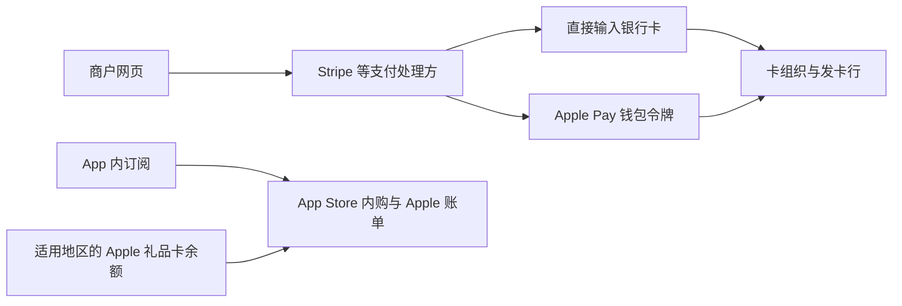

# 跨境数字服务接入

这件事更准确的目标是：**人在中国，也能在自身具备服务资格的前提下，稳定使用海外数字服务，并长期保有账户、支付与恢复能力。**“全球身份”容易把网络位置、账户地区、居住身份和支付能力混在一起；它们需要分别建立，不能靠一个海外 IP 一并获得。

本文结合个人接入情况与公开资料整理，资料核验于 **2026-10-29—31**。主要依据：[Claude Code 网络配置](https://code.claude.com/docs/en/network-config)、[Claude 身份验证](https://support.claude.com/en/articles/14328960-identity-verification-on-claude)、[Stripe Apple Pay](https://docs.stripe.com/apple-pay)、[Cloudflare 邮件路由](https://developers.cloudflare.com/email-service/get-started/route-emails/)、[Wise 发卡地区](https://wise.com/help/articles/2968915/can-i-get-the-wise-card-in-my-country)。个人最新实测：已用中国身份开通 Gate AI Elite，并完成 Apple 账号转美区；C2C 买入报价为 ¥6.8/USDT，实际订阅扣款与续费尚未确认。其余配置仍是待填入本人参数的实施模板，不能当作已经接入。网络细节与可复制配置见[通信与网络](./通信与网络.md#多客户端代理dns-与-vpn-共存)。

## 推荐尝试路径：先接入模型，再决定基础设施投入

先维持已经可用的工作渠道，再用有限预算探索更便宜或更稳定的供给。订阅、邮箱、卡、设备和网络可以分别建设，不必等“全球账户体系”全部完成才开始使用模型。

| 顺序 | 本轮解决什么 | 完成后再增加什么 |
| --- | --- | --- |
| 短期：今天至本周 | 三份日区 $200 全部续费；Gate AI Elite 与 Apple 美区改区已完成，新增订阅仍按 $200 起步 | 比较 Gate 直付、本人 Visa、正规礼品卡的同笔账单总价，再验证扣款与权益；$500 留作后续选项 |
| 中期：未来 1–2 周 | 自己控制的 Google 账号先开一份目标 Ultra，再尝试第二个入口；Claude 独立选型 | 比较实际可用量、总费用与续费；远程执行有需求再短租 VPS |
| 长期：未来 1–3 个月 | 按真实任务保留主用和备用；有长期支付缺口再办香港账户 | 自有域名、长期 VPS、额外订阅份数按实际收益投入，维护可迁移的工作状态 |

需要的不是抽象的“更多 token”，而是**特定模型、在需要的客户端里、以可接受成本完成更多任务**。例如 Google Ultra 的 Gemini 权益不能直接填进 Codex；一个便宜的 API Key 也不自动包含网页或桌面产品的权益。下面先分清这些资源，再讨论购买与维护。

### 当前起点：已有资源、遇到的问题与尝试范围

以下是 **截至 2026-10-31 的个人情况和执行计划**，用于以后与 AI 接续。状态按当时记录；“计划办理”“待尝试”均不代表已经完成。本文同时保存知识、计划和待填的验证记录，后续直接在这里更新。

| 环节 | 当前情况 | 对执行顺序的影响 |
| --- | --- | --- |
| 日本 Apple 账号 | 此前记录一个受限、两个可正常购买；当前明确共有三份日区 $200 GPT 订阅，全部继续续费 | 维持三份订阅的充值和续费，受限购买账号的恢复状态另查；不迁移或取消旧订阅 |
| 受限账号 | 客服要求申请后等 72 小时，未保证恢复 | 单独跟进支持工单，不再靠给它充值尝试解限 |
| 近期额度需求 | 三份日区 $200 仍不够用；原拟日区升级，因 $200 档 ¥30,000、$500 档 ¥84,000 改为美区新增；先前考虑 $500，现暂定 $200 起步 | 这是额外购买，不是用新订阅替换旧订阅；不再通过闲鱼充值 |
| 美区购买路径 | 原拟独立 Apple 账号、网页改区、招行卡绑定；现已用 Gate AI Elite 完成转美区 | 改区不再列为待办；下一步核对目标订阅、税后账单和实际扣款来源，招行与礼品卡保留为成本备选 |
| Google 账号 | 旧账号换日本地区时，手机验证没有通过 | 保留既有会话和恢复方式，不把主账号改区作为所有尝试的前提 |
| 本人银行卡 | 此前计划办招行 Visa；最新补充已有 Visa，具体发卡行、发卡地及是否就是新办招行卡尚未确认 | 优先核验已有卡；Visa 是卡组织，不能仅凭标识推断发卡地区、买币受理或境外订阅成功 |
| 当前资金 | 起点为大陆信用卡/储蓄卡及 Visa；现已接触 C2C，买入 1 USDT 报价 ¥6.8，感受是偏贵 | 买入报价、已成交数量、净到账与卡充值分开；尚无足够订单数据计算实际全链成本，不推定已经完成大额入金 |
| Android 手机 | 豆包手机计划这周到，准备使用 Google Play | 先核对具体型号、GMS 和 Play Protect 认证，再登录和付款 |
| 网络 | 已有 Veee，可选土区 IP；考虑美国 VPS | 日区已有工作路径先保留；土区订阅与美国远程执行分开验证 |
| 香港账户 | 可以专程赴港申请本人银行账户和卡 | 作为长期支付建设，排在本次选定订阅与付款路线之后 |
| U 卡与稳定币 | 已以中国身份开通 **Gate AI Elite**，并完成 Apple 美区改区 | 从选卡转入成本、实际扣款和续费验证；不为相同用途继续开第二张卡或购买地址文件，保留当次适用协议与费用 |

最初咨询建议土区 Apple Store、低价 Google 账号、Visa/U 卡购买礼品卡，再从 YouTube、Drive、Gemini 等入口给同一 Google 账号购买多份 5x，并可尝试土区 GPT、美国 VPS 上使用 Claude。当前确定 **GPT 保留三份日区 $200，美区暂按先开 $200、需要时再评估 $500**；土区 Google 的多入口叠加仍按可行的经验假设规划，继续补齐菜单、套餐和续费细节。Gate 开卡与 Apple 改区已完成，Google 叠加、模型订阅实际扣款及返利资格仍分别验证。

### 短期：今天到本周，先维持工作，再补基础工具

完成条件是：**三份日区订阅照常续费，第四个独立 ChatGPT 账号获得新增额度，账单与恢复关系清楚。**不等待旧订阅到期，不将旧账号改区，也不再升级日区 ¥84,000 档。按每份日区 ¥30,000 估算，既有月费约 ¥90,000；新增暂按 $200 及附加费单独预算，实际以美区内购确认页为准。

1. **维持旧三份，准备新账号。**用 `GPT-JP-A/B/C` 记录三份服务与扣款账号，保留续费和日区余额安排；受限 Apple 账号继续独立恢复。新增 `GPT-US-D` 与 `Apple-US-purchase`，不要在原三份服务账号里尝试购买第四份。各账号额度独立，新增容量不等于合并为一个额度池。
2. **保留已完成的开卡和改区结果。**Gate AI Elite 已用中国身份开通，Apple 转美区已成功，不重新注册或反复改区。保留账号归属、恢复方式及当次适用资料；原拟招行绑定路线仍是备选，不能由 Gate 的成功推定招行也已受理。可复用步骤见[美区 Apple 接入](#美区-apple-账号与礼品卡按账单路线建立)。
3. **先比较同一笔账单，再选择充值方式。**在官方 ChatGPT App 登录 `GPT-US-D`，核对 $200 档位、税后应付额和续费价。将 Gate 的 ¥6.8/USDT 买入价加上充值/兑换费，与本人 Visa 实际人民币结算价、正规美区礼品卡的总购买价比较。仅在礼品卡路线确有优势且商户受理后，先小额验证交付/兑换，再补足一笔账单；不为未来 $500 档囤余额，也不挪日区续费资金。详见[C2C 与全链成本](#c2c-报价与支付总成本68-究竟贵在哪里)。
4. **验证扣款与权益。**Gate 完成 Apple 改区，与 Gate 能付目标内购、Apple 余额能付目标内购分别记录。余额不足时 Apple 可能尝试银行卡，因此备用卡不保证永不扣款。付款后核对 Apple 收据、卡/余额明细、ChatGPT 档位及 Codex 用量；有授权但没有权益时先查订单，不重复下单。美元网页付款保留为备选。
5. **本周核验已有 Visa、手机与首次续费安排。**确认 Visa 发卡行/发卡地、境外线上支付、3DS、周期扣款和费用，再决定是否仍需新办招行卡。手机按“型号/系统 → GMS → Play Protect 认证 → Google 登录 → App 安装更新 → 套餐界面”验收。Gate 已有实际用途，Infini 等新卡暂不扩展；先留下足够完成一笔目标支付的必要资金，核对退出费用与续费日。见[Google 账号与 Android](#google-账号与-android先验设备再迁移重要用途)和[招行 Visa 与 U 卡](#招行-visa-与-u-卡比较整条支付链的完成时间)。

向银行可以直接这样问：

> 我主要做本人境外线上订阅及电子礼品卡消费，想申请我有资格办理的 Visa。具体是哪款、核卡后可否在实体卡到手前使用数字卡？激活是否必须面签或收卡？境外线上支付、3DS 和周期扣款如何开通？年费、外币转人民币和退款怎样计算？

### 中期：未来 1–2 周，取得可重复使用的第二路额度

完成条件是：**至少跑通一个新模型渠道，知道它能完成哪些工作、花多少钱、额度怎样恢复；若试叠加，能复现第二份权益与账单关系。**时间只是安排节奏，不是开卡或账户恢复的保证。

1. **先把土区流程的前提拆开。**Apple 注册不要求先买 Gmail，iOS 内购不要求先有 Android，Google Play 改区也不等于 Apple 商店改区。向相关人士补齐成功路径里的 App、菜单、Apple/Google 两层地区和家庭组/旧订阅条件，不把“土区 IP”当作这些设置已经完成。
2. **准备一个可持续控制的 Google 账号，先买一份 Ultra 5x。**优先自己持有的账号；若选择咨询中提到的 RMB 6–8 购入号，只承载可丢失的实验权益，修改密码、检查设备/第三方访问、更新恢复方式、启用 MFA。绑定 2FA 不能保证以后不弹验证码，也不能证明原恢复通道立即失效。记录首期与续费价、礼品卡溢价，确认 Gemini 与 Antigravity 的实际权益。
3. **正常使用后，再从第二个 App 追加。**若界面提供自动超额消耗选项，先关闭不需要的部分；用长文/代码阅读、小修复并测试、一次长程任务观察第一份用量。从指定入口给同一个 Google 账号买第二份，核对具体资源增量、刷新和取消关系。不要把额度自然刷新误认为叠加，也不拿云盘或 YouTube 权益增加代替模型额度验证。详细步骤和记录表见[土区与多入口叠加](#土区与多入口叠加按可执行试验推进)。第二份确实有用再考虑第三份。
4. **单独试 Claude 与远程执行。**按原生订阅、产品集成或网关确定渠道，再决定是否短租美国 VPS。远程编程优先 Linux、公钥 SSH、独立用户、`tmux`、公开仓库，不需要 GPU；用一次短任务和一次长任务验证连接、重连、资源和费用。报价与步骤见[美国 VPS](#美国-vps远程执行环境怎样试)。若已有网关直连稳定，则先按[Claude 小额试用](#从模型渠道开始的小额试用)跑通，不把 VPS 变成额外前提。

测试期间记录目标模型/渠道、401/403/429/断流、延迟、真实任务完成量、费用、额度重置和退出路径。七天是观察窗口，不是防封合格线。GPT 集中验证美元网页或美区 IAP；土区暂只服务 Google 试验，不再同时维护第三条 GPT 购买路线。

### 长期：未来 1–3 个月，留下值得续费的组合

1. **保留既定续费，衡量新增供给。**三份日区 $200 全部续费；先观察新增美区 $200 的实际完成量、限流及充值维护成本，随后验证续费。若仍不够用，再比较 $500 的新增额度、当次升级应付额与续费价；不预设必须升级，也不把差额直接算成 $300。Codex 主力开发，Google 分担有优势的任务，Claude 保留明确有价值的场景。Google 第一份经常不足、第二份确有增量时再加份数。地区定价、支付费用和返利分别核算，返利只按已结算、可兑现的净额记录；不自行把既有三份改成待取消项。
2. **有持续支付缺口，再安排香港开户。**候选保留 HSBC One + Mastercard Debit；出发前确认非 HKID 的预约分行、本人证件、入境/真实地址与税务材料、卡种和收卡方式。把低余额费、资金占用和旅费算进去。具体官方入口与费用见[赴港开户步骤](#可赴港时hsbc-one--mastercard-debit)。香港卡提升支付能力，不自动补足 Claude 地区资格；已有 Visa 足够时不必为了工具齐全再开户。
3. **把恢复与迁移做扎实。**现有主邮箱、MFA 和独立恢复备份先维护好；需要别名与迁移控制时再增加自有域名。VPS 确实提高工作体验后才长期续费，按实际内存、构建负载和账单扩容。保留仓库 revision、任务状态、配置与补丁，域名/DNS/邮箱避免相互依赖的找回死循环。

每个渠道长期维护一条记录：**月费及附加费、模型与客户端、实际完成任务、额度恢复/限流、故障恢复耗时、续费和退出入口**。三份日区与新增账号分别记账；多个同供应商账号增加容量，但不能代替跨供应商备用渠道。本人掌握付款与恢复方式，工作状态保持可迁移。

### 下一次接续：记录已经做到哪一步

| 事项 | 当前状态 | 下一次补充的非秘密信息 |
| --- | --- | --- |
| 三份日区 Codex | 三份 $200 全部继续续费，不升级 ¥84,000 档 | 三个账号别名、日区余额、续费日、受限购买账号恢复状态 |
| 新增美区 Codex | Apple 转美区已成功，订阅仍按独立 ChatGPT 账号、$200 起步；购买结果尚未反馈 | 实际 SKU、税后总价、Gate/Visa/礼品卡账单成本、付款来源及权益 |
| Gate Card | **AI Elite 已用中国身份开通，并用于完成 Apple 转美区**；个人反馈，未由助手登录复验 | 当次服务实体/适用协议、实际充值费、扣款与退款、续费及返现；不再记作待开卡 |
| Infini Lite | 待核验备选，未认证或开卡；L1 支持卡片但不支持法币入金，尚不能解决大陆银行卡里的钱如何进入 | 本人真实资料适用性、另行成立的资金入口、Lite 开放情况、费用、余额赎回/提币 |
| ether.fi × MEXC | 已查普通 3% 条件；联名额外返利结束，礼品卡排除，大陆未列入发卡地区 | 是否存在符合本人真实居住情况的资格；不先入金，返利暂按 0 计 |
| Visa | 最新补充已有，具体卡片情况待核；不据此认定原定招行新卡已获批 | 发卡行/发卡地、卡产品、激活状态、线上支付与实际支付结果 |
| Android | 计划到手后验证 | 型号、系统、GMS/认证、登录及应用安装结果 |
| USDT / C2C | 买入报价已确认为 **¥6.8/USDT**；尚未提供成交金额、净到账和完整费用 | 同时段比较基准、人民币实付、USDT 净到账、Gate 入卡美元数、必要费用与已兑现返现 |
| 土区 Google 第一份/第二份 | 按可叠加假设准备流程，尚未实测 | 两个 App/菜单/SKU、地区条件、额度变化、续费和取消关系 |
| Claude / VPS | 已有候选与方案，尚未开通验收 | 实际渠道、模型、配置版本、任务与费用、失败和恢复记录 |
| 香港账户 / 自有域名 | 按长期需要选择 | 是否仍有支付/恢复缺口，值得投入的费用与维护工作 |

遇到失败，记时间、入口、脱敏报错、扣款/权益状态，以及下一步要查哪一层。支付凭据、礼品卡码、验证码、恢复码和私钥由本人保存，表中只记别名与结果。后文的[实施单](#与-ai-真正开始接入执行顺序与验收)用于把选定路线交给 AI 继续处理。

## 先拆清楚：究竟缺哪一种能力

| 属性 | 实际决定什么 | 不能替代什么 |
| --- | --- | --- |
| 国籍、证件签发地 | 用什么身份文件证明“我是谁” | 当前所在地、居住地、税务居民身份 |
| 实际所在地 | 服务是否允许在这里使用、当地网络是否可达 | 不能用出口 IP 的国家代替 |
| 居住地、地址证明 | 银行、卡与部分账户的开户资格 | 旅游、收件地址或一张外国银行卡不自动构成居住资格 |
| 税务居民身份 | 金融账户申报、税务义务 | 不等于国籍，也不由账单地址随意决定 |
| 账户地区、商店地区 | 商品目录、订阅价格、支付方式 | 不等于设备语言和时区 |
| 发卡地区、卡类型、账单地址 | 商户是否受理、3DS 验证与扣款 | 钱包绑卡成功不等于目标商户会扣款成功 |
| 电话与邮箱 | 验证、通知、找回与长期控制权 | 海外号码不等于海外居民；自有域名不保证更高风控评分 |
| 网络出口、DNS 与客户端环境 | 请求能否抵达、从哪里出去、如何排障 | 身份验证、服务许可、支付资格 |

服务接入是多个条件的交集。先回答“我要用什么产品、以什么身份、从哪里使用”，再决定缺邮箱、支付、网络还是资格；不要先买齐一套工具，再发现关键产品根本不向自己的使用情形开放。

一个常见分岔是 **Claude 网页/桌面订阅、Claude Code 与 API**：它们有关联，但额度、认证与计费入口不能混用。订阅不是通用 API 余额；Claude Code 可以使用官方支持的订阅登录或相应 Provider 路径，具体按产品说明核对。接入第三方云平台也要分别核对该平台和模型供应方的适用条件，不能推断“换成云 API 就绕过了地区限制”。相关产品边界见 [BYOK](./AI-Agent-Product&PE.md#byok模型接入的身份计费与数据边界)。

**当前接入与未来条款要分开。**[2026-03-16 的官方帮助页](https://support.claude.com/en/articles/8461763-where-can-i-access-claude)所列支持地区不含中国大陆和香港；[付款拒绝说明](https://support.claude.com/en/articles/9402418-why-was-my-card-declined)另要求账单地址与银行卡 origin country 属于支持地区，并与发卡行记录匹配。因此，“本人香港卡 + 香港出口”不能直接构成 Claude 原生服务的完整接入方案。

本次打开的 [Anthropic Supported Regions Policy](https://www.anthropic.com/legal/supported-regions)标注 **2026-11-12 生效**，晚于核验日；其中明确区分实际所在地、实体注册/总部及控制关系，也涉及经第三方提供的模型。不能把未来版本冒充已经生效的版本。真正操作前，应保存当时适用的规则与生效日期；网络调通不能补足资格，旧教程成功记录也不能代替现行说明。

## 订阅与额度：先确认买的是什么

### Codex Pro：先看最新额度，再决定升级或补 credits

[OpenAI 当前 Pro 说明](https://help.openai.com/en/articles/9793128-about-chatgpt-pro-tiers)在 2026-10-30 核验时列出 **Pro 100 / 200 / 500，分别为 $100 / $200 / $500 每月**。这是美元公开价格，不是日本 App Store 的含税成交价；“50x”等倍数称呼应与实际 SKU、当前权益对应，不能仅按倍数推算价格或 token 数。

本次更新中，Pro 100 和 Pro 500 的 Work/Codex 额度翻倍；Pro 200 原较低额度翻倍至原较高额度，已经持有较高额度的保持不变。现有订阅自动生效，不需要等续费或取消重买。**准备加钱前，先打开 ChatGPT `Settings → Usage` 或 Codex `Usage & Billing`，确认自己是否已经获得新额度。**CLI 可用 `/status` 查看当前会话信息与可用额度。

还有三个会改变购买决策的因素：

- **订阅额度、额外 credits、API 账单分开。**Plus/Pro 的合资格功能可在额度用尽后消耗额外 credits，是否可买及如何付款看账户界面；不能预设 Apple 礼品卡余额能支付网页 credits，更不能把 API 充值当作订阅充值。
- **速度会改变消耗率。**[当前价格页](https://learn.chatgpt.com/docs/pricing)列出：同模型 Standard 为基准，Fast 消耗订阅额度为 2.5 倍，Ultrafast 为 8 倍；使用购买的 credits 时分别为 2 倍、6 倍。这不是任务速度保证。只缺总工作量时，先确认有没有为不需要的速度多付额度；Pro 500 的 Ultrafast 资格也不等于应始终开启。
- **倍数不是完成任务数。**模型、上下文、推理、缓存、工具和图像都会影响消耗；当前 Pro 没有五小时限制，但仍可能有周限额。用自己的真实任务和用量页比较，不用 API 单价倒算订阅里的固定 token 包。

升级前依次记录：当前 ChatGPT 账号、实际扣款平台及 Apple 账号、目标 SKU、今天应付额、续费金额与日期。iOS 内购在 Apple 管理取消与退款。若能购买的 Apple 账号与原订阅扣款账号不同，先查订阅归属和可用的迁移/升级路径；另一账号的余额不能自动支付原订阅，勿先充值再处理绑定。

### 日区与美区：价格差异和增量订阅

2026-10-30 实际看到的日区 iPhone 报价如下；这是个人提供的购买页价格，尚未由本次登录结账复验。[美元官方价格](https://learn.chatgpt.com/docs/pricing)确认 Pro 有 $100 / $200 / $500，但不能直接当作美区 IAP 的税后金额。

| 对应美元档位 | 日区报价 | 隐含换算 | 说明 |
| --- | --- | --- | --- |
| $200 | ¥30,000 | ¥150/$ | 当前三份全部续费，维持既有供给 |
| $500 | ¥84,000 | ¥168/$ | 比上一档的换算贵 12%；按 ¥150/$ 应为 ¥75,000，相差 ¥9,000 |

从 $200 升至 $500，美元标价增为 2.5 倍，日区账单却增为 2.8 倍；新增 $300 档位对应多付 ¥54,000，边际换算为 ¥180/$。这支持**暂停日区高档升级**，不自动意味着日区 $200 档也该停掉，更不意味着美区必然便宜 12%。

当前新增美区订阅与三份日区长期并存，并非短期重叠或升级差额。比较新供给时，将税、礼品卡溢价、换汇/买币价差、提币费、开卡费统一换成本人实际支付的同一种货币；三份日区作为原有预算另记。返利先按 0 预算，确认合资格且可兑现后再抵减。

例如纯为说明计算，假设 $1 = ¥155、美区商品 $500、适用税率 8%、礼品卡溢价 2%，则成本是 $500 × 1.08 × 1.02 × 155 = **¥85,374**，反而高于 ¥84,000。这里的汇率、税率都是假设；实际税费按真实账单资料与确认页，不把任意“免税州地址”当作省钱配置。

美元路线再分两种：

| 路线 | 需要什么 | 优先判断 |
| --- | --- | --- |
| ChatGPT 网页订阅 | 服务与支付资格、网页提供的币种/档位、可用本人卡 | 不需要 Apple 账号和礼品卡；作为新账号的备选付款路线，国内 Visa 的具体受理待核验 |
| 美区 App Store 内购 | 相应 Apple 商店账号、App 中实际提供的档位、可用付款方式/美区余额 | Gate AI Elite 与转美区已完成；比较直接扣卡和礼品卡余额路线，先核对 $200 IAP 最终报价，$500 留作后续比较 |

**账号职责仍要分开，但当前确实需要独立新增服务账号。**Apple 账号决定商店和扣款，ChatGPT 账号承载服务身份。三份日区继续存在，第四份由新 ChatGPT 账号承载，不将新购买附到旧账号，也不自动合并历史、项目、记忆和剩余额度。

若未来另做订阅迁移，再核对旧账期、取消与解绑定条件；不能预设换 Apple 登录即可迁移，退出登录也不等于取消。这些是通用知识，不是当前计划。

当前顺序是：**新 Apple 账号注册 → 网页改区和招行卡绑定验证 → 新 ChatGPT 账号确认美区商品 → 礼品卡支付 → 验证新增额度**。网页直付保留为备选，GPT 暂停土区探索，以减少尚未验证的组合；没有证据证明美区新账号天然更不容易受限。

### Google Ultra：5x、AI credits 与 API 是不同的资源

[Google 官方说明](https://support.google.com/googleone/answer/16286513?hl=en)确认，Ultra 按档位提供相对 AI Pro 的 **5x 或 20x Gemini / Antigravity 使用额度**，并包含 20 TB 或 30 TB 等权益。各产品、功能、模型仍有各自限制，不能理解为一个可以到处提取的通用 token 钱包。

| 资源 | 看哪里、怎么使用 | 不应混淆 |
| --- | --- | --- |
| Gemini / Antigravity 基础 quota | 各产品用量或模型选择界面，按对应窗口恢复 | 不一定与 Flow 的 credits 同步，也不是无限调用 |
| Google AI credits | Google One 的 AI credit activity；支持的 Flow / Antigravity 功能消耗 | 不等于 Google Cloud / Gemini API 余额 |
| 存储、YouTube 与其他权益 | Google One 权益页及各产品的激活状态 | 云盘容量增加，不能证明模型额度也增加 |
| API / Cloud 账单 | 对应 API Key、项目、额度与账单 | AI Ultra 包含 AI Studio 等权益，也不能推断所有 API 调用免费 |

[AI credits 的当前规则](https://support.google.com/googleone/answer/16287445?hl=en)有一项容易被低价攻略省略：**通过 Apple billing、第三方或 Pixel Pass 订阅的 Google One 会员，不能购买额外 AI credits**；Flow 与 Antigravity 的 AI credits 可用地区还明确排除日本。因此，便宜的 Apple 订阅可能足够满足基础额度，却不适合希望随时加购 credits 的用法。选地区与付款渠道时，要一起比较价格和后续扩容能力。

Google 文档另明确支持一种资源合并：同时有个人与家庭会员时，AI credits 可以合并个人和家庭分配量，分别有刷新时间。这与从多个 App 购买同档订阅是不同机制，不能互相拿来作证明。

### 土区与多入口叠加：按可执行试验推进

[土耳其官方套餐页](https://one.google.com/intl/tr_tr/about/google-ai-plans/)已列出 Ultra 5x / 20x；本次未取到可确认的 TRY 结账价格。公开社区[2026-10-29 的一则 X 帖子](https://x.com/xiax0603/status/2115819754904817718)报告土区 Ultra 5x 总价不到人民币 300 元，但没有足够付款明细来解释渠道、汇率与续费口径；其“约等于 1.5–2 个 Claude Pro”是使用体感，不能当作跨模型额度换算表。

多入口路线采用的**工作假设**是：同一 Google 账号可经不同 App 的订阅入口，累加多份同档 5x 权益。下面据此设计试验；它不是本次已经复现、也不是已查到的官方保证。关键是把“可叠加”落实到具体资源与账单，不必等找到公开教程才尝试，也不一次买齐所有入口。

1. **先确定工作负载。**主要需要 Gemini 交互，还是 Antigravity 编程？选三类实际任务：长文/代码阅读、一次修改并跑测试、一次较长连续任务；固定模型与设置，记录耗用和完成情况。
2. **准备自己能控制的 Google 账号与明确的账单环境。**Apple 商店地区、Google 账号/Payments、Play 地区与网络出口分别记录；不要把“土区 Apple 内购”误操作成“必须先改 Google Play 地区”。土区 IP 是网络条件，不会自动设置另三项。
3. **只买第一份 5x。**按已确认的教程入口登录目标 Google 账号，读取商品名、周期、价格和原价续费说明；付款后核对 Apple 订单、Google One 会员，以及 Gemini / Antigravity 的实际权益。先跑一次正常任务。
4. **从第二个指定 App 再购买一份。**每次都核对 App 内 Google 账号一致，记录两份 Apple 订阅/订单以及购买前后的 quota、credits、刷新时间。不要仅凭第二笔扣款或套餐仍显示 Ultra 就判断叠加失败/成功；界面可能不直接显示总额，必要时观察正常使用跨过原限制后的行为。
5. **确认独立续费和取消关系。**第二份生效后再决定是否加第三份；取消实验中的续费前，确认保留哪个订阅，以及取消一份会否影响另一份。观察到一次生效，只能支持当前组合，不能自动证明后续续费或平台调整后的行为。

需要从可复现教程中取到的最小信息：**具体 App 与菜单路径、两层账号地区、套餐 SKU、叠加的是哪项额度、两份刷新/续费时间、取消行为**。YouTube、Drive、Gemini 的名称只是入口线索；普通 YouTube Premium 订阅本身不能直接当成 Ultra 5x。

后续咨询可以直接这样问：

> 我准备先买一份土区 Ultra 5x，再用第二个 App 给同一 Google 账号叠加。你成功的两个 App、具体菜单和套餐名分别是什么？Apple 与 Google 的地区要怎样配，是否真的需要改 Play 地区？增加的是 Gemini/Antigravity quota，还是 AI credits？两份怎样续费，取消其中一份会不会影响另一份？如果有脱敏的前后额度和订阅页，我按这个顺序复现。

每次只增加一个购买入口，并保留下面的前后记录。quota 界面如果只显示百分比，两次都显示 100% 并不能说明总额度没有变；结合窗口、实际任务与限流观察，避免将自然刷新或延迟到账归因于叠加。

| 记录字段 | 第一份 | 第二份 | 第三份（需要时再买） |
| --- | --- | --- | --- |
| App / 菜单路径 / SKU | 待填 | 待填 | 待填 |
| Apple 账号别名 / Google 账号别名 | 待填 | 与第一份核对 | 与第一份核对 |
| 今日价格 / 下期价格 / 付款渠道 | 待填 | 待填 | 待填 |
| 订单别名 / 生效和续费时间 | 待填 | 待填 | 待填 |
| Gemini quota / 窗口 | 待填 | 前后变化 | 前后变化 |
| Antigravity quota / 可用模型 / 窗口 | 待填 | 前后变化 | 前后变化 |
| AI credits / 刷新时间 | 待填 | 前后变化 | 前后变化 |
| 正常任务完成量 / 限流 | 待填 | 待填 | 待填 |
| 取消一份对其他权益的影响 | 待确认 | 待确认 | 待确认 |

普通流程中，[Google 将 Gmail、Drive、Photos 等视为 Google One 的购买入口](https://support.google.com/googleone/answer/9003707?hl=en)，换档存储不直接相加；[订阅管理说明](https://support.google.com/googleone/answer/9003633?hl=en)还要求回到原购买 App 管理 Apple 账单，一个 Apple 账号在此订阅管理关系下只能关联一个 Google 账号。它们说明为什么要记录入口与归属，但并不足以否定上述特定叠加经验。

最后比较的是：多份 5x 的实际月费、汇率及礼品卡溢价，除以能完成的目标任务。若一份已足够就先用一份；若需要更多，再比较叠加与单份 20x。不要把首月优惠、不能使用的附送权益或尚未到账的额度算作长期节省。

## 建立自己的账户与恢复能力

### 邮箱：自有域名便于迁移，但收信与发信是两条链

一种轻量组合是：**自有域名 → Cloudflare Email Routing → 自己长期控制的主邮箱**。例如 `accounts@example.com` 用于注册，`billing@example.com` 接账单。以后更换主邮箱时可以调整转发目标，不必逐个更换对外地址。

[Cloudflare 当前入口](https://developers.cloudflare.com/email-service/get-started/route-emails/)是 `Compute → Email Service → Email Routing → Onboard Domain`，旧教程可能仍写 Email Routing 独立入口。

1. 选一个自己能持续续费的域名，核对首年和续费价格，给注册商账户启用 MFA 与续费提醒。
2. 按 Cloudflare 要求托管 DNS。**已有企业邮箱的域名先备份 DNS，不直接覆盖 MX**；更改 MX 会改变整个域名的收件去向，优先使用专用域名或按文档配置子域。
3. 添加并验证目标邮箱，再建立明确的别名转发规则。先不用 catch-all，避免任意拼写和垃圾邮件都进入主邮箱。
4. 按控制台设置 MX 与所需的 SPF/DKIM 记录；已有 SPF 应合并授权，不能给同一名称堆多个互相独立的 SPF 记录。不要复制旧截图中的 DNS 值。
5. 从**另一个发件邮箱**发送测试信，检查投递活动、主邮箱收件箱和垃圾邮件；不要只从转发目标给自己发，部分邮箱可能丢弃这种回环邮件。官方给出的典型 DNS 生效时间为 5–15 分钟，最长可能 24 小时。
6. 再验证真实服务的验证码、账单与找回邮件。收普通信成功，不代表特定发信域的邮件已正常投递。

可让 AI 协助核对公开 DNS，不需要提供邮箱密码：

```bash
dig MX example.com +short
dig TXT example.com +short
```

Email Routing 主要解决收件转发；以自有域名发送邮件，需要另行配置发送服务、身份认证与发件策略。Cloudflare 现有 Email Sending 产品仍应按当时状态与[价格页](https://developers.cloudflare.com/email-service/platform/pricing/)核对。直接从主邮箱回复，可能显示主邮箱地址，不能自动视为从域名别名回复。

核验时，普通入站 Routing 在 Workers Free/Paid 都可用，价格表列为不限入站数量；发送给账户内已验证目标地址免费，向任意收件人发送需要 Workers Paid，包含每月 3,000 封，超出部分 $0.35/千封。这个额度不包含域名续费，也不能代替 Workers 套餐及执行用量的费用核算。

这一组合改善的是地址控制与迁移能力，**没有证据证明“自定义域名一定比 Gmail 更不容易封号”**。依赖也从一个邮箱增加为注册商、DNS、转发和主邮箱，应保留独立恢复方式，避免“找回注册商必须收这个域名的邮件”的循环依赖。

### 手机号、MFA 与身份验证

先确认服务是否真的要求海外手机号。能用现有长期号码、passkey 或 TOTP 完成的，不必为了“看起来全球化”增加一个易失效号码。

- **eSIM 是卡的载体，不是服务类型**：可能只有数据，也可能包含电话与短信。买之前核对是否有号码、能否在中国漫游接收短信、首次激活位置、设备兼容性、余额/保号规则以及目标服务是否接受该号段。旅行数据卡不能直接当短信接码卡。
- 若确需第二号码，选择可持续实名持有、能续费和找回的运营商方案。一次性接码只能解决一次输入，之后的登录、支付验证和账号找回仍会依赖原号码。
- 优先启用官方支持的 passkey/TOTP，恢复码放密码管理器及独立备份。换手机前完成迁移和恢复验证，不能只确认旧设备还能登录。

[Claude 的 Persona 验证说明](https://support.claude.com/en/articles/14328960-identity-verification-on-claude)要求本人持有效政府签发的实体带照片证件，可能需要实时自拍；接受多数国家的证件，不接受扫描件、截图和翻拍照片。**接受某国护照是在验证身份，不等于允许在该国使用服务**，也不保证验证后账户永不受限。

核验时，AI 可以解释字段和报错，证件、自拍、密码、验证码及恢复码由本人在官方界面操作。金融账户可能另要求真实地址证明、税务信息和资金来源；每家的可接受文件类型与时效不同，准备官方支持的本人文件，不照抄教程的地址样例。

### Google 账号与 Android：先验设备，再迁移重要用途

**注册 Apple 账号不要求先买一个 Gmail。**[Apple 的创建流程](https://support.apple.com/en-us/108647)要求可验证的邮箱及必要电话等信息；选择自己能长期收信和恢复的邮箱即可。买 Google 账号解决的是一个现成 Google 登录身份，不是 Apple 注册的必经步骤。

低价买号后改密码、绑 TOTP，只能改善当前控制，不能证明原有恢复通道与历史风险全部消失。[Google 明确提示](https://support.google.com/accounts/answer/183723?hl=en)，修改恢复信息或其他认证因素后，仍可能在 7 天内向原信息发送验证码。这个“7 天”也不是过后必然安全的保证。若用购入账号验证套餐，先只承载可丢失的测试权益，不放主邮箱恢复、重要 Drive 文件或其他账号的唯一找回方式；“绑了 2FA 就不会再弹手机验证”不能作为操作保证。

新 Android 手机到手，先检查 `Play 商店 → 头像 → 设置 → 关于 → Play Protect 认证`，再验证 Google 登录、App 安装更新与目标应用。**Android 系统不等于预装 GMS，更不等于 Play Protect 已认证。**[Google 的说明](https://support.google.com/googleplay/answer/7165974?hl=en)指出，关闭 Play Protect 不能修复设备未认证；设备不符合时先找厂商核对，不默认通过 root 或刷机来建立重要账号环境。

若确实要切 Google Play 地区，[当前规则](https://support.google.com/googleplay/answer/7431675?hl=zh-Hans)要求身处新地区且有当地可用支付方式；首次设置及每次切换后通常需等 90 天，家庭组等条件还会限制切换。旧余额不能在新区消费，原订阅也可能继续关联旧付款资料，更新最多可能需要 48 小时。已有手机验证失败时，保留原可用会话，按官方验证/恢复流程处理，不能把频繁切 IP 当作恢复方案。

## 支付：先核对资格，再选择通道

### 三种“用 Apple 付款”不能混为一谈



| 路径 | 实际发生什么 | 操作时核对 |
| --- | --- | --- |
| 商户网页输入卡号 | 商户/支付处理方向发卡行请求授权 | 发卡地区、卡类型、线上与跨境开关、3DS、余额、账单地址 |
| 商户网页 Apple Pay | 钱包提供卡令牌，商户仍可由 Stripe 处理付款 | 设备/浏览器与商户是否支持、发卡行能否绑卡、所选卡及账单信息 |
| App Store 内购 | Apple 处理对应应用内的订阅账单 | 当前商店有无该档位、Apple 账户地区、余额/支付方式、取消与退款入口 |

[Stripe 文档](https://docs.stripe.com/apple-pay)直接展示 Apple Pay 的接入和订阅支付：**Apple Pay 不等于绕过 Stripe，也不等于 App Store 内购。**它可能改变认证体验与卡信息传递形式，不能由此推断必然降低拒付或账户风险。

Apple 礼品卡用于相应 Apple 消费体系，并非任意网站都能刷的国际卡。[礼品卡官方说明](https://support.apple.com/en-us/108285)要求兑换地区匹配；[切换账户地区](https://support.apple.com/en-us/118283)还可能需要清余额、结束阻碍切区的订阅、等待退款并提供新地区有效支付方式。先确认商品、档位和账户条件，再购买礼品卡，不先囤余额赌能用。

### 3DS：网上刷卡时的持卡人认证

**3DS（3-D Secure）用于确认“现在付款的人是否是合法持卡人”。**例如用 Visa 买礼品卡，输入卡号后，银行可能要求短信验证码或银行 App 确认，再返回商户继续支付。Visa 的品牌名是 **Visa Secure**，Mastercard 的是 **Identity Check**；它不是卡背面的 CVV 安全码。

- **有感验证（challenge）**：需要输入验证码、在银行 App 确认或完成生物识别。
- **无感验证（frictionless）**：银行根据交易、设备等信息完成认证，不额外弹窗。因此“没收到验证码”不等于没走 3DS。

**认证成功不等于扣款成功。**3DS 主要确认持卡人身份；发卡行之后仍可能因额度、支付限制或风控拒绝交易，商户也可能不接受该卡或地区。它更不保证服务账号不会被封。付款被拒（decline）与付款后发生的拒付争议（chargeback）也应分开判断。

办卡时问：“这张卡是否支持 Visa Secure / Mastercard Identity Check，是否需要开通，验证走短信还是银行 App？”确认预留手机号和 App 可用。若验证失败，先查认证环节；若验证已通过但扣款被拒，再查银行授权与商户限制。

来源：[Stripe 3DS 说明](https://docs.stripe.com/payments/3d-secure)、[认证流程](https://docs.stripe.com/payments/3d-secure/authentication-flow)。

### 美区 Apple 账号与礼品卡：按账单路线建立

只有选定美区 IAP 才需要这条路线。独立购买账号可避免改动仍有余额和订阅的日区账号，但不能替代服务资格：[Apple 媒体服务条款](https://www.apple.com/legal/internet-services/itunes/us/terms.html)将商店地区称为居住地区 Home Country；当前人在大陆，不能把“能选美国、能兑换美元卡”当作已经满足该要求。注册与付款使用真实资料，不照抄教程的地址；无法满足条件时继续比较适用于本人的付款渠道。

原拟经验路线是 **iPhone 注册独立新号 → 网页改美区 → 尝试招行卡绑定 → 礼品卡余额支付**。2026-10-31 的个人反馈确认：**以中国身份开通 Gate AI Elite，并完成 Apple 转美区**。这替代了“尚未改区”的旧状态；未补齐的具体注册入口、招行受理、目标订阅实际扣款与续费不推定成功。“先在手机注册更容易”仍只是经验假设。

1. **先在 iPhone 建立独立 Apple 账号。**按[官方创建流程](https://support.apple.com/en-us/108647)使用本人长期掌握的邮箱、手机号，完成验证与 MFA；无需先买 Gmail。只创建新号，不修改现有三份订阅所属账号。若所用入口要求退出整个 iCloud 主账号，改用 [account.apple.com](https://account.apple.com/) 注册作为备选，不为创建购买账号打断照片、备份和查找。改区前先不充值、开试用或加入家庭组。
2. **在网页改区，并验证具体卡片。**登录新号，进入 `Personal Information → Country/Region`，按[官方改区流程](https://support.apple.com/en-us/118283)设置目标地区及要求的支付资料；改区可能要求新地区有效付款方式，并非所有情形都一律要求信用卡。本次 Gate AI Elite 路线已成功；原拟招行 Visa 仍待单独验证。姓名/账单资料与发卡方记录保持一致，最后回 App Store 核对地区和美元商品，不把绑定、改区与实际扣款混为一项。本步骤供复用，现有账号不需重做。
3. **只切换“媒体与购买项目”，配独立新 ChatGPT 账号。**iPhone `设置 → 姓名 → 媒体与购买项目 → 退出登录 → 再点该项 → 不是…？`，登录新的购买账号；保留 iCloud 主账号。[Apple 官方页面](https://support.apple.com/en-us/117294)明确二者可不同。在官方 ChatGPT App 登录 `GPT-US-D`，先核对 $200 档位、税后应付额和续费额。若显示旧订阅，先检查是否登错服务账号，不在旧三份上重复购买。
4. **买对地区和类型，先验证一张小额卡。**优先 [Apple 美国官方电子礼品卡](https://www.apple.com/shop/buy-giftcard/giftcard)，本人可用卡或可信亲友从正规渠道代买，保留订单，自己兑换。选 Apple Gift Card / 可兑换的 App Store 卡，不买仅供硬件消费的旧 Apple Store Gift Card。美元美区卡不能充到日区账号。
5. **补足全额后购买，确认实际扣款来源。**`App Store → 头像 → Redeem Gift Card or Code`，兑换前再次核对购买账号；按含税总额补足一笔账单。小额兑换成功不保证大额订阅获批。付款后检查 Apple 收据、余额变化、银行流水、ChatGPT 档位及 Codex 用量，确认确实由余额支付且权益进入新账号。之后在每次续费前补足，不把绑定的卡理解为永远不会被扣款。

**这里有三种不同的“银行卡可用”，对 Gate 和招行都适用。**

| 用卡位置 | 谁处理这一步 | 能证明什么 |
| --- | --- | --- |
| 绑定美区 Apple 付款资料 | Apple 与发卡行 | 该卡在当前账号通过绑定/认证；不等于目标订阅一定能扣款 |
| 买美国 Apple 礼品卡 | Apple 零售网站或具体售卡商 | 该商户接受该笔购卡交易；不等于能绑美区 App Store |
| 直接付 ChatGPT / Google 网页订阅 | 对应服务的支付系统与发卡行 | 该服务、账号、账单资料和金额获准；不能推断另一个商户也接受 |

[美区 Apple 媒体付款列表](https://support.apple.com/en-us/111741)写有余额和多数信用/借记卡，没有保证所有中国发行 Visa 都能绑定。[添加付款方式说明](https://support.apple.com/en-us/118429)要求资料匹配银行记录，地区不同也可能需要处理。[Apple 美国零售支付说明](https://www.apple.com/shop/help/payments)虽然提及国际 Visa/Mastercard，但适用场景是零售网站购物，不能据此直接证明美区 App Store 绑招行卡可行。绑卡或更新资料可能出现[小额临时授权](https://support.apple.com/en-us/118244)，不是已买到订阅。

[Apple 扣款顺序](https://support.apple.com/en-us/118244)是先尝试用账户余额覆盖全额；没有余额或不足时尝试主付款方式，失败后再尝试其他方式。因此“卡用于建立有效付款资料、订阅主要花礼品卡余额”在机制上成立，但备用卡仍可能被扣款。[余额规则](https://support.apple.com/en-us/118245)另说明部分购买即使用余额也须留有银行卡。绑卡被拒时先处理卡和地区条件，不买大额礼品卡试图绕过尚未完成的账号设置。

对于“国内 Visa 能否付模型订阅”，按入口保留结论：[Claude 直付说明](https://support.claude.com/en/articles/9402418-why-was-my-card-declined)明确检查支持的账单地址与卡来源国；国内卡因发行地区受限，不是换成 Visa 标识就能解决。GPT/Gemini 能刷国内卡目前是待验证的经验线索，不能写成统一保证；[Google Play](https://support.google.com/googleplay/answer/2651410?hl=en&co=GENIE.CountryCode%3DUS)虽列 Visa，也明确受理随地区和卡而变，且 Play、Google 网页、Apple IAP 是不同渠道。经 Apple 余额买订阅时，由 Apple 处理该笔内购，服务方仍可能有账号与服务地区要求。

备选 [Bitrefill 美国 Apple 卡](https://www.bitrefill.com/us/en/gift-cards/apple-usa/)于本次读取时显示 **$500 面额售价 $510，$200 面额 $204，$10 面额 $10.50**；这是页面报价，支付/入金费用另算，未实测购买，也未核验其为 Apple 授权经销商。已交付卡码的[退款限制](https://help.bitrefill.com/hc/en-us/articles/360019310740-What-is-our-refund-policy)仍适用。已有其接受的加密资产时，可直接购卡，不必另办 U 卡；没有资产时不为这一条路先搭完整买币链。

### 日本 Apple 礼品卡：先确认归属，再补差额

这条路线保留给继续维持日区订阅、只是余额不足的情况；**当前已暂停用它升级 ¥84,000 档**。先打开 iPhone `设置 → Apple 账号 → 订阅`，确认目标订阅属于哪个 Apple 账号；再到 App Store 头像页看该账号可用余额，并在目标 App 中检查服务账号与升级确认页。App Store 的“媒体与购买项目”账号可能与 iCloud 主账号不同，需要核对实际扣款一侧。

先处理已有欠款或待结算订单，再用**升级确认页今天应付额减去可用余额**确定充值缺口。升级是即时扣款、按差额处理还是下期生效，以确认页为准，不用“新月费减旧月费”自行推算。留足页面明确列出的税费，不因为卡面额固定就充值多个月。

| 购买路径 | 适合什么情况 | 本次核验与限制 |
| --- | --- | --- |
| [Apple 日本官方电子礼品卡](https://www.apple.com/jp/shop/buy-giftcard/giftcard) | 已有可用支付工具；或可信亲友能用自己正常的付款方式代购卡码 | [支付说明](https://www.apple.com/jp/shop/help/payments)列有 Visa 等，但明确外国发行卡可能不被接受。官方可见 ¥3,000 / ¥5,000 / ¥10,000 等选项；当前可选面额以页面为准 |
| 可信亲友从正规渠道代买卡码 | 暂无合适卡、希望尽快补一次缺口 | 只交换卡码与订单凭证，不让对方登录自己的 Apple / ChatGPT；真实性取决于购买来源，而非认识对方就忽略凭证 |
| [Bitrefill 的日本 Apple 卡](https://www.bitrefill.com/jp/en/gift-cards/apple-japan/) | 已有该商家接受的付款工具/资产，愿意承担第三方交付风险 | 商家页面标注日本账号专用；当次显示 ¥1,000 约 $6.61、¥10,000 约 $64.86，仅为即时美元报价，付款费率另看结账页。没有实测购买，也未核验其为 Apple 授权经销商 |

Bitrefill 的[退款条款](https://help.bitrefill.com/hc/en-us/articles/360019310740-What-is-our-refund-policy)明确：**已成功交付的卡码不能退款**；30 天是合资格退款申请期限，不是无理由退货。已有相应加密资产且符合商家服务条件时，可直接购买卡码，不一定还需要经过 U 卡；没有资产、入金渠道与相关经验时，不为一笔小缺口临时搭起整条稳定币支付链。商家支持“cards”也不保证任意大陆卡都能受理。

购买商品应是可用于相应 Apple 账户/App Store 的日本卡。不要混淆旧式、仅用于硬件等消费的 **Apple Store Gift Card**。卡码来源不明、折扣异常大、必须远程登录账号的代充，不能仅凭“卖家包到账”判断成本更低。

兑换顺序：App Store 头像 → `兑换礼品卡或代码` → 确认目标 Apple 账号与余额到账 → 返回原服务账号内升级 → 同时核对 Apple 收据、服务档位和 Codex 实际用量页。首次第三方渠道可先用一张足以消费的小额卡验证；先别购买多张不可退款卡码。

若账户出现 Media & Purchases disabled，[Apple 官方处理](https://support.apple.com/en-us/108100)是申请重新激活/联系支持；额外充值不能解除限制。“等待 72 小时”可能是某次客服处置时间，不是所有限制都会在 72 小时自动恢复。付款失败后先查错误和待处理交易，不连续换卡重试。

### 银行卡、Wise 与稳定币卡怎样选

优先从**已经持有、本人能维护的支付工具**开始，核对目标商户要求。Visa/Mastercard 标识只说明卡网络，不保证跨境、订阅或特定商户受理；“境外卡”也不是一个资格与功能完全相同的产品。

| 选择 | 适用时机 | 必须核对的条件 |
| --- | --- | --- |
| 本人现有银行卡 | 商户支持且跨境线上支付可用 | 支持币种、3DS、国际支付与订阅权限、汇率/手续费、拒付原因 |
| 本人可依法申请的境外银行账户/卡 | 有长期跨境支付与资金管理需求 | 是否接受非居民、开户地点、证件、真实地址与税务资料、最低余额、维护费、邮寄和补卡 |
| Wise 等多币种账户 | 产品对自己的居住地开放且功能符合需求 | 汇款、持有余额、收款账号、银行卡是独立功能，逐项核对 |
| 稳定币支持的卡 | 已有相应知识、资金通道且确实符合资格 | 发卡主体、适用居住地、KYC、充值网络、兑换/提现费用、商户限制、退款路径 |

**Wise 的例子最能说明“账户 ≠ 卡”。**[官方发卡列表](https://wise.com/help/articles/2968915/can-i-get-the-wise-card-in-my-country)按居住地判断，核验时不包含中国大陆，并提示美国暂停新卡发行。不能因为能注册某个账户或完成某种汇款，就认定能申请 Wise 卡；搬迁后也需按官方要求更新地址与卡。

[Plasma One](https://www.plasma.org/personal)是稳定币卡的一个公开例子：官网说明卡由 Rain 按 Visa 许可发行，全球账户服务由 Bridge 提供，Plasma 本身不是银行；支持 Apple Pay/Google Pay，但地区条件分别适用。官网的“180 多国商户可使用”描述**受理范围**，不能用来证明这些国家的居民都能开户。[2026-06-15 条款 Appendix I §1.2](https://www.plasma.org/terms-of-service)已将 China (Mainland) 列为可限制或终止服务的 Additional Restricted Jurisdictions。它不适合作为大陆用户寻求稳定支付的默认方案；一次 KYC 或绑卡成功也不能消除这项限制。

[Bybit Card 当前公开页面](https://www.bybit.com/en/cards/)要求身份与地址检查，并限定地区；此前所读 Global 页面还明确排除 EEA 客户，不能套用另一个地区的 Bybit 卡说明。**交易所账户资格、某地区卡项目资格、钱包绑定资格、商户受理是四道不同条件**。Gate、MEXC、Bitget 等后续核验见[U 卡选型](#u-卡选型资格产品与小额试验)，不按旧教程的推荐码与截图充值。

稳定币卡的资金路径通常是 `法币/已有资产 → 支持的资产和网络 → 卡的可用余额 → 商户扣款`，需要理解链与地址、最低入金、gas、价差和提现限制。稳定币余额不是银行存款；一笔订阅的节省，应与全部入金、换汇、提现、维护成本一起比较，不为一笔月费附带大额闲置余额或收益产品。

### U 卡选型：资格、产品与小额试验

**Gate AI Elite 已开通，Apple 转美区已成功，接下来重点是支付总成本和实际扣款。**2026-10-31 本人反馈用中国身份完成开卡，并确认 Apple 改区成功；这是个人实测信息，不是助手登录验证，也没有证明新增 $200 订阅已购买。C2C 的买入报价为 ¥6.8/USDT，感觉偏贵，按[全链成本](#c2c-报价与支付总成本68-究竟贵在哪里)比较。

此前根据 Gate Global 条款未能确认大陆开户路径，不能据此继续把本人的状态写成“未开卡”，也不能把一般条款直接当作所有具体产品无法开通的证明。两类证据并存：**这次具体开卡/改区已经成功；所读 Global 条款限制大陆，实际卡项目对应的服务实体与适用协议仍待补齐。**保留当次申请与协议记录，不将单次实测扩展成对所有大陆申请人的保证。Infini 等只保留备选知识，当前不再为同一用途重复开卡。

#### 身份与地址证明：材料证明什么

“中国护照 + 海外地址证明”的逻辑，是分别证明国籍/身份与居住地。它适用于确实居住海外、能够提供本人真实材料的中国公民；护照本身不能证明海外居住，外国银行账户、收件地址和海外 IP 也不自动建立居住事实。

2026-10-31 读取的 [addr.win](https://addr.win/)是第三方地址证明销售网站，声称可按填写的信息生成银行结单 PDF，并列出多种卡项目。**这只能证明网站在销售这类文件，不能证明文件由银行为本人的真实账户出具，也不能证明对应居住事实、审核通过率或长期账户资格。**未核验其银行授权及文件真实性；生成文件不作为开户资料。买来的 PDF 与本人银行直接出具的真实结单应明确区分。

判断地址文件时，先确定平台要的是居住地址、账单地址还是邮寄地址，再核对姓名、真实地址、出具机构、日期和允许的文件类型。存在真实海外居住条件时，从银行、公共事业单位或政府直接取得原始文件；文件不符合格式或时效要求时补取材料，不改写地址或伪造结单。初次审核通过，也不能替代后续补审时持续提供真实材料的能力。

#### 只有大陆银行卡时：拆开地址证明与首次入金

这一节保留首次入门时的疑问与条件分析；最新进度已是 Gate AI Elite 开卡、Apple 改区成功。“U 卡需要地址证明，买证明需要 BNB Smart Chain USDT，买 USDT 又需要 U 卡”不是必然的依赖循环。这里混合了三个问题：

| 问题 | 实际关系 |
| --- | --- |
| 地址证明从哪里来？ | 由真实银行、公共事业单位或政府等出具，具体类型以申请平台为准。addr.win 要求用 BSC USDT 支付，是该商家的收款安排；不是取得真实地址证明的必要条件 |
| 没有 U 卡能否持有 USDT？ | 技术上可以，交易平台账户或钱包与银行卡独立。但新建钱包只有收款能力，不会把大陆银行卡资金自动兑换成 USDT |
| 能开一张卡，是否就能充值？ | 不一定。开卡资格、法币入口、稳定币到账和商户扣款分别核验；一张空卡不能解决买第一笔币的问题 |

首次探索需要分别核验开卡条件与法币入口；现已取得 Gate 卡，接下来的缺口变为 C2C 成交及卡充值的完整费用、目标订阅扣款与续费。BSC 是网络，USDT 是资产；选择 BSC 只解决资产在哪条链上转移，不解决法币来源和开户资格。购买生成的银行结单不会补出真实海外居住事实，也不再是本次已跑通开卡与改区所需的下一步。

首次选路时的判断及后续变化如下：

1. **先推进普通银行卡支付。**最新已补充持有 Visa，先核对其发卡行/发卡地、境外线上消费、目标普通订阅/正规礼品卡受理、3DS、周期扣款和费用，再在受理该卡且本人符合条件的入口验证；有缺口才继续原定招行 Visa 申请。保持三份日区续费和新增约 200 美元订阅的既定计划，不让它们等待 U 卡。信用卡消费额度不作为购币本金，不走套现或借款买币。
2. **Gate 的条款与实测分别保存。**[Global 条款 §2.5](https://www.gate.com/ja/legal/user-agreement)限制大陆；先前未查清具体项目，因此没有给出开户方案。现本人已用中国身份开通 AI Elite，后续核对该卡适用的实体与协议，不继续把开卡列为待办。
3. **Infini 同时查开卡和入金，不能只看 L1。**[官方认证表](https://help.infini.money/zh-CN/articles/17327160)明确：L1 可用卡片，但不支持法币入金/出金；L2 才开放这两项，同时不接受大陆地址证明。因此，Lite + L1 即使获批，也没有解决第一笔稳定币来源。尚未核验出适用于本人的完整资金路径，暂不安排充值。
4. **需要长期跨境支付，再走本人香港银行账户。**出发前按[赴港开户步骤](#可赴港时hsbc-one--mastercard-debit)确认银行是否接受真实的大陆非居民资料、所需证明与费用；开户后，仅通过银行允许、如实申报用途的渠道入金，并按规则用于普通消费。这条路线无需先持有 USDT。香港银行出具、但记载大陆住址的结单，证明的仍是大陆住址；非居民开户不变成香港居住资格，也不自动解决购币限制。

此前提出的 30–50 美元是初次支付试验预算，并非已执行的充值。现已有卡及 C2C 报价，优先记录实际订单、净到账、卡入账与退出方式，再确定一笔必要消费需要多少资金；不能从“开卡成功”反推这些资金步骤已经全部发生。

**Visa 究竟能不能入金，要看收款业务，而不只是卡组织。**真实的资金路径通常有三类：银行卡向受支持的买币服务付款后取得稳定币；本人银行转账至已获准使用的法币账户后兑换；已有稳定币从钱包/交易平台转入卡平台。第三类只是搬运已有资产，不能解决第一笔币。U 卡自身的卡号通常用于消费，只有平台明确支持的充值功能才能接收资金，不能直接把信用卡转账当作充值。

本轮另核验了 [Infini「银行卡 / Apple Pay / Google Pay 法币收单」](https://help.infini.money/zh-CN/articles/14837599)：它是**商户收银台**，付款人的银行卡扣法币，后台买 USDC 并支付该订单，商户收到稳定币；不是个人 L1 的 Visa 充值入口。该页将 China 列为 KYC 受限国家，并说明使用 **MCC 6051（虚拟资产/准现金）**，发卡行受理不同于普通电商。故不能把“支持 Visa”或“支持 Apple Pay”当作本人可用，也不能通过自己建商户、虚构订单给自己套现入金。这些是 Infini 的产品边界，不覆盖掉本人随后获得的 Gate 实测结果。

#### 网站所列卡片：按当前产品规则重新筛选

以下是页面列出的九类名称，按本次需求重排；不是网站推荐顺序，也不代表九种产品都已完成开户实测。

| 候选 | 本轮核验与选择 |
| --- | --- |
| **Gate Card** | **AI Elite 已以中国身份开通，Apple 改美区成功**。费用、返现与余额取回有公开资料；[Global 总条款 §2.5](https://www.gate.com/ja/legal/user-agreement)限制 Mainland China，具体卡项目协议仍待对应。实际消费与续费尚未确认 |
| **Infini Card** | 优先看个人 **Lite + L1**；[L1 可使用卡片，L2 明确不接受大陆地址证明](https://help.infini.money/zh-CN/articles/17327160)。L1 限制名单未列大陆，不等于已确认本人能获批；保留真实资料申请的核验路径 |
| **ether.fi Cash** | [发卡地区](https://help.ether.fi/en/articles/758780-in-which-countries-is-the-cash-card-available)未包括大陆；普通返利与 MEXC 联名额外活动分开。仅在真实资格成立后考虑 |
| **MEXC Card** | 自有 **APAC、Global** 与 **MEXC × ether.fi** 是不同产品。Global 普通消费有 1% 交易费，APAC 同币种消费无该项费用，见[官方费率](https://www.mexc.com/support/article/understanding-the-mexc-card-446453561133852672)。[平台条款](https://www.mexc.com/terms)限制大陆居民，不能用支持海外华人身份文件推导大陆可申请 |
| **Bitget 交易所卡** | [官方通知](https://www.bitget.com/asia/support/articles/12560603820722)：2026-08-01 起不再接受新申请，旧卡到期不能续卡，转向 Bitget Wallet 产品。销售网站仍保留旧卡条目，不代表还能新开 |
| **Bitget Wallet Card** | 与交易所卡分开；[官方明确大陆暂停新申请](https://web3.bitget.com/zh-CN/helpCenter/802)，现有用户不受影响。不能照搬老用户成功记录 |
| **Bybit Card** | [Global 限制说明](https://www.bybit.com/en/help-center/article/Service-Restricted-Countries)包含大陆；Global 与欧洲等卡项目规则不同，不通过虚填地区切换资格 |
| **Plasma Card** | [条款 Appendix I §1.2](https://www.plasma.org/terms-of-service)包含 Mainland China；全球商户受理范围不能当作开户地区列表 |
| **Krak Card** | [官方卡页](https://krak.app/card)披露英国/EEA 的 Monavate 发卡主体，并要求另查资格；本轮未核实适用于大陆居民的申请路径，不按第三方网站提供的地区建议开户 |

MEXC、Gate 的高额返现均有等级、交易类别或活动条件，不按标题中的最高比例计算。对新用户而言，第一张卡的评价顺序是：真实资格、目标商户受理、资金退出、总费用，再看返现。

#### Gate AI Elite：费用、返现与实际用途

Gate Card 是一组卡项目，帮助中心还列有 Classic/Platinum、Standard、Signature、Essential、Gold 等。**本次实际开通的是 AI Elite**；不能把某张旧卡的费率、发卡地和可用地区套到所有 Gate Card。官网面向 AI 订阅的定位是供应商声明；本人已完成 Apple 改区，但 ChatGPT/Codex、Claude 或美区 App Store 的实际扣款及续费尚未反馈。

[Essential / AI Elite / Gold 费率页](https://www.gate.com/ja/help/gatecard/gc7/100745)列明以下规则，实际申请页可能更新：

| 项目 | AI Elite | 对操作的影响 |
| --- | --- | --- |
| 虚拟卡开卡费、月费 | 开卡限时免费；月费和闲置费免费 | 保存当次开卡确认页，不把限时优惠当永久价格 |
| 首笔充值 | 10 USDT，首笔免充值费，仍受 USDT/USD 汇率影响 | 成功后进入卡余额；申请失败退回 **Gate 账户**，不等于退回人民币付款来源 |
| 后续充值 | 0.9% | 200 美元消费约对应 1.8 美元充值成本，最终按净到账额计算 |
| 非美元消费 | 外汇转换费 1.5%；Essential 为 1.7% | 优先核验真正的美元账单，不用它替代现有日区支付而额外承担换汇费 |
| 撤销 / 商户退款 / 拒付争议 | 撤销 1 美元；退款 2%；chargeback 35 美元 | 三种流程不同，不把撤销、退款当作免费测试工具 |
| 卡余额取回 | [余额取回公告](https://www.gate.com/ja/announcements/article/101132)：最低 0.01 USD，费率 0.9%，按实时报价转为 USDT 回 Gate 现货账户 | 再转出平台还需另看提币费、最小额及审核；不是直接退回银行卡 |

**“50% AI 订阅返现”已经不能计入当前预算。**[活动页](https://www.gate.com/campaigns/6017)显示活动于 2026-09-27 结束；原规则也仅限首次合资格订阅，每人最高 10 USDT **Cash Voucher**。这种券用于卡消费/充值抵扣，不能提现、兑换或转让；不是一张 200 美元账单能返 100 美元，也不是每月续费返一半。官网仍展示活动入口不代表活动仍有效。

普通返现另走积分体系。[当前等级页](https://www.gate.com/card/reward)显示新用户常见 T0 为 **1%，每月最多 5 USDT**；[FAQ](https://www.gate.com/ja/help/gatecard/benefits/49985)另列 **T0 每笔最多 200 积分，即 2 USDT**，100 积分兑换 1 USDT，手动兑换最低 50 积分。T1 仍为 1%，提高上限；单靠每月新增 200 美元订阅，不能预设得到 8%。页面的高等级 VIP 范围在不同版本有差异，使用当期卡权益页确认，不能为返现去增加无需求的消费或交易。

以 T0、交易合资格、月度额度尚足、USDT 近似等于 USD 为假设，仅估算充值费与普通返现：

| 一笔美元订阅 | 充值成本约 | 返现上限 | 解释 |
| --- | --- | --- | --- |
| 200 美元 | 1.8 美元 | 2 USDT | 差额约 0.2 美元，尚未扣购币价差、链上费及其他费用 |
| 500 美元 | 4.5 美元 | 2 USDT | 单笔上限使返现无法覆盖充值费，不能直接算成返 5 美元 |

这是成本量级示例；若充值费从金额中扣除，为达到指定净余额需要多充，实际以页面报价为准。预付卡购买/充值、部分金融类交易及非消费交易不计积分，礼品卡路线暂按零返现预算，直付 AI 或 Apple IAP 则等待实际清算记录；不能仅凭商户名字预认定合资格。

#### Gate 的下一步：从开卡改区走到扣款与续费

**已经完成：以中国身份取得 AI Elite，Apple 账号成功转美区。**当前不再重复开户，下一步比较付款成本、完成一笔实际订阅并观察续费。[Gate Money FAQ](https://www.gate.com/ja/help/money/basics/102304)说明 Money 在 Gate App 内，卡片仍适用具体地区规则；当次适用协议作为独立待补资料保存。

可直接向官方提出以下问题，不向地址证明商家、介绍人或 AI 提交证件原件、卡号或验证码：

> 我已用中国身份开通 Gate AI Elite，目前居住在中国大陆。请确认我这张卡对应的服务实体、发卡机构与适用地区条款；Global 条款 §2.5 的 Mainland China 限制如何适用于该卡？此外，请提供自动续费、3DS、Apple Pay，以及充值、撤销、退款和余额取回的现行规则。

以下步骤按当前已开卡状态接续；[官方申请说明](https://www.gate.com/ja/help/gatecard/gc7/100762)保留作入口参考，无需重做邮箱、手机号与身份认证：

1. **记录已开卡资料。**从[官方卡页](https://www.gate.com/ja/card)或 Gate App 的 Money → Cards / Gate Card 查看卡种、服务实体、发卡地区、账单币种、费用和退款条款。不要由中国身份推断中国 BIN，也不因 Apple 改区成功就认定目标订阅已获准扣款。
2. **比较实际报价，按需要准备资金。**先记录 C2C 人民币实付、USDT 净到账、预计入卡美元数，计算[全链成本](#c2c-报价与支付总成本68-究竟贵在哪里)。首笔 10 USDT 优惠与后续充值费分开；之前的 30–50 美元小额试验仅是计划，不能自动记为已充值。核对退回 Gate 后如何取出，只保留必要消费资金，不为等级购买收益产品。
3. **账户资金与卡余额分别核对。**按[用卡说明](https://www.gate.com/ja/help/gatecard/gc7/100761)，在 Card Management → Top Up 选择资产和金额，看预计净到账与费率。View Details / Manage → Card Details 查看卡资料并完成本人验证；账单信息按发卡方记录填写。首轮不启用跨账户自动补充资金，先弄清楚实际扣款来源。
4. **选一笔本来需要的美元消费。**分别验证授权、清算、订阅权益和费用。Apple Pay 是钱包入口，App Store 内购是另一条账单链；直接刷卡、钱包付款和 IAP 要分别记录。出现拒绝时先查报错及已有授权，不反复换地址、重复付款；发生异常交易可在卡管理页 Freeze Card 临时冻结。
5. **测试少量余额取回。**按当次页面将未消费的少量卡余额退回 Gate 账户，接受相应费用，再核对是否可以按正常提币规则转出。不要通过购买后退款或无依据 chargeback 来测试，避免把 2% 退款费或 35 美元争议费当作提现成本。
6. **接入新增美区约 200 美元订阅，并观察下一次续费。**仅在上一轮成立后补足账单、税费和必要手续费。三份日区订阅继续按原路线续费；新增账号独立记录卡/Apple/ChatGPT 的归属、扣款日和权益。一次成功不代表长期稳定；卡片资格、平台使用地区与 Claude 账号审核仍分别成立。

#### Infini Lite：保留为较小范围的备选试验

Gate AI Elite 已开通，Infini 暂不作为下一张必办卡；仅在出现 Gate 无法满足的具体需求时，继续核验 [Infini 个人 L1](https://help.infini.money/zh-CN/articles/17327160)。L1 支持卡片和转账/提现，**不支持法币入金和法币出金**；L2 才开放法币功能，需要地址证明并明确排除大陆地址。不要把“L1 限制名单没写大陆”当作已获批，也不要为提高等级提交不真实材料。它也不能自动解决 C2C 价差；若资金入口相同，换卡只改变后半段费用。

[最新定价页](https://www.infini.money/pricing)列出：个人 Lite 首张卡免费、无年费/月费，首次充值至少 10 美元；美元消费标示 0%，非美元外汇转换费 3%，支持 Apple Pay/Google Pay，并将 ChatGPT/Claude 标为支持。Pro 不支持这两组功能；Max 的条件和费用不同。**Lite Plus** 才明确宣传美国 BIN，并要求 KYB 或 Professional 以上 KYC 等条件，不能把它的宣传套到普通 Lite。服务方标示支持仍不等于已实测商户受理。

定价页预告 11 月 1 日起合资格消费基础返现 1.5%，而[卡片帮助页](https://help.infini.money/zh-CN/articles/17340045)仍保留旧返现和部分不同费率；以当次提交页和适用协议核对，保存版本。只有本人认证与适用资金入口都成立后，才按 30–50 美元验证稳定币充值、卡片消费、余额赎回及提币，不为返现提升持仓等级。

资金风险也限制了推荐范围：[2025 年安全事件报道](https://decrypt.co/307513/crypto-neo-bank-infini-50-million-exploit)涉及约 4,950 万美元损失；[当前官方钱包说明](https://help.infini.money/zh-CN/articles/17660821)说明资金由平台钱包和内部账本管理，不能仅凭技术分账认定法律资产隔离或破产时可直接取回。因此仅列为小额支付试验，不作为大额存款或理财推荐。

#### ether.fi × MEXC：3% 返利怎样计入成本

“etherfi mxec 联名”对应 **ether.fi × MEXC**。2026-10-30 读取的[联名卡官方说明](https://help.ether.fi/en/articles/490457-ether-fi-x-mexc-card)明确：额外 MEXC 返利已于 **2026-09-13 结束**，联名虚拟卡仍可申请，合资格消费沿用普通 ether.fi Cash 规则。旧 4% 活动不能继续计入预算。

| 问题 | 当前官方规则 | 对订阅的意义 |
| --- | --- | --- |
| 普通 3% 是否存在？ | [Core 每自然月前 $2,000 的标准合资格消费返 3%](https://help.ether.fi/en/articles/262374-how-does-cashback-work)，随后分档下降；不同币种共用计数器 | 若消费全部合资格且仍处首档，$200 名义返利为 $6，$500 为 $15，不是所有消费无限 3% |
| 返什么、何时拿到？ | 清算时按当时价格转为 **ETHFI 代币**，锁定 7 天后可领取 | 不是即时少扣 3%，也不是固定收到 $15 的 USDT；币价、兑换和提现会改变实得 |
| 买 Apple 礼品卡能返吗？ | [明确排除礼品卡、汇票及现金等价物](https://help.ether.fi/en/articles/882488-which-transactions-don-t-earn-cashback)，即使之后用于购物也不返 | “U 卡买礼品卡 + 3%”不能作为预期节省；Apple Pay 包装也不会改变底层交易资格 |
| 直接付 ChatGPT 能返吗？ | 合资格订阅可按一般消费判断，但 MCC 和个别商户限制另行适用 | 未实测 ChatGPT 或 Apple IAP 的具体交易，不承诺一定返；最终看清算与返利明细 |
| 大陆现在能申请吗？ | [当前支持地区](https://help.ether.fi/en/articles/758780-in-which-countries-is-the-cash-card-available)不含中国大陆，并注明未列地区不能申请虚拟或实体卡 | 不作为当前默认路线；香港在列表中不等于赴港开户或旅游就获得居住资格 |

[KYC 要求](https://help.ether.fi/en/articles/269731-kyc-process-and-requirements)包括身份、自拍、手机号和居住资料，可能要求三个月内地址证明。官方允许未完成卡验证前先充值加密资产，因此**能入金不等于能开卡**；确认资格前不充值，也不用虚构地址补条件。

若以后具备真实资格，再比较 Core 与其他支付工具。仅为每月一笔 $200 或 $500 订阅，Core 的首档已够用；不为返利买 [$199/年 Luxe 或 $999/年 Pinnacle](https://help.ether.fi/en/articles/304368-what-are-the-benefits-of-a-personal-cash-credit-card)。把开卡、入金、兑换、提现和代币波动一起计入，先预算无返利也能接受的成本。借款/抵押、质押收益等是额外金融产品，不作为支付订阅的必需环节。

### USDT：从买入到礼品卡付款

**买 USDT 不需要先办 U 卡。**USDT 是 Tether 发行、目标锚定美元的稳定币，不是美元银行存款，也不保证始终按 1 美元成交。交易平台解决买入与托管，钱包解决持有和转账，U 卡解决刷卡受理，三者不是一项产品。这里只研究少量支付用途，不涉及杠杆、合约或理财。

**当前已取得 Gate AI Elite，并看到 ¥6.8/USDT 的 C2C 买入报价；成交、净到账与提币情况尚未完整记录。**下文保留购币与礼品卡付款的机制，不能把报价当作完整资金链已验收，也不再把开卡写成未完成。最新成本比较见[C2C 报价](#c2c-报价与支付总成本68-究竟贵在哪里)。

常见资金路径是：**本人法币付款 → 交易平台取得 USDT 余额 → 按指定网络转给商家 → 获得礼品卡 → 兑换至对应 Apple 账号**。其中交易平台的 USDT 余额通常是平台账本记录；真正提到链上时，才需要选择平台与收款方共同支持的网络。

先明确大陆使用的现实边界。[2026-02-06 银发〔2026〕42号](https://www.csrc.gov.cn/csrc/c100028/c7614318/content.shtml)明确禁止境内法币与虚拟货币兑换等相关业务，禁止境外主体非法向境内主体提供相关服务，并禁止金融/支付机构为相关业务提供资金划转、清算结算等服务；该通知同时废止 2021 年的旧通知。不能把平台显示 CNY、一次实名成功或转账成功理解为受到境内持牌金融服务保障，也不能仅凭这份通知就推导“个人任何持币行为都构成犯罪”。

| 买入渠道 | 钱和币怎样交换 | 对首次小额购买的判断 |
| --- | --- | --- |
| 平台银行卡买币或银行入金后现货兑换 | 本人向平台/支付合作方付款，再获得 USDT | 仅限平台、银行及当地规则允许的情形；核对地区、卡受理、价差、费用与提币冻结期 |
| 平台 C2C / P2P | 平台匹配交易对手并锁定卖方的币；买方向卖方指定账户转法币，确认后平台放币 | 并不是向交易所充值人民币；需要核对对手、实名、付款规则与适用保障，不能把平台商家标记当成银行担保 |
| 私聊、群内或线下换币 | 直接与对方交换法币和币 | 缺少可依赖的订单与争议处理，不作为第一次买币的默认渠道；熟人关系也不自动解决资金来源和规则问题 |
| 向 Tether 直接申购 | 发行方审核后进行大额申购/赎回 | [官方费用页](https://tether.to/en/fees/)列最低申购/赎回额 $100,000，验证费 $150，不适合小额礼品卡消费 |

作为机制核验，本次读了 [OKX P2P 用户协议](https://www.okx.com/help/okx-p2p-user-agreement)：订单锁定卖方数字资产，法币支付发生在买卖双方之间，平台不是法币交易的对手方。[通用指南](https://www.okx.com/help/okx-p2p-general-trading-guidelines)同时写有“CNY 仅向居住在中国大陆的客户提供”和“该通用指南不适用于中国大陆用户”。**因此只能据此理解产品机制，不能直接把它当作已核验适用于本人、可稳定使用的人民币购币方案。**当前可用服务、协议与限制仍需按真实资料核对；香港银行卡、外国 IP 不替代真实居住地，也不使用买来的实名交易账户。

在法律与平台规则允许、本人已满足条件的前提下，第一次操作按这个顺序拆解：

1. **先看最终商家的收款条件。**确认购买的是美国、日本或土耳其正确地区的礼品卡，商家接受的币种/网络、面额和退款规则。此时只核对条件，暂不生成倒计时付款单；不是先买一笔币，再寻找能消费的地方。
2. **核对买币后能否提走。**使用官方入口与本人身份，区分交易所账户和同品牌 Web3 钱包；看支持的入金、USDT 提币网络、最小提币量、手续费，以及新账户、银行卡购币或安全设置变更后的限制。看见余额不等于立即可提币，无法保证固定的 T+0/T+1 时间。
3. **买币只比较最终到账与总成本。**若使用允许的 C2C/P2P，核对报价、订单限额、完成记录、付款时限和收款资料；本人实名付款，完成后才标记已付款，等待平台放币。已付钱但未收到币时留在订单内申诉，不按私聊要求取消后重新转账、向第三人付款或追加“解冻费”。不编造交易用途或提交虚假材料。
4. **确认可用余额后，再生成礼品卡付款单。**[Bitrefill 当前说明](https://help.bitrefill.com/hc/en-us/articles/11163727483538-What-can-I-pay-with)列有 USDT 的 Arbitrum、BNB Smart Chain、Ethereum、Polygon、SUI、Tron、TON 等网络，但实际订单可选项优先。选择双方支持的同一网络，再读取本次地址、金额、时限，以及存在时的 Memo/Tag；不凭 `0x` 或币种名称猜链。
5. **提币前看“对方实际收到多少”。**交易所常收提币费，可能从输入金额扣除；确认净到账恰好满足订单。若走本人自托管钱包，还需准备对应链的手续费资产，例如 Ethereum/Arbitrum 通常需要 ETH，Tron 涉及 TRX 或带宽/能量。持有 USDT 不等于已经有手续费，TRC-20 也不保证始终最便宜。
6. **用一张小面额礼品卡完成首次闭环。**不要随意向有时限的商家订单先转 1 USDT“测试”，那可能只形成少付订单。若要测试个人钱包转账，另用可重复接收且符合最低入账量的地址；正式订单按完整应付额处理。付款后记录订单号、网络和交易哈希，核对商家到账、卡码交付，再兑换并检查订阅权益。

两个具体细节最容易造成损失：

- **订单过期与旧地址。**[Bitrefill 说明](https://help.bitrefill.com/hc/en-us/articles/360019410600-Why-is-there-a-countdown-timer-on-the-order)给出 30 分钟报价窗口；刷新过期订单会生成新地址。先准备可提资金，再创建订单；已经发出交易时先查原交易/订单状态，不因为网页刷新就再次付款。
- **金额扣费后不足。**假设订单要收到 30 USDT、平台提币费 1 USDT，就至少要有覆盖两者的余额，并检查提币界面的净到账。按假设报价 ¥7.20/USDT，31 USDT 对应 ¥223.20；这是算费例子，不是当前报价。若到账只有 29 USDT，商家可能显示 [underpaid](https://help.bitrefill.com/hc/en-us/articles/360019410720-Why-does-my-invoice-say-underpaid-order)，按该订单的补付/退款流程处理，不重新支付整单。

对于单次补 Apple 余额，仍可比较本人可用卡或可信亲友从正规渠道代买卡码。**第一张 U 卡已取得，接下来学习实际支付成本与资金退出**，按[U 卡试验](#u-卡选型资格产品与小额试验)接续；不把它混同于礼品卡付款的必需环节。直接用 USDT 买礼品卡能省掉 U 卡，却仍有买币对手、法币支付限制、提币和链上付款环节；从同一 C2C 买币，也不会消除 ¥6.8 的购币成本。尚未提供实际购币/入金订单，后续记录实际费用、可提币时间与商家网络。

#### C2C 报价与支付总成本：6.8 究竟贵在哪里

2026-10-31 的个人反馈是：**Gate AI Elite 已用中国身份开通，Apple 转美区成功；C2C 买入 1 USDT 要付 ¥6.8，感受是偏贵。**买入方向已确认，尚未提供同时段的比较汇率、实际成交数量和账单。因此保留这次成本感受，但不把“6.8”本身写成已证明亏损的价格，也不把报价直接记作已买入。

**人民币买 USDT，报价越低越便宜。**先算购币溢价，再算支付总价。假设 USDT/USD 为 1:1，且比较基准也是同一时间、实际可用渠道的人民币单价：

$$
\text{购币溢价}=\frac{6.8}{r_{\mathrm{ref}}}-1
$$

| 假设比较单价 | ¥6.8 的相对成本 | 含义 |
| --- | --- | --- |
| ¥6.60 | 高约 3.03% | 若 Visa 的同笔美元消费含费结算确为这个单价，C2C 买币阶段已经更贵 |
| ¥6.80 | 相同 | 后续充值、兑换与提币费仍会让总成本上升 |
| ¥7.00 | 低约 2.86% | 单看买入环节更便宜，不能因价格写成 6.8 就认定吃亏 |

这些是示例，不是当日汇率。银行中间价、现汇卖出价、Visa 最终结算价与 C2C 广告价不是同一个报价；广告还可能附有金额、支付方式或成交条件，最终按相同金额的实付和净到账比较。USDT 与美元也并非永远精确 1:1。

对于 Gate，先用 [AI Elite 公开费率](https://www.gate.com/ja/help/gatecard/gc7/100745)中的后续充值 0.9% 做预算。设美元账单为 D，买币价为 r，每 USDT 充值前兑换 x 美元，充值费按比例 f 从入账额扣除，另有固定币费用 Fᵤ、人民币费用 Fᵣ，已兑现且未重复计入的返现为 R：

$$
C_{\mathrm{RMB}}
=r\left(\frac{D}{x(1-f)}+F_U\right)+F_R-R
$$

D 包括已确定的税费与扣款附加费；r 按实际买币净到账计算，费用不能重复记。若平台采用额外加收而非从金额扣费，按当次净到账报价重算。内部划转没有链上费就记 0，不为了“完整”凭空添加一次提币。首笔充值优惠与后续长期费率分开。

以 r=6.8、x=1、f=0.9%、无其他费用、无返现为**计算假设**：

| 最终美元账单 | 需投入 USDT | 人民币成本约 | 有效支付汇率 |
| --- | --- | --- | --- |
| $200 | 201.82 | ¥1,372.35 | ¥6.862/$ |
| $500 | 504.54 | ¥3,430.88 | ¥6.862/$ |

若美区商品标价 $200 但结账另加税，应把含税金额代入，不能直接套 ¥1,372.35。比较日区则用对应 ¥30,000 日元的实际人民币购卡/结算成本；不能拿日元标价和 USDT 报价直接比。

返现只能按实得抵扣。若实际属于前述 T0，且消费合资格，$200 交易最多返 2 USDT，与为净入账 $200 多花的约 1.82 USDT 充值成本相近，**主要抵掉充值费，并没有消除 C2C 相对更便宜渠道的购币溢价**。$500 交易仍受每笔 2 USDT 上限限制，连约 4.54 USDT 充值成本都覆盖不了。自己的等级、交易资格和兑付结果尚未确认时，预算仍按返现 0。

由此调整使用方式：

1. **保留 Gate 已经实现的用途，单独选择消费资金。**它已帮助完成 Apple 改区，不代表之后每笔订阅都必须通过 Gate 入金。可按 [Apple 扣款顺序](https://support.apple.com/en-us/118244)比较账户余额付款；余额不足时备用卡可能被扣款，仍需维护有效付款方式。
2. **同一笔新增订阅比较三条总价。**Gate 直付看购币、入卡与兑换；本人 Visa 看该入口是否受理及实际人民币清算；正规礼品卡看面值、溢价、税费与支付手续费。Apple 注册/绑卡、售卡商受理、订阅扣款各自验证，不由一处成功推断全通。
3. **换卡不自动修复 C2C 价差。**若仍从同一报价取得 USDT，改用 Infini 或另一张 U 卡只可能改变后半段费用。直接用 USDT 买礼品卡也保留买币成本，另有售卡溢价；例如此前 Bitrefill $200 面额报价 $204，仅按 6.8 换算已是 ¥1,387.20，尚不含转账等费用。这是旧报价的成本示例，不能作为当前成交承诺。
4. **先完成新增 $200 的真实支付和续费，不为省小额手续费堆资产。**三份日区按既定安排续费；新路线记录一笔账单，再决定 Gate 做主付款还是绑定/备用工具。不因 C2C 感觉贵就转向缺乏保障的私下换币，也不为返现增加无需求的交易。

后续一笔账单只需留：时间、卡种/等级、人民币实付、USDT 净到账、入卡美元数、税后订阅金额、额外费用、实际返现、付款来源和权益结果。没有这些数据时能做预算，不能声称已经算出真实损失。

### 招行 Visa 与 U 卡：比较整条支付链的完成时间

申请本人 Visa 是可复用的基础建设。办卡时直接问五件事：**我能申请哪款 Visa、核卡后能否在实体卡到手前线上使用、如何完成激活/3DS、境外订阅是否受理、年费与换汇成本**。数字卡是否可提前使用取决于具体卡产品和发卡流程，不能保证“申请当天就能充礼品卡”。

例如[招行全币种国际白金卡](https://market.cmbchina.com/MPage/online/220607120009184/vippc/vip/quanbi/index.html)当前写明外币消费 0 外汇兑换手续费、人民币入账，2027-06-30 前申请有有效期内免年费安排；但也明确**仅限已经持有该行高端信用卡的客户申请**。它可以作为向银行询问的具体产品，不能当成所有新客户都能办的 Visa。0 外汇兑换手续费也不等于采用实时市场中间汇率。

U 卡的比较单位应是 `资格/KYC → 合法入金 → 开卡 → 商户受理 → 退款/提现` 的总耗时与总成本。虚拟卡生成很快，只完成其中一步；还可能遇到预付卡/BIN 拒绝、3DS、入金网络和退款原路返回等问题。

**当前不能作为大陆默认选项的两个例子**：除了上文 Plasma 条款，[RedotPay 2026-08-28 的限制列表](https://helpcenter.redotpay.com/en/articles/10339263-unsupported-countries-regions)也已列出 Mainland China，并说明涉及注册/KYC 与使用限制。旧教程中“大陆证件秒开”的经验不能代表现在的新申请。这不等于所有 U 卡都不可用；需要具体名称、发卡主体、当前申请地区和费用，才能比较，不能把“U 卡”当作一个已验收的统一产品。

银行卡被某一商户拒绝，优先读取拒绝信息、核对发卡行授权与商户条件；再决定改用官方支持的支付入口。新办一张卡不自动解除 Apple 账户限制，也不改变服务方对使用地区的要求。

### 可赴港时：HSBC One + Mastercard Debit

这条路线的目标是本人长期掌握一个跨境银行账户与银行卡。推荐它作为可继续核验的具体产品，是因为开户、费用和借记卡流程有官方资料；没有比较完所有香港银行，也不承诺一定开户成功。

1. **出发前确认办理渠道。**从 [HSBC One](https://www.hsbc.com.hk/accounts/products/one/)及[开户页](https://www.hsbc.com.hk/ways-to-bank/mobile-apps/banking/account-opening/)进入。官方注明非 HKID 申请 One，可先到分行或电话预约，再前往旺角分行或香港总行大厦 3 楼办理；App/Digital Banker 对证件、所在地和申请人有不同要求，不能照搬香港居民流程。出发前向银行确认最新分行与预约安排，无需代办。
2. **准备本人资料。**向预约分行核对身份证、港澳通行证及有效签注/入境记录、本人真实住址证明、税务居民及税号、职业与资金来源、账户用途的具体要求和文件时效。上述是预备核对清单，不是宣称每项都必交或只带这些就够；账户用途按真实跨境消费、资金管理需要解释。
3. **明确要 Mastercard Debit。**[借记卡页面](https://www.hsbc.com.hk/debit-cards/products/mastercard-debit-card/)要求先有 integrated account；开户可以选择 Mastercard Debit 和/或 UnionPay ATM Card。拿到 ATM 卡不代表已经具备所需线上订阅能力，也不必先申请信用卡。已有账户可在 HSBC HK App `Products → Cards and instalments` 申请。
4. **把账户费和卡费分开算。**2026-01-01 起新开的非 HKID One 账户，低余额费为 **HKD100/月**；维持连续 3 个月平均 TRB **HKD10,000** 可豁免，按官方计算及豁免细则核对。卡的免年费不等于账户免维护费；部分新非 HKID 账户前 6 个月另有较低转账/取现限额。
5. **收卡、激活和小额验证。**官方给出的香港邮寄时间约 4–6 个工作日，境外更久，确认可收件地址，不假定当天拿到实体借记卡。在 App `Cards → HSBC Mastercard Debit Card → Activate card` 激活，按提示设置 PIN。通过本人银行允许的渠道少量入金，核对线上/境外消费开关、限额、验证短信/推送和实际换汇成本，再做一笔确有需要的小额消费。
6. **回内地后的维护也要验。**检查 App 登录、验证通知、锁卡、联系银行和更新地址的路径；记录账户费、卡有效期、补卡和取消订阅入口。卡片账单地址保持银行真实记录，不能为匹配商户而填一个不存在的海外住址。

出行、资金占用与账户维护成本，可能远高于一次模型试用费。**先验证真正需要的模型渠道，再决定是否为更广泛的跨境需求办卡**；即使成功开立，香港发卡地仍不自动满足 Claude 原生付款要求。

### 一次支付应该验到哪一步

1. 在官方产品页确认档位、税费、续费周期、取消及退款主体，判断是网页账单还是 Apple 内购。
2. 检查本人支付工具的资格、可用余额和真实账单资料。先解决明确的条件缺口，不靠频繁换卡、换地址试错。
3. 本人在官方结账页完成付款与 3DS/钱包确认，AI 只协助解释界面与错误，不收集卡号或验证码。
4. 分别检查**商户订阅权益、商户订单/发票、发卡行交易状态**。`Approved` 常表示授权阶段，`Pending` 不等于结算完成；单独一张付款截图不能证明订阅已经激活，更不能证明长期续费可用。
5. 用一次真实功能验证权益，再记录下一次扣款日与取消入口。付款后不要立即重复下单；先查是否已有授权、待处理交易或延迟激活。

失败时记下时间、订单标识、脱敏错误、付款入口和发卡行状态。卡被拒绝先找支付层；页面都打不开先查网络；明确地区拒绝查服务资格。将所有失败都归因于“IP 不干净”，无法收敛问题。

## 网络方案：按缺口逐级增加复杂度

完整配置见[多客户端代理、DNS 与 VPN 共存](./通信与网络.md#多客户端代理dns-与-vpn-共存)。先建立一个可测的最小路径，再增加中转、进程接管与多端配置。

| 方案 | 能解决的具体问题 | 新增依赖与边界 |
| --- | --- | --- |
| 已有官方支持的直连/企业接入 | 路径最短、维护最少 | 验证目标服务与业务流量，不因教程复杂就另建代理 |
| 应用 → 本机代理 → 一个固定出口 | 给 CLI 和采用系统代理的应用明确入口与出口 | 客户端必须真的采用代理；固定 IP 不保证信誉或账户资格 |
| 应用 → 中转 → 固定出口 | 分别优化国内到中转的传输与最终出口 | 两段延迟、费用与故障点；中转故障可影响所有出口 |
| 应用 → VPS → WARP → 服务 | 使用 Cloudflare 提供的出站通道 | WARP 地址不是住宅身份、不保证固定 IP 或随意选择国家 |
| 多个用途 → 各自固定入口/出口 | 分离个人/工作用途、复现实验与排障 | 要维护端口、规则与真实连接的对应关系；不是增加账号额度的方法 |

[WARP 官方 FAQ](https://developers.cloudflare.com/warp-client/known-issues-and-faq/)说明，它使用代表近似位置的 Cloudflare 地址，接入点还受路由、负载等因素影响。把它解释成“融入隐私用户，所以更安全”仍是未经验证的风控假说。自建 VPS 上的第三方 WARP 容器，还应单独核验维护者、版本、权限和出口行为，不能把第三方镜像当 Cloudflare 官方发行物。

**出口类型与传输质量是两个维度。**线路很快的机房出口未必被目标接受；地址归属合适的固定 ISP 代理也可能拥塞或经常断流。若要比较，固定客户端、任务、时段和重试策略，记录目标任务成功率、首字节/完整响应耗时、断流与总费用；不要只比较 ping。既有 [IPRoyal 笔记](./通信与网络.md#网络代理与出口-ipiproyal)保留了产品、黏性会话和计费细节。

IPinfo、Scamalytics、IPQualityScore 等可以提供不同数据库的归属、代理和风险标记；分数不是服务商的公开录取线。“低于 10 分”“英文聊天”“时区匹配”“某邮箱更有权重”等经验不能升级为封号因果规律。浏览器 profile 可以分离工作上下文，指纹伪装也不能创造真实居民身份或保证服务接受。

### 美国 VPS：远程执行环境怎样试

“用美国 VPS”至少可能指两种架构：本机客户端经 VPS 转发网络，或者客户端、代码、工具与会话都在 VPS 上运行，自己仅通过 SSH 操作。后者更适合验证稳定的 CLI 执行环境，也便于手机/电脑接回任务；它不会自动改善所有本地浏览器的登录请求，更没有证据保证 Claude 账号不被停用。

如果目标是远程编程，建议先做**一个月以内、Linux + SSH + tmux、无需 GPU**的小规模试验。一个可查价格的候选是 [AWS Lightsail](https://aws.amazon.com/lightsail/pricing/)：本次 Linux/Unix 含公网 IPv4 套餐为 2 GB / 2 vCPU / 60 GB SSD **$12/月**，4 GB / 2 vCPU / 80 GB SSD **$24/月**。2 GB 可作为轻量 CLI 起点，浏览器与构建较多再考虑 4 GB 或更高；这不是所有仓库都够用的保证。模型订阅、流量超额、税费、额外磁盘/快照另算，也需要 AWS 账户和有效付款能力。

执行顺序：

1. 先确认模型渠道本身适用，再选择美区机房；支付与资源配额未确认前不预付长期实例。
2. 建立单独 Linux 用户和 SSH 公钥登录，检查云防火墙与 SSH 来源范围；不开放公共 HTTP/SOCKS 代理，不把管理端口裸露为免认证服务。
3. 安装当前官方 CLI，先只拉一个公开项目；首次登录、OAuth、Key 和浏览器跳转分别按产品的远程登录说明完成。通过 `/status` 核对到底在使用订阅、官方 API 还是网关，不能只看出口 IP。
4. 用持久终端管理会话，例如 `tmux new -s ai`，掉线后 SSH 返回，再用 `tmux attach -t ai`。这保存进程/终端，不替代 Agent 自己的轨迹与文件持久化。
5. 从真实使用网络完成一次短任务和一次较长任务，记录断流、重连、耗时、内存及模型用量；同时验证文件与补丁如何带回本机。
6. 记录资源销毁与账单路径，不再需要时删除收费资源并核对是否还有磁盘、IP、快照等费用。VPS 里的整个 Agent 仍要按下文隔离原则运行，不能把“换了一台机器”当作权限已经收紧。

收益应写成“远端会话可恢复、连接和工具环境可复现”；账号存续、模型地区资格、支付和 VPS 连通性是另外几项。已有 API 网关直接连接稳定时，先不增加 VPS 这一层。

## Claude：账号封禁与中转断供是两种问题

### 从模型渠道开始的小额试用

若目标是长期使用 Claude 模型，优先解决**模型供给可持续、任务数据可带走、故障后可恢复**，不要把全部投入押在某个 Pro/Max 账号的寿命上。网页版、Claude Code、API 和带 Claude 的其他产品需要分别选择，API 中转不会自动给 Claude 网页版或 Cowork 开通权益。

面向个人、非敏感任务，我建议按下面顺序试；这是基于公开资料的实施建议，尚未完成付费验收。

1. **邮箱沿用长期持有的主邮箱。**已有 Gmail 或其他可正常收验证、账单及恢复邮件的邮箱就继续用，先开启 MFA。自有域名用于地址控制与迁移，排在后面，不是防封前提。
2. **先选模型渠道。**若接受中转风险，把 **Cubence 作为第一家待验收候选**：现行文档明确提供大陆线路、原生 Claude Code 接法和按量计费。充值前必须核对实际可用的 Claude 型号、供给来源、地区条件、计费组和退款规则；目前对其供给与长期稳定性的证据不足，不能当作可信主供应商。**OpenRouter 作为透明度更高的对照渠道**，但不能默认它允许大陆用户使用 Claude。只需要成品编程工具时，可以先免费检查 Kiro 的具体模型权限。
3. **支付先用渠道现有的本地付款方式。**OpenRouter 官方列有 AliPay；Cubence 只确认“多种支付方式”，具体币种、方式和最低充值额须看当前结账页。第一笔只用最低可行金额，个人试验上限可设为人民币 100 元，关自动充值；这是控制损失的建议，不是平台报价。金额过高、型号或退款说不清就换候选。
4. **网络先直连目标网关的 HTTPS 入口。**中转商已经承担网关到模型上游的连接，先验证这条路径；不要同时买 VPS、WARP 和住宅代理。直连确有问题，再给 CLI 使用已有本机 HTTP 代理，逐层排障。固定住宅出口主要是自持原生账号路线的经验选项，不能给中转供给兜底。
5. **固定一个明确型号，在隔离的公开项目副本上验收，再观察 7 天。**短问答验认证和账单；小仓库修改验工具调用与流式返回；一次较长会话验缓存、上下文、重试与费用。预算有限、主要做开源开发时，优先考虑下文的“按量中转 + 一次性 VM + 补丁审查”组合。观察窗口是工程取样，不是“活过 7 天就安全”；通过后才增加充值与使用量。
6. **办香港银行账户是第二阶段的通用建设。**若有长期跨境支付需求，可走 HSBC One + Mastercard Debit 的本人开户路线；不建议仅为了 Claude 防封专程办卡。香港卡本身并不能补足 Claude 的地区与账单资格。

如果具体渠道拒绝当前使用情形，就停止该路线的付费尝试；保留可迁移的工具配置、任务与笔记，选择明确可提供服务的模型。这里尚没有一条经实测、可承诺大陆长期使用 Claude 不被停用的路径。

### “中转”究竟转了什么

| 渠道 | 自己持有什么、钱付给谁 | 解决的环节与剩余风险 |
| --- | --- | --- |
| 网络代理、固定 ISP 出口 | 自己的 Claude 账号；分别付订阅费和线路费 | 改变网络路径；账号、KYC、支付与服务资格仍由自己承担 |
| 自己的官方 API / 云平台模型服务 | 自己的 API 或云账户；按其账单计费 | 获得可管理的调用、配额与日志；仍需核对模型授权、地区、组织身份和成本 |
| Kiro 等集成模型的产品 | 该产品账户与订阅 | 省去维护 Claude 消费者账号，使用产品自己的 harness；不是通用 Claude API，也不自动包含网页权益 |
| API 聚合网关，如 OpenRouter | 网关账号、独立 API Key 和余额 | 统一支付、协议与供应商路由；多一层数据处理、费用及地区限制 |
| 第三方中转站 | 商家的 Key、余额或套餐 | 商家维护上游，客户端可只连网关；供给可能来自官方 API、云额度或消费订阅账号池，须区分 |
| 合租号、代充、OAuth 订阅池 | 自己未必控制完整账户或上游凭据 | 入门价格可能低；账户、付款、并发额度及恢复能力容易受其他人影响，池内集中封禁会一起断供 |

**HTTP CONNECT 网络代理与 API 中转不是同一个信任边界。**正常证书校验下，前者通常转发到目标的加密流量；后者是 API 请求的接收方，通常能够读取 prompt、代码、工具结果和模型回答。中转站可用，不代表适合公司代码或敏感材料；这类任务应走组织批准的服务。

API 网关把“自己的账号被封”转换成“供应商还能否交付”。它确实可以降低自己反复注册、维护支付的成本，但没有消除上游封号、供应商倒闭、模型替换、日志保留和预付余额损失。两个品牌如果共用一个上游账号池，也不是独立备份。

### 开源开发：中转 + 沙箱能否成为可接受的组合

**可以作为预算有限时的实际路线：把中转返回的内容和工具动作视为不可信，只让它在可丢弃的公开代码副本里工作。**不要求供应商“绝对无恶意”才能开始评估，而是先限制一次失败能损失什么。开源代码降低了源码保密负担，但本机的登录态、SSH Key、发布权限和未公开内容仍然敏感。

“不掺水”和“执行安全”是两项独立验收。真实 Claude 也可能受恶意上下文影响；中转也可能改写响应或工具参数。能力抽样、型号标签和工具调用格式都不能证明所有返回内容可信。

| 风险 | 沙箱能做什么 | 还需要什么 |
| --- | --- | --- |
| 工具读取宿主凭据、删除其他项目、安装驻留程序 | 在边界正确、没有逃逸时，将读写限制在隔离环境内 | 不挂载宿主 home、SSH agent、浏览器资料、Docker socket；隔离配置不能让 Agent 改 |
| 已送到 API 的代码、prompt、工具结果被中转记录 | 无法撤回或隐藏已经发出的内容 | 只送公开、非敏感内容；包括自定义指令、日志及未公开修改，不只看仓库是否开源 |
| 工具联网外发数据或操作远程账户 | 限制工具出网及可用凭据，关闭无关 MCP / 浏览器能力 | 仅放行域名不等于限制全部动作；允许的 API 请求本身也能携带数据 |
| 偷换模型、错误计费、断供 | 不解决 | 独立的能力/账单验收、小额余额、可替换渠道 |
| 生成后门、削弱测试、修改 CI 以在合并后窃取凭据 | 只限制当前执行环境，不能证明生成代码安全 | 把补丁当外部贡献审查，在无秘密的新环境复测；发布和合并权限留在外面 |
| 无限循环、昂贵调用、磁盘或 CPU 耗尽 | 可设置执行时间、CPU、内存、进程和磁盘上限 | 另设推理预算与网关 Key 硬额度；VM 隔离不自动限制 API 账单 |

最容易漏掉的是**延后发生的攻击**：Agent 在沙箱内写入恶意 `postinstall`、构建脚本或 CI workflow，当时并未越界；如果后来在带真实凭据的主机或 CI 上执行，就把危险带出了沙箱。不能因为测试通过，就直接在日常主机安装或运行产物。

**Claude Code 的 `/sandbox` 不是整个 Agent 的统一隔离层。**[当前官方文档](https://code.claude.com/docs/en/sandboxing)明确说明，它主要包住 shell 命令及其子进程；Read/Edit/Write、WebFetch、MCP、hooks 等走其他权限路径。默认读取范围也较宽，子进程可能继承环境中的秘密。严格使用时，要核对 `enabled: true`、`allowUnsandboxedCommands: false`、`failIfUnavailable: true`，没有宽泛 `excludedCommands`，并检查最终生效配置；这些仍不能替代整进程隔离。允许 `pytest` 或 `npm test` 也不是只允许“安全测试”：它们会执行仓库内可修改的代码。

首轮建议这样落地：

1. **用一次性 Linux VM 或 microVM，整个 CLI 与本地工具一起放进去。**在里面从公开 revision 建立独立副本；不直接挂载日常项目目录，不挂宿主 `.git` 管理目录、home、密钥、会话记录或 Docker socket。普通 Git worktree 只隔离开发分支，不是权限沙箱。模板和依赖尽量预装，减少运行期扩大权限的需要。
2. **工具只覆盖这个副本内的读、改、构建、测试。**关闭宿主 MCP、浏览器登录态、自动加载的个人 skills/hooks；不能因一次命令失败就自动移到宿主或关闭隔离。必要的新域名和新权限由边界外的人确认。
3. **模型通道和工具通道分开限权。**模型推理需要出网，测试命令未必需要。理想结构是可信代理在执行环境外持有真实 Key，只转发允许的目标与 API 请求；沙箱拿受限会话能力。首轮做不到凭据代理时，只放专用、可撤销、有硬额度的中转 Key，并按“可能被沙箱代码读到”预算风险，绝不放 GitHub 发布、云账户等凭据。
4. **补丁是唯一默认交付物。**在外部检查 diff，尤其是依赖、锁文件、安装脚本、CI、测试删改和异常联网逻辑；用另一份干净环境运行既有测试，读取可信执行器的日志与退出状态，不以模型自述“已通过”作为证据。第二个 Reviewer 若仍经过同一个可改写响应的中转，也不能提供独立保证。正式 commit/push、包发布、生产部署留在可信侧，由人或另行授权的流程执行。
5. **先验隔离，再验模型。**用无秘密 canary 检查工作区外的读写被拒绝、未批准联网被阻断、不能调用宿主连接器、不能改隔离策略、资源超额会被终止。探针须从 Agent 实际工具路径执行；没有真实密钥也能验边界。完成后移出审查材料并删除环境，不把已污染快照当下轮模板。

[Docker Sandboxes 架构](https://docs.docker.com/ai/sandboxes/architecture/)可作为现成实现的核验候选：文档描述 microVM、宿主代理的凭据注入，以及无工作区挂载或 clone 工作区模式。**不要只看到名字就沿用默认配置**：直接 workspace mount 会即时修改宿主文件，宿主侧 MCP gateway 可以连接 VM 外的服务，停止也不等于删除沙箱。这里尚未安装或验证具体版本、自定义中转的凭据注入与网络策略；也不能把 Docker Sandboxes 等同于普通 `docker run`。

这条组合提高的是**开源开发试验的可控性**，不是中转真实性或产物正确性的证明。总成本应按“模型费 + VM/维护费 + 审查时间 + 失败重跑”比较；若每次都要花很久修兼容性，低 token 单价未必更省。通用机制见[不可信模型渠道的执行边界](./AI-Agent-Engineering.md#模型渠道不可信时的执行边界)。

### 社区经验能支持什么判断

本轮检查了 X 原帖、V2EX 讨论、Linux.do 事件汇总，再回到供应商和官方文档核验。下面是具体个案，不是随机样本；没有封号率的分母，也看不到平台实际风控原因。

| 来源与时间 | 发帖者报告 / 页面信息 | 对选择的影响 |
| --- | --- | --- |
| [X：LanzhiAI](https://x.com/LanzhiAI/status/2115719949012648269)，2026-10-29 | 7 月注册即订 Max，多设备、高频且不规律使用，报告一直可用 | 反驳“必须先养号、不能多设备、不能马上 Max”的绝对说法；不能证明其固定 IP 或实体卡就是原因 |
| [X：tualatrix](https://x.com/tualatrix/status/2115763395882537453)，2026-10-29 | 公司 Claude API 账户收到 KYC，提交后约 3 分钟被停用并退款 | API 和完成 KYC 也不能承诺存续；没有证据定位具体触发因素 |
| [V2EX：订阅与验证经历](https://www.v2ex.com/t/1252827)，2026-10-29 | 老 Max、App Store 订阅及之后重新开通账号仍有被封经历 | 付款成功、老号、应用商店内购都不是充分保障；退款是个案结果 |
| [V2EX：中转池故障](https://www.v2ex.com/t/1199289)，2026-03 起 | 用户转述某商家“池中 90% 被封”，并报告余量退款 | 说明账号池可能集中断供；90% 是单个商家的二手说法，不能外推所有中转 |
| [Linux.do：中转事件汇总](https://linux.do/t/topic/2729040)，2026-08 起 | 汇集模型、计费和退款争议，混有商家回应，很多事件涉及 GPT | 用于发现需核验的风险；不能把汇总中的指控全部认定为事实，也不能全算作 Claude 事件 |

[另一条 X 攻略](https://x.com/make_claude/status/2115501814090969583)将邮箱、操作系统、TUN、套餐升级等解释成风控权重，但没有公开样本与对照。更稳妥的理解是：**网络、支付、资格、使用行为都可能相关，目前无法从这些个案恢复平台的评分函数。**固定配置与出口的确定收益是可排障、少意外切换；“住宅 IP 就不封”“Gmail 权重低”“自有域名必胜”仍是未经验证的因果判断。

### 渠道选择：核验到了哪一步

| 候选 | 本轮确认的内容 | 尚未确认与推荐位置 |
| --- | --- | --- |
| **Cubence** | [2026-10-04 接入文档](https://docs.cubence.com/en/docs/setup/claude-code)提供大陆入口 `https://api-lb.cubence.ai`；Claude Code 使用根 URL。[计费文档](https://docs.cubence.com/en/docs/guides/pricing)已改为 PAYG，旧 Cube/Prism/Tesseract 月订阅停售 | 第一家小额验收候选。基础单价之外还有分组倍率、时段及 token 阶梯；须看实际选组。主站地区/退款页面本次未成功读取，上游来源、模型真实性、支付和长期稳定性均未实测；“提供大陆入口”不是这些缺口的答案 |
| **OpenRouter** | [FAQ](https://openrouter.ai/docs/faq)列明银行卡、AliPay、USDC；[Claude Code 原生 Messages 接法](https://openrouter.ai/docs/cookbook/coding-agents/claude-code-integration)与调用记录完整；可查看路由与数据政策 | 文档透明度更高，但[条款 §5.7](https://openrouter.ai/terms)明确继承模型地区等限制。能充值、目录有 Claude，不等于该用户可调用；不作为地区绕行承诺 |
| **Kiro** | [FAQ](https://kiro.dev/faq/)的付费账单地址包含 China / Hong Kong SAR；[价格页](https://kiro.dev/pricing/)为免费 50 credits，Pro $20/月、1,000 credits；[模型页](https://kiro.dev/docs/models/)列出 Claude | 同一 FAQ 又明确模型遵循供应方地理要求。先免费确认账户下具体权限，再考虑 Pro；不能根据 X 的“没封过”回复就年付。Auto 会路由不同模型，验证 Claude 时应显式选型并检查 fallback；credits 也不是请求次数 |
| **88code、Packy、Anyrouter 等** | 读到 [88code 2026-01 用户故障讨论](https://www.v2ex.com/t/1184117)、[Packy 2025-09 运营者帖子](https://linux.do/t/topic/933715)；也检索了当前入口 | 历史口碑不能证明当前供应，部分当前站点未成功读取、88code 文档入口出现证书主机名不匹配。暂不列为首选；本地访问失败不等于平台全球下线 |

排行榜也不是供应商审计。[V2EX 的中转比较页作者](https://www.v2ex.com/t/1178677)明确承认初始评分主观、折扣变化快，探针也可能被针对。用排行榜找候选，再按**当前供给、真实账单和自己的任务**验收，不按返佣文章的“第一名”直接大额充值。

询问供应商时可以直接使用这段问题；回答留在私有实施记录，不需要发送任何账号凭据：

> 我需要在自己的实际所在地长期使用 Claude Code。这个分组的 Claude 来自官方 API、云平台还是订阅账号池？能否固定明确型号，禁用静默替换？请给出输入、输出、缓存读写、长上下文和失败重试的实际计费规则，以及限流/并发、日志内容与保留期、停服及未用余额退款规则。客户端只需你们的 API Key，还是还需要提供我的 Claude OAuth？

商家声明只能缩小未知范围，不等于审计证明。自己已有的 Claude Cookie、OAuth、验证码不应交给一个仅需 API Key 即可接入的网关。

### API 接法与一周验收

**先验证协议，再看价格。**支持 OpenAI Chat Completions 不等于完整支持 Anthropic Messages；Claude Code 还依赖工具调用、流式事件、thinking、缓存等语义。以两家已读文档为例：

| 配置 | OpenRouter | Cubence |
| --- | --- | --- |
| `ANTHROPIC_BASE_URL` | `https://openrouter.ai/api` | 大陆入口 `https://api-lb.cubence.ai`；全球入口 `https://api.cubence.ai` |
| 认证 | `ANTHROPIC_AUTH_TOKEN` 为该网关 Key；`ANTHROPIC_API_KEY` 显式置空 | 文档使用 `ANTHROPIC_AUTH_TOKEN`；先排除其他 Key/OAuth 配置冲突 |
| 模型 | 本轮公开目录实际读到 `anthropic/claude-sonnet-5.5` 等 ID | 从当期 Model Plaza 读取该分组支持的 ID；不能照搬另一平台的名称 |
| 读回 | Claude Code `/status` + OpenRouter Activity | `/status` + 平台 Logs / Consumption Records |

首次用独立测试环境，避免覆盖正在使用的 `~/.claude/settings.json`、全局模型映射或 macOS Keychain。下面是 **zsh 临时包装**，Key 由本人隐藏输入，只传入本次子进程；不写入命令历史或公开配置：

```bash
claude_via_gateway() (
  local gateway_base="$1" gateway_model="$2" gateway_key
  shift 2
  read -rs "gateway_key?Gateway API key: "
  printf '\n'
  export ANTHROPIC_BASE_URL="$gateway_base"
  export ANTHROPIC_AUTH_TOKEN="$gateway_key"
  export ANTHROPIC_API_KEY=""
  command claude --model "$gateway_model" "$@"
)

# 先确认当前账户允许访问该模型，再运行；需要已安装 Claude Code。
claude_via_gateway https://openrouter.ai/api anthropic/claude-sonnet-5.5
# Cubence 用自己的模型 ID 替换占位值。
# claude_via_gateway https://api-lb.cubence.ai MODEL_ID_FROM_PROVIDER
```

子 shell 只隔离环境变量，**不隔离已经保存的 OAuth/Keychain 或 managed settings**。若 `/status` 显示原订阅登录、错误 Base URL 或认证冲突，先退出测试会话，按当前客户端文档检查配置来源；不要照搬教程删除全局登录凭据。普通项目 `.env` 也不会自动被 Claude Code 原生安装读取。网关 Key 存在子进程环境中，仍需避免把完整环境与 debug 日志外发。

成本必须按完整调用计算。OpenRouter 的[公开模型目录](https://openrouter.ai/api/v1/models)在核验时列出 Sonnet 5.5 输入 $2/M、输出 $10/M tokens，故 **10 万未缓存输入 + 1 万输出约 $0.30**；这仅是示例模型费用，不含充值费、特殊费率或其他调用。长程 Agent 每轮可能重新携带大量上下文；缓存读写、重试、subagent、辅助模型必须一起计入。Cubence 标明基础价格还会受到分组倍率、时段和阶梯影响，不能拿“充值到账多少刀”当作美元现值。

[OpenRouter 条款](https://openrouter.ai/terms)当时规定最低充值 $5，未用 credits 的退款申请窗口为付款后 24 小时，平台费用不退，加密货币付款不退款；不能跑完七天后才想起测试退款。Cubence 的具体支付/退款条件需在首次付款前读取，未核验时不推定存在无条件退款。

| 验收项 | 具体做法与保留证据 |
| --- | --- |
| 功能 | 一个公开小仓库：解释代码、修改少量文件、执行测试、读图片或工具结果；核对 streaming、tool call、长输入是否正常 |
| 费用 | 每个任务记模型/分组、输入输出和缓存量、余额差、失败重试；账单与调用记录对应，给 Key 设硬额度 |
| 连续可用性 | 在正常工作时段使用 7 天，记录 401/403/429/5xx、断流和重试；区分网关报错与自己网络故障，不做无意义压测 |
| 模型与路由 | 读取请求 ID、平台 model/provider/route 和切换记录；询问“你是谁”、模型自报名字或所谓 juice 测试不能证明模型身份；辅助 Haiku 调用也不自动证明主模型被替换 |
| 恢复 | 导出任务上下文、提交代码，保留脱敏设置；练习撤销 Key、停止充值、换已验收渠道。只有不同供给链才有较强独立性 |

默认先单渠道验收，通过后再测一个独立备用。切换应明确提示，失败不能悄悄改用别的模型还沿用原型号计费和记录。公司任务的供应商审批、数据留存与传输范围应另行核对。

## 与 AI 真正开始接入：执行顺序与验收

先填这份不含秘密的实施单，下一次可以直接交给 AI；不知道就标 `待确认`，不要猜。

```yaml
target:
  product: "具体服务、网页/桌面/CLI/API、所需档位"
  usage: "个人交互 | 开发 API | 工作组织"
  expected_result: "一次怎样的真实任务算成功"
eligibility:
  physical_location: "实际使用地"
  residence: "真实居住地"
  current_terms_checked_at: "日期、适用版本、未解决问题"
environment:
  os_and_clients: "系统、客户端及版本"
  corporate_vpn: "是否必须并存"
  current_proxy: "产品与协议，不填密码或订阅链接"
account:
  email_controlled: "是否可收验证/恢复邮件"
  recovery_available: "是否具备 MFA 和独立恢复方式，不填恢复码"
payment:
  method: "本人已有工具类型、发卡地区，不填卡号"
  supports_recurring: "已确认 | 待确认"
budget:
  monthly_limit: "订阅 + 域名 + 网络 + 通信 + 支付维护"
  one_time_limit: "首次测试允许的费用"
```

推进顺序：

| 阶段 | AI 可以先完成 | 本人参与与通过条件 |
| --- | --- | --- |
| 1. 核对资格 | 查当前官方说明、分清产品与支付入口，列真正缺口 | 本人确认真实使用地、身份和用途；关键资格明确 |
| 2. 整理账户 | 给邮箱/DNS/MFA 配置方案与恢复步骤 | 本人在官方界面验证；收信和恢复路径成立 |
| 3. 验证网络 | 生成脱敏配置、检查语法，比较直连与代理、核验各客户端路径 | 改本机/企业网络前确认范围；实际连接走预定路径，办公网络可用 |
| 4. 开通与支付 | 汇总当期档位、全部费用和取消入口 | 本人完成必要的注册、KYC 与付款；权益及账单对应 |
| 5. 真实任务 | 运行获得授权的最小功能测试并定位失败层 | 网页、CLI 或 API 各自验收，不拿查 IP 代替 |
| 6. 留下维护记录 | 保存配置版本、非秘密参数、失败与恢复办法 | 凭据留密码管理器；续费、补卡与账户恢复均可接续 |

首轮不需要自动部署所有备选方案。**先用已有资源完成一个闭环，再决定哪一项值得长期付费。**例如：资格已经明确、已有可用邮箱和卡，只缺 CLI 连通性，就先做本机 HTTP 代理与一轮 CLI 测试；不要同时购买域名、第二号码、VPS、住宅代理和稳定币卡。

成本记录至少包括：订阅本身、域名续费、代理流量/IP 租期、中转 VPS 流量、电话保号、换汇/入金/提现、税费和维护时间。恢复记录至少包括：关闭代理后怎样恢复联网、域名过期如何续费、手机丢失如何恢复 MFA、支付卡失效如何更新订阅、账户不可用时工作成果在哪里。

长期价值来自**每一层都可解释、可验证、可替换**：知道账号属于谁，知道请求经过哪里，知道钱由谁扣，知道坏了找哪一层，也知道哪一部分尚未验证。
