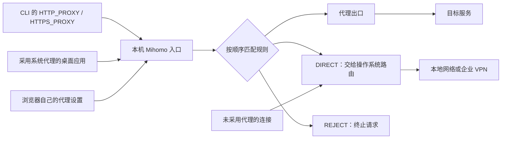

### 通信与网络

工具实践：[网络代理与出口 IP：IPRoyal](#网络代理与出口-ipiproyal)

#### lecture 8.线性分组码译码及应用

**CRC循环冗余校验码 (cyclic redundancy checks)**
* (k+m,k)码，$r(x)=x^{m}d(x)\mod g(x)$, $c(x)=x^md(x) - r(x)$
* 当g(x)的重量不为1时，CRC码距大于等于2
* 存在周期:   $ x^t-1 \mod g(x) = 0$
  * m+k>n时：存在两列相同 => CRC无纠错能力，只能检错  ; 最小码距为2
  * m+k=n：循环码, (10, 7)码不能纠错, (7, 4) 码可以;  e.g. g(x)=1101  周期为7
* CRC is linear，密码学的内容=>[没有integrity](http://csce.uark.edu/~drt/publications/icet2003-b.pdf)
* 可检查突发错(burst): [检错能力比下限强](https://wk.baidu.com/view/35228a7e5ff7ba0d4a7302768e9951e79a896913?ivk_sa=1023194j)


#### 5G时代的机遇与挑战 —— 吕廷杰

回顾历史

* 《第三次浪潮》声明其为新的时代，智力密集型行业
* 互联网
  * 美苏核对峙 ---> 除核之外，通信是军事中最重要且脆弱的部分（层级式通信，单点 fail）
  * p2p 网络，1969年互联网，研究了 packet switching 分组交换技术、sliding window ---> 速递包裹的跟踪查询系统
  * PC 互联网 ---> 移动互联网
* Q: 互联网是否创造了价值？
  * A: 移动互联网拥抱实体经济，重新定义了生产力
* 1G->2G: 能力完善
* 2G->3G: Apple 重新定义了移动互联网，App Store 是 OTT (over-the-top) service，**网络和业务分离**
* 3G->4G: 降价提速

5G

|  | 时间 | 定义 | 交换带宽 |
| :----:| :---: | :----: | :----: |
| 1G | 1980 | 语音通信无线化 ||
| 2G | 1990 | 无线通信数字化 |100Kbps|
| 3G | 2000 | 无线通信上网化 |100Mbps|
| 4G | 2010 | 上网手机娱乐化 |1Gbps|
| 5G | 2020 | 万物互联 |10Gbps|

* 5G 的风险不在于技术层面，而在于应用层有多大的创新空间，尤其是与国家战略相关的创新

* 5G 的三大应用

  * eMBB (enhanced Mobile Broadband)
    * 数字化娱乐、UHD screen、远程手术、智能家居办公
  * URLLC (Ultra Reliable Low Latency Communications)
    * 工业自动化、AR/VR、
  * mMTC (massive Machine Type Communications)
    * 自动驾驶、智能机器人、无人机、智能制造

* 5G 的四大商业模式

  * 基于流量：eMBB, 2C；需要运营商加快用户分级的智能管道升级，实现差异化的流量收费模式
  * 基于连接：单独提供连接，可能包括终端设备和模组；运营商按物联网设备采用卡用户收益（月/年）等方式收费
  * 基于网络切片：运营商根据不同垂直行业和特定区域定制网络切片，垂直用户可直接向运营商购买网络切片，一般按年计费
  * 基于完整解决方案：为工业企业提供包括工厂内外连接、设备终端数字化改造、平台层完整解决方案等
    * ToC 难以提供通用解决方案（难以做好企业画像），给了中小企业杀出来做 ToB 的机会
    * 面向行业细分市场的服务不是运营商的强项，因此可以考虑 ToC 转 ToB 能力开放、鼓励分销与转售

  

* 5G 将推动边缘计算的发展与应用

  * 见下文 **边缘计算** 小节

* 5G 将重构数字经济的产业生态

  * 万物互联，做数据的更挣钱，因为有更多数据

* 5G 应用与网络部署的进度、垂直行业解决方案、国家政策推动密不可分

* 5G 与区块链

  * 区块链作为 5G 的账本
  * 5G 的隐私泄漏问题：《维基经济学》，以区块链为终极解决方案；工业企业不用运营商的频率，专用网络用特定频率

* 5G + AI 消灭工作机会？ ---> 多能力组合的文化创意产业


#### 边缘计算

* 边缘计算
  * 从集中到分布、从被动到主动、减少网络时延、本地化服务
  * 靠近客户、靠近场景、资源独占
  * [一篇综述](https://mp.weixin.qq.com/s/oNJU7un-A0-Fpo4Gdsw3sQ)，分类：
    * 物联网边缘计算：边缘计算是物联网的附属品
    * P2P边缘计算：“特定内容借流量”和“特型应用借算力”，轻量、不稳定
    * 服务器边缘计算：边缘网络 + 边缘IaaS算力 + 网站服务，这就是 CDN；把网站服务换成视频服务，这就是点直播；如果把应用层换成通用边缘计算框架，再通过 5G 把延时降低到 10ms 以下，这就是边缘计算
    * 运营商边缘计算
  * 客户价值
    * 硬件设计更灵活
    * 改变应用发布生态
    * 单一应用留住客户
* 边缘计算场景
  * 视频优化加速：边缘部署给中心视频服务器提供动态网络分析信息，辅助TCP拥塞控制、码率匹配，改善内容分发效率低下情况
  * 监控视频流分析：在边缘进行监控视频的分析，降低视频采集设备的成本，减少发给核心网的流量
  * 车联网：MEC应用分析车及路侧传感器的数据，预警周边车辆，为用户提供路障通知、减小拥堵、感知其他车辆行为等服务
  * 企业专网：在网络边缘对用户接入进入控制和分流，用户面流量分流到企业网络的服务
  * IOT/工业互联：MEC应用整合、分析设备产生的消息及时进行决策，对终端的远端接入和控制等。例如在机场，飞机发动机传感器在着陆前检测状态，AI眼镜探测问题
  * 辅助时延敏感计算：[字节跳动 Pitaya](https://mp.weixin.qq.com/s/XF2k9MGcbY_hqlLEjl0hhw)，推荐/广告端上智能场景
    * “算法包”扫二维码调试、动态部署：算法开发与客户端开发解耦
    * 端上特征工程：特征实时性强、可回传云端形成闭环
    * 算法包的运行触发：Applog Event 或 业务逻辑主动触发
    * 通用 AI 能力建设：针对通用性的使用场景（网络状态预测等），可内置相关能力，快速推广至业务方
  * AR/VR：边缘应用快速处理用户位置和摄像头图像，实时提供辅助信息，本地化处理增强体验

#### 网络代理与出口 IP：IPRoyal

> 来源：[IPRoyal 官网](https://iproyal.com/)、[住宅代理文档](https://docs.iproyal.com/proxies/residential)、[ISP 快速入门](https://iproyal.com/quick-start-guides/static-residential-proxies/)。核验日期：2026-10-23。以下为公开资料整理，未接入账号或实测线路、延迟及目标站成功率。

IPRoyal 是商业代理供应商，主要提供住宅、ISP、机房和移动代理。它提供的是**可选择地域、身份类型和会话策略的网络出口**，用于地域内容测试、价格监测、数据采集等工作。

请求链路可记为：`客户端 → 代理网关（认证、选路）→ 出口 IP → 目标站`。接入网关的地址不一定就是目标站看到的出口 IP；同一网关可以把不同请求路由到不同住宅节点。HTTP(S)、SOCKS5 是接入协议，住宅、ISP、机房是出口资源类型，两组概念需要分开。

##### 产品选择：轮转住宅与固定 ISP

| 类型 | 出口与稳定性 | 费用结构与选择依据 |
| --- | --- | --- |
| Residential，动态住宅代理 | 来自住宅连接的 IP 池；按请求轮转，或在黏性会话内尽量维持同一出口 | 按流量计费，可按需购买或订阅；适合需要多地域、较多出口的任务 |
| ISP，静态住宅代理 | ISP 归属的地址，租期内固定；不代表代理运行在真实家庭设备上 | 按 IP 与租期购买；适合需要稳定出口、IP 白名单的持续任务 |
| Datacenter，机房代理 | 数据中心出口，提供固定 IP | 按 IP 与租期购买；先确认目标服务接受机房出口，再比较吞吐与费用 |
| Mobile，移动代理 | 移动运营商网络出口，有 Dedicated 与 Rotating 等产品 | 按具体产品核对租期或流量计费；只有任务需要移动网络出口时再选 |

[官方 FAQ](https://help.iproyal.com/en/articles/7222102-are-the-proxies-from-real-residential-ip-addresses)说明，ISP 代理托管在数据中心，ASN 与 ISP 关联。**“静态住宅”描述地址归属和产品形态，不能直接理解为一台家庭电脑。**移动轮转产品的按流量模式见[官方配置指南](https://help.iproyal.com/en/articles/13844257-how-to-use-rotating-mobile-proxies)。

选择顺序是：先确定要固定出口还是轮转，再确定地域与协议，最后比较费用。住宅来源不自动保证目标站接受；登录态、浏览器状态、账号权限和目标站验证仍分别成立。

##### Sticky session：保留出口的路由约定

[Rotation 文档](https://docs.iproyal.com/proxies/residential/proxy/rotation)提供两种模式：

- **Randomize**：按请求重新选择出口；不添加黏性会话参数。
- **Sticky**：用 session 标识复用同一出口，并用 lifetime 指定期限。当前文档要求 session 为 **8 位字母数字字符串**，lifetime 为 **1 秒至 7 天**，一次只使用一种时间单位，如 `10m`、`2h`。

示例路由后缀：`_country-us_session-ab12cd34_lifetime-10m`，附在住宅代理密码字段后。相同 session 用于保持一组请求的出口；不同并发身份应各用自己的 session。**session 标识不是网站 Cookie，也不是网站登录会话。**

需要区分三种期限：住宅流量包的有效期、sticky session 的 TTL、固定 ISP IP 的租期。官方将购入的住宅流量标为不过期，但这不表示某个出口 IP 永久保留；sticky 的最长 TTL 也不能当作节点全程在线的可用性保证。需要稳定固定地址时，应按 ISP 产品的租期与续费条件判断。

##### 接入、认证与协议

常用连接信息包含 `协议、网关、端口、用户名、密码、地域/会话参数`；以控制台生成的连接串为准，不把某个示例端口当成所有产品的固定端口。[Making Requests](https://docs.iproyal.com/proxies/residential/proxy/making-requests)分别给出 HTTP 与 SOCKS5 示例。

HTTP 代理也可访问 HTTPS 目标：代理地址写 `http://...`、目标写 `https://...` 并不矛盾。客户端到代理是否加密，与客户端到目标站的 HTTPS 是两段不同的连接。SOCKS5 本身也不能替代目标站 TLS。住宅[协议文档](https://docs.iproyal.com/proxies/residential/proxy/protocols)明确列出 TCP 支持；不要仅凭 SOCKS5 名称推断具体产品已支持 UDP。

住宅接入支持用户名/密码与 IP 白名单。前者便于携带地域和 session 参数；后者依赖调用端公网地址稳定。账号/API token 与代理认证信息是不同凭据。真实凭据保存在私有配置或密钥管理中，不进入笔记、命令历史或公开日志。

下面是私有 curl 配置文件的**占位模板**，真实文件放在仓库外并限制读取权限：

```text
proxy = "http://PROXY_HOST:PROXY_PORT"
proxy-user = "YOUR_USERNAME:YOUR_PASSWORD_country-us_session-ab12cd34_lifetime-10m"
connect-timeout = 10
max-time = 30
```

```bash
curl --config "/PRIVATE/PATH/iproyal.curl" https://ipv4.icanhazip.com
```

先核对返回的出口 IP，再在同一 session 下重复请求验证稳定性，最后测实际目标。出口查询成功只证明代理链路可通，不代表目标站授权、页面内容或自动化流程已经可用。

##### 费用、维护与排障

- **动态住宅**：按实际流量估成本。浏览器加载的图片、脚本和失败重试都会增加用量，不能只按成功页面数估算。订阅与按需购买是不同扣费方式，见[订阅文档](https://docs.iproyal.com/proxies/residential/dashboard/subscription)。
- **固定 ISP / 机房**：计入 IP 数量、租期与公平使用限制。ISP 快速入门当前写明每 IP 每月 100GB 额度，超过后降速；“不限流量”不等于无限全速。[2026 Q3 更新](https://iproyal.com/blog/iproyal-2026-q3-update/)也说明 ISP 与机房产品的流量报表和公平使用额度。具体额度及续费价格仍按所购方案核对。
- **接入与维护**：单个客户端主要配置代理与认证；浏览器自动化或采集服务还需管理连接复用、session 到期、超时/重试、流量上限和按目标域名统计用量。只对需要的流量启用代理，避免无关资源消耗。
- **比较口径**：看目标任务成功率、尾延迟、出口稳定性和每个有效结果的全部成本；营销中的 IP 池规模、最高成功率及“from”单价不能替代具体线路实测。

| 现象 | 优先检查 |
| --- | --- |
| 代理返回 `407` | 代理认证、白名单、连接串格式及账号产品状态 |
| 能查到出口 IP，但目标站返回 `403` 或验证页 | 区分目标站响应与代理错误，再查网站会话、权限和目标访问规则 |
| 相同 session 仍换 IP | session 字符串与 lifetime 是否一致、是否已到期、出口节点是否可用 |
| 超时或握手失败 | 协议/端口是否匹配、到网关和目标的两段连通性、TLS 与客户端配置 |
| 流量明显超出预期 | 静态资源、重试、后台请求及是否误把无关流量全部代理 |

这套分层也适用于其他供应商：**先定位链路和认证，再看出口与会话，最后判断目标站行为。**

#### 多客户端代理、DNS 与 VPN 共存

> 来源：[Claude Code 网络配置](https://code.claude.com/docs/en/network-config)、[Mihomo HTTP 出站](https://wiki.metacubex.one/en/config/proxies/http/)、[dialer-proxy](https://wiki.metacubex.one/en/config/proxies/dialer-proxy/)、[DNS](https://wiki.metacubex.one/en/config/dns/)、[Cloudflare WARP FAQ](https://developers.cloudflare.com/warp-client/known-issues-and-faq/)。核验：2026-10-29。以下是可填参数的设计与验证步骤，未在本机部署。账号、邮箱与支付的整体路径见[跨境数字服务接入](./跨境数字服务接入.md)。

##### 先区分接管、选路与出口



**代理规则只处理已经进入代理的请求。**YAML 里有某个域名规则，不代表这个应用的所有网络组件都已进入 Mihomo；登录、更新、模型流式响应、浏览器扩展和工具子进程也可能采用不同路径。

| 层 | 配置决定什么 | 需要观察什么 |
| --- | --- | --- |
| 应用接入 | 用系统代理、环境变量、应用设置还是进程接管 | 当前运行实例采用的设置、实际连接到的本机端口 |
| Mihomo 分流 | 已进入代理的请求走哪个出口/直连/拒绝 | 活动配置、入站端口、目标、首条命中的规则 |
| 出站链路 | 从代理内核到中转、再到最终出口 | 各跳连通性、协议、实际代理链 |
| DNS | 哪个组件将哪一个域名解析成 IP | 应用、内核、出口与企业内网各自使用的解析路径 |
| 服务端 | 认证、额度、地区资格与业务响应 | 登录、实际任务、账单和明确错误，不能只看 HTTP 状态 |

不开 TUN、只给部分应用显式代理，通常更容易与企业 VPN 分工，但不保证没有冲突：VPN 仍可能改变到代理服务器的路由、DNS 或防火墙策略。`DIRECT` 意味着不经过 Mihomo 的代理出站，**不是强制绕过 VPN**；操作系统可能仍把它送进企业隧道。

##### 最小配置：本机 HTTP 入口，明确上游与服务规则

Clash Verge Rev 是配置与界面层，Mihomo 是内核。安装从[项目 Releases](https://github.com/clash-verge-rev/clash-verge-rev/releases)选择对应系统架构，记录应用与内核版本。编辑自己的配置源，再确认界面已经加载；不要只改 GUI 生成的运行文件，下一次刷新可能覆盖它。

下面示例假设供应商已经提供**支持 TLS 的 HTTP 代理**。若实际只提供 SOCKS5，按供应商协议改出站；不能只换协议名称而沿用另一套端口和 TLS 参数。真实配置放仓库外或私有目录。

```yaml
mixed-port: 7897
bind-address: 127.0.0.1
allow-lan: false
mode: rule
log-level: info
tun:
  enable: false
dns:
  enable: false

proxies:
  - name: Fixed-Exit
    type: http
    server: proxy.example.com  # 替换成供应商真实主机名
    port: 443                 # 使用供应商给的端口
    username: YOUR_USERNAME
    password: YOUR_PASSWORD
    tls: true
    skip-cert-verify: false

proxy-groups:
  - name: Service-Proxy
    type: select
    proxies: [Fixed-Exit]

rules:
  - DOMAIN-SUFFIX,anthropic.com,Service-Proxy
  - DOMAIN-SUFFIX,claude.ai,Service-Proxy
  - DOMAIN-SUFFIX,claude.com,Service-Proxy
  - DOMAIN-SUFFIX,claudeusercontent.com,Service-Proxy
  - DOMAIN-SUFFIX,claudemcpcontent.com,Service-Proxy
  - DOMAIN,ipv4.icanhazip.com,Service-Proxy  # 仅用于验证同一出口
  - MATCH,DIRECT
```

这是 Claude 相关域的起点，不是所有功能的完整白名单；第三方登录、MCP、Git、包管理器和应用内资源，应结合[当前官方网络清单](https://code.claude.com/docs/en/network-config#network-access-requirements)与实际失败补充。`DOMAIN-SUFFIX` 已包含子域；无依据扩大为关键词规则，会把无关域名一起带走。把 `cloudflare.com` 加进规则，也不会自动覆盖所有使用 Cloudflare CDN 的网站。

此处代理组只有一个出口，避免选中其他节点或 `DIRECT`；但 `MATCH,DIRECT` 仍允许未知域直连，**不构成全机禁止旁路**。若某个业务要求未分类请求也不能直连，应为它设专用入口和明确的默认代理/拒绝规则，再单独放行必要的内网目标，不能沿用此模板却声称已全覆盖。

有独立 Mihomo 二进制时可先校验，路径按实际安装填写；GUI 用户使用配置检查功能并读回报错：

```bash
mihomo -t -f /PRIVATE/PATH/service-proxy.yaml
```

HTTP 与 SOCKS 接入只是协议选择。客户端到本机回环的 HTTP 可以通过上游 TLS 加密出网；若客户端直接连公网明文 HTTP/SOCKS 代理，代理认证和控制信息可能不受目标站 HTTPS 保护。分别核对**客户端—代理、代理链各跳、客户端—目标站**的加密，不因最终网站是 HTTPS 就跳过前两项。

##### CLI、桌面和后台进程分别接入

Claude Code 官方明确支持 HTTP/HTTPS 代理变量，**不支持直接使用 SOCKS 代理**。可以由 Mihomo 把本机 HTTP 请求转到上游 SOCKS，而不是把 `ALL_PROXY=socks5h://...` 当作所有 SDK 都通用的设置。

交互式终端可用子 shell 包装，变量作用于本次命令及继承它的子进程，不污染父 shell：

```bash
claude_via_proxy() (
  export HTTP_PROXY=http://127.0.0.1:7897
  export HTTPS_PROXY="$HTTP_PROXY"
  export http_proxy="$HTTP_PROXY"
  export https_proxy="$HTTPS_PROXY"
  export NO_PROXY=localhost,127.0.0.1,::1
  export no_proxy="$NO_PROXY"
  unset ALL_PROXY all_proxy
  command claude "$@"
)
```

企业内部目标按实际域名补入 `NO_PROXY`，同时维护 Mihomo 直连与内网 DNS 策略；只把**应直连的目标**加进去。上游代理凭据保存在代理配置，不放进 CLI 命令历史。此函数不修改 API Key、OAuth 或 `ANTHROPIC_BASE_URL`，网络修复与认证配置分开处理。

官方文档还指出两个容易漏掉的细节：

- **后台 Agent 不一定是当前 shell 的子进程。**共享 supervisor 可能早已由另一个终端启动，只在 shell 里 export 不足以覆盖它；需要把变量合并进 `~/.claude/settings.json` 的 `env` 或组织 managed settings。不要整文件覆盖已有配置，生效方式按当前版本核验。
- **桌面应用管理 Provider 连接时，配置作用域不同。**部分 Desktop/Cowork 会话只读取 managed settings 与用户级设置中的网络变量，忽略仓库级配置。Dock 打开的已有实例也不会因为改了终端环境就自动更新。使用实际版本的受支持配置入口，并在会话 `/status`、本地 debug 记录与代理连接中核验。

macOS 可先做只读检查：

```bash
scutil --proxy
lsof -nP -iTCP:7897 -sTCP:LISTEN
```

`scutil --proxy` 说明系统配置，端口监听说明入口存在，都不能单独证明某个 App 已使用它。需要时本地查看 `scutil --dns` 及目标连接，分享前脱敏公司域名、内部地址和凭据；不要把完整环境变量、Cookie 或调试日志直接交给外部分析。

##### DNS 为什么不能用一个开关概括

需要分别问：**应用是否先解析、Mihomo 是否为规则或拨号解析、最终出口是否解析？**

1. `curl --proxy http://127.0.0.1:7897 https://目标域名` 通常以 HTTP CONNECT 把目标域名交给代理；curl 不必先在本地解析目标，但后续内核/上游在哪里解析仍由它们决定。
2. `socks5h://` 在支持它的客户端中表示把域名交给 SOCKS 代理解析；`socks5://` 常由客户端先解析。它不是全局 DNS 设置，也不保证其他应用采用同样行为。
3. Mihomo 的 `dns.enable: false` 按[官方文档](https://wiki.metacubex.one/en/config/dns/)意味着需要解析时使用系统 DNS，**不意味着“不发生 DNS 查询”或“防泄漏已完成”**。本机可能仍需要解析代理服务器，直连流量与其他应用也会查询 DNS。
4. `dns.enable: true` 开启的是内核 DNS 能力，不自动意味着所有系统或浏览器 DNS 已接管。还要看监听地址、系统解析器、TUN/重定向、浏览器 DoH 与应用行为。
5. 若确需统一 DNS，先列公司私有域、普通公网域、代理服务器自举域，再配置 nameserver-policy、proxy-server-nameserver 等；公司私有域仍走公司解析器，避免公共 DNS 无法解析或泄露查询。切回系统 DNS 前也要安排可用解析路径。

DNS 测试页显示的是该测试观察到的解析器，不必与 HTTP 出口 IP 完全相同；多个 Cloudflare 解析器地址本身不证明泄漏。要检查查询是否经过预期通道，以及有没有意外暴露给本地默认解析器。

浏览器另有 DoH、预连接、WebRTC/STUN、QUIC 等通道。HTTP 页面走对代理，不代表这些通道都被覆盖；具体还取决于浏览器、代理协议与 TUN/进程接管。若业务确实要求约束旁路，再按其官方设置禁用非代理 UDP或使用适当接管，并验证视频会议等功能是否受影响。不能把改写页面显示的 IP 当作网络层已经阻断的证据，也不要用一个 IPv6 开关宣称整机 IPv6 已受控。

##### 双跳、WARP 和多个入口：需要时再加

`dialer-proxy` 指定“当前出站通过哪个出站建立连接”。例如：

```yaml
proxies:
  - name: Transit
    type: http
    server: transit.example.com
    port: 443
    tls: true
    username: TRANSIT_USER
    password: TRANSIT_PASSWORD
    skip-cert-verify: false
  - name: Final-Exit
    type: http
    server: exit.example.com
    port: 443
    tls: true
    username: EXIT_USER
    password: EXIT_PASSWORD
    skip-cert-verify: false
    dialer-proxy: Transit
# 在完整配置的业务规则中选择 Final-Exit；不是 Transit。
```

方向为 `本机 → Transit → Final-Exit → 目标`，目标看到最终出口。这里两端都必须支持示例协议和 CONNECT 用途；供应商若限制链式使用，应按实际能力调整。中转优化第一段传输，最终出口决定最后一跳的地址；两跳增加共同故障点和延迟，不会自动更快。

另一种结构是 `本机 → VPS 的加密入口 → WARP 出站 → 目标`。WARP 的出口与服务器原生 IP 可以不同，但 WARP 不是固定住宅出口服务。第三方 Docker 示例还需检查：

- 有出站规则不等于有可连接的入站监听；确认协议、认证、监听地址、容器端口与宿主机映射一致。
- `depends_on` 的启动顺序不等于上游健康，需要实际就绪检查；`NET_ADMIN` 和 `/dev/net/tun` 是实质权限。
- 只映射 TCP 端口，不能据此声称 UDP 已通；规则集下载、DNS 与业务流量也需分别核验。
- 镜像与配置固定版本，控制端口不裸露，远程代理入口有认证与适当加密。先跑单链路，再做更新、回滚和开机启动。

多客户端或多个用途需要独立出口时，可以让每个 profile 固定到各自的 loopback 入口，再用入站规则决定出口；检测目标也要经过同一策略。避免将它们放进自动测速切换池，否则故障可能悄悄变成另一个出口。采用专用端口并不自动覆盖所有请求，前置直连规则仍可能优先命中。

##### 验证与排障：配置文件 → 运行实例 → 规则 → 连接 → 业务

先检查代理配置已加载、端口已监听。下面两个命令分别测当前系统直连路径与显式代理路径；“直连”仍可能经过 VPN。示例检测域必须命中与业务相同的代理规则，否则只是测到了默认出口。

```bash
# 不受当前 shell 的代理环境变量影响
curl --noproxy '*' --connect-timeout 10 --max-time 20 \
  https://ipv4.icanhazip.com

# 显式使用本机代理；清空 NO_PROXY 对这次请求的影响
curl --proxy http://127.0.0.1:7897 --noproxy '' \
  --connect-timeout 10 --max-time 20 https://ipv4.icanhazip.com
```

随后在**同一客户端**完成真实任务：CLI 发送一次正常请求并读取结果；浏览器验证登录、页面资源和一次功能操作；桌面应用另测；需要后台 Agent、MCP 或下载再分别测。一个未经认证的请求返回 `401` 可能说明已到鉴权层，不能当作模型调用成功；`200` 也可能只是普通网页。

| 现象 | 下一项有区分力的检查 |
| --- | --- |
| 连不上 127.0.0.1:7897 | 进程、端口与配置加载；先不怀疑远端账号 |
| curl 可用，CLI 不通 | 客户端是否支持代理协议、大小写变量、运行实例是否重启 |
| 前台可用，后台失败 | supervisor 与用户级设置，不假设继承当前 shell |
| 网页可用，桌面空白 | 实际网络组件、CDN/登录域、桌面设置作用域 |
| HTTP `407` | 代理认证；与目标服务 `401` 分开 |
| TLS 证书错误 | 域名、证书链、系统时钟或企业 CA；不靠关闭证书校验修复 |
| 短请求成功，长响应中断 | 代理空闲超时、流式转发、连接复用、客户端 watchdog 与上游重试 |
| 开 VPN 后故障 | 到上游的路由、DNS、企业策略；保留前后对照 |
| IP 检测结果和业务预期不一致 | 检测域命中的规则及出口；不能只看两个国家标签 |
| 地区拒绝、余额/额度不足、账号暂停 | 服务资格、账单或账号层；停止将其当作网络错误重试 |

每次只改一个主要变量，保留原配置与版本。恢复时先还原应用代理/用户设置，再恢复系统代理与 DNS，最后停止相关进程；否则系统仍指向已经关闭的本机端口，会把“停用代理”变成“全部断网”。在需要明确出口的业务中，故障应显式失败，不静默降级到不允许的直连路径。
