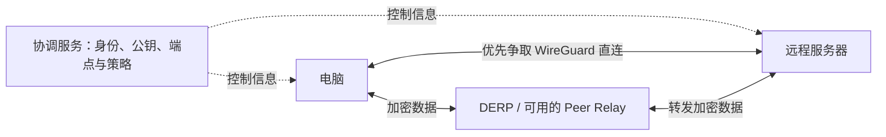
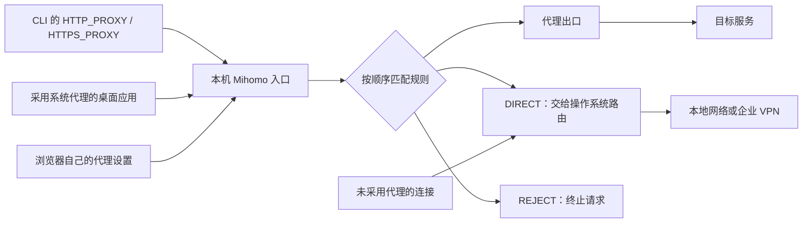

### 通信与网络

工具实践：[网络代理与出口 IP：IPRoyal](#网络代理与出口-ipiproyal) · [Tailscale 私有组网](#tailscale基于身份的私有组网) · [多客户端代理、DNS 与 VPN 共存](#多客户端代理dns-与-vpn-共存)

#### lecture 8.线性分组码译码及应用

**CRC循环冗余校验码 (cyclic redundancy checks)**
* (k+m,k)码，$r(x)=x^{m}d(x)\mod g(x)$, $c(x)=x^md(x) - r(x)$
* 当g(x)的重量不为1时，CRC码距大于等于2
* 存在周期:   $ x^t-1 \mod g(x) = 0$
  * m+k>n时：存在两列相同 => CRC无纠错能力，只能检错  ; 最小码距为2
  * m+k=n：循环码, (10, 7)码不能纠错, (7, 4) 码可以;  e.g. g(x)=1101  周期为7
* CRC is linear，密码学的内容=>[没有integrity](http://csce.uark.edu/~drt/publications/icet2003-b.pdf)
* 可检查突发错(burst): [检错能力比下限强](https://wk.baidu.com/view/35228a7e5ff7ba0d4a7302768e9951e79a896913?ivk_sa=1023194j)


#### 5G时代的机遇与挑战 —— 吕廷杰

回顾历史

* 《第三次浪潮》声明其为新的时代，智力密集型行业
* 互联网
  * 美苏核对峙 ---> 除核之外，通信是军事中最重要且脆弱的部分（层级式通信，单点 fail）
  * p2p 网络，1969年互联网，研究了 packet switching 分组交换技术、sliding window ---> 速递包裹的跟踪查询系统
  * PC 互联网 ---> 移动互联网
* Q: 互联网是否创造了价值？
  * A: 移动互联网拥抱实体经济，重新定义了生产力
* 1G->2G: 能力完善
* 2G->3G: Apple 重新定义了移动互联网，App Store 是 OTT (over-the-top) service，**网络和业务分离**
* 3G->4G: 降价提速

5G

|  | 时间 | 定义 | 交换带宽 |
| :----:| :---: | :----: | :----: |
| 1G | 1980 | 语音通信无线化 ||
| 2G | 1990 | 无线通信数字化 |100Kbps|
| 3G | 2000 | 无线通信上网化 |100Mbps|
| 4G | 2010 | 上网手机娱乐化 |1Gbps|
| 5G | 2020 | 万物互联 |10Gbps|

* 5G 的风险不在于技术层面，而在于应用层有多大的创新空间，尤其是与国家战略相关的创新

* 5G 的三大应用

  * eMBB (enhanced Mobile Broadband)
    * 数字化娱乐、UHD screen、远程手术、智能家居办公
  * URLLC (Ultra Reliable Low Latency Communications)
    * 工业自动化、AR/VR、
  * mMTC (massive Machine Type Communications)
    * 自动驾驶、智能机器人、无人机、智能制造

* 5G 的四大商业模式

  * 基于流量：eMBB, 2C；需要运营商加快用户分级的智能管道升级，实现差异化的流量收费模式
  * 基于连接：单独提供连接，可能包括终端设备和模组；运营商按物联网设备采用卡用户收益（月/年）等方式收费
  * 基于网络切片：运营商根据不同垂直行业和特定区域定制网络切片，垂直用户可直接向运营商购买网络切片，一般按年计费
  * 基于完整解决方案：为工业企业提供包括工厂内外连接、设备终端数字化改造、平台层完整解决方案等
    * ToC 难以提供通用解决方案（难以做好企业画像），给了中小企业杀出来做 ToB 的机会
    * 面向行业细分市场的服务不是运营商的强项，因此可以考虑 ToC 转 ToB 能力开放、鼓励分销与转售

  

* 5G 将推动边缘计算的发展与应用

  * 见下文 **边缘计算** 小节

* 5G 将重构数字经济的产业生态

  * 万物互联，做数据的更挣钱，因为有更多数据

* 5G 应用与网络部署的进度、垂直行业解决方案、国家政策推动密不可分

* 5G 与区块链

  * 区块链作为 5G 的账本
  * 5G 的隐私泄漏问题：《维基经济学》，以区块链为终极解决方案；工业企业不用运营商的频率，专用网络用特定频率

* 5G + AI 消灭工作机会？ ---> 多能力组合的文化创意产业


#### 边缘计算

* 边缘计算
  * 从集中到分布、从被动到主动、减少网络时延、本地化服务
  * 靠近客户、靠近场景、资源独占
  * [一篇综述](https://mp.weixin.qq.com/s/oNJU7un-A0-Fpo4Gdsw3sQ)，分类：
    * 物联网边缘计算：边缘计算是物联网的附属品
    * P2P边缘计算：“特定内容借流量”和“特型应用借算力”，轻量、不稳定
    * 服务器边缘计算：边缘网络 + 边缘IaaS算力 + 网站服务，这就是 CDN；把网站服务换成视频服务，这就是点直播；如果把应用层换成通用边缘计算框架，再通过 5G 把延时降低到 10ms 以下，这就是边缘计算
    * 运营商边缘计算
  * 客户价值
    * 硬件设计更灵活
    * 改变应用发布生态
    * 单一应用留住客户
* 边缘计算场景
  * 视频优化加速：边缘部署给中心视频服务器提供动态网络分析信息，辅助TCP拥塞控制、码率匹配，改善内容分发效率低下情况
  * 监控视频流分析：在边缘进行监控视频的分析，降低视频采集设备的成本，减少发给核心网的流量
  * 车联网：MEC应用分析车及路侧传感器的数据，预警周边车辆，为用户提供路障通知、减小拥堵、感知其他车辆行为等服务
  * 企业专网：在网络边缘对用户接入进入控制和分流，用户面流量分流到企业网络的服务
  * IOT/工业互联：MEC应用整合、分析设备产生的消息及时进行决策，对终端的远端接入和控制等。例如在机场，飞机发动机传感器在着陆前检测状态，AI眼镜探测问题
  * 辅助时延敏感计算：[字节跳动 Pitaya](https://mp.weixin.qq.com/s/XF2k9MGcbY_hqlLEjl0hhw)，推荐/广告端上智能场景
    * “算法包”扫二维码调试、动态部署：算法开发与客户端开发解耦
    * 端上特征工程：特征实时性强、可回传云端形成闭环
    * 算法包的运行触发：Applog Event 或 业务逻辑主动触发
    * 通用 AI 能力建设：针对通用性的使用场景（网络状态预测等），可内置相关能力，快速推广至业务方
  * AR/VR：边缘应用快速处理用户位置和摄像头图像，实时提供辅助信息，本地化处理增强体验

#### 网络代理与出口 IP：IPRoyal

> 来源：[IPRoyal 官网](https://iproyal.com/)、[住宅代理文档](https://docs.iproyal.com/proxies/residential)、[ISP 快速入门](https://iproyal.com/quick-start-guides/static-residential-proxies/)。核验日期：2026-10-23。以下为公开资料整理，未接入账号或实测线路、延迟及目标站成功率。

IPRoyal 是商业代理供应商，主要提供住宅、ISP、机房和移动代理。它提供的是**可选择地域、身份类型和会话策略的网络出口**，用于地域内容测试、价格监测、数据采集等工作。

请求链路可记为：`客户端 → 代理网关（认证、选路）→ 出口 IP → 目标站`。接入网关的地址不一定就是目标站看到的出口 IP；同一网关可以把不同请求路由到不同住宅节点。HTTP(S)、SOCKS5 是接入协议，住宅、ISP、机房是出口资源类型，两组概念需要分开。

##### 产品选择：轮转住宅与固定 ISP

| 类型 | 出口与稳定性 | 费用结构与选择依据 |
| --- | --- | --- |
| Residential，动态住宅代理 | 来自住宅连接的 IP 池；按请求轮转，或在黏性会话内尽量维持同一出口 | 按流量计费，可按需购买或订阅；适合需要多地域、较多出口的任务 |
| ISP，静态住宅代理 | ISP 归属的地址，租期内固定；不代表代理运行在真实家庭设备上 | 按 IP 与租期购买；适合需要稳定出口、IP 白名单的持续任务 |
| Datacenter，机房代理 | 数据中心出口，提供固定 IP | 按 IP 与租期购买；先确认目标服务接受机房出口，再比较吞吐与费用 |
| Mobile，移动代理 | 移动运营商网络出口，有 Dedicated 与 Rotating 等产品 | 按具体产品核对租期或流量计费；只有任务需要移动网络出口时再选 |

[官方 FAQ](https://help.iproyal.com/en/articles/7222102-are-the-proxies-from-real-residential-ip-addresses)说明，ISP 代理托管在数据中心，ASN 与 ISP 关联。**“静态住宅”描述地址归属和产品形态，不能直接理解为一台家庭电脑。**移动轮转产品的按流量模式见[官方配置指南](https://help.iproyal.com/en/articles/13844257-how-to-use-rotating-mobile-proxies)。

选择顺序是：先确定要固定出口还是轮转，再确定地域与协议，最后比较费用。住宅来源不自动保证目标站接受；登录态、浏览器状态、账号权限和目标站验证仍分别成立。

##### Sticky session：保留出口的路由约定

[Rotation 文档](https://docs.iproyal.com/proxies/residential/proxy/rotation)提供两种模式：

- **Randomize**：按请求重新选择出口；不添加黏性会话参数。
- **Sticky**：用 session 标识复用同一出口，并用 lifetime 指定期限。当前文档要求 session 为 **8 位字母数字字符串**，lifetime 为 **1 秒至 7 天**，一次只使用一种时间单位，如 `10m`、`2h`。

示例路由后缀：`_country-us_session-ab12cd34_lifetime-10m`，附在住宅代理密码字段后。相同 session 用于保持一组请求的出口；不同并发身份应各用自己的 session。**session 标识不是网站 Cookie，也不是网站登录会话。**

需要区分三种期限：住宅流量包的有效期、sticky session 的 TTL、固定 ISP IP 的租期。官方将购入的住宅流量标为不过期，但这不表示某个出口 IP 永久保留；sticky 的最长 TTL 也不能当作节点全程在线的可用性保证。需要稳定固定地址时，应按 ISP 产品的租期与续费条件判断。

##### 接入、认证与协议

常用连接信息包含 `协议、网关、端口、用户名、密码、地域/会话参数`；以控制台生成的连接串为准，不把某个示例端口当成所有产品的固定端口。[Making Requests](https://docs.iproyal.com/proxies/residential/proxy/making-requests)分别给出 HTTP 与 SOCKS5 示例。

HTTP 代理也可访问 HTTPS 目标：代理地址写 `http://...`、目标写 `https://...` 并不矛盾。客户端到代理是否加密，与客户端到目标站的 HTTPS 是两段不同的连接。SOCKS5 本身也不能替代目标站 TLS。住宅[协议文档](https://docs.iproyal.com/proxies/residential/proxy/protocols)明确列出 TCP 支持；不要仅凭 SOCKS5 名称推断具体产品已支持 UDP。

住宅接入支持用户名/密码与 IP 白名单。前者便于携带地域和 session 参数；后者依赖调用端公网地址稳定。账号/API token 与代理认证信息是不同凭据。真实凭据保存在私有配置或密钥管理中，不进入笔记、命令历史或公开日志。

下面是私有 curl 配置文件的**占位模板**，真实文件放在仓库外并限制读取权限：

```text
proxy = "http://PROXY_HOST:PROXY_PORT"
proxy-user = "YOUR_USERNAME:YOUR_PASSWORD_country-us_session-ab12cd34_lifetime-10m"
connect-timeout = 10
max-time = 30
```

```bash
curl --config "/PRIVATE/PATH/iproyal.curl" https://ipv4.icanhazip.com
```

先核对返回的出口 IP，再在同一 session 下重复请求验证稳定性，最后测实际目标。出口查询成功只证明代理链路可通，不代表目标站授权、页面内容或自动化流程已经可用。

##### 费用、维护与排障

- **动态住宅**：按实际流量估成本。浏览器加载的图片、脚本和失败重试都会增加用量，不能只按成功页面数估算。订阅与按需购买是不同扣费方式，见[订阅文档](https://docs.iproyal.com/proxies/residential/dashboard/subscription)。
- **固定 ISP / 机房**：计入 IP 数量、租期与公平使用限制。ISP 快速入门当前写明每 IP 每月 100GB 额度，超过后降速；“不限流量”不等于无限全速。[2026 Q3 更新](https://iproyal.com/blog/iproyal-2026-q3-update/)也说明 ISP 与机房产品的流量报表和公平使用额度。具体额度及续费价格仍按所购方案核对。
- **接入与维护**：单个客户端主要配置代理与认证；浏览器自动化或采集服务还需管理连接复用、session 到期、超时/重试、流量上限和按目标域名统计用量。只对需要的流量启用代理，避免无关资源消耗。
- **比较口径**：看目标任务成功率、尾延迟、出口稳定性和每个有效结果的全部成本；营销中的 IP 池规模、最高成功率及“from”单价不能替代具体线路实测。

| 现象 | 优先检查 |
| --- | --- |
| 代理返回 `407` | 代理认证、白名单、连接串格式及账号产品状态 |
| 能查到出口 IP，但目标站返回 `403` 或验证页 | 区分目标站响应与代理错误，再查网站会话、权限和目标访问规则 |
| 相同 session 仍换 IP | session 字符串与 lifetime 是否一致、是否已到期、出口节点是否可用 |
| 超时或握手失败 | 协议/端口是否匹配、到网关和目标的两段连通性、TLS 与客户端配置 |
| 流量明显超出预期 | 静态资源、重试、后台请求及是否误把无关流量全部代理 |

这套分层也适用于其他供应商：**先定位链路和认证，再看出口与会话，最后判断目标站行为。**

#### Tailscale：基于身份的私有组网

Tailscale 把散落在家庭、移动网络和云上的设备连成一个加密私有网络，称为 **tailnet**。设备获得稳定的 Tailscale IP，也可通过 MagicDNS 名称互访；更换 Wi-Fi 通常不必修改访问地址。它是在现有互联网之上建立 IP 层的 overlay，并不把不同物理网络合并成一个以太网广播域。它默认解决“我的设备怎样互相访问”，只有选择出口节点后，才进一步解决“访问公网时从哪里出去”。

阅读范围：官方 [What is Tailscale](https://tailscale.com/docs/concepts/what-is-tailscale)、[How Tailscale works](https://tailscale.com/blog/how-tailscale-works) 的架构论证，以及连接、DNS、访问控制和主要功能文档；[NAT traversal](https://tailscale.com/blog/how-nat-traversal-works) 选读与打洞相关的机制。架构与 NAT 两篇分别发表于 2020 年，具体行为以 2026-11-20 查阅的功能文档为准。以下是机制与操作方案，未在本机安装或实测。

##### 控制面与数据面：集中管理，按需互连

普通中心式 VPN 把流量送到网关，再由网关转发。Tailscale 尝试让设备直接建立 WireGuard 加密隧道：**身份和策略集中管理，业务数据尽量不绕中心节点。** Mesh 是按需建立的逻辑互连能力，不代表所有设备始终两两直连。

WireGuard 负责加密隧道；Tailscale 进一步处理身份认证、公钥分发、设备发现、NAT 穿透、路由和访问策略，减少手工维护 peer 配置的工作。



上图为机制示意，直连与中继是替代路径。一次接入的关键步骤是：

1. 设备通过身份提供方登录，生成自己的密钥对；私钥留在设备上。
2. 协调服务分发通信所需的公钥、可达端点与策略。公钥不需要保密，但“这个公钥属于谁、允许访问谁”的绑定必须可信。
3. 两端建立加密连接，访问规则在节点侧执行；协调服务不必代转每个业务数据包。

“中继不能解密 WireGuard 内容”不等于没有元数据或信任边界：身份提供方、管理权限和终端本身仍需可信。子网路由器和出口节点会结束 Tailscale 隧道，再把流量交给后续网络；HTTPS、SSH 等应用协议决定后续链路是否仍加密。[架构说明](https://tailscale.com/blog/how-tailscale-works)

##### NAT 穿透：为什么没有公网 IP 也可能直连

家庭设备通常只有私网地址。NAT 会把出站连接的源地址、端口改成路由器的公网映射；有状态防火墙通常允许相应的返回流量。所谓 UDP 打洞，是利用两端主动发包建立映射和允许返回的状态，并非让显式拒绝的防火墙规则失效。

例如下面的地址均为示意：

```text
电脑 A：192.168.1.10:41641 → 公网映射 198.51.100.10:53000
服务器 B：10.0.0.20:41641 → 公网映射 203.0.113.20:54000
```

两端借助 STUN 等机制发现“外面看到我的地址和端口”，交换候选端点，再分别向对方发 UDP 包。最早的包可能被丢弃；当两边的映射与过滤状态允许返回流量时，后续包就可能直接到达。**STUN 帮忙发现地址，DERP 才负责转发业务流量。**

困难在于，有些 NAT 会针对不同目的地分配不同端口：STUN 服务器看到的映射，未必适用于另一个 peer；还有网络会限制 UDP。映射也会超时，因此需要保活或重新探测。它是一套争取直连的机制，不是所有网络都能打穿的保证。[NAT 原理](https://tailscale.com/blog/how-nat-traversal-works)

[当前连接文档](https://tailscale.com/docs/reference/connection-types)说明：连接先经 DERP 建立，再尝试升级为 UDP 直连；失败时尝试可达的 tailnet Peer Relay，否则继续 DERP，并周期性尝试改善路径。因此第一次 `tailscale ping` 显示 DERP，后面变成直连，是正常现象。直连通常延迟更低、吞吐更高；中继可用性与实际速度仍要分别测量。

##### 功能选择：先看谁要访问什么

| 需要 | 选择 | 流量与权限边界 |
| --- | --- | --- |
| 自己的电脑、手机和服务器互访 | 基础 tailnet + MagicDNS | 两端安装客户端；默认不改变普通公网访问出口 |
| 登录服务器终端 | 普通 SSH over Tailscale，或 Tailscale SSH | 前者沿用 sshd 与 SSH 密钥；后者额外接管 tailnet 上的 SSH 身份与授权 |
| 在自己的设备上打开本地 Web 面板 | Tailscale Serve | 私有 HTTPS 入口，转发到本机服务，受 tailnet 策略控制 |
| 访问装不了客户端的 NAS、打印机或局域网设备 | Subnet router | 一台已加入 tailnet 的设备转发到指定私网网段 |
| 多台设备访问互联网时共用一个出口 | Exit node | 客户端显式选择，由该节点转发默认公网路由 |
| 让未安装 Tailscale 的公众访问某项本地服务 | Tailscale Funnel | 公网入口；不能再把 tailnet 成员身份当作访客认证 |

**Relay 与 exit node 是不同角色。** Relay 帮 A 把仍加密的包送到 B；exit node 则作为 B，解开 Tailscale 这一层后替 A 访问互联网。经过哪里的 relay，不等于从哪里访问目标网站。

[Serve](https://tailscale.com/docs/features/tailscale-serve) 与 [Funnel](https://tailscale.com/docs/features/tailscale-funnel) 的私有/公开边界尤其容易混淆：同一端口不能同时使用两种模式，最后一次配置决定它是否公开。Funnel 当前仍标为 beta，只支持规定的 TLS 端口与 tailnet 域名，并有不可自行配置的带宽限制，不宜直接当作任意公网生产服务的等价替代。

##### 最小接入：先连两台设备，再访问一个私有服务

推荐先用已有电脑或服务器做实验，无需为了理解 Tailscale 先购买 VPS、配置出口节点或自建控制面。假设远程设备命名为 `devbox`，已运行 SSH 或一个本地 Web 服务：

1. 按[官方 Quickstart](https://tailscale.com/docs/how-to/quickstart)在两台设备安装客户端，登录同一 tailnet；在管理台 **Machines** 确认设备与名称，**DNS** 检查 MagicDNS。个人初试可登录同一账号，团队使用各自身份与邀请，不共享账号。
2. 在有 CLI 的设备上检查连接，以下 `devbox` 替换为真实设备名。手机使用 App 查看节点，再用浏览器访问服务。

   ```bash
   tailscale status
   tailscale ip -4
   tailscale ping devbox
   tailscale netcheck
   ```

3. **终端路径**：若远程 sshd 已开启，使用 `ssh YOUR_OS_USER@devbox`，沿用原有系统用户与 SSH 认证。加入 tailnet 不会自动创建系统账号，也不会自动启动 sshd。
4. **Web 路径**：在远程设备先确认 `http://127.0.0.1:3000` 能打开，再在同一设备执行下列命令。服务可继续只监听 localhost，Serve 为它提供 tailnet 内的 HTTPS 入口。

   ```bash
   tailscale serve 3000
   ```

   首次按提示启用 tailnet HTTPS，打开命令实际返回的 `https://设备名.tailnet名.ts.net` 地址；需要有该端口的访问权限。前台运行按 `Ctrl+C` 停止。确认需要常驻后再用 `tailscale serve --bg 3000`，用 `tailscale serve status` 查看；撤销默认 443 入口用 `tailscale serve --https=443 off`。`tailscale serve reset` 会清空本机 Serve 配置，仅在确实要撤销全部 Serve 项时使用。[Serve CLI](https://tailscale.com/docs/reference/tailscale-cli/serve)
5. 手机改用移动网络、保持 Tailscale 在线，再打开同一地址。成功说明跨网络私有访问成立；继续确认实际页面、登录和操作正常，不能以 ping 成功代替业务验收。

对远程 Agent，最直接的价值是连接服务器、终端与私有面板。任务常驻、断线后继续执行、结果与文件持久化仍由进程管理和应用负责；Tailscale 不承担 Agent 调度或运行沙箱。

##### 身份、访问规则与 DNS：可达不等于可用

[Grants](https://tailscale.com/docs/features/access-control/grants)表达“谁可以访问哪个资源、使用哪些能力”：`src` 是来源身份，`dst` 是目标，`ip` 限制协议和端口，`app` 表达需由应用理解和执行的能力。规则引擎没有授权就拒绝，但不能据此推断新建 tailnet 已把设备逐个隔离：官方默认策略允许 tailnet 内设备广泛互访，需按用途收紧其放行范围。[默认 ACL 示例](https://tailscale.com/docs/reference/examples/acls#allow-all-default-acl)

例如，“自己可以访问开发机的 TCP 443”只授予网络入口，不会自动授予面板里的管理员权限。Serve 可传递 `Tailscale-User-Login` 等身份头；应用若依此认证，应只允许可信代理访问后端，通常让后端监听 localhost，避免绕过 Serve 伪造头部。来自 tagged device 的请求没有人类用户身份头。[Serve 身份头](https://tailscale.com/docs/features/tailscale-serve#identity-headers)

Tailscale SSH 是可选功能：支持的服务端执行 `sudo tailscale set --ssh` 后，接管 **Tailscale 地址上**的 SSH 连接，并要求网络层允许端口 22、SSH 策略允许相应系统用户；`check` 模式还可要求重新认证。当前服务端支持 Linux 及 macOS 的开源 `tailscaled` 变体，不能把所有 macOS 客户端构建视为等价。首次接入用普通 SSH 即可；启用接管前保留独立恢复通道。[Tailscale SSH](https://tailscale.com/docs/features/tailscale-ssh)

MagicDNS 把设备名解析为 Tailscale 地址；**解析出 IP 不会自动赋予路由或访问权限**。Split DNS 则把指定域名交给指定解析器，例如公司域名交给公司 DNS。配置了一个私有 DNS 地址，还需保证客户端有路由和权限抵达它。使用 exit node 时默认通过该节点解析域名，可在管理台 Nameservers 的 **Use with exit node** 设置例外。[DNS 文档](https://tailscale.com/docs/reference/dns-in-tailscale)

##### 子网路由：把未安装客户端的设备接进来

例如家里有一台能运行 Tailscale 的 Linux 主机，和一台不能安装客户端的打印机。让主机作为 subnet router，远程电脑就能经它访问打印机的局域网地址，无需把整个网络一次性改造。[子网路由文档](https://tailscale.com/docs/features/subnet-routers)

配置分为四层：**路由器启用 IP forwarding → 发布真实网段 → 管理台批准路由 → 访问策略允许对应目标**。下面只是模板，`192.168.50.0/24` 必须改为实际且不冲突的网段：

```bash
# 子网路由器：已按系统说明启用 IP forwarding 后
sudo tailscale set --advertise-routes=192.168.50.0/24

# Linux 客户端：显式接收已批准的子网路由
sudo tailscale set --accept-routes
```

管理台在 **Machines → 对应设备 → Subnets** 审批。macOS、Windows、iOS、Android 等客户端默认接收子网路由，Linux 需要上面的开关。批准发布路由不等于授予所有人访问；远程网络若与本地 LAN 使用相同地址范围，还会出现选路歧义。

子网路由默认使用 SNAT：打印机看到的源地址通常是子网路由器，而非远程电脑。关闭 SNAT 前需要补齐返回路由；否则请求能到、响应却回不去。Tailscale 加密终止于子网路由器，之后到打印机的一段依赖应用协议与局域网自身的保护。

##### Tailscale 出口节点：让多台设备共用一个公网出口

Tailscale 默认只连接 tailnet 内的设备，**安装并登录不等于公网流量已经改道**。要让手机、电脑共用一个出口，需要服务器发布 exit node、管理员批准，再由每台客户端选择该节点。[官方出口节点说明](https://tailscale.com/docs/features/exit-nodes)将其解释为接管 IPv4 / IPv6 默认路由；子网路由、app connector、客户端排除项等仍可能形成例外。以下机制复核于 2026-11-20，未在本机部署或测试。


目标连接通常呈现服务器的公网出口；`100.x` 等 tailnet 内网地址不是网站看到的出口 IP。让多设备选择同一节点，可以减少意外换出口，也便于复现故障；不会统一浏览器 Cookie、账户身份、账单地址或实际所在地。出口仍是云服务器地址，Tailscale 不会把它转换成住宅宽带。Claude 地区与身份验证的独立边界见[跨境数字服务接入](./跨境数字服务接入.md#tailscale--新加坡出口网络一致性与-claude-资格分开看)。

按[连接类型文档](https://tailscale.com/docs/reference/connection-types)，设备间优先争取 UDP 直连，无法直连时可经 DERP 或 tailnet 内的 Peer Relay；这些路径均保留端到端加密。中继增加一跳，可能影响延迟和吞吐，**中继所在地不等于最终公网出口所在地**。Tailscale 负责组网，不承诺国内到某个云区的跨境线路质量；实际运营商、时段和网络策略需实测。正常 HTTPS 的应用加密继续由客户端与目标服务完成，出口节点并不因此获得明文 prompt。

已有合法、获准的远程访问用途时，按以下位置配置与验收：

1. **云控制台**：核对 VM 地区、公网地址、账单与防火墙。需要重启后保留地址时，使用预留静态公网 IP；临时地址可能在停机后释放。不要把 Tailscale 组网额外做成免认证公共代理。
2. **服务器与 Tailscale 管理台**：按[官方步骤](https://tailscale.com/docs/features/exit-nodes#how-it-works)启用转发、发布并批准 exit node，限制可用该节点的设备与用户；维护系统更新、登录恢复和设备密钥状态。
3. **每台客户端**：明确选择节点，检查与公司 VPN、其他 TUN、HTTP 代理是否冲突；使用 HTTP 代理的应用，网站可能看到的是该代理的出口。默认不开放本地 LAN 访问，有打印机或 NAS 需求再评估该例外。
4. **实际路径**：用 `tailscale status`、`tailscale ping EXIT_NODE_NAME` 区分 direct / relay；在同一浏览器或 CLI 分别检查 IPv4、IPv6、DNS，再验证获准的真实业务。能 ping 到 tailnet 节点不等于公网改道成功。
5. **网络切换与恢复**：检查 Wi-Fi / 移动网络切换、休眠唤醒、节点重启及节点失联后的实际行为。需要固定出口的用途，不把断线后静默直连当作恢复。撤销方案时先还原客户端出口选择与 DNS，再停节点。

自定义访问策略时，“能 SSH 到出口节点”不等于“获准把它用作互联网网关”；后者需要对 `autogroup:internet` 的授权。当前官方文档还明确：出口节点密钥过期时，路由保留但不可达，采用 fail closed，避免撤路由后流量泄漏。维护时需处理重新认证或受控的密钥有效期配置；这一明确情形不能代替其他故障场景的实际测试。[出口节点权限与过期行为](https://tailscale.com/docs/features/exit-nodes)

[DNS 官方说明](https://tailscale.com/docs/reference/dns-in-tailscale#nameservers-and-exit-nodes)指出，使用 exit node 时默认通过出口节点解析域名，也可为 nameserver 设置例外；浏览器自带 DoH 等还要核对实际配置。不能根据一个 IP 检测页就断言整机所有流量与 DNS 已统一。

成本按整条链计算。2026-11-20 的 [Tailscale Personal](https://tailscale.com/pricing)列为免费、最多 6 位用户，用户设备不限量，tagged resources 起始额度为 50 个；exit node 各计划可用。个人免费额度与企业用途分开核对。自建节点仍支付 VM、磁盘、公网 IP、出站流量，另有更新、密钥、监控和故障恢复的维护投入，不需要为了单一出口就先自建控制面或中继。保留 2026-11-05 的费用例子，采购时需重查价格：以 [GCP 新加坡区域](https://docs.cloud.google.com/compute/docs/regions-zones) `asia-southeast1` 为例，机器配置和网络层级未定，不能给出完整月费；[网络价格页](https://cloud.google.com/vpc/network-pricing#ipaddress)所列普通 VM 在用外部 IPv4 为 $0.005/小时，每账户每月仅 1 小时免费，按 730 小时约 $3.65，尚未加计算、磁盘与流量。中继时还应按实际云出站目的地和 SKU 核算；全流量出口会把无关下载也带入账单。

保留静态地址与省停机费用存在取舍：[GCP 说明](https://cloud.google.com/vpc/network-pricing#ipaddress)静态地址即使 VM 已停止，仍按关联资源判断计费；脱离资源但仍保留的地址收费更高。停止 VM 不等于停止所有费用，退出时分别核对 VM、磁盘、快照和公网地址。

##### 排障：先定位哪一层失败

| 现象 | 检查顺序 |
| --- | --- |
| 找不到或连不上设备 | Machines 中的登录、在线与密钥状态；再看 `tailscale status` 和双方网络 |
| 能连，但慢 | `tailscale ping` / `status` 看 direct、relay、peer-relay；`netcheck` 看 UDP、NAT 映射和 DERP 延迟；最后测真实业务吞吐 |
| IP 能用，设备名不能用 | MagicDNS、客户端是否接受 Tailscale DNS、系统解析器与浏览器 DoH；macOS 可用 `dscacheutil -q host -a name devbox` |
| 节点 ping 通，网页或 SSH 不通 | 网络访问规则、目标端口监听、系统防火墙、服务日志及应用认证；Tailscale ping 不验证这些条件 |
| 子网设备不通 | 发布/批准/接收路由、IP forwarding、目标权限、网段重叠，以及 SNAT 或返回路由 |
| 出口选择后业务仍走别处 | HTTP 代理、其他 VPN/TUN、应用例外、IPv4/IPv6 与 DNS；同时看真实请求，不只看一个 IP 查询页 |

[CLI 参考](https://tailscale.com/docs/reference/tailscale-cli)中的 `netcheck` 描述当前网络条件，不是业务可用证明；`status` 的 `idle` 表示当前无通信，并不等于离线。排查 DNS 时，`nslookup` 在部分平台不采用系统的 split DNS/MagicDNS 规则，优先使用官方建议的系统解析方式。与现有代理并存时，继续按[接管、选路与出口](#先区分接管选路与出口)分层分析。

#### 多客户端代理、DNS 与 VPN 共存

> 来源：[Claude Code 网络配置](https://code.claude.com/docs/en/network-config)、[Mihomo HTTP 出站](https://wiki.metacubex.one/en/config/proxies/http/)、[dialer-proxy](https://wiki.metacubex.one/en/config/proxies/dialer-proxy/)、[DNS](https://wiki.metacubex.one/en/config/dns/)、[Cloudflare WARP FAQ](https://developers.cloudflare.com/warp-client/known-issues-and-faq/)。核验：2026-10-29。以下是可填参数的设计与验证步骤，未在本机部署。账号、邮箱与支付的整体路径见[跨境数字服务接入](./跨境数字服务接入.md)。

##### 先区分接管、选路与出口



**代理规则只处理已经进入代理的请求。**YAML 里有某个域名规则，不代表这个应用的所有网络组件都已进入 Mihomo；登录、更新、模型流式响应、浏览器扩展和工具子进程也可能采用不同路径。

| 层 | 配置决定什么 | 需要观察什么 |
| --- | --- | --- |
| 应用接入 | 用系统代理、环境变量、应用设置还是进程接管 | 当前运行实例采用的设置、实际连接到的本机端口 |
| Mihomo 分流 | 已进入代理的请求走哪个出口/直连/拒绝 | 活动配置、入站端口、目标、首条命中的规则 |
| 出站链路 | 从代理内核到中转、再到最终出口 | 各跳连通性、协议、实际代理链 |
| DNS | 哪个组件将哪一个域名解析成 IP | 应用、内核、出口与企业内网各自使用的解析路径 |
| 服务端 | 认证、额度、地区资格与业务响应 | 登录、实际任务、账单和明确错误，不能只看 HTTP 状态 |

不开 TUN、只给部分应用显式代理，通常更容易与企业 VPN 分工，但不保证没有冲突：VPN 仍可能改变到代理服务器的路由、DNS 或防火墙策略。`DIRECT` 意味着不经过 Mihomo 的代理出站，**不是强制绕过 VPN**；操作系统可能仍把它送进企业隧道。

##### 专用虚拟环境的出口控制与持久状态

Claude-Cage 把终端、浏览器、编辑器和官方 Claude Desktop 集中到持久客机中，再从客机外控制公网出口。它把多客户端各自配置代理的工作收拢到一个工作环境，同时增加虚拟机、镜像、文件共享和登录状态的维护。以下核验于 2026-11-12，来源是陈大黄的项目推荐及仓库提交 `53b7c13a`。本次读 README、网络指南与安装/系统指南相关段落，选读出口与联网许可源码，尚缺本机安装、故障注入和完整安全审计。原帖附图及项目 UI 截图未逐图核验，本文依据文字与代码记录机制。[原帖](https://x.com/realchendahuang/status/2120447854452027554)、[固定版本 README](https://github.com/Lee-xeo/Claude-Cage/blob/53b7c13a9ab599d00d26dfed5a6585233d069d7d/README.md)

**先核对运行位置与共享范围。** 本地可选 macOS、Windows 或 Linux 客机，具体组合受主机架构与虚拟化支持限制。项目在同一持久环境内共享系统、工具、账户和文件系统。明确打开的宿主目录可读写，删除和 Git 操作直接作用于原文件。系统盘保存客机文件与登录，主机已有 Claude 登录、浏览器资料和 SSH 密钥须另行授权，默认不自动导入。云端路线使用自己的 Linux 服务器容器，手机则接续电脑上的任务。不同路线的资源、存储和信任边界应分别记录。[客机系统指南](https://github.com/Lee-xeo/Claude-Cage/blob/53b7c13a9ab599d00d26dfed5a6585233d069d7d/docs/guide/guest-systems.md)

| 控制面 | 文档与源码中的机制 | 验收时保留的限制 |
| --- | --- | --- |
| 公网连接 | 客机 IPv4 TCP 交给指定 HTTP/SOCKS5 上游，DNS 经同一出口转为 DoH，普通公网 UDP、IPv6、ICMP及宿主/LAN直连受限 | 节点域名启动解析、主机镜像下载、SSH/共享文件等内部通道另有路径，需区分业务流量与准备通信 |
| 启动检查 | 环境先关闭业务外网，检查出口、DNS、系统/浏览器配置、共享目录与管理接口隔离，关键失败或证据缺失时继续关闭 | IP 检测仅覆盖采样请求，第三方节点仍可能按连接分配不同出口 |
| 有效期 | 文档约每30秒监测，联网许可每次最多90秒，完整检查报告最多有效24小时 | 监测到期和故障检测存在时间窗，成功一次不能覆盖所有后续连接 |
| 配置变化 | 代理停止/重启或节点修订先尝试关闭已知环境的联网许可，修复后重新检查 | CLI 对无法打开或读取状态的控制端跳过即时关闭，依赖原有效期兜底，故障时还须验证实际连接行为 |
| 暂停与恢复 | 手动暂停会保存，关闭外部连接，离线终端和文件仍可用；自动完整复检按15、30、60、120、240秒退避，之后300秒 | 手动暂停需主动恢复，自动复检仍受环境就绪、操作和资源压力影响 |

[`Egress.DialContext`](https://github.com/Lee-xeo/Claude-Cage/blob/53b7c13a9ab599d00d26dfed5a6585233d069d7d/internal/cage/egress.go#L77)将目标交给指定上游。SOCKS5 连接失败直接返回错误，HTTP 路径连接上游再建立隧道。[`EgressGate`](https://github.com/Lee-xeo/Claude-Cage/blob/53b7c13a9ab599d00d26dfed5a6585233d069d7d/internal/cage/gate.go#L254)校验本次运行、配置、检查会话和报告，再签发90秒许可。到期或关闭时递增状态代次、取消在途操作并关闭跟踪连接，连接读写也检查有效期。CLI 的代理生命周期另有关闭许可逻辑，控制端不可达的分支须结合到期机制理解。[代理切换实现](https://github.com/Lee-xeo/Claude-Cage/blob/53b7c13a9ab599d00d26dfed5a6585233d069d7d/cmd/cage/proxy.go#L65)

**接入与恢复按状态验收。** 网络来源在“配置网络与代理”或“设置 → 网络与代理”导入，可用 Clash/Mihomo YAML、本地文件或手动 HTTP/SOCKS5 节点。导入只采用支持的节点与代理链，订阅中的 TUN、系统代理和直连规则不会一并接管。选择节点后点击“应用代理”，再启动环境并完成关键检查。时区和语言在对应设置页选择跟随出口或手动配置，IP变化规则按最终出口节点保存。位置数据库可能有误，跟随设置也无法改变实际所在地。[网络指南](https://github.com/Lee-xeo/Claude-Cage/blob/53b7c13a9ab599d00d26dfed5a6585233d069d7d/docs/guide/network.md)

检查时分别记录宿主、客机终端、浏览器的 IPv4 出口与 DNS 路径，再观察获准的真实业务。用代理中断、控制服务失联、主机换网、休眠和重启验证已有连接与新连接的行为。失败时先查看缺失的探针证据、代理核心与所选节点，再修复和复检；共享项目与离线状态可独立保存。镜像下载使用主机网络，其成功只验到准备阶段。诊断包和配置可能包含代理、账号或项目信息，分享前应检查脱敏范围。[安装与边界说明](https://github.com/Lee-xeo/Claude-Cage/blob/53b7c13a9ab599d00d26dfed5a6585233d069d7d/docs/getting-started.md)

**投入包含存储、运行资源和长期状态维护。** 项目采用 MIT 主许可，随附 Mihomo 独立按 GPL-3.0 分发。需要自备代理、Claude 使用资格及对应系统许可。文档列独立 Ubuntu 22.04 镜像约669–697 MiB、创建前至少17 GiB空间，系统盘按实际写入增长；macOS/Windows 镜像与应用占用按所选版本计算。CPU/内存上限在“设置 → 环境与恢复 → 计算资源”保存，下次启动或重启应用。持续成本还包括代理、模型、云主机与流量，以及系统/浏览器更新、磁盘备份、登录恢复和节点变更排障，现有资料不足以给统一月费或节省工时。

平台支持也需绑定具体构建。该版本文档将多项真实 Claude 在线登录与完整业务会话列为待验收，Cowork 暂不支持，安装包能力以发行说明为准。网络检查的观测范围与平台地区、身份及账户规则分别验收，相关当前政策见[Claude 接入笔记](./跨境数字服务接入.md#claude-cage专用环境与账户资格)。

##### 最小配置：本机 HTTP 入口，明确上游与服务规则

Clash Verge Rev 是配置与界面层，Mihomo 是内核。安装从[项目 Releases](https://github.com/clash-verge-rev/clash-verge-rev/releases)选择对应系统架构，记录应用与内核版本。编辑自己的配置源，再确认界面已经加载；不要只改 GUI 生成的运行文件，下一次刷新可能覆盖它。

下面示例假设供应商已经提供**支持 TLS 的 HTTP 代理**。若实际只提供 SOCKS5，按供应商协议改出站；不能只换协议名称而沿用另一套端口和 TLS 参数。真实配置放仓库外或私有目录。

```yaml
mixed-port: 7897
bind-address: 127.0.0.1
allow-lan: false
mode: rule
log-level: info
tun:
  enable: false
dns:
  enable: false

proxies:
  - name: Fixed-Exit
    type: http
    server: proxy.example.com  # 替换成供应商真实主机名
    port: 443                 # 使用供应商给的端口
    username: YOUR_USERNAME
    password: YOUR_PASSWORD
    tls: true
    skip-cert-verify: false

proxy-groups:
  - name: Service-Proxy
    type: select
    proxies: [Fixed-Exit]

rules:
  - DOMAIN-SUFFIX,anthropic.com,Service-Proxy
  - DOMAIN-SUFFIX,claude.ai,Service-Proxy
  - DOMAIN-SUFFIX,claude.com,Service-Proxy
  - DOMAIN-SUFFIX,claudeusercontent.com,Service-Proxy
  - DOMAIN-SUFFIX,claudemcpcontent.com,Service-Proxy
  - DOMAIN,ipv4.icanhazip.com,Service-Proxy  # 仅用于验证同一出口
  - MATCH,DIRECT
```

这是 Claude 相关域的起点，不是所有功能的完整白名单；第三方登录、MCP、Git、包管理器和应用内资源，应结合[当前官方网络清单](https://code.claude.com/docs/en/network-config#network-access-requirements)与实际失败补充。`DOMAIN-SUFFIX` 已包含子域；无依据扩大为关键词规则，会把无关域名一起带走。把 `cloudflare.com` 加进规则，也不会自动覆盖所有使用 Cloudflare CDN 的网站。

此处代理组只有一个出口，避免选中其他节点或 `DIRECT`；但 `MATCH,DIRECT` 仍允许未知域直连，**不构成全机禁止旁路**。若某个业务要求未分类请求也不能直连，应为它设专用入口和明确的默认代理/拒绝规则，再单独放行必要的内网目标，不能沿用此模板却声称已全覆盖。

有独立 Mihomo 二进制时可先校验，路径按实际安装填写；GUI 用户使用配置检查功能并读回报错：

```bash
mihomo -t -f /PRIVATE/PATH/service-proxy.yaml
```

HTTP 与 SOCKS 接入只是协议选择。客户端到本机回环的 HTTP 可以通过上游 TLS 加密出网；若客户端直接连公网明文 HTTP/SOCKS 代理，代理认证和控制信息可能不受目标站 HTTPS 保护。分别核对**客户端—代理、代理链各跳、客户端—目标站**的加密，不因最终网站是 HTTPS 就跳过前两项。

##### CLI、桌面和后台进程分别接入

Claude Code 官方明确支持 HTTP/HTTPS 代理变量，**不支持直接使用 SOCKS 代理**。可以由 Mihomo 把本机 HTTP 请求转到上游 SOCKS，而不是把 `ALL_PROXY=socks5h://...` 当作所有 SDK 都通用的设置。

交互式终端可用子 shell 包装，变量作用于本次命令及继承它的子进程，不污染父 shell：

```bash
claude_via_proxy() (
  export HTTP_PROXY=http://127.0.0.1:7897
  export HTTPS_PROXY="$HTTP_PROXY"
  export http_proxy="$HTTP_PROXY"
  export https_proxy="$HTTPS_PROXY"
  export NO_PROXY=localhost,127.0.0.1,::1
  export no_proxy="$NO_PROXY"
  unset ALL_PROXY all_proxy
  command claude "$@"
)
```

企业内部目标按实际域名补入 `NO_PROXY`，同时维护 Mihomo 直连与内网 DNS 策略；只把**应直连的目标**加进去。上游代理凭据保存在代理配置，不放进 CLI 命令历史。此函数不修改 API Key、OAuth 或 `ANTHROPIC_BASE_URL`，网络修复与认证配置分开处理。

官方文档还指出两个容易漏掉的细节：

- **后台 Agent 不一定是当前 shell 的子进程。**共享 supervisor 可能早已由另一个终端启动，只在 shell 里 export 不足以覆盖它；需要把变量合并进 `~/.claude/settings.json` 的 `env` 或组织 managed settings。不要整文件覆盖已有配置，生效方式按当前版本核验。
- **桌面应用管理 Provider 连接时，配置作用域不同。**部分 Desktop/Cowork 会话只读取 managed settings 与用户级设置中的网络变量，忽略仓库级配置。Dock 打开的已有实例也不会因为改了终端环境就自动更新。使用实际版本的受支持配置入口，并在会话 `/status`、本地 debug 记录与代理连接中核验。

macOS 可先做只读检查：

```bash
scutil --proxy
lsof -nP -iTCP:7897 -sTCP:LISTEN
```

`scutil --proxy` 说明系统配置，端口监听说明入口存在，都不能单独证明某个 App 已使用它。需要时本地查看 `scutil --dns` 及目标连接，分享前脱敏公司域名、内部地址和凭据；不要把完整环境变量、Cookie 或调试日志直接交给外部分析。

##### DNS 为什么不能用一个开关概括

需要分别问：**应用是否先解析、Mihomo 是否为规则或拨号解析、最终出口是否解析？**

1. `curl --proxy http://127.0.0.1:7897 https://目标域名` 通常以 HTTP CONNECT 把目标域名交给代理；curl 不必先在本地解析目标，但后续内核/上游在哪里解析仍由它们决定。
2. `socks5h://` 在支持它的客户端中表示把域名交给 SOCKS 代理解析；`socks5://` 常由客户端先解析。它不是全局 DNS 设置，也不保证其他应用采用同样行为。
3. Mihomo 的 `dns.enable: false` 按[官方文档](https://wiki.metacubex.one/en/config/dns/)意味着需要解析时使用系统 DNS，**不意味着“不发生 DNS 查询”或“防泄漏已完成”**。本机可能仍需要解析代理服务器，直连流量与其他应用也会查询 DNS。
4. `dns.enable: true` 开启的是内核 DNS 能力，不自动意味着所有系统或浏览器 DNS 已接管。还要看监听地址、系统解析器、TUN/重定向、浏览器 DoH 与应用行为。
5. 若确需统一 DNS，先列公司私有域、普通公网域、代理服务器自举域，再配置 nameserver-policy、proxy-server-nameserver 等；公司私有域仍走公司解析器，避免公共 DNS 无法解析或泄露查询。切回系统 DNS 前也要安排可用解析路径。

DNS 测试页显示的是该测试观察到的解析器，不必与 HTTP 出口 IP 完全相同；多个 Cloudflare 解析器地址本身不证明泄漏。要检查查询是否经过预期通道，以及有没有意外暴露给本地默认解析器。

浏览器另有 DoH、预连接、WebRTC/STUN、QUIC 等通道。HTTP 页面走对代理，不代表这些通道都被覆盖；具体还取决于浏览器、代理协议与 TUN/进程接管。若业务确实要求约束旁路，再按其官方设置禁用非代理 UDP或使用适当接管，并验证视频会议等功能是否受影响。不能把改写页面显示的 IP 当作网络层已经阻断的证据，也不要用一个 IPv6 开关宣称整机 IPv6 已受控。

##### 双跳、WARP 和多个入口：需要时再加

`dialer-proxy` 指定“当前出站通过哪个出站建立连接”。例如：

```yaml
proxies:
  - name: Transit
    type: http
    server: transit.example.com
    port: 443
    tls: true
    username: TRANSIT_USER
    password: TRANSIT_PASSWORD
    skip-cert-verify: false
  - name: Final-Exit
    type: http
    server: exit.example.com
    port: 443
    tls: true
    username: EXIT_USER
    password: EXIT_PASSWORD
    skip-cert-verify: false
    dialer-proxy: Transit
# 在完整配置的业务规则中选择 Final-Exit；不是 Transit。
```

方向为 `本机 → Transit → Final-Exit → 目标`，目标看到最终出口。这里两端都必须支持示例协议和 CONNECT 用途；供应商若限制链式使用，应按实际能力调整。中转优化第一段传输，最终出口决定最后一跳的地址；两跳增加共同故障点和延迟，不会自动更快。

另一种结构是 `本机 → VPS 的加密入口 → WARP 出站 → 目标`。WARP 的出口与服务器原生 IP 可以不同，但 WARP 不是固定住宅出口服务。第三方 Docker 示例还需检查：

- 有出站规则不等于有可连接的入站监听；确认协议、认证、监听地址、容器端口与宿主机映射一致。
- `depends_on` 的启动顺序不等于上游健康，需要实际就绪检查；`NET_ADMIN` 和 `/dev/net/tun` 是实质权限。
- 只映射 TCP 端口，不能据此声称 UDP 已通；规则集下载、DNS 与业务流量也需分别核验。
- 镜像与配置固定版本，控制端口不裸露，远程代理入口有认证与适当加密。先跑单链路，再做更新、回滚和开机启动。

多客户端或多个用途需要独立出口时，可以让每个 profile 固定到各自的 loopback 入口，再用入站规则决定出口；检测目标也要经过同一策略。避免将它们放进自动测速切换池，否则故障可能悄悄变成另一个出口。采用专用端口并不自动覆盖所有请求，前置直连规则仍可能优先命中。

##### 验证与排障：配置文件 → 运行实例 → 规则 → 连接 → 业务

先检查代理配置已加载、端口已监听。下面两个命令分别测当前系统直连路径与显式代理路径；“直连”仍可能经过 VPN。示例检测域必须命中与业务相同的代理规则，否则只是测到了默认出口。

```bash
# 不受当前 shell 的代理环境变量影响
curl --noproxy '*' --connect-timeout 10 --max-time 20 \
  https://ipv4.icanhazip.com

# 显式使用本机代理；清空 NO_PROXY 对这次请求的影响
curl --proxy http://127.0.0.1:7897 --noproxy '' \
  --connect-timeout 10 --max-time 20 https://ipv4.icanhazip.com
```

随后在**同一客户端**完成真实任务：CLI 发送一次正常请求并读取结果；浏览器验证登录、页面资源和一次功能操作；桌面应用另测；需要后台 Agent、MCP 或下载再分别测。一个未经认证的请求返回 `401` 可能说明已到鉴权层，不能当作模型调用成功；`200` 也可能只是普通网页。

| 现象 | 下一项有区分力的检查 |
| --- | --- |
| 连不上 127.0.0.1:7897 | 进程、端口与配置加载；先不怀疑远端账号 |
| curl 可用，CLI 不通 | 客户端是否支持代理协议、大小写变量、运行实例是否重启 |
| 前台可用，后台失败 | supervisor 与用户级设置，不假设继承当前 shell |
| 网页可用，桌面空白 | 实际网络组件、CDN/登录域、桌面设置作用域 |
| HTTP `407` | 代理认证；与目标服务 `401` 分开 |
| TLS 证书错误 | 域名、证书链、系统时钟或企业 CA；不靠关闭证书校验修复 |
| 短请求成功，长响应中断 | 代理空闲超时、流式转发、连接复用、客户端 watchdog 与上游重试 |
| 开 VPN 后故障 | 到上游的路由、DNS、企业策略；保留前后对照 |
| IP 检测结果和业务预期不一致 | 检测域命中的规则及出口；不能只看两个国家标签 |
| 地区拒绝、余额/额度不足、账号暂停 | 服务资格、账单或账号层；停止将其当作网络错误重试 |

每次只改一个主要变量，保留原配置与版本。恢复时先还原应用代理/用户设置，再恢复系统代理与 DNS，最后停止相关进程；否则系统仍指向已经关闭的本机端口，会把“停用代理”变成“全部断网”。在需要明确出口的业务中，故障应显式失败，不静默降级到不允许的直连路径。
